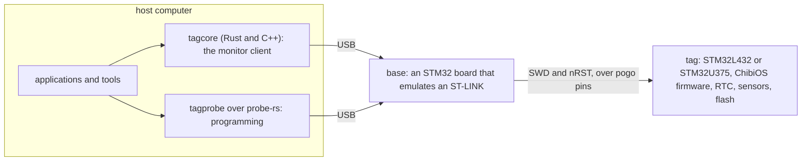
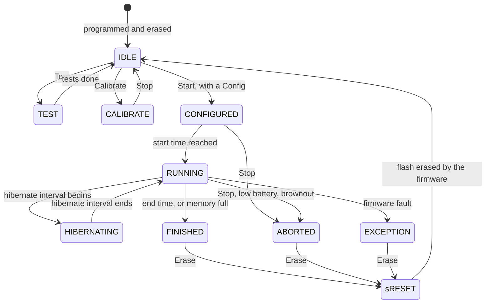

# 1. The system

The project builds **tags**: archival data loggers small enough to ride on a
songbird. A tag has a battery, a microcontroller, a real-time clock, one or
more sensors, flash memory, and no radio. It records to its own memory for
hours to months and gives the data back only when the animal, and the tag,
return. The **host software** in this tree is everything that runs on a
desktop computer to prepare a tag before it goes out and to recover its data
when it comes back.

## The parts

**Tags** are built around an STM32 microcontroller: the STM32L432 on the
older families and the STM32U375 on the IMUTag. The firmware runs on the
ChibiOS real-time operating system and is in `embedded/`. Tags come in
**families** that differ in what they sense and how fast:

| Family | Senses | Processor | Data goes to |
| --- | --- | --- | --- |
| BitTag (and BitTag LE, BitTagNG) | Activity from an accelerometer, one bit per second aggregated into minutes | STM32L432 | internal flash |
| PresTag | Barometric pressure and temperature at a configured period | STM32L432 | external SPI NOR flash |
| BitPresTag, UIUCTag | Activity and pressure | STM32L432 | external flash |
| CompassTag | Magnetometer and accelerometer, for orientation | STM32L432 | external flash |
| IMUTag | Accelerometer, gyroscope, magnetometer and pressure at 100 to 1600 Hz | STM32U375 | external SPI NAND flash |

**Bases** are small USB boards with spring pins that touch a tag's test
points. A base's firmware (`embedded/bases`) makes it look to the host like
an **ST-LINK**, the debug probe ST Microelectronics sells, so off-the-shelf
tools can program a tag through it; and it drives the tag's **SWD** (Serial
Wire Debug) lines and its reset line. The host talks to a tag only through a
base. A base has no idea what a tag is: it moves words between USB and SWD.

**The host** is this directory. It has libraries that know how to talk to a
tag through a base, command-line tools that script the common operations,
and graphical applications for the people who deploy tags, calibrate them and
look at their data.

## A tag's life cycle

Every tag runs the same state machine, and every host operation is a request
to move it along. The states are the `TagState` enumeration in
`proto/tag.proto`, and the host sees them in every status reply:

The transitions labelled Test, Calibrate, Start, Stop and Erase are commands
from the host (a `Req` of chapter 4); the others happen on the tag by
itself. The host sees the current state in every `Status` reply.

- **IDLE** is the empty state: no configuration, no log. A tag is shipped
  and stored IDLE. From IDLE the host can set the clock, run the **self
  tests** (the tag goes through TEST and back), write calibration constants,
  enter **CALIBRATE** to stream raw sensor samples, or **start** it.
- **Start** carries a `Config` message: a schedule (when to start, when to
  stop, when to hibernate) and the sensor settings the family understands.
  The tag stores the configuration in its internal flash and becomes
  **CONFIGURED**, then **RUNNING** when the start time arrives.
- **RUNNING** and **HIBERNATING** are the deployment. The tag writes its log
  and sleeps between samples in the lowest power state it can. Nothing on the
  host is involved.
- A run ends in **FINISHED** (the schedule ran out or the memory filled),
  **ABORTED** (a `Stop` from the host, a low battery, a brownout) or
  **EXCEPTION** (a firmware fault). The log is intact in all three.
- **Download** reads the log back while the tag is in one of those three
  states. Downloading changes nothing on the tag, so it can be repeated.
- **Erase** returns the tag to IDLE through **sRESET**, during which the tag's
  own firmware erases its flash. Only the firmware that wrote a log may erase
  it, because only it knows the log's layout.

The tag records every transition it makes in a **state log** (marker log) in
internal flash, with the time, the reason, the voltage and the temperature.
The host downloads that too and stores it with the data.

## What the host software does

Each job below is one or two programs, described in chapters 9 and 11.

| Job | Programs | When |
| --- | --- | --- |
| **Program** a tag's firmware into its internal flash, and a base's into its own | Tag Programmer (`tagprogram`, `qtprogram`), `tag-flash`, `base-flash` | Manufacturing, firmware upgrades |
| **Commission** a tag: run its self tests, set its clock, record it | Tag Programmer, `tag-test`, `tag-info` | After programming, before deployment |
| **Calibrate** a tag's magnetometer and accelerometer and store the constants on it | Tag Calibrator (`tagcalibrate`, `qtcalibrate`), `tag-cal`, `tag-cal-write` | CompassTag and IMUTag, before deployment |
| **Configure and start** a tag with a schedule and sensor settings | Tag Monitor (`tagmonitor`, `qtmonitor`), `tag-start` | Deployment |
| **Monitor** an attached tag: state, clock error, voltage, test results | Tag Monitor, `tag-info` | Any time a tag is on a base |
| **Stop, download and erase** a returned tag | Tag Monitor, `tag-stop`, `tag-dwnld`, `tag-reset` | Recovery |
| **View and process** the downloaded data | Tag View (`tagview`), SensorViz (`sensorviz`), `dataprocessing` | Analysis |
| **Recover** a tag that cannot run its firmware: capture its memory, read its external flash through a loader, rebuild the download offline | `tag-capture`, `tag-xflash`, `tag-rebuild` (C++ only) | Failure analysis |

Two facts shape all of them:

1. **The host can only reach a tag through its debug port, and connecting
   resets the tag.** There is no live view of a running tag. The host
   attaches (which reboots the firmware with the debugger visible), asks
   questions, and detaches. This is why a deployment is "start it and walk
   away", and why the bench rules in `AGENTS.md` forbid attaching to a
   running tag to see what it is doing. Chapter 3 explains the mechanism.
2. **The host and the firmware agree on a small set of definitions and
   nothing else.** Protobuf messages for every request and reply, a C header
   for the debug-port handshake, and packed C structs for the raw log
   records, all compiled by both sides from the same files. Chapter 4 lists
   them.

## Two implementations

The host code was written in C++ with Qt applications between 2018 and
October 2026. In the last ten days of October 2026 much of it was ported to
Rust: the tag interface, the command-line tools that need only it, and all
four applications, which became Tauri applications (a Rust program showing a
web page in a native window). Both lines ship today; the Qt applications are
to be retired once their ports have been used in the field.

The port was not a rewrite from scratch, and that matters for reading the
code. Three rules were followed, and each Rust file says which C++ file it
follows in its first lines:

- **Behaviour was ported, not invented.** Each Rust tool and application
  reproduces its C++ counterpart's options, texts, checks and output, and is
  held to it by shared test oracles (chapter 13). Where the Rust deliberately
  differs, the difference is listed in that component's documentation.
- **Logic that must not exist twice stayed in C++.** The SQLite log writer
  (the one definition of the download file format), the magnetometer
  calibration (months of measured arithmetic), and sensorViz's display core
  were kept in C++, made Qt-free, and reached from Rust through one C
  interface, `tagcore_c` (chapter 8). A Rust program may depend on C++; a
  C++-free stack is not a goal.
- **The user interface is a page, and the rules are not in it.** Each Rust
  application is an engine that owns every rule and all state and publishes
  a complete "view state" after every change, plus a web page that draws it
  and sends commands back (chapter 10).

The one piece the Rust side does differently in kind is **programming**:
the C++ Tag Programmer runs ST's `STM32_Programmer_CLI`; the Rust one
programs through the `probe-rs` library and needs no external programmer
(chapter 7).

## Vocabulary

| Term | Meaning here |
| --- | --- |
| **Tag** | The logger. Also, in code, the `Tag` type that represents one from the host. |
| **Base** | The USB board a tag sits on; an ST-LINK to the host, an SWD master to the tag. "Programmer base" and "breakout base" are variants. |
| **Attach / detach** | Opening and closing a monitor session with a tag's firmware. Attaching resets the tag. |
| **Monitor** | The firmware's debug-port command handler, and the protocol the host speaks to it. Not to be confused with Tag Monitor, the application. |
| **RPC, request, acknowledgement** | One exchange with the monitor: a `Req` protobuf message in, an `Ack` out. |
| **Family / target / board** | A family is a kind of tag (IMUTag); a target is a firmware build (IMUTagNandBmp581); a board is a hardware revision (IMUTagNandv2). One `TagType` can cover several targets. |
| **Tag type** | The `TagType` enumeration value a tag reports (`BITTAG`, `PRESTAG`, `IMUTAG`, ...). |
| **Config, status, info** | The three messages a host reads most: the configuration (`Config`), the current state and readings (`Status`), the fixed identity (`TagInfo`). |
| **Default configuration** | The `default-config.json` compiled into each firmware, which says which `Config` fields that tag has. |
| **Log, page, record** | The data the tag stores. It is read back in **pages** (one RPC each); a page holds **records**. What a record is depends on the family. |
| **Download** | Reading the whole log into a SQLite file (`.db3`). |
| **Capture** | A copy of a tag's memory taken over SWD without running its firmware; the raw material for an offline rebuild. |
| **Identity record** | A block in every firmware image, after the interrupt vectors, naming the target, board, commit and decoder. |
| **Engine, view state, prompt** | In a Rust application: the thread that owns the rules, the JSON it publishes, and a dialog expressed as data. |
| **Core** (two meanings) | A Rust application's engine crate (`core/`); and a C++ library's Qt-free part (`sensoranalysis/core`, `sensorviz/core`). |

## Where this came from

The project site's [software architecture](https://tag-designs.github.io/architecture/software/)
page describes the original design in 2020 terms (C++ only, and before the
STM32U375 transport) and is still right about the ideas. The current
one-page map of the whole system is
[`docs/architecture/overview.md`](../../../docs/architecture/overview.md), and
the tag families are described for users at
[tag-designs.github.io/tags](https://tag-designs.github.io/tags/).
