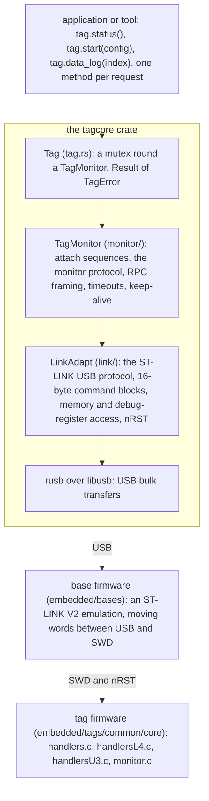
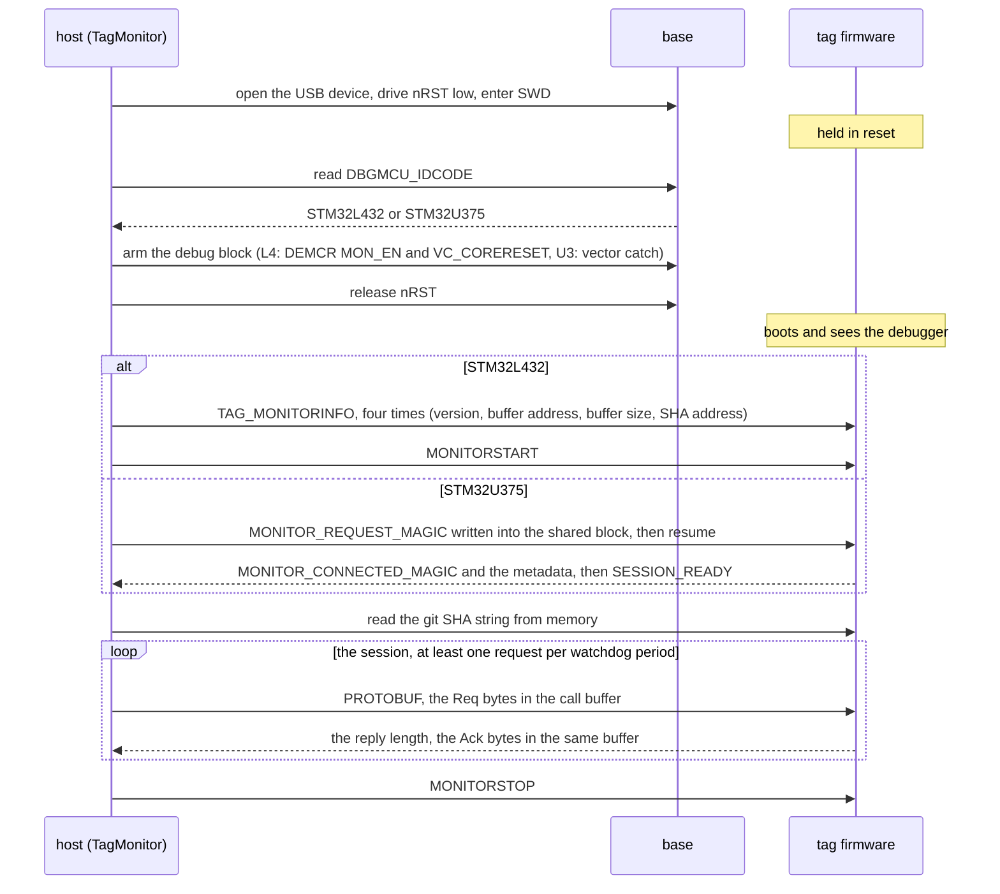

# 3. The communication model

This chapter explains how a host program talks to a tag. It assumes chapter
1 (what a tag, a base and the monitor are) and basic familiarity with
microcontroller debug ports. It describes the Rust implementation in
`libraries/tagcore-rs`; the C++ `libraries/tagcore` does the same thing on
the wire, by design. The protocol itself is specified in
[`docs/shared/monitor-interface.md`](../../../docs/shared/monitor-interface.md);
this chapter is the explanation that document assumes you have.

## The layers

Each layer owns the one below it by value. Nothing holds a second handle to
the USB device, so two exchanges can never interleave on the link.

### USB and the ST-LINK protocol

A base enumerates as an ST-LINK V2 (vendor `0483`, product `3748`). The
host speaks the ST-LINK protocol to it, which the stlink open-source project
documented: every exchange is a 16-byte command block on the bulk OUT
endpoint, optionally followed by a data phase in either direction. The
commands the monitor needs are few: read and write target memory with 32-bit
accesses (which do not halt the core), read and write a debug register,
drive the nRST line, read the target voltage, enter and leave SWD mode. The
base also answers one command of its own, `F6 99`, with an identity string
(board, firmware commit); older bases do not, and that silence is itself
information (chapter 7).

In code: `link/stlink.rs` holds the command codes and the transfer helpers,
`link/target.rs` the target-facing commands, `link/discovery.rs` finding and
opening a base. Every transfer blocks the caller with a 1.5 s timeout. The
layer retries nothing; that is the monitor's business.

### SWD

Serial Wire Debug is the two-wire debug port of every Arm Cortex-M part. It
gives a debugger access to the whole memory map and to the core's debug
registers while the core runs. The host uses only that memory access and a
handful of debug registers; it never single-steps or sets breakpoints, and it
halts the core only on an attach, and briefly in a diagnostic report after a
timeout. The base does the bit-level SWD work; to the host, SWD is just "read
or write a word at an address".

### The monitor

The **monitor** is a command handler compiled into every tag's firmware
(`embedded/tags/common/core/src/monitor.c` and the two `handlers*.c`). It
lets a host that is attached through SWD ask the firmware to do things:
answer a protobuf request, start or stop a session. The firmware does the
work; the host only pokes memory and registers. This is the key design
choice of the system: the tag's own code interprets every request, so the
host needs to know nothing about a family's internals, and a new family needs
no host change beyond the shared definitions in chapter 4.

## Attaching resets the tag

A sleeping tag does not answer SWD. The STM32's low-power stop modes gate
the clocks the debug port needs, and the tags sleep whenever they can. The
only moment a tag is certainly awake and listening is at reset. So every
attach holds the tag in reset (nRST low), enters SWD, arms the debug block,
and then **releases reset**, letting the firmware boot while the debugger is
visible to it. The firmware notices the debugger at boot and keeps a session
open instead of going back to sleep.

The consequence is absolute: **attaching ends whatever the tag was doing**.
A running deployment becomes an aborted one; a tag that was counting
something stops counting. There is no API anywhere in this tree that
observes a running tag, and the root `AGENTS.md` spends several paragraphs on
the mistakes this has caused. When a program needs to know what a tag did, it
waits for the run to end and reads the log.

The firmware distinguishes this reset from others. On the STM32U375 it treats
a reset with a debugger present as a **reattach** and resumes the interrupted
run as a continuation rather than failing it (`restart-recovery.md` in the
firmware's design docs); on the STM32L432 the vector-catch hint plays the
same role. The host does not need to know this, but a reader of a state log
does: a `Running(T_CONT, POWERFAIL)` marker after an attach is the firmware
recording that the host interrupted it.

## Two transports, one protocol

The host identifies the processor at attach from its `DBGMCU_IDCODE`
register and picks one of two ways to deliver a command. Above this split
everything is the same: a request is a protobuf `Req`, a reply a protobuf
`Ack`, and the session has a start, calls, and a stop.

| | STM32L432 (BitTag, PresTag, CompassTag, UIUCTag families) | STM32U375 (IMUTag) |
| --- | --- | --- |
| Mechanism | The **DebugMonitor exception**: the host writes a command word into `DCRDR` and sets request bits in `DEMCR`; the firmware's `DebugMon_Handler` runs and clears the request bit when its result is back in `DCRDR` | A **shared block** of 64 bytes at the bottom of SRAM (`0x20000000`, laid out by `include/monitor.h`): the host writes command and arguments there and pends a reserved interrupt through the NVIC; the firmware's handler fills in `result` and `status` |
| Attach handshake | Set `DEMCR.MON_EN` and `VC_CORERESET`, release reset, query metadata with `TAG_MONITORINFO` (version, buffer address and size, SHA address), then `MONITORSTART` | Release reset with vector catch so the core halts at its reset vector, write `MONITOR_REQUEST_MAGIC` into the block, resume; the firmware answers `MONITOR_CONNECTED_MAGIC` and the metadata, then `SESSION_READY` once ChibiOS is running |
| "Host is here" | `DEMCR.VC_CORERESET` (an attach hint the firmware reads) | The `request` word of the block |
| Session end | `MONITORSTOP`; the firmware may sleep immediately after, so the host does not wait for a reply | `MONITORSTOP`; the firmware clears `request` to 0, which the host treats as the acknowledgement |
| Watchdog | 60 s without a request ends the session (5 s on UIUCTag firmware up to fw-v0.6) | A 5 s heartbeat: any call sets `host_activity`; two quiet periods end the session |
| Code | `monitor/l4.rs`, firmware `handlersL4.c` | `monitor/u3.rs`, `monitor/abi.rs`, firmware `handlersU3.c` |

The attach and a session, on both transports:

The U375 path exists because the DebugMonitor exception cannot wake a core
from its deepest stop modes and because `DCRDR` is a single word shared by
request and reply. The shared block needs no exception and keeps the
session's whole state visible to both sides; [decision 0006](../../../docs/decisions/0006-monitor-u3-attachment-is-the-shared-session.md)
records the fault that taught the U3 firmware to trust only the block.

The protobuf work is never done in the interrupt. Both handlers latch the
request and signal the firmware's main thread, which runs `proto_eval()`,
and the response is published when it finishes. A request therefore takes as
long as the main thread takes to get to it: milliseconds normally, a second
or more while the tag is setting its clock or running a self test.

## A protobuf RPC

`monitor/rpc.rs` frames one request, the same way over both transports:

1. Serialise the `Req` with prost into the host's staging buffer. It must fit
   the firmware's **call buffer**, whose address and size the attach
   metadata gave (a few hundred bytes to a few kilobytes, by family).
2. On an L432, wait up to 2.5 s for `MON_REQ` and `MON_PEND` to clear: an
   earlier call that failed part way may have left a request the firmware
   has not yet read, and overwriting the buffer under it would corrupt that
   request.
3. Write the bytes into the call buffer with 32-bit memory writes, rounded
   up to whole words.
4. Issue the `PROTOBUF` command with the request length as its operand, and
   poll for completion. The result word is the reply's length.
5. Read that many bytes back from the same buffer (the reply overwrites the
   request) and decode an `Ack`.

There is no length prefix, no checksum and no sequence number on the wire.
The lengths travel in the command operand and result word, and the SWD and
USB layers are assumed reliable. A reply that does not decode, or claims a
length larger than the buffer, fails the call.

The `Tag` layer then turns the `Ack` into a typed result: `Tag::status()`
returns `Result<Status, TagError>`, where the error separates **a transport
failure** (the request may never have reached the firmware) from **a
refusal** (the firmware answered with an `Ack.Err` code such as `PERM`, and
perhaps a message). Callers that retry should retry only the first kind.

## Permissions, timing and keeping a session alive

**What may be asked when.** The firmware gates every request on its state
before evaluating it (`monitor_request_allowed()` in `monitor.c`): info,
status and config always; start, self test, set-clock and write-calibration
only in IDLE; erase only in FINISHED or ABORTED; a data-log page only once
collection has stopped; calibration streaming only in CALIBRATE. A request
in the wrong state gets `PERM` with the message "Monitor request not
permitted in current tag state". Chapter 4 has the full table.

**Acknowledgement is not completion.** `Stop`, `Erase`, `Start`, a self test
and `SetRtc` return OK when the request is accepted; the state machine acts
on it later. Every tool therefore polls `Status` until the state it asked
for appears, with a timeout, and the applications judge a start by the state
the tag reaches rather than by the start call's return.

**Timeouts are counted in polls, not seconds.** A poll is one SWD read plus
a 1 ms sleep, each a USB round trip, so the nominal figures are lower
bounds: 500 ms for a result read, 2.5 s for an ordinary monitor call, and
on an L432 65,000 polls for a protobuf call, about 120 s of wall time if the
firmware never answers. On a U375 every call gives up after 2.5 s. During a
timed-out call the `Tag`'s mutex is held and every other thread using that
`Tag` waits, which is why the applications keep the tag on its own thread
(chapter 10). After a timeout the monitor halts the core briefly to log a
diagnostic report (registers, reset cause) and releases it.

**A host must keep talking.** The firmware's watchdogs end a session that
goes quiet, and an IDLE tag then enters its terminal sleep, after which no
SWD access succeeds until the next reset. The applications poll `Status`
every 400 ms partly for display and partly for this. On the U375 a quiet
host can call `Tag::keep_alive()` instead, a single memory write that runs
no code on the tag. The Rust applications also opt out of macOS App Nap,
which once stretched the poll past a UIUCTag's 5 s limit while the window was
in the background.

**Memory access between calls.** `Tag::read_memory` and `write_memory` read
and write live tag memory with no RPC, for the bench tools (`tag-peek`,
`tag-side-channel-check`). On the U375 a write into the shared block would
end the session, so the monitor refuses it unless forced.

## One base, one owner

A base is one USB device with one claimable interface, and there are two
kinds of host code that claim it: the monitor (`tagcore`) and the programmer
(`tagprobe`, chapter 7). They cannot share. A program that programs a tag
detaches its `Tag` first, lets probe-rs open and close the base, and attaches
again afterwards, and while a worker thread owns the base the application
refuses every other operation on it. Within one process the `Tag` type's
mutex serialises its own callers; across processes the operating system's
claim fails with a libusb "busy" error, which the tools report as the base
being in use by another program. A second program polling the same base
(two Tag Monitors, or Tag Monitor and the Joulescope software on a bench) is
the usual cause of mysterious attach failures.

## The other path: programming

Programming firmware does not use the monitor; there may be no firmware to
talk to. It uses the same base, the same SWD, and the Arm debug and flash
programming algorithms a generic debugger uses, through the probe-rs
library, with the core halted under reset. Reading a tag's state for failure
analysis (`tag-capture`, C++ only) also attaches under reset and halts the
core before the first instruction, precisely so that the firmware cannot
change the evidence. And a base's own firmware is programmed through yet
another path, its microcontroller's USB bootloader (DFU), with no SWD at all.
Chapter 7 covers the first and third; the C++ recovery library's own design
document covers the second.

## Where to read next

- The protocol, register by register:
  [`docs/shared/monitor-interface.md`](../../../docs/shared/monitor-interface.md).
- The crate: chapter 6, and
  [`libraries/tagcore-rs/design/architecture.md`](../../libraries/tagcore-rs/design/architecture.md).
- The firmware side: `embedded/tags/common/core/README.md`, and the
  [proposal for a more robust L4 monitor](../../../embedded/tags/common/core/design/proposals/l4-monitor-robustness.md)
  for what the L432 path lacks.
- The bench rules that follow from "attaching resets the tag":
  [`docs/bench/verifying-firmware.md`](../../../docs/bench/verifying-firmware.md).
