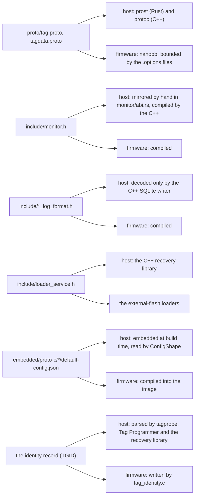

# 4. What host and firmware share

A tag deployed today may come back in a year to a host built from a much
newer tree, and a host must serve tags of every age in the field. So the
set of things the two sides agree on is kept small, each has one home in the
repository, and each has a rule for changing it. This chapter lists them.
It assumes chapters 1 and 3. [`docs/shared/README.md`](../../../docs/shared/README.md)
is the authoritative table; this chapter explains each entry.

## The protobuf schema

`proto/tag.proto` and `proto/tagdata.proto` define every message that
crosses the monitor. The host compiles them with protoc into C++ (the
`proto` CMake target) and, in Rust, with prost at build time
(`tagcore-rs/build.rs`), so the Rust types are never hand-written and
cannot drift. The firmware compiles them with **nanopb**, a C
implementation for microcontrollers, with `.options` files in
`embedded/proto-c/` that bound every repeated field and string so the
message fits in a fixed buffer, and that drop the messages a family does not
use.

### Req and Ack

Every exchange is one `Req` and one `Ack`. `Req.payload` is a `oneof`: the
request's kind is which member is set.

| Request | Payload | Firmware does | Permitted in |
| --- | --- | --- | --- |
| `get_info` | `Empty` | Answers `TagInfo` | any state |
| `get_status` | `Empty` | Answers `Status` | any state |
| `get_config` | `Empty` | Answers `Config`: the stored one, or the default in IDLE | any state |
| `erase` | `Empty` | Queues the erase; the state machine goes through sRESET to IDLE | FINISHED, ABORTED |
| `start` | `Config` | Validates and stores the configuration (`writeConfig()`), queues the start | IDLE |
| `stop` | `Empty` | Queues the stop | CONFIGURED, RUNNING, HIBERNATING, EXCEPTION, CALIBRATE |
| `test` | `TestReq` | Queues a self test (one device or `RUN_ALL`); the result arrives later in `Status.test_status` | IDLE |
| `set_rtc` | `int64` ms since the epoch | Sets the RTC at once | IDLE |
| `log` | `LogReq {fmt, index}` | `SYSTEM_LOG`: a block of state-log entries from `index`; `INTERNAL_DATA`: one data page from `index` | state log any time; data only once collection has stopped |
| `calibrate` | `Empty` | Enters CALIBRATE and starts streaming raw samples | IDLE (CompassTag, IMUTag) |
| `caldata` | `Empty` | Answers the samples gathered since the last request (`CalibrationLog`) | CALIBRATE |
| `write_calibration` | `CalibrationConstants` | Appends a record to the tag's calibration store | IDLE (tags with a store) |
| `read_calibration` | `int32` index, negative for the last written | Answers one stored record | any state |

A request outside its permitted states gets `Ack.err = PERM` with the message
"Monitor request not permitted in current tag state"; the gate is
`monitor_request_allowed()` in `embedded/tags/common/core/src/monitor.c`.

`Ack` carries an `Err` code and a `oneof` payload. The codes split into host
errors (`UNSPECIFIED`, `EMPTY_RETURN`, `MONITOR`: the host-side layers
record these when nothing valid came back) and tag errors (`NODATA`,
`INVAL`, `PERM`, `NXIO`, `NANOPB`). A refusal often carries `error_message`
instead of a payload. The payloads are the answers to the table above plus
one **data-log message per family**: `BitTagLog`, `PresTagLog`,
`PresTagRawLog`, `BitPresTagLog`, `CompassTagLog`, `BitTagNgLog`,
`UIUCTagLog`, `IMUTagLog`, `IMUTagRawLog`. Which one a tag sends is how the
host's writer knows how to decode a page (chapter 5).

### The messages a host reads most

**`TagInfo`** is the tag's fixed identity: `tag_type`, `board_desc`, the
processor `uuid`, internal and external flash sizes, and the firmware's
`firmware` string, `gitrepo`, `githash`, `source_path` and `build_time`;
`qtmonitor_min_version`, the sensor scale constants, and `ppm_clock_error`
(the RTC's factory trim, which the IMUTag writer uses to correct sample
times). The firmware fills it from its identity record, so live and offline
readers see the same values. `intflashsz` is in kilobytes, read from the
part's flash-size register, which is how Tag Programmer tells an STM32L432KB
(128 KB) from a KC (256 KB).

**`Status`** is what a poll returns: `millis` (the tag's clock, ms since the
epoch; the host compares it with its own to show the clock error), `state`,
`test_status` (`TEST_RUNNING`, `ALL_PASSED`, or which device failed),
`internal_data_count` and `external_data_count` (records or pages written;
the units differ by family, which is one reason the download loop does not
trust them), `voltage`, `temperature`, the erase progress
(`sectors_erased`, `erase_sectors_total_plus_one`; zero means unknown), and
`debug_message`, a drain of the firmware's debug text buffer.

**`State`** is one state-log entry: the `Status` at the transition, the
`Event` that caused it (start command, end time, low battery, external
storage full, storage error, configuration verify error, ...) and, on the
U375, a `transition_detail` word whose meaning depends on the event.

**`Config`** is described below.

**`CalibrationConstants`** is a timestamp, the magnetometer's hard-iron
offset vector and soft-iron 3x3 matrix (M' = A(M - V)), and the
accelerometer's zero-g offset. Field 1 is reserved: it was the field
magnitude, dropped so the tag's flash record stays 64 bytes.

### The rules for changing the schema

Protobuf's wire format is why a 2024 tag can talk to a 2026 host: unknown
fields are skipped, absent fields read as zero, and field numbers, not
names, identify fields. The rules in `proto/README.md` follow from that:

- Never reuse or renumber a field or enum value; mark removed ones
  `reserved` (as `CalibrationConstants.MagConstants` does).
- Add, do not change. A new family adds a `TagType` value, a data-log
  message and an `Ack` payload member; nothing existing moves.
- A change touches both sides and stored data. After editing a `.proto`, an
  `.options` file or a `default-config.json`, the generated nanopb sources
  committed under `embedded/proto-c/<variant>-proto-c/generated/` must be
  regenerated and committed, because distributed firmware builds
  reproducibly from them (`docs/build/firmware-reproducibility.md`).
- The nanopb bounds are a contract too: a `bytes` field's size in an
  `.options` file must match the C struct the firmware packs into it, which
  the firmware asserts at compile time.

## The configuration model

`Config` holds everything a start needs: the `tag_type`, an
`active_interval` (start and end epochs), up to two `hibernate` intervals, a
`period` (PresTag's sampling period), `start_delay` (IMUTag, in minutes plus
one), the BitTag `bittag_log` packing format, and sensor sub-messages
`adxl362` (accelerometer thresholds and settings, several of them reused
with family-specific meanings) and `lsm6` (IMU rate and ranges). No family
uses all of it.

The problem the configuration model solves is that **proto3 cannot say
whether a zero was set**. A field a tag supports whose value is 0 looks, on
the wire and after decoding, exactly like a field the tag does not have. So
the host cannot learn from a `Config` which fields matter to that tag. The
answer is the **default configuration**: each firmware variant's
`embedded/proto-c/<name>-proto-c/default-config.json` lists every field the
tag supports, zeros written out. The firmware build compiles it into the
image as the configuration an IDLE tag reports; the host embeds the same
files at build time (`tagcore-rs/build.rs`, and the C++ `defaultconfigs.cc`)
and reads them through **`ConfigShape`** into one set of dotted field paths
per tag type (`adxl362.freq`, `period`, ...). From that shape:

- Tag Monitor shows the panels that edit a type's fields and checks, in a
  test, that the panels and the shapes agree;
- opening a configuration file, and `tag-start --merge`, copy from the file
  only the fields the tag supports and the file speaks for, so a file saved
  for one family does not smuggle a stray field into another;
- a new family's fields appear on the host as soon as its default
  configuration exists, with no host code change.

The firmware is the authority on what it does with a field: a default
configuration that omits a field the firmware reads (UIUCTag's
`adxl362.accel_type`) means the host treats it as unsupported and passes it
through unchanged. The full model, the per-field meanings and the merge rule
are in [`docs/shared/design/configuration-model.md`](../../../docs/shared/design/configuration-model.md);
the deferred alternative, letting the tag report presence itself, is a
proposal beside it.

## The monitor ABI: `include/monitor.h`

The handshake of chapter 3 is a C header both sides compile: the monitor
opcodes (`TAG_MONITORINFO`, `MONITORSTART`, `MONITORSTOP`, `PROTOBUF`), the
`TAG_MONITORINFO` operands, the debug protocol version (`DEBUGVERSION`,
0x20), and for the STM32U375 the address, size, magic words, flags, kick
IRQ and the packed layout of the 64-byte shared block
(`monitor_shared_t`). The C++ host compiles the header directly; the Rust
host **mirrors it by hand** in `tagcore-rs/src/monitor/abi.rs`, with a unit
test that the struct's offsets match. A change to the header is therefore a
change to `abi.rs` in the same commit. The U375 attach checks
`MONITOR_SHARED_ABI_VERSION` and `DEBUGVERSION` and refuses a mismatch; the
L432 path has no such check, so a mismatch there shows up as calls that
fail or answer nonsense.

The header's comment states the design rule for what belongs in it: only
state the host must observe or modify. Firmware policy stays in the
firmware.

## Packed binary log formats: `include/*_log_format.h`

Three families (IMUTag, PresTagRaw, UIUCTag) send their data pages as the
raw bytes they wrote to flash, inside a protobuf `bytes` field
(`IMUTagRawLog.samples`, `PresTagRawLog.samples`, `UIUCTagLog.samples`),
rather than as decoded protobuf fields. It saves the tag the work and the
RAM of re-encoding, and it makes the download a faithful image of the flash.
The layouts are packed C structs in `include/`, with compile-time size
asserts, little-endian only, documented in
[`docs/shared/binary-datalogs.md`](../../../docs/shared/binary-datalogs.md)
and in each header's Doxygen ([decision 0001](../../../docs/decisions/0001-shared-binary-log-structs-in-include.md)).

Only the C++ SQLite writer decodes them (`libraries/tagcore/sqlitelog/`),
copying each record out of the payload rather than casting, and taking every
geometry constant from the header rather than repeating it. **No Rust code
interprets a log record**: the Rust download tool and Tag Monitor hand each
page's bytes to the C++ writer (chapter 8). That is deliberate: there is one
decoder per family, and it is compiled against the header the firmware
compiled.

## The tag identity record

Every image since fw-v0.0.3 carries a `const`, versioned block directly after
its interrupt vector table, at `0x080001A0` on the STM32L432 and
`0x08000240` on the STM32U375 ([decision 0021](../../../docs/decisions/0021-offline-rebuild-tag-identity-record.md)).
It starts with `"TGID"`, a format version and a size, then `id`/`length`/value
entries: the target, family, board, board description, firmware string, git
repository, hash, commit date and source path, the flash and RTC parts, the
loader and decoder names, and a numbers block whose first word is the
`TagType`. Unknown ids are skipped, so the record can grow.

Three readers use it: the firmware's own `infoAck()`, so that `TagInfo`
reports the record's values; the C++ recovery library, which reads it from a
captured tag to choose the loader and decoder for an offline rebuild; and
Tag Programmer and `tag-flash`, which read it from an **ELF file**
(`tagprogram-core/src/model/identity.rs`) to say which target and board an
image is for without trusting its file name, and to match an image to the
attached tag's `TagInfo`.

## The loader service block: `include/loader_service.h`

When a tag's external flash must be read without its firmware (a tag that
will not boot, or a log the firmware's own download path cannot reach), the
host loads a small **loader** program into the tag's SRAM over SWD and
drives it through a command block the header defines: the host fills a
command, increments `seq`; the loader runs it and copies `seq` to `ack`,
with status, detail and progress. `LOADER_SERVICE_VERSION` guards the
layout. The loaders are in `embedded/loaders`; the host side is the C++
recovery library (`libraries/tagcore/recovery`), behind `tag-xflash` and the
external stage of `tag-capture`. There is no Rust counterpart yet; the Rust
command-line README lists these tools as not ported for that reason.

## The base identity string

A base's firmware answers the ST-LINK-shaped command `F6 99` with a string
such as `base=bittag-base-v7;fw=a473918f;...`. It is not part of the
ST-LINK protocol; it was added in October 2026 so that a host can tell which
bases have the fixes that make them usable by probe-rs's own ST-LINK driver
(chapter 7), and so that Tag Monitor can name a base in its chooser. A base
that does not answer predates the command; the host treats the silence as
"old firmware" and uses the field-safe programming driver. The command and
the string's fields are documented in `embedded/bases/README.md`
("Identifying a Base").

## Downstream contracts the host defines alone

Two more definitions are contracts, though only the host compiles them,
because stored data depends on them:

- **The SQLite download schema** (chapter 5), owned by the C++ writer and
  documented for users in `host/docs/src/reference/sqlite-logs.md`. Every
  viewer and analysis script reads it.
- **The capture manifest and layout** written by `tag-capture`, which
  `tag-rebuild` reads back ([`docs/bench/capturing-a-tag.md`](../../../docs/bench/capturing-a-tag.md)).

And one the firmware asserts for the host's sake: the offsets of the
firmware structs the offline rebuild decodes are `_Static_assert`ed in the
firmware with messages naming `capturesource.cc`, so a firmware change that
would break the rebuild fails to compile.

## Where to read next

- [`docs/shared/README.md`](../../../docs/shared/README.md) and the
  documents it links, for the authoritative text of each contract.
- `proto/README.md` for how each side compiles the schema and how to change
  it; `embedded/design/source-layout.md` for the nanopb variants.
- Chapter 5 for how the contracts above become a SQLite file.
