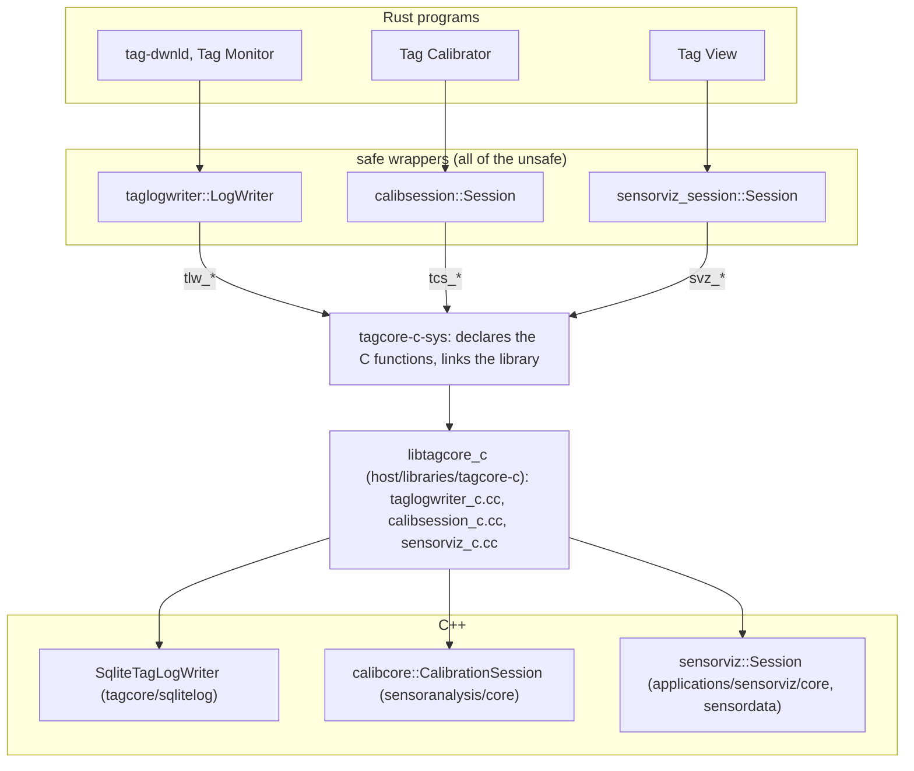

# 8. The bridge to the C++ libraries

Three pieces of logic were deliberately not ported to Rust: the SQLite log
writer, the magnetometer and accelerometer calibration, and sensorViz's
display core. Each is the single definition of something (a file format, a
measured algorithm, a display policy) that the Qt applications still use,
and a second copy would have to be kept bit-for-bit in step forever. Instead
the C++ was made Qt-free where it was not already, given one C interface,
and the Rust programs call it. This chapter explains that bridge. It assumes
chapter 5 (what the writer and the readers do) and chapter 2 (where the
crates are).



## Why a C interface, and why these three

Rust and C++ have no common calling convention beyond C's. A C interface
(`extern "C"` functions, plain data) is the one thing both compile without
help. The project's rule, from the
[proposal](../../libraries/tagcore/design/proposals/rust-over-cpp-libraries.md)
that measured the options, is that a Rust host application may depend on the
C++ libraries, and that porting them is not pursued. The three interfaces
exist because the three applications needed them, in order: the writer for
`tag-dwnld` and Tag Monitor, the calibration for Tag Calibrator, sensorViz's
core for Tag View. The tag interface itself was ported rather than wrapped,
because it is small, its wire behaviour is specified, and a wrapper would
have brought libusb's threading into Rust through C++.

## The C interface: `tagcore_c`

`libraries/tagcore-c` is one C++ library exporting only C functions, in
three headers whose Doxygen is the authority on each call:

| Header | Prefix | Wraps | Crosses the boundary as |
| --- | --- | --- | --- |
| `taglogwriter_c.h` | `tlw_*` | `SqliteTagLogWriter` | **Protobuf wire bytes.** The Rust side encodes `Config`, `TagInfo`, `CalibrationConstants`, `State` and each page's `Ack` with prost; the C side parses them with the C++ protobuf library. Both compile `proto/`, so the encoding is the whole contract and no value is converted |
| `calibsession_c.h` | `tcs_*` | `calibcore::CalibrationSession`, `displayAngles()`, the model rotation | **Plain numbers.** Samples go in as `float[3]` arrays; results come out as `#[repr(C)]` structs the header defines |
| `sensorviz_c.h` | `svz_*` | `sensorviz::Session`, `PreferenceStore` | **JSON text out, arrays in.** Descriptions (catalog, view, plot spec, parameters, hover rows) come out as JSON the C side writes; envelopes and compass samples are copied into caller arrays; setters take plain C arrays and return change bits |

The rules every entry point keeps:

- **Status codes, never exceptions.** Calls return 1 or 0, or a count, and a
  `*_last_error()` says why. Every entry point catches every C++ exception
  (`guarded()` in the shims) and turns it into a failure; a C++ exception
  crossing into Rust would abort the process.
- **A version check first.** Each header has an ABI version
  (`TLW_ABI_VERSION`, `TCS_ABI_VERSION`, `SVZ_ABI_VERSION`), raised whenever a
  signature, meaning, struct layout or JSON schema changes. The Rust wrapper
  refuses a library built from a different version, so a stale library fails
  with a message rather than misbehaving.
- **Caller memory is borrowed for the call only.** The library copies what it
  keeps; its own strings live until the next call on that handle.
- **One handle, one thread at a time.** Handles are independent of each other.
- **Only the C functions are visible.** The library links libprotobuf,
  abseil, SQLite, `tagcore`, `sensoranalysis_core`, `sensorviz_core` and
  `sensordata` inside it with every other symbol hidden (export lists on
  macOS and Linux, `dllexport` on Windows, a pre-link with `c++ -r` for the
  static archive), so a Rust program's own copies of SQLite or protobuf, if
  it had any, could not collide with them.

The writer's interface shows the shape: `tlw_open(path, config, len,
replace)` makes a handle for the config's tag type (refusing a type without
a schema), `tlw_header_add()` gathers the header's parts one message at a
time (the header has no protobuf message of its own), `tlw_write_header()`,
`tlw_begin_log()`, one `tlw_write_log(ack, len)` per page returning the
records consumed (0 at the end, negative on error), `tlw_end_log()`,
`tlw_close()`. That is chapter 5's download loop, as C calls.

## The Rust side

### `tagcore-c-sys`: one crate links the library

Cargo allows only one crate in a build to declare `links = "tagcore_c"`, so
`libraries/tagcore-c-sys` is that crate, and the three wrappers depend on
it. It holds one module of hand-written `extern "C"` declarations per header
(`tlw.rs`, `tcs.rs`, `svz.rs`; with a few dozen functions, `bindgen` would
cost more than it saves) and the build script that links the library:

- `TAGCORE_C_LIB_DIR` names the directory holding it, `<build>/<Config>/lib`
  in a CMake tree. Without it the build script stops with a message saying
  how to build the library.
- `TAGCORE_C_LINK` is `static` or `dylib`; the default follows the
  platform's packaging (below).
- For the shared library it passes the directory on to direct dependents as
  `DEP_TAGCORE_C_LIB_DIR`, because only the final binary's own build script
  may set that binary's run-time search path (rpath). This is why
  `commandline-rs` names `tagcore-c-sys` as a dependency it does not call.

### The wrappers: all the `unsafe`, with its argument

`taglogwriter::LogWriter`, `calibsession::Session` and
`sensorviz_session::Session` (and its `Preferences`) are ordinary Rust types
over a C handle. Each crate's `lib.rs` has a "Safety model" section stating
the rules its `unsafe` blocks rest on, and every block says which rule
applies:

- **Ownership.** A wrapper owns exactly one handle, never null (creation
  checks the version and the open), freed exactly once in `Drop`. Nothing
  else holds the pointer.
- **Borrowed buffers.** Every pointer passed in points at Rust memory that
  lives until the call returns, sized as the header requires; the library
  keeps no pointer after the call.
- **Returned strings** belong to the handle and are valid until its next
  call, so they are copied out at once, inside the wrapper.
- **`Send`, not `Sync`.** A handle may move between threads but not be shared
  between them; every method that advances it takes `&mut self`, which is
  the C side's one-thread rule expressed in the type system.

`sensorviz-session` adds typed structs for the JSON (`Catalog`, `View`,
`PlotSpec`, `ParameterSpec`, `Changes`), parsed with serde; a field added to
the JSON on the C++ side is ignored until a Rust type names it.

## Building and linking it

CMake builds the library with `-DBUILD_TAGCORE_C=ON`, and always with
`BUILD_RUST_APPS`. There are two targets, and **the link follows each
platform's packaging** (the owner's decision, 2026-10-27):

| Platform | Target | Why |
| --- | --- | --- |
| macOS | `tagcore_c_static` → `libtagcore_c.a`, linked into each executable | Each application is its own `.app` bundle and would carry its own copy of a shared library anyway; a static executable needs no rpath, no extra signed library, nothing at run time. The caller also links `c++`, `objc`, CoreFoundation, IOKit and Security (libusb's frameworks, which come in because `tagcore` is linked whole) |
| Linux | `tagcore_c` → `libtagcore_c.so`, installed once in `tag_tools/lib` | The tools share one install directory; one copy serves all. Executables carry an rpath of `$ORIGIN/../lib` (`TAGCORE_C_RPATH`, set by the CMake targets) |
| Windows | `tagcore_c` → `tagcore_c.dll`, installed once in `tag_tools/lib` beside the programs | Windows finds a program's DLLs only beside it, which is why the Rust programs live in `tag_tools/lib` there and the GUI launcher in `tag_tools` starts them |

The static archive is made by pre-linking the shim and all 87 vcpkg
archives into one object with `c++ -r` and the export list, so everything
but the C functions becomes local; `static/CMakeLists.txt` sets that rule in
its own directory because CMake rule variables are per directory. One known
wrinkle: Apple's linker no longer has `-d`, so five libusb "common" symbols
stay global in the archive; a Rust program that also links libusb (every
program on `tagcore`) shares those variables with a copy that never runs.

For a developer, the sequence is:

```sh
cmake -DBUILD_TAGCORE_C=ON <build-dir>
cmake --build <build-dir> --target tagcore_c_static tagcore_c
export TAGCORE_C_LIB_DIR=<build-dir>/Release/lib
cd host && cargo test -p taglogwriter -p calibsession -p sensorviz-session
```

The portal's rustdoc build gets away without the library by pointing
`TAGCORE_C_LIB_DIR` at an empty directory with `TAGCORE_C_LINK=dylib`:
`cargo doc` and `cargo check` never link, and the build script only emits
link directives.

## How it was shown correct

Each interface was checked against the C++ it wraps, not against a
specification:

- **Writer.** `taglogwriter`'s `log-import` example repeats `tag-log-import`
  through the interface; on the same input the databases are byte-identical.
  On hardware, a one-minute IMUTag run downloaded with the C++ `tag-dwnld`
  and the Rust one, linked both ways, gave three identical files.
- **Calibration.** `calibsession`'s replay test runs qtcalibrate's reference
  capture through a `Session` and requires every figure qtcalibrate logged,
  to the precision it logs them; the move of the arithmetic into the C++
  core was itself shown bit-identical with a hex-float dump of 4,913 results
  ([decision 0039](../../../docs/decisions/0039-host-tagcalibrate-rs.md)).
- **sensorViz.** `sensorviz-session`'s tests drive a session through the
  setters and compare the catalog, view and spec with the core's own
  state-dump script; the core's move out of Qt was checked the same way
  against the Qt application.

## Keeping it in step

| When this changes | Do this |
| --- | --- |
| A `tlw_*`/`tcs_*`/`svz_*` signature, meaning, struct or JSON schema | Raise the header's ABI version and the crate's constant; change the `-sys` declaration and the safe method |
| A new function in an existing interface | Mark it exported (`TLW_API` and its siblings); declare it in the `-sys` module; wrap it. The export lists match the prefixes, so visibility needs nothing more |
| A new interface | A new header and shim in `tagcore-c`, a new module in `tagcore-c-sys`, a new wrapper crate added to the workspace |
| `proto/` | Nothing in these interfaces; rebuild both sides so prost and protoc see the same definitions |
| The C++ underneath (the writer, the session, the core) | Rebuild the library; a static build relinks into each Rust program, a shared one is replaced in place |

Hazards: never let an exception reach the boundary (use the shims'
`guarded()`); never keep a caller's pointer beyond the call; never open one
SQLite file from two SQLite copies in one process (the library's private
SQLite and, say, `rusqlite` would not see each other's locks).

## Where to read next

- [`libraries/tagcore-c/README.md`](../../libraries/tagcore-c/README.md) and
  [its design](../../libraries/tagcore-c/design/architecture.md): the full
  contract tables, the build rules and the per-platform table in detail.
- The three wrapper READMEs:
  [taglogwriter](../../libraries/taglogwriter-rs/README.md),
  [calibsession](../../libraries/calibsession-rs/README.md),
  [sensorviz-session](../../libraries/sensorviz-session-rs/README.md), each
  with its API table and its checks.
- The proposal that chose this path:
  [`rust-over-cpp-libraries.md`](../../libraries/tagcore/design/proposals/rust-over-cpp-libraries.md).
- Chapter 14 for what `unsafe`, `repr(C)`, `Send` and `Drop` mean if you
  have not met them.
