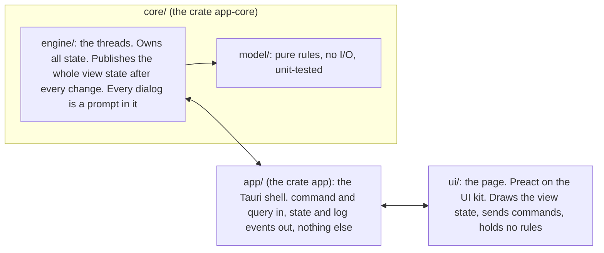
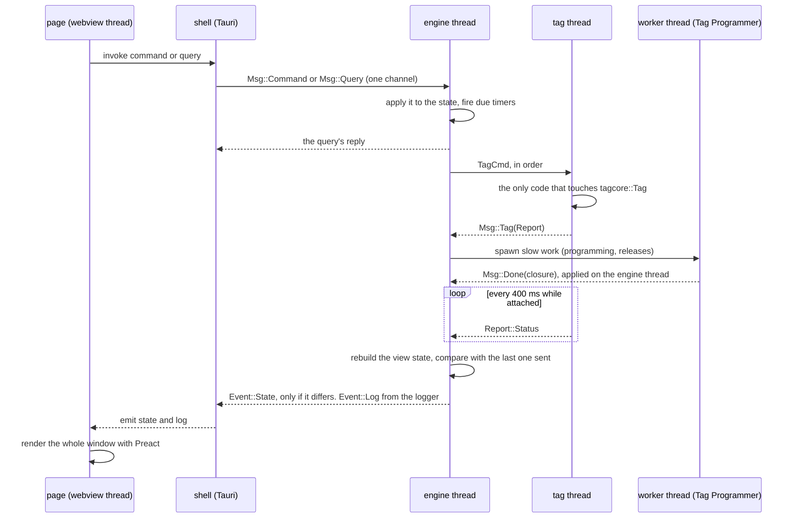

# 10. The application pattern

The four Rust applications were built one after another on one pattern,
and once you have read one you have read the shape of all four. This
chapter describes the pattern; chapter 11 describes each application. It
assumes chapters 3 and 6, and no knowledge of Tauri or web front ends.

## The idea

A Qt application's natural unit is a slot on the GUI thread that calls the
tag, updates widgets and decides what is enabled. That shape mixed the
rules, the state, the tag I/O and the drawing in one class, and it does not
translate to a program whose user interface is a web page that can only
send messages. The Rust applications therefore split three ways, and the
split was first made in the Qt applications themselves so that the port
would be a translation ([decision 0036](../../../docs/decisions/0036-host-qtmonitor-engine-model-view.md)):

- **The engine owns every rule and all state.** Which commands are enabled,
  what a status means, what a dialog asks and what happens after it is
  answered, every text the window shows: all of it is computed in `core/`,
  on one thread, and is testable without a window or a tag.
- **The page draws and never decides.** It receives a complete description
  of the window (the **view state**, JSON) after every change and renders
  all of it. It turns clicks into named **commands** and asks **queries**
  for data it needs. It keeps only what is its own: which tab is open, the
  log text, a scroll position.
- **The shell forwards.** One shared crate, `tagapp-shell`, exposes two
  Tauri commands (`command`, `query`) and emits two events (`state`, `log`)
  for every application. An application's `app/src/main.rs` is about fifty
  lines: it describes the application to the shell and starts its engine.
  The few differences are flags, listed under the Tauri shell below.

The contract between engine and page is written down per application in
`design/ui-engine-contract.md`: the view state's shape, the commands with
their arguments, the queries, the prompts, and every deliberate difference
from the Qt application it ports. That document is the place to look before
changing either side.

## Threads

- **One owner per thing, no locks.** Everything that reaches the engine
  thread arrives as a message on one channel (`std::sync::mpsc`), so every
  state change happens there. The tag thread is the only code that touches
  the `Tag`; the engine never calls it and never waits for it, so the window
  stays live during a download and a silent tag shows as "no answer" rather
  than a hung window. Tag Programmer, the first port, runs monitor calls on
  its engine thread (they are short when the firmware answers) and keeps
  slow work on worker threads; the later three moved the tag to its own
  thread, and Tag View has no tag at all.
- **Timers are deadlines, not threads.** The engine keeps `Option<Instant>`
  deadlines (the status poll, a session tick, an attach retry) and the loop
  waits on its channel until the earliest one; cancelling a timer is setting
  it to `None`.
- **The whole state, only when changed.** After each message or timer the
  loop rebuilds the view state (`view.rs`) and compares it with the last one
  sent. An idle application emits nothing; a change emits one complete,
  consistent state, never a partial update.
- **Queries block the caller, not the engine.** `Engine::query` sends a
  reply channel and waits up to 10 s (30 s in Tag View, where a large log
  can take that long to open ahead of a query); the shell runs it in
  `spawn_blocking` so Tauri's main (event-loop) thread never waits on the
  engine.
- **The log is a logger.** A `log::Log` implementation (`UiLogger`) forwards
  every record at or above the pane's level to the page as a `log` event, so
  `tagcore`'s and `tagprobe`'s messages reach the pane without any plumbing
  of their own.

The handle, the loop and the logger are the same code in every
application, and Tag Calibrator and Tag View get them from the shared
engine toolkit described [below](#the-engine-toolkit). Tag Monitor and Tag
Programmer still carry their own copies, which move onto the toolkit when
each is next changed.

## Prompts: dialogs as data

A modal dialog in a Qt application is a function call that returns the
user's choice. An engine cannot block its loop to wait for a click, so a
dialog is a **prompt** in the view state: `state.prompt` carries a kind,
its texts and a fresh `id`; the page shows it once per id and answers with a
command naming the id and the button (and an index or a path where the
dialog chose one). The engine then continues what the prompt interrupted. A
prompt that needs several answers carries its continuation: Tag Monitor's
"unsaved changes" prompt holds an `After` saying whether Open, Read, New or
Quit was interrupted, so Save-then-continue works the same for all four.
Even the file pickers are prompts, so the engine decides where they start
and what happens with the result.

Tag Monitor and Tag Calibrator keep their prompts in a **queue**: a prompt
raised while another is up waits its turn rather than replacing it, the
page shows the front one, and one command, `answer {id, button, index?,
path?}`, answers it; an answer to any id but the front one's is ignored.
Tag Programmer, the first port, still holds one prompt, which a new one
replaces, and answers each kind with its own command carrying the id.

## The engine toolkit

[`tagapp-engine`](../../libraries/tagapp-engine-rs/README.md)
(`host/libraries/tagapp-engine-rs`) is the engine half of the pattern as a
library: the parts every engine had repeated, with no Tauri dependency, so a
`core` crate that uses it still builds and tests without a window. Tag
Calibrator and Tag View run on it; Tag Monitor and Tag Programmer move onto
it in later phases of [the proposal](../proposals/unified-app-shell.md).

| Item | What it is |
| --- | --- |
| `EngineState` | The trait an application's state implements: `command`, `query`, `view_state`, and optionally `message` (its own messages, type `Msg`), `next_deadline` and `fire_timers`, `take_republish` and `take_exit` |
| `channel(timeout, sink)` | Makes the `Engine` handle, a `Poster` for the application's own messages, and the inbox; installs `sink` as the logger's destination and resets the level to `INFO` |
| `spawn(name, state, inbox)` | Starts the engine thread: wait until the next deadline, apply the message, fire timers, rebuild the view state and emit it if it changed (or a `ready` asked for it), emit `Exit` if asked |
| `Engine` | The handle the shell holds: `command`, and `query` with the application's timeout. Not generic: every application's handle is the same type |
| `Poster<M>` | What a tag thread posts its reports through |
| `Event` | `State`, `Log`, `Exit` |
| `Ready` | The `ready` guard: the first `ready` starts the engine (attach, open the startup file), and every `ready` resends the whole view state, so a reloaded page is redrawn at once without attaching or opening anything again |
| `Prompts<K>` | The prompt queue above, with fresh ids; `answer(args)` returns the parsed answer, or nothing for a stale id |
| `UiLogger`, `LOGGER`, `set_log_level` | The `log` forwarding and its level |

An application supplies only its state: Tag Calibrator's `Calibrator`
(messages are the tag thread's `Report`s, with timers, prompts and a
confirmed quit), and Tag View's `Viewer` (no messages, no timers, no
prompts, no exit).

## The Tauri shell

[Tauri](https://tauri.app) is a Rust framework that shows a web page in the
operating system's own webview (WebKit on macOS, WebView2 on Windows,
WebKitGTK on Linux) and lets the page call Rust functions. Every
application uses it the same way, through two shared crates in
`host/libraries` ([the proposal that made them](../proposals/unified-app-shell.md)):

- [`tagapp-shell`](../../libraries/tagapp-shell-rs/README.md) is the run-time
  half. `tagapp_shell::run` builds the `tauri::Builder` with the `dialog`
  plugin (native file dialogs) and the `opener` plugin (URLs and folders),
  registers the two `#[tauri::command]` functions, `command` and `query`,
  which the page reaches through `invoke`, emits `state` and `log`, finds
  the user manual's page for the application, and handles closing.
- [`tagapp-shell-build`](../../libraries/tagapp-shell-build-rs/README.md) is
  the build-script half: each application's `app/build.rs` is one call to
  it.

An application's `main.rs` passes an `App` description, its
`tauri::generate_context!()` (which must expand in the application's own
crate) and a closure that builds the engine's configuration from the
platform directories and spawns the engine with a sink forwarding its
events to the shell. The `App` flags are the only differences between the
shells:

| Application | `keep_awake` | `close_through_engine` |
| --- | --- | --- |
| Tag Programmer | yes | yes |
| Tag Monitor | yes | yes |
| Tag Calibrator | yes | yes |
| Tag View | no | no |

- **`close_through_engine`**: a window close is vetoed and sent to the
  engine as `quit`, and on macOS the application menu's Quit item (Cmd-Q) is
  replaced by one that does the same, since Tauri's own Quit ends the
  process without a close request. The window closes when the engine emits
  `Exit`, after it has asked about unsaved work (Tag Monitor), detached the
  tag (Tag Monitor, Tag Calibrator) or confirmed quitting during
  programming (Tag Programmer). Tag View, with no tag and no unsaved work,
  closes at once.
- **`keep_awake`**: on macOS, opt the process out of App Nap, which once
  throttled the 400 ms poll past a tag's sleep limit while the window was in
  the background. Tag View attaches no tag.

`tagapp-shell-build` assembles the page into a staging directory under
cargo's `OUT_DIR` (the page plus the kit, with the kit's relative path
rewritten), because Tauri embeds one directory at compile time and the kit
lives outside the application. It also writes the one capabilities file
every application shares, which grants the page the few permissions it
uses (events, file dialogs, the window title, opening URLs and the
installed user guide), and adds the run-time path to a shared
`libtagcore_c` for the applications that link it. Each application's
`tauri.conf.json` names its window and identifier. Tauri's own bundler and
updater are not used: CMake assembles the macOS bundle and the packages, so
there is one signing path for every application (chapter 13).

## The page and the UI kit

The page is plain HTML, CSS and classic JavaScript, with no npm, no bundler
and no build step: it opens straight from disk in a browser, which is what
makes designing it quick. `host/ui-kit` is what every page shares:

| File | What it is |
| --- | --- |
| `kit.css` | The look: a macOS-native style in plain CSS, with light and dark themes as custom properties, matching the Qt applications these replaced |
| `preact-htm.js` | [Preact](https://preactjs.com) 10 (a small React-compatible renderer), its hooks, and htm (templates as tagged strings), vendored as one classic script |
| `kit.js` | The global `Kit`: `createEngine()` (Tauri inside the app, a mock in a browser), the in-window menu bar, dialogs (`Kit.dialog`, whose body may be a Preact element), file pickers, URL and folder opening |
| `kit-components.js` | Preact components for the kit's own classes: `Button`, `Group`, `Row`, `Progress`, `StatusGrid`, `LogPane` |
| `heading-dial.js` | The heading indicator (SVG) Tag Calibrator and Tag View draw |
| `screenshot.sh` | Captures a page against its mock with headless Chrome; each app's `ui/screenshots.sh` makes the user manual's pictures this way |

A page renders its whole window from each view state:
``render(html`<${Window} s=${state}/>`, root)``. Preact diffs the new tree
against the old one and touches only what changed, so a field being typed
into keeps its focus. This matches the engine contract exactly (the whole
state after each change) and replaced about 500 lines of hand-written DOM
code per application ([decision 0038](../../../docs/decisions/0038-host-ui-kit-preact.md)).

`ui/mock-engine.js` stands in for the engine in a browser, with canned
view states selected by `?scenario=`, so the page can be designed, and
photographed for the manual, with no application and no tag. The mock's
samples are hand-written copies of the contract's shapes and must be kept in
step with it.

## How a command travels

Tag Monitor's Start, as the pattern's worked example (its
[architecture](../../applications/tagmonitor-rs/design/architecture.md) has
the full version):

1. The page's Start button sends `command("start")`.
2. The engine thread's `Monitor::command` finds the command in the model's
   table and runs it only if the model's one availability rule enables it
   now.
3. The start checks (clock within 2 s, self test passed, approved) run; any
   failure queues a `StartAnyway` prompt and stops there.
4. The page shows the prompt and answers; the engine continues to `start`.
5. `start` asks the configuration editor for what the form would send and
   posts `TagCmd::Start(config)` to the tag thread.
6. The tag thread calls `Tag::start` and reports `StartSent`, then reads a
   status.
7. The engine records the start in its monitor model; each later status is
   applied to the model, which settles the start when the tag reaches
   RUNNING or CONFIGURED, or reports failure after 7 s. A start is judged by
   the state the tag reaches, because the start call's acknowledgement can
   be lost after the tag accepted it.
8. After each message the loop rebuilds the view state and emits it if it
   changed; the page redraws.

## Reading an application

In this order, for any of the four:

1. `README.md`: what it is, what is ported, its status.
2. `design/ui-engine-contract.md`: the view state. It is the application's
   whole behaviour as data; most questions about "what does the window do
   when" are answered by its tables.
3. `design/architecture.md` (Tag Programmer: `design/engine.md`): the
   threads, the source map with the C++ file each Rust file follows, how a
   command travels, where to change what.
4. `core/src/lib.rs` and `core/src/engine/mod.rs`: the crate's front page
   and the loop (for Tag Calibrator and Tag View, `spawn` and the loop in
   `tagapp-engine`).
5. `core/src/engine/view.rs`: how the state becomes JSON; then the state
   type it reads from (`station.rs`, `monitor.rs`, `calibrator.rs`,
   `engine.rs`).
6. `ui/app.js` with the mock open in a browser.

## Running and testing without hardware

- **The page alone:** open `ui/index.html` in a browser; `?scenario=` picks
  a canned state.
- **The engine alone:** each core has examples that run it headless
  (`smoke`, `form_view`, `session_check` on hardware) and tests that drive
  it with messages.
- **Against the Qt application:** the oracles. qtmonitor's `test/` holds
  the command availability table, the start checks, the menu layout and 710
  configuration probe cases with golden results; Tag Monitor's tests read
  those files in place and fail until the port matches. qtcalibrate's replay
  fixtures hold every sample of a calibration session; Tag Calibrator
  reproduces qtcalibrate's quality log line for line. sensorViz's state-dump
  script is Tag View's. The Qt application's test files are changed in the
  same commit as its behaviour (regenerating them needs a build with
  `BUILD_LEGACY_HOST`, since the Qt applications are no longer built by
  default), and the Rust test then fails, which is how
  two implementations are kept honest without duplicating specifications.
- **Screenshots:** `ui/screenshots.sh` renders the manual's pictures from
  the mock; 30 to 34 screenshots per application were compared pixel for
  pixel across the Preact port.

## Where to read next

- Tag Programmer's [engine design](../../applications/tagprogram-rs/design/engine.md):
  the loop, timers and worker threads in the most detail, and the hazards
  that shaped them.
- Tag Monitor's [architecture](../../applications/tagmonitor-rs/design/architecture.md)
  and [contract](../../applications/tagmonitor-rs/design/ui-engine-contract.md):
  the two-thread form and the richest view state.
- [`ui-kit/README.md`](../../ui-kit/README.md): the kit's components,
  helpers, classes and themes.
- Decisions [0035](../../../docs/decisions/0035-host-tagprogram-rs.md),
  [0036](../../../docs/decisions/0036-host-qtmonitor-engine-model-view.md),
  [0037](../../../docs/decisions/0037-host-tagmonitor-rs.md),
  [0038](../../../docs/decisions/0038-host-ui-kit-preact.md),
  [0039](../../../docs/decisions/0039-host-tagcalibrate-rs.md): why each
  choice, and what was rejected (egui, Slint, Lit, Pico CSS, Tauri's
  bundler, porting the writer and the calibration).
