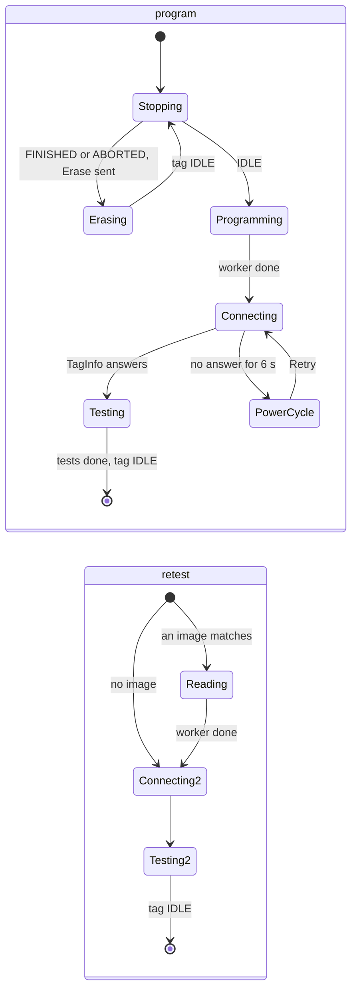

# 11. The applications

This chapter assumes chapter 10. Each section gives the application's job,
the shape it takes within the pattern, its state, a code map, and the
checks. The per-application design documents remain the detailed sources
and are linked at the end of each section.

## Tag Programmer (`tagprogram`)

**Job.** A station for programming and testing a batch of tags: find the
base and the tag, offer the published firmware releases, program one with
the right erase, run its self tests, set its clock, and record every attempt
in a CSV. A port of qtprogram ([decision 0034](../../../docs/decisions/0034-host-qtprogram-batch-station.md)
describes the station it reproduces).

**Shape.** The first port, and the one that fixed the pattern. One engine
thread owns a `Station` that holds everything: eight **checks** (Programmer,
Base, SWD, Supply, Tag, Tag state, Firmware, Record), the base and the
`Tag`, the chosen image, the record file, the open prompt and the
programming **session**. Monitor calls run on the engine thread; the slow
work (the connect check, programming, the flash read-back, listing and
downloading releases) runs on **worker threads** started per job, whose
results come back as closures applied on the engine thread. A worker that
owns the base sets `worker_busy`, and nothing else touches the USB device
meanwhile.

**The session** is a step machine ticked once a second while it waits on
the tag:

Erasing asks the tag's own firmware to erase; Programming detaches the
monitor, runs `tagprobe::program` and reattaches; Testing compares the
tag's commit with the image's, sets the clock and runs the self tests. The
session ends with the tag **IDLE** and never starts it.

**Code map** (`host/applications/tagprogram-rs`):

| Path | Holds |
| --- | --- |
| `core/src/model/` | Pure logic over files, each with unit tests: `elf.rs` (a minimal ELF32 reader), `flashplan.rs` (the erase from the image's linker symbols), `identity.rs` (the TGID record), `image.rs` (a `FirmwareImage` with its SHA-256 and manifest check), `catalog.rs` (GitHub releases: list, download, extract, verify, cache), `record.rs` (the CSV), `settings.rs` |
| `core/src/engine/mod.rs` | `Engine`, `Msg`, the loop, `UiLogger` |
| `core/src/engine/station.rs` | `Station`: checks, base and tag, firmware, record, prompts, commands, queries |
| `core/src/engine/session.rs` | The step machine, as a second `impl Station` |
| `core/src/engine/view.rs` | The view state from the station |
| `core/examples/smoke.rs`, `bench.rs` | A headless run that never attaches; qtprogram's `--bench-program`, which programs one tag |
| `app/`, `ui/` | The shell and the page |

**Checks.** The model's unit tests; `examples/bench.rs` on hardware;
Program and Retest passed on a BitTag through both base generations, Retest
on an IMUTag, Program on a UIUCTag through a field base, and a batch of
PresTags in one session.

**Deliberate differences from qtprogram.** No STM32CubeProgrammer, so no
"Choose Programmer" and the Programmer row names the probe driver; a label
already recorded for another tag must be confirmed; a session's result
stays on the step line until Next Tag; `host_version` in the record reads
`tagprogram-rs <version>`.

Read: [`README.md`](../../applications/tagprogram-rs/README.md),
[`design/engine.md`](../../applications/tagprogram-rs/design/engine.md),
[`design/ui-engine-contract.md`](../../applications/tagprogram-rs/design/ui-engine-contract.md),
[`design/build-and-packaging.md`](../../applications/tagprogram-rs/design/build-and-packaging.md),
[decision 0035](../../../docs/decisions/0035-host-tagprogram-rs.md).

## Tag Monitor (`tagmonitor`)

**Job.** The everyday tool: attach to a tag, see its state, clock error,
voltage and self-test result, read and edit its configuration (or open a
configuration file), synchronise its clock, run the self tests, start it,
stop it, download its data and erase it. A port of qtmonitor, module for
module.

**Shape.** Two threads. The **tag thread** owns the `Tag`, polls `Status`
every 400 ms while attached (pausing 1.5 s after Synchronize Clock and
Self-Test, when an L432 tag cannot answer debug accesses reliably), runs
each `TagCmd` in order and runs downloads. The **engine thread** owns the
`MonitorModel` (the tag as known, and what each status settles), the
`ConfigEditor` (the document and the form), the prompts and the progress
displays. The two exchange `TagCmd` and `Report` messages and share nothing.

**The model** (`core/src/model/`) is qtmonitor's Qt-free core, file for
file: the twelve commands and the one rule for when each is available; the
start checks and their sentences; small tag rules (downloadable states, the
erase size estimate, the clock offset, the version floor); the monitor
model; the configuration document (its values, source, unsaved-changes
baseline, approval, and the file format); the menus as data; the
**configuration form**; and the editor that joins document and form.

**The form** is the hard part and the largest file (`configform.rs`). What
Start sends depends not only on qtmonitor's panels but on how Qt's widgets
behave: date boxes that clamp to a minimum and re-run the panel's
whole-hour handlers on every change, spin boxes that round half away from
zero and re-round their limits when their decimals change. So the file
models those widgets (`DateEdit`, `DoubleSpin`, `IntSpin`, `RadioGroup`),
builds each panel from them exactly as the Qt constructor does, and a table
says which panels each tag type shows. The page draws the form generically
from the engine's description of each control (kind, label, range, step,
decimals, enabled) and sends each edit as `set_field {id, value}`; the
engine clamps, rounds and applies the panel's rules, and the next state
shows the result.

**Download** (`engine/download.rs`) is chapter 5's loop through the C++
writer, behind the `sqlitelog` feature; built without it, Download refuses
with a message and everything else works. It runs on the tag thread and
blocks only that thread; Cancel stops it after the current page and keeps
what was written.

**Code map** (`host/applications/tagmonitor-rs`): the
[architecture document](../../applications/tagmonitor-rs/design/architecture.md)
has the full table, with the qtmonitor file each one ports and a "where to
change what" table. The skeleton:

| Path | Holds |
| --- | --- |
| `core/src/model/{commands,menus,startchecks,tagrules,monitormodel,configdocument,configform,configeditor}.rs` | The rules, as above |
| `core/src/engine/{mod,tagthread,monitor,view,download}.rs` | The loop; the tag thread; `Monitor`, the engine's state and what follows each prompt; the view state and `menus` query; the download |
| `core/tests/{oracles,core_check,config_probe,panels}.rs` | The checks against qtmonitor's files |
| `core/examples/session_check.rs`, `form_view.rs` | A whole tag cycle on hardware; one tag type's form as the page sees it |

**Checks.** The command table, start checks and menu layout match
qtmonitor's committed oracle files; `qtmon_core_check`'s assertions pass;
**all 710 configuration probe cases** match the goldens (the bytes Start
sends, the document, the panels, the dialogs, every control's value, range,
step, decimals and enabled state; deliberately breaking the rounding made
22 cases fail); the panel table agrees with every default configuration; a
full cycle (attach, sync, self-test, read, start, run, stop, download, erase)
passed on an IMUTag.

**Deliberate differences.** The Configuration tab comes first and the Tag
tab is "Tag Info"; the date boxes are the browser's; bases are named by
their identity in the chooser; there is no fixture mode (the mock serves for
screenshots).

**Adding a tag type** is a written procedure:
[`design/adding-a-tag-type.md`](../../applications/tagmonitor-rs/design/adding-a-tag-type.md),
which covers both Tag Monitors, the default configuration, the panel table,
a new panel, the probe cases and goldens, and the download path.

Read: [`README.md`](../../applications/tagmonitor-rs/README.md),
[`design/architecture.md`](../../applications/tagmonitor-rs/design/architecture.md),
[`design/ui-engine-contract.md`](../../applications/tagmonitor-rs/design/ui-engine-contract.md),
[`design/build-and-packaging.md`](../../applications/tagmonitor-rs/design/build-and-packaging.md),
[decisions 0036](../../../docs/decisions/0036-host-qtmonitor-engine-model-view.md)
and [0037](../../../docs/decisions/0037-host-tagmonitor-rs.md).

## Tag Calibrator (`tagcalibrate`)

**Job.** Calibrate a CompassTag's or IMUTag's magnetometer and
accelerometer: stream raw samples while the operator turns the tag through
every attitude, fit the hard-iron offset and soft-iron matrix and the
accelerometer's zero-g offset, show quality figures and a sphere of the
calibrated samples, write the constants to the tag, and show the live
compass that results. A port of qtcalibrate's window.

**Shape.** Two threads as in Tag Monitor. The tag thread attaches, puts the
tag in CALIBRATE, reads the calibration log every 100 ms (qtcalibrate's
sample timer), otherwise polls status every second to keep the tag awake,
and writes and reads constants; stopping the stream waits for IDLE, because
a tag detached on the acknowledgement stays calibrating through the next
reset. The engine thread owns the **calibration session**, which is not
Rust: it is `calibsession::Session`, the C++ `CalibrationSession` that
qtcalibrate's `CompassData` runs, reached through `tagcore_c` (chapter 8).
The engine feeds it samples, ticks its quality update every 200 ms, formats
its figures as qtcalibrate's labels did, logs the same four debug lines per
update, and keeps the capture file.

**Replay.** `TAGCALIBRATE_REPLAY=<capture.json>` feeds a saved capture one
sample per tick instead of attaching, as qtcalibrate's `--replay-capture`
did, so the whole engine runs without a tag and its tests compare its log
with qtcalibrate's for the same capture.

**Code map** (`host/applications/tagcalibrate-rs`):

| Path | Holds |
| --- | --- |
| `core/src/engine/mod.rs` | The loop, as Tag Monitor's |
| `core/src/engine/calibrator.rs` | `Calibrator`: every command, report and timer; the session; prompts |
| `core/src/engine/tagthread.rs` | Attach, the stream, the status poll, constants, the stop-and-wait |
| `core/src/engine/view.rs` | The view state: constants, quality, sphere points, orientation readouts |
| `core/src/engine/capture.rs` | The capture file, read and written in qtcalibrate's schema |
| `core/tests/replay_log.rs`, `imutag_axes.rs` | The replay log against qtcalibrate's; the IMUTag fixture's dip |
| `ui/views.js`, `three.min.js` | The sphere and tag model (three.js), the heading dial |

**Checks.** `calibsession`'s replay test reaches every figure qtcalibrate
logged for the reference capture; the engine's replay logs the same 1,552
quality lines character for character; the user calibrated an IMUTag through
it, which found a firmware axis-mapping fault and became a fixture.

**Deliberate differences.** three.js graphics in place of magPlot and the
QML views (drawn and turned as those did); quality figures in a grid rather
than Courier columns; a Tag menu and a Log menu; Quit waits for IDLE and
Attach recovers a tag left calibrating, which qtcalibrate did not.

Read: [`README.md`](../../applications/tagcalibrate-rs/README.md),
[`design/architecture.md`](../../applications/tagcalibrate-rs/design/architecture.md),
[`design/ui-engine-contract.md`](../../applications/tagcalibrate-rs/design/ui-engine-contract.md),
[decision 0039](../../../docs/decisions/0039-host-tagcalibrate-rs.md).

## Tag View (`tagview`)

**Job.** View a downloaded SQLite log of any family: the streams on stacked
axes against time, with hover readouts, cursors, zoom, event markers, gap
breaks, per-stream ranges, colours and axis sides, a compass panel for
compass logs, per-tag preference files, File Info, and PDF export. A port of
the Qt SensorViz's window; the Qt application keeps its name while both
ship.

**Shape.** One engine thread and no tag. The engine owns the open log as a
`sensorviz_session::Session`: sensorViz's C++ core (chapter 5), so the
streams, transforms, plot specification, hover text and preference files are
the Qt application's. The page draws the core's **plot spec** with
[uPlot](https://github.com/leeoniya/uPlot), fetching **M4 envelopes** from
the engine for the visible range at the plot's width, and asks for the hover
readout and the compass sample at the pointer. Every setter on the session
returns change bits, so the engine republishes only what changed.

**Printing** is File ▸ Export PDF: the page draws the view again offscreen at
A4 landscape and 300 dpi from envelopes fetched for that width, and places
it in a PDF with jsPDF, the title, metadata box and legend as PDF text. The
renderer and the printing method were chosen by a spike whose results are in
the README.

**Code map** (`host/applications/sensorviz-rs`):

| Path | Holds |
| --- | --- |
| `core/src/engine.rs` | `Engine`, the loop, `Viewer`: every command and query (tabled in its doc comment), status line, File Info, preferences, the PDF save |
| `core/tests/engine.rs` | The engine on the committed fixtures |
| `ui/plot.js` | The uPlot chart from the spec: stacked axes, time axes, markers, gaps, cursors, zoom, the metadata box and legend, the PDF export |
| `ui/app.js` | The Qt menus and dialogs, the tabs, the compass panel |
| `ui/uPlot.iife.min.js`, `jspdf.umd.min.js` | uPlot 1.6.32 and jsPDF 2.5.2, vendored |
| `tools/export_mock_data.py` | Writes fixture data for the browser mock (generated, not committed) |

**Checks.** `sensorviz-session`'s tests against the core's state dump;
`core/tests/engine.rs` on the fixtures; the core itself against the Qt
application by `session_cli` and the state dump.

**Deliberate differences.** Auto axes take the data range padded by 5 %
(the Qt plot also includes zero and the previous range); printing is PDF
export rather than the system print dialog; no activity filter (it stays in
the Qt application); Axis Sides lists streams rather than axis groups.

Read: [`README.md`](../../applications/sensorviz-rs/README.md),
[`design/architecture.md`](../../applications/sensorviz-rs/design/architecture.md),
the [leaving-Qt proposal](../../applications/sensorviz/design/proposals/leaving-qt.md)
(accepted; the plan this is step 4 of), and the Qt application's
[toolkit-neutral core proposal](../../applications/sensorviz/design/proposals/toolkit-neutral-core.md).

## The Qt applications, briefly

They are the references the ports are held to, and they ship beside them
until retired. `qtmon` is structured like its port (a Qt-free `core/`, a
tag session on a worker thread, a window that draws), by design. `qtprogram`
is the batch station, through `STM32_Programmer_CLI`. `qtcalibrate`'s
`CompassData` is now an adapter over the C++ session the Rust application
uses. `sensorviz`'s `core/` is the one Tag View runs; its Qt layer holds
QCustomPlot, the activity filter and the screenshot hooks. `btdataviz` is a
deprecated BitTag viewer. Each has a README; `qtmon/design/architecture.md`
is worth reading alongside Tag Monitor's.
