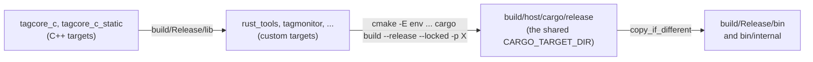

# 1. The workspace and the build

All of the host's Rust code is one Cargo workspace rooted at
[`host/Cargo.toml`](../../Cargo.toml). cargo builds it; CMake runs cargo
(through [`cmake/HostRust.cmake`](../../../cmake/HostRust.cmake) and
[`cmake/RustFlashTools.cmake`](../../../cmake/RustFlashTools.cmake)) and
packages what it produces. This chapter reads those files, a few
`Cargo.toml` manifests and the build scripts. After it you can say which
crate a file belongs to, what a manifest line does, what a build script
emits and why, which cargo command CMake runs for each target, and how to
build, test and document a crate by hand without touching the source tree.

The architecture of the same material is in chapters
[2](../guide/02-source-tree.md) and [13](../guide/13-building-and-testing.md)
of the Host Software Guide, and the reason for one workspace in decision
[0041](../../../docs/decisions/0041-host-one-cargo-workspace.md). This
chapter is the code reading underneath them.

## Cargo's vocabulary, in CMake terms

| Cargo term | What it is | Nearest CMake / C++ idea |
| --- | --- | --- |
| **package** | A directory with a `Cargo.toml`. It has a name (`tag-tools`), a version, dependencies, and one or more targets. | A `CMakeLists.txt` that defines a few related targets |
| **crate** | One compilation unit: everything `rustc` compiles in a single invocation, starting from a root file (`src/lib.rs`, `src/main.rs`, `src/bin/x.rs`). Modules inside it are not separate translation units. | One library or executable target, but compiled as a whole, not per `.cc` |
| **target** (cargo sense) | A crate a package produces: at most one library, any number of binaries, tests, examples, benches. Not the CPU target. | `add_library` / `add_executable` |
| **workspace** | Packages that share one `Cargo.lock` and one output directory, so `cargo build`, `test`, `doc` and `clippy` run over all of them. | A top-level project with `add_subdirectory` for each |
| **`Cargo.toml`** | The manifest: `[package]`, `[dependencies]`, `[features]`, `[[bin]]`, `[lints]`. Declarative; there is no scripting in it. | The declarative half of a `CMakeLists.txt` |
| **`Cargo.lock`** | The exact version (and checksum) of every crate in the dependency graph, written by cargo, committed here. | A vcpkg baseline, pinned to the checksum |
| **dependency** | Another package, from crates.io by version or from a path. `"0.4.45"` means "0.4.45 or any later 0.4.x" (a caret requirement); the lock file decides which. | `find_package` plus a version constraint |
| **dev-dependency** | Needed only by tests, examples and doc tests. | A dependency of the test executables only |
| **build-dependency** | Needed only by the build script (`build.rs`), which runs on the host before the crate compiles. | A tool used by `add_custom_command` (protoc) |
| **feature** | A named switch, declared in `[features]`, that can turn on optional dependencies and `#[cfg(feature = "...")]` code. Features are additive: within one build each crate is compiled once, with the union of every feature anyone asked for. | `option()` plus `target_compile_definitions` |
| **edition** | The language revision a crate is written in (2015, 2018, 2021, 2024). Crates of different editions link together; the edition only changes how source is parsed and a few defaults. Every crate here is `edition = "2024"`. | `CXX_STANDARD` per target, but ABI-neutral |
| **profile** | `dev` (the default, unoptimised, debug assertions) or `release` (`--release`). Output goes to `<target dir>/debug` or `<target dir>/release`. | `CMAKE_BUILD_TYPE` |
| **target directory** | Where all output goes, `target/` beside the workspace's `Cargo.toml` unless `CARGO_TARGET_DIR` names another. | The build tree |

Two consequences of edition 2024 appear in this tree and are worth knowing
before you read it:

- Some library functions became `unsafe` to call. `std::env::set_var` is one,
  because changing the environment races with other threads reading it; you
  will see it wrapped in `unsafe { }` in a build script below.
- Blocks of foreign declarations must be written `unsafe extern "C" { ... }`
  (chapter [8](08-bridges-to-cpp-and-python.md)), and `if let ... && ...`
  ("let chains") are allowed. Let chains need Rust 1.88 or newer; the
  installed toolchain is newer than that.

> **Rust:** a package name may contain hyphens (`tag-tools`,
> `tagcore-c-sys`); in Rust source the crate is named with underscores
> (`use tag_tools::BaseArgs;`, `tagcore_c_sys::tlw`). The hyphen form is
> what you pass to `cargo -p`; the underscore form is what you `use`.

## The workspace manifest

[`host/Cargo.toml:10`](../../Cargo.toml#L10) is the whole of the workspace
definition (lines 1-9 are a comment):

```toml
[workspace]
resolver = "3"
members = [
  # Libraries: the tag interface, programming, and the bridge to the C++ host
  # libraries through tagcore_c.
  "libraries/tagcore-rs",
  "libraries/tagprobe-rs",
  "libraries/tagcore-c-sys",
  "libraries/taglogwriter-rs",
  "libraries/calibsession-rs",
  "libraries/sensorviz-session-rs",
  # The Tauri shell every application shares, its build-script half, and the
  # engine toolkit the applications' core crates share.
  "libraries/tagapp-shell-rs",
  "libraries/tagapp-shell-build-rs",
  "libraries/tagapp-engine-rs",
  # The command-line tools (crate tag-tools: one binary per tool).
  "commandline-rs",
  # The Python binding of tagcore's recovery module (built with maturin).
  "python/tagcore-py",
  # The applications: a toolkit-free core crate and a Tauri shell crate each.
  "applications/tagprogram-rs/core",
  "applications/tagprogram-rs/app",
  "applications/tagmonitor-rs/core",
  "applications/tagmonitor-rs/app",
  "applications/tagcalibrate-rs/core",
  "applications/tagcalibrate-rs/app",
  "applications/sensorviz-rs/core",
  "applications/sensorviz-rs/app",
]
exclude = [
  # Experiments with their own dependencies; not built with the host.
  "spikes/probe-rs-spike",
  "applications/sensorviz-rs/tools/print-spike",
]
```

This is a *virtual* manifest: it has a `[workspace]` table and no
`[package]`, so the directory `host/` is not itself a crate. Points to
notice:

- **`resolver = "3"`** is the default for edition 2024, stated explicitly
  because a virtual manifest has no edition to take it from. It selects the
  feature resolver that keeps a build-dependency's features separate from a
  normal dependency's (so `prost-build` in a build script does not change how
  `prost` is compiled into the program), and makes version selection aware
  of each package's minimum Rust version. No crate here declares one
  (`rust-version`), so cargo measures candidate versions against the
  installed toolchain instead: `cargo update` will not pick a dependency
  version that needs a newer Rust than the one you have.
- **One `Cargo.lock`**, `host/Cargo.lock`, for every member. Before
  2026-10-31 there were seven; decision
  [0041](../../../docs/decisions/0041-host-one-cargo-workspace.md) records the
  merge.
- **Nothing is inherited.** Many Rust workspaces put shared versions in
  `[workspace.dependencies]` and lints in `[workspace.lints]`, and members
  write `serde.workspace = true`. This one does not: each member pins its own
  dependency versions and repeats the same `[lints]` table. If you have read
  other Rust repositories, do not look for `workspace = true` here.
- **`exclude`** keeps two experiments (which have their own `Cargo.toml` and
  lock) from being swallowed by the workspace.

### The members

Nineteen packages. The directory keeps a `-rs` suffix where a C++ directory of
the same name exists; the package name does not.

| Directory under `host/` | Package | Produces | What it is | Read in |
| --- | --- | --- | --- | --- |
| `libraries/tagcore-rs` | `tagcore` | lib | The tag interface: `LinkAdapt` (ST-LINK over libusb), `TagMonitor`, `Tag`, the protobuf types, and the SWD recovery module | chapters [3](03-usb-and-stlink.md), [4](04-monitor-and-rpc.md), [5](05-protobuf-and-the-tag-api.md), [6](06-recovery.md) |
| `libraries/tagprobe-rs` | `tagprobe` | lib | Programming tags through probe-rs, and bases over USB DFU | chapter [7](07-programming-tags-and-bases.md) |
| `libraries/tagcore-c-sys` | `tagcore-c-sys` | lib (`no_std`) | Hand-written declarations of the `tagcore_c` C interface, and the build script that links it | chapter [8](08-bridges-to-cpp-and-python.md) |
| `libraries/taglogwriter-rs` | `taglogwriter` | lib | Safe wrapper over the C++ SQLite log writer | chapter [8](08-bridges-to-cpp-and-python.md) (and its use in [9](09-command-line-tools.md)) |
| `libraries/calibsession-rs` | `calibsession` | lib | Safe wrapper over the C++ calibration session | chapter [8](08-bridges-to-cpp-and-python.md) |
| `libraries/sensorviz-session-rs` | `sensorviz-session` | lib | Safe wrapper over sensorViz's C++ core | not covered (sensorViz is out of scope) |
| `libraries/tagapp-shell-rs` | `tagapp-shell` | lib | The Tauri shell every application shares: the two commands, the two events, closing through the engine, App Nap, the user guide | chapter [10](10-tauri-shell.md) |
| `libraries/tagapp-shell-build-rs` | `tagapp-shell-build` | lib | The applications' build-script helper: page staging, the shared capabilities, the rpath, `tauri-build` | chapters [1](#the-tauri-applications-staging-the-page), [10](10-tauri-shell.md) |
| `libraries/tagapp-engine-rs` | `tagapp-engine` | lib | The engine toolkit the applications' `core` crates share (no Tauri): the `Engine` handle, the engine loop over an `EngineState`, the `Poster`, the prompt queue, the `ready` guard, the logger. Tag Calibrator and Tag View use it so far | chapters [11](11-engine-and-model.md#the-engine-handle-and-spawn), [14](14-the-three-applications.md#the-engine-toolkit-underneath) |
| `commandline-rs` | `tag-tools` | lib + 21 binaries | The command-line tools | chapter [9](09-command-line-tools.md) |
| `python/tagcore-py` | `tagcore-py` | `cdylib` named `_native` | The Python module `tagcore`, over `tagcore::recovery`, built with maturin | chapter [8](08-bridges-to-cpp-and-python.md) |
| `applications/tagprogram-rs/core` | `tagprogram-core` | lib | Tag Programmer's engine and model (also the ELF reader and flash plan `tag-flash` uses) | chapters [11](11-engine-and-model.md), [14](14-the-three-applications.md) |
| `applications/tagprogram-rs/app` | `tagprogram` | bin | Tag Programmer's Tauri shell | chapters [10](10-tauri-shell.md), [14](14-the-three-applications.md) |
| `applications/tagmonitor-rs/core` | `tagmonitor-core` | lib | Tag Monitor's engine and model | chapters [11](11-engine-and-model.md), [13](13-tracing-start.md) |
| `applications/tagmonitor-rs/app` | `tagmonitor` | bin | Tag Monitor's Tauri shell | chapters [10](10-tauri-shell.md), [13](13-tracing-start.md) |
| `applications/tagcalibrate-rs/core` | `tagcalibrate-core` | lib | Tag Calibrator's engine | chapter [14](14-the-three-applications.md) |
| `applications/tagcalibrate-rs/app` | `tagcalibrate` | bin | Tag Calibrator's Tauri shell | chapters [10](10-tauri-shell.md), [14](14-the-three-applications.md) |
| `applications/sensorviz-rs/core` | `sensorviz-core` | lib | Tag View's engine | not covered |
| `applications/sensorviz-rs/app` | `tagview` | bin | Tag View (sensorViz in Rust) | not covered |

The dependency arrows all point down: the applications' `core` crates use
`tagcore` (and `tagprobe`, `taglogwriter`, `calibsession` as needed, and
`tagapp-engine` in Tag Calibrator and Tag View); each
`app` crate uses only its own `core`, `tagapp-shell` (and
`tagapp-shell-build` in its build script) plus Tauri; `tag-tools` uses `tagcore`,
`tagprobe`, `tagprogram-core` and, with a feature, `taglogwriter`. The one
sideways edge is worth noticing: `tag-tools` depends on
`tagprogram-core` to reuse Tag Programmer's ELF reader and erase plan.

## Reading a package manifest

Two manifests show every kind of entry in use. First `tag-tools`, the
command-line tools,
[`commandline-rs/Cargo.toml:1`](../../commandline-rs/Cargo.toml#L1):

```toml
[package]
name = "tag-tools"
version = "0.1.0"
edition = "2024"

[dependencies]
chrono = "0.4.45"
clap = { version = "4.6.7", features = ["derive"] }
ctrlc = "3.5.2"
env_logger = "0.11.11"
log = "0.4.34"
prost-reflect = "0.16.5"
# tag-log-import reads the download's header object generically.
serde_json = "1.0.154"
tagcore = { version = "0.1.0", path = "../libraries/tagcore-rs" }
# tag-flash programs through probe-rs, and plans its erase as Tag Programmer does.
tagprobe = { version = "0.1.0", path = "../libraries/tagprobe-rs" }
tagprogram-core = { version = "0.1.0", path = "../applications/tagprogram-rs/core" }
# Named only for its `log` feature: with no tracing subscriber installed,
# probe-rs's and tagprobe's tracing events then become `log` records, so -d
# shows them. Here rather than in tagprobe so Tag Programmer's log pane is
# unchanged when it is built on its own.
tracing = { version = "0.1.44", features = ["log"] }
taglogwriter = { version = "0.1.0", path = "../libraries/taglogwriter-rs", optional = true }
# Named directly only so build.rs receives DEP_TAGCORE_C_LIB_DIR for the rpath.
tagcore-c-sys = { version = "0.1.0", path = "../libraries/tagcore-c-sys", optional = true }

[target.'cfg(unix)'.dependencies]
# Restores the default SIGPIPE action, so `tag-info | head` ends quietly.
libc = "0.2.191"

[features]
# tag-dwnld, tag-log-import and tag-rebuild write their logs through the C++ writer, so it needs libtagcore_c
# built by CMake (-DBUILD_TAGCORE_C=ON) and TAGCORE_C_LIB_DIR naming it. Off
# by default so the other tools still build with cargo alone.
sqlitelog = ["dep:taglogwriter", "dep:tagcore-c-sys"]

[[bin]]
name = "tag-dwnld"
required-features = ["sqlitelog"]

[[bin]]
name = "tag-log-import"
required-features = ["sqlitelog"]

[[bin]]
name = "tag-rebuild"
required-features = ["sqlitelog"]
```

Line by line, what a CMake user would not guess:

- `clap = { version = ..., features = ["derive"] }` turns on one of the
  *dependency's* features: clap's derive macros are compiled only when asked
  for.
- `path = "..."` with a `version` is a local package. The version is checked
  against the path's `Cargo.toml` and would matter only if the crate were
  published (none is; most say `publish = false`).
- `optional = true` makes a dependency absent unless a feature enables it.
  `sqlitelog = ["dep:taglogwriter", "dep:tagcore-c-sys"]` is that feature;
  the `dep:` prefix says "enable this optional dependency" without also
  creating a feature named after it.
- `tracing` is a dependency the package's own code never calls. Naming it
  here turns on its `log` feature, and cargo enables a crate's features
  once per build for every user of that crate, so probe-rs's `tracing`
  events reach the tools' `log` logger
  ([chapter 7](07-programming-tags-and-bases.md#the-libraries-in-this-chapter)).
- `[target.'cfg(unix)'.dependencies]` is a dependency only when compiling
  for a Unix target. Windows builds never see `libc` here.
- `[[bin]]` (double brackets: an array of tables, one per binary) is needed
  only to attach settings to a binary. cargo finds every `src/bin/*.rs` by
  itself; these three entries exist to say `required-features`: without
  `--features sqlitelog`, cargo skips those three binaries instead of failing
  to compile them. That is what lets `cargo build -p tag-tools` work on a
  machine that has never built the C++ library.

Second, `tagcore`, which has the other kinds,
[`libraries/tagcore-rs/Cargo.toml:16`](../../libraries/tagcore-rs/Cargo.toml#L16):

```toml
[features]
default = ["instrumentation"]
# Mirrors TAGCORE_ENABLE_INSTRUMENTATION: count and time every USB transfer,
# ST-LINK command and monitor RPC. Turning it off leaves the statistics at
# zero with `enabled == false`.
instrumentation = []

[dependencies]
chrono = "0.4.45"
log = "0.4.34"
# ELF reading for SRAM loader and probe images (recovery::image).
object = { version = "0.39.1", default-features = false, features = ["read_core", "elf", "std"] }
prost = "0.14.4"
prost-reflect = { version = "0.16.5", features = ["derive", "serde", "text-format"] }
rusb = { version = "0.9.4", features = ["vendored"] }
serde_json = "1.0.154"
# Hashes recorded in capture manifests (recovery::capture).
sha2 = "0.10.9"

[build-dependencies]
protoc-bin-vendored = "3"
prost-build = "0.14.4"
prost-reflect-build = "0.16.1"

[dev-dependencies]
env_logger = "0.11.11"
```

- `default = ["instrumentation"]`: features on unless a dependent writes
  `default-features = false`. `instrumentation = []` enables nothing else;
  the code tests it with `#[cfg(feature = "instrumentation")]`.
- `default-features = false` on `object` is the opposite move, made by a
  consumer: take only the ELF reader, not every object format.
- `rusb`'s `vendored` feature compiles libusb from source and links it
  statically, so no libusb is needed on the user's machine.
- The three `[build-dependencies]` are used only by `build.rs` (protobuf
  code generation, below). They never reach the program.
- `env_logger` is a dev-dependency: the `tag_info` example installs it
  (reading `RUST_LOG`); the library only logs through the `log` facade.

The remaining manifest shape is the Python binding's, which changes what the
library target is,
[`python/tagcore-py/Cargo.toml:12`](../../python/tagcore-py/Cargo.toml#L12):

```toml
[lib]
name = "_native"
crate-type = ["cdylib"]
```

`cdylib` produces a C-ABI shared library (`_native.abi3.so`) for Python to
load, instead of an `.rlib` for other Rust crates to link. Chapter
[8](08-bridges-to-cpp-and-python.md) reads it; it is not in the CMake build.

## Where the files of a crate go

cargo finds a crate's targets by convention, so the layout is the build
description:

| Path | Is |
| --- | --- |
| `src/lib.rs` | The library crate's root. Its `//!` comment is the crate's front page in rustdoc; then `pub mod` lines name the modules. |
| `src/main.rs` | A binary crate's root (the Tauri `app` crates). |
| `src/bin/<name>.rs` | One more binary, named `<name>`, in the same package. It uses the package's library as an ordinary dependency: `use tag_tools::...`. `commandline-rs` has 21. |
| `src/<m>.rs` or `src/<m>/mod.rs` | The module `m` declared by `mod m;` in its parent. `mod.rs` is the folder form: `tagcore-rs/src/link/mod.rs` is the module `link`, and `link/stlink.rs` beside it is `link::stlink`. |
| `tests/*.rs` | Integration tests: each file is a separate crate that sees only the library's public API (`tagcore-rs/tests/hardware.rs`). |
| `examples/*.rs` | Small programs built by `cargo run --example <name>`, and compiled (not run) by `cargo test` (`tagcore-rs/examples/tag_info.rs`, Tag Monitor's `session_check`). |
| `build.rs` (next to `Cargo.toml`) | The build script, described next. |

One trap: [`tagcore-rs/src/recovery/build.rs`](../../libraries/tagcore-rs/src/recovery/build.rs)
is *not* a build script. It is the module `recovery::build` (the firmware
build stored with a capture), declared by `pub mod build;` in
`recovery/mod.rs`. Only a `build.rs` at the package root, beside
`Cargo.toml`, is run by cargo.

> **Rust:** there are no header files and no include paths. `mod link;` in
> `lib.rs` makes the compiler read `link.rs` or `link/mod.rs` as part of the
> same crate; `use` only brings names into scope. A whole crate is one
> compilation unit, which is why a crate rebuilds as a unit and why large
> crates are split.

## Build scripts

A `build.rs` is compiled and run on the host before its package compiles.
It can generate source, compile C, or find a library, and it talks to cargo
by printing lines of the form `cargo:KEY=VALUE` on stdout. Cargo passes it
information in environment variables: `OUT_DIR` (a private scratch directory
per package and build), `CARGO_MANIFEST_DIR`, `CARGO_CFG_TARGET_OS` (the OS
being compiled *for*), `CARGO_FEATURE_<NAME>` for each enabled feature, and
`DEP_<LINKS>_<KEY>` from dependencies (below). A `panic!` in a build script
fails the build with the panic message, which is how these scripts report
errors.

The keys this tree uses:

| Printed | Means | CMake equivalent |
| --- | --- | --- |
| `cargo:rerun-if-changed=PATH` | Rerun the script only when this file or directory changes (by default it reruns when anything in the package changes) | `DEPENDS` of a custom command |
| `cargo:rerun-if-env-changed=VAR` | Rerun when this environment variable changes | none; CMake caches instead |
| `cargo:rustc-link-search=native=DIR` | Add a library search directory | `-L` |
| `cargo:rustc-link-lib=static=NAME` / `dylib=NAME` / `framework=NAME` | Link a library | `target_link_libraries` |
| `cargo:rustc-link-arg=ARG` | Pass a raw linker argument to every binary, test and example of this package | `target_link_options` |
| `cargo:rustc-link-arg-bins=ARG` | The same, for this package's `[[bin]]` targets only | |
| `cargo:rustc-env=VAR=VALUE` | Set a variable that `env!("VAR")` reads while compiling this package | `target_compile_definitions` |
| `cargo:KEY=VALUE` (any other key) | Metadata for dependents, only if the package declares `links` | an exported variable |

There are four kinds of build script in the workspace. Each is read in
detail in its own chapter; here is enough to recognise them.

### Code generation: `tagcore`

[`libraries/tagcore-rs/build.rs:21`](../../libraries/tagcore-rs/build.rs#L21)
compiles the shared `proto/` files into Rust:

```rust
fn main() -> std::io::Result<()> {
    let manifest = PathBuf::from(std::env::var("CARGO_MANIFEST_DIR").unwrap());
    let out_dir = PathBuf::from(std::env::var("OUT_DIR").unwrap());
    let root = manifest.join("../../..");
    let proto_dir = root.join("proto");
    let tag_proto = proto_dir.join("tag.proto");

    println!("cargo:rerun-if-changed={}", tag_proto.display());
    println!(
        "cargo:rerun-if-changed={}",
        proto_dir.join("tagdata.proto").display()
    );

    // A packaging build has no protoc of its own; use the vendored one
    // unless PROTOC names another.
    if std::env::var_os("PROTOC").is_none() {
        let protoc = protoc_bin_vendored::protoc_bin_path().expect("vendored protoc");
        // SAFETY: build scripts are single-threaded.
        unsafe { std::env::set_var("PROTOC", protoc) };
    }

    prost_reflect_build::Builder::new()
        .descriptor_pool("crate::proto::DESCRIPTOR_POOL")
        .file_descriptor_set_path(out_dir.join("file_descriptor_set.bin"))
        .compile_protos(&[tag_proto], &[proto_dir])?;

    embed_default_configs(&root.join("embedded/proto-c"), &out_dir)
}
```

The generated code lands in `OUT_DIR`, never in the source tree, and the
crate pulls it in with a textual include,
[`src/proto.rs:25`](../../libraries/tagcore-rs/src/proto.rs#L25):

```rust
include!(concat!(env!("OUT_DIR"), "/_.rs"));
```

`protoc-bin-vendored` ships `protoc` binaries inside the crate, so the build
needs no installed protobuf compiler; `prost-reflect-build` drives
`prost-build` and also writes the descriptor set that tagcore's text-format
and JSON code reflect over. Chapter [5](05-protobuf-and-the-tag-api.md) reads
the result. The `unsafe { std::env::set_var(...) }` is the edition-2024 rule
mentioned at the top.

> **Rust:** `fn main() -> std::io::Result<()>` lets `?` propagate an I/O
> error out of `main`; a non-`Ok` return prints the error and exits non-zero,
> which fails the build. `include!` is the one place Rust does a C-style
> textual include, used almost only for generated code.

### Linking a CMake product: `tagcore-c-sys` and `links`

The crates that reach the C++ libraries link `libtagcore_c`, which only CMake
can build. [`libraries/tagcore-c-sys/Cargo.toml`](../../libraries/tagcore-c-sys/Cargo.toml#L15)
declares:

```toml
# Lets a dependent's build script read DEP_TAGCORE_C_LIB_DIR, to set an rpath.
# Only one crate in a build may declare this.
links = "tagcore_c"
```

and its build script finds the library through an environment variable,
[`libraries/tagcore-c-sys/build.rs:33`](../../libraries/tagcore-c-sys/build.rs#L33):

```rust
fn main() {
    println!("cargo:rerun-if-env-changed=TAGCORE_C_LIB_DIR");
    println!("cargo:rerun-if-env-changed=TAGCORE_C_LINK");
    let Some(dir) = env::var_os("TAGCORE_C_LIB_DIR").map(PathBuf::from) else {
        panic!(
            "TAGCORE_C_LIB_DIR is not set. Build the C library with CMake \
             (-DBUILD_TAGCORE_C=ON, target tagcore_c or tagcore_c_static) and set \
             TAGCORE_C_LIB_DIR to the directory holding it, e.g. <build>/Release/lib."
        );
    };
    if !dir.is_dir() {
        panic!("TAGCORE_C_LIB_DIR={} is not a directory", dir.display());
    }
    let os = env::var("CARGO_CFG_TARGET_OS").unwrap_or_default();

    // Static on macOS (one bundle per app), shared elsewhere (one shared
    // install directory for every tool).
    let default_link = if os == "macos" { "static" } else { "dylib" };
    let link = env::var("TAGCORE_C_LINK").unwrap_or_else(|_| default_link.into());
    match link.as_str() {
        // ...
```

The two arms of that `match` (lines 53-90) print the `rustc-link-search` and
`rustc-link-lib` lines for the static archive (plus `c++`, `objc` and three
frameworks on macOS) or for the shared library; chapter
[8](08-bridges-to-cpp-and-python.md) reads them. The `dylib` arm also prints
`cargo:lib_dir=<dir>`. Because the package declares `links = "tagcore_c"`,
cargo hands that value to the build scripts of the packages that depend on
it *directly*, as `DEP_TAGCORE_C_LIB_DIR`. That is the only channel from one
package's build script to another's, and only one package in a build may
claim a given `links` name, which is why exactly one crate links the
library and the three wrappers depend on it.

> **Rust:** `let Some(dir) = ... else { panic!(...) };` is `let`-`else`:
> bind the pattern or run the `else` block, which must leave the scope
> (`return`, `panic!`, `continue`). It reads as a guard clause:
> `if (!opt) fail(); auto dir = *opt;`. Note `CARGO_CFG_TARGET_OS`
> rather than `#[cfg(target_os = ...)]`: inside a build script `cfg!` is the
> host's OS, the variable is the target's.

Why `DEP_...` matters: a run-time search path is a linker argument, and a
link argument printed by `tagcore-c-sys` applies only to `tagcore-c-sys`'s
own binaries (its tests). The program that finally links the shared library
has to set its own rpath, from its own build script. For the command-line
tools that is
[`commandline-rs/build.rs:24`](../../commandline-rs/build.rs#L24), which is
why `tag-tools` names `tagcore-c-sys` as a direct (optional) dependency:

```rust
fn main() {
    println!("cargo:rerun-if-env-changed=TAGCORE_C_RPATH");
    // DEP_TAGCORE_C_LIB_DIR is present only for a shared link.
    let Ok(lib_dir) = env::var("DEP_TAGCORE_C_LIB_DIR") else {
        return;
    };
    if env::var("CARGO_CFG_TARGET_OS").as_deref() == Ok("windows") {
        return;
    }
    let dir = env::var("TAGCORE_C_RPATH").unwrap_or(lib_dir);
    println!("cargo:rustc-link-arg-bins=-Wl,-rpath,{dir}");
}
```

On macOS the default link is static, `lib_dir` is never printed, and this
script does nothing. On Linux the package build passes
`TAGCORE_C_RPATH=$ORIGIN/../lib:$ORIGIN/../../lib` (see `host_rust_tools()`
below); a developer build falls back to the directory the library was linked
from.

### The Tauri applications: staging the page

Each Tauri `app` crate's build script is one call into a shared helper
crate, `tagapp-shell-build`, listed under the app's `[build-dependencies]`,
[`applications/tagmonitor-rs/app/build.rs:8`](../../applications/tagmonitor-rs/app/build.rs#L8):

```rust
fn main() {
    tagapp_shell_build::build(tagapp_shell_build::Rpath::WithFeature("sqlitelog"));
}
```

The helper copies the web page and the shared UI kit into `OUT_DIR` and then
runs Tauri's own build step,
[`libraries/tagapp-shell-build-rs/src/lib.rs:127`](../../libraries/tagapp-shell-build-rs/src/lib.rs#L127):

```rust
pub fn build(rpath: Rpath) {
    let manifest = PathBuf::from(std::env::var("CARGO_MANIFEST_DIR").expect("manifest dir"));
    let stage = PathBuf::from(std::env::var("OUT_DIR").expect("OUT_DIR")).join("tauri");
    let _ = fs::remove_dir_all(&stage);

    let dist = stage.join("dist");
    copy_dir(&manifest.join("../ui"), &dist, true);
    copy_dir(&manifest.join("../../../ui-kit"), &dist.join("ui-kit"), false);
    fs::create_dir_all(stage.join("capabilities")).expect("create capabilities");
    fs::write(stage.join("capabilities/default.json"), CAPABILITIES).expect("write capabilities");
    // ...
    let config = format!(
        r#"{{"build":{{"frontendDist":{}}}}}"#,
        serde_json::to_string(&dist.to_string_lossy()).expect("path as JSON")
    );
    println!("cargo:rustc-env=TAURI_CONFIG={config}");

    tagcore_c_rpath(rpath);

    std::env::set_current_dir(&stage).expect("enter staging directory");
    tauri_build::build()
}
```

A library function can do this because it runs inside the application's
build script: `CARGO_MANIFEST_DIR`, `OUT_DIR` and the `CARGO_FEATURE_*`
variables it reads are the application's. The page lives in `../ui` and
loads the kit by a relative path so it also opens as a plain file in a
browser; Tauri serves one directory, so the helper assembles that directory
under `OUT_DIR`, writes the one capabilities file every application shares
(compiled into the helper from its `capabilities.json`), and points Tauri's
`generate_context!` macro at the staged page through `TAURI_CONFIG`.
Nothing is written into the source tree, so a release build works from a
read-only checkout.

The argument says when the executable needs an rpath for a shared
`libtagcore_c`: `Rpath::Never` for Tag Programmer, which links no C++;
`Rpath::WithFeature("sqlitelog")` for Tag Monitor, whose download is behind
that feature; `Rpath::Always` for Tag Calibrator and Tag View, whose cores
are in the library. `tagcore_c_rpath` reads `TAGCORE_C_RPATH`, else
`TAGCORE_C_LIB_DIR`, itself, because the applications are not direct
dependents of `tagcore-c-sys` and so never see `DEP_TAGCORE_C_LIB_DIR`.
Chapter [10](10-tauri-shell.md#buildrs-staging-the-page) reads the whole
helper.

> **Rust:** `r#"..."#` is a raw string (no escapes), and `{{`/`}}` in a
> `format!` string are literal braces. `.expect("...")` unwraps an `Option`
> or `Result`, panicking with that message otherwise; in a build script that
> is the error report.

The last build script, `python/tagcore-py/build.rs`, is one call,
`pyo3_build_config::add_extension_module_link_args()`, which on macOS adds
`-undefined dynamic_lookup` so the module takes Python's symbols from the
interpreter that loads it.

## How CMake runs cargo

CMake does not know Rust. For each Rust product it defines a custom target
that always runs cargo, lets cargo decide what is out of date, and copies
the result to `<build>/<Config>/bin`. The pieces are in
[`cmake/HostRust.cmake`](../../../cmake/HostRust.cmake).



### The shared settings

[`cmake/HostRust.cmake:30`](../../../cmake/HostRust.cmake#L30) finds cargo
where rustup puts it even if an IDE's shell has no `~/.cargo/bin` on `PATH`,
and lines 35 and 45 fix the workspace and the one target directory per build
tree:

```cmake
find_program(CARGO_EXECUTABLE cargo HINTS "$ENV{CARGO_HOME}/bin" "$ENV{HOME}/.cargo/bin")
```

```cmake
set(HOST_RUST_WORKSPACE_DIR "${PROJECT_SOURCE_DIR}/host")
```

```cmake
set(HOST_CARGO_TARGET_DIR "${CMAKE_BINARY_DIR}/host/cargo")
```

Every cargo invocation from a build tree therefore shares
`<build>/host/cargo`: probe-rs, Tauri and `tagcore` are compiled once per
tree, not once per application, and nothing is written to `host/target` in
the source tree. cargo locks the directory itself, so two targets building
at once wait for each other rather than corrupt it.

The environment for each cargo run is assembled by
[`_host_rust_environment()`, line 83](../../../cmake/HostRust.cmake#L83):

```cmake
function(_host_rust_environment out_env out_depends rpath)
  set(_env "CARGO_TARGET_DIR=${HOST_CARGO_TARGET_DIR}")
  if(APPLE AND CMAKE_OSX_DEPLOYMENT_TARGET)
    list(APPEND _env "MACOSX_DEPLOYMENT_TARGET=${CMAKE_OSX_DEPLOYMENT_TARGET}")
  endif()
  set(_depends)
  if(rpath)
    list(APPEND _env "TAGCORE_C_LIB_DIR=${CMAKE_BINARY_DIR}/$<CONFIG>/lib")
    if(APPLE)
      set(_depends tagcore_c_static)
    else()
      set(_depends tagcore_c)
      if(NOT WIN32)
        list(APPEND _env "TAGCORE_C_RPATH=${rpath}")
      endif()
    endif()
  endif()
  set(${out_env} "${_env}" PARENT_SCOPE)
  set(${out_depends} "${_depends}" PARENT_SCOPE)
endfunction()
```

So a crate that links the C++ library gets `TAGCORE_C_LIB_DIR` (read by the
`tagcore-c-sys` build script above), `TAGCORE_C_RPATH` on Linux (read by
the program's own build script), and a CMake dependency on the library
target so the library exists before cargo runs. `MACOSX_DEPLOYMENT_TARGET`
makes rustc and the C that `rusb` compiles target the same macOS release as
the C++.

### The applications: `host_rust_app()`

[`host_rust_app()`, line 142](../../../cmake/HostRust.cmake#L142), defines
one target per application; its core is
[line 165](../../../cmake/HostRust.cmake#L165):

```cmake
  add_custom_target(
    ${target} ALL
    COMMAND ${CMAKE_COMMAND} -E env ${_env}
            "${CARGO_EXECUTABLE}" build --release --locked -p ${ARG_PACKAGE} ${_features}
    COMMAND ${CMAKE_COMMAND} -E make_directory "${CMAKE_BINARY_DIR}/$<CONFIG>/bin"
    COMMAND ${CMAKE_COMMAND} -E copy_if_different "${_bin}" "${CMAKE_BINARY_DIR}/$<CONFIG>/bin"
    WORKING_DIRECTORY "${HOST_RUST_WORKSPACE_DIR}"
    BYPRODUCTS "${_bin}"
    COMMENT "${ARG_COMMENT}"
    USES_TERMINAL
    VERBATIM)
```

`--release` is the optimised profile whatever `CMAKE_BUILD_TYPE` says.
`--locked` makes cargo fail rather than change `Cargo.lock`: the build uses
exactly the committed versions. `-p` (`--package`) picks one workspace
member, and cargo builds only what that package needs. The four
applications call it as follows:

| CMake target | Call | Features and environment |
| --- | --- | --- |
| `tagprogram` | [`tagprogram-rs/CMakeLists.txt:36`](../../applications/tagprogram-rs/CMakeLists.txt#L36) | `ENV TAGPROGRAM_HOST_VERSION=<package version>` (read with `option_env!` at compile time); no C++ |
| `tagmonitor` | [`tagmonitor-rs/CMakeLists.txt:42`](../../applications/tagmonitor-rs/CMakeLists.txt#L42) | `FEATURES sqlitelog LINKS_TAGCORE_C` |
| `tagcalibrate` | [`tagcalibrate-rs/CMakeLists.txt:43`](../../applications/tagcalibrate-rs/CMakeLists.txt#L43) | `LINKS_TAGCORE_C` (the calibration is C++) |
| `tagview` | [`sensorviz-rs/CMakeLists.txt:43`](../../applications/sensorviz-rs/CMakeLists.txt#L43) | `LINKS_TAGCORE_C` |

The `.app` bundles, signing and the Windows launcher are each
application's install rules, read in chapter [10](10-tauri-shell.md).

### The command-line tools: `host_rust_tools()` and `rust_tools`

The tools are one package with many binaries, so they get their own
function,
[`host_rust_tools()`, line 231](../../../cmake/HostRust.cmake#L231),
called from
[`commandline-rs/CMakeLists.txt:34`](../../commandline-rs/CMakeLists.txt#L34).
Its target, [line 244](../../../cmake/HostRust.cmake#L244):

```cmake
  add_custom_target(
    rust_tools ALL
    COMMAND ${CMAKE_COMMAND} -E env ${_env}
            "${CARGO_EXECUTABLE}" build --release --locked -p tag-tools
            --features sqlitelog --bins
    COMMAND ${CMAKE_COMMAND} -E make_directory "${_bin}/internal"
    COMMAND ${CMAKE_COMMAND} -E copy_if_different ${_shipped} "${_bin}"
    COMMAND ${CMAKE_COMMAND} -E copy_if_different ${_internal} "${_bin}/internal"
    WORKING_DIRECTORY "${HOST_RUST_WORKSPACE_DIR}"
    BYPRODUCTS ${_shipped} ${_internal}
    COMMENT "Building the Rust command-line tools (commandline-rs) with cargo"
    USES_TERMINAL
    VERBATIM)
```

One cargo run builds every binary (`--bins`) with `sqlitelog` on, so
`tag-dwnld`, `tag-log-import` and `tag-rebuild` are included and link the
C++ writer. The rpath passed in (line 234) is
`$ORIGIN/../lib:$ORIGIN/../../lib`, one entry for `bin/` and one for
`bin/internal/`. Which binaries go where is two lists,
[line 189](../../../cmake/HostRust.cmake#L189):

```cmake
set(HOST_RUST_SHIPPED_TOOLS
    tag-info tag-start tag-stop tag-reset tag-test tag-cal tag-dwnld
    tag-flash base-flash)
```

```cmake
set(HOST_RUST_INTERNAL_TOOLS
    tag-peek tag-attach-cycle tag-monitor-test tag-side-channel-check
    tag-test-example tag-cal-write qtmonitor-fixture-capture tag-log-import
    tag-capture tag-xflash tag-sramcall tag-rebuild)
```

Shipped tools are copied to `bin/` and installed; internal ones go to
`bin/internal/` and are never installed. A new binary in `src/bin/` is built
by cargo either way, but CMake copies only what these lists name.

### `tag-flash` and `base-flash` for the firmware build

The embedded `-download`, `-erase` and `-dfu` targets need `tag-flash` and
`base-flash` even in a tree that does not build the host.
[`rust_flash_tools()`](../../../cmake/RustFlashTools.cmake#L53) decides once
per configure (a global property guards it) between three cases. With the
host tools in the tree, [line 59](../../../cmake/RustFlashTools.cmake#L59):

```cmake
    if(TARGET rust_tools)
      # The host build already builds every tool of the crate, these two
      # included, into the same target directory (host_rust_tools() in
      # HostRust.cmake); a second cargo run with another feature set would
      # rebuild the crate each time the two alternated.
      add_custom_target(flash_tools)
      add_dependencies(flash_tools rust_tools)
```

The comment is about features. A feature changes how `tag-tools` itself is
compiled, so `cargo build -p tag-tools --features sqlitelog` and
`cargo build -p tag-tools` (no feature) produce different builds of the same
crate in the same target directory, and alternating them recompiles it each
time. Hence one invocation, one feature set. Without the host build but
with cargo, `flash_tools` runs
`cargo build --release --locked -p tag-tools --bin tag-flash --bin base-flash`
(no feature: neither needs the C++); without cargo, it looks for the two
programs on `PATH`.

### The Rust reference: `rust_docs`

The developer portal's rustdoc is one more cargo run, in the top-level
[`CMakeLists.txt:371`](../../../CMakeLists.txt#L371):

```cmake
  list(APPEND developer_rust_runs
    COMMAND ${CMAKE_COMMAND} -E make_directory "${DEVELOPER_RUST_NOLIB_DIR}"
    COMMAND ${CMAKE_COMMAND} -E env
            "CARGO_TARGET_DIR=${DEVELOPER_RUST_TARGET_DIR}"
            "TAGCORE_C_LIB_DIR=${DEVELOPER_RUST_NOLIB_DIR}"
            TAGCORE_C_LINK=dylib
            "${DEVELOPER_CARGO_EXECUTABLE}" doc --locked --all-features --no-deps
            --document-private-items
            --manifest-path "${PROJECT_SOURCE_DIR}/host/Cargo.toml"
            ${rust_doc_package_args}
```

`cargo doc` compiles but never links, so the `tagcore-c-sys` build script
only has to be satisfied: an empty directory and `TAGCORE_C_LINK=dylib` (the
arm that does not copy an archive) are enough. `--all-features` documents
the `sqlitelog` code too; `--no-deps` documents only the workspace's own
crates, not the hundreds of dependencies.

## Documentation lints and rustdoc

Every manifest ends with the same table, for example
[`commandline-rs/Cargo.toml:50`](../../commandline-rs/Cargo.toml#L50):

```toml
# Every item is documented, private ones included (AGENTS.md,
# "Checking documentation coverage"); keep it that way.
[lints.rust]
missing_docs = "warn"

[lints.clippy]
missing_docs_in_private_items = "warn"
```

`missing_docs` is rustc's lint for public items and the crate root;
`clippy::missing_docs_in_private_items` is Clippy's (Rust's standard linter,
run as `cargo clippy`) for everything else. Together they make an
undocumented item of any visibility a warning. The plain `cargo build` shows
only the first; run `cargo clippy` to see both.

The doc comments are the API reference. `///` documents the item after it,
`//!` the enclosing module or crate (the first block of every file).
rustdoc renders them, Markdown included, with cross-links: `` [`Tag`] `` in a
comment becomes a link to `Tag`. By convention a function's comment has
`# Errors`, `# Panics` and `# Safety` sections where they apply, and a code
block in a doc comment is compiled as a test (` ```no_run ` compiles it
without running it, which is how examples that would attach to a tag are
kept honest). `--document-private-items` includes private items, which is
what you want when reading the implementation:

```sh
cargo doc --no-deps --document-private-items -p tag-tools --open
```

## Tests

There is no CI test target: `.github/workflows` builds and packages but does
not run `cargo test`, and nothing in CMake runs tests. Tests are run by hand
with cargo. Three places hold them:

- **Unit tests in the file they test**, in a module compiled only for
  testing, for example
  [`commandline-rs/src/lib.rs:246`](../../commandline-rs/src/lib.rs#L246):

  ```rust
  #[cfg(test)]
  mod tests {
      use super::*;

      /// Checks `bus:device` parsing keeps `sscanf`'s leniency and rejects
      /// what `sscanf` would.
      #[test]
      fn bus_device_parses_like_sscanf() {
          assert_eq!(parse_bus_device("0:6"), Some((0, 6)));
          assert_eq!(parse_bus_device("20:3x"), Some((20, 3)));
          assert_eq!(parse_bus_device("6"), None);
          assert_eq!(parse_bus_device(""), None);
          assert_eq!(parse_bus_device("a:1"), None);
      }
      // ...
  }
  ```

  > **Rust:** `#[cfg(test)]` is conditional compilation, like
  > `#ifdef TESTING` around the whole module: it exists only in the test
  > build. `use super::*;` imports everything from the enclosing file,
  > private items included, so unit tests can call private functions.
  > `#[test]` marks a function for the test harness that `cargo test`
  > links in; a panic (a failed `assert_eq!`) is a failure.

- **Integration tests** in `tests/`, each its own crate using only the public
  API: the oracles against the Qt applications in the `core` crates, the
  calibration replay in `calibsession-rs/tests`, and the hardware test.
- **Doc tests**: the code blocks in doc comments.

Hardware tests are marked so that `cargo test` skips them,
[`tagcore-rs/tests/hardware.rs:21`](../../libraries/tagcore-rs/tests/hardware.rs#L21):

```rust
#[test]
#[ignore = "needs a tag on an ST-LINK base; attaching resets it"]
fn attach_read_and_detach() {
```

They run only with `-- --ignored` (arguments after `--` go to the test
binary, not to cargo), and they reset the tag: read
[`docs/bench/`](../../../docs/bench/README.md) first. Note that `cargo test`
runs tests on several threads at once; the hardware test's own header asks
for `--test-threads=1`.

Which tests need what:

| Command | Needs |
| --- | --- |
| `cargo test -p tagcore -p tag-tools -p tagprobe -p tagprogram-core -p tagmonitor-core` | nothing: no C++ library, no hardware |
| `cargo test -p calibsession -p taglogwriter -p sensorviz-session` | `TAGCORE_C_LIB_DIR` (they link the C++ library); no hardware |
| `cargo test -p tagcore --test hardware -- --ignored --test-threads=1` | a tag on a base; follows the bench rules |

`cargo test -p tag-tools` without `--features sqlitelog` skips the three
binaries that need the feature, so it builds with cargo alone (it ran 13
unit tests and one doc test when this chapter was written).

## Day to day

The internal disk is full; keep every build on the external one. Choose a
target directory there and export it once per shell:

```sh
export CARGO_TARGET_DIR=/Users/geobrown/codedev/Build/host-cargo
cd /Users/geobrown/Research/tag-designs/software/host
```

Do not reuse the CMake tree's `<build>/host/cargo` for interactive work
unless you build with the same features as CMake; a debug `cargo build`
there is harmless (it goes to `debug/`), but `cargo build --release -p
tag-tools` without `--features sqlitelog` recompiles what `rust_tools`
built.

The commands, from `host/`:

```sh
cargo check -p tagcore                       # type-check only, fastest feedback
cargo build -p tag-tools                     # every tool but the three that need sqlitelog, debug
cargo build --release -p tag-tools --bin tag-info
cargo clippy --all-targets -p tag-tools      # lints, the documentation lints included
cargo test -p tag-tools                      # hardware-free
cargo doc --no-deps --document-private-items -p tagcore --open
cargo tree -p tag-tools -e features -i clap  # who turns on which clap features
```

`cargo run --bin tag-info -- -d` would build and run a tool (arguments after
`--` go to the program), but every monitor tool attaches, and attaching
resets the tag; that needs a tag on the bench and the procedures in
[`docs/bench/`](../../../docs/bench/README.md).

For the crates that link the C++ library, point at the CMake tree that built
it. The existing host build is a Release tree:

```sh
export TAGCORE_C_LIB_DIR=/Users/geobrown/codedev/Build/tag-designs-host/Release/lib
cargo build -p tag-tools --features sqlitelog --bin tag-dwnld
cargo test -p calibsession
```

If the library is not there yet, build it from the repository root with
`cmake --build /Users/geobrown/codedev/Build/tag-designs-host --target tagcore_c_static`
(macOS; `tagcore_c` elsewhere). Without `TAGCORE_C_LIB_DIR`, the first crate
that needs it stops the build with the message quoted above; that includes
`cargo build --workspace`, so build by package (`-p`), not the whole
workspace.

To build exactly what a package will contain, use CMake's targets:

```sh
cmake --build /Users/geobrown/codedev/Build/tag-designs-host --target rust_tools
cmake --build /Users/geobrown/codedev/Build/tag-designs-host --target tagmonitor
```

## Try it

- Read [`host/Cargo.toml`](../../Cargo.toml) and one member's manifest
  side by side, then run `cargo metadata --format-version 1 --no-deps | head`
  from `host/` to see how cargo lists the members and their targets.
- `cargo tree -p tag-tools --depth 1` and then
  `cargo tree -p tag-tools --depth 1 --features sqlitelog`: the second adds
  `taglogwriter` and `tagcore-c-sys`. (`cargo tree` resolves; it builds
  nothing and needs no C++ library.)
- `ls $CARGO_TARGET_DIR/debug/build/` after a build: one `tagcore-*`
  directory holds the build script's `out/`, with the generated `_.rs` and
  `defaultconfigs.rs`. Open `_.rs` to see what prost made of `tag.proto`.
- `rg -n 'cargo:' -g build.rs .` (from `host/`) lists every directive the
  build scripts emit.
- `cargo test -p tag-tools`, then `cargo test -p tag-tools -- --list` to see
  the test names.
- `cargo clippy --all-targets -p tag-tools 2>&1 | grep -c "missing documentation"`
  should print 0.

## Where next

- Chapter [2](02-rust-and-js-field-guide.md): the Rust constructs that recur
  through the rest of the code.
- Chapter [9](09-command-line-tools.md) reads `tag-tools`, the smallest
  complete programs in the workspace, if you want a whole program next.
- [Chapter 13 of the guide](../guide/13-building-and-testing.md) has the
  table of features and environment variables, the CMake options, and the
  packages per platform.
