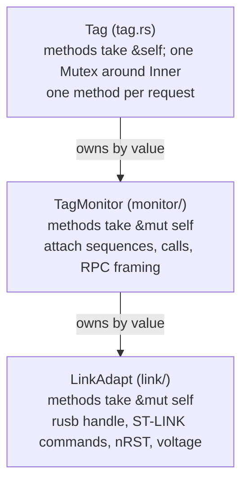

# 3. The link: USB, the ST-LINK protocol and SWD access

This chapter reads `LinkAdapt`, the bottom layer of the Rust `tagcore`
crate: the code that finds an ST-LINK on USB, opens it, and turns "read
DEMCR" or "write these 64 bytes at the call buffer" into ST-LINK command
blocks and libusb bulk transfers. It covers
[`lib.rs`](../../libraries/tagcore-rs/src/lib.rs) and the four files of
[`src/link/`](../../libraries/tagcore-rs/src/link/): `mod.rs`,
`discovery.rs`, `stlink.rs` and `target.rs`. It is the Rust port of your
`linkadapt.cc`, and most functions are a line-for-line translation, so the
chapter spends its time on the places where the Rust differs and on the
Rust constructs that carry the translation.

After reading it you should be able to follow one `read_debug32(DEMCR)`
from the call to the USB endpoint and back, say what is logged when it
fails, and say why there is no mutex anywhere in this folder.

The architecture of the whole communication path is in
[chapter 3 of the guide](../guide/03-communication-model.md) and the crate
map in [chapter 6 of the guide](../guide/06-tagcore.md); this chapter does
not repeat them.

## Where the link sits

The crate root, [`lib.rs`](../../libraries/tagcore-rs/src/lib.rs), is a
44-line `//!` doc comment (the crate's front page in `cargo doc`) followed
by the module list. [lib.rs:46](../../libraries/tagcore-rs/src/lib.rs#L46):

```rust
pub mod configshape;
pub mod link;
pub mod monitor;
pub mod proto;
pub mod recovery;
pub mod tag;
pub mod textformat;

pub use link::{LinkAdapt, LinkAdaptStats, UsbDev};
pub use monitor::{BitTagFlashLog, MemAccess, TagMonitor, TagMonitorStats, TargetFamily};
pub use tag::{StopFailure, Tag, TagError};
```

> **Rust:** `pub mod link;` tells the compiler to compile
> `src/link/mod.rs` (or `src/link.rs`) as the module `tagcore::link`. The
> module tree is declared in code, not discovered by the build system.
> `pub use` re-exports a name, so callers write `tagcore::LinkAdapt` rather
> than `tagcore::link::LinkAdapt`; think of it as a `using` declaration in
> the public header.

The three layers are the same as in the C++:



One structural difference matters from the start. In C++, `TagMonitor`
**inherits** from `LinkAdapt` and reaches `ReadDebug32` and friends as
protected members. Rust has no implementation inheritance, so the Rust
`TagMonitor` **contains** a `LinkAdapt` as a field (`pub(crate) link:
LinkAdapt`, see [chapter 4](04-monitor-and-rpc.md)), and the
debug-register and memory calls are `pub`. That lets `tag-monitor-test`,
tagprobe's field-safe probe-rs driver and the crate's own
`recovery::session` hold a bare `LinkAdapt` without subclassing.

`LinkAdapt` is one type whose methods are spread over four files by
concern:

| File | What it adds to `LinkAdapt` |
| --- | --- |
| `link/mod.rs` | the struct, statistics, attach/detach, the failure-run logging |
| `link/discovery.rs` | `UsbDev`, `available()`, `open_matching()` |
| `link/stlink.rs` | command codes, the 16-byte block, bulk transfers, mode changes, base identify |
| `link/target.rs` | memory, debug registers, nRST, voltage |

> **Rust:** each file has its own `impl LinkAdapt { ... }` block. Any
> module of the same crate may add methods to a type; there is no class
> declaration listing them. It is the C++ habit of defining member
> functions of one class in several `.cc` files, without the header.
> `stlink` and `target` are private modules (`mod stlink;`), yet the `pub`
> methods they define are still public methods of `LinkAdapt`: visibility
> belongs to the method, not to the file it is written in.

## Two libraries: rusb and log

**Library: rusb.** [rusb](https://docs.rs/rusb/0.9.4) (0.9.4) is a safe
Rust wrapper over libusb-1.0. The crate enables its `vendored` feature
([Cargo.toml:30](../../libraries/tagcore-rs/Cargo.toml#L30)), which builds
libusb from source and links it statically, so the tools depend on no
libusb on the user's machine. Its transfers are libusb's **synchronous**
API: `read_bulk` and `write_bulk` block the calling thread until the
transfer completes or times out. No async runtime is involved anywhere in
this layer. The pieces used:

| rusb | libusb equivalent | Used in |
| --- | --- | --- |
| `Context::new()` | `libusb_init` | `LinkAdapt::new` |
| `ctx.devices()`, `DeviceList::iter()` | `libusb_get_device_list` | `available`, `open_matching` |
| `Device::device_descriptor()`, `bus_number()`, `address()` | `libusb_get_device_descriptor`, ... | discovery |
| `Device::open()` → `DeviceHandle<Context>` | `libusb_open` | discovery |
| `active_configuration`, `set_active_configuration`, `set_auto_detach_kernel_driver`, `claim_interface` | the same names | `claim` |
| `read_bulk`, `write_bulk`, `clear_halt` | `libusb_bulk_transfer`, `libusb_clear_halt` | `stlink.rs` |
| `read_control`, `read_string_descriptor_ascii` | `libusb_control_transfer`, `libusb_get_string_descriptor_ascii` | serial and string reading |
| `rusb::Error` (enum: `Io`, `Pipe`, `NoDevice`, `Timeout`, ...) | `LIBUSB_ERROR_*` | everywhere |

A `DeviceHandle` closes the device (`libusb_close`) when it is dropped, and
the `Context` is reference counted, so libusb is torn down only when the
last handle and context are gone. That is what lets this code "close the
probe" by writing `self.handle = None`.

**Library: log.** [log](https://docs.rs/log/0.4.34) is a logging *facade*:
the library calls `error!`, `warn!`, `debug!` or `log!(level, ...)`, and
the application decides where records go by installing a backend. The
command-line tools install `env_logger` at a fixed level, DEBUG with `-d`
and ERROR otherwise, and ignore `RUST_LOG`
([chapter 9](09-command-line-tools.md)); the three applications install a
logger that forwards records to their log tab or pane; only the crate's
`tag_info` example reads `RUST_LOG` (through
`env_logger::Builder::from_env`). With no backend installed nothing is
printed. Each record carries a *target* that defaults to the module path,
such as `tagcore::link::stlink`, so under the example
`RUST_LOG=tagcore::link=debug` turns on exactly this layer. The message
texts deliberately repeat the C++ wording, and `libusb_name`
([mod.rs:181](../../libraries/tagcore-rs/src/link/mod.rs#L181)) maps
`rusb::Error` back to libusb's own names (`LIBUSB_ERROR_TIMEOUT`), so a log
reads the same as one from the C++ tools.

There is no error type in this layer. As in the C++, functions return
`bool` or `Option<T>` and log the reason where it happens
([lib.rs:36-41](../../libraries/tagcore-rs/src/lib.rs#L36)). The first
real error type, `TagError`, is two layers up in `tag.rs`.

## The struct

[link/mod.rs:218](../../libraries/tagcore-rs/src/link/mod.rs#L218) (field
doc comments shortened to their first line):

```rust
pub struct LinkAdapt {
    /// The libusb session, or `None` if libusb failed to initialise (every
    /// later enumeration then finds nothing).
    ctx: Option<Context>,
    /// The open probe; `Some` exactly while attached.
    handle: Option<DeviceHandle<Context>>,
    /// Bulk IN endpoint address (endpoint 1, direction bit set).
    ep_in: u8,
    /// Bulk OUT endpoint address: endpoint 2 on the original ST-LINK/V2,
    /// endpoint 1 on V2-1 and later probes.
    ep_out: u8,
    /// Counters for [`LinkAdapt::link_stats`].
    stats: LinkAdaptStats,
    /// Link operations failed in a row, so a burst is logged once.
    // ...
    failure_run: u32,
    /// True once a transfer has failed with `LIBUSB_ERROR_NO_DEVICE` and the
    /// probe was closed because of it; cleared when a probe is opened.
    // ...
    probe_lost: bool,
    /// True while the monitor layer expects target accesses to fail, so
    /// that a failure is routine rather than a fault: set by
    /// [`LinkAdapt::expect_failures`], cleared by it or by
    /// [`LinkAdapt::detach`].
    // ...
    failures_expected: bool,
}
```

> **Rust:** `Option<DeviceHandle<Context>>` is the Rust spelling of your
> `libusb_device_handle *handle` that may be null. `None` is "no device
> open"; the compiler will not let code use the handle without first
> checking for `Some`, so the null check cannot be forgotten. The
> invariant the module doc states is "`handle` is `Some` exactly while
> attached" ([mod.rs:21](../../libraries/tagcore-rs/src/link/mod.rs#L21)).

The last three fields have no counterpart in `linkadapt.cc`; they drive the
failure-run logging described [below](#failure-runs-one-error-per-burst).

The constructor, [mod.rs:272](../../libraries/tagcore-rs/src/link/mod.rs#L272):

```rust
    pub fn new() -> Self {
        let ctx = Context::new()
            .map_err(|e| error!("USB Init error {}", libusb_name(&e)))
            .ok();
        Self {
            ctx,
            handle: None,
            ep_in: 0,
            ep_out: 0,
            stats: LinkAdaptStats::default(),
            failure_run: 0,
            probe_lost: false,
            failures_expected: false,
        }
    }
```

> **Rust:** `Context::new()` returns `Result<Context, rusb::Error>`.
> `.map_err(|e| error!(...))` runs the closure on the error only (here to
> log it), and `.ok()` turns `Result<T, E>` into `Option<T>`, dropping the
> error. The net effect: log the failure, keep `None`. A failed libusb
> init is therefore not fatal; every later enumeration finds nothing.

## Discovery: `UsbDev` and `available`

A probe is selected by vid, pid, bus and address, as the C++ tools and
qtmonitor do. [discovery.rs:24](../../libraries/tagcore-rs/src/link/discovery.rs#L24)
(doc comments shortened):

```rust
#[derive(Debug, Clone, Default, PartialEq, Eq)]
pub struct UsbDev {
    /// USB vendor ID (0x0483 for ST).
    pub vid: u16,
    /// USB product ID; identifies the ST-LINK generation.
    pub pid: u16,
    /// USB bus number at enumeration.
    pub bus: u8,
    /// USB device address on `bus`; changes on replug.
    pub address: u8,
    /// The ST-LINK's USB serial number as printable text, or empty when it
    /// could not be read.
    // ...
    pub serial: String,
}
```

> **Rust:** `#[derive(...)]` asks the compiler to generate the listed
> trait implementations: `Debug` (printable with `{:?}`), `Clone`
> (`.clone()`), `Default` (all fields zero or empty, so
> `UsbDev::default()` means "the first ST-LINK found"), and
> `PartialEq`/`Eq` (`==`). It replaces the hand-written copy constructor,
> `operator==` and stream inserter you would otherwise write.

`serial` is filled by `available()` but **not used by `attach`**: tools that
let the user name a probe by serial list the probes, find the entry with
that serial, and attach with the whole entry.

Which products count as an ST-LINK, [discovery.rs:49](../../libraries/tagcore-rs/src/link/discovery.rs#L49):

```rust
pub fn is_stlink(vid: u16, pid: u16) -> bool {
    use stlink::*;
    vid == USB_VID_ST
        && matches!(
            pid,
            USB_PID_STLINK_32L
                | USB_PID_STLINK_32L_AUDIO
                | USB_PID_STLINK_NUCLEO
                | USB_PID_STLINK_V2_1
                | USB_PID_STLINK_V3E
                | USB_PID_STLINK_V3S
                | USB_PID_STLINK_V3_PWR
        )
}
```

> **Rust:** `matches!(value, pattern)` is a boolean "does this value fit
> the pattern"; `A | B | C` in a pattern is "any of". Named constants are
> allowed in patterns. It is a `switch` with fall-through cases that
> returns true, written as one expression.

The doc comment above it notes that `host/linux/70-ultralight-tags.rules`
must list the same products, since on Linux a user can open only what a
udev rule grants.

Listing, [discovery.rs:133](../../libraries/tagcore-rs/src/link/discovery.rs#L133):

```rust
    pub fn available(&self) -> Vec<UsbDev> {
        let Some(ctx) = &self.ctx else {
            return Vec::new();
        };
        let devices = match ctx.devices() {
            Ok(devices) => devices,
            Err(e) => {
                error!("USB Init error {}", libusb_name(&e));
                return Vec::new();
            }
        };
        let mut stlinks = Vec::new();
        for dev in devices.iter() {
            let desc = match dev.device_descriptor() {
                Ok(desc) => desc,
                Err(e) => {
                    error!("USB Init error {}", libusb_name(&e));
                    break;
                }
            };
            if !is_stlink(desc.vendor_id(), desc.product_id()) {
                continue;
            }
            stlinks.push(UsbDev {
                vid: desc.vendor_id(),
                pid: desc.product_id(),
                bus: dev.bus_number(),
                address: dev.address(),
                serial: read_serial(&dev, &desc),
            });
        }
        stlinks
    }
```

> **Rust:** `let Some(ctx) = &self.ctx else { return ...; };` is
> *let-else*: bind `ctx` if the pattern matches, otherwise run the `else`
> block, which must leave the function (or loop). It is the early-return
> guard `if (!ctx) return {};` that also gives you the unwrapped value.
> You will see it on almost every page of this layer.

> **Rust:** `ctx.devices()` is a method of the trait `rusb::UsbContext`,
> and it can only be called because `discovery.rs` has
> `use rusb::{Context, Device, DeviceDescriptor, UsbContext};` at
> [line 16](../../libraries/tagcore-rs/src/link/discovery.rs#L16). A trait's
> methods are callable only where the trait is in scope; a missing `use`
> shows up as "method not found".

`available()` takes `&self` and never claims an interface or sends a
command, so it does not reset any tag. It does briefly **open** each
ST-LINK to read its serial ([discovery.rs:95](../../libraries/tagcore-rs/src/link/discovery.rs#L95)),
with a raw `GET_DESCRIPTOR(STRING)` control transfer so that the old
ST-LINK/V2's 12-byte binary serial can be hex-encoded as
STM32_Programmer_CLI shows it (`decode_serial`, [discovery.rs:72](../../libraries/tagcore-rs/src/link/discovery.rs#L72)).
A probe held by another process lists with an empty serial.

## Opening a probe and choosing the endpoints

`open_matching` ([discovery.rs:177](../../libraries/tagcore-rs/src/link/discovery.rs#L177))
walks the same device list. With a non-zero vid and pid in the `UsbDev`
only the exact vid/pid/bus/address matches (and it need not be in the
`is_stlink` list); otherwise the first accepted ST-LINK wins. A device that
matches but will not open is logged and skipped. Once one opens, from
[discovery.rs:217](../../libraries/tagcore-rs/src/link/discovery.rs#L217):

```rust
            // ST-LINK/V2 uses OUT endpoint 2; later probes use endpoint 1.
            self.ep_in = 1 | rusb::constants::LIBUSB_ENDPOINT_IN;
            self.ep_out = match desc.product_id() {
                stlink::USB_PID_STLINK_NUCLEO
                | stlink::USB_PID_STLINK_32L_AUDIO
                | stlink::USB_PID_STLINK_V2_1
                | stlink::USB_PID_STLINK_V3E
                | stlink::USB_PID_STLINK_V3S
                | stlink::USB_PID_STLINK_V3_2VCP
                | stlink::USB_PID_STLINK_V3_PWR => 1,
                _ => 2,
            } | rusb::constants::LIBUSB_ENDPOINT_OUT;

            let text = |index: Option<u8>| {
                index
                    .and_then(|i| handle.read_string_descriptor_ascii(i).ok())
                    .unwrap_or_default()
            };
            debug!(
                "Device Manufacturer: {}",
                text(desc.manufacturer_string_index())
            );
            debug!("Device Product: {}", text(desc.product_string_index()));
            debug!("Device Serial: {}", text(desc.serial_number_string_index()));
            debug!(
                "Device Bus {:03} Device {:03}",
                dev.bus_number(),
                dev.address()
            );

            self.handle = Some(handle);
            // A new probe starts a new session: no failure run, not lost.
            self.failure_run = 0;
            self.probe_lost = false;
            return true;
```

The tag bases carry an original ST-LINK/V2 (pid `0x3748`), so they fall to
the `_ => 2` arm: IN endpoint `0x81`, OUT endpoint `0x02`.

> **Rust:** `match` is an expression with a value, so the endpoint number
> is computed by the `match` and then OR-ed with the direction bit in one
> statement. `_` is the default arm. Every `match` must be exhaustive,
> which for a `u16` means a `_` arm is required.

> **Rust:** `text` is a closure (a lambda) that captures `handle` by
> reference. `.and_then` chains an `Option`-returning step onto an
> `Option` (no string index → `None`), `.ok()` turns the libusb `Result`
> into an `Option`, and `.unwrap_or_default()` gives an empty string for
> `None`. A few lines later `handle` is *moved* into `self.handle`; the
> compiler allows it because the closure's borrow ends at its last use
> (the borrow checker reasons about where a reference is last used, not
> about the closing brace).

`open_matching` claims nothing. The rest of an attach is in `mod.rs`.

## Attach: claim, reset, enter SWD

[mod.rs:315](../../libraries/tagcore-rs/src/link/mod.rs#L315):

```rust
    pub fn attach_with_reset(&mut self, assert_reset: bool, usbdev: &UsbDev) -> bool {
        self.handle = None;
        if self.open_matching(usbdev) && self.configure(assert_reset) {
            return true;
        }
        self.detach();
        false
    }
```

`attach(usbdev)` is `attach_with_reset(true, usbdev)`. Note the first line:
an already-open probe is dropped (closed by rusb) without the exit-debug
command. `configure`, [mod.rs:451](../../libraries/tagcore-rs/src/link/mod.rs#L451):

```rust
    fn configure(&mut self, assert_reset: bool) -> bool {
        if !self.claim() {
            return false;
        }
        let Some(mode) = self.current_mode() else {
            return true;
        };
        debug!("ST-LINK mode before debug entry: 0x{mode:x}");
        if mode_code(mode) == stlink::DEV_DFU_MODE && !self.exit_dfu_mode() {
            error!("exit dfu mode failed");
            return false;
        }
        if assert_reset {
            if !self.assert_reset(false) {
                error!("asserting target reset failed");
                return false;
            }
            debug!("target reset asserted through ST-LINK");
        }
        self.enter_swd()
    }
```

The order is the C++ `Attach`'s: claim, read the mode, leave DFU, drive
nRST low, and only then enter SWD, so the tag is already in reset when its
debug port comes up. **The tag is left held in reset** when `attach`
returns; the monitor's attach sequence releases it
([chapter 4](04-monitor-and-rpc.md)). Two inherited quirks are kept on
purpose: if the mode cannot be read, `configure` returns `true` without
entering SWD, as the C++ does; and `assert_reset(false)` is the call that
*asserts* reset (see [nRST](#nrst-assert_resettrue-releases-reset)).

> **Rust:** `"0x{mode:x}"` is an inline format argument: the variable
> `mode` printed in lower-case hex. Format strings are checked at compile
> time, so a missing argument is a build error, not a crash.

`claim` ([mod.rs:414](../../libraries/tagcore-rs/src/link/mod.rs#L414))
selects configuration 1, asks libusb to detach a kernel driver (ignored
where unsupported, with `let _ = ...`), claims interface 0, and logs the
target voltage at DEBUG as a sign of life.

### Entering SWD, with a retry the C++ did not have

[mod.rs:368](../../libraries/tagcore-rs/src/link/mod.rs#L368):

```rust
    pub fn enter_swd(&mut self) -> bool {
        let mut attempt = 1;
        loop {
            match self.enter_debug_mode() {
                None => {
                    error!("enter swd mode command failed");
                    return false;
                }
                Some(stlink::DEBUG_ERR_OK) => {
                    if attempt > 1 {
                        warn!("enter swd mode succeeded on attempt {attempt}");
                    }
                    break;
                }
                Some(status) if attempt < SWD_ENTER_ATTEMPTS => {
                    debug!("enter swd mode reported status 0x{status:x}; retrying");
                    sleep(SWD_ENTER_RETRY_DELAY);
                    attempt += 1;
                }
                Some(status) => {
                    error!(
                        "enter swd mode reported status 0x{status:x} on all {SWD_ENTER_ATTEMPTS} attempts"
                    );
                    break;
                }
            }
        }
        // Mode 4 is accepted as well as DEBUG_MODE for existing bases.
        match self.current_mode() {
            Some(mode) if matches!(mode_code(mode), 4 | stlink::DEV_DEBUG_MODE) => {
                debug!("ST-LINK mode after debug entry: 0x{mode:x}");
                true
            }
            mode => {
                error!("enter swd mode failed: 0x{:x}", mode.unwrap_or(0));
                false
            }
        }
    }
```

A tag in Shutdown has an unpowered debug port until nRST wakes it, and the
enter sent about a millisecond after nRST occasionally arrives first; the
base then fails every debug access of the session with 0x81. The fix (up to
four sends, 10 ms apart, [mod.rs:80-85](../../libraries/tagcore-rs/src/link/mod.rs#L80))
is in both libraries now; the investigation is
`host/libraries/tagcore/design/investigations/2026-10-l4-attach-swd-enter.md`.

> **Rust:** match arms are tried in order. `Some(stlink::DEBUG_ERR_OK)`
> matches a constant inside the `Option`; `Some(status) if attempt < ...`
> binds `status` and then applies a *guard*; the final `Some(status)`
> catches the rest. `None` must be handled too, or the code does not
> compile. `loop { ... break; }` is `for (;;)`.

## The 16-byte command block

The command codes are `pub const`s at the top of
[`stlink.rs`](../../libraries/tagcore-rs/src/link/stlink.rs#L25), ported from
`commands.h`, each with a doc comment saying what the reply looks like. The
ones this layer uses:

| Constant | Value | Reply |
| --- | --- | --- |
| `GET_CURRENT_MODE` | `F5` | 2 bytes, low byte the mode |
| `GET_TARGET_VOLTAGE` | `F7` | 8 bytes: reference, reading |
| `DFU_COMMAND`, `DFU_EXIT` | `F3 07` | none |
| `DEBUG_COMMAND` | `F2`, sub-command in byte 1 | |
| `DEBUG_APIV2_ENTER` + `DEBUG_ENTER_SWD` | `F2 30 A3` | 2-byte status |
| `DEBUG_EXIT` | `F2 21` | none |
| `JTAG_DRIVE_NRST` | `F2 3C <level>` | 2-byte status |
| `DEBUG_READMEM_32BIT` / `WRITEMEM_32BIT` | `F2 07` / `F2 08`, addr, count | data / none |
| `DEBUG_APIV2_READDEBUGREG` | `F2 36 <addr>` | 8 bytes: status, pad, value |
| `DEBUG_APIV2_WRITEDEBUGREG` | `F2 35 <addr> <value>` | 2-byte status |
| `DEBUG_APIV2_GETLASTRWSTATUS2` / `GETLASTRWSTATUS` | `F2 3E` / `F2 3B` | 12 / 2 bytes |
| `TAGBASE_COMMAND`, `TAGBASE_IDENTIFY` (private) | `F6 99` | 128 bytes |

`DEBUG_ERR_OK` is `0x80`. The block builder,
[stlink.rs:145](../../libraries/tagcore-rs/src/link/stlink.rs#L145):

```rust
pub(super) fn debug_cmd(sub: u8, addr: u32) -> [u8; 16] {
    let mut cmd = [0u8; 16];
    cmd[0] = DEBUG_COMMAND;
    cmd[1] = sub;
    cmd[2..6].copy_from_slice(&addr.to_le_bytes());
    cmd
}
```

> **Rust:** `[u8; 16]` is a fixed-size array, and unlike a C array it is a
> value: it can be returned from a function and is copied like a struct.
> `addr.to_le_bytes()` gives the four little-endian bytes as a `[u8; 4]`,
> and `cmd[2..6]` is a bounds-checked slice of the block. This layer never
> casts a struct over a byte buffer; every multi-byte field is packed and
> unpacked explicitly with `to_le_bytes` / `from_le_bytes`, so host
> endianness and padding never come into it. `pub(super)` means "visible
> to the parent module" (`link`), not to the rest of the crate.

The only unit test in the file checks exactly this:
`debug_command_blocks_are_little_endian` ([stlink.rs:470](../../libraries/tagcore-rs/src/link/stlink.rs#L470)).

Every exchange is a block on the OUT endpoint followed by an optional data
phase. `cmd_read` is the C++ `cmd_eval` with `ReadnWrite` true,
[stlink.rs:306](../../libraries/tagcore-rs/src/link/stlink.rs#L306):

```rust
    pub(super) fn cmd_read(&mut self, cmd: &[u8; 16], buf: &mut [u8]) -> bool {
        let start = Instant::now();
        if !self.usb_out(cmd) {
            log!(self.failure_level(), "cmd_eval request failed");
            return false;
        }
        if !buf.is_empty() && !self.usb_in(buf) {
            log!(self.failure_level(), "cmd_eval response failed");
            return false;
        }
        self.count_cmd(start);
        true
    }
```

`cmd_write` ([stlink.rs:325](../../libraries/tagcore-rs/src/link/stlink.rs#L325))
is the same with a second `usb_out` for the payload. Neither interprets
status bytes; that is left to the caller.

> **Rust:** `&[u8; 16]` is a reference to exactly sixteen bytes, so the
> type system guarantees every command block has the right size.
> `&mut [u8]` is a *slice*: pointer and length in one value, the
> `(uint8_t *buf, size_t len)` pair of C. `buf.len()` is how many bytes to
> read, so there is no separate size argument to get wrong. Passing
> `&mut []` (an empty slice) means "no data phase".

A small command shows the idiom used for short replies,
[stlink.rs:349](../../libraries/tagcore-rs/src/link/stlink.rs#L349):

```rust
    pub(super) fn current_mode(&mut self) -> Option<u16> {
        let mut cmd = [0u8; 16];
        cmd[0] = GET_CURRENT_MODE;
        let mut result = [0u8; 2];
        self.cmd_read(&cmd, &mut result).then(|| unpack16(&result))
    }
```

> **Rust:** `bool::then(f)` returns `Some(f())` if the bool is true and
> `None` otherwise. It folds "call, check the bool, then decode the reply
> or return nothing" into one line, and replaces the C++ pattern of a
> `bool` return plus an out-parameter.

## Bulk transfers and timeouts

The two transfer functions are the halves of the C++ `usb_xfer`.
[stlink.rs:192](../../libraries/tagcore-rs/src/link/stlink.rs#L192):

```rust
    fn usb_in(&mut self, buf: &mut [u8]) -> bool {
        let Some(handle) = &self.handle else {
            self.no_device_open();
            return false;
        };
        let start = Instant::now();
        let mut result = handle.read_bulk(self.ep_in, buf, USB_TRANSFER_TIMEOUT);
        if matches!(result, Err(rusb::Error::Pipe)) && clear_stall(handle, self.ep_in, "IN") {
            result = handle.read_bulk(self.ep_in, buf, USB_TRANSFER_TIMEOUT);
        }
        let res = match result {
            Ok(n) => n,
            Err(e) => {
                self.transfer_failed(&e);
                return false;
            }
        };
        if INSTRUMENTED {
            self.stats.usb_in_calls += 1;
            self.stats.usb_in_bytes += res as u64;
            self.stats.usb_in_ns += elapsed_ns(start);
        }
        if res != buf.len() {
            let level = self.note_failure();
            log!(level, "Transferred {res} bytes instead of {}", buf.len());
            return false;
        }
        true
    }
```

Every bulk transfer has the C++ timeout,
`USB_TRANSFER_TIMEOUT = Duration::from_millis(1500)`
([stlink.rs:102](../../libraries/tagcore-rs/src/link/stlink.rs#L102)).
Monitor-level waits are built from many short commands, never one long
transfer. A short transfer is a failure.

> **Rust:** `handle` here is a shared borrow of `self.handle`. The call
> `self.transfer_failed(&e)` needs `&mut self`, which would conflict with a
> live borrow of one of `self`'s fields, but `handle` is not used after
> that point, so the borrow has already ended and the compiler accepts it.
> Reorder those lines (use `handle` after `transfer_failed`) and the code
> stops compiling: this is the borrow checker enforcing that nothing can
> close the device while a reference to it is in use.

Two behaviours here are **Rust-only**; your C++ has neither.

### Stall clearing

If a transfer fails with `LIBUSB_ERROR_PIPE` (the endpoint stalled), the
halt is cleared once and the transfer retried once,
[stlink.rs:165](../../libraries/tagcore-rs/src/link/stlink.rs#L165):

```rust
fn clear_stall(handle: &rusb::DeviceHandle<rusb::Context>, endpoint: u8, dir: &str) -> bool {
    match handle.clear_halt(endpoint) {
        Ok(()) => {
            warn!("bulk {dir} endpoint {endpoint:#04x} stalled; cleared the halt, retrying once");
            true
        }
        Err(e) => {
            warn!(
                "bulk {dir} endpoint {endpoint:#04x} stalled, and clearing it failed: {}",
                libusb_name(&e)
            );
            false
        }
    }
}
```

The reason is in its doc comment: a 2022 bittag-base-v7 build that predates
the identify command (`F6 99`) left its endpoint stalled after receiving it,
and every later command failed with `LIBUSB_ERROR_PIPE` until the base was
unplugged. The halt is cleared only after a stall, never on open, because
`CLEAR_FEATURE` resets the data toggle.

### `NO_DEVICE` closes the probe

[stlink.rs:271](../../libraries/tagcore-rs/src/link/stlink.rs#L271):

```rust
    fn transfer_failed(&mut self, e: &rusb::Error) {
        let level = self.note_failure();
        if *e == rusb::Error::NoDevice {
            error!(
                "{}: the probe has gone; closing it, attach again to continue",
                libusb_name(e)
            );
            self.handle = None;
            self.probe_lost = true;
        } else {
            log!(level, "{}", libusb_name(e));
        }
    }
```

When the base is unplugged (or re-enumerates), the handle is dropped at
once, so `is_attached()` turns false. The monitor's poll loops check
`is_attached()` after a failed read and give up, so an L4 call in progress
ends at once instead of polling a missing device for 2500 iterations. The C++
keeps polling to its timeout. `architecture.md`'s
[Logging section](../../libraries/tagcore-rs/design/architecture.md#logging)
records this as a deliberate difference. Every later transfer then goes
through `no_device_open` ([stlink.rs:291](../../libraries/tagcore-rs/src/link/stlink.rs#L291)),
which counts the failure in the run when `probe_lost` is set and logs an
ERROR every time otherwise (a transfer with no probe, without an unplug, is
a caller bug).

> **Rust:** `self.handle = None;` is the whole of "close the device". The
> old `DeviceHandle` is dropped by the assignment, and its destructor
> releases the interface and calls `libusb_close`. There is no explicit
> `close()` anywhere in this layer.

## Target access: memory and debug registers

[`target.rs`](../../libraries/tagcore-rs/src/link/target.rs) holds the four
calls the monitor is built on. There are two paths, and the monitor uses
both:

| | Memory: `read_mem32`, `write_mem32` | Debug register: `read_debug32`, `write_debug32` |
| --- | --- | --- |
| Command | `F2 07` / `F2 08`, address, 16-bit byte count | `F2 36` / `F2 35`, one word |
| Size | any multiple of 4 up to 65535 bytes | one 32-bit word |
| Status | none in the reply; a separate last-R/W-status command | in the reply (first two bytes) |
| Halts the core | no | no (the access itself) |
| Used for | the RPC call buffer, the U3 shared block, SHA string, live memory, peripheral words | DHCSR, DEMCR, DCRDR, SCB, DBGMCU_IDCODE |

### Debug registers

[target.rs:153](../../libraries/tagcore-rs/src/link/target.rs#L153), the
port of `LinkAdapt::ReadDebug32`:

```rust
    pub fn read_debug32(&mut self, addr: u32) -> Option<u32> {
        let start = Instant::now();
        let mut result = [0u8; 8];
        if !self.cmd_read(
            &debug_cmd(stlink::DEBUG_APIV2_READDEBUGREG, addr),
            &mut result,
        ) {
            return None;
        }
        let status = unpack16(&result);
        if status != stlink::DEBUG_ERR_OK {
            // Callers poll; a base can fail a burst of reads (status 0x81)
            // and then recover, so only the first of a run is an error.
            let level = self.note_failure();
            log!(level, "read debug register 0x{addr:x} failed status=0x{status:x}");
            return None;
        }
        self.end_failure_run(format_args!("debug register 0x{addr:x} read"));
        if INSTRUMENTED {
            self.stats.read_debug_calls += 1;
            self.stats.read_debug_ns += elapsed_ns(start);
        }
        Some(unpack32(&result[4..8]))
    }
```

Apart from the logging this is your C++: an 8-byte reply, status in bytes
0..2, value in bytes 4..8. The return type replaces the `bool` plus
`uint32_t *` out-parameter: `None` is failure, `Some(value)` is the word.

> **Rust:** `log!(level, ...)` is the `log` macro with a level chosen at
> run time (a `log::Level`), where `error!` and `debug!` fix it at compile
> time. Here the level comes from the failure-run counter.

`write_debug32` ([target.rs:185](../../libraries/tagcore-rs/src/link/target.rs#L185))
patches the value into bytes 6..10 of the block and checks a 2-byte status.
Its doc comment says what the reader must remember when using it directly:
writes to DHCSR, DEMCR or the SCB can halt, resume or reset the core, and
this function does not care.

### Memory, and the last-R/W status

[target.rs:73](../../libraries/tagcore-rs/src/link/target.rs#L73):

```rust
    pub fn read_mem32(&mut self, addr: u32, buf: &mut [u8]) -> bool {
        let start = Instant::now();
        let Ok(count) = u16::try_from(buf.len()) else {
            error!("read of {} bytes exceeds one ST-LINK transfer", buf.len());
            return false;
        };
        let mut cmd = debug_cmd(stlink::DEBUG_READMEM_32BIT, addr);
        cmd[6..8].copy_from_slice(&count.to_le_bytes());
        if !self.cmd_read(&cmd, buf) {
            return false;
        }
        match self.get_rw_status() {
            Some(stlink::DEBUG_ERR_OK) => {}
            status => {
                let level = self.note_failure();
                log!(level, "error return {:x}", status.unwrap_or(0));
                return false;
            }
        }
        self.end_failure_run(format_args!("a memory read"));
        if INSTRUMENTED {
            self.stats.read_mem_calls += 1;
            self.stats.read_mem_bytes += u64::from(count);
            self.stats.read_mem_ns += elapsed_ns(start);
        }
        true
    }
```

> **Rust:** `u16::try_from(buf.len())` is a *checked* narrowing: it
> returns `Err` if the `usize` does not fit in 16 bits, where the C++
> `uint16_t` parameter would silently truncate. Rust has no implicit
> integer conversions at all; widening uses `u64::from(count)` (cannot
> fail) and deliberate truncation uses `as`. When you see `as` in this
> code, someone chose to truncate or reinterpret.

`read_mem32` does **not** check alignment; the ST-LINK rejects a misaligned
request. `TagMonitor::read_mem` checks before calling it, but tools that
use `LinkAdapt` directly must check for themselves.

The memory command reports success at the USB level even when the target
faulted the access, so every transfer is confirmed with the last-R/W
status, [stlink.rs:394](../../libraries/tagcore-rs/src/link/stlink.rs#L394):

```rust
    pub(super) fn get_rw_status(&mut self) -> Option<u16> {
        let start = Instant::now();
        let mut result = [0u8; 12];
        let status = if self.cmd_read(&debug_cmd(DEBUG_APIV2_GETLASTRWSTATUS2, 0), &mut result) {
            unpack16(&result)
        } else {
            // Older probe firmware has only the two-byte form.
            let mut legacy = [0u8; 2];
            if !self.cmd_read(&debug_cmd(DEBUG_APIV2_GETLASTRWSTATUS, 0), &mut legacy) {
                return None;
            }
            unpack16(&legacy)
        };
        if INSTRUMENTED {
            self.stats.rw_status_calls += 1;
            self.stats.rw_status_ns += elapsed_ns(start);
        }
        Some(status)
    }
```

So one memory read costs at least two ST-LINK commands (four bulk
transfers), and when the 12-byte form fails, three. Keep that in mind when
reading the poll loops in [chapter 4](04-monitor-and-rpc.md): an L4 call
polls with debug-register reads (one command each), a U3 call with memory
reads (two each).

> **Rust:** `if ... { a } else { b }` is an expression, like C's `?:` but
> with blocks; the value of the last expression of the chosen block
> (written without a semicolon) becomes `status`. The `return None;`
> inside the `else` leaves the whole function.

## nRST: `assert_reset(true)` releases reset

[target.rs:214](../../libraries/tagcore-rs/src/link/target.rs#L214):

```rust
    pub fn assert_reset(&mut self, high: bool) -> bool {
        let mut cmd = debug_cmd(stlink::JTAG_DRIVE_NRST, 0);
        cmd[2] = u8::from(high);
        let mut result = [0u8; 2];
        if !self.cmd_read(&cmd, &mut result) {
            return false;
        }
        let status = unpack16(&result);
        if status != stlink::DEBUG_ERR_OK {
            error!("assert reset failed: {status:x}");
            return false;
        }
        true
    }
```

The name is the C++ `AssertReset`'s, but the argument is the **line
level**: `assert_reset(true)` drives nRST high and so **releases** reset;
`assert_reset(false)` holds the tag in reset. Read every call site with that
in mind: `configure` calls `assert_reset(false)` to put the tag in reset
before SWD entry, and the monitor's attach sequences call
`assert_reset(true)` to let it boot.

> **Rust:** `u8::from(high)` converts a `bool` to 0 or 1. Rust will not
> let you write `cmd[2] = high;` because `bool` and `u8` are distinct
> types; `From` conversions are the lossless ones.

## Voltage

[target.rs:45](../../libraries/tagcore-rs/src/link/target.rs#L45):

```rust
    pub fn voltage(&mut self) -> Option<f32> {
        let mut cmd = [0u8; 16];
        cmd[0] = stlink::GET_TARGET_VOLTAGE;
        let mut result = [0u8; 8];
        if self.cmd_read(&cmd, &mut result) {
            let factor = unpack32(&result[0..4]) as f32;
            let reading = unpack32(&result[4..8]) as f32;
            return Some(2.4 * reading / factor);
        }
        error!("Voltage failed");
        None
    }
```

The probe returns its 1.2 V reference reading and the target pin's reading
through a divide-by-two, so the voltage is `2 * 1.2 * reading / reference`,
as in `LinkAdapt::Voltage`. A zero reference gives an infinite or NaN
`f32`, not `None`. The command goes to the probe only; nothing reaches the
tag.

## Base identify (`F6 99`)

The one exchange that talks to the base's own firmware rather than the tag.
[stlink.rs:428](../../libraries/tagcore-rs/src/link/stlink.rs#L428):

```rust
    pub fn base_identity(&mut self) -> Option<String> {
        let handle = self.handle.as_ref()?;
        let mut cmd = [0u8; 16];
        cmd[0] = TAGBASE_COMMAND;
        cmd[1] = TAGBASE_IDENTIFY;
        if handle
            .write_bulk(self.ep_out, &cmd, USB_TRANSFER_TIMEOUT)
            .ok()?
            != cmd.len()
        {
            return None;
        }
        let mut reply = [0u8; TAGBASE_IDENTIFY_LEN];
        let n = match handle.read_bulk(self.ep_in, &mut reply, TAGBASE_IDENTIFY_TIMEOUT) {
            Ok(n) => n,
            Err(e) => {
                debug!(
                    "base identify: no reply ({}); not a tag base, or one that predates the command",
                    libusb_name(&e)
                );
                return None;
            }
        };
        if n != reply.len()
            || reply[0] != 0x80
            || reply[1] != 0
            || reply[2] != TAGBASE_IDENTIFY_FORMAT
        {
            debug!("base identify: {n}-byte reply; the base predates the command");
            return None;
        }
        let text = &reply[4..];
        let end = text.iter().position(|&b| b == 0).unwrap_or(text.len());
        Some(String::from_utf8_lossy(&text[..end]).into_owned())
    }
```

A current base answers 128 bytes: `80 00`, format 1, a reserved byte, then
NUL-padded text such as
`base=<target>;fw=<git hash>;dirty=<0|1>;date=<commit date>;stlink=V2J37S7`.
An older base answers a 2-byte FAULT, and the 2022 firmware not at all, so
the function calls `read_bulk` directly with a 300 ms timeout instead of
going through `cmd_read` (and its 1.5 s timeout, statistics and error
logging). A missing reply is DEBUG, not ERROR. The firmware side is
`STLINK_TAGBASE_*` in `embedded/bases/common/inc/stlink.h`. `Tag` reaches
this through `self.lock().monitor.link.base_identity()`
([tag.rs:437](../../libraries/tagcore-rs/src/tag.rs#L437)).

> **Rust:** `?` applied to an `Option` returns `None` from the function if
> the value is `None`, and unwraps it otherwise. `self.handle.as_ref()?`
> is "if no device is open, return `None`"; `.ok()?` does the same for a
> failed `write_bulk`. `?` on a `Result` (in functions that return
> `Result`) works the same way with the error.

> **Rust:** `text.iter().position(|&b| b == 0)` finds the first NUL, the
> `strnlen` of this code; `|&b|` destructures the `&u8` the iterator
> yields into a plain `u8`. `String::from_utf8_lossy` builds a string and
> replaces invalid UTF-8 rather than failing.

## Failure runs: one error per burst

This is the largest behavioural difference from `linkadapt.cc`, which logs
every failure. The monitor polls DEMCR or the U3 shared block once per
millisecond, a base can fail a burst of reads with 0x81 and recover, and a
tag that drops into standby after MONITORSTOP fails every read until it is
released. Logged one line per failure, one reconnect wrote hundreds of
identical errors and an unplug during an L4 call about 2,500
([architecture.md, Logging](../../libraries/tagcore-rs/design/architecture.md#logging)).

[mod.rs:520](../../libraries/tagcore-rs/src/link/mod.rs#L520) (doc
comments dropped):

```rust
    pub(super) fn note_failure(&mut self) -> Level {
        self.failure_run = self.failure_run.saturating_add(1);
        self.failure_level()
    }

    pub(super) fn failure_level(&self) -> Level {
        if self.failure_run <= 1 && !self.failures_expected {
            Level::Error
        } else {
            Level::Debug
        }
    }

    pub(super) fn end_failure_run(&mut self, what: std::fmt::Arguments<'_>) {
        if self.failure_run > 1 {
            let level = if self.failures_expected {
                Level::Debug
            } else {
                Level::Warn
            };
            log!(
                level,
                "{} link operations failed in a row before {what}{}",
                self.failure_run,
                if self.probe_lost {
                    " (the probe was disconnected)"
                } else {
                    ""
                }
            );
        }
        self.failure_run = 0;
    }
```

The rules:

1. Every failed USB transfer, short transfer, non-OK debug-register status
   and non-OK last-R/W status calls `note_failure`, which counts it and
   returns ERROR for the first of a run and DEBUG for the rest.
2. A further line about the *same* failure (for example
   "cmd_eval request failed" after the transfer's own line) uses
   `failure_level`, which does not count again.
3. The next successful memory or debug-register access calls
   `end_failure_run`, which logs one WARN, "N link operations failed in a
   row before debug register 0xe000edfc read", if the run was two or more
   long. `detach` calls it too, so a run cut short by a detach or an unplug
   is still summarised.
4. While the monitor has said failures are expected,
   `expect_failures(true)` ([mod.rs:500](../../libraries/tagcore-rs/src/link/mod.rs#L500)),
   the whole run including the summary is DEBUG. The monitor does that from
   MONITORSTOP to the end of a detach, and around the first L4 call after
   attach, which it retries ([chapter 4](04-monitor-and-rpc.md)).
   `detach` turns it off again.

> **Rust:** `std::fmt::Arguments<'_>` is a pre-parsed, not yet formatted
> message, produced by `format_args!("debug register 0x{addr:x} read")`.
> It borrows its arguments and allocates nothing, so the success path,
> which runs once per millisecond poll, never builds a string; the text is
> formatted only if the WARN is actually logged. The `'_` is an elided
> lifetime: "this value borrows something; the compiler works out what".

> **Rust:** `saturating_add(1)` stops at `u32::MAX` instead of wrapping.
> Arithmetic overflow in Rust panics in debug builds, so code that might
> overflow says what it wants.

The tests at the end of `mod.rs` ([mod.rs:586](../../libraries/tagcore-rs/src/link/mod.rs#L586))
check these rules without hardware: they drive a `LinkAdapt` with no probe
open, which is exactly the state an unplug leaves.
`polling_a_lost_probe_logs_a_bounded_handful` polls `read_debug32` and
`read_mem32` 2,500 times each after a simulated loss and asserts zero ERRORs
and one WARN. They install a capturing logger:

```rust
    thread_local! {
        /// Levels of the records this test thread logged from this module.
        static RECORDS: RefCell<Vec<Level>> = const { RefCell::new(Vec::new()) };
    }
```

> **Rust:** `log` allows one logger per process, but `cargo test` runs
> tests on parallel threads. The test logger is installed once
> (`std::sync::Once`) and stores records in a `thread_local!`, so each
> test sees only its own. `RefCell` gives mutable access to the vector
> through a shared reference, checked at run time; it is the
> single-threaded cousin of a mutex.

## Instrumentation

[mod.rs:75](../../libraries/tagcore-rs/src/link/mod.rs#L75):

```rust
const INSTRUMENTED: bool = cfg!(feature = "instrumentation");
```

The `instrumentation` Cargo feature (on by default,
[Cargo.toml:16-21](../../libraries/tagcore-rs/Cargo.toml#L16)) mirrors
`TAGCORE_ENABLE_INSTRUMENTATION`. Code that counts is written as
`if INSTRUMENTED { self.stats.usb_in_calls += 1; ... }`.

> **Rust:** `cfg!(...)` evaluates to a compile-time `true` or `false`.
> Unlike `#[cfg(...)]`, which deletes the code before it is type-checked
> (like `#ifdef`), `if INSTRUMENTED { ... }` is always compiled and checked,
> and the optimiser removes it when the constant is false. It is
> `if constexpr` on a macro, and it means the counting code cannot rot in
> builds that turn the feature off.

The counters are in `LinkAdaptStats` ([mod.rs:99](../../libraries/tagcore-rs/src/link/mod.rs#L99)):
USB IN/OUT calls, bytes and nanoseconds; ST-LINK commands; memory reads and
writes; debug-register reads and writes; last-R/W-status queries. Only
successful operations are counted, and the categories nest (one memory read
is a command, two or more transfers and a status query), so they must not
be summed. `Default` is written by hand
([mod.rs:151](../../libraries/tagcore-rs/src/link/mod.rs#L151)) because
`enabled` must be `INSTRUMENTED`, not `false`. `link_stats()` returns a
`.clone()`: the struct derives `Clone` but not `Copy`, so a copy is always
written out.

## Detach and `Drop`

[mod.rs:483](../../libraries/tagcore-rs/src/link/mod.rs#L483) and
[mod.rs:580](../../libraries/tagcore-rs/src/link/mod.rs#L580):

```rust
    pub fn detach(&mut self) {
        if self.handle.is_some() {
            self.exit_debug_mode();
        }
        self.handle = None;
        self.end_failure_run(format_args!("detach"));
        self.failures_expected = false;
    }
```

```rust
/// Detaches, so a dropped link never leaves the probe in SWD mode.
impl Drop for LinkAdapt {
    fn drop(&mut self) {
        self.detach();
    }
}
```

`detach` sends `F2 21` and drops the handle. It sends **no** monitor
command: ending a monitor session is `TagMonitor::detach`'s job, and calling
`LinkAdapt::detach` on a tag with an open session leaves the firmware to
time the session out.

> **Rust:** `impl Drop` is the destructor. It runs when the owner goes
> out of scope, exactly as a C++ destructor does, and afterwards each
> field is dropped in declaration order (`ctx`, then `handle`, ...). When a
> `TagMonitor` is dropped, its own `Drop` runs first (MONITORSTOP and
> `link.detach()`), then its `link` field's `Drop` calls `detach()` again,
> which finds `handle` already `None` and only clears the failure-run state.
> Calling detach twice is safe by design. Because a `DeviceHandle` holds
> its own reference to the libusb context, the context cannot be torn
> down under an open handle whatever the drop order.

## `&mut self` instead of a recursive mutex

In the C++, `TagMonitor` has a `std::recursive_mutex link_mtx`
([tagmonitor.h:147](../../libraries/tagcore/tagmonitor.h#L147)) taken by
`Attach`, `Detach`, `Rpc`, `Voltage`, `ReadMem`, `WriteMem`, `KeepAlive`
and the rescue helpers; recursive because `Attach` calls `Detach` and
`KeepAlive` calls `Rpc`. `Tag` has its own plain `std::mutex`
([tagclass.h:168](../../libraries/tagcore/tagclass.h#L168)).

The Rust has one lock, at the top, and none below it.
[tag.rs:359](../../libraries/tagcore-rs/src/tag.rs#L359):

```rust
    fn lock(&self) -> MutexGuard<'_, Inner> {
        // A panic in another thread leaves nothing half-written that a later
        // call cannot cope with, so a poisoned lock is still used.
        self.inner.lock().unwrap_or_else(|e| e.into_inner())
    }
```

Every method of `LinkAdapt` that touches the probe takes `&mut self`, and
so does every such method of `TagMonitor`. In safe Rust there can be only
one `&mut` reference to a value at a time, enforced at compile time, so two
threads cannot be inside the same `LinkAdapt` at once: code that tried
would not compile. A program that wants to share a tag between threads must
put it behind something that hands out `&mut` one at a time, and `Tag` is
that: `Mutex<Inner>`, where `Inner` owns the `TagMonitor`, which owns the
`LinkAdapt`, which owns the `DeviceHandle`. Single ownership all the way
down means no second handle to the USB device exists anywhere.

Recursion needs no special lock because a method holding `&mut self` can
call another `&mut self` method on the same value directly (`attach`
calling `detach`, `keep_alive` calling `rpc`); the exclusive borrow is just
passed along.

> **Rust:** `MutexGuard` is RAII: the lock is released when the guard is
> dropped. `self.lock().monitor.detach();` locks, calls and unlocks in one
> statement, because the temporary guard is dropped at the `;`. A
> `std::sync::Mutex` is *poisoned* if a thread panics while holding it,
> and `lock()` then returns an error; `unwrap_or_else(|e| e.into_inner())`
> takes the guard anyway.

The lock is held for a whole request, including an L4 protobuf call's poll
of up to about 120 s. A caller on a UI thread freezes for that long when
the firmware hangs; [chapter 11](11-engine-and-model.md) shows how the
applications keep the tag on an engine thread.

## The rest of the API

| Method | File | What it does |
| --- | --- | --- |
| `open(usbdev)` | [mod.rs:331](../../libraries/tagcore-rs/src/link/mod.rs#L331) | open, claim and leave DFU, without touching nRST or entering SWD; for tagprobe's probe-rs driver, which orders those steps itself |
| `enter_swd()` | [mod.rs:368](../../libraries/tagcore-rs/src/link/mod.rs#L368) | the retrying SWD entry, public for the same caller |
| `is_attached()` | [mod.rs:564](../../libraries/tagcore-rs/src/link/mod.rs#L564) | `handle.is_some()` |
| `link_stats()`, `reset_link_stats()` | [mod.rs:569-576](../../libraries/tagcore-rs/src/link/mod.rs#L569) | the instrumentation counters |
| `expect_failures()`, `failures_expected()` | [mod.rs:500-507](../../libraries/tagcore-rs/src/link/mod.rs#L500) | `pub(crate)`: for the monitor only |
| `decode_serial`, `is_stlink` | [discovery.rs](../../libraries/tagcore-rs/src/link/discovery.rs) | re-exported from `link` for tools and tests |

## Try it

None of these touch USB.

- Run the hardware-free tests for this layer and the monitor:
  `cargo test -p tagcore --lib -- link:: monitor::` from `host/` (set
  `CARGO_TARGET_DIR` to your build disk). Then read
  `polling_a_lost_probe_logs_a_bounded_handful` in
  [mod.rs](../../libraries/tagcore-rs/src/link/mod.rs#L658) and change the
  2500 to see that the ERROR count does not move.
- Open the API docs, private items included:
  `cargo doc -p tagcore --no-deps --document-private-items --open`, and
  look at `LinkAdapt`: every method from all four files is on one page.
- Compare the translation: open `linkadapt.cc` next to
  [target.rs](../../libraries/tagcore-rs/src/link/target.rs) and read
  `ReadDebug32` against `read_debug32`.
- Find every place that asserts or releases nRST:
  `rg -n 'assert_reset\(' host/libraries/tagcore-rs/src`. Each `false`
  holds the tag in reset; each `true` lets it run.
- Find the Rust-only behaviours: `rg -n 'clear_halt|NoDevice|probe_lost' host/libraries/tagcore-rs/src/link`.
- On the bench only (a tag on a base; attaching **resets the tag**, so
  never on one mid-run, and follow [docs/bench](../../../docs/bench/README.md)):
  `RUST_LOG=tagcore::link=debug cargo run -p tagcore --example tag_info`
  shows the device strings, the mode before and after SWD entry, and the
  target voltage logged by `claim`.

## Where next

[Chapter 4](04-monitor-and-rpc.md) reads `TagMonitor`, which drives these
calls: the two attach sequences, the L4 and U3 transports, and the RPC
framing. The design notes for this crate are in
[architecture.md](../../libraries/tagcore-rs/design/architecture.md).
