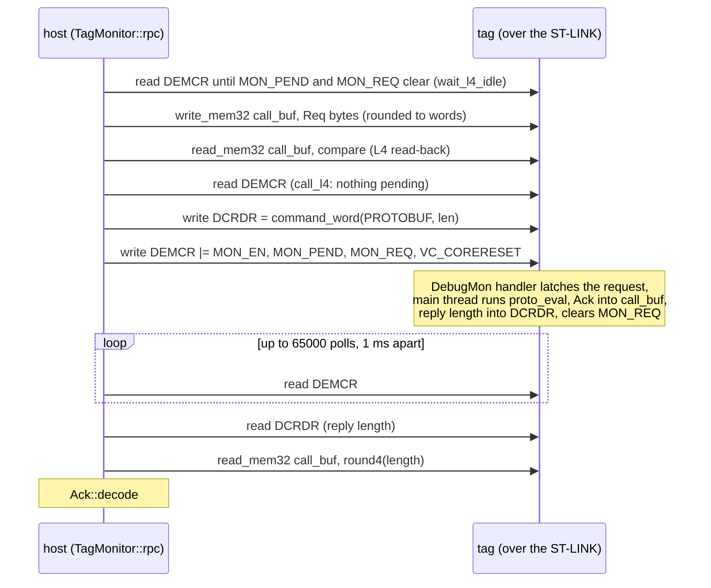
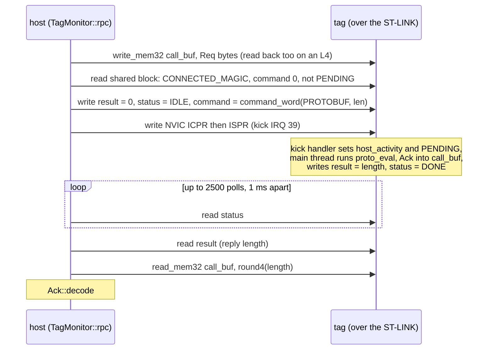

# 4. The monitor: attach, the two transports and the RPC

This chapter reads `TagMonitor`, the middle layer of the Rust `tagcore`: the
port of your `tagmonitor.cc` and `legacy_bittag_rescue.cc`. It runs the
monitor protocol over the `LinkAdapt` of [chapter 3](03-usb-and-stlink.md):
it attaches (through reset), identifies the part, starts a session on one of
two transports, delivers monitor calls, and frames protobuf requests into
the firmware's call buffer. The files are all in
[`src/monitor/`](../../libraries/tagcore-rs/src/monitor/): `mod.rs`,
`abi.rs`, `cortex_m.rs`, `l4.rs`, `u3.rs`, `rpc.rs` and `rescue.rs`.

After reading it you should be able to follow `TagMonitor::rpc` for a
`GetStatus` request on either transport down to the debug-register and
memory calls, say which poll limit applies to it, and say what the host
does when the firmware does not answer.

The protocol is specified in
[`docs/shared/monitor-interface.md`](../../../docs/shared/monitor-interface.md),
and [chapter 3 of the guide](../guide/03-communication-model.md) explains
the two transports and the attach handshake at the architecture level.
Protobuf code generation is [chapter 5](05-protobuf-and-the-tag-api.md);
here prost appears only at the RPC boundary.

## The files

`TagMonitor` is declared in `mod.rs` and extended by an `impl TagMonitor`
block in each of the other files (the same pattern as `LinkAdapt` in
chapter 3):

| File | Contents |
| --- | --- |
| [mod.rs](../../libraries/tagcore-rs/src/monitor/mod.rs) | the struct, `TargetFamily`, `Transport`, `MemAccess`, attach, detach, family detection, the call dispatcher, memory access, keep-alive |
| [abi.rs](../../libraries/tagcore-rs/src/monitor/abi.rs) | the host/firmware ABI mirrored from `include/monitor.h` |
| [cortex_m.rs](../../libraries/tagcore-rs/src/monitor/cortex_m.rs) | Arm debug and SCB register addresses and bits; halting the core for timeout reports |
| [l4.rs](../../libraries/tagcore-rs/src/monitor/l4.rs) | the DebugMonitor/DCRDR transport, the L4 attach, the L4 timeout report |
| [u3.rs](../../libraries/tagcore-rs/src/monitor/u3.rs) | the shared-block (mailbox) transport, the U3 attach, the mailbox session handshake shared with L4 mailbox images |
| [rpc.rs](../../libraries/tagcore-rs/src/monitor/rpc.rs) | protobuf framing |
| [rescue.rs](../../libraries/tagcore-rs/src/monitor/rescue.rs) | legacy BitTag V6 field rescue |

## The struct

[mod.rs:298](../../libraries/tagcore-rs/src/monitor/mod.rs#L298):

```rust
pub struct TagMonitor {
    /// The probe. `pub(crate)` so [`crate::Tag`] can reach link-level calls
    /// such as [`LinkAdapt::base_identity`] without a pass-through here.
    pub(crate) link: LinkAdapt,
    /// Staging buffer for serialised requests and replies.
    rpcbuf: Vec<u8>,
    /// Address of the firmware's call buffer.
    call_buf: u32,
    /// Size of the firmware's call buffer in bytes.
    maxpacket: usize,
    /// The firmware's git SHA string, NUL padded.
    sha_str: [u8; 48],
    /// Monitor version the firmware reported.
    version: u32,
    /// The family detected at attach.
    pub(crate) target_family: TargetFamily,
    /// The transport this session's calls use; see [`Transport`].
    pub(crate) transport: Transport,
    /// The raw DBGMCU_IDCODE read at attach (0 if none was plausible), for
    /// log messages.
    target_idcode: u32,
    /// Counters for [`TagMonitor::monitor_stats`].
    monitor_stats: TagMonitorStats,
    /// True when this session set RCC_AHB1ENR.DMA1EN on an STM32L4, so
    /// [`detach`](TagMonitor::detach) clears it again.
    l4_dma_clock_set: bool,
}
```

The link is a field, not a base class (chapter 3 explains why). The session
fields (`call_buf`, `maxpacket`, `sha_str`, `version`, `transport`) are
valid only while attached; `clear_session` and `clear_all`
([mod.rs:421-436](../../libraries/tagcore-rs/src/monitor/mod.rs#L421)) zero
them on detach or a failed attach. Two fields are new relative to the C++
layout: `transport`, which is the subject of a [section below](#the-l4-mailbox-and-why-calls-dispatch-on-the-transport),
and `l4_dma_clock_set`.

`rpcbuf` is allocated once in `new()` as `vec![0; Self::RPCBUF_BYTES]`, 64
KiB ([mod.rs:345](../../libraries/tagcore-rs/src/monitor/mod.rs#L345)).
Both attach sequences reject a firmware that advertises a bigger call
buffer. The doc comment on the constant notes an edge: one ST-LINK memory
transfer carries at most 65535 bytes and the RPC does not chunk, so a
firmware advertising exactly 65536 would be accepted but could not return a
full reply.

> **Rust:** `Vec<u8>` is `std::vector<uint8_t>`; `vec![0; n]` allocates
> and zero-fills it. `const RPCBUF_BYTES: usize = 64 * 1024;` inside
> `impl TagMonitor` is an *associated constant*, the `static constexpr`
> class member of C++, and is written `Self::RPCBUF_BYTES`.

Two small enums go with it, [mod.rs:180](../../libraries/tagcore-rs/src/monitor/mod.rs#L180):

```rust
#[derive(Debug, Clone, Copy, PartialEq, Eq, Default)]
pub enum TargetFamily {
    /// Not attached, or the IDCODE matched neither family; the L4 transport
    /// is tried.
    #[default]
    Unknown,
    /// STM32L4: DebugMonitor/DCRDR transport.
    Stm32L4,
    /// STM32U3: shared-block transport.
    Stm32U3,
}
```

and [mod.rs:197](../../libraries/tagcore-rs/src/monitor/mod.rs#L197):

```rust
#[derive(Debug, Clone, Copy, PartialEq, Eq, Default)]
pub enum Transport {
    /// DCRDR and the DEMCR request bits, served by the DebugMonitor exception.
    #[default]
    DebugMonitor,
    /// The shared block at [`abi::MONITOR_SHARED_ADDR`], a kick IRQ and the
    /// `host_activity` heartbeat.
    Mailbox,
}
```

> **Rust:** these are host-side enums: their values are produced by host
> code, never read off the wire, so a Rust `enum` is safe. `#[default]`
> marks the variant `Default::default()` returns. `Copy` makes assignment
> a bitwise copy (as for a C enum). `impl fmt::Display for TargetFamily`
> ([mod.rs:208](../../libraries/tagcore-rs/src/monitor/mod.rs#L208)) is
> what prints `STM32L4` when a log line uses `{}`; `{:?}` would use the
> derived `Debug` and print `Stm32L4`.

## The ABI, mirrored by hand

The C++ `#include`s `monitor.h`. Rust cannot include a C header; the
options are generating bindings at build time (bindgen, which needs
libclang) or restating the values. The crate restates them, in
[abi.rs](../../libraries/tagcore-rs/src/monitor/abi.rs), and its module
doc sets the rule: these values cross the SWD boundary, so a change on
either side must be made in `monitor.h` and in `abi.rs` together. The
mailbox attach checks `MONITOR_SHARED_ABI_VERSION` exactly and the
protocol version against a range; the L4 DebugMonitor transport has no such
check, so an L4 mismatch would show up only as failing or nonsensical calls.

The header's `enum`s become **modules of constants**, not Rust enums.
[abi.rs:61](../../libraries/tagcore-rs/src/monitor/abi.rs#L61):

```rust
pub mod status {
    /// No command in progress.
    pub const IDLE: u32 = 0;
    /// The firmware has taken the command and is running it.
    pub const PENDING: u32 = 1;
    /// The command finished; `result` holds its value.
    pub const DONE: u32 = 2;
    /// The firmware refused the command because another was running.
    pub const BUSY: u32 = 3;
    /// The firmware did not recognise the command.
    pub const BAD_COMMAND: u32 = 4;
    /// The firmware has no monitor session.
    pub const NOT_ATTACHED: u32 = 5;
}
```

`op` (the `DBGOP` operations, `u8`), `info` (`DBGINFO` operands, `i32`) and
`protocol` (`MONITOR_PROTOCOL` answers, `u32`) follow the same pattern
([abi.rs:77-110](../../libraries/tagcore-rs/src/monitor/abi.rs#L77)).

> **Rust:** a Rust `enum` may only ever hold one of its listed variants;
> unlike a C enum it is not "an int with names". A `status` word read from
> tag memory can be any `u32` (a firmware bug, a stale block, SRAM
> garbage), and turning an arbitrary integer into an enum needs a checked
> conversion with an error path for every read. Keeping the raw `u32` and
> giving the values names in a module (`status::DONE`) keeps the wire
> value as it is and still lets code `match` on the names, with a `_` arm
> for anything else. `pub mod status { ... }` is a namespace, the C++
> `namespace status { constexpr uint32_t DONE = 2; }`.

The command word, [abi.rs:126](../../libraries/tagcore-rs/src/monitor/abi.rs#L126):

```rust
pub fn command_word(operation: u8, operand: i32) -> u32 {
    ((operand as u32) << 8) | u32::from(operation)
}
```

> **Rust:** `operand as u32` reinterprets the two's-complement bits of the
> `i32`, which is what the C++ shift does; `u32::from(operation)` widens
> losslessly. Rust requires both sides of `|` (and of the arithmetic and
> other bitwise operators) to be the same integer type, with no implicit
> promotion, so each conversion is spelled out. (A shift is the exception:
> its amount may be any integer type.)

The shared block, [abi.rs:134](../../libraries/tagcore-rs/src/monitor/abi.rs#L134),
is a plain struct of thirteen `u32` fields in the order of
`monitor_shared_t`, decoded from bytes explicitly
([abi.rs:169](../../libraries/tagcore-rs/src/monitor/abi.rs#L169), field
offsets' doc comments dropped):

```rust
impl MonitorShared {
    /// Size in bytes of the structure as laid out in tag memory.
    pub const SIZE: usize = 13 * 4;

    pub const REQUEST: u32 = 0;
    pub const COMMAND: u32 = 7 * 4;
    pub const RESULT: u32 = 8 * 4;
    pub const STATUS: u32 = 9 * 4;
    pub const HOST_ACTIVITY: u32 = 10 * 4;

    /// Decodes the block from the bytes read at [`MONITOR_SHARED_ADDR`].
    pub fn from_bytes(bytes: &[u8; Self::SIZE]) -> Self {
        let w = |i: usize| u32::from_le_bytes(bytes[i * 4..i * 4 + 4].try_into().unwrap());
        Self {
            request: w(0),
            abi_version: w(1),
            debug_version: w(2),
            flags: w(3),
            buf_addr: w(4),
            buf_size: w(5),
            sha_addr: w(6),
            command: w(7),
            result: w(8),
            status: w(9),
            host_activity: w(10),
            watchdog_ticks: w(11),
            path_magic: w(12),
        }
    }
    // ...
}
```

No `#[repr(C)]` and no cast of the struct over the buffer: the bytes are
read little-endian word by word, and the offsets of the few words the host
writes individually are associated constants. The test
`shared_block_decodes_little_endian_words_in_order` checks the offsets
agree with the decode order, and `shared_block_fits_reserved_hole` that 52
bytes fit the reserved `MONITOR_SHARED_SIZE` of 0x40.

> **Rust:** `bytes[a..b]` is a slice of unknown length at compile time;
> `.try_into()` converts it to a `[u8; 4]` array, failing if the length
> is not 4. Here it cannot fail, so `.unwrap()` (panic on failure) is the
> honest choice. `&[u8; Self::SIZE]` uses the associated constant inside a
> type, so the caller must pass exactly 52 bytes.

## Attach

[mod.rs:616](../../libraries/tagcore-rs/src/monitor/mod.rs#L616):

```rust
    pub fn attach(&mut self, usbdev: &UsbDev) -> bool {
        if self.is_attached() {
            error!("Already attached");
            return false;
        }
        self.clear_all();

        if !self.link.attach(usbdev) {
            error!("Attach failed");
            return false;
        }
        sleep(ms(20));

        self.detect_target_family();
        debug!(
            "Target family: {} idcode=0x{:x}",
            self.target_family, self.target_idcode
        );

        let attached = if self.target_family == TargetFamily::Stm32U3 {
            self.attach_u3()
        } else {
            self.attach_l4()
        };
        if attached {
            return true;
        }
        self.link.detach();
        self.detach();
        false
    }
```

`self.link.attach` leaves the tag **held in reset** (chapter 3). After 20
ms the family is read from `DBGMCU_IDCODE`; an unidentified part takes the
L4 path, as in the C++. On failure the link is closed, then
`self.detach()` finds nothing attached and only clears the session fields.

Family detection, [mod.rs:551](../../libraries/tagcore-rs/src/monitor/mod.rs#L551):

```rust
    fn detect_target_family(&mut self) -> bool {
        self.target_family = TargetFamily::Unknown;
        self.target_idcode = 0;
        for (addr, family) in [
            (STM32L4_DBGMCU_IDCODE, TargetFamily::Stm32L4),
            (STM32U3_DBGMCU_IDCODE, TargetFamily::Stm32U3),
        ] {
            if let Some(idcode) = self.link.read_debug32(addr)
                && plausible_stm32_idcode(idcode)
            {
                self.target_family = family;
                self.target_idcode = idcode;
                return true;
            }
        }
        false
    }
```

The L4 address `0xE004_2000` is tried first, then the U3's `0xE004_4000`.
`plausible_stm32_idcode` ([mod.rs:263](../../libraries/tagcore-rs/src/monitor/mod.rs#L263))
rejects a device ID of 0 or 0xfff, the floating or unpowered bus. On a U375
the L4 read can fail, so a healthy U3 attach may log one link ERROR here.

> **Rust:** `for (addr, family) in [ (...), (...) ]` iterates over an
> array of tuples and destructures each one: a two-row lookup table
> without declaring a struct. `if let Some(idcode) = ... && cond` is a
> *let chain* (Rust 2024 edition, which this crate uses; stable since Rust
> 1.88, the minimum this code needs): bind `idcode`
> if the read succeeded, and then test it, in one `if`.

## The L4 attach

The L4 attach is two functions. First, arm and release,
[l4.rs:401](../../libraries/tagcore-rs/src/monitor/l4.rs#L401):

```rust
    fn reset_into_monitor(&mut self, phase: &str) -> bool {
        let Some(setup_demcr) = self.link.read_debug32(DEMCR) else {
            error!("Monitor attach failed: {phase} DEMCR read failed");
            return false;
        };
        // Standby can power-cycle the core debug block, so program vector
        // catch immediately before releasing reset; the firmware then sees
        // the host before it can return to terminal standby.
        if !(self.link.write_debug32(DHCSR, DBGKEY | C_DEBUGEN)
            && self.link.write_debug32(
                DEMCR,
                (setup_demcr | MON_EN | VC_CORERESET) & !MON_REQ & !MON_PEND,
            ))
        {
            error!("Monitor attach failed: {phase} debug setup failed");
            return false;
        }
        if !self.link.assert_reset(true) {
            error!("Monitor attach failed: {phase} reset release failed");
            return false;
        }
        sleep(ms(50));
        self.clear_stale_mask_ints();
        if !self.link.write_debug32(DHCSR, DBGKEY | C_DEBUGEN) {
            warn!("Monitor attach warning: {phase} halt release failed");
        }
        true
    }
```

`assert_reset(true)` **releases** nRST (chapter 3). With `VC_CORERESET`
set the core halts at the reset vector; 50 ms later the host clears a stale
`C_MASKINTS` if a previous SWD tool left one (`clear_stale_mask_ints`,
[cortex_m.rs:245](../../libraries/tagcore-rs/src/monitor/cortex_m.rs#L245)),
then writes `DBGKEY | C_DEBUGEN` to DHCSR, which resumes the core.
`VC_CORERESET` stays set for the whole session: it is the "host attached"
flag the L4 firmware reads.

> **Rust:** `!` on an integer is bitwise NOT (C's `~`), so
> `& !MON_REQ & !MON_PEND` clears those bits. On a `bool` the same `!` is
> logical NOT. The register names (`DHCSR`, `DEMCR`, `MON_EN`, ...) come
> from `use super::cortex_m::*;` at the top of `l4.rs`; they are plain
> `pub const u32`s in [cortex_m.rs](../../libraries/tagcore-rs/src/monitor/cortex_m.rs#L37).

Then the sequence proper, `attach_l4_steps`
([l4.rs:460](../../libraries/tagcore-rs/src/monitor/l4.rs#L460)). After
`reset_into_monitor("initial")` and a check that reports
`FLASH_SR.PEMPTY` (which would send every reset to the ROM bootloader), it
reads the monitor version, with a retry the C++ also has.
[l4.rs:488](../../libraries/tagcore-rs/src/monitor/l4.rs#L488):

```rust
        self.link.expect_failures(true);
        let first = self.call(op::TAG_MONITORINFO, info::MONITORVERSION);
        self.link.expect_failures(false);
        self.version = match first {
            Some(version) => version,
            None => {
                warn!("L4 monitor version read failed; retrying attach after reset pulse");
                if !self.link.assert_reset(false) {
                    error!("Monitor attach failed: retry reset assert failed");
                    return false;
                }
                sleep(ms(20));
                let retried = if self.reset_into_monitor("retry") {
                    self.call(op::TAG_MONITORINFO, info::MONITORVERSION)
                } else {
                    None
                };
                let Some(version) = retried else {
                    error!("couldn't fetch monitor version information");
                    return false;
                };
                version
            }
        };
```

The first call's failures are logged at DEBUG (`expect_failures`, chapter
3), so a missed first call leaves only the retry's WARN in the log.

> **Rust:** a `match` arm can be a whole block whose last expression is
> its value: the `None` arm pulses reset, retries, and ends with
> `version`, which becomes `self.version`. The early `return false`s
> inside it leave the function.

Then, from [l4.rs:517](../../libraries/tagcore-rs/src/monitor/l4.rs#L517):

```rust
        if self.version >= DEBUGVERSION_MAILBOX {
            match self.call(op::TAG_MONITORINFO, info::MONITORPROTOCOL) {
                Some(protocol::MAILBOX) => return self.attach_l4_mailbox(),
                Some(protocol::DEBUGMON) => {}
                Some(other) => {
                    error!("L4 monitor reports unknown protocol {other}");
                    return false;
                }
                None => {
                    error!("couldn't fetch the L4 monitor protocol");
                    return false;
                }
            }
        }
```

An image at version 0x21 or later is asked which transport carries its
protobuf requests; older L4 images are not asked, because they leave the
host's own command word in DCRDR for an operand they do not know
([abi.rs:24-27](../../libraries/tagcore-rs/src/monitor/abi.rs#L24)).
A DebugMonitor image then continues with, in this order:

1. `TAG_MONITORINFO(MONITORBUF)`: the call-buffer address.
2. `TAG_MONITORINFO(TAGSHASTR)`, then a 48-byte `read_mem32` of the SHA
   string, cached in `sha_str`.
3. `TAG_MONITORINFO(MONITORBUFSIZE)`, rejected if larger than the 64 KiB
   host buffer ("Is a tag connected to this base?").
4. `MONITORSTART`, which must return non-zero.
5. `keep_debug_in_sleep()` sets `DBGMCU_CR.DBG_SLEEP`, and
   `keep_bus_matrix_in_sleep()` sets `RCC_AHB1ENR.DMA1EN` if it was clear
   (recording that in `l4_dma_clock_set`). Without them, a debug access
   while the tag idles in WFI either waits (0x81 bursts) or, beyond the
   core's private bus, reads zero with an OK status and drops writes. The
   doc comments at [l4.rs:598-651](../../libraries/tagcore-rs/src/monitor/l4.rs#L598)
   record how each was found (UIUCTag, 2026-11-02, for the DMA clock).

So the order differs from the guide's summary ("version, buffer address,
buffer size, SHA address"): the SHA comes before the size.

`release_l4_dma_clock` ([l4.rs:661](../../libraries/tagcore-rs/src/monitor/l4.rs#L661))
undoes step 5's clock at detach, only if this session set it:

```rust
        if !std::mem::take(&mut self.l4_dma_clock_set) {
            return;
        }
```

> **Rust:** `std::mem::take(&mut x)` returns `x` and leaves its default
> (`false`) in its place: a test-and-clear in one expression.

## The U3 attach

The U3 has no DebugMonitor session. `attach_u3_steps`
([u3.rs:299](../../libraries/tagcore-rs/src/monitor/u3.rs#L299)) arms
`VC_CORERESET` with the monitor bits cleared, releases nRST, and polls
DHCSR up to 100 times for `S_HALT`. With the core halted at the reset
vector it posts the request before the firmware's first instruction,
[u3.rs:335](../../libraries/tagcore-rs/src/monitor/u3.rs#L335):

```rust
        // Halted at the reset vector: post the attach request before the
        // firmware's first instruction.
        let empty = [0u8; MONITOR_SHARED_SIZE as usize];
        if !(self.link.write_mem32(MONITOR_SHARED_ADDR, &empty)
            && self.write_monitor_shared_word(MonitorShared::REQUEST, MONITOR_REQUEST_MAGIC)
            && self.write_word(MONITOR_SHARED_KICK_ICPR_ADDR, MONITOR_SHARED_KICK_MASK))
        {
            error!("U3 monitor attach failed: shared request setup failed");
            return false;
        }
```

It zeroes the 64-byte block at `0x20000000`, writes
`MONITOR_REQUEST_MAGIC` (`0xC0FFEE00`) to `request`, and clears any stale
kick IRQ (IRQ 39, bit 7 of `NVIC_ICPR1`). After a read-back logged at
DEBUG and `clear_stale_mask_ints`, it resumes the core and waits for the
firmware in `await_mailbox_session(false)`. No `MONITORSTART` is sent: on
the U3 the session starts when the firmware sees the request.

The wait is shared with the L4 mailbox attach,
[u3.rs:390](../../libraries/tagcore-rs/src/monitor/u3.rs#L390) (the
timeout report in the middle elided):

```rust
    pub(super) fn await_mailbox_session(&mut self, rekick: bool) -> bool {
        const ATTACH_TIMEOUT_MS: u32 = 2000;
        const REKICK_EVERY_MS: u32 = 200;

        let mut shared = MonitorShared::default();
        let mut last_nonzero = None;
        let mut connected = false;
        for i in 0..ATTACH_TIMEOUT_MS {
            if rekick && i > 0 && i % REKICK_EVERY_MS == 0 {
                // An L4 request can be lost while the tag sleeps; post it again.
                self.post_mailbox_request();
            }
            self.write_monitor_shared_word(MonitorShared::HOST_ACTIVITY, 1);
            if let Some(s) = self.read_monitor_shared() {
                shared = s;
                if s.any_nonzero() {
                    last_nonzero = Some(s);
                }
                if s.request == MONITOR_CONNECTED_MAGIC
                    && s.flags & MONITOR_SHARED_FLAG_SESSION_READY != 0
                {
                    connected = true;
                    break;
                }
            } else if !self.is_attached() {
                error!("monitor mailbox attach failed: the probe has gone");
                return false;
            }
            sleep(ms(1));
        }

        if !connected {
            // ...
            return false;
        }

        if shared.abi_version != MONITOR_SHARED_ABI_VERSION {
            error!(
                "monitor mailbox ABI mismatch host={MONITOR_SHARED_ABI_VERSION} target={}",
                shared.abi_version
            );
            return false;
        }

        self.version = shared.debug_version;
        self.call_buf = shared.buf_addr;
        self.maxpacket = shared.buf_size as usize;
        if !(DEBUGVERSION..=DEBUGVERSION_MAILBOX).contains(&self.version)
            || self.call_buf == 0
            || self.maxpacket == 0
            || self.maxpacket > self.rpcbuf.len()
            || shared.sha_addr == 0
        {
            error!(
                "monitor mailbox metadata invalid version=0x{:x} buf=0x{:x} size={} sha=0x{:x}",
                self.version, self.call_buf, self.maxpacket, shared.sha_addr
            );
            return false;
        }

        let mut sha = [0u8; 48];
        if !self.link.read_mem32(shared.sha_addr, &mut sha) {
            error!("monitor mailbox attach failed: SHA read failed");
            return false;
        }
        self.sha_str = sha;
        // ...
        self.transport = super::Transport::Mailbox;
        true
    }
```

For up to 2000 polls the host sets `host_activity` and reads the block,
until the firmware has written `MONITOR_CONNECTED_MAGIC` (`0xDEADBEEF`)
**and** set `SESSION_READY` (its monitor watchdog and kick IRQ are armed).
It then checks the ABI version exactly, the protocol version in
`0x20..=0x21`, and the metadata, reads the SHA string, and only then sets
`self.transport = Transport::Mailbox`. On a timeout it logs the decoded
block and its raw words, and also the last non-zero block it saw, which
often shows how far the firmware got. `path_magic` is logged but not
checked.

> **Rust:** `(DEBUGVERSION..=DEBUGVERSION_MAILBOX).contains(&v)` is an
> inclusive range test, `0x20 <= v && v <= 0x21`. `0..ATTACH_TIMEOUT_MS`
> is half-open. `last_nonzero` is an `Option<MonitorShared>`, a value
> that may or may not have been seen, with no sentinel.

## The L4 mailbox, and why calls dispatch on the transport

L4 images built with `TAG_L4_MONITOR_MAILBOX` report version 0x21 and
protocol `MAILBOX`. `attach_l4_steps` then returns
`self.attach_l4_mailbox()`, [l4.rs:589](../../libraries/tagcore-rs/src/monitor/l4.rs#L589):

```rust
    fn attach_l4_mailbox(&mut self) -> bool {
        self.keep_debug_in_sleep();
        self.keep_bus_matrix_in_sleep();
        if !self.post_mailbox_request() {
            return false;
        }
        self.await_mailbox_session(true)
    }
```

The firmware has already booted (the version and protocol calls ran over
the DebugMonitor). The host sets DBG_SLEEP and the DMA clock first,
writes `MONITOR_REQUEST_MAGIC` and pends the kick IRQ
(`post_mailbox_request`, [u3.rs:366](../../libraries/tagcore-rs/src/monitor/u3.rs#L366)),
and waits with `rekick` set, reposting the request every 200 polls because
an L4 can drop a write that lands while it sleeps.

Now the dispatcher, [mod.rs:594](../../libraries/tagcore-rs/src/monitor/mod.rs#L594):

```rust
    fn call(&mut self, operation: u8, operand: i32) -> Option<u32> {
        if self.transport == Transport::Mailbox {
            self.call_u3(operation, operand)
        } else {
            self.call_l4(operation, operand)
        }
    }
```

It selects on `self.transport`, not on `self.target_family`. Precisely:

- `transport` starts as `DebugMonitor` (`new()` and `clear_session()`) and
  becomes `Mailbox` only at the end of a successful
  `await_mailbox_session`, which both the U3 attach and the L4 mailbox
  attach use.
- So during an L4 attach, the `TAG_MONITORINFO(MONITORVERSION)` and
  `TAG_MONITORINFO(MONITORPROTOCOL)` calls go through `call_l4`, on every
  L4 image. The U3 attach makes no `call` at all.
- Once an L4 mailbox session is up, **every** call goes through
  `call_u3`: `PROTOBUF`, and `MONITORSTOP` at detach. The function is named
  for the U3 because the U3 was its first user; it is the mailbox call.
- Other decisions follow the transport too: `keep_alive` writes
  `host_activity` on the mailbox; `write_mem` protects the shared block on
  the mailbox; `rpc` waits for an idle DEMCR only on an L4 *and*
  DebugMonitor session.
- One decision follows the family: `write_request` reads the request back
  on any STM32L4 (`target_family == Stm32L4`), so L4 mailbox sessions are
  read back as well.

The consequence for timeouts: an L4 mailbox image's protobuf calls get the
mailbox's 2500-poll limit, not the DebugMonitor's 65000. Several doc
comments (`lib.rs`, the `monitor/mod.rs` "Timeouts" section, `rpc`'s doc)
and the guide's two-transport table describe the split by family; the
`Transport` doc ([mod.rs:192-196](../../libraries/tagcore-rs/src/monitor/mod.rs#L192))
and the code describe it by transport. Read the code.

## The DebugMonitor call (`call_l4`)

[l4.rs:110](../../libraries/tagcore-rs/src/monitor/l4.rs#L110):

```rust
    pub(super) fn call_l4(&mut self, operation: u8, operand: i32) -> Option<u32> {
        const MONITOR_RESULT_TIMEOUT_MS: u32 = 500;
        const MONITORSTOP_POST_MS: u64 = 5;
        const MONITOR_FAST_CALL_TIMEOUT_MS: u32 = 2500;
        const MONITOR_PROTOBUF_CALL_TIMEOUT_MS: u32 = 65000;
        let call_timeout_ms = if operation == op::PROTOBUF {
            MONITOR_PROTOBUF_CALL_TIMEOUT_MS
        } else {
            MONITOR_FAST_CALL_TIMEOUT_MS
        };
        let name = operation_name(operation);

        if !self.is_attached() {
            log!(self.failure_log_level(), "monitor not attached");
            return None;
        }

        // VC_CORERESET is the attachment flag the embedded app reads; it also
        // halts the core at the reset vector after a reset.
        let Some(mut demcr) = self.link.read_debug32(DEMCR) else {
            log!(self.failure_log_level(), "read reg failed");
            return None;
        };

        // DCRDR is both the request and the response mailbox: do not write a
        // new request until the previous DebugMon transaction is idle.
        if demcr & (MON_PEND | MON_REQ) != 0 {
            log!(
                self.failure_log_level(),
                "monitor pending bit already set op={name}(0x{operation:x}) operand={operand} \
                 demcr=0x{demcr:x}"
            );
            return None;
        }

        if !self
            .link
            .write_debug32(DCRDR, command_word(operation, operand))
            || !self
                .link
                .write_debug32(DEMCR, demcr | MON_EN | MON_PEND | MON_REQ | VC_CORERESET)
        {
            log!(self.failure_log_level(), "write reg failed");
            return None;
        }

        if operation == op::MONITORSTOP {
            // Detach lets the target drop into terminal low power as soon as
            // the handler has seen the request; waiting for a reply could turn
            // a successful detach into a USB/SWD timeout.
            sleep(ms(MONITORSTOP_POST_MS));
            return Some(1);
        }

        // Wait for the handler to clear MON_REQ.
        let mut answered = false;
        for _ in 0..call_timeout_ms {
            match self.link.read_debug32(DEMCR) {
                // The probe has gone (unplugged): nothing can answer, and
                // the timeout report could read nothing either.
                None if !self.is_attached() => {
                    log!(
                        self.failure_log_level(),
                        "probe lost during monitor call op={name}(0x{operation:x})"
                    );
                    return None;
                }
                // read_debug32 logs the failure; keep polling.
                None => {}
                Some(d) => {
                    demcr = d;
                    if d & MON_REQ == 0 {
                        answered = true;
                        break;
                    }
                }
            }
            sleep(ms(1));
        }

        if !answered {
            self.report_l4_timeout(operation, operand, demcr);
            return None;
        }
        // ...
```

The rest ([l4.rs:203-221](../../libraries/tagcore-rs/src/monitor/l4.rs#L203))
reads DCRDR for the result, retrying up to 500 times.

This is your `TagMonitor::Call` for the L4: refuse if a request is still
pending (DCRDR is one word shared by request and reply), write the command
word into DCRDR, set `MON_EN | MON_PEND | MON_REQ | VC_CORERESET` in DEMCR,
poll DEMCR once per millisecond until the handler clears `MON_REQ`, read
the result from DCRDR. `MONITORSTOP` does not wait for the firmware.

The limits are **poll counts**, each a USB round trip plus a 1 ms sleep, so
the 65000-poll protobuf limit is about 120 s of wall time, not 65 s. A failed
DEMCR read uses up a poll and polling goes on (the link's failure run keeps
the log to one ERROR), unless the probe has gone (`NO_DEVICE` closed it,
chapter 3), in which case the call returns at once.

> **Rust:** `const` items inside a function body are local compile-time
> constants, `constexpr` locals. `None if !self.is_attached() => ...` is a
> match arm with a guard; the next arm, `None => {}`, catches the other
> `None`s and does nothing.

> **Rust:** `failure_log_level()` ([mod.rs:651](../../libraries/tagcore-rs/src/monitor/mod.rs#L651))
> returns DEBUG while the link has been told failures are expected and
> ERROR otherwise, so monitor-level lines follow the same rule as the link's.
> `call_u3`'s "monitor not attached" uses a plain `error!` instead.

## The mailbox call (`call_u3`)

[u3.rs:107](../../libraries/tagcore-rs/src/monitor/u3.rs#L107), first the
checks and the kick:

```rust
    pub(super) fn call_u3(&mut self, operation: u8, operand: i32) -> Option<u32> {
        const TIMEOUT_MS: u32 = 2500;
        const MONITORSTOP_TIMEOUT_MS: u32 = 100;
        let name = operation_name(operation);

        if !self.is_attached() {
            error!("monitor not attached");
            return None;
        }
        let Some(shared) = self.read_monitor_shared() else {
            error!("mailbox monitor shared read failed");
            return None;
        };
        if operation != op::MONITORSTOP {
            if shared.request != MONITOR_CONNECTED_MAGIC {
                error!(
                    "mailbox monitor not connected request=0x{:x} status=0x{:x}",
                    shared.request, shared.status
                );
                return None;
            }
            if shared.command != 0 || shared.status == status::PENDING {
                error!(
                    "mailbox monitor busy command=0x{:x} status=0x{:x}",
                    shared.command, shared.status
                );
                return None;
            }
        }

        if !(self.write_monitor_shared_word(MonitorShared::RESULT, 0)
            && self.write_monitor_shared_word(MonitorShared::STATUS, status::IDLE)
            && self.write_monitor_shared_word(
                MonitorShared::COMMAND,
                command_word(operation, operand),
            )
            && self.write_word(MONITOR_SHARED_KICK_ICPR_ADDR, MONITOR_SHARED_KICK_MASK)
            && self.write_word(MONITOR_SHARED_KICK_ISPR_ADDR, MONITOR_SHARED_KICK_MASK))
        {
            error!("mailbox monitor kick failed op={name}(0x{operation:x}) operand={operand}");
            return None;
        }
```

Then the poll, [u3.rs:155](../../libraries/tagcore-rs/src/monitor/u3.rs#L155):

```rust
        for _ in 0..timeout_ms {
            if let Some(st) = self.read_word(MONITOR_SHARED_ADDR + MonitorShared::STATUS) {
                if st == status::DONE {
                    let result = self.read_word(MONITOR_SHARED_ADDR + MonitorShared::RESULT);
                    if result.is_none() {
                        error!("mailbox monitor result read failed");
                    }
                    return result;
                }
                if operation == op::MONITORSTOP
                    && let Some(s) = self.read_monitor_shared()
                    && s.request == 0
                    && s.flags == 0
                    && s.command == 0
                {
                    debug!(
                        "mailbox monitor stop observed detached state status=0x{:x} \
                                 result=0x{:x} heartbeat=0x{:x} watchdog_ticks={}",
                        s.status, s.result, s.host_activity, s.watchdog_ticks
                    );
                    return Some(1);
                }
                if matches!(
                    st,
                    status::BUSY | status::BAD_COMMAND | status::NOT_ATTACHED
                ) {
                    error!(
                        "mailbox monitor request rejected op={name}(0x{operation:x}) operand={operand} \
                         status=0x{st:x}"
                    );
                    return None;
                }
            } else if !self.is_attached() {
                // The probe has gone (unplugged): stop polling it.
                error!("probe lost during U3 monitor call op={name}(0x{operation:x})");
                return if operation == op::MONITORSTOP {
                    Some(1)
                } else {
                    None
                };
            }
            sleep(ms(1));
        }
```

Only memory-access-port reads and writes are used, so a call never halts
the core and never touches DCRDR. The kick IRQ also sets `host_activity` on
the firmware side, so every call counts as heartbeat. `MONITORSTOP` is
handled generously: it skips the "connected and idle" check (so a
half-broken session can still be stopped), accepts DONE or a block whose
`request`, `flags` and `command` are all zero, and after its 100 polls
returns `Some(1)` with a WARN anyway ([u3.rs:199-209](../../libraries/tagcore-rs/src/monitor/u3.rs#L199)),
because a U375 that drops into standby after clearing the block can no
longer be read. Any other timeout runs `report_u3_timeout`.

> **Rust:** `status::BUSY | status::BAD_COMMAND | status::NOT_ATTACHED`
> inside `matches!` is an or-pattern of constants. It works because the
> module-of-constants style keeps `st` a plain `u32`.

## The RPC

**Library: prost.** [prost](https://docs.rs/prost/0.14.4) (0.14.4) is the
protobuf runtime. `build.rs` runs its code generator, prost-build (through
prost-reflect-build), over `proto/` at compile time
and generates a Rust struct per message (`crate::proto::Req`,
`crate::proto::Ack`, ...) with an implementation of the trait
`prost::Message`. This chapter uses three of that trait's methods:
`encoded_len()`, `encode(&mut buf)` and `T::decode(&bytes)`. How the types
are generated, and what a oneof looks like in Rust, is
[chapter 5](05-protobuf-and-the-tag-api.md).

[rpc.rs:98](../../libraries/tagcore-rs/src/monitor/rpc.rs#L98) (statistics
lines kept, as they show the phases):

```rust
    pub fn rpc(&mut self, req: &Req) -> Option<Ack> {
        let rpc_start = Instant::now();

        if !self.is_attached() {
            error!("Monitor not attached");
            return None;
        }

        let size = req.encoded_len();
        if size > self.rpcbuf.len() {
            error!("Request message too big");
            return None;
        }
        let step = Instant::now();
        let mut out: &mut [u8] = &mut self.rpcbuf[..];
        if req.encode(&mut out).is_err() {
            error!("Request message too big");
            return None;
        }
        if INSTRUMENTED {
            self.monitor_stats.serialize_ns += elapsed_ns(step);
        }

        if size + 2 > self.maxpacket {
            error!("Input buffer too long");
            return None;
        }

        // On the DebugMonitor an STM32L4 tag may still hold an earlier
        // request that a failed call left pending; the buffer is its until the
        // tag clears MON_REQ. The mailbox has its own handshake in call_u3().
        const L4_IDLE_BEFORE_WRITE_MS: u32 = 2500;
        if self.target_family == TargetFamily::Stm32L4
            && self.transport == Transport::DebugMonitor
            && !self.wait_l4_idle(L4_IDLE_BEFORE_WRITE_MS)
        {
            return None;
        }

        let step = Instant::now();
        let write_ok = self.write_request(round4(size));
        if INSTRUMENTED {
            self.monitor_stats.write_request_ns += elapsed_ns(step);
        }
        if !write_ok {
            return None;
        }

        let step = Instant::now();
        let retval = self.call(op::PROTOBUF, size as i32);
        if INSTRUMENTED {
            self.monitor_stats.monitor_call_ns += elapsed_ns(step);
        }
        let Some(retval) = retval else {
            error!("monitor_call failed");
            return None;
        };

        let len = retval as usize;
        if len > self.maxpacket {
            error!(
                "Reply length {len} exceeds the monitor buffer ({} bytes)",
                self.maxpacket
            );
            return None;
        }

        let step = Instant::now();
        let read_ok = len == 0
            || self
                .link
                .read_mem32(self.call_buf, &mut self.rpcbuf[..round4(len)]);
        if INSTRUMENTED {
            self.monitor_stats.read_response_ns += elapsed_ns(step);
        }
        if !read_ok {
            error!("Error reading RPC buffer");
            return None;
        }

        let step = Instant::now();
        let ack = Ack::decode(&self.rpcbuf[..len]);
        if INSTRUMENTED {
            self.monitor_stats.parse_ns += elapsed_ns(step);
            self.monitor_stats.rpc_calls += 1;
            self.monitor_stats.request_bytes += size as u64;
            self.monitor_stats.response_bytes += len as u64;
            self.monitor_stats.rpc_total_ns += elapsed_ns(rpc_start);
        }
        ack.map_err(|e| error!("Reply did not decode: {e}")).ok()
    }
```

The framing is the C++'s: no length prefix, no checksum. The request length
travels as the `PROTOBUF` operand and the reply length as the call's result
word. Request and reply share the firmware's call buffer. Transfers are
rounded up to whole words (`round4`, [rpc.rs:24](../../libraries/tagcore-rs/src/monitor/rpc.rs#L24))
because the memory path is 32-bit only; the decoder is given the exact
length, so the padding is ignored. The request must leave two bytes spare
in the call buffer, as in the C++. A reply that decodes is returned
whatever its `err` code: a firmware refusal is a valid `Ack`, and deciding
what it means is `Tag`'s job ([chapter 5](05-protobuf-and-the-tag-api.md)).

> **Rust:** `let mut out: &mut [u8] = &mut self.rpcbuf[..];` makes a
> mutable slice over the whole buffer. prost's `encode` takes anything
> implementing the `BufMut` trait, and `&mut [u8]` implements it by
> writing at the front and advancing the slice past what it wrote. The
> slice is passed as `&mut out` so that `out` itself can be advanced;
> `encode` returns `Err` if it runs out of room. `encode`, `decode` and
> `encoded_len` are callable only because of `use prost::Message;` at
> [rpc.rs:16](../../libraries/tagcore-rs/src/monitor/rpc.rs#L16).

> **Rust:** `self.link.read_mem32(self.call_buf, &mut self.rpcbuf[..])`
> borrows two fields of `self` mutably at once, the link and the buffer.
> That is allowed because they are different fields; what the borrow
> checker forbids is calling a `&mut self` *method* of `TagMonitor` while
> a borrow of one of its fields is alive.

> **Rust:** `ack.map_err(|e| error!(...)).ok()` logs the
> `prost::DecodeError` and turns the `Result<Ack, DecodeError>` into the
> `Option<Ack>` this layer returns.

`write_request` ([rpc.rs:47](../../libraries/tagcore-rs/src/monitor/rpc.rs#L47))
writes the words with `write_mem32` and, on an STM32L4, reads them back and
on a mismatch writes them again, up to three attempts in all, 100 ms apart, because an L4 whose bus matrix
has stopped in Sleep drops writes with an OK status. The U3 is not
checked. `wait_l4_idle` ([l4.rs:60](../../libraries/tagcore-rs/src/monitor/l4.rs#L60))
waits for `MON_PEND` and `MON_REQ` to clear before writing, so a request
left pending by a call that failed part way is not overwritten under the
firmware.

One RPC on the DebugMonitor transport:



One RPC on the mailbox transport (every U3, and L4 mailbox images):



## Keep-alive

[mod.rs:530](../../libraries/tagcore-rs/src/monitor/mod.rs#L530):

```rust
    pub fn keep_alive(&mut self) -> bool {
        if !self.is_attached() {
            return false;
        }
        if self.transport == Transport::Mailbox {
            return self.write_monitor_shared_word(MonitorShared::HOST_ACTIVITY, 1);
        }
        // L4 re-arms its session timer only on a monitor request.
        let request = Req {
            payload: Some(req::Payload::GetStatus(Default::default())),
        };
        self.rpc(&request).is_some()
    }
```

On the mailbox the firmware clears `host_activity` at each 5 s heartbeat
check and ends the session if it finds it still clear, so an idle host must
set it at least every 2-3 s; one SWD write, no code runs on the tag. On the
DebugMonitor the session ends after 60 s without a request, and only a
request re-arms it, so keep-alive is a `GetStatus` RPC.

> **Rust:** `Req { payload: Some(req::Payload::GetStatus(Default::default())) }`
> builds the prost struct for a `Req` whose `oneof payload` holds an empty
> `GetStatus`. A oneof becomes an `Option` of a Rust enum, one variant per
> case; chapter 5 covers it.

## Live memory access

`read_mem` and `write_mem` ([mod.rs:472](../../libraries/tagcore-rs/src/monitor/mod.rs#L472),
[mod.rs:499](../../libraries/tagcore-rs/src/monitor/mod.rs#L499)) are the
checked wrappers over the link calls that tools use while a session is
open. They return a `MemAccess` (`Ok`, `NotAttached`, `InvalidRange`,
`Protected`, `LinkError`) so that a caller such as `tag-monitor-test` can
report a caller mistake differently from a link failure. They check word
alignment and wrap-around (`valid_mem_range`), split into 1 KiB chunks, and
on the mailbox transport refuse a write overlapping the shared block unless
`force` is set (`overlaps_monitor_shared`). The test
`detached_monitor_refuses_everything_without_touching_usb`
([mod.rs:785](../../libraries/tagcore-rs/src/monitor/mod.rs#L785)) shows
the contract when detached.

> **Rust:** `buf.chunks_mut(Self::MEM_CHUNK_BYTES).enumerate()` iterates
> over consecutive mutable sub-slices of at most 1024 bytes, with their
> index; it replaces the offset arithmetic of an index loop.

## Detach

[mod.rs:675](../../libraries/tagcore-rs/src/monitor/mod.rs#L675) (the
mailbox DEBUG snapshot after MONITORSTOP elided):

```rust
    pub fn detach(&mut self) {
        if !self.is_attached() {
            self.clear_all();
            return;
        }

        // Before MONITORSTOP, which ends the session: the tag may then sleep
        // or start a run, and the clock is not the host's to leave on.
        self.release_l4_dma_clock();
        // Once the firmware has seen MONITORSTOP it may drop into standby,
        // and the reads that follow (the stop poll, the post-stop snapshot)
        // fail as a matter of course. The link's own detach below turns
        // failure reporting back on.
        self.link.expect_failures(true);
        let stop = self.call(op::MONITORSTOP, 0);
        if self.transport == Transport::Mailbox {
            // ...
            if !matches!(stop, Some(s) if s != 0) {
                error!("mailbox monitor stop failed during detach");
            }
        } else if !matches!(stop, Some(s) if s != 0) {
            error!("Monitor Stop failed during detach");
        }

        if self.target_family != TargetFamily::Unknown {
            debug!(
                "{} monitor detach leaves post-stop debug cleanup to target firmware",
                self.target_family
            );
        } else if let Some(demcr) = self.link.read_debug32(DEMCR) {
            let monitor_bits = VC_CORERESET | MON_PEND | MON_REQ | MON_EN;
            if !self.link.write_debug32(DEMCR, demcr & !monitor_bits) {
                error!("Monitor detach failed to clear debug control register");
            } else if let Some(verify) = self.link.read_debug32(DEMCR)
                && verify & monitor_bits != 0
            {
                error!("Monitor detach left debug control bits set demcr=0x{verify:x}");
            }
        } else {
            error!("Monitor detach failed to read debug control register");
        }

        self.link.detach();
        self.clear_all();
    }
```

The DMA clock is released first, while the tag is still in its session
loop. Then `MONITORSTOP` goes over the session's transport with link
failures expected (the tag may already be asleep). On an identified family
the host leaves the debug registers alone so as not to race the firmware's
own cleanup; only an unknown family gets the host-side DEMCR clear. Detach
never fails and is safe to call twice, and `impl Drop for TagMonitor`
([mod.rs:737](../../libraries/tagcore-rs/src/monitor/mod.rs#L737)) calls
it, so dropping a `Tag` ends the session and closes the probe.

> **Rust:** `matches!(stop, Some(s) if s != 0)` is "the call returned a
> non-zero result": a pattern with a guard, as a boolean.

## When the firmware does not answer

A timeout on either transport is followed by a diagnostic report that may
briefly **halt the core**. The switches are compile-time constants
mirroring the C++ ones, [cortex_m.rs:29](../../libraries/tagcore-rs/src/monitor/cortex_m.rs#L29):

```rust
pub(super) const HALT_ON_MONITOR_TIMEOUT: bool = true;
/// Leave a core halted by that probe halted, for a debugger
/// (`TAGCORE_LEAVE_HALTED_ON_MONITOR_TIMEOUT`).
pub(super) const LEAVE_HALTED_ON_MONITOR_TIMEOUT: bool = false;
```

The halt itself, [cortex_m.rs:188](../../libraries/tagcore-rs/src/monitor/cortex_m.rs#L188):

```rust
    pub(super) fn halt_for_diagnostics(&mut self, dhcsr_snapshot: u32) -> HaltProbe {
        let mut probe = HaltProbe::default();
        if !HALT_ON_MONITOR_TIMEOUT || dhcsr_snapshot & S_LOCKUP != 0 {
            return probe;
        }
        probe.halted_by_probe = dhcsr_snapshot & S_HALT == 0;
        if !self.link.write_debug32(DHCSR, DBGKEY | C_DEBUGEN | C_HALT) {
            return probe;
        }
        for _ in 0..100 {
            if let Some(d) = self.link.read_debug32(DHCSR) {
                probe.halted_dhcsr = d;
                if d & S_HALT != 0 {
                    break;
                }
            }
            sleep(ms(1));
        }
        if probe.halted_dhcsr & S_HALT != 0 {
            let mut reg = |r| self.read_core_register(r).unwrap_or(0);
            probe.sp = reg(13);
            probe.lr = reg(14);
            probe.pc = reg(15);
            probe.xpsr = reg(16);
            probe.msp = reg(17);
            probe.psp = reg(18);
            probe.special = reg(20);
        }
        probe
    }
```

Unless the core is locked up, it halts it, and reads SP, LR, PC, xPSR, MSP,
PSP and CONTROL/FAULTMASK/BASEPRI/PRIMASK through DCRSR/DCRDR
(`read_core_register`, [cortex_m.rs:153](../../libraries/tagcore-rs/src/monitor/cortex_m.rs#L153)).
`halted_by_probe` records whether the probe, rather than something else,
caused the halt, which tells the caller whether to resume. The function
leaves the core halted.

> **Rust:** `let mut reg = |r| self.read_core_register(r).unwrap_or(0);`
> is a closure that captures `self` by mutable reference (so the closure
> itself must be `mut`). While `reg` is alive nothing else may use `self`.
> It does not capture `probe` (a local), so the assignments to `probe`'s
> fields are fine, and its borrow of `self` ends at its last use, `reg(20)`.

`report_l4_timeout` ([l4.rs:239](../../libraries/tagcore-rs/src/monitor/l4.rs#L239))
reads DHCSR, DCRDR, RCC_CSR and the SCB registers, halts, reads both
stacked exception frames (`read_frame`), and logs one long line in the C++
format. Then it recovers. If DHCSR showed `S_HALT` and `S_RESET_ST` with no
active exception and no fault, the tag reset during the session and is
sitting at the reset vector because `VC_CORERESET` is still set. The host
clears vector catch, resumes the core, checks whether the PC was in the ROM
bootloader (0x1FFFxxxx, usually `FLASH_SR.PEMPTY`), and **drops the
session**, [l4.rs:367](../../libraries/tagcore-rs/src/monitor/l4.rs#L367):

```rust
            self.clear_all();
            self.link.detach();
```

so the caller's next request fails until it attaches again. Otherwise, if
only the diagnostics halted the core, it clears the pending request bits
and resumes.

`report_u3_timeout` ([u3.rs:223](../../libraries/tagcore-rs/src/monitor/u3.rs#L223))
logs the shared block, the kick IRQ's NVIC enable, pending and active bits,
DHCSR, DEMCR and the fault registers, halts for the core registers, and
resumes if it halted. It does not look for a reset-vector catch and never
drops the session. Because dispatch is by transport, an L4 mailbox image
that times out gets this report, not the L4 one.

## The limits in one table

| | DebugMonitor (`call_l4`) | Mailbox (`call_u3`) |
| --- | --- | --- |
| `PROTOBUF` | 65000 polls of DEMCR (about 120 s) | 2500 polls of `status` |
| other calls | 2500 polls | 2500 polls |
| `MONITORSTOP` | no wait: 5 ms sleep, returns 1 | up to 100 polls; always returns `Some` |
| result read | DCRDR, up to 500 tries | one read of `result` |
| before an RPC's write | `wait_l4_idle`, 2500 polls (L4 family and DebugMonitor) | none |
| attach | version call, one retry after a reset pulse | up to 2000 polls for `SESSION_READY` (repost every 200 on an L4) |
| one poll costs | one debug-register read (2 bulk transfers) + 1 ms | one memory read and its R/W status (4 transfers) + 1 ms |
| on timeout | `report_l4_timeout`; may drop the session | `report_u3_timeout`; never drops it |

## Legacy BitTag rescue (`monitor/rescue.rs`)

Not to be confused with `recovery/rescue.rs`, which erases external flash
over SWD without any monitor ([chapter 6](06-recovery.md)). This one is the
port of `legacy_bittag_rescue.cc`, used only by
`tag-dwnld --rescue-exception`, and runs **inside** an open monitor session.
Old BitTag V6 firmware that hit an exception latches EXCEPTION in its
backup registers and then refuses internal-data log RPCs. Two workarounds:

- `force_backup_state(state)` ([rescue.rs:135](../../libraries/tagcore-rs/src/monitor/rescue.rs#L135))
  rewrites `BackupState.state`, the fourth RTC backup register
  (`0x4000285C`), enabling `PWR_CR1.DBP` around the write if needed and
  verifying by read-back. `tag-dwnld` writes ABORTED and downloads in the
  same session.
- `count_bittag_log_headers(layout)` and
  `read_bittag_log_from_flash(layout, index)` ([rescue.rs:184](../../libraries/tagcore-rs/src/monitor/rescue.rs#L184),
  [rescue.rs:212](../../libraries/tagcore-rs/src/monitor/rescue.rs#L212))
  read the 16-byte sample records straight out of internal flash and wrap
  up to 30 of them in the same `Ack` a log RPC returns, so the log writers
  downstream cannot tell the difference.

STM32L4 only, and nothing checks the family. Where the records are depends
on the image, so the layout is a parameter,
[rescue.rs:60](../../libraries/tagcore-rs/src/monitor/rescue.rs#L60) (doc
comments dropped):

```rust
pub struct BitTagFlashLog {
    pub start: u32,
    pub end: u32,
}

impl BitTagFlashLog {
    pub const LEGACY: Self = Self {
        start: 0x0800_7a68,
        end: STM32L432_FLASH_END,
    };

    pub fn new(start: u32, end: u32) -> Result<Self, String> {
        if start < STM32L432_FLASH_BASE || end > STM32L432_FLASH_END || start >= end {
            return Err(format!(
                "BitTag record region 0x{start:08x}..0x{end:08x} is not inside the STM32L432's flash"
            ));
        }
        if !start.is_multiple_of(8) {
            return Err(format!(
                "BitTag record region starts at 0x{start:08x}, off a flash double word"
            ));
        }
        Ok(Self { start, end })
    }
}
```

`LEGACY` is the original field firmware's layout; for later images the
caller passes `vddHeader` and `__persistent_end__` from the image's ELF
(the hard-coded address lay inside `.text` on fw-v0.0.3; see
`docs/investigations/2026-10-offline-log-reconstruction.md`).

> **Rust:** `pub const LEGACY: Self = Self { ... };` is a constant
> *instance* of the type, like a `static constexpr BitTagFlashLog LEGACY`
> member. `Result<Self, String>` is a constructor that can fail with a
> message: the lightweight alternative to defining an error type, and to a
> throwing constructor.

In `count_bittag_log_headers`, `let first = self.read_word(address)?;`
returns `None` from the whole function on a failed read, the `?` on
`Option` of chapter 3. In `force_backup_state`, `state as i32 as u32`
turns the prost enum `TagState` into its wire integer and then into the
register word.

## Try it

None of these touch USB.

- Run the unit tests for this folder: `cargo test -p tagcore --lib -- monitor::`
  from `host/` (with `CARGO_TARGET_DIR` on your build disk). They cover the
  command-word packing, the shared-block decode, address-range checks,
  IDCODE plausibility, the detached-monitor contract and the rescue record
  decode.
- Put [abi.rs](../../libraries/tagcore-rs/src/monitor/abi.rs) next to
  [`include/monitor.h`](../../../include/monitor.h) and check each value;
  this is the review a change to either must get.
- Find every decision keyed on the transport and every one keyed on the
  family: `rg -n 'Transport::' host/libraries/tagcore-rs/src/monitor` and
  `rg -n 'TargetFamily::Stm32' host/libraries/tagcore-rs/src/monitor`.
- Read [tag.rs](../../libraries/tagcore-rs/src/tag.rs#L248) `Inner::rpc`
  to see how `None` from `TagMonitor::rpc` becomes a transport failure in
  `TagError`.
- On the bench only (a tag on a base; attaching **resets the tag**, so
  never on one mid-run; follow [docs/bench](../../../docs/bench/README.md)):
  `RUST_LOG=tagcore::monitor=debug cargo run -p tagcore --example tag_info`
  logs the family, and on a DebugMonitor session the monitor version and
  the SHA; on a mailbox session (every U375) one line gives the `path`
  magic, version, call buffer, size and SHA. (The example reads `RUST_LOG`;
  the command-line tools do not, and take `-d` instead.)

## Where next

[Chapter 5](05-protobuf-and-the-tag-api.md) goes up a layer: how
`proto::Req` and `proto::Ack` are generated, and how `Tag` turns an `Ack`
into a typed result or a `TagError`. [Chapter 6](06-recovery.md) covers the
other way to reach a tag over the same link, without the monitor.
