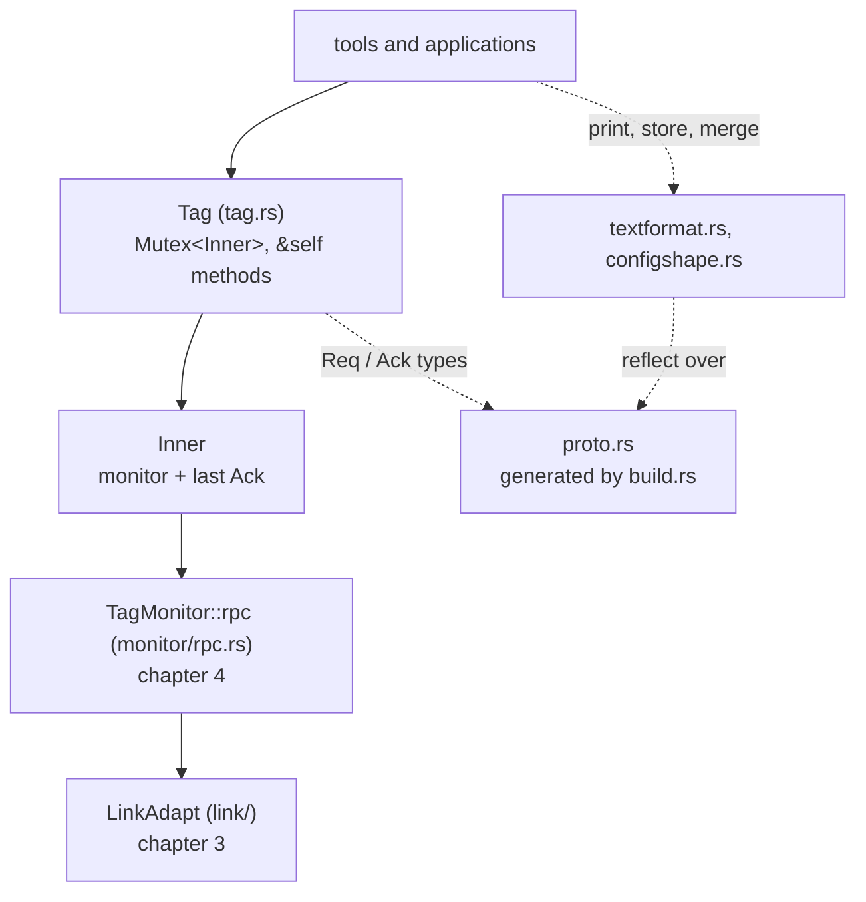
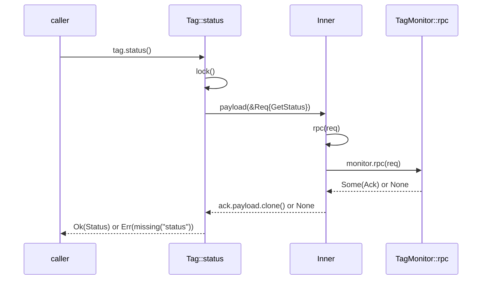

# 5. Protobuf and the Tag API

This chapter covers the top of the tagcore-rs crate: the build script that
turns `proto/tag.proto` and `proto/tagdata.proto` into Rust types, the module
that pulls those types in (`proto.rs`), the `Tag` facade that every tool and
application calls (`tag.rs`, the port of `tagclass.*`), and the two modules
that keep the Rust tools' output identical to the C++ ones (`textformat.rs`
and `configshape.rs`). The files are
[build.rs](../../libraries/tagcore-rs/build.rs),
[src/proto.rs](../../libraries/tagcore-rs/src/proto.rs),
[src/tag.rs](../../libraries/tagcore-rs/src/tag.rs),
[src/textformat.rs](../../libraries/tagcore-rs/src/textformat.rs) and
[src/configshape.rs](../../libraries/tagcore-rs/src/configshape.rs).

After reading it you will be able to read any prost-generated type and know
what the fields mean, follow a status request from `Tag::status` down to the
point where [chapter 4](04-monitor-and-rpc.md) takes over, and explain why
`tag-info` prints `voltage: 3` and not `voltage: 3.0`.

The architecture of the crate (layers, ownership, concurrency) is in
[chapter 6 of the guide](../guide/06-tagcore.md); the schema itself, and the
rules for changing it, are in
[chapter 4 of the guide](../guide/04-shared-contract.md#the-protobuf-schema).
This chapter does not repeat them.

## Where this sits



| File | C++ counterpart | What it does |
| --- | --- | --- |
| `build.rs` | the CMake `protoc` step and the generated `defaultconfigs.cc` | Runs protoc at build time; embeds every tag's `default-config.json` |
| `src/proto.rs` | `tag.pb.h`, `tagdata.pb.h`, `json_util` calls | The generated types, the descriptor pool, JSON in and out |
| `src/tag.rs` | `tagclass.*` | `Tag`: one method per monitor request |
| `src/textformat.rs` | protobuf's own `DebugString()` | Text format laid out exactly as the C++ library prints it |
| `src/configshape.rs` | `configshape.*` | Which `Config` fields a tag type supports |

## From `.proto` to Rust at build time

**Library: prost-build.** prost is the protobuf implementation the Rust world
mostly uses (the "prost" crates are maintained under the Tokio project).
`prost-build` is its code generator: it runs `protoc` to get a
`FileDescriptorSet`, then writes plain Rust structs and enums from it. It is
only a build dependency, linked into the build script and not into the
library.

**Library: prost-reflect-build.** prost generates bare structs with no
runtime reflection: there is no equivalent of the C++ `Descriptor` /
`Reflection` pair. `prost-reflect` adds one (below), and
`prost-reflect-build` is its wrapper around `prost-build`: it asks protoc for
the descriptor set as well, saves it to a file, and adds a derive to every
generated message so each type can find its own descriptor at run time.

**Library: protoc-bin-vendored.** Ships prebuilt `protoc` binaries for the
common host platforms inside the crate. The build script uses it unless
`PROTOC` is already set, so neither a developer nor a packaging machine needs
protoc installed. (The crate's [README](../../libraries/tagcore-rs/README.md)
still says protoc must be on `PATH`; the build script and `Cargo.toml` say
otherwise, and they are what runs.)

A `build.rs` at the root of a package is a program that Cargo compiles and
runs before compiling the package itself. It writes whatever it generates
into a per-build directory named by the `OUT_DIR` environment variable, and
talks to Cargo by printing `cargo:` lines on stdout. Here is the whole of
`main`, [build.rs:21](../../libraries/tagcore-rs/build.rs#L21):

```rust
fn main() -> std::io::Result<()> {
    let manifest = PathBuf::from(std::env::var("CARGO_MANIFEST_DIR").unwrap());
    let out_dir = PathBuf::from(std::env::var("OUT_DIR").unwrap());
    let root = manifest.join("../../..");
    let proto_dir = root.join("proto");
    let tag_proto = proto_dir.join("tag.proto");

    println!("cargo:rerun-if-changed={}", tag_proto.display());
    println!(
        "cargo:rerun-if-changed={}",
        proto_dir.join("tagdata.proto").display()
    );

    // A packaging build has no protoc of its own; use the vendored one
    // unless PROTOC names another.
    if std::env::var_os("PROTOC").is_none() {
        let protoc = protoc_bin_vendored::protoc_bin_path().expect("vendored protoc");
        // SAFETY: build scripts are single-threaded.
        unsafe { std::env::set_var("PROTOC", protoc) };
    }

    prost_reflect_build::Builder::new()
        .descriptor_pool("crate::proto::DESCRIPTOR_POOL")
        .file_descriptor_set_path(out_dir.join("file_descriptor_set.bin"))
        .compile_protos(&[tag_proto], &[proto_dir])?;

    embed_default_configs(&root.join("embedded/proto-c"), &out_dir)
}
```

Only `tag.proto` is named: it imports `tagdata.proto`
([proto/tag.proto:2](../../../proto/tag.proto#L2)), so compiling it yields
every type a monitor RPC can carry. `tag_service.proto` and
`tagdata-archive.proto` in `proto/` are not compiled by this crate.

`.descriptor_pool("crate::proto::DESCRIPTOR_POOL")` is a string, not a
reference: it is pasted into the generated code as the path of a static
that `proto.rs` must define (it does; see the next section). If you renamed
the static without changing this string, the generated code would stop
compiling.

> **Rust:** `cargo:rerun-if-changed=PATH` lines narrow when Cargo reruns the
> script. Without any, Cargo reruns it whenever any file in the package
> changes; with them, only when a named file does. The nearest C++ equivalent
> is the `DEPENDS` list of a CMake `add_custom_command`.

> **Rust:** `unsafe { std::env::set_var(...) }`. In edition 2024,
> `set_var` is an `unsafe fn` because another thread reading the environment
> at the same moment is undefined behaviour (as with `setenv` in C). The
> `// SAFETY:` comment is the convention for stating why an `unsafe` block is
> sound; here, a build script has one thread.

The build leaves three files in `OUT_DIR` (for the CMake build,
`<build>/cargo/<profile>/build/tagcore-<hash>/out/`):

| File | Made by | Pulled in by |
| --- | --- | --- |
| `_.rs` (about 1600 lines) | prost-build, through prost-reflect-build | `include!` at [proto.rs:25](../../libraries/tagcore-rs/src/proto.rs#L25) |
| `file_descriptor_set.bin` | protoc | `include_bytes!` at [proto.rs:30](../../libraries/tagcore-rs/src/proto.rs#L30) |
| `defaultconfigs.rs` | `embed_default_configs` | `include!` at [configshape.rs:30](../../libraries/tagcore-rs/src/configshape.rs#L30) |

The odd name `_.rs` comes from prost naming its output after the protobuf
`package`; neither file declares one, so the package name is empty and prost
writes `_`.

### The embedded default configs

`embed_default_configs` is the counterpart of the C++ build's generated
`defaultconfigs.cc`. It finds every `embedded/proto-c/*-proto-c/default-config.json`,
sorts them by directory name, and writes a Rust *expression* that names each
file, [build.rs:64](../../libraries/tagcore-rs/build.rs#L64):

```rust
    found.sort();

    let mut src = String::from("&[\n");
    for (name, path) in &found {
        writeln!(src, "    ({name:?}, include_str!({:?})),", path.display()).unwrap();
    }
    src.push(']');
    std::fs::write(out_dir.join("defaultconfigs.rs"), src)
}
```

The file it writes begins like this (from a real `OUT_DIR`):

```rust
&[
    ("bitprestag-proto-c", include_str!("/Users/geobrown/Research/tag-designs/software/embedded/proto-c/bitprestag-proto-c/default-config.json")),
    ("bittag-legacy-proto-c", include_str!("/Users/geobrown/Research/tag-designs/software/embedded/proto-c/bittag-legacy-proto-c/default-config.json")),
    ("bittag-ng-proto-c", include_str!("/Users/geobrown/Research/tag-designs/software/embedded/proto-c/bittag-ng-proto-c/default-config.json")),
```

`include_str!` reads the file at compile time and becomes a `&'static str`
holding its text, so the JSON of every tag's default config is compiled into
the library; nothing is read from disk at run time.

> **Rust:** `{name:?}` formats with `Debug` rather than `Display`. For a
> string, `Debug` prints it quoted and escaped, which is exactly a valid Rust
> string literal: a cheap way to emit source code. `use std::fmt::Write as _;`
> ([build.rs:14](../../libraries/tagcore-rs/build.rs#L14)) imports the
> `fmt::Write` trait without binding its name, so `writeln!` works on a
> `String` and the name does not clash with `std::io::Write`. A trait's
> methods can only be called where the trait is in scope; this is how you
> bring it in "for its methods only".

## proto.rs: pulling the generated code in

[proto.rs:17](../../libraries/tagcore-rs/src/proto.rs#L17):

```rust
#![allow(clippy::all, missing_docs)]

use std::sync::LazyLock;

use prost_reflect::{
    DescriptorPool, DeserializeOptions, DynamicMessage, ReflectMessage, SerializeOptions,
};

include!(concat!(env!("OUT_DIR"), "/_.rs"));

/// Descriptors of every message and enum in `tag.proto` and `tagdata.proto`.
pub static DESCRIPTOR_POOL: LazyLock<DescriptorPool> = LazyLock::new(|| {
    DescriptorPool::decode(
        include_bytes!(concat!(env!("OUT_DIR"), "/file_descriptor_set.bin")).as_ref(),
    )
    .expect("embedded file descriptor set decodes")
});
```

> **Rust:** `include!(path)` pastes the tokens of a file in place, like
> `#include`, but it is a macro that works on whole items or expressions,
> not text. `env!("OUT_DIR")` reads an environment variable **at compile
> time** (Cargo sets `OUT_DIR` while compiling this crate), and `concat!`
> joins string literals. The result is that every generated type becomes an
> item of the module `tagcore::proto` itself: `tagcore::proto::Req`,
> `tagcore::proto::ack::Err`, and so on. `include_bytes!` embeds a file as a
> `&'static [u8; N]`.

> **Rust:** `#![allow(...)]` with `!` is an *inner* attribute: it applies to
> the whole enclosing module, which here is the file. The generated items
> carry only the `.proto` comments, so the crate-wide `missing_docs` lint is
> silenced for this module alone.

> **Rust:** `LazyLock<T>` is a thread-safe, lazily initialised static. The
> closure runs once, on the first access from any thread; later accesses get
> the stored value. The C++ analogue is a function-local `static` with its
> initialiser. Here the descriptor set is decoded into a `DescriptorPool` the
> first time anything reflects over a message.

**Library: prost-reflect.** Runtime reflection for prost types, by the same
author as prost-reflect-build. The pieces this crate uses:

- `DescriptorPool`: the decoded `FileDescriptorSet`, like the C++
  `DescriptorPool`.
- `MessageDescriptor`, `FieldDescriptor`, `Kind`: the C++ `Descriptor`,
  `FieldDescriptor` and field type.
- `ReflectMessage`: a trait the generated structs implement (that is what
  the derive adds). Its `descriptor()` method returns the message's
  `MessageDescriptor`, and `transcode_to_dynamic()` turns the typed struct
  into a `DynamicMessage`.
- `DynamicMessage` and `Value`: a message held by descriptor, whose fields
  you get and set by `FieldDescriptor`, like the C++ `Message` used through
  `Reflection`. `Value` is an enum with one variant per protobuf value kind
  (`Bool`, `I32`, ..., `F32`, `String`, `EnumNumber`, `Message`, `List`,
  `Map`).
- serde support (the `serde` feature): `DynamicMessage` can be written to and
  read from proto3 JSON through serde_json (below).

`transcode_to_dynamic()` works by encoding the struct to the wire format and
decoding the bytes against the descriptor. It costs a copy, which is nothing
at these message sizes.

The same file adds one method to a generated type,
[proto.rs:35](../../libraries/tagcore-rs/src/proto.rs#L35):

```rust
impl Ack {
    /// The firmware's error text, or `""` when the payload is not
    /// `error_message`. Matches the C++ `Ack::error_message()` accessor,
    /// which returns an empty string for an unset oneof member.
    pub fn error_message(&self) -> &str {
        match &self.payload {
            Some(ack::Payload::ErrorMessage(message)) => message,
            _ => "",
        }
    }
}
```

> **Rust:** an `impl` block can add methods to a type only in the crate that
> defines the type. Because `_.rs` is `include!`d into this crate, `Ack` is
> this crate's type, and `proto.rs` can give it the accessor the C++
> generated code had. Any `impl` block anywhere in the crate adds to the same
> type; there is no single class body.

## What the generated types look like

**Library: prost.** The runtime half of prost: the `Message` trait
(`encode`, `encoded_len`, `decode`, `encode_to_vec`) and the derive macros
the generated code uses (`::prost::Message`, `::prost::Oneof`,
`::prost::Enumeration`). A prost message is a plain struct with public
fields; there are no accessors, no arena and no `has_` bits for proto3
scalars.

The generated `_.rs` is not checked in. These excerpts are copied from a
build's `OUT_DIR`. First the request, whose whole content is one oneof:

```rust
#[derive(::prost_reflect::ReflectMessage)]
#[prost_reflect(message_name = "Req")]
#[prost_reflect(descriptor_pool = "crate::proto::DESCRIPTOR_POOL")]
#[derive(Clone, PartialEq, ::prost::Message)]
pub struct Req {
    #[prost(oneof = "req::Payload", tags = "1, 2, 3, 4, 5, 6, 7, 8, 9, 11, 12, 13, 14")]
    pub payload: ::core::option::Option<req::Payload>,
}
/// Nested message and enum types in `Req`.
pub mod req {
    #[derive(Clone, PartialEq, ::prost::Oneof)]
    pub enum Payload {
        /// static tag information
        #[prost(message, tag = "1")]
        GetInfo(super::Empty),
        /// current tag status
        #[prost(message, tag = "2")]
        GetStatus(super::Empty),
        // ...
        /// configure & start tag
        #[prost(message, tag = "5")]
        Start(super::Config),
        // ...
        /// start test
        #[prost(enumeration = "super::TestReq", tag = "7")]
        Test(i32),
        /// set clock (milliseconds)
        #[prost(int64, tag = "8")]
        SetRtc(i64),
        // ...
```

from this source, [proto/tag.proto:19](../../../proto/tag.proto#L19):

```text
message Req {
  oneof payload {

    // Information

    Empty get_info = 1;   // static tag information
    Empty get_status = 2; // current tag status
    Empty get_config = 3; // current tag configuration

    // control

    Empty erase = 4;   // erase tag (return to Idle)
    Config start = 5;  // configure & start tag
    Empty stop = 6;    // stop tag
    TestReq test = 7;  // start test
    int64 set_rtc = 8; // set clock (milliseconds)
```

The `#[derive(...)]` and `#[prost(...)]` lines are attributes read by
procedural macros at compile time: `::prost::Message` generates the
`encode`/`decode` implementation from the `tag = "..."` annotations, and
`ReflectMessage` generates `descriptor()` by looking `"Req"` up in
`DESCRIPTOR_POOL`. Nested types of a message go in a module named after it in
snake_case: `req::Payload`, `ack::Err`, `config::Interval`.

> **Rust:** a oneof becomes `Option<m::Payload>`, where `Payload` is an
> `enum` whose variants carry data (`GetStatus(Empty)`, `Start(Config)`,
> `SetRtc(i64)`). This is a tagged union the compiler checks: the C++
> `payload_case()` switch plus `mutable_start()` becomes a single `match`,
> and `None` is "not set". You build a request with
> `Req { payload: Some(req::Payload::GetStatus(Empty {})) }`.

The reply carries an enum field and a oneof:

```rust
pub struct Ack {
    #[prost(enumeration = "ack::Err", tag = "1")]
    pub err: i32,
    #[prost(
        oneof = "ack::Payload",
        tags = "2, 3, 4, 5, 6, 7, 8, 9, 10, 11, 12, 13, 14, 15, 16, 17"
    )]
    pub payload: ::core::option::Option<ack::Payload>,
}
/// Nested message and enum types in `Ack`.
pub mod ack {
    #[derive(
        Clone,
        Copy,
        Debug,
        PartialEq,
        Eq,
        Hash,
        PartialOrd,
        Ord,
        ::prost::Enumeration
    )]
    #[repr(i32)]
    pub enum Err {
        Unspecified = 0,
        Ok = 1,
        // ...
        /// operation not permitted
        Perm = 6,
        /// operation failed
        Nxio = 7,
        /// nanopb error
        Nanopb = 8,
    }
    impl Err {
        // ...
        pub fn as_str_name(&self) -> &'static str {
            match self {
                Self::Unspecified => "UNSPECIFIED",
                Self::Ok => "OK",
                // ...
```

Note `pub err: i32`, not `pub err: ack::Err`. **Every enum-typed field is an
`i32`.** proto3 enums are open: a value the receiver does not know must
survive decoding, and a Rust enum cannot hold a value it does not declare. So
the field stores the number, and code converts in one of three ways:

- compare with a cast: `state == TagState::Configured as i32`
  ([tag.rs:105](../../libraries/tagcore-rs/src/tag.rs#L105));
- convert, choosing what to do with an unknown value:
  `ack::Err::try_from(ack.err).unwrap_or(ack::Err::Unspecified)`
  ([tag.rs:159](../../libraries/tagcore-rs/src/tag.rs#L159));
- call the typed getter `status.state()`, which returns `TagState` and maps
  an unknown value to the enum's first variant. The getter (and a setter,
  `set_state`) is generated by the `#[derive(::prost::Message)]` macro, so it
  is not in `_.rs` as text: searching the file for `fn state` finds nothing.

> **Rust:** `#[repr(i32)]` fixes the enum's representation as `i32`, so
> `TagState::Idle as i32` is the protobuf number. `try_from` comes from the
> `TryFrom<i32>` trait the `Enumeration` derive implements; it returns a
> `Result`, so the caller must say what an out-of-range number means. Enum
> variant names are the protobuf names converted to CamelCase: `BITTAG_LE`
> becomes `TagType::BittagLe`, `sRESET` becomes `TagState::SReset`, and
> `as_str_name()` gives back the protobuf spelling.

`Config` shows the other field shapes:

```rust
pub struct Config {
    #[prost(enumeration = "TagType", tag = "1")]
    pub tag_type: i32,
    /// Schedule
    #[prost(message, optional, tag = "2")]
    pub active_interval: ::core::option::Option<config::Interval>,
    /// hibernation
    #[prost(message, repeated, tag = "3")]
    pub hibernate: ::prost::alloc::vec::Vec<config::Interval>,
    /// period for synchronous tags
    #[prost(uint32, tag = "7")]
    pub period: u32,
    // ...
    #[prost(message, optional, tag = "6")]
    pub adxl362: ::core::option::Option<Adxl362>,
    // ...
```

and `TagInfo` the one proto3 `optional` scalar in the schema
([proto/tagdata.proto:33](../../../proto/tagdata.proto#L33)):

```protobuf
  optional float ppm_clock_error = 15; // RV3028 EEOffset-derived clock correction
```

which prost generates as:

```rust
    /// RV3028 EEOffset-derived clock correction
    #[prost(float, optional, tag = "15")]
    pub ppm_clock_error: ::core::option::Option<f32>,
```

| proto3 | prost | Example |
| --- | --- | --- |
| scalar | plain value; zero means unset | `Status.millis: i64`, `Config.period: u32` |
| `optional` scalar | `Option<T>` | `TagInfo.ppm_clock_error: Option<f32>` |
| singular message | `Option<M>` | `Config.active_interval`, `Config.adxl362` |
| `repeated` | `Vec<T>` | `Config.hibernate`, `StateLog.states` |
| `bytes` | `Vec<u8>` | |
| enum field | `i32`, plus derived getter and setter | `Status.state`, `status.state()` |
| `oneof` | `Option<m::Payload>` | `Req.payload`, `Ack.payload` |

prost also derives `Copy` for a message whose fields are all `Copy`:
`Empty`, `config::Interval` and `CalibrationConstants` are `Copy`, which is
why [tag.rs:792](../../libraries/tagcore-rs/src/tag.rs#L792) can pass
`*constants` where it passes `config.clone()` for a `Config`.

Encoding and decoding are methods of the `prost::Message` trait. The two
calls the crate makes are in `TagMonitor::rpc` (shown later):
`req.encode(&mut out)` into the staging buffer, and
`Ack::decode(&self.rpcbuf[..len])`, which returns
`Result<Ack, DecodeError>`. A file that calls them needs `use prost::Message;`,
for the same reason as `fmt::Write` above.

## The Tag type

### TagError: an error written by hand

[tag.rs:64](../../libraries/tagcore-rs/src/tag.rs#L64):

```rust
#[derive(Debug, Clone, PartialEq, Eq)]
pub struct TagError {
    /// The RPC did not complete over the link.
    pub transport_failed: bool,
    /// The firmware's Ack code; `Unspecified` after a transport failure.
    pub err: ack::Err,
    /// Human-readable reason; empty only in [`Tag::last_error`] after a
    /// successful call.
    pub message: String,
}

impl fmt::Display for TagError {
    fn fmt(&self, f: &mut fmt::Formatter<'_>) -> fmt::Result {
        f.write_str(&self.message)
    }
}

impl std::error::Error for TagError {}
```

It keeps the three things the C++ `Tag::LastError()` distinguished: the link
failed, the firmware refused with a code, or the reply lacked the payload.
Unlike the C++, a failure is also the *return value* of the call that
failed; `last_error()` is kept for code ported from the C++ that asks
afterwards.

> **Rust:** an error type is an ordinary struct. Implementing the `Display`
> trait gives it `{e}` formatting and `.to_string()`; the empty
> `impl std::error::Error` marks it as an error, so callers can box it as
> `Box<dyn Error>` and use `?` on it in functions that return one. Many Rust
> projects generate these two impls with the `thiserror` crate; this crate
> uses no error crates at all and writes them out.

The second error type, `StopFailure`
([tag.rs:116](../../libraries/tagcore-rs/src/tag.rs#L116)), is an enum whose
variants carry data (`Status(TagError)`, `NotAcquiring(Box<Status>)`,
`Refused(TagError)`, `TimedOut(Box<Status>)`). It belongs to
`stop_confirmed`, below.

> **Rust:** `Box<Status>` in `NotAcquiring(Box<Status>)` puts the large
> `Status` on the heap. An enum is as large as its largest variant, so boxing
> the big one keeps every `StopFailure` (and every `Result` holding one)
> small. Clippy's `large_enum_variant` lint asks for this.

### Inner: the state behind the lock

[tag.rs:236](../../libraries/tagcore-rs/src/tag.rs#L236):

```rust
/// State behind the [`Tag`] lock.
struct Inner {
    /// The monitor session; all link traffic goes through it.
    monitor: TagMonitor,
    /// The most recent reply, or the failure recorded in its place.
    ack: Ack,
    /// The last RPC did not complete over the link.
    rpc_failed: bool,
}

impl Inner {
    /// Sends `req` and records the reply (or its absence) for `last_error`.
    fn rpc(&mut self, req: &Req) -> bool {
        match self.monitor.rpc(req) {
            Some(ack) => {
                self.ack = ack;
                self.rpc_failed = false;
            }
            None => {
                self.ack = Ack::default();
                self.rpc_failed = true;
            }
        }
        !self.rpc_failed
    }
```

Every request goes through `Inner::rpc`. It stores the reply (or a default
`Ack` with `rpc_failed` set) so that `last_error()` and `debug_message()`
can report it later, as the C++ class's member `Ack` did. The other `Inner`
methods are small wrappers that turn the stored outcome into a `Result`:

| Method | Line | Returns |
| --- | --- | --- |
| `error()` | [264](../../libraries/tagcore-rs/src/tag.rs#L264) | the recorded outcome as a `TagError` (empty message on success) |
| `missing(what)` | [269](../../libraries/tagcore-rs/src/tag.rs#L269) | that error, or "Tag reply carried no {what}" if the RPC itself succeeded |
| `expect_ok(req)` | [278](../../libraries/tagcore-rs/src/tag.rs#L278) | `Ok(())` only for a completed RPC answered OK |
| `command(req)` | [291](../../libraries/tagcore-rs/src/tag.rs#L291) | `Result<Option<Status>, TagError>`; a transport failure is recorded as a MONITOR Ack, as the C++ `Start()` did |
| `payload(req)` | [300](../../libraries/tagcore-rs/src/tag.rs#L300) | the reply's oneof, cloned, or `None` |

### Tag: one mutex, `&self` everywhere

[tag.rs:332](../../libraries/tagcore-rs/src/tag.rs#L332):

```rust
pub struct Tag {
    /// The monitor and the last RPC outcome, behind one lock so a request
    /// and the recording of its outcome are atomic.
    inner: Mutex<Inner>,
}
```

and the helper every method starts with,
[tag.rs:357](../../libraries/tagcore-rs/src/tag.rs#L357):

```rust
    /// Locks the inner state, blocking until any other thread's request
    /// finishes.
    fn lock(&self) -> MutexGuard<'_, Inner> {
        // A panic in another thread leaves nothing half-written that a later
        // call cannot cope with, so a poisoned lock is still used.
        self.inner.lock().unwrap_or_else(|e| e.into_inner())
    }
```

> **Rust:** `std::sync::Mutex<T>` *owns* the data it protects. There is no
> way to reach the `Inner` except through the `MutexGuard` that `lock()`
> returns, and the guard unlocks when it is dropped (RAII, like
> `std::lock_guard`). So `self.lock().monitor.detach();` locks, calls and
> unlocks in one statement, and `let mut inner = self.lock();` holds the lock
> to the end of the enclosing block. In C++ the mutex sits beside the data
> and nothing stops code touching the data without it.

> **Rust:** "poisoning". If a thread panics while holding a `Mutex`, later
> `lock()` calls return `Err(PoisonError)`. `unwrap_or_else(|e|
> e.into_inner())` takes the guard out of the error and carries on; the
> comment says why that is safe here.

Every public method takes `&self`, a shared reference, yet changes state
through the mutex. That makes one `Tag` safe to share between threads, for
example in an `Arc<Tag>`, which is what the module documentation promises.
(The applications in this tree do not need it: Tag Monitor creates its `Tag`
on its tag thread and keeps it there; see
[chapter 11](11-engine-and-model.md).) The C++ `Tag` had the same
arrangement in its `mutex mtx` member
([tagclass.h:168](../../libraries/tagcore/tagclass.h#L168)). The layers
below, `TagMonitor` and `LinkAdapt`, take `&mut self` and have no lock at
all: there the compiler proves that only one piece of code holds the link at
a time, and `Tag` is the one place a lock is taken.

`impl Drop for Tag` ([tag.rs:797](../../libraries/tagcore-rs/src/tag.rs#L797))
detaches, as the C++ destructor did.

### The public methods

Calls that send no request to the firmware, and so do not change
`last_error()`:

| Method | Returns | Line |
| --- | --- | --- |
| `new()` | `Tag` (detached) | [347](../../libraries/tagcore-rs/src/tag.rs#L347) |
| `available()` | `Vec<UsbDev>` | [369](../../libraries/tagcore-rs/src/tag.rs#L369) |
| `attach(&UsbDev)` | `bool`; **resets the tag** | [380](../../libraries/tagcore-rs/src/tag.rs#L380) |
| `detach()` | | [395](../../libraries/tagcore-rs/src/tag.rs#L395) |
| `is_attached()`, `target_family()` | `bool`, `TargetFamily` | [400](../../libraries/tagcore-rs/src/tag.rs#L400) |
| `link_stats()`, `monitor_stats()` and their resets | statistics | [410](../../libraries/tagcore-rs/src/tag.rs#L410) |
| `voltage()` | `Option<f32>` | [430](../../libraries/tagcore-rs/src/tag.rs#L430) |
| `base_identity()`, `git_sha()` | `Option<String>` | [437](../../libraries/tagcore-rs/src/tag.rs#L437) |
| `force_backup_state`, `count_bittag_log_headers`, `bittag_log_from_flash` | field-rescue helpers for old BitTags | [483](../../libraries/tagcore-rs/src/tag.rs#L483) |
| `read_memory`, `write_memory` | `MemAccess` | [503](../../libraries/tagcore-rs/src/tag.rs#L503) |
| `keep_alive()` | `bool` | [517](../../libraries/tagcore-rs/src/tag.rs#L517) |

Calls that send one request each:

| Method | Request payload | Returns | Line |
| --- | --- | --- | --- |
| `tag_info()` | `GetInfo` | `Result<TagInfo, TagError>` | [453](../../libraries/tagcore-rs/src/tag.rs#L453) |
| `config()` | `GetConfig` | `Result<Config, TagError>` | [462](../../libraries/tagcore-rs/src/tag.rs#L462) |
| `status()` | `GetStatus` | `Result<Status, TagError>` | [471](../../libraries/tagcore-rs/src/tag.rs#L471) |
| `request(&Req)` | any | `Result<Ack, TagError>` | [528](../../libraries/tagcore-rs/src/tag.rs#L528) |
| `erase()` | `Erase` | `Result<Option<Status>, TagError>` | [581](../../libraries/tagcore-rs/src/tag.rs#L581) |
| `start(&Config)` | `Start` | `Result<Option<Status>, TagError>` | [596](../../libraries/tagcore-rs/src/tag.rs#L596) |
| `stop()` | `Stop` | `Result<Option<Status>, TagError>` | [612](../../libraries/tagcore-rs/src/tag.rs#L612) |
| `stop_confirmed(Duration)` | `GetStatus`, `Stop` in a loop | `Result<Status, StopFailure>` | [639](../../libraries/tagcore-rs/src/tag.rs#L639) |
| `calibrate()` | `Calibrate` | `Result<Option<Status>, TagError>` | [686](../../libraries/tagcore-rs/src/tag.rs#L686) |
| `set_rtc()` | `SetRtc` | `Result<(), TagError>` | [702](../../libraries/tagcore-rs/src/tag.rs#L702) |
| `test(TestReq)` | `Test` | `Result<Option<Status>, TagError>` | [742](../../libraries/tagcore-rs/src/tag.rs#L742) |
| `state_log(i32)` | `Log { SystemLog, index }` | `Result<StateLog, TagError>` | [751](../../libraries/tagcore-rs/src/tag.rs#L751) |
| `data_log(i32)` | `Log { InternalData, index }` | `Result<Ack, TagError>` | [762](../../libraries/tagcore-rs/src/tag.rs#L762) |
| `calibration_log()` | `Caldata` | `Result<Ack, TagError>` | [768](../../libraries/tagcore-rs/src/tag.rs#L768) |
| `read_calibration(i32)` | `ReadCalibration` | `Result<CalibrationConstants, TagError>` | [776](../../libraries/tagcore-rs/src/tag.rs#L776) |
| `write_calibration(&CalibrationConstants)` | `WriteCalibration` | `Result<(), TagError>` | [790](../../libraries/tagcore-rs/src/tag.rs#L790) |
| `last_error()`, `debug_message()` | none: the recorded outcome | `TagError`, `String` | [542](../../libraries/tagcore-rs/src/tag.rs#L542) |

There is no `reset()`. The `tag-reset` tool is `stop_confirmed` (when the tag
is acquiring) followed by `erase()`.

### Why the commands return `Option<Status>`

The five state-changing commands share one return type, explained at
[tag.rs:561](../../libraries/tagcore-rs/src/tag.rs#L561):

```rust
    // ---- Tag control ----
    //
    // Start, Stop, Erase, Self-test and Calibrate return `Ok(Some(status))`
    // from firmware with synchronous commands: the transition has run, and
    // `status` is the state it reached. `Ok(None)` is a bare OK from older
    // firmware, which only queued the command; the caller then learns the
    // outcome from later status reads. A refusal is `Err`; from the newer
    // firmware a PERM leaves the state as it was.
```

The `Option` encodes a firmware generation, which the C++ API (a `bool`)
could not. The decision is made by
[tag.rs:208](../../libraries/tagcore-rs/src/tag.rs#L208):

```rust
fn command_outcome(ack: &Ack) -> Result<Option<Status>, TagError> {
    if ack_err(ack) != ack::Err::Ok {
        return Err(describe(ack, false));
    }
    match &ack.payload {
        Some(ack::Payload::Status(status)) => Ok(Some(status.clone())),
        _ => Ok(None),
    }
}
```

and a command method is one line,
[tag.rs:596](../../libraries/tagcore-rs/src/tag.rs#L596):

```rust
    pub fn start(&self, config: &Config) -> Result<Option<Status>, TagError> {
        self.lock()
            .command(&request(req::Payload::Start(config.clone())))
    }
```

`config.clone()` is needed because the variant `Start(Config)` owns its
`Config` and the caller only lent one. `command_outcome`, `describe` and
`log_request` are free functions rather than `Inner` methods so that the unit
tests at the bottom of the file can check them without a tag
([tag.rs:892](../../libraries/tagcore-rs/src/tag.rs#L892) onwards).

## One call, end to end: `Tag::status`



**1. The public method**, [tag.rs:470](../../libraries/tagcore-rs/src/tag.rs#L470):

```rust
    /// Current state, clock, data counts, voltage and temperature.
    pub fn status(&self) -> Result<Status, TagError> {
        let mut inner = self.lock();
        match inner.payload(&request(req::Payload::GetStatus(Empty {}))) {
            Some(ack::Payload::Status(status)) => Ok(status),
            _ => Err(inner.missing("status")),
        }
    }
```

`request()` ([tag.rs:219](../../libraries/tagcore-rs/src/tag.rs#L219)) wraps
the payload: `Req { payload: Some(payload) }`. The guard `inner` is held to
the closing brace, so the request and the recording of its outcome happen
under one lock.

> **Rust:** `Some(ack::Payload::Status(status)) => Ok(status)` is a nested
> pattern: it matches an `Option` holding the `Status` variant of the oneof
> and binds the `Status` inside to `status`, moving it out. It replaces the
> C++ `if (ack.has_status()) return ack.status();`. The `_` arm catches the
> rest: a failed RPC, no payload, or the wrong payload, and `missing()` works
> out which message to give.

**2. `Inner::payload`**, [tag.rs:299](../../libraries/tagcore-rs/src/tag.rs#L299):

```rust
    /// The Ack payload, if the RPC completed and carried one.
    fn payload(&mut self, req: &Req) -> Option<ack::Payload> {
        if self.rpc(req) {
            self.ack.payload.clone()
        } else {
            None
        }
    }
```

It clones the oneof out of the stored `Ack`, because the `Ack` stays in
`Inner` for `last_error()`.

**3. `Inner::rpc`** (shown above) calls `self.monitor.rpc(req)` and records
what came back.

**4. `TagMonitor::rpc`**,
[monitor/rpc.rs:98](../../libraries/tagcore-rs/src/monitor/rpc.rs#L98). This
is the port of `TagMonitor::Rpc`. Only the protobuf ends are shown here;
[chapter 4](04-monitor-and-rpc.md) covers the transport between them. The
request is encoded straight into the 64 KiB staging buffer,
[monitor/rpc.rs:106](../../libraries/tagcore-rs/src/monitor/rpc.rs#L106):

```rust
        let size = req.encoded_len();
        if size > self.rpcbuf.len() {
            error!("Request message too big");
            return None;
        }
        let step = Instant::now();
        let mut out: &mut [u8] = &mut self.rpcbuf[..];
        if req.encode(&mut out).is_err() {
            error!("Request message too big");
            return None;
        }
```

> **Rust:** `Message::encode` writes into anything implementing the
> `bytes::BufMut` trait, and `&mut [u8]` implements it by *advancing the
> slice* past what it wrote. That is why the code makes a mutable variable
> `out` holding the slice and passes `&mut out`: `encode` shrinks `out`, not
> `rpcbuf`. The bytes land at the start of `rpcbuf`.

The request is written to the firmware's call buffer and the PROTOBUF call
made (lines 121-154, chapter 4). The reply length comes back as the call's
result, the reply is read into the same buffer, and decoded,
[monitor/rpc.rs:178](../../libraries/tagcore-rs/src/monitor/rpc.rs#L178):

```rust
        let step = Instant::now();
        let ack = Ack::decode(&self.rpcbuf[..len]);
        if INSTRUMENTED {
            self.monitor_stats.parse_ns += elapsed_ns(step);
            self.monitor_stats.rpc_calls += 1;
            self.monitor_stats.request_bytes += size as u64;
            self.monitor_stats.response_bytes += len as u64;
            self.monitor_stats.rpc_total_ns += elapsed_ns(rpc_start);
        }
        ack.map_err(|e| error!("Reply did not decode: {e}")).ok()
    }
```

> **Rust:** the last line turns `Result<Ack, DecodeError>` into
> `Option<Ack>` while logging. `map_err(|e| error!(...))` replaces the error
> with the closure's result, `()` (the `error!` macro returns nothing), and
> `.ok()` turns `Ok(x)` into `Some(x)` and any `Err` into `None`. The layers
> below `Tag` report failure as `Option` or `bool` with the reason in the
> log, as the C++ did; only `Tag` turns that into an error value.

`TagMonitor::rpc` returns the decoded `Ack` whatever its `err` code: a
firmware refusal is a successful RPC. `Tag` decides what a refusal means.

## `stop_confirmed`

`stop()` sends one request. `stop_confirmed` is the procedure the tools
actually want: stop the tag and do not return until it is stopped, coping
with old firmware that queues the stop, and with the STM32L4 firmware that
could accept a stop early in a session and lose it (the comment on
`STOP_RESEND_AFTER` at
[tag.rs:87](../../libraries/tagcore-rs/src/tag.rs#L87) has the history).
[tag.rs:639](../../libraries/tagcore-rs/src/tag.rs#L639):

```rust
    pub fn stop_confirmed(&self, timeout: Duration) -> Result<Status, StopFailure> {
        let status = self.status().map_err(StopFailure::Status)?;
        if is_stopped(status.state) {
            return Ok(status);
        }
        if !is_acquiring(status.state) {
            return Err(StopFailure::NotAcquiring(Box::new(status)));
        }
        if let Some(stopped) = self.stop().map_err(StopFailure::Refused)?
            && is_stopped(stopped.state)
        {
            return Ok(stopped);
        }
        let started = Instant::now();
        let mut sent = started;
        loop {
            let status = self.status().map_err(StopFailure::Status)?;
            if is_stopped(status.state) {
                return Ok(status);
            }
            if started.elapsed() >= timeout {
                return Err(StopFailure::TimedOut(Box::new(status)));
            }
            if is_acquiring(status.state) && sent.elapsed() >= STOP_RESEND_AFTER {
                warn!(
                    "tag still {} {:.0} s after the stop was accepted; sending it again",
                    state_label(status.state),
                    sent.elapsed().as_secs_f32()
                );
                if let Err(e) = self.stop() {
                    warn!("resent stop failed: {e}");
                }
                sent = Instant::now();
            }
            sleep(STOP_POLL);
        }
    }
```

With synchronous firmware this is two RPCs: a status read and a stop whose
reply already carries FINISHED or ABORTED. With older firmware it polls every
`STOP_POLL` (2 s) and resends the stop after `STOP_RESEND_AFTER` (4 s).

> **Rust:** `map_err(StopFailure::Status)` passes the *variant constructor*
> as a function. A tuple variant's name is a function from its contents to
> the enum, so `StopFailure::Status` is a `fn(TagError) -> StopFailure`.
> Then `?` returns early with the converted error if the `Result` is `Err`,
> and otherwise unwraps the `Ok` value.

> **Rust:** `if let Some(stopped) = ... && is_stopped(stopped.state) { }` is
> a *let chain*: a pattern match and a condition joined with `&&`, the
> condition seeing the binding. It needs edition 2024 and Rust 1.88 or later
> (which is why that is the toolchain minimum), and the crate uses it
> throughout. In C++ this would be two nested `if`s.

Unlike the other methods, `stop_confirmed` takes no lock itself: each
`self.status()` and `self.stop()` locks and unlocks, so another thread's
request can run between polls. The doc comment says so.

## The downloads: `data_log`, `calibration_log`, `state_log`

The log requests use one helper,
[tag.rs:225](../../libraries/tagcore-rs/src/tag.rs#L225):

```rust
/// A log request for block `index` of the log `fmt` selects.
///
/// The protobuf field is unsigned; a negative `index` is sent as its
/// two's-complement bit pattern, as the C++ implicit conversion does.
fn log_request(fmt: log_req::LogDataType, index: i32) -> Req {
    request(req::Payload::Log(LogReq {
        fmt: fmt as i32,
        index: index as u32,
    }))
}
```

> **Rust:** `as` between integer types never fails: `index as u32`
> reinterprets the bits of a negative `i32`, exactly the C++ implicit
> conversion the comment refers to. Rust has no implicit integer
> conversions, so the cast must be written.

The three methods, [tag.rs:749](../../libraries/tagcore-rs/src/tag.rs#L749):

```rust
    /// The block of state transitions starting at entry `index`. The number
    /// fetched is `states.len()`; an empty log means there are no more.
    pub fn state_log(&self, index: i32) -> Result<StateLog, TagError> {
        let mut inner = self.lock();
        match inner.payload(&log_request(log_req::LogDataType::SystemLog, index)) {
            Some(ack::Payload::SystemLog(log)) => Ok(log),
            _ => Err(inner.missing("state log")),
        }
    }

    /// The block of data-log entries starting at entry `index`, as the whole
    /// Ack, since its payload type depends on the tag. The Ack code is not
    /// checked; `Err` only when the RPC did not complete.
    pub fn data_log(&self, index: i32) -> Result<Ack, TagError> {
        self.request(&log_request(log_req::LogDataType::InternalData, index))
    }

    /// The calibration log, as the whole Ack. The Ack code is not checked;
    /// `Err` only when the RPC did not complete.
    pub fn calibration_log(&self) -> Result<Ack, TagError> {
        self.request(&request(req::Payload::Caldata(Empty {})))
    }
```

`data_log` returns the whole `Ack` because the payload variant depends on the
tag: `BittagDataLog`, `PrestagDataLog`, `CompasstagDataLog` and so on. The
caller is the downloader, which needs both the code (NODATA means a missing
block, not the end) and the payload. Tag Monitor's download loop,
[download.rs:159](../../applications/tagmonitor-rs/core/src/engine/download.rs#L159):

```rust
    while !cancel.load(Ordering::Relaxed) {
        let page = match tag.data_log(count) {
            Ok(page) => page,
            Err(_) => {
                error = format!(
                    "GetDataLog failed at entry {count}: {}",
                    tag.debug_message()
                );
                break;
            }
        };
        if !page.error_message().is_empty() {
            error = page.error_message().to_string();
            break;
        }
        if page.err == ack::Err::Nodata as i32 && count < max_count {
            // ...
```

The page then goes to `writer.write_log(&page)`: the `taglogwriter` crate,
which passes the `Ack` in its wire encoding to the C++ SQLite writer, so the
payload variant is interpreted on the C++ side only
([chapter 8](08-bridges-to-cpp-and-python.md)). How the download is shaped is
in [chapter 5 of the guide](../guide/05-data-and-storage.md#the-download).

## textformat.rs: `DebugString()` byte for byte

The problem, as the author of the C++ tools would meet it: `tag-info`,
`tag-start` and `tag-dwnld` print messages with `DebugString()`, and people
and scripts compare that output. prost has no text format at all, and
prost-reflect's (its `text-format` feature is enabled in `Cargo.toml`) prints
a repeated field once, as a bracketed list, where the C++ repeats the field
name per element (`hibernate {` ... `}` twice for two intervals). So this module re-implements the C++ printer over
`DynamicMessage`. The rules are listed at the top of the file,
[textformat.rs:1](../../libraries/tagcore-rs/src/textformat.rs#L1); the one
deliberate difference is that the randomised marker recent C++ protobuf
releases insert into `DebugString()` is not reproduced.

The walker, [textformat.rs:41](../../libraries/tagcore-rs/src/textformat.rs#L41):

```rust
fn print_message(msg: &DynamicMessage, single_line: bool, indent: usize, out: &mut String) {
    let mut fields: Vec<(FieldDescriptor, &Value)> = msg.fields().collect();
    fields.sort_by_key(|(f, _)| f.number());
    for (field, value) in fields {
        match value {
            Value::List(items) => {
                for item in items {
                    print_field(&field, item, single_line, indent, out);
                }
            }
            Value::Map(_) => {} // tag.proto has no map fields
            v => print_field(&field, v, single_line, indent, out),
        }
    }
}
```

`DynamicMessage::fields()` yields only the fields that are set, which for
proto3 means non-default scalars, present messages, the set oneof member and
explicit-presence optionals: the same set the C++ prints. They are sorted by
field number, the C++ order (the `.proto` declares `period = 7` between 3
and 4, and the output puts it after `bittag_log = 4`).

> **Rust:** `msg.fields().collect()` turns an iterator into a container;
> the type annotation on `fields` tells `collect` which container to build.
> `sort_by_key(|(f, _)| f.number())` takes a closure that destructures each
> tuple and returns the key. `v => ...` in the last arm binds whatever
> matched to `v`, a named catch-all.

Each value is spelled by `scalar`,
[textformat.rs:104](../../libraries/tagcore-rs/src/textformat.rs#L104); the
float lines are the interesting ones:

```rust
        Value::F32(v) => format_g(f64::from(*v), 6, 9, |s| s.parse::<f32>().ok() == Some(*v)),
        Value::F64(v) => format_g(*v, 15, 17, |s| s.parse::<f64>().ok() == Some(*v)),
```

The C++ library prints floats with `SimpleFtoa`: `%.6g`, and `%.9g` if the
six-digit form does not read back as the same `float` (`%.15g`/`%.17g` for
doubles). `format_g` implements that rule with the round-trip test passed in,
[textformat.rs:133](../../libraries/tagcore-rs/src/textformat.rs#L133):

```rust
pub fn format_g(v: f64, short: usize, long: usize, round_trips: impl Fn(&str) -> bool) -> String {
    if v.is_nan() {
        return "nan".into();
    }
    if v.is_infinite() {
        return if v > 0.0 { "inf".into() } else { "-inf".into() };
    }
    let s = percent_g(v, short);
    if round_trips(&s) {
        s
    } else {
        percent_g(v, long)
    }
}
```

Rust's `format!` has no `%g`, so `percent_g`
([textformat.rs:149](../../libraries/tagcore-rs/src/textformat.rs#L149))
builds it: format in scientific notation with `precision - 1` decimals
(`{:.*e}`), read the exponent of the rounded value, and choose between
exponent and fixed layout as C does, stripping trailing zeros. The unit test
at [textformat.rs:218](../../libraries/tagcore-rs/src/textformat.rs#L218)
lists the cases: `3.0` prints `3`, `0.00001` prints `1e-05`, and
`1.2345678f32` needs nine digits, `1.23456776`.

> **Rust:** `round_trips: impl Fn(&str) -> bool` in argument position means
> "any closure taking `&str` and returning `bool`". It is a generic parameter
> written short, like a C++ template parameter constrained to be callable;
> each call site gets its own compiled copy with the closure inlined. The
> closure `|s| s.parse::<f32>().ok() == Some(*v)` captures `v` from the
> enclosing `match` arm.

## JSON: `to_json`, `from_json` and the float formatter

**Library: serde_json.** serde is Rust's general serialisation framework:
a data format implements serde's `Serializer`/`Deserializer` traits, and a
type implements `Serialize`/`Deserialize`. serde_json is the JSON format. In
this crate it appears in three ways: prost-reflect's serde support writes and
reads `DynamicMessage`s as proto3 JSON through it; `serde_json::Value` (a
parsed JSON tree, like a `QJsonValue`) is walked directly by `configshape`;
and the recovery code reads a capture manifest back with it
([chapter 6](06-recovery.md)).

`to_json`, [proto.rs:62](../../libraries/tagcore-rs/src/proto.rs#L62), with
the formatter it uses:

```rust
pub fn to_json<M: ReflectMessage>(msg: &M) -> String {
    let dynamic = msg.transcode_to_dynamic();
    let mut out = serde_json::Serializer::with_formatter(Vec::new(), CppFloats);
    dynamic
        .serialize_with_options(
            &mut out,
            &SerializeOptions::new().use_proto_field_name(true),
        )
        .expect("a message always serializes to JSON");
    String::from_utf8(out.into_inner()).expect("JSON is UTF-8")
}

/// Compact JSON with floats written as the C++ `json_util` writes them
/// (`SimpleFtoa`/`SimpleDtoa`: `3`, not `3.0`). Non-finite values never
/// reach it; proto3 JSON spells those as strings.
struct CppFloats;

impl serde_json::ser::Formatter for CppFloats {
    fn write_f32<W: ?Sized + std::io::Write>(&mut self, w: &mut W, v: f32) -> std::io::Result<()> {
        let text =
            crate::textformat::format_g(f64::from(v), 6, 9, |s| s.parse::<f32>().ok() == Some(v));
        w.write_all(text.as_bytes())
    }

    fn write_f64<W: ?Sized + std::io::Write>(&mut self, w: &mut W, v: f64) -> std::io::Result<()> {
        let text = crate::textformat::format_g(v, 15, 17, |s| s.parse::<f64>().ok() == Some(v));
        w.write_all(text.as_bytes())
    }
}
```

This exists for the same reason as `textformat`: the JSON is what
`tag-info --json` prints, and it must read the same as what the C++ tools
wrote with `MessageToJsonString` (and what the SQLite writer, still C++,
writes into a log's `info` table with it,
[sqlitelog.cc:159](../../libraries/tagcore/sqlitelog.cc#L159)). serde_json on its own writes a
float `3.0` as `3.0`; the C++ wrote `3`. The test at
[proto.rs:144](../../libraries/tagcore-rs/src/proto.rs#L144) pins it:

```rust
    fn json_floats_print_as_cpp_does() {
        let status = Status {
            voltage: 3.0,
            temperature: 23.6,
            ..Default::default()
        };
        assert_eq!(to_json(&status), r#"{"voltage":3,"temperature":23.6}"#);
    }
```

> **Rust:** customising a library by implementing its trait.
> `serde_json::ser::Formatter` is a trait with a default implementation for
> every method (how to write a `[`, a `,`, an integer, a float...).
> `CppFloats` is an empty struct that implements the trait and overrides only
> `write_f32` and `write_f64`; everything else uses the defaults. The C++
> analogue is subclassing with two virtual overrides, except that the
> dispatch is resolved at compile time. `W: ?Sized` relaxes the usual
> requirement that a generic type have a known size, so `W` may be an
> unsized type such as `dyn Write`.

> **Rust:** `Status { voltage: 3.0, temperature: 23.6, ..Default::default() }`
> is struct-update syntax: the named fields are given, every other field
> comes from `Status::default()` (all zero or empty; prost derives
> `Default`). `r#"..."#` is a raw string literal, so the quotes inside need
> no escaping.

`SerializeOptions::new().use_proto_field_name(true)` writes `start_delay`
rather than `startDelay`; the other defaults (fields at their default
omitted, enums by name, 64-bit integers as strings) are the proto3 JSON
rules the C++ used.

`from_json`, [proto.rs:97](../../libraries/tagcore-rs/src/proto.rs#L97):

```rust
pub fn from_json<M: ReflectMessage + Default>(text: &str) -> Result<M, String> {
    let descriptor = M::default().descriptor();
    let mut de = serde_json::Deserializer::from_str(text);
    let dynamic =
        DynamicMessage::deserialize_with_options(descriptor, &mut de, &DeserializeOptions::new())
            .map_err(|e| e.to_string())?;
    de.end().map_err(|e| e.to_string())?;
    dynamic.transcode_to::<M>().map_err(|e| e.to_string())
}
```

The default `DeserializeOptions` reject unknown fields and accept both
`start_delay` and `startDelay`, as `JsonStringToMessage` does with default
options; `de.end()` rejects anything after the JSON object.

> **Rust:** `fn from_json<M: ReflectMessage + Default>` is a generic
> function over the message type, bounded by two traits. The caller chooses
> `M` either by annotation, `let c: Config = from_json(text)?`, or by the
> "turbofish", `from_json::<Config>(text)`. `M::default().descriptor()`
> makes a throwaway default message just to ask its type for the
> descriptor, because `descriptor()` is a method on a value.

## configshape.rs: which fields a tag supports

The problem is the one the C++ `configshape.*` solved. proto3 does not record
whether a zero scalar was set, so a decoded `Config` cannot say which fields
a tag supports: BitTag's `period` and a PresTag's `period` of 0 look the
same. Each tag's checked-in `default-config.json` does say, because it lists
every field the tag supports, zeros included. `build.rs` embeds those files
(above), and `ConfigShape` reduces each to a set of dotted field paths such
as `"period"`, `"adxl362.freq"` and `"hibernate.end_epoch"`. A shape answers
two questions: `has(path)` (does this tag support the field?) and
`merge(...)`, which copies from a file only the fields the tag supports and
the file states; `tag-start --merge` and Tag Monitor's configuration
document ([configdocument.rs:185](../../applications/tagmonitor-rs/core/src/model/configdocument.rs#L185))
both use it. The model
is described in
[chapter 4 of the guide](../guide/04-shared-contract.md#the-configuration-model).

The data, [configshape.rs:29](../../libraries/tagcore-rs/src/configshape.rs#L29)
(doc comments on the fields dropped):

```rust
/// Every tag's default-config.json: (directory name, text), by name.
const EMBEDDED_DEFAULT_CONFIGS: &[(&str, &str)] =
    include!(concat!(env!("OUT_DIR"), "/defaultconfigs.rs"));

// ...
#[derive(Debug, Clone, Default, PartialEq, Eq)]
pub struct ConfigShape {
    paths: BTreeSet<String>,
}

/// Everything read from the embedded default configs.
struct Table {
    shapes: BTreeMap<i32, ConfigShape>,
    defaults: BTreeMap<i32, Config>,
    errors: Vec<String>,
}

/// The table, built from the embedded defaults on first use.
static TABLE: LazyLock<Table> = LazyLock::new(build_table);
```

Here `include!` pastes the generated *expression* (the `&[ ... ]` slice) as
the value of a `const`. `BTreeSet` and `BTreeMap` are the sorted containers,
`std::set` and `std::map`. `LazyLock::new(build_table)` passes a function
where a closure is expected; a plain `fn` is callable like one.

Shapes are found by walking the JSON against the `Config` descriptor, because
parsing the JSON into a `Config` would lose exactly the zeros that matter.
[configshape.rs:90](../../libraries/tagcore-rs/src/configshape.rs#L90):

```rust
fn walk(
    object: &Map<String, serde_json::Value>,
    ty: &MessageDescriptor,
    prefix: &str,
    paths: &mut BTreeSet<String>,
) -> Result<(), String> {
    for (key, value) in object {
        if prefix.is_empty() && key == "tag_type" {
            continue;
        }
        let field = ty
            .get_field_by_name(key)
            .or_else(|| ty.get_field_by_json_name(key))
            .ok_or_else(|| format!("no Config field {prefix}{key}"))?;
        let path = format!("{prefix}{}", field.name());
        paths.insert(path.clone());
        let Some(message) = field.kind().as_message().cloned() else {
            continue;
        };
        let child = match value {
            serde_json::Value::Object(o) => Some(o),
            serde_json::Value::Array(a) => a.first().and_then(|v| v.as_object()),
            _ => None,
        };
        if let Some(child) = child {
            walk(child, &message, &format!("{path}."), paths)?;
        }
    }
    Ok(())
}
```

A key is accepted by its `.proto` name or its JSON name and recorded by its
`.proto` name; an unknown key is an error. A repeated message (`hibernate`)
is described by its first element.

> **Rust:** `get_field_by_name(key).or_else(|| ...).ok_or_else(|| ...)?` is
> an `Option` chain: try the `.proto` name; if that is `None`, try the JSON
> name; if still `None`, turn it into `Err(message)`; and `?` returns that
> error. `let Some(message) = ... else { continue; };` is *let-else*: bind
> the pattern or run the `else` block, which must leave the scope (`continue`,
> `return`, `break`). It is the Rust spelling of "if this is not a message
> field, go to the next key".

Two default configs may share a tag type (PresTag and PresTagRaw); their
paths are unioned and the first by directory name supplies the default
`Config`, [configshape.rs:162](../../libraries/tagcore-rs/src/configshape.rs#L162):

```rust
        match loaded {
            Ok((tag_type, paths, config)) => {
                let key = tag_type as i32;
                table.shapes.entry(key).or_default().paths.extend(paths);
                table.defaults.entry(key).or_insert(config); // keeps the first
            }
            Err(error) => {
                let message = format!("{name}/default-config.json: {error}");
                eprintln!("ConfigShape: skipping {message}");
                table.errors.push(message);
            }
        }
```

> **Rust:** `entry(key)` is the map's "entry API": one lookup that yields a
> handle to the slot, occupied or not. `.or_default()` inserts a default
> value if empty and returns a mutable reference to what is there;
> `.or_insert(config)` inserts only if empty, so the first config wins. It
> replaces the C++ `find`-then-`insert` pair.

A shape for a tag type is returned by reference to the static table,
[configshape.rs:184](../../libraries/tagcore-rs/src/configshape.rs#L184):

```rust
    pub fn for_tag(tag_type: TagType) -> &'static ConfigShape {
        static EMPTY: ConfigShape = ConfigShape {
            paths: BTreeSet::new(),
        };
        TABLE.shapes.get(&(tag_type as i32)).unwrap_or(&EMPTY)
    }
```

> **Rust:** `&'static ConfigShape` promises a reference that is valid for
> the whole program, which is true because `TABLE` is a static that is never
> dropped. The fallback must live as long, so it is a function-local
> `static`; that is allowed because `BTreeSet::new()` is a `const fn`,
> callable at compile time.

`merge` round-trips both configs through `DynamicMessage` and copies field by
field along the paths the two shapes share,
[configshape.rs:272](../../libraries/tagcore-rs/src/configshape.rs#L272):

```rust
    pub fn merge(&self, target: &mut Config, overlay: &Config, overlay_shape: &ConfigShape) {
        let mut to = target.transcode_to_dynamic();
        let from = overlay.transcode_to_dynamic();
        let mut skip_under: Option<String> = None;
        for path in &self.paths {
            if let Some(prefix) = &skip_under
                && path.starts_with(prefix.as_str())
            {
                continue;
            }
            skip_under = None;
            if !overlay_shape.paths.contains(path) {
                continue;
            }
            let segs: Vec<&str> = path.split('.').collect();
            if merge_path(&mut to, &from, &segs) == Copied::List {
                skip_under = Some(format!("{path}."));
            }
        }
        *target = to
            .transcode_to()
            .expect("a Config transcodes back to Config");
    }
```

`merge_path` ([configshape.rs:314](../../libraries/tagcore-rs/src/configshape.rs#L314))
walks the segments through both messages with `get_field_mut` and
`get_field`, and copies a scalar with `set_field`. A message-typed path is
not copied whole; its leaves are merged separately. A repeated message is
copied element by element up to the shorter length, so the tag's element
count never changes, and `skip_under` stops the loop revisiting the paths
under it. Because the paths are in a sorted set, `hibernate.end_epoch`
follows `hibernate` immediately.

The caller, `tag-start`,
[tag-start.rs:97](../../commandline-rs/src/bin/tag-start.rs#L97):

```rust
fn load_config_json(path: &str, cfg: &mut Config, merge: bool) -> Result<(), String> {
    let text =
        std::fs::read_to_string(path).map_err(|_| format!("Cannot open config file: {path}"))?;
    let parsed: Config =
        proto::from_json(&text).map_err(|e| format!("Config JSON did not parse: {e}"))?;
    if merge {
        let file_shape =
            ConfigShape::for_file(&text).map_err(|e| format!("Config JSON did not parse: {e}"))?;
        let tag_type = TagType::try_from(cfg.tag_type).unwrap_or(TagType::TagUnspecified);
        ConfigShape::for_tag(tag_type).merge(cfg, &parsed, &file_shape);
    } else {
        *cfg = parsed;
    }
    Ok(())
}
```

`for_file` rather than `from_json` gives the file's shape: qtmonitor's Save
wrote every `Config` field, padding the ones a tag lacks with zeros, so a
file's keys overstate what it means, and `for_file` limits them to the shape
of the `tag_type` the file names
([configshape.rs:201](../../libraries/tagcore-rs/src/configshape.rs#L201)).

`has` on a path that names no `Config` field at all is a programming error:
it prints to stderr and, in a debug build, panics through `debug_assert!`
([configshape.rs:250](../../libraries/tagcore-rs/src/configshape.rs#L250)).
`debug_assert!` is `assert` compiled out of release builds, like C's
`assert` with `NDEBUG`.

## Try it

None of these needs a tag.

- Read the generated code. After any host build, find it and open it beside
  `proto/tag.proto`:

  ```sh
  find <your cargo target dir> -path '*tagcore-*/out/_.rs'
  ```

  Look for `pub struct Status`, then search for `fn state` and see that it is
  not there: the getter comes from the derive.
- Run the crate's unit tests; they cover the JSON and text spellings, the
  default configs and `merge`, and they open no device:

  ```sh
  cd host && CARGO_TARGET_DIR=<scratch dir> cargo test -p tagcore --lib
  ```

  Then change the expected string in `debug_string_matches_cpp_layout`
  ([proto.rs:125](../../libraries/tagcore-rs/src/proto.rs#L125)) and watch
  the failure message show both spellings.
- `cargo doc -p tagcore --open` and look at the `proto` module page: every
  generated type is documented there with its `.proto` comments, including the
  derived getters that the source does not show.
- `rg 'TagState::\w+ as i32' host` shows how much code compares enum fields
  by casting, and `rg '\.state\(\)' host` how much uses the getter.
- Read [examples/tag_info.rs](../../libraries/tagcore-rs/examples/tag_info.rs),
  the smallest complete program using `Tag`. Running it
  (`cargo run -p tagcore --example tag_info`) **needs a tag on the bench and resets
  it**: follow [docs/bench](../../../docs/bench/README.md) first.

## Where next

- [Chapter 4](04-monitor-and-rpc.md) covers what happens inside
  `TagMonitor::rpc` between the encode and the decode shown here.
- [Chapter 6](06-recovery.md) is the other half of tagcore-rs: reaching a tag
  over SWD without running its firmware.
- [Chapter 9](09-command-line-tools.md) shows the tools that call `Tag`, and
  [chapter 11](11-engine-and-model.md) how Tag Monitor keeps its one `Tag`
  on a tag thread and sends it requests.
- [Chapter 14 of the guide](../guide/14-rust-for-this-codebase.md#reading-the-generated-code)
  has a short note on reading generated code in general.
