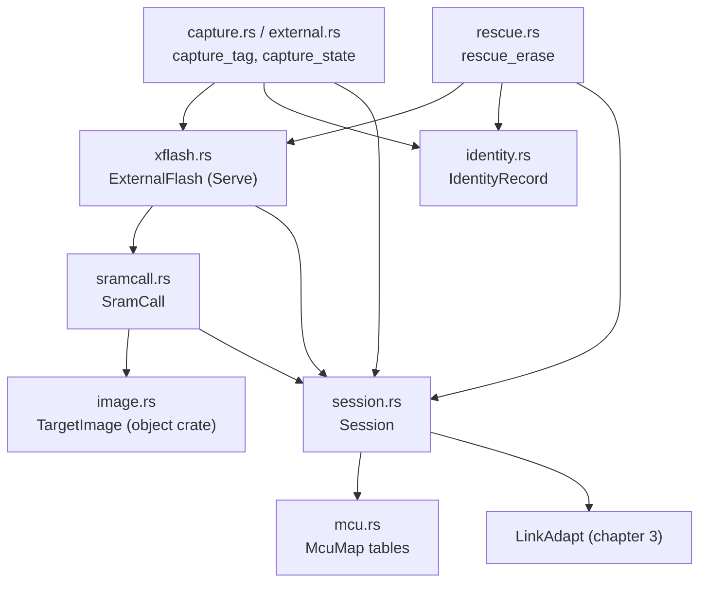

# 6. Recovery: capture, SRAM calls and external flash

The `recovery` module of tagcore-rs reaches a tag over SWD **without running
its firmware**: it attaches with the core halted at the reset vector, reads
registers and memory, downloads code into SRAM and calls it, and through an
SRAM-resident loader reads (and in a rescue, erases) the external flash. It
is the Rust port of the deleted C++ `tagcore/recovery` library
([decision 0045](../../../docs/decisions/0045-swd-recovery-in-rust.md)); only
the offline rebuild, `CaptureSource`, and the identity-record and ELF readers
it uses, are still C++. The files are everything
under
[src/recovery/](../../libraries/tagcore-rs/src/recovery/mod.rs), and the
design they implement is
[SWD Capture and Recovery Library](../../libraries/tagcore-rs/design/swd-recovery.md).

After reading this chapter you will be able to follow `tag-capture` from
`capture_tag` to the `manifest.json` it writes, follow a loader command from
`ExternalFlash::read` to the `loaderService` block in the tag's SRAM, and
explain why `SramCall` and `ExternalFlash` take `&mut Session` on every call
instead of keeping one.

The bench procedure that uses all of this is
[Capturing a Tag](../../../docs/bench/capturing-a-tag.md); the loader side is
[Loader Runtime Design](../../../embedded/loaders/design/loader-runtime.md).
This chapter is about reading the host code.

## Two ways to reach a tag

The `Tag` of [chapter 5](05-protobuf-and-the-tag-api.md) attaches through
reset and lets the firmware boot into its monitor; everything after that is
an RPC. A recovery `Session` attaches through reset too, but arms a halt on
the reset vector first, so the firmware never executes an instruction, and
everything after that is raw SWD access plus code the host downloads.
[recovery/mod.rs:24](../../libraries/tagcore-rs/src/recovery/mod.rs#L24):

```rust
//! A recovery session and a monitor session are alternatives: each claims
//! the base for its lifetime. Procedures that need both run them in
//! sequence.
```

The layers, lowest first (the table is the module's own,
[mod.rs:12](../../libraries/tagcore-rs/src/recovery/mod.rs#L12)):

| Module | Responsibility |
| --- | --- |
| `mcu` | One table per MCU: flash, SRAM, register addresses, identity-record offset |
| `session` | Attach without booting, declared exit, core control, reads that continue past faults |
| `image` | The loadable segments and symbols of a loader or probe ELF |
| `sramcall` | Download an image to SRAM1 and call a symbol with the ST loader convention |
| `xflash` | A loader's `Serve()` session: probe, read, read page, erase, program |
| `identity` | Parse the identity record from captured internal flash |
| `external`, `capture` | The capture procedure: ordering, output directory, manifest |
| `build` | The firmware build stored with a capture, and whether it matches the flash |
| `rescue` | The rescue erase: blank the external flash, proved, before an internal erase |



The users are the command-line tools `tag-capture`, `tag-xflash` (`dump`,
`nand`, `rescue-erase`) and `tag-sramcall`
([chapter 9](09-command-line-tools.md)); `tag-flash`, which reads identity
records with `find_identity_record`, and Tag Programmer, which uses
`parse_identity_record` over `record_offsets()`; and the Python
package `tagcore`, a PyO3 binding of this module
([chapter 8](08-bridges-to-cpp-and-python.md)).

> **Rust:** recovery types are not re-exported at the crate root as `Tag`
> is. Callers write `use tagcore::recovery::{Session, SwdExit, capture_tag};`.
> The `pub use` lines at the bottom of
> [mod.rs:41](../../libraries/tagcore-rs/src/recovery/mod.rs#L41) re-export
> each submodule's main items one level up, so `tagcore::recovery::Session`
> works as well as `tagcore::recovery::session::Session`.

### Errors are strings

Every fallible function in this module returns `Result<T, String>`: the
`Err` is a sentence for a person, and there is no error type to match on.
That is a contrast with `TagError`: in this module a failure is reported to
the operator, who decides what to do, rather than handled by code, so a
sentence is all a caller needs. The one
exception carries more than text:
`capture_tag` returns `Result<CaptureResult, (String, AttachInfo)>`, so a
failed attach still reports what the session saw (halted, PC, reset vector).

> **Rust:** with `String` as the error type, `?` still works on functions
> that fail with a `&str` or with another error converted by `map_err`.
> `.ok_or("could not read the command status")?` turns an `Option` into a
> `Result<_, &str>`, and `?` converts the `&str` into the function's
> `String` error through the standard `From<&str> for String`. `?` always
> applies `From::from` to the error on its way out.

## mcu.rs: one table per part

Everything that differs between the STM32L432 and the STM32U375 is data, in
two `static` tables, so the procedures stay MCU-neutral.
[mcu.rs:93](../../libraries/tagcore-rs/src/recovery/mcu.rs#L93):

```rust
/// STM32L432 (RM0394 Rev 5, `stm32l432xx.h`).
pub static STM32L432: McuMap = McuMap {
    name: "STM32L432",
    dev_id: 0x435,
    dbgmcu_idcode: 0xE004_2000,
    dbgmcu_apb1fzr1: 0xE004_2008,
    iwdg_freeze: 1 << 12,
    flash_base: 0x0800_0000,
    flash_page: 2048,
    // ...
    ecc_regs: &[0x4002_2018], // FLASH_ECCR
    register_blocks: &[
        McuRegion { name: "rcc", addr: 0x4002_1000, size: 0xA0 },
        McuRegion { name: "flash_regs", addr: 0x4002_2000, size: 0x50 },
        McuRegion { name: "pwr", addr: 0x4000_7000, size: 0x68 },
        // Includes the backup registers.
        McuRegion { name: "rtc", addr: 0x4000_2800, size: 0xD0 },
        McuRegion { name: "dbgmcu", addr: 0xE004_2000, size: 0x10 },
    ],
    // ...
    sram: &[
        McuRegion { name: "sram1", addr: 0x2000_0000, size: 48 * 1024 },
        McuRegion { name: "sram2", addr: 0x1000_0000, size: 16 * 1024 },
    ],
    identity_offset: 0x1A0, // after 104 vectors
};
```

The `STM32U375` table follows at
[mcu.rs:136](../../libraries/tagcore-rs/src/recovery/mcu.rs#L136) (IDCODE
`DEV_ID` 0x454, 4 KB pages, SRAM1 192 KB, identity record at 0x240). Lookup
by IDCODE, [mcu.rs:176](../../libraries/tagcore-rs/src/recovery/mcu.rs#L176):

```rust
pub static ALL_MCUS: [&McuMap; 2] = [&STM32L432, &STM32U375];

/// The map whose `DEV_ID` matches the low 12 bits of a raw `DBGMCU_IDCODE`,
/// or `None` for an unsupported part.
pub fn find_mcu(idcode: u32) -> Option<&'static McuMap> {
    ALL_MCUS
        .iter()
        .copied()
        .find(|m| (idcode & 0xFFF) == u32::from(m.dev_id))
}
```

> **Rust:** a `static` initialised with a struct literal is built entirely
> at compile time and lives in read-only data, like a `const` aggregate in
> C. The slice fields have type `&'static [u32]` and `&'static [McuRegion]`:
> a pointer plus a length into other compile-time data, written inline as
> `&[ ... ]`. `0xE004_2000` uses `_` as a digit separator.

> **Rust:** `.iter()` over an array of `&McuMap` yields `&&McuMap`;
> `.copied()` dereferences once so `find` returns `Option<&McuMap>`.
> `u32::from(m.dev_id)` widens a `u16`. `m.dev_id as u32` would compile too;
> `from` exists only for conversions that cannot lose information, so it
> documents that none is lost.

## session.rs: attach without booting

### The type, and its destructor

[session.rs:122](../../libraries/tagcore-rs/src/recovery/session.rs#L122):

```rust
/// An SWD session that holds the tag's core at its reset vector.
///
/// Not thread-safe. Only one session, or one monitor session, may hold a
/// base at a time; opening a claimed base fails. Dropping an open session
/// closes it with [`SwdExit::HardwareReset`].
pub struct Session {
    /// The link to the base.
    link: LinkAdapt,
    /// The attached part, while open.
    mcu: Option<&'static McuMap>,
    /// What the attach observed.
    info: AttachInfo,
    /// True between a successful [`open`](Self::open) and
    /// [`close`](Self::close); also set while a failed open cleans up.
    open: bool,
}

impl Default for Session {
    fn default() -> Self {
        Self::new()
    }
}

impl Drop for Session {
    fn drop(&mut self) {
        self.close(SwdExit::HardwareReset);
    }
}
```

The session owns its `LinkAdapt` by value: it is not built on a
`TagMonitor`, and it never touches the monitor protocol. `mcu` points at one
of the two static tables once the part is identified.

> **Rust:** `Option<&'static McuMap>` is a nullable pointer to data that
> lives for the whole program. Because the pointee is `'static`, `Session`
> needs no lifetime parameter of its own; a reference to anything shorter
> lived would force one (`Session<'a>`) on every user.

> **Rust:** `impl Drop` is the destructor. It runs when the value goes out
> of scope, including on an early `return` or `?`, and on a panic as the
> stack unwinds. So a tool that bails out halfway through a capture still
> leaves the tag reset and the base released. `close` is idempotent
> (it returns at once when not open), so an explicit `close` followed by the
> drop is harmless.

### `open`

The sequence is the C++ `swdsession.cc` "call for call ... the same register
writes in the same order"
([session.rs:3](../../libraries/tagcore-rs/src/recovery/session.rs#L3)),
because what a capture shows depends on them. The reasons are in the design
doc, [Attaching without booting the firmware](../../libraries/tagcore-rs/design/swd-recovery.md#attaching-without-booting-the-firmware).
[session.rs:197](../../libraries/tagcore-rs/src/recovery/session.rs#L197),
first half:

```rust
    pub fn open(&mut self, usbdev: &UsbDev) -> Result<(), String> {
        if self.open {
            return Err("SWD session already open".into());
        }
        self.info = AttachInfo::default();
        self.mcu = None;

        // NRST asserted, SWD entered. The claim fails if another session or
        // application holds the base.
        if !self.link.attach_with_reset(true, usbdev) {
            return Err("could not attach: no base, or the base is in use by another \
                        session or application"
                .into());
        }
        sleep(Duration::from_millis(20));

        for m in ALL_MCUS {
            if let Some(idcode) = self.link.read_debug32(m.dbgmcu_idcode)
                && plausible_idcode(idcode)
                && find_mcu(idcode) == Some(m)
            {
                self.mcu = Some(m);
                self.info.idcode = idcode;
                break;
            }
        }
        let Some(mcu) = self.mcu else {
            self.link.assert_reset(true);
            self.link.detach();
            return Err("unsupported or unreadable MCU".into());
        };

        self.info.voltage = self.link.voltage().unwrap_or(0.0);
        self.info.dhcsr_before = self.link.read_debug32(DHCSR).unwrap_or(0);
        self.info.demcr_before = self.link.read_debug32(DEMCR).unwrap_or(0);
        self.info.fz_before = self.link.read_debug32(mcu.dbgmcu_apb1fzr1).unwrap_or(0);

        // Arm the halt, then let the core out of reset into the vector catch.
        if !self.link.write_debug32(DHCSR, DBGKEY | C_DEBUGEN | C_HALT)
            || !self.link.write_debug32(DEMCR, VC_CORERESET)
            || !self.link.assert_reset(true)
        {
            self.open = true;
            self.close(SwdExit::HardwareReset);
            return Err("could not arm the reset halt".into());
        }
```

**Read `assert_reset` carefully.** `assert_reset(true)` *releases* nRST:
the argument is the level of the line, "`high` releases reset, low holds it"
([link/target.rs:207](../../libraries/tagcore-rs/src/link/target.rs#L207)).
It is a port of the C++ `LinkAdapt::AssertReset` with the same name and the
same sense. `attach_with_reset(true, ...)`, on the other hand, means "hold
reset while entering SWD". So the code above holds the tag in reset from the
attach, writes DHCSR and DEMCR, and then `assert_reset(true)` lets it go
into the vector catch.

The MCU is identified by reading each table's `DBGMCU_IDCODE` address in
turn, since the address differs between the parts. The second half,
[session.rs:244](../../libraries/tagcore-rs/src/recovery/session.rs#L244):

```rust
        for _ in 0..200 {
            if let Some(d) = self.link.read_debug32(DHCSR) {
                self.info.dhcsr_halted = d;
                if d & S_HALT != 0 {
                    self.info.halted = true;
                    break;
                }
            }
            sleep(Duration::from_millis(1));
        }

        self.open = true;
        if self.info.halted {
            self.info.pc = self.read_core_register(REG_PC).unwrap_or(0);
            self.info.reset_vector = self.read_word(mcu.flash_base + 4).unwrap_or(0);
            self.info.flash_blank = self.info.reset_vector == 0xFFFF_FFFF;
            self.info.at_reset_vector = self.info.pc == (self.info.reset_vector & !1);
        }

        if !self.info.halted || !(self.info.at_reset_vector || self.info.flash_blank) {
            let why = format!(
                "core did not halt at its reset vector (halted={} pc=0x{:08x} \
                 vector=0x{:08x}): the firmware may have run",
                u8::from(self.info.halted),
                self.info.pc,
                self.info.reset_vector
            );
            error!("{why}");
            self.close(SwdExit::HardwareReset);
            return Err(why);
        }

        self.link
            .write_debug32(mcu.dbgmcu_apb1fzr1, self.info.fz_before | mcu.iwdg_freeze);
        Ok(())
    }
```

The check that matters is `pc == reset_vector & !1`: if PC is anywhere else,
an instruction has run and the capture would not be of an untouched tag, so
the session refuses. The monitor-enable bits are never set; the firmware
must not see a monitor.

> **Rust:** `!` on an integer is bitwise NOT, C's `~`: `reset_vector & !1`
> clears the Thumb bit. `!` on a `bool` is logical NOT. There is no separate
> `~` operator.

> **Rust:** `let Some(mcu) = self.mcu else { ...; return Err(...); };` is
> let-else: bind `mcu` if `self.mcu` is `Some`, otherwise run the block,
> which must leave the function. `"...".into()` converts the `&str` literal
> to a `String`; the target type is inferred from the return type
> `Result<(), String>`. `u8::from(bool)` prints the flag as 0 or 1, as the
> C++ message did.

`AttachInfo` ([session.rs:92](../../libraries/tagcore-rs/src/recovery/session.rs#L92))
is `#[derive(Copy)]`, a dozen plain fields; callers copy it out with
`*s.attach_info()` for the manifest and for error reports.

### `close`

[session.rs:294](../../libraries/tagcore-rs/src/recovery/session.rs#L294)
(the doc comment above it, lines 281-293, explains each step):

```rust
    pub fn close(&mut self, exit: SwdExit) {
        if !self.open {
            return;
        }
        if let Some(mcu) = self.mcu {
            self.link.write_debug32(mcu.dbgmcu_apb1fzr1, self.info.fz_before);
        }

        if let Some(d) = self.link.read_debug32(DHCSR)
            && d & C_MASKINTS != 0
        {
            if d & S_HALT == 0 {
                self.halt();
            }
            self.link.write_debug32(DHCSR, DBGKEY | C_DEBUGEN | C_HALT);
            // ...
        }

        match exit {
            SwdExit::HardwareReset => {
                // Hold the core in reset while debug is disabled, so it
                // comes out of reset with no vector catch and no halt
                // request, as after a plain connection.
                self.link.assert_reset(false);
                sleep(Duration::from_millis(5));
                self.link.write_debug32(DEMCR, 0);
                self.link.write_debug32(DHCSR, DBGKEY);
                self.link.assert_reset(true);
                sleep(Duration::from_millis(5));
            }
            SwdExit::LeaveHalted => {
                self.link.write_debug32(DEMCR, 0);
            }
        }

        self.link.detach();
        self.open = false;
    }
```

Two leftovers would poison the next boot, so both are cleared before the
exit. `DEMCR.VC_CORERESET` is also the monitor's attachment flag
(`MONCONNECTED`): left set, the firmware believes a monitor is attached and
never sleeps. `DHCSR.C_MASKINTS`, which `run()` sets while loader code runs,
survives a system reset and would mask every interrupt the next time the
monitor sets `C_DEBUGEN`. `SwdExit` (`HardwareReset`, the default, or
`LeaveHalted`) is recorded in the manifest by name.

### Core control and reads

The rest of `Session` is the toolkit the layers above use:

| Method | Line | What it does |
| --- | --- | --- |
| `read_word`, `write_word` | [358](../../libraries/tagcore-rs/src/recovery/session.rs#L358) | one word through the debug-register path; `Option<u32>` / `bool` |
| `read(addr, buf, chunk, failed)` | [378](../../libraries/tagcore-rs/src/recovery/session.rs#L378) | bulk read that continues past faults, re-reading a failed chunk in 512-byte pieces and recording the failed ranges |
| `read_vec`, `write` | [417](../../libraries/tagcore-rs/src/recovery/session.rs#L417) | read into a new `Vec`; write in 512-byte pieces |
| `read_core_register`, `write_core_register` | [444](../../libraries/tagcore-rs/src/recovery/session.rs#L444) | through DCRSR/DCRDR, polling `S_REGRDY` |
| `run` | [483](../../libraries/tagcore-rs/src/recovery/session.rs#L483) | set `C_MASKINTS` while halted, then clear `C_HALT` |
| `wait_halt(timeout)`, `halt` | [493](../../libraries/tagcore-rs/src/recovery/session.rs#L493) | poll `S_HALT`; `wait_halt` returns `(bool, u32)` |

`read` is worth a look for how Rust walks a buffer in blocks,
[session.rs:390](../../libraries/tagcore-rs/src/recovery/session.rs#L390):

```rust
        let mut all_ok = true;
        for (i, part) in buf.chunks_mut(chunk).enumerate() {
            let at = addr + (i * chunk) as u32;
            if self.link.read_mem32(at, part) {
                continue;
            }
            // Pin the fault down to the base's transfer unit.
            for (k, piece) in part.chunks_mut(BASE_PIECE as usize).enumerate() {
                let p = at + k as u32 * BASE_PIECE;
                if !self.link.read_mem32(p, piece) {
                    piece.fill(0);
                    all_ok = false;
                    if let Some(f) = failed.as_deref_mut() {
                        f.push((p, piece.len() as u32));
                    }
                }
            }
        }
        all_ok
```

> **Rust:** `buf.chunks_mut(n)` yields non-overlapping mutable sub-slices of
> at most `n` bytes, the last one shorter; `.enumerate()` adds the index.
> Each `part` is a `&mut [u8]` the read can fill directly, with no pointer
> arithmetic and no way to run past the end.

> **Rust:** `failed` is an `Option<&mut Vec<AddressRange>>` parameter
> declared `mut`. Using it inside the loop as `if let Some(f) = failed` would
> *move* the `&mut` out of the `Option` on the first fault, and the next
> iteration could not use it. `failed.as_deref_mut()` instead reborrows it,
> producing a fresh, short-lived `Option<&mut Vec<_>>` each time. The same
> idiom appears wherever an optional callback is called in a loop.

`AddressRange` is `pub type AddressRange = (u32, u32);`
([session.rs:120](../../libraries/tagcore-rs/src/recovery/session.rs#L120)),
a type alias like C++ `using`.

## image.rs: reading an ELF with `object`

**Library: object.** A reader (and writer) for object-file formats: ELF,
Mach-O, PE, archives; the Rust standard library itself uses it to read
debug information for backtraces.
This crate enables only `read_core`, `elf` and `std`, and uses the low-level ELF
API rather than the format-independent `File` type, because it needs program
headers (load segments) and the raw symbol table, nothing else.
[image.rs:55](../../libraries/tagcore-rs/src/recovery/image.rs#L55):

```rust
    fn parse(data: &[u8], path: &Path) -> Result<TargetImage, String> {
        if data.len() < 52 || &data[0..4] != b"\x7fELF" {
            return Err(" is not an ELF file".into());
        }
        if data[4] != 1 || data[5] != 1 {
            return Err(" is not ELF32 little-endian".into());
        }
        let header = FileHeader32::<Endianness>::parse(data).map_err(|e| format!(": {e}"))?;
        let endian = header.endian().map_err(|e| format!(": {e}"))?;
        if header.e_machine(endian) != EM_ARM {
            return Err(" is not an ARM image".into());
        }

        let mut segments = Vec::new();
        for ph in header
            .program_headers(endian, data)
            .map_err(|_| ": program headers out of range".to_string())?
        {
            if ph.p_type(endian) != PT_LOAD || ph.p_memsz(endian) == 0 {
                continue;
            }
            let memsz = ph.p_memsz(endian);
            let bytes = ph
                .data(endian, data)
                .map_err(|_| ": segment out of range".to_string())?;
            if bytes.len() as u64 > u64::from(memsz) {
                return Err(": segment out of range".into());
            }
            segments.push(ImageSegment {
                addr: ph.p_paddr(endian),
                memsz,
                data: bytes.to_vec(),
            });
        }
```

`object` reads the headers in place from the byte buffer, without copying
them into native structs, so every accessor takes the `endian` value to know
how to interpret the bytes. The symbol table is read the same way (lines
90-106); the first symbol of a name wins, as the C++ reader's
`std::map::emplace` kept it. The errors are suffixes (`" is not an ARM
image"`) that `load` prefixes with the path
([image.rs:46](../../libraries/tagcore-rs/src/recovery/image.rs#L46)).

> **Rust:** `FileHeader32::<Endianness>::parse(data)` is the "turbofish"
> again: it names the generic parameter of `FileHeader32` explicitly.
> `Endianness` is a run-time endianness (as opposed to a compile-time
> `LittleEndian` type), so one code path handles either, and the check two
> lines earlier already refused big-endian files.

The one accessor that reads image bytes,
[image.rs:141](../../libraries/tagcore-rs/src/recovery/image.rs#L141):

```rust
    /// `len` bytes at load address `addr`, if one segment's file data covers
    /// the whole range.
    pub fn read_at(&self, addr: u32, len: usize) -> Option<&[u8]> {
        self.segments.iter().find_map(|s| {
            let start = addr.checked_sub(s.addr)? as usize;
            s.data.get(start..start.checked_add(len)?)
        })
    }
```

> **Rust:** inside a closure that returns `Option`, `?` returns `None` from
> the closure, not from `read_at`. `checked_sub` returns `None` on
> underflow (the address is below this segment), and `slice.get(range)`
> returns `None` instead of panicking when the range is out of bounds.
> `find_map` returns the first `Some` any segment produces. Every
> out-of-range case becomes "not this segment" without a single comparison
> written out.

## sramcall.rs: calling code in SRAM

`SramCall` downloads an image into SRAM1 of the halted tag and calls one of
its functions with the convention STM32CubeProgrammer uses for external
loaders, as traced in
[Loader Runtime Design, The contract](../../../embedded/loaders/design/loader-runtime.md#the-contract).
The convention, from the module comment
([sramcall.rs:4](../../libraries/tagcore-rs/src/recovery/sramcall.rs#L4)):

- the image's SRAM segments are written at their link addresses; a segment
  outside SRAM, such as a loader's `StorageInfo` descriptor at address 0, is
  skipped;
- a `BKPT` trap word, `0xBE00_BE00`, sits at the start of SRAM1, and LR
  points at it with the Thumb bit set, so the called function returns into a
  halt;
- MSP is set about 1 KB past the image;
- arguments go in R0-R3, every other register is zeroed, and the result
  comes back in R0;
- a transfer buffer follows the stack and runs to the end of SRAM1 (at most
  32 KB), and its address can be passed as an argument.

The type, [sramcall.rs:45](../../libraries/tagcore-rs/src/recovery/sramcall.rs#L45):

```rust
/// Where a downloaded image's call frame and buffer are.
///
/// Holds no reference to the session: each call takes it, so one session
/// can be used for SWD reads between calls.
#[derive(Debug, Clone)]
pub struct SramCall {
    /// The downloaded image.
    image: TargetImage,
    /// Address of the BKPT trap word, the first word of SRAM1.
    trap: u32,
    /// Initial MSP for each call.
    stack_top: u32,
    /// First byte of the transfer buffer.
    buffer: u32,
    /// Transfer buffer length in bytes, a multiple of 512.
    buffer_size: u32,
    /// Symbol started by [`start`](Self::start), for messages.
    running: String,
}
```

and its methods, each taking the session as a parameter (signatures only,
each joined onto one line):

```rust
pub fn download(s: &mut Session, image: &TargetImage) -> Result<SramCall, String>
pub fn call(&mut self, s: &mut Session, symbol: &str, args: &[u32], timeout: Duration) -> Result<u32, String>
pub fn start(&mut self, s: &mut Session, symbol: &str, args: &[u32]) -> Result<(), String>
pub fn wait_return(&mut self, s: &mut Session, timeout: Duration) -> Result<u32, String>
```

`download` ([sramcall.rs:77](../../libraries/tagcore-rs/src/recovery/sramcall.rs#L77))
is the constructor: an associated function with no `self`, like a static
factory. It writes each SRAM segment padded with zeros to its memory size,
reads it back and compares, writes the trap word, and works out the stack
and buffer. Its first line is a dense `Option` chain:

```rust
        let Some(sram) = s.mcu().and_then(|m| m.sram.first()).filter(|_| s.is_open()) else {
            return Err("session not open".into());
        };
```

Read it left to right: the session's MCU table, if any; then its first SRAM
region, if any; then keep it only if the session is open; otherwise fail.

The call frame is set up in `start`,
[sramcall.rs:165](../../libraries/tagcore-rs/src/recovery/sramcall.rs#L165):

```rust
    pub fn start(&mut self, s: &mut Session, symbol: &str, args: &[u32]) -> Result<(), String> {
        let entry = self
            .image
            .symbol(symbol)
            .ok_or_else(|| format!("no symbol {symbol} in {}", self.image.path().display()))?;
        if args.len() > 4 {
            return Err("at most four arguments".into());
        }
        let mut r = [0u32; 13];
        r[..args.len()].copy_from_slice(args);
        for (reg, value) in r.iter().enumerate() {
            if !s.write_core_register(REG_R0 + reg as u32, *value) {
                return Err(format!("could not set R{reg}"));
            }
        }
        if !s.write_core_register(REG_MSP, self.stack_top)
            || !s.write_core_register(REG_SP, self.stack_top)
            || !s.write_core_register(REG_LR, self.trap | 1)
            || !s.write_core_register(REG_PC, entry & !1)
            || !s.write_core_register(REG_XPSR, XPSR_THUMB)
        {
            return Err("could not set up the call frame".into());
        }
        if !s.run() {
            return Err("could not start the core".into());
        }
        self.running = symbol.to_string();
        Ok(())
    }
```

and the return is recognised in `wait_return`,
[sramcall.rs:203](../../libraries/tagcore-rs/src/recovery/sramcall.rs#L203):

```rust
    pub fn wait_return(&mut self, s: &mut Session, timeout: Duration) -> Result<u32, String> {
        if !s.wait_halt(timeout).0 {
            s.halt();
            let pc = s.read_core_register(REG_PC).unwrap_or(0);
            return Err(format!(
                "{} did not return within {} ms (halted at pc 0x{pc:08X})",
                self.running,
                timeout.as_millis()
            ));
        }
        let (Some(pc), Some(result)) = (s.read_core_register(REG_PC), s.read_core_register(REG_R0))
        else {
            return Err("could not read the result".into());
        };
        if pc & !1 != self.trap {
            return Err(format!("{} halted at 0x{pc:08X}, not the return trap", self.running));
        }
        Ok(result)
    }
```

A halt anywhere but the trap (a fault handler's breakpoint, say) is an
error, not a result. `call` is `start` followed by `wait_return`; `start`
alone exists for `Serve()`, which does not return until told to.

> **Rust:** `let (Some(pc), Some(result)) = (a, b) else { ... };` builds a
> tuple of two `Option`s and destructures both at once: the `else` runs if
> either is `None`. It is the compact form of two nested checks.

> **Rust:** `r[..args.len()].copy_from_slice(args)` copies into the first
> `args.len()` elements of the array. `copy_from_slice` panics if the
> lengths differ, which the range guarantees they do not; it compiles to a
> `memcpy`.

## Why `SramCall` and `ExternalFlash` take `&mut Session` per call

In C++ the natural design is an object holding a pointer to the session it
was created on: `SramCall call(session, image); call.Call("Init");`. In Rust
that would be `struct SramCall<'a> { s: &'a mut Session, ... }`, and it
would make the session unusable for as long as the `SramCall` exists.

The rule is that a `&mut` reference is exclusive. While one is alive,
nothing else may read or write through the original, not even through
`&self` methods. If `SramCall` stored `&'a mut Session`, then this code from
`tag-xflash`'s ST-entry-point path,
[tag-xflash.rs:206](../../commandline-rs/src/bin/tag-xflash.rs#L206), would
not compile:

```rust
    match call.call(s, "Init", &[], INIT_TIMEOUT) {
        Ok(1) => {}
        Ok(_) => return Err("Init failed (returned 0)".into()),
        Err(e) => return Err(format!("Init failed: {e}")),
    }
    let (bufaddr, bufsize) = (call.buffer_address(), call.buffer_size());
    let mut buf = vec![0u8; bufsize as usize];
    let mut meter = Meter::new();
    let mut done = 0u32;
    while done < length {
        let n = bufsize.min(length - done);
        let at = cli.offset + done;
        // Read(Address, Size, buffer): the address is the loader's fictional one.
        match call.call(s, "Read", &[base + at, n, bufaddr], READ_TIMEOUT) {
            Ok(1) => {}
            Ok(_) => return Err(format!("\nRead at offset {at} failed (returned 0)")),
            Err(e) => return Err(format!("\nRead at offset {at} failed: {e}")),
        }
        let words = ((n + 3) & !3) as usize;
        if !s.read(bufaddr, &mut buf[..words], 8192, None) {
            return Err(format!("\nSWD read of the buffer failed at offset {at}"));
        }
```

Each loop iteration calls `Read` in the loader and then reads the transfer
buffer directly with `s.read(...)`. With the session borrowed inside `call`
for the whole loop, `s.read` would be a second use of a value already
exclusively borrowed, and the borrow checker rejects it. The alternatives
would all be worse: give `SramCall` its own `read` method that forwards to
the session (and so on for every session method), or put the session in a
`RefCell` and move the exclusivity check to run time.

Passing `s: &mut Session` to each method instead makes each borrow last for
one call. Between calls the caller holds the session again and can do
anything with it. `ExternalFlash` follows the same pattern for the same
reason, and so do `capture_external_flash` and `rescue_erase`, which hand
the same `s` to the session, the loader and the reads in turn.

Two consequences follow, both stated in the code:

- **Nothing stops the caller passing a different session** from the one the
  image was downloaded on. Nothing in the tools does; the type system would
  need the lifetime parameter to prevent it.
- **`ExternalFlash` has no `Drop`**: a destructor gets only `&mut self`, and
  without the session it cannot send EXIT. Its doc comment says what happens
  instead, [xflash.rs:121](../../libraries/tagcore-rs/src/recovery/xflash.rs#L121):
  "If the value is dropped without close, the core is left running
  `Serve()` until the session closes, which halts and resets it." The
  callers therefore close explicitly, and do it even on the error path (see
  the rescue below). `Session`, which owns its link, does have a `Drop`.

The Python binding mirrors this. `PyExternalFlash` holds a Python reference
to its `PySession` and borrows the Rust session mutably for the length of
each method
([tagcore-py/src/lib.rs:407](../../python/tagcore-py/src/lib.rs#L407)), and
a second Python thread that reaches the session meanwhile gets a
`RecoveryError`; see
[chapter 8](08-bridges-to-cpp-and-python.md#a-class-that-holds-another).

## xflash.rs: the `Serve()` loader protocol

Calling the ST entry points one at a time (`Init`, then `Read`, `Read`...)
costs a register setup, a run/halt round trip and a re-initialisation per
call, and returns only 0 or 1. The loaders in `embedded/loaders` also export
`Serve(buffer, size)`, which initialises once and then loops on a command
block in SRAM. The block is declared once, in C, for both sides:
[include/loader_service.h:106](../../../include/loader_service.h#L106):

```c
typedef struct {
  uint32_t magic;     ///< ::LOADER_SERVICE_MAGIC once ready.
  uint32_t version;   ///< ::LOADER_SERVICE_VERSION.
  uint32_t seq;       ///< Host increments to submit a command.
  uint32_t ack;       ///< Loader copies @c seq when the command completes.
  uint32_t cmd;       ///< A ::LoaderServiceCommand.
  uint32_t offset;    ///< Flash byte offset (not the programmer's 0x90000000 address).
  uint32_t length;    ///< Bytes; at most the buffer size.
  int32_t status;     ///< A ::LoaderServiceStatus for the last command.
  uint32_t detail[12]; ///< Indexed by the LOADER_DETAIL_* values.
  uint32_t progress;  ///< Bytes done in the current command.
} LoaderServiceBlock;
```

The host never maps this struct into its own memory: it reads and writes
the block word by word over SWD at the address of the `loaderService` symbol.
So the Rust side mirrors it as offsets, not as a `#[repr(C)]` struct,
[xflash.rs:23](../../libraries/tagcore-rs/src/recovery/xflash.rs#L23):

```rust
/// The layout of `include/loader_service.h`, as byte offsets into
/// `LoaderServiceBlock`. Little-endian 32-bit words, no padding; checked
/// against the header by this module's tests.
pub mod layout {
    /// `'LSRV'`: written to `magic` once the loader is ready for commands.
    pub const MAGIC_VALUE: u32 = 0x5652_534C;
    /// The layout version this host speaks; it also accepts 1.
    pub const VERSION: u32 = 2;
    /// Offset of `magic`.
    pub const MAGIC: u32 = 0;
    /// Offset of `version`.
    pub const VERSION_FIELD: u32 = 4;
    /// Offset of `seq`: the host increments it to submit a command.
    pub const SEQ: u32 = 8;
    /// Offset of `ack`: the loader copies `seq` when the command completes.
    pub const ACK: u32 = 12;
    // ...
}

use layout as l;
```

> **Rust:** `pub mod layout { ... }` declares a module inline, inside the
> file, used here as a namespace for constants (the C++ equivalent is a
> `namespace`). `use layout as l;` is a local alias, so the code reads
> `self.block + l::ACK`.

Because the offsets are written by hand, the tests check them against the
header itself: they read `include/loader_service.h` at test time, compute
the offset of every struct member and the value of every constant, and
compare ([xflash.rs:463](../../libraries/tagcore-rs/src/recovery/xflash.rs#L463)
onwards). A change to the header that the host does not follow fails
`cargo test`.

### Opening

[xflash.rs:169](../../libraries/tagcore-rs/src/recovery/xflash.rs#L169):

```rust
    pub fn open(s: &mut Session, loader: &TargetImage) -> Result<ExternalFlash, String> {
        let block = loader.symbol("loaderService").ok_or_else(|| {
            format!(
                "{} has no Serve() service block (an older loader: use the ST entry points)",
                loader.path().display()
            )
        })?;
        let mut call = SramCall::download(s, loader)?;
        let zero = vec![0u8; align4(l::SIZE) as usize];
        if !s.write(block, &zero) {
            return Err("could not clear the service block".into());
        }
        let (buf, size) = (call.buffer_address(), call.buffer_size());
        call.start(s, "Serve", &[buf, size])?;

        let deadline = Instant::now() + READY_TIMEOUT;
        while s.read_word(block + l::MAGIC) != Some(l::MAGIC_VALUE) {
            if Instant::now() >= deadline {
                s.halt();
                return Err("Serve() did not become ready".into());
            }
            std::thread::sleep(Duration::from_millis(1));
        }

        let (Some(version), Some(status), Some(seq)) = (
            s.read_word(block + l::VERSION_FIELD),
            s.read_word(block + l::STATUS),
            s.read_word(block + l::SEQ),
        ) else {
            s.halt();
            return Err("could not read the service block".into());
        };
        // ...
```

The block is zeroed before `Serve()` starts because it is in `.bss`, which
the download does not write, and SRAM survives reset: a `'LSRV'` left by an
earlier session would read as "ready" before `Serve()` had cleared it. Note
the session `s` passing back and forth between `SramCall::download`,
`s.write`, `call.start` and `s.read_word` in a few lines; that is the
per-call borrow at work. The rest of `open` reads `detail[]` (JEDEC ID, the
status register as found, size, sector size, writable flag; for version 2
also page size and the NAND configuration) and refuses an unknown version or
a loader that reported an initialisation failure.

### A command

[xflash.rs:285](../../libraries/tagcore-rs/src/recovery/xflash.rs#L285):

```rust
    fn command(
        &mut self,
        s: &mut Session,
        cmd: u32,
        offset: u32,
        length: u32,
        timeout: Duration,
    ) -> Result<(), String> {
        if !self.open {
            return Err("not open".into());
        }
        self.seq = self.seq.wrapping_add(1);
        if !s.write_word(self.block + l::CMD, cmd)
            || !s.write_word(self.block + l::OFFSET, offset)
            || !s.write_word(self.block + l::LENGTH, length)
            || !s.write_word(self.block + l::SEQ, self.seq)
        {
            return Err("could not submit the command".into());
        }
        let deadline = Instant::now() + timeout;
        while s.read_word(self.block + l::ACK) != Some(self.seq) {
            if Instant::now() >= deadline {
                s.halt();
                self.open = false;
                return Err(format!(
                    "command {cmd} not acknowledged within {} ms; core halted",
                    timeout.as_millis()
                ));
            }
        }
        let status = s
            .read_word(self.block + l::STATUS)
            .ok_or("could not read the command status")? as i32;
        // ...
```

`seq` is written last because writing it submits the command; the loader
copies it to `ack` when done. The `ack` poll has no sleep: each
`read_word` is a USB round trip to the base, which paces the loop. (The
ready wait in `open` does sleep 1 ms per poll.)

> **Rust:** `wrapping_add(1)` is explicit modular arithmetic. Plain `+`
> panics on overflow in a debug build and wraps in release; for a sequence
> number that is meant to wrap, `wrapping_add` says so and behaves the same
> in both.

`read` ([xflash.rs:337](../../libraries/tagcore-rs/src/recovery/xflash.rs#L337))
loops over the output in buffer-sized chunks: `command(CMD_READ)`, then
`s.read` of the transfer buffer, then the optional progress callback. It
takes `progress: Option<&mut dyn FnMut(u32, u32)>`, an optional borrowed
callback (`dyn FnMut` is a trait object: a closure called through a vtable,
like a non-owning `std::function`). `read_page`, `erase_sector` and
`program` follow the same shape. `close` sends EXIT and expects `Serve()` to
return 1 into the trap, [xflash.rs:441](../../libraries/tagcore-rs/src/recovery/xflash.rs#L441):

```rust
    pub fn close(&mut self, s: &mut Session) -> Result<(), String> {
        if !self.open {
            return Ok(());
        }
        self.open = false;
        self.seq = self.seq.wrapping_add(1);
        if !s.write_word(self.block + l::CMD, l::CMD_EXIT) || !s.write_word(self.block + l::SEQ, self.seq) {
            s.halt();
            return Err("could not send EXIT".into());
        }
        match self.call.wait_return(s, Duration::from_millis(1000))? {
            1 => Ok(()),
            r0 => Err(format!("Serve() returned {r0}")),
        }
    }
```

> **Rust:** in `match ... { 1 => ..., r0 => ... }` the last arm is a
> binding pattern: it matches anything and names it `r0`, a catch-all that
> keeps the value.

## identity.rs: the identity record

Every image built since the identity record carries one directly after the
interrupt vectors: an 8-byte header (`"TGID"`, a `u16` format version, a
`u16` total size) and TLV entries `{u16 id, u16 len, value}` ending in an
`0xFFFF` entry. There is no CRC; a record is accepted only when the magic,
the declared size and the end entry agree. The firmware side is
`embedded/tags/common/core/inc/tag_identity.h`, and the reasons for the
format are in
[chapter 4 of the guide](../guide/04-shared-contract.md#the-tag-identity-record).

The record names the loader and the decoder, so `capture_state` uses it to
choose the loader for the external flash, `rescue_erase` to check the part,
and `tag-flash` and Tag Programmer to identify an image. The parse loop,
[identity.rs:265](../../libraries/tagcore-rs/src/recovery/identity.rs#L265):

```rust
    let mut off = 8;
    while off + 4 <= size {
        let id = u16_at(flash, base + off);
        let len = u16_at(flash, base + off + 2) as usize;
        off += 4;
        if id == END {
            if off != size {
                return Err("identity record end entry does not match its size".into());
            }
            return Ok(r);
        }
        if !len.is_multiple_of(4) || off + len > size {
            return Err("identity record entry has a bad length".into());
        }
        let v = base + off;
        let value = &flash[v..v + len];
        if let Some(name) = string_name(id) {
            let end = value.iter().position(|&b| b == 0).unwrap_or(len);
            r.strings
                .insert(name.into(), String::from_utf8_lossy(&value[..end]).into_owned());
        } else if let Some(name) = region_name(id).filter(|_| len >= 20) {
            r.regions.insert(
                name.into(),
                IdentityRegion {
                    start: u32_at(flash, v),
                    end: u32_at(flash, v + 4),
                    record_size: u32_at(flash, v + 8),
                    record_count: u32_at(flash, v + 12),
                    layout_version: u32_at(flash, v + 16),
                },
            );
        } else if id == NUMBERS && len >= 24 {
            // ...
        // ...
        }
        off += len;
    }
    Err("identity record has no end entry".into())
```

(The elided branches decode the numbers, BackupState, default-config,
session-facts and external-flash entries the same way.) Unknown ids, and
known ids shorter than their layout, are skipped, so an
older host reads a newer record. The integers come from small helpers,
[identity.rs:226](../../libraries/tagcore-rs/src/recovery/identity.rs#L226):

```rust
fn u32_at(b: &[u8], o: usize) -> u32 {
    u32::from_le_bytes(b[o..o + 4].try_into().unwrap())
}
```

> **Rust:** there are no packed structs or pointer casts here. `b[o..o + 4]`
> is a 4-byte sub-slice (bounds-checked: out of range panics rather than
> reading past the buffer), `try_into()` converts the slice `&[u8]` into an
> array `[u8; 4]` (it can fail only on a length mismatch, hence `unwrap`),
> and `u32::from_le_bytes` assembles the value with the endianness stated.
> `f32_at` is `f32::from_bits(u32_at(...))`, the safe form of a type-punning
> `memcpy`.

> **Rust:** the id-to-name tables are functions returning
> `Option<&'static str>`, written as
> `Some(match id { 0x0101 => "target", ..., _ => return None })`
> ([identity.rs:38](../../libraries/tagcore-rs/src/recovery/identity.rs#L38)).
> `return` inside the `match` arm leaves the whole function, so the unknown
> case never reaches the `Some(...)`.

`find_identity_record`
([identity.rs:210](../../libraries/tagcore-rs/src/recovery/identity.rs#L210))
tries each MCU's offset in turn (`0x1A0`, then `0x240`); the first that holds
the magic decides. `record_offsets()` returns `impl Iterator<Item = u32>`:
"some iterator of `u32`", without naming its type, which is unnameable
because it contains a closure.

## The capture

### external.rs: the external flash, hashed as it is written

**Library: sha2.** The RustCrypto implementation of SHA-224/256/384/512.
Two forms are used: one-shot, `Sha256::digest(data)`, and streaming,
`Sha256::new()`, `.update(bytes)`, `.finalize()`. The capture records the
SHA-256 of every file it writes in the manifest, as the C++ did, and the
offline rebuild refuses a capture whose files do not match.

`capture_external_flash` reads a NOR part whole into `external_flash.bin`, or
an SPI NAND page by page (raw and through ECC, skipping blank blocks unless
asked). Every file goes through a small writer that hashes as it writes,
[external.rs:119](../../libraries/tagcore-rs/src/recovery/external.rs#L119):

```rust
impl HashedFile {
    /// Creates `dir/file`.
    fn create(dir: &Path, file: String) -> Result<HashedFile, String> {
        let f = File::create(dir.join(&file))
            .map_err(|e| format!("cannot write to {}: {e}", dir.display()))?;
        Ok(HashedFile { f, file, sha: Sha256::new(), size: 0 })
    }

    /// Appends `data`.
    fn write(&mut self, data: &[u8]) -> Result<(), String> {
        self.sha.update(data);
        self.size += data.len() as u64;
        self.f.write_all(data).map_err(|e| format!("write to {} failed: {e}", self.file))
    }

    /// Closes the file and describes it under the role `name`.
    fn finish(self, name: &str) -> ExternalCaptureFile {
        ExternalCaptureFile {
            name: name.into(),
            file: self.file,
            size: self.size,
            sha256: hex(&self.sha.finalize()),
        }
    }
}
```

> **Rust:** `finish(self)` takes the value itself, not a reference. Calling
> it *consumes* the `HashedFile`: its fields are moved out (`self.file`) or
> used up (`self.sha.finalize()` also takes `self`), the `File` is closed
> when the rest is dropped at the end of the function, and the caller can no
> longer touch the object. The compiler enforces "nothing after finish",
> which in C++ would be a comment.

The function never returns `Err`: it returns an `ExternalCaptureResult` with
`ok` and `error` fields, so the manifest can record how far it got. Its last
lines show cleanup without `finally`,
[external.rs:186](../../libraries/tagcore-rs/src/recovery/external.rs#L186):

```rust
    let read = if xf.page_bytes() != 0 {
        capture_paged(s, &mut xf, dir, o, &mut r)
    } else {
        capture_linear(s, &mut xf, dir, o, &mut r)
    };
    let closed = xf.close(s);
    r.seconds = t0.elapsed().as_secs_f64();
    match (read, closed) {
        (Err(e), _) => r.error = e,
        (Ok(()), Err(e)) => {
            r.error = format!("Serve() did not exit cleanly (configuration not restored?): {e}")
        }
        (Ok(()), Ok(())) => r.ok = true,
    }
    r
```

> **Rust:** matching on a tuple of two `Result`s picks the error to report
> in one place: the read error wins, then the close error, then success.
> The loader is always closed, whatever the read did, because the result of
> the read is stored rather than returned with `?`.

### capture.rs: the order, and the options

`capture_state` reads, in order of how much each step disturbs the tag
([capture.rs:5](../../libraries/tagcore-rs/src/recovery/capture.rs#L5)):
registers (option bytes and the flash ECC registers first, since a flash
read can overwrite them; the raw RCC block before any clock enable changes),
OTP and option bytes; the internal flash page by page, then the ECC
registers again; SRAM only if asked; and the external flash last, because
the loader overwrites the start of SRAM1. The table of what is read and why
is in the design doc,
[What a capture contains](../../libraries/tagcore-rs/design/swd-recovery.md#what-a-capture-contains).

The options, [capture.rs:45](../../libraries/tagcore-rs/src/recovery/capture.rs#L45)
(doc comments dropped):

```rust
pub struct CaptureOptions<'a> {
    pub parent_dir: PathBuf,
    pub reason: String,
    pub include_sram: bool,
    pub include_external: bool,
    pub loader_path: Option<PathBuf>,
    pub loader_dirs: Vec<PathBuf>,
    pub external_full: bool,
    pub exit: SwdExit,
    pub build: Option<BuildFiles>,
    pub progress: Option<&'a mut dyn FnMut(&str)>,
}

impl Default for CaptureOptions<'_> {
    fn default() -> Self {
        CaptureOptions {
            parent_dir: PathBuf::from("captures"),
            reason: String::new(),
            include_sram: false,
            include_external: true,
            loader_path: None,
            loader_dirs: Vec::new(),
            external_full: false,
            exit: SwdExit::HardwareReset,
            build: None,
            progress: None,
        }
    }
}
```

> **Rust:** `CaptureOptions<'a>` has a lifetime parameter because one field
> borrows: `progress` is a reference to the caller's closure, valid for
> `'a`. The options struct cannot outlive the closure it points to, and the
> compiler checks that at every use. `impl Default for CaptureOptions<'_>`
> uses the anonymous lifetime, "for any lifetime". `Default` is written by
> hand because `#[derive(Default)]` would make `include_external` false and
> `parent_dir` empty. Callers write
> `CaptureOptions { reason: ..., ..Default::default() }`.

The capture then follows the order above. Two passages are worth reading.
The first is how the identity record chooses the loader,
[capture.rs:594](../../libraries/tagcore-rs/src/recovery/capture.rs#L594):

```rust
    if flash_kb != 0 {
        let image = std::fs::read(dir.join("internal_flash.bin")).unwrap_or_default();
        r.identity = parse_identity_record(&image, m.identity_offset);
    }
    let named_loader = r.identity.as_ref().map(|id| id.string("loader").to_string()).unwrap_or_default();
    let record_says_none = r.identity.as_ref().is_ok_and(|id| id.has_no_external_flash());
```

The record is parsed from the file just written, at the offset for the MCU
the session identified. `r.identity` is a field of type
`Result<IdentityRecord, String>`: "the record, or why there is none", stored
rather than returned. The loader is then the one `--loader` names, or
`<name>.stldr` found by `find_loader` under the loader directories.

The second is how the capture's progress callback is handed on to the
external-flash stage, [capture.rs:627](../../libraries/tagcore-rs/src/recovery/capture.rs#L627):

```rust
        if let Some(image) = image {
            progress(o, &format!("reading external flash through {}", image.path().display()));
            let full = o.external_full;
            let mut forward = |line: &str| progress(o, line);
            let mut xo = ExternalCaptureOptions {
                prefix: "external_".into(),
                full,
                progress: Some(&mut forward),
                ..Default::default()
            };
            r.external_attempted = true;
            r.external = capture_external_flash(s, &image, &dir, &mut xo);
```

The closure `forward` captures `o` mutably (it calls `progress(o, ...)`,
which needs `&mut CaptureOptions`), and `xo` holds `&mut forward`. While
`xo` is alive, `o` is exclusively borrowed by the closure, so
`o.external_full` cannot be read inside the struct literal. That is why it
is copied into `full` one line *before* the closure is made. After the call
to `capture_external_flash`, `xo` is no longer used, the borrow ends, and
later lines use `o` again.

> **Rust:** this is the commonest shape a borrow-checker error takes in
> practice, and the commonest fix: read what you need out of a struct before
> something borrows the whole struct mutably. The compiler tracks borrows
> to their last use, not to the end of the block, which is why `o` is usable
> again a few lines later.

`capture_tag` wraps the whole thing in a session,
[capture.rs:689](../../libraries/tagcore-rs/src/recovery/capture.rs#L689):

```rust
pub fn capture_tag(
    o: &mut CaptureOptions,
    usbdev: &UsbDev,
) -> Result<CaptureResult, (String, AttachInfo)> {
    let mut s = Session::new();
    if let Err(e) = s.open(usbdev) {
        return Err((
            format!("could not open an SWD session halted at reset: {e}"),
            *s.attach_info(),
        ));
    }
    let r = capture_state(&mut s, o);
    s.close(o.exit);
    r.map_err(|e| (e, *s.attach_info()))
}
```

`s.close(o.exit)` is explicit so that the declared exit is used; the `Drop`
that runs at the closing brace finds the session closed and does nothing.

### The manifest, written by hand

The capture's `manifest.json` is not produced with serde. It is built as
text with `format!` and `write!`, because it must be **byte for byte** the
JSON the deleted C++ capture wrote: same key order, same spacing, the same
`"0x%08X"` strings. The C++ rebuild (`CaptureSource`) reads captures from
either, and the two implementations were compared byte for byte before the
C++ was deleted ([capture.rs:19](../../libraries/tagcore-rs/src/recovery/capture.rs#L19)).
The string escaper,
[capture.rs:170](../../libraries/tagcore-rs/src/recovery/capture.rs#L170):

```rust
/// A JSON string literal, escaped as the C++ capture escapes it.
fn json_string(s: &str) -> String {
    let mut out = String::from("\"");
    for c in s.chars() {
        match c {
            '"' => out.push_str("\\\""),
            '\\' => out.push_str("\\\\"),
            '\n' => out.push_str("\\n"),
            '\t' => out.push_str("\\t"),
            c if (c as u32) < 0x20 => {
                let _ = write!(out, "\\u{:04x}", c as u32);
            }
            c => out.push(c),
        }
    }
    out.push('"');
    out
}
```

and the start of the writer,
[capture.rs:403](../../libraries/tagcore-rs/src/recovery/capture.rs#L403):

```rust
    let mut j = String::from("{\n");
    j += "  \"format\": \"tag-capture\",\n  \"format_version\": 1,\n";
    let _ = writeln!(j, "  \"captured_at\": {},", json_string(&utc_stamp("%Y-%m-%dT%H:%M:%SZ")));
    let _ = writeln!(j, "  \"reason\": {},", json_string(&o.reason));
```

Even the C++ quirks are kept: the option-byte booleans are written as `0`
and `1`, with the comment "Integers, not true/false: the C++ capture streams
these bools bare"
([capture.rs:243](../../libraries/tagcore-rs/src/recovery/capture.rs#L243)).
Reading a manifest back, which only the rescue does, uses `serde_json`.

> **Rust:** `let _ = write!(j, ...);`. `write!` into a `String` returns a
> `fmt::Result` that cannot actually fail, but `Result` is marked
> `#[must_use]` and an ignored one draws a warning. `let _ =` discards it
> explicitly. `c if (c as u32) < 0x20 =>` is a match guard: the arm matches
> only when the condition after the pattern holds.

**Library: chrono.** The usual Rust date and time library. The standard
library has `SystemTime` but no calendar or `strftime`. In this crate chrono
appears exactly once, in the capture's timestamps,
[capture.rs:160](../../libraries/tagcore-rs/src/recovery/capture.rs#L160):

```rust
/// A UTC timestamp in `strftime` `format`.
fn utc_stamp(format: &str) -> String {
    chrono::Utc::now().format(format).to_string()
}
```

used for the directory name (`capture-%Y%m%d-%H%M%S`) and the manifest's
`captured_at`.

### build.rs (recovery): the firmware stored with a capture

Not to be confused with the crate's build script.
[recovery/build.rs](../../libraries/tagcore-rs/src/recovery/build.rs)
implements `tag-capture --with-build`: it copies the firmware ELF and its
`.map`, `.list` and `-build-manifest.json` into `build/` inside the capture,
records their hashes and four linker symbols, and checks the ELF's flash
segments below `__tag_code_limit__` against the internal flash just
captured. `BuildFiles::resolve` runs **before** the attach, so a bad path
fails before anything touches the tag; `store` runs after and never fails
(problems go into `BuildRecord::errors`). The outcome is an enum with
struct-like variants,
[recovery/build.rs:63](../../libraries/tagcore-rs/src/recovery/build.rs#L63):

```rust
/// How the stored ELF compares with the captured internal flash.
#[derive(Debug, Clone, PartialEq, Eq)]
pub enum ImageCheck {
    /// Every byte of every flash segment below the persistent region matches.
    Matches {
        /// Bytes compared.
        bytes: u64,
    },
    /// A byte differs.
    Differs {
        /// Bytes compared up to and including the first difference.
        bytes: u64,
        /// Address of the first differing byte.
        first_difference: u32,
    },
    /// No comparison was possible, and why.
    NotChecked(String),
}
```

and the comparison finds the first difference with an iterator chain,
[recovery/build.rs:261](../../libraries/tagcore-rs/src/recovery/build.rs#L261):
`seg.data.iter().zip(captured).position(|(a, b)| a != b)`, pairing the two
byte slices and returning the index of the first unequal pair.

## rescue.rs: erase only what has been captured

A rescue blanks both flashes of a tag whose firmware cannot erase its own
log, in three sessions: this external erase, then `tag-flash` erases and
reprograms the internal flash, then `tag-reset`. External first, because a
blank internal flash over a still-written external flash programs new pages
over old ones without error
([Loader Runtime Design, Rescue erase](../../../embedded/loaders/design/loader-runtime.md#rescue-erase)).

The first refusal is that no tag is erased before its evidence is kept. The
caller must say which capture vouches for it, or say explicitly that there
is none; there is no default,
[rescue.rs:44](../../libraries/tagcore-rs/src/recovery/rescue.rs#L44):

```rust
/// Which capture, if any, vouches that the tag's evidence was kept.
#[derive(Debug, Clone, Copy)]
pub enum CaptureCheck<'a> {
    /// A `tag-capture` directory, whose manifest's `target.uid` must equal
    /// the attached tag's UID.
    Capture(&'a Path),
    /// The caller states that no capture is wanted.
    NoCapture,
}
```

The procedure, [rescue.rs:146](../../libraries/tagcore-rs/src/recovery/rescue.rs#L146):

```rust
pub fn rescue_erase(
    s: &mut Session,
    loader: &TargetImage,
    check: CaptureCheck,
    mut progress: Option<&mut dyn FnMut(&RescueProgress)>,
) -> Result<RescueReport, String> {
    let t0 = Instant::now();
    let mut r = RescueReport {
        uid: read_uid(s)?,
        ..Default::default()
    };

    match check {
        CaptureCheck::Capture(dir) => {
            let captured = capture_uid(dir)?;
            if !captured.eq_ignore_ascii_case(&r.uid) {
                return Err(format!(
                    "the capture is of tag {captured}, but tag {} is attached; refusing",
                    r.uid
                ));
            }
        }
        CaptureCheck::NoCapture => r.notes.push("no capture kept (--no-capture)".into()),
    }

    // The identity record, if the internal flash still holds one, names the
    // part. A tag being rescued may have none.
    let flash_base = s.mcu().ok_or("no recovery session")?.flash_base;
    let record = s
        .read_vec(flash_base, IDENTITY_SPAN, 4096)
        .ok()
        .and_then(|head| find_identity_record(&head).ok());
    let expected = record.as_ref().and_then(|rec| rec.external_flash);
    match &expected {
        Some(x) if x.spare != 0 => {
            return Err(
                "the image's external flash is paged (SPI NAND): no loader can erase it yet".into(),
            );
        }
        Some(_) => {}
        None if record.is_some() => {
            return Err("the image's identity record names no external flash".into());
        }
        None => r.notes.push(
            "no identity record in internal flash: the part is not checked against the image"
                .into(),
        ),
    }

    let mut xf = ExternalFlash::open(s, loader).map_err(|e| format!("loader failed: {e}"))?;
    let result = erase_all(
        s,
        &mut xf,
        expected.map(|x| x.jedec_id),
        &mut r,
        &mut progress,
    );
    let closed = xf.close(s);
    result?;
    closed.map_err(|e| format!("Serve() did not exit cleanly: {e}"))?;
    r.seconds = t0.elapsed().as_secs_f64();
    Ok(r)
}
```

The UID is read from the chip over SWD (`read_uid`, words 2, 1, 0 printed
as `{:08X}{:08X}{:08X}`, the form of the monitor's `info.uuid`) and compared
with `target.uid` in the capture's manifest. `capture_uid`
([rescue.rs:112](../../libraries/tagcore-rs/src/recovery/rescue.rs#L112))
reads that with `serde_json::Value`, a parsed JSON tree:
`v.get("target").and_then(|t| t.get("uid")).and_then(|u| u.as_str())`.
`erase_all` ([rescue.rs:211](../../libraries/tagcore-rs/src/recovery/rescue.rs#L211))
then refuses a read-only loader, a paged part, and a JEDEC ID that does not
match the record's (`jedec_matches` compares the manufacturer byte and the
first device byte, the two the firmware knows), and walks the part: read
each sector, erase it only if some byte is not `0xFF`, and read it back to
prove it blank.

> **Rust:** `Some(x) if x.spare != 0 =>` and `None if record.is_some() =>`
> are match guards on patterns. Arms are tried in order, so the plain
> `Some(_)` and `None` arms below them take what the guards did not.

> **Rust:** Rust has no `finally`. The idiom at the end is to store the
> loop's `Result` in `result`, close the loader unconditionally, and only
> then apply `?` to each: the loop's error is reported first, the close's
> second, and the loader is closed on every path. Compare the tuple `match`
> in `capture_external_flash` above, which does the same with a value
> instead of an early return.

## Try it

None of these needs a tag.

- Run the module's unit tests. They check the MCU tables, the ELF reader on
  a hand-built ELF, the identity parser on hand-built records, the
  `loaderService` offsets against `include/loader_service.h`, the JEDEC
  comparison and the manifest UID reader:

  ```sh
  cd host && CARGO_TARGET_DIR=<scratch dir> cargo test -p tagcore --lib recovery
  ```

  Then add a field to `LoaderServiceBlock` in a scratch copy of the header
  (or edit `l::DETAIL_WORDS`) and see `struct_layout_matches_header` fail.
- `tests/recovery_loader_images.rs` parses every built loader under
  `$TAG_LOADER_DIR` and checks each has the symbols `SramCall` and
  `ExternalFlash` need. It passes trivially when the variable is unset:

  ```sh
  TAG_LOADER_DIR=<directory of built .stldr files> cargo test -p tagcore --test recovery_loader_images
  ```

- Read a capture's manifest beside `build_manifest`
  ([capture.rs:395](../../libraries/tagcore-rs/src/recovery/capture.rs#L395)):
  every line of the file comes from one `writeln!`. Bench captures are in
  the `captures/` directories the tools write; `embedded/tools/decode_tag_identity.py
  <capture-dir>` prints the identity record the capture parsed.
- `rg 's: &mut Session' host/libraries/tagcore-rs/src/recovery` lists every
  function that takes the session per call.
- `cargo doc -p tagcore --open`, then `tagcore::recovery`: the module page
  carries the layer table, and each type's page its contract.
- Taking a capture (`tag-capture`), dumping external flash (`tag-xflash
  dump`) or a rescue erase **needs a tag on the bench, resets it, and in the
  last case erases it**. Follow
  [Capturing a Tag](../../../docs/bench/capturing-a-tag.md) and
  [the bench rules](../../../docs/bench/README.md) before any of them.

## Where next

- [Chapter 3](03-usb-and-stlink.md) for `LinkAdapt`, under `Session`:
  `read_debug32`, `read_mem32` and `assert_reset`.
- [Chapter 7](07-programming-tags-and-bases.md) for programming the internal
  flash (`tag-flash`), step 2 of a rescue.
- [Chapter 8](08-bridges-to-cpp-and-python.md) for the Python binding of this
  module, and for the C++ rebuild that reads the captures.
- [Chapter 9](09-command-line-tools.md) for `tag-capture`, `tag-xflash` and
  `tag-sramcall`, the tools built on it.
- [SWD Capture and Recovery Library](../../libraries/tagcore-rs/design/swd-recovery.md)
  for the design: what each register read is evidence of, and the MCU
  rules.
