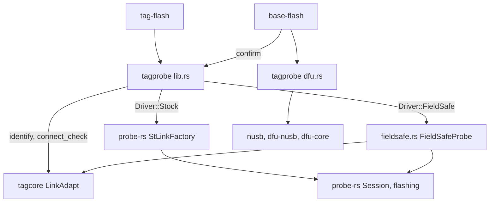

# 7. Programming tags and bases: tagprobe, probe-rs and DFU

This chapter reads the code that puts firmware into a tag and into a base:
the library [`tagprobe-rs`](../../libraries/tagprobe-rs/) (crate `tagprobe`:
`src/lib.rs`, `src/fieldsafe.rs`, `src/dfu.rs`) and the two command-line
tools over it, [`tag-flash`](../../commandline-rs/src/bin/tag-flash.rs) and
[`base-flash`](../../commandline-rs/src/bin/base-flash.rs). The tag path goes
through probe-rs, a Rust debug-probe and flash library; the base path goes
through the STM32 ROM bootloader's USB DFU interface and has nothing to do
with SWD.

After reading it you should be able to follow `tag-flash program bittag.elf`
from the command line to the probe-rs flash loop and the jump into the new
image, count the resets it causes, say why an old base is driven by a
driver that answers DAP register reads from a constant table, and follow
`base-flash program` from the ELF to the identity check after the base
comes back on USB.

The architecture is in
[chapter 7 of the guide](../guide/07-programming-and-flash-tools.md); the
design and its rules for callers are in
[tagprobe's design document](../../libraries/tagprobe-rs/design/architecture.md),
and the bench evidence behind the choices is in the
[probe-rs evaluation](../../../docs/investigations/2026-10-probe-rs-evaluation.md).
This chapter does not repeat them; it reads the code.

## Where the code sits



Two USB libraries meet in one crate. tagcore's `LinkAdapt`, and so
`identify`, `connect_check` and the field-safe driver, uses libusb through
rusb ([chapter 3](03-usb-and-stlink.md)). probe-rs's own ST-LINK driver,
and the DFU side, use **nusb**, a pure-Rust USB library introduced with
`dfu.rs` below. Both open the same base at different times, never at once.

| File | Lines | What it holds |
| --- | --- | --- |
| [`tagprobe-rs/src/lib.rs`](../../libraries/tagprobe-rs/src/lib.rs) | 672 | The public API: `Driver`, `list`, `identify`, `connect_check`, `chip_for`, `open_probe`, `program`, `flash_bytes`, `erase_all`, `read_memory`; `TagSequence` |
| [`tagprobe-rs/src/fieldsafe.rs`](../../libraries/tagprobe-rs/src/fieldsafe.rs) | 753 | `FieldSafeProbe`, `FieldSafeArm`, `FieldSafeMemory`: probe-rs's probe traits over `LinkAdapt` |
| [`tagprobe-rs/src/dfu.rs`](../../libraries/tagprobe-rs/src/dfu.rs) | 335 | Programming a base through its ROM bootloader: `list`, `parse_region`, `flatten_elf`, `program` |
| [`commandline-rs/src/bin/tag-flash.rs`](../../commandline-rs/src/bin/tag-flash.rs) | 496 | `list`, `info`, `program`, `erase`, `read` |
| [`commandline-rs/src/bin/base-flash.rs`](../../commandline-rs/src/bin/base-flash.rs) | 289 | `list`, `program`, and the identity confirmation |

Every public tagprobe function returns `Result<T, String>`: no error enum,
just a message built with `format!` at each step, which the tools print
after `tag-flash: `. That is a deliberate simplification over the C++
habit of a `bool` return plus a logged reason; the message travels with the
failure instead of sitting in a log.

## The libraries in this chapter

**Library: probe-rs** (0.32.0). A Rust library for debug probes and
on-chip flash programming, the engine behind the `probe-rs` command-line
tool. It has three parts this code uses: probe drivers (ST-LINK, CMSIS-DAP,
J-Link, ...), each behind a set of traits; a **target database** compiled
into the crate (YAML descriptions of thousands of parts, each with a memory
map and one or more **flash algorithms**: small position-independent
routines that probe-rs loads into target SRAM and calls to erase and
program flash, the same CMSIS-Pack algorithms Keil and CubeProgrammer use);
and the ARM debug machinery (DP/AP access, core halt and run, reset
sequences). The calls used here are few: `Registry::from_builtin_families()`
and `get_target_by_name()` to choose a part; `Probe::attach_under_reset_with_registry()`
to get a `Session`; `flashing::download_file_with_options()`,
`flashing::erase()` and `flashing::erase_all()` to program; and
`Session::core(0)` for register and memory access. It replaced
STM32CubeProgrammer after the evaluation linked above. probe-rs also offers
a lower-level `FlashLoader` (build a loader, add data, `commit`);
`download_file_with_options` is a wrapper that builds one from the ELF and
commits it, and the code here never touches `FlashLoader` directly.

**Library: tracing** (0.1.44). A structured-logging facade, the one
probe-rs logs through (the Rust ecosystem has two: `log`, which every other
crate in this tree uses, and `tracing`). tagprobe has one `tracing::debug!`
call of its own, in the field-safe driver. Know this before you look for
that line or for probe-rs's diagnostics: **nothing in the workspace ever
prints a `tracing` event.** A `tracing` event is delivered only to an
installed subscriber, or forwarded to `log` when `tracing`'s `log` feature
is on. Neither holds here: no crate installs a subscriber (there is no
`tracing-subscriber` in `host/Cargo.lock`), and
`cargo tree -e features -i tracing` shows only the `std`, `attributes`
and `default` features. So `tag-flash -d` shows tag-flash's own `log`
lines and tagcore's, but nothing from probe-rs or from
`fieldsafe.rs:331`.

The other libraries (nusb, dfu-core, dfu-nusb, tokio and object) appear only
in `dfu.rs` and are introduced there.

## Stateless by design

The crate's doc comment states the rule everything else follows,
[lib.rs:32](../../libraries/tagprobe-rs/src/lib.rs#L32):

```rust
//! # Threading
//!
//! Every call opens the base, uses it and closes it again; nothing is held
//! between calls, so calls may come from any thread. Two calls on the *same*
//! base at once are not serialised here and would interleave their USB
//! exchanges: the caller owns that exclusion. The Stock driver is opened
//! through [`StLinkFactory`] only, never probe-rs's `Lister`; see
//! [`open_probe`] for why that matters on macOS.
```

There is no tagprobe object. Every function takes the base as a
`&UsbDev` (tagcore's bus/address/serial record, from
[chapter 3](03-usb-and-stlink.md)), opens it, attaches, works, and closes.
That costs a reset per call, which you will count below, and buys the
absence of any shared state between Tag Programmer's worker threads and
the tools.

## Choosing the driver from the base's identity

[lib.rs:123](../../libraries/tagprobe-rs/src/lib.rs#L123):

```rust
#[derive(Debug, Clone, Copy, PartialEq, Eq)]
pub enum Driver {
    /// probe-rs's own ST-LINK driver: the base answers the identify command,
    /// so it has the ST-LINK fixes.
    Stock,
    /// [`FieldSafeProbe`]: the base predates the identify command.
    FieldSafe,
}

impl Driver {
    // ... (doc comment dropped)
    pub fn for_identity(identity: Option<&str>) -> Self {
        if identity.is_some() {
            Driver::Stock
        } else {
            Driver::FieldSafe
        }
    }
```

> **Rust:** `#[derive(Debug, Clone, Copy, PartialEq, Eq)]` asks the compiler
> to write those trait implementations: `{:?}` formatting, copy-by-value,
> and `==`. Without `Copy`, passing a `Driver` by value would *move* it and
> the caller could not use it again; with it, `Driver` behaves like a C
> enum. `impl Driver { ... }` adds methods to the type, the way a C++ enum
> class cannot have them.

The test is just "did the base answer `F6 99`". The identify command and
the two ST-LINK fixes probe-rs's own driver needs shipped in the same base
firmware, so an answer implies the fixes; the guide's
[chapter 7](../guide/07-programming-and-flash-tools.md#two-drivers-chosen-by-the-bases-identity)
gives the history. The question is asked through tagcore's `LinkAdapt`,
not probe-rs, [lib.rs:176](../../libraries/tagprobe-rs/src/lib.rs#L176):

```rust
pub fn identify(usbdev: &UsbDev) -> Option<String> {
    let mut link = LinkAdapt::new();
    if !link.open(usbdev) {
        return None;
    }
    let identity = link.base_identity();
    link.detach();
    identity
}
```

`LinkAdapt::open` opens the USB device without nRST or SWD
([chapter 3](03-usb-and-stlink.md)), so asking does not reset the tag. A
base that cannot be opened also reads as `None` and so as FieldSafe, the
driver that works everywhere.

## The connect check, without probe-rs

[lib.rs:268](../../libraries/tagprobe-rs/src/lib.rs#L268):

```rust
pub fn connect_check(usbdev: &UsbDev) -> Result<Connect, String> {
    let mut link = LinkAdapt::new();
    if !link.attach_with_reset(true, usbdev) {
        return Err("Cannot open the base".into());
    }
    let voltage = link.voltage();
    let plausible = |id: u32| (id & 0xfff) != 0 && (id & 0xfff) != 0xfff;
    let id = [L4_DBGMCU_IDCODE, U3_DBGMCU_IDCODE]
        .iter()
        .find_map(|a| link.read_debug32(*a).filter(|v| plausible(*v)));
    link.assert_reset(true);
    link.detach();
    match id {
        Some(idcode) => {
            let device_id = (idcode & 0xfff) as u16;
            Ok(Connect {
                device_id,
                device_name: device_name(device_id),
                voltage,
            })
        }
        None => Err("No STM32 target found".into()),
    }
}
```

This is `STM32_Programmer_CLI -c port=SWD mode=UR`, done with the
`LinkAdapt` calls the monitor is built on: attach with nRST held, read the
voltage, try the L4 then the U3 `DBGMCU_IDCODE` address, release nRST
(`assert_reset(true)` drives the line *high*: the argument is the line
level, as in your `AssertReset`), and detach. It needs no probe-rs target
name, which is the point: the device ID it returns is what chooses the
target.

> **Rust:** `|id: u32| ...` is a closure, a lambda. `find_map` walks the
> two addresses and returns the first `Some` the closure produces;
> `read_debug32` returns `Option<u32>`, and `.filter(...)` turns a `Some`
> that fails the test into `None`. The whole line is "the first plausible
> IDCODE, or `None`", the loop you would write by hand in C++.

> **Rust:** `"Cannot open the base".into()` converts a `&'static str` (a
> pointer into the binary) into the owned `String` the return type wants.
> `into()` is the generic conversion; the target type comes from the
> context, here `Result<Connect, String>`.

## Choosing the probe-rs target

probe-rs needs a target name to look up the memory map and flash
algorithm. [lib.rs:236](../../libraries/tagprobe-rs/src/lib.rs#L236):

```rust
pub fn chip_for(device_id: u16, flash_bytes: Option<u32>) -> Result<&'static str, String> {
    match (device_id, flash_bytes) {
        (DEV_L432, None | Some(0x40000)) => Ok("STM32L432KC"),
        (DEV_L432, Some(0x20000)) => Ok("STM32L432KB"),
        (DEV_U375, None | Some(0x100000)) => Ok("STM32U375RG"),
        (DEV_U375, Some(0x80000)) => Ok("STM32U375RE"),
        (id, Some(size)) => Err(format!(
            "no probe-rs target for device 0x{id:03x} with {} KB of flash",
            size / 1024
        )),
        (id, None) => Err(format!("no probe-rs target for device 0x{id:03x}")),
    }
}
```

The device ID does not give the flash size, and the size matters: a
`STM32L432KC` target on a UIUCTag's 128 KB L432KB would have probe-rs's
flash algorithm address flash that is not there. The caller supplies the
size; `tag-flash` reads it from the part (below) and falls back to the
image's `__flash0_size__` (ChibiOS's linker symbol, `LENGTH(flash0)`).

> **Rust:** `match` on a tuple is a C `switch` on two values at once. Arms
> are tried in order; `None | Some(0x40000)` matches either; `(id, Some(size))`
> binds the values for use on the right. The compiler checks that the arms
> cover every case, which is why the two catch-all arms must exist.
> `{id:03x}` inside `format!` names a variable directly, like a Python f-string.

## Opening the probe

[lib.rs:328](../../libraries/tagprobe-rs/src/lib.rs#L328):

```rust
pub fn open_probe(usbdev: &UsbDev, driver: Driver) -> Result<Probe, String> {
    match driver {
        Driver::FieldSafe => FieldSafeProbe::open(usbdev).map_err(|e| e.to_string()),
        Driver::Stock => {
            // Only the ST-LINK driver, never Lister: listing every kind of
            // probe enumerates CMSIS-DAP over HID, and on macOS hidapi ties
            // its IOHIDManager to the first thread that used it, so a second
            // program from another worker thread aborted the process.
            let probes: Vec<_> = StLinkFactory
                .list_probes()
                .into_iter()
                .map(|item| item.info)
                .filter(|p| p.vendor_id == usbdev.vid && p.product_id == usbdev.pid)
                .collect();
            let info = match probes.iter().find(|p| {
                !usbdev.serial.is_empty() && p.serial_number.as_deref() == Some(&usbdev.serial)
            }) {
                Some(p) => p,
                None if probes.len() == 1 => &probes[0],
                None => return Err("Cannot tell this base from the other ST-LINKs".into()),
            };
            let selector = DebugProbeSelector {
                vendor_id: info.vendor_id,
                product_id: info.product_id,
                interface: None,
                serial_number: info.serial_number.clone(),
            };
            StLinkFactory
                .open(&selector)
                .map(Probe::from_specific_probe)
                .map_err(|e| e.to_string())
        }
    }
}
```

Both arms produce the same thing: a probe-rs `Probe`, the type-erased
handle every later probe-rs call takes. From here up, nothing depends on
which driver is underneath.

The comment carries a real bug. probe-rs's convenient entry point,
`Lister`, asks every probe family for its devices, and the CMSIS-DAP family
enumerates HID devices through hidapi, which on macOS binds an
`IOHIDManager` to the first thread that used it. Tag Programmer runs each
programming job on a fresh worker thread, so its second job aborted the
process. Asking only the ST-LINK factory never touches HID.

> **Rust:** `StLinkFactory` is a *unit struct*, a type with no fields, and
> `StLinkFactory.list_probes()` calls a method on its single value. It
> exists so the ST-LINK driver can implement probe-rs's `ProbeFactory`
> trait; there is nothing to construct. `Probe::from_specific_probe` is
> passed as a function value to `.map`, the way you would pass a function
> pointer.

> **Rust:** the `.into_iter().map(...).filter(...).collect()` chain is an
> iterator pipeline; nothing runs until `collect()` drains it into the
> `Vec<_>` the `let` asks for (the `_` lets the compiler infer the element
> type). `None if probes.len() == 1 =>` is a match arm with a guard.

## The session: target, debug sequence, attach under reset

Every operation that needs the core opens a probe-rs `Session` through one
private function, [lib.rs:374](../../libraries/tagprobe-rs/src/lib.rs#L374):

```rust
fn session(usbdev: &UsbDev, driver: Driver, chip: &str) -> Result<Session, String> {
    let registry = Registry::from_builtin_families();
    let mut target = registry
        .get_target_by_name(chip)
        .map_err(|e| format!("probe-rs has no target {chip}: {e}"))?;
    target.debug_sequence = DebugSequence::Arm(Arc::new(TagSequence));
    open_probe(usbdev, driver)?
        .attach_under_reset_with_registry(
            TargetSelector::Specified(target),
            Permissions::default(),
            &registry,
        )
        .map_err(|e| format!("Cannot attach to the tag: {e}"))
}
```

Read it in four steps.

1. `Registry::from_builtin_families()` loads probe-rs's compiled-in target
   database, and `get_target_by_name("STM32L432KC")` returns a `Target`: a
   plain struct holding the part's memory map, flash algorithms and
   **debug sequence**.
2. The debug sequence is replaced. A probe-rs debug sequence is a trait
   object with hooks for attach, reset, reset catch and detach; probe-rs's
   STM32 families use `Stm32Armv7` (L4) and `Stm32Armv8` (U3), which set
   `DBGMCU_CR`'s debug-in-Stop/Standby bits on attach and, because they
   override the default detach step, never clear `C_DEBUGEN` (they restore
   or clear the `DBGMCU_CR` bits, but leave debug enabled). That would leave
   a programmed tag in a state a normal boot never produces.
3. `Permissions::default()` grants nothing. The one permission probe-rs
   has, `allow_erase_all`, is consulted only by vendor sequences that unlock
   a read-protected part by erasing it (Nordic, Microchip); a chip erase
   through the flash algorithm does not need it.
4. `attach_under_reset_with_registry` holds nRST, attaches, arms reset
   vector catch and releases nRST, so the core halts at its reset vector
   before any firmware instruction. Dropping the `Session` later detaches,
   through the replacement sequence.

The replacement is two lines, [lib.rs:303](../../libraries/tagprobe-rs/src/lib.rs#L303):

```rust
#[derive(Debug)]
pub struct TagSequence;

impl ArmDebugSequence for TagSequence {}
```

> **Rust:** a trait is an interface whose methods may have default bodies.
> `ArmDebugSequence` gives every method one: the ARM-specified default
> sequence (on detach, `debug_core_stop` writes `DHCSR.C_DEBUGEN = 0` and
> `DEMCR = 0`). An empty `impl` block is a subclass that overrides nothing:
> `TagSequence` *is* the default sequence, with a type of its own so it can
> be installed. `Arc::new(TagSequence)` puts it behind a reference-counted
> pointer, because probe-rs keeps a shared `Arc<dyn ArmDebugSequence>`.

> **Rust:** `?` after an expression that returns `Result` means "if it is
> `Err`, return that error from this function now; otherwise unwrap the
> `Ok`". It is the early-return error check you write after every call in
> C, spelt as one character. `open_probe(usbdev, driver)?.attach_...`
> therefore attaches only if the open succeeded.

The doc comment above `TagSequence` notes the measured consequence:
Joulescope traces after each kind of attach showed no difference in
resting current, and every base sets `C_DEBUGEN` on SWD entry regardless.
The sequence choice is about leaving the tag as a boot would, not about a
measured fault.

## The field-safe driver: implementing someone else's interface

A base in the field emulates an ST-LINK/V2 well enough for tagcore, but not
for probe-rs's ST-LINK driver: its `READ_DAP_REG` returns stale data and a
1-byte `READMEM_8BIT` gets a 1-byte reply where probe-rs waits for two.
Those bases cannot be reflashed. So `fieldsafe.rs` gives probe-rs a
different driver, built on the `LinkAdapt` commands every base gets right.
The module doc names that subset,
[fieldsafe.rs:9](../../libraries/tagprobe-rs/src/fieldsafe.rs#L9):

```rust
//! either. It speaks only the subset tagcore's [`LinkAdapt`] already uses on
//! every base:
//!
//! - USB open, mode query, DFU exit, SWD enter/exit, nRST drive, voltage;
//! - `READMEM_32BIT` / `WRITEMEM_32BIT` with the last-R/W-status check,
//!   in chunks of at most [`CHUNK`] bytes;
//! - `READDEBUGREG` for the chip ID, which tells L4 from U3.
```

In C++ you would do this by deriving from the library's abstract driver
classes and overriding their virtual functions. Rust has no inheritance;
the equivalent is to **implement the library's traits for your own
types**. probe-rs drives a probe through a stack of traits, and the file
implements each one:

| probe-rs trait | Implemented by | Role |
| --- | --- | --- |
| `DebugProbe` | `FieldSafeProbe` | Open, attach, nRST, speed, protocol, voltage; hands out the ARM interface |
| `ArmDebugInterface`, `DapAccess`, `SwdSequence`, `SwoAccess` | `FieldSafeArm` | DP/AP registers, raw SWJ, SWO, the access-port list, the memory interface |
| `ArmMemoryInterface`, `MemoryInterface<ArmError>`, `SwdSequence` | `FieldSafeMemory<'a>` | 8/16/32/64-bit memory through AP0 |
| `ProbeError` (plus `Display`, `Error`) | `LinkError` | The driver's own error type inside probe-rs's |

A trait's methods without default bodies must all be written, or the
`impl` does not compile; so every method probe-rs could call has an answer
here, even if the answer is "not supported".

### The probe

[fieldsafe.rs:147](../../libraries/tagprobe-rs/src/fieldsafe.rs#L147):

```rust
pub struct FieldSafeProbe {
    /// The open base; every USB exchange goes through it.
    link: LinkAdapt,
    /// Whether SWD has been entered since the last detach (for `Debug` only).
    attached: bool,
}
```

and its constructor, [fieldsafe.rs:174](../../libraries/tagprobe-rs/src/fieldsafe.rs#L174):

```rust
    pub fn open(usbdev: &UsbDev) -> Result<Probe, DebugProbeError> {
        let mut link = LinkAdapt::new();
        if !link.open(usbdev) {
            return Err(link_err("open"));
        }
        Ok(Probe::from_specific_probe(Box::new(Self {
            link,
            attached: false,
        })))
    }
```

> **Rust:** `Box::new(...)` allocates on the heap and returns an owning
> pointer, like `std::make_unique`. `from_specific_probe` takes a
> `Box<dyn DebugProbe>`: `dyn DebugProbe` is a *trait object*, a fat
> pointer of (data, vtable), which is exactly a C++ pointer to an abstract
> base class. The `Box<FieldSafeProbe>` converts to it implicitly, and
> ownership moves into probe-rs; tagprobe never sees the object again.

The `DebugProbe` methods are short translations onto `LinkAdapt`.
Two are worth reading. SWD entry, [fieldsafe.rs:206](../../libraries/tagprobe-rs/src/fieldsafe.rs#L206):

```rust
    fn attach(&mut self) -> Result<(), DebugProbeError> {
        if !self.link.enter_swd() {
            return Err(link_err("SWD entry"));
        }
        self.attached = true;
        Ok(())
    }
```

and reset, [fieldsafe.rs:230](../../libraries/tagprobe-rs/src/fieldsafe.rs#L230):

```rust
    fn target_reset_assert(&mut self) -> Result<(), DebugProbeError> {
        // LinkAdapt::assert_reset(high): false drives nRST low.
        if self.link.assert_reset(false) {
            Ok(())
        } else {
            Err(link_err("nRST assert"))
        }
    }
```

For an attach under reset, probe-rs calls `target_reset_assert` before
`attach`, which is tagcore's order: nRST low, then SWD entry, because a
tag asleep with its debug domain off answers SWD only from reset.

The probe's errors have to be probe-rs's error type.
[fieldsafe.rs:75](../../libraries/tagprobe-rs/src/fieldsafe.rs#L75):

```rust
#[derive(Debug)]
pub struct LinkError(&'static str);

impl fmt::Display for LinkError {
    /// Formats as `tag base: <step> failed`.
    fn fmt(&self, f: &mut fmt::Formatter<'_>) -> fmt::Result {
        write!(f, "tag base: {} failed", self.0)
    }
}

impl std::error::Error for LinkError {}
impl ProbeError for LinkError {}

/// Wraps a failed step, named by `what`, as a probe-rs
/// [`DebugProbeError::ProbeSpecific`].
fn link_err(what: &'static str) -> DebugProbeError {
    DebugProbeError::ProbeSpecific(LinkError(what).into())
}
```

> **Rust:** `struct LinkError(&'static str)` is a *tuple struct*: one
> unnamed field, read as `self.0`. `impl ProbeError for LinkError {}` is a
> *marker* implementation: the trait has no methods, only supertraits
> (`Error`, which itself requires `Display` and `Debug`, plus `Send` and
> `Sync`, which a struct holding a `&'static str` has automatically), so
> implementing it says "this type may travel as a probe-specific error". `.into()` boxes it into the
> `Box<dyn ProbeError>` that `ProbeSpecific` holds.

### From probe to ARM interface: consuming `self`

When probe-rs wants the ARM debug interface, it gives up the probe and gets
back a different object that owns it,
[fieldsafe.rs:272](../../libraries/tagprobe-rs/src/fieldsafe.rs#L272):

```rust
    fn try_get_arm_debug_interface<'probe>(
        self: Box<Self>,
        _sequence: Arc<dyn ArmDebugSequence>,
    ) -> Result<Box<dyn ArmDebugInterface + 'probe>, (Box<dyn DebugProbe>, ArmError)> {
        Ok(Box::new(FieldSafeArm {
            probe: self,
            table: None,
        }))
    }

    /// Returns the probe itself as a boxed [`DebugProbe`].
    fn into_probe(self: Box<Self>) -> Box<dyn DebugProbe> {
        self
    }
```

> **Rust:** `self: Box<Self>` means the method *consumes* the boxed probe:
> after the call the caller no longer has it. The probe is moved into the
> new `FieldSafeArm`, so there is never a moment when two objects think
> they own the USB handle. The error type is a pair that hands the probe
> back on failure, so ownership is never lost. `+ 'probe` is a lifetime
> bound on the returned trait object; here it is satisfied trivially,
> because `FieldSafeArm` borrows nothing.

The `_sequence` argument is ignored: probe-rs still runs `TagSequence`'s
steps, but through the interface returned here, and they arrive as the DAP
register traffic answered below.

### DAP registers from a table

[fieldsafe.rs:300](../../libraries/tagprobe-rs/src/fieldsafe.rs#L300):

```rust
pub struct FieldSafeArm {
    /// The probe, owned while the interface is in use and handed back by
    /// [`ArmDebugInterface::close`].
    probe: Box<FieldSafeProbe>,
    /// The DAP answers for the part, chosen on first use from its chip ID.
    table: Option<DapTable>,
}
```

The table is the trick that makes an old base usable. probe-rs discovers
the debug port and access ports by reading DPIDR, CTRL/STAT and each AP's
IDR, BASE and CSW. A base whose `READ_DAP_REG` returns stale data sends
that discovery astray (the evaluation records probe-rs scanning all 256
APs on one). So the driver never asks the base; it answers with the values
the real part returns, read once from parts through a fixed base,
[fieldsafe.rs:113](../../libraries/tagprobe-rs/src/fieldsafe.rs#L113):

```rust
const L4_DAP: DapTable = DapTable {
    dpidr: 0x2BA0_1477,
    ap0_idr: 0x2477_0011,
    ap0_base: 0xE00F_F003,
    ap0_csw: 0x2300_0052,
};
```

(`U3_DAP` follows with the Cortex-M33 values.) Which table applies is
decided on first use from `DBGMCU_IDCODE`, read with `READDEBUGREG`, which
every base handles, [fieldsafe.rs:319](../../libraries/tagprobe-rs/src/fieldsafe.rs#L319):

```rust
    fn table(&mut self) -> Result<DapTable, ArmError> {
        if let Some(t) = self.table {
            return Ok(t);
        }
        let link = &mut self.probe.link;
        let table = if link.read_debug32(L4_DBGMCU_IDCODE).is_some_and(plausible) {
            L4_DAP
        } else if link.read_debug32(U3_DBGMCU_IDCODE).is_some_and(plausible) {
            U3_DAP
        } else {
            return Err(ArmError::Probe(link_err("chip identification")));
        };
        tracing::debug!("tag base: DAP table {table:x?}");
        self.table = Some(table);
        Ok(table)
    }
```

(The `tracing::debug!` line is the one that never prints; see the
libraries section above.)

> **Rust:** `if let Some(t) = self.table` is a one-arm `match`: it runs the
> block only when the `Option` holds a value, binding it to `t`. It can copy
> the table out because `DapTable` derives `Copy`. `if ... else if ...` is
> an *expression* here: its value is assigned to `table`, and the `return`
> in the last branch leaves the function instead of producing a value.

The reads themselves, [fieldsafe.rs:442](../../libraries/tagprobe-rs/src/fieldsafe.rs#L442):

```rust
    fn read_raw_dp_register(
        &mut self,
        _dp: DpAddress,
        address: DpRegisterAddress,
    ) -> Result<u32, ArmError> {
        let t = self.table()?;
        Ok(match (address.address, address.bank.unwrap_or(0)) {
            (0x0, _) => t.dpidr,
            // CTRL/STAT: debug and system power-up requested and acknowledged.
            (0x4, 0) => 0xF000_0000,
            _ => 0,
        })
    }
```

CTRL/STAT reads `0xF000_0000`: `CSYSPWRUPACK`, `CSYSPWRUPREQ`,
`CDBGPWRUPACK`, `CDBGPWRUPREQ` all set, which ends probe-rs's power-up
handshake at once. The base powers the DAP up itself on SWD entry. AP
reads work the same way, [fieldsafe.rs:472](../../libraries/tagprobe-rs/src/fieldsafe.rs#L472):

```rust
    fn read_raw_ap_register(
        &mut self,
        ap: &FullyQualifiedApAddress,
        address: u64,
    ) -> Result<u32, ArmError> {
        if ap.ap_v1()? != 0 {
            // No AP past AP0: an IDR of 0 ends probe-rs's AP scan.
            return Ok(0);
        }
        let t = self.table()?;
        Ok(match address & 0xFF {
            0x00 => t.ap0_csw,
            0xF8 => t.ap0_base,
            0xFC => t.ap0_idr,
            _ => 0,
        })
    }
```

Every DP and AP *write* is accepted and ignored. That is safe only because
of the next part: memory never goes through `TAR`/`DRW`, so there is no AP
state for a write to set up.

### Memory through the base's own commands

32-bit reads go to `READMEM_32BIT` in chunks,
[fieldsafe.rs:346](../../libraries/tagprobe-rs/src/fieldsafe.rs#L346):

```rust
    fn read_words(&mut self, address: u32, data: &mut [u32]) -> Result<(), ArmError> {
        let mut bytes = vec![0u8; data.len() * 4];
        for (i, chunk) in bytes.chunks_mut(CHUNK).enumerate() {
            let at = address + (i * CHUNK) as u32;
            if !self.probe.link.read_mem32(at, chunk) {
                return Err(ArmError::Probe(link_err("memory read")));
            }
        }
        for (word, b) in data.iter_mut().zip(bytes.chunks_exact(4)) {
            *word = u32::from_le_bytes(b.try_into().unwrap());
        }
        Ok(())
    }
```

> **Rust:** `&mut [u32]` is a *slice*: a pointer and a length, the
> `(uint32_t *data, size_t n)` pair as one value, bounds-checked on every
> index. `chunks_mut(CHUNK)` yields consecutive sub-slices of at most
> `CHUNK` bytes; `enumerate()` adds the index. `b.try_into().unwrap()`
> turns a 4-byte slice into a `[u8; 4]` array: the conversion is fallible
> in the type system because a slice's length is a run-time value, and
> `unwrap` is safe here because `chunks_exact(4)` only yields 4-byte
> pieces.

Byte and half-word writes are the part that needs care, because the field
bases cannot be trusted with `WRITEMEM_8BIT`. They are emulated with whole
words, [fieldsafe.rs:415](../../libraries/tagprobe-rs/src/fieldsafe.rs#L415):

```rust
    fn write_bytes(&mut self, address: u32, data: &[u8]) -> Result<(), ArmError> {
        if data.is_empty() {
            return Ok(());
        }
        let start = address & !3;
        let end = (address as u64 + data.len() as u64 + 3) & !3;
        let mut words = vec![0u32; ((end - start as u64) / 4) as usize];
        self.read_words(start, &mut words)?;
        let mut bytes: Vec<u8> = words.iter().flat_map(|w| w.to_le_bytes()).collect();
        let offset = (address - start) as usize;
        bytes[offset..offset + data.len()].copy_from_slice(data);
        let words: Vec<u32> = bytes
            .chunks_exact(4)
            .map(|b| u32::from_le_bytes(b.try_into().unwrap()))
            .collect();
        self.write_words(start, &words)
    }
```

Read the enclosing words, patch the bytes, write the words back. That is
not atomic, so it is right for what probe-rs writes bytewise (halted-core
SRAM and flash-algorithm buffers) and wrong for a peripheral register with
side effects; the doc comment above it says so, and the design document
says not to use this driver for general debugging. The `end` arithmetic is
done in `u64` so an access ending at the top of the 4 GB space does not
overflow.

> **Rust:** `!3` is bitwise NOT (C's `~3`); Rust uses `!` for both logical
> and bitwise not, chosen by type. `as u64` is an explicit widening cast:
> Rust never widens or narrows integers implicitly, so mixed-width
> arithmetic always shows its casts.

### Reset through `swj_pins`

probe-rs's reset sequences toggle nRST through the CMSIS-DAP style
`swj_pins` call. The driver accepts exactly that pin and nothing else,
[fieldsafe.rs:525](../../libraries/tagprobe-rs/src/fieldsafe.rs#L525):

```rust
    fn swj_pins(
        &mut self,
        pin_out: u32,
        pin_select: u32,
        _pin_wait: u32,
    ) -> Result<u32, DebugProbeError> {
        if pin_select != PIN_NRESET {
            return Err(DebugProbeError::CommandNotSupportedByProbe {
                command_name: "swj_pins",
            });
        }
        if pin_out & PIN_NRESET == 0 {
            self.probe.target_reset_assert()?;
        } else {
            self.probe.target_reset_deassert()?;
        }
        Ok(pin_out)
    }
```

Raw SWJ bit sequences (`swj_sequence`) are refused outright: the base does
its own line reset and JTAG-to-SWD switch on SWD entry. SWO is refused
with `ArmError::NotImplemented("SWO on a tag base")`.

### The memory interface borrows the ARM interface

[fieldsafe.rs:604](../../libraries/tagprobe-rs/src/fieldsafe.rs#L604):

```rust
    fn memory_interface(
        &mut self,
        access_port: &FullyQualifiedApAddress,
    ) -> Result<Box<dyn ArmMemoryInterface + '_>, ArmError> {
        if access_port.ap_v1()? != 0 {
            return Err(ArmError::NotImplemented("APs other than AP0 on a tag base"));
        }
        Ok(Box::new(FieldSafeMemory {
            arm: self,
            ap: access_port.clone(),
        }))
    }
```

and the type it returns, [fieldsafe.rs:625](../../libraries/tagprobe-rs/src/fieldsafe.rs#L625):

```rust
pub struct FieldSafeMemory<'a> {
    /// The interface whose link carries the transfers.
    arm: &'a mut FieldSafeArm,
    /// The access port this interface was opened for (always AP0).
    ap: FullyQualifiedApAddress,
}
```

> **Rust:** `FieldSafeMemory<'a>` holds a *borrowed* `&mut FieldSafeArm`,
> and `'a` names how long that borrow lasts. The `'_` in the return type
> ties the returned box to the `&mut self` borrow of the call. Together
> they make the compiler refuse any use of the `FieldSafeArm` while a
> memory interface from it is alive: two objects can never both issue USB
> commands through one link. In C++ this would be a raw back-pointer and a
> comment.

The memory methods then forward: `read_32` and `write_32` to the word
helpers, `read_8` and `read_16` to `read_bytes`, `write_8` and `write_16` to
`write_bytes`, and 64-bit accesses as word pairs. `close` hands the probe
back as an unattached `Probe`, [fieldsafe.rs:583](../../libraries/tagprobe-rs/src/fieldsafe.rs#L583):

```rust
    fn close(self: Box<Self>) -> Probe {
        // from_attached_probe() is crate-private; the spike never reuses a
        // closed probe, so an unattached Probe is enough.
        Probe::from_specific_probe(self.probe)
    }
```

The comment's "spike" is the probe-rs evaluation spike this file grew
from; the argument still holds for the production code, since tagprobe
drops every probe after one session.

## The program sequence

[lib.rs:475](../../libraries/tagprobe-rs/src/lib.rs#L475) is the
function every programming path ends in, Tag Programmer's included:

```rust
pub fn program(
    usbdev: &UsbDev,
    driver: Driver,
    chip: &str,
    elf: &Path,
    erase: Erase,
    mut on_progress: impl FnMut(Progress),
) -> Result<(), String> {
```

> **Rust:** `on_progress: impl FnMut(Progress)` takes any callable that
> accepts a `Progress`: a closure, a function. It is a generic parameter,
> compiled once per caller's closure type like a template parameter, not a
> `std::function`. `FnMut` means the callable may change state it
> captured; `mut` on the parameter lets this function call it.

The erase it takes is tagprobe's own three-way choice,
[lib.rs:395](../../libraries/tagprobe-rs/src/lib.rs#L395) (doc comments
dropped):

```rust
pub enum Erase {
    ImagePages,
    Range {
        start: u64,
        end: u64,
    },
    All,
}
```

> **Rust:** an enum variant can carry data. `Erase::Range { start, end }`
> is a tagged union: a C++ `std::variant` of an empty type, a two-field
> struct and another empty type, with the tag managed by the compiler and
> the fields reachable only after a `match` or `if let` has checked which
> variant it is.

### Progress, and the flash loop

The first half of the body, [lib.rs:483](../../libraries/tagprobe-rs/src/lib.rs#L483):

```rust
    let mut session = session(usbdev, driver, chip)?;
    let mut totals = std::collections::HashMap::new();
    let mut done = std::collections::HashMap::new();
    {
        let mut progress = FlashProgress::new(|event| match event {
            ProgressEvent::AddProgressBar { operation, total } => {
                totals.insert(operation as u8, total.unwrap_or(0));
            }
            ProgressEvent::Started(op) => {
                done.insert(op as u8, 0u64);
                on_progress(Progress::Step(operation_name(op)));
            }
            ProgressEvent::Progress {
                operation, size, ..
            } => {
                let d = done.entry(operation as u8).or_insert(0);
                *d += size;
                on_progress(Progress::Bytes {
                    done: *d,
                    total: *totals.get(&(operation as u8)).unwrap_or(&0),
                });
            }
            _ => {}
        });
        if let Erase::Range { start, end } = erase {
            flashing::erase(&mut session, &mut progress, start, end, false)
                .map_err(|e| format!("Erase failed: {e}"))?;
        }
        let mut options = DownloadOptions::default();
        options.verify = true;
        options.do_chip_erase = erase == Erase::All;
        options.progress = progress;
        flashing::download_file_with_options(
            &mut session,
            elf,
            ElfLoader(Default::default()),
            options,
        )
        .map_err(|e| format!("Programming failed: {e}"))?;
    }
```

probe-rs reports flash progress as a stream of `ProgressEvent`s to a
handler held in a `FlashProgress`: first an `AddProgressBar` with the byte
total for each operation (erase, program, verify), then `Started` and
`Progress { size, .. }` increments. The closure turns that into tagprobe's
simpler `Progress::Step` and `Progress::Bytes { done, total }`, keeping a
running total per operation in two hash maps.

> **Rust:** `operation as u8` casts probe-rs's `ProgressOperation` enum to
> its discriminant, because the enum derives neither `Hash` nor `Eq` and so
> cannot itself be a `HashMap` key. `done.entry(k).or_insert(0)` returns a
> `&mut u64` into the map (inserting 0 if absent), and `*d += size`
> updates it in place.

> **Rust:** the closure mutably borrows `totals`, `done` and `on_progress`
> for as long as `progress` holds it. The inner `{ ... }` marks where that
> ends. (`progress` is moved into `options` and consumed by the download,
> so the compiler would end the borrows there anyway; the block makes the
> extent visible.) Holding two `&mut` to one value at once is a compile
> error, which is the rule this structure is arranged around.

The erase plan becomes probe-rs settings:

| `Erase` | probe-rs | What is erased |
| --- | --- | --- |
| `ImagePages` | `DownloadOptions::default()` | The flash sectors the image's loadable segments overlap |
| `Range { start, end }` | `flashing::erase(..., start, end, ...)` first, then as `ImagePages` | Every sector overlapping `start..end`, then the image's sectors |
| `All` | `options.do_chip_erase = true` | The whole part, through the flash algorithm's chip erase |

All three run in one session, so there is no reset between erase and
program. `options.verify = true` makes probe-rs read every programmed byte
back after writing. `ElfLoader(Default::default())` is probe-rs's ELF image
loader with default options: it programs the `PT_LOAD` segments at their
load addresses, which is what `flatten_elf` does by hand for DFU below.

One detail to read correctly: probe-rs erases whole sectors. With
`DownloadOptions::default()` its `keep_unwritten_bytes` option is off, so
the bytes of a sector the image only partly covers are left erased, not
restored. `operation_name` maps probe-rs's `Fill` operation ("Reading
back") for completeness, but with this setting probe-rs never starts it.
On the L432 that is harmless because what must survive (the calibration
page, and the persistent region that begins on the page after the code)
sits on pages of its own.

### PEMPTY and the start

The second half, [lib.rs:523](../../libraries/tagprobe-rs/src/lib.rs#L523):

```rust
    let mut core = session.core(0).map_err(|e| e.to_string())?;
    clear_l4_pempty(&mut core)?;
    // Start as `-g 0x08000000` does: SP and PC from the vector table.
    let sp = core.read_word_32(FLASH_BASE).map_err(|e| e.to_string())?;
    let pc = core
        .read_word_32(FLASH_BASE + 4)
        .map_err(|e| e.to_string())?;
    let sp_reg = core.stack_pointer();
    let pc_reg = core.program_counter();
    core.write_core_reg(sp_reg, sp).map_err(|e| e.to_string())?;
    core.write_core_reg(pc_reg, pc & !1)
        .map_err(|e| e.to_string())?;
    core.run()
        .map_err(|e| format!("Cannot start the image: {e}"))?;
    Ok(())
}
```

`session.core(0)` borrows the session as a `Core`, probe-rs's handle for
one CPU, with memory and register access. The image is started as
CubeProgrammer's `-g 0x08000000` did: SP and PC loaded from the vector
table (with the Thumb bit cleared from the reset vector before writing PC)
and the core resumed. So the first boot after programming is not a cold
boot; the tag's next reset is. When `program` returns, `core` and then
`session` are dropped, and the drop detaches through `TagSequence`.

Before the start comes the STM32L4 detail,
[lib.rs:551](../../libraries/tagprobe-rs/src/lib.rs#L551):

```rust
fn clear_l4_pempty(core: &mut probe_rs::Core<'_>) -> Result<(), String> {
    let l4 = core
        .read_word_32(u64::from(L4_DBGMCU_IDCODE))
        .is_ok_and(|id| (id & 0xfff) as u16 == DEV_L432);
    if !l4 {
        return Ok(());
    }
    let sr = core.read_word_32(L4_FLASH_SR).map_err(|e| e.to_string())?;
    if sr & L4_FLASH_SR_PEMPTY == 0 {
        return Ok(());
    }
    core.write_word_32(L4_FLASH_SR, L4_FLASH_SR_PEMPTY)
        .map_err(|e| e.to_string())?;
    let after = core.read_word_32(L4_FLASH_SR).map_err(|e| e.to_string())?;
    if after & L4_FLASH_SR_PEMPTY != 0 {
        return Err("FLASH_SR.PEMPTY is still set; the tag would boot its ROM bootloader".into());
    }
    Ok(())
}
```

`FLASH_SR.PEMPTY` latches at reset when user flash reads empty, and while
it is set the L432 boots its ROM bootloader instead of the image. After a
mass erase it is set. The bit is write-1-to-toggle, so it is written only
when found set and then read back: the rule `embedded/tools/flash_release.py`
follows. probe-rs knows nothing about PEMPTY (the evaluation lists it as
missing), so this is tagprobe's.

> **Rust:** `probe_rs::Core<'_>` is a type with a lifetime parameter: a
> `Core` borrows the `Session` it came from, and `'_` says "some lifetime
> the compiler works out". `is_ok_and(|id| ...)` is `true` only for an
> `Ok` whose value passes the test, so a failed read (as on a U3) counts as
> "not an L4" in one expression.

### The other session users

`flash_bytes` opens one more session, on the smaller L432KB target, to
read the L4 flash size register, [lib.rs:584](../../libraries/tagprobe-rs/src/lib.rs#L584):

```rust
pub fn flash_bytes(usbdev: &UsbDev, driver: Driver, device_id: u16) -> Result<Option<u32>, String> {
    if device_id != DEV_L432 {
        return Ok(None);
    }
    let bytes = read_memory(usbdev, driver, "STM32L432KB", u64::from(L4_FLASHSIZE), 4)?;
    let kb = u32::from(u16::from_le_bytes([bytes[0], bytes[1]]));
    if kb == 0 {
        return Err("the flash size register reads 0".into());
    }
    Ok(Some(kb * 1024))
}
```

The register is in system memory, which does not answer while the core is
held in reset, so it cannot be part of `connect_check`; it costs one more
attach under reset. `erase_all` is a session and
`flashing::erase_all(&mut session, &mut FlashProgress::empty(), false)`.
`read_memory` ends with an explicit detach and a pause,
[lib.rs:639](../../libraries/tagprobe-rs/src/lib.rs#L639):

```rust
    let mut session = session(usbdev, driver, chip)?;
    let mut core = session.core(0).map_err(|e| e.to_string())?;
    let mut buf = vec![0u8; len];
    core.read_8(addr, &mut buf)
        .map_err(|e| format!("Read failed: {e}"))?;
    drop(core);
    drop(session);
    // Leave the tag running its firmware, as STM32_Programmer_CLI does.
    std::thread::sleep(Duration::from_millis(50));
    Ok(buf)
```

> **Rust:** `drop(x)` ends a value's life now instead of at the closing
> brace: the destructor (here, probe-rs's detach) runs immediately. It is
> how you force RAII cleanup to happen before a later statement, the
> equivalent of `ptr.reset()` on a `unique_ptr`. `core` must go first
> because it borrows `session`.

## tag-flash: the command line

[`tag-flash.rs`](../../commandline-rs/src/bin/tag-flash.rs) is the
replacement for the CMake `-download` and `-erase` targets'
`STM32_Programmer_CLI` calls; those targets now run
`tag-flash program <elf>` and `tag-flash erase`. Its argument parsing uses
clap's derive macros, which [chapter 9](09-command-line-tools.md) reads in
detail; the shape is enough here, [tag-flash.rs:94](../../commandline-rs/src/bin/tag-flash.rs#L94):

```rust
#[derive(Subcommand)]
enum Command {
    /// List the bases on USB
    List,
    /// Check the connection: device, flash size and supply voltage
    Info,
    /// Program an image, verify it and start it
    Program {
        /// The firmware's .elf
        #[arg(value_parser = tag_tools::parse_elf_path)]
        elf: PathBuf,
        /// What to erase before programming
        #[arg(long, value_enum, default_value_t = EraseArg::Plan)]
        erase: EraseArg,
    },
    /// Mass-erase internal flash, programming nothing
    Erase,
    /// Read memory to a file
    Read {
        /// Start address (0x-prefixed hex or decimal)
        #[arg(value_parser = parse_number)]
        address: u64,
        /// Bytes to read (0x-prefixed hex or decimal)
        #[arg(value_parser = parse_number)]
        length: u64,
        /// File to write
        #[arg(short, long)]
        output: PathBuf,
    },
}
```

Each subcommand is an enum variant carrying its own arguments, and the
`///` comments become the `--help` text. `-b`/`--base` takes the base's USB
**serial**, not the monitor tools' `bus:device`, because a serial survives
replugging.

### Connecting

Every attaching command starts with `connect`,
[tag-flash.rs:201](../../commandline-rs/src/bin/tag-flash.rs#L201):

```rust
fn connect(wanted: Option<&str>, image_flash: Option<u32>) -> Result<Target, String> {
    let base = find_base(wanted)?;
    let driver = Driver::for_identity(tagprobe::identify(&base).as_deref());
    let found = tagprobe::connect_check(&base)?;
    let flash = tagprobe::flash_bytes(&base, driver, found.device_id)?;
    let chip = tagprobe::chip_for(found.device_id, flash.or(image_flash))?;
    log::debug!("{chip} through {} ({})", base.serial, driver.name());
    Ok(Target { base, driver, chip })
}
```

This is the whole driver and chip decision in six lines: identity, then
the connect check, then the flash size from the part, falling back to the
size the image was linked for.

> **Rust:** `.as_deref()` turns an `Option<String>` (owned) into an
> `Option<&str>` (borrowed), which is what `for_identity` takes; the
> `String` stays owned by the temporary. `flash.or(image_flash)` is "the
> first if `Some`, else the second", the `a ? a : b` of options.

### The erase plan

`--erase` has three values, and the default is `plan`,
[tag-flash.rs:270](../../commandline-rs/src/bin/tag-flash.rs#L270):

```rust
fn erase_for(elf: &std::path::Path, erase: EraseArg) -> Result<Erase, String> {
    Ok(match erase {
        EraseArg::Image => Erase::ImagePages,
        EraseArg::All => {
            println!("Mass erase: calibration stored in internal flash is destroyed.");
            Erase::All
        }
        EraseArg::Plan => {
            let plan = plan_flash(elf);
            println!("{}", plan.summary());
            match plan.erase {
                flashplan::Erase::Invalid => return Err(plan.error),
                flashplan::Erase::None => Erase::ImagePages,
                flashplan::Erase::All => Erase::All,
                flashplan::Erase::BelowCalibration => Erase::Range {
                    start: 0x0800_0000,
                    end: 0x0800_0000
                        + (plan.last_erased_page as u64 + 1) * u64::from(plan.page_size),
                },
            }
        }
    })
}
```

`plan_flash` is Tag Programmer's flash plan
([`flashplan.rs`](../../applications/tagprogram-rs/core/src/model/flashplan.rs),
the port of qtprogram's `flashplan.cpp`), read from the image's linker
symbols: on an STM32L432 every page below the calibration page (or the
whole part when the image has none); on an STM32U375 only the image's
pages, since every region it saves there is pinned. tag-flash reuses it so
the command line and the GUI erase alike.

> **Rust:** two different enums are both called `Erase` here: tagprobe's
> (imported as `Erase`) and the flash plan's, written with its module path
> as `flashplan::Erase`. Modules are namespaces, so the paths
> disambiguate. And `return Err(...)` inside the `Ok(match ...)` leaves the
> function from the middle of an expression; the `Ok` wrapping only applies
> to the arms that produce a value.

Why `plan` and not `image` is the default is in the file's own doc comment,
[tag-flash.rs:23](../../commandline-rs/src/bin/tag-flash.rs#L23):

```rust
//!   On an STM32L432 the persistent region starts at the first page after
//!   the code, so it moves whenever the image crosses a page boundary.
//!   Erasing only the image's pages then leaves whatever was on the new
//!   region's first page -- the old image's code, typically -- where the new
//!   firmware reads its stored configuration, and its first start aborts. On
//!   2026-11-04 a UIUCTag image 2 KB shorter than its predecessor did exactly
//!   that.
```

So an explicit `--erase image`, which keeps the stored configuration and
state, is allowed only after a check that the persistent region does not
move: `check_persistent_unmoved` reads the first 4 KB of the tag's flash
(another `read_memory`, another reset), finds the identity record of the
image already there with `tagcore::recovery::find_identity_record`
([chapter 6](06-recovery.md)), and compares its persistent start with the
new image's `__persistent_start__` symbol,
[tag-flash.rs:332](../../commandline-rs/src/bin/tag-flash.rs#L332):

```rust
    let old = find_identity_record(&flash)
        .map_err(|e| format!("tag flash: {e}"))
        .and_then(|r| {
            r.persistent_start()
                .ok_or_else(|| "tag flash: identity record has no persistent region".into())
        })
        .map_err(|e: String| {
            format!(
                "{e}, so where the tag's image keeps its persistent region is \
                 unknown and --erase image could leave stale bytes there; \
                 use --erase plan"
            )
        })?;
```

> **Rust:** `and_then` chains a second fallible step onto a `Result`:
> it runs only on `Ok`, and an `Err` passes straight through. The first
> `map_err` has already made the error a `String`, which also fixes what the
> `.into()` inside `and_then` produces; the annotation `|e: String|` on the
> last closure is therefore not needed by the compiler, only a statement to
> the reader of what `e` is.

### Programming, and counting resets

[tag-flash.rs:366](../../commandline-rs/src/bin/tag-flash.rs#L366):

```rust
fn program(wanted: Option<&str>, elf: &std::path::Path, erase: EraseArg) -> Result<(), String> {
    let image = Elf::load(elf).map_err(|e| format!("{}: {e}", elf.display()))?;
    let image_only = matches!(erase, EraseArg::Image);
    let erase = erase_for(elf, erase)?;
    let target = connect(wanted, image.symbol("__flash0_size__"))?;
    if image_only {
        check_persistent_unmoved(&target, &image, elf)?;
    }
    println!("Programming {} into {}", elf.display(), target.chip);
    let mut stderr = std::io::stderr();
    let mut step = "";
    tagprobe::program(
        &target.base,
        target.driver,
        target.chip,
        elf,
        erase,
        |p| match p {
            Progress::Step(name) => {
                step = name;
                let _ = write!(stderr, "\n{name}");
            }
            Progress::Bytes { done, total } if total > 0 => {
                let _ = write!(stderr, "\r{step} {:3}%", done * 100 / total);
            }
            Progress::Bytes { .. } => {}
        },
    )?;
    eprintln!();
    println!("Programmed, verified and started");
    Ok(())
}
```

> **Rust:** the closure passed as `on_progress` assigns to the local `step`
> and writes to the local `stderr`, so it captures both by mutable
> reference; that is what makes it `FnMut`. `Progress::Bytes { .. }`
> matches the variant and ignores its fields. `let _ = write!(...)`
> deliberately discards the `Result` of a write to stderr; Rust warns about
> an unused `Result`, and `let _ =` is how you say "on purpose".

`Elf::load` and `Elf::symbol` come from Tag Programmer's core, the ELF
reader it uses for its flash plan. Everything happens before the first
attach that can be checked from the file alone: the ELF loads, the plan
exists.

Then count what `tag-flash program` does to the tag:

| Step | Call | Tag reset? |
| --- | --- | --- |
| Find the base | `tagprobe::list` | No |
| Identity | `tagprobe::identify` | No |
| Connect check | `tagprobe::connect_check` | Yes |
| Flash size (L432 only) | `tagprobe::flash_bytes` | Yes |
| Persistent region (only `--erase image`) | `tagprobe::read_memory` | Yes |
| Erase, program, verify, start | `tagprobe::program` | Yes, then started by a debugger jump |

Two to four attaches under reset (two on an STM32U375 with the default
plan, three on an STM32L432, one more for `--erase image`), each ending
whatever the tag was doing. That is right for programming. It is also why the bench rules say
to erase the stored log with `tag-reset`, using the old firmware, *before*
flashing: by the time `tag-flash` is done the old image is gone.

### The settle pause

`main` adds one more thing after any attaching command,
[tag-flash.rs:447](../../commandline-rs/src/bin/tag-flash.rs#L447):

```rust
    let base = cli.base.as_deref();
    let attaches = !matches!(cli.command, Command::List);
    let result = match &cli.command {
        Command::List => list(),
        Command::Info => info(base),
        Command::Program { elf, erase } => program(base, elf, *erase),
        Command::Erase => erase(base),
        Command::Read {
            address,
            length,
            output,
        } => read(base, *address, *length, output),
    };
    if attaches {
        // A tool that attaches the moment this one has let the base go can
        // fail its first debug read (SWD status 0x81); a second later it
        // does not. On a BitTag, 3 of 5 back-to-back `tag-info` runs failed
        // after `program`, and 6 of 6 passed with this pause.
        std::thread::sleep(SETTLE);
    }
```

`SETTLE` is one second. It exists because scripts and CMake targets run
`tag-flash program` and then `tag-test` back to back.

> **Rust:** `match &cli.command` matches on a reference, so the bound
> fields (`elf`, `erase`, `address`, ...) are references too; `*erase`
> copies the `EraseArg` out. `matches!(value, Pattern)` is a macro that
> returns `true` if the value matches the pattern, a one-line `match`.

## Programming a base over DFU

A base is reprogrammed through its own MCU's ROM bootloader, not through
SWD. Plugged in with its button held (which holds BOOT0), the base's
STM32F042, STM32C071 or STM32L432 enumerates as `0483:df11` and speaks
**DfuSe**, ST's dialect of DFU 1.1: block 0 of a download carries commands
(set address pointer `0x21`, erase `0x41`), data blocks from 2 on land at
pointer + (block - 2) x transfer size, and each alternate setting's string
descriptor is a memory map such as `@Internal Flash  /0x08000000/032*0001Kg`.
[`dfu.rs`](../../libraries/tagprobe-rs/src/dfu.rs) is the
`dfu-util -a 0 -i 0 -s 0x08000000:leave -D` of this tree.

**Library: nusb** (0.2.9). A pure-Rust USB host library: no libusb
underneath, it talks to IOKit, usbfs and WinUSB directly. Its operations
return a `MaybeFuture`, which can either be `.await`ed in async code or
`.wait()`ed to block the calling thread, so the same API serves both
styles. This file uses `nusb::list_devices()`, `DeviceInfo::open()`,
`Device::claim_interface()` and two string-descriptor reads.

**Library: dfu-core and dfu-nusb** (0.11.1, 0.2.0). `dfu-core` is the DFU
and DfuSe protocol state machine, independent of any USB library;
`dfu-nusb` is its transport over nusb. `DfuNusb::open` wraps a claimed
interface, `into_sync_dfu()` gives the blocking API, and
`download_from_slice` does the whole DfuSe sequence: erase the pages the
image covers, set the address, send the blocks, and send the zero-length
download that makes the bootloader manifest and leave.

**Library: tokio** (1.x). Rust's most common async runtime: an executor
that polls futures and a reactor that wakes them on I/O and timers. It is
here for two calls only, and the `Cargo.toml` comment says why: "dfu-nusb
insists on naming a runtime for its async path; tokio is already here
through probe-rs."

**Library: object** (0.39.1). A reader for object-file formats (ELF,
Mach-O, PE, ...); built here with only its ELF reader. `flatten_elf` uses
it to read program headers.

### Listing

[dfu.rs:55](../../libraries/tagprobe-rs/src/dfu.rs#L55):

```rust
pub fn list() -> Vec<DfuDevice> {
    let Ok(devices) = nusb::list_devices().wait() else {
        return Vec::new();
    };
    devices
        .filter(|d| d.vendor_id() == DFU_VID && d.product_id() == DFU_PID)
        .map(|d| DfuDevice {
            serial: d.serial_number().unwrap_or_default().to_string(),
            bus: d.bus_id().to_string(),
            address: d.device_address(),
        })
        .collect()
}
```

> **Rust:** `let Ok(devices) = expr else { return ...; };` is *let-else*:
> bind `devices` if the pattern matches, otherwise run the block, which
> must leave the function. It is the "check and bail out" at the top of a C
> function, without an extra nesting level.

### Opening, and the two async steps

[dfu.rs:180](../../libraries/tagprobe-rs/src/dfu.rs#L180):

```rust
fn open(device: &DfuDevice) -> Result<(DfuNusb, String, Region), String> {
    let info = nusb::list_devices()
        .wait()
        .map_err(|e| e.to_string())?
        .find(|d| {
            d.vendor_id() == DFU_VID
                && d.product_id() == DFU_PID
                && d.bus_id() == device.bus
                && d.device_address() == device.address
        })
        .ok_or("The DFU device has gone from USB")?;
    let usb = info
        .open()
        .wait()
        .map_err(|e| format!("Cannot open the DFU device: {e}"))?;
    let interface = usb
        .claim_interface(DFU_INTERFACE)
        .wait()
        .map_err(|e| format!("Cannot claim the DFU interface: {e}"))?;
    // nusb's futures need a Tokio reactor when awaited (its tokio feature is
    // on, through dfu-nusb), so the two async steps run on a small runtime.
    let runtime = tokio::runtime::Builder::new_current_thread()
        .enable_all()
        .build()
        .map_err(|e| format!("Cannot start the USB runtime: {e}"))?;
    let label = runtime.block_on(alt_string(&usb, &interface, FLASH_ALT))?;
    let (name, region) = parse_region(&label)?;
    let dfu = runtime
        .block_on(DfuNusb::open(usb, interface, FLASH_ALT))
        .map_err(|e| format!("Not an STM32 DFU device: {e}"))?;
    Ok((dfu, name, region))
}
```

The first three USB steps block with `.wait()`. Two steps exist only as
async functions: reading the alternate setting's string, and
`DfuNusb::open`. For those the code builds a single-threaded tokio runtime
on the spot and runs each to completion with `block_on`.

> **Rust:** an `async fn` does not run when called; it returns a *future*,
> a state machine that makes progress only when an executor polls it. The
> `.await` points inside are where it may suspend. `runtime.block_on(f)`
> is the bridge back to ordinary code: it polls `f` on this thread until
> it finishes and returns its result. Here that is all async is used for;
> the rest of the tree is synchronous, with threads.

> **Rust:** `.ok_or("...")?` turns an `Option` into a `Result` with that
> error, then `?` returns it. The error is a `&str` while the function
> returns `Result<_, String>`; `?` applies the `From` conversion from
> `&str` to `String` on the way out, so no `.into()` is needed.

The async function itself, [dfu.rs:218](../../libraries/tagprobe-rs/src/dfu.rs#L218):

```rust
async fn alt_string(
    usb: &nusb::Device,
    interface: &nusb::Interface,
    alt: u8,
) -> Result<String, String> {
    let index = interface
        .descriptors()
        .find(|a| a.alternate_setting() == alt)
        .and_then(|a| a.string_index())
        .ok_or("The DFU device names no memory for alternate setting 0")?;
    let lang = usb
        .get_string_descriptor_supported_languages(STRING_TIMEOUT)
        .await
        .map_err(|e| e.to_string())?
        .next()
        .unwrap_or_default();
    usb.get_string_descriptor(index, lang, STRING_TIMEOUT)
        .await
        .map_err(|e| format!("Cannot read the DFU memory map: {e}"))
}
```

`parse_region` (next to it, at
[dfu.rs:91](../../libraries/tagprobe-rs/src/dfu.rs#L91)) parses the string
into a name and a `Region { start, size }`, summing the
`count*size<unit>` sector groups; it is the one function in the file with
a hardware-free test.

### Flattening the ELF

DfuSe wants bytes and an address, not an ELF, so the image is flattened as
`objcopy -O binary` does, [dfu.rs:137](../../libraries/tagprobe-rs/src/dfu.rs#L137):

```rust
    let data = std::fs::read(path).map_err(|e| format!("{name}: {e}"))?;
    let header = object::elf::FileHeader32::<object::Endianness>::parse(&*data)
        .map_err(|e| format!("{name} is not a 32-bit ELF: {e}"))?;
    let endian = header.endian().map_err(|e| format!("{name}: {e}"))?;
    let mut segments = Vec::new();
    for ph in header
        .program_headers(endian, &*data)
        .map_err(|e| format!("{name}: {e}"))?
    {
        if ph.p_type(endian) != object::elf::PT_LOAD || ph.p_filesz(endian) == 0 {
            continue;
        }
        let bytes = ph
            .data(endian, &*data)
            .map_err(|_| format!("{name}: a segment lies outside the file"))?;
        segments.push((ph.p_paddr(endian), bytes));
    }
    let start = segments
        .iter()
        .map(|(a, _)| *a)
        .min()
        .ok_or_else(|| format!("{name} has nothing to load"))?;
    let end = segments
        .iter()
        .map(|(a, b)| *a as u64 + b.len() as u64)
        .max()
        .unwrap_or(start as u64);
    let mut image = vec![0xffu8; (end - start as u64) as usize];
    for (address, bytes) in segments {
        let at = (address - start) as usize;
        image[at..at + bytes.len()].copy_from_slice(bytes);
    }
    Ok((start, image))
```

Every `PT_LOAD` segment with file contents is placed at its *physical*
(load) address, so `.data`'s initial values land in flash where the
startup code copies them from, and the gaps are `0xFF` (erased flash).

> **Rust:** `FileHeader32::<object::Endianness>::parse` uses the
> *turbofish* `::<T>` to name a generic parameter explicitly, like
> `FileHeader32<Endianness>::parse` in C++. `&*data` turns the `Vec<u8>`
> into a `&[u8]` slice (dereference, then borrow). `segments` holds
> `(u32, &[u8])` pairs whose slices borrow `data`, so no segment bytes are
> copied until the final `copy_from_slice`.

### Writing, and treating the departure as success

[dfu.rs:261](../../libraries/tagprobe-rs/src/dfu.rs#L261):

```rust
    let (start, image) = flatten_elf(elf)?;
    let (dfu, name, region) = open(device)?;
    if !name.eq_ignore_ascii_case("Internal Flash") {
        return Err(format!(
            "alternate setting 0 is \"{name}\", not internal flash; nothing was written"
        ));
    }
    let end = start as u64 + image.len() as u64;
    if start < region.start || end > region.start as u64 + region.size as u64 {
        return Err(format!(
            "the image (0x{start:08x}-0x{end:08x}) does not fit in internal flash \
             (0x{:08x}, {} KB); nothing was written",
            region.start,
            region.size / 1024
        ));
    }
    let total = image.len();
    let written = std::rc::Rc::new(std::cell::Cell::new(0usize));
    let counter = written.clone();
    let mut dfu = dfu.into_sync_dfu();
    dfu.override_address(start).with_progress(move |n| {
        counter.set(counter.get() + n);
        on_progress(counter.get(), total);
    });
    match dfu.download_from_slice(&image) {
        Ok(_) => Ok(()),
        Err(e) if written.get() >= total => {
            log::debug!("after the last block: {e} (the bootloader leaving)");
            Ok(())
        }
        Err(e) => Err(format!(
            "DFU download failed after {} of {total} bytes: {e}",
            written.get()
        )),
    }
```

Two safety checks come before anything is written: alternate setting 0
must be internal flash (so option bytes, alternate setting 1, are never
touched), and the image must fit inside it. Then the download, with one
rule worth noticing: after the last block the bootloader manifests and
drops off the bus, and the USB stack may report that as an error. An error
after every byte was accepted is therefore taken as success; the caller
confirms it independently (next section).

> **Rust:** dfu-core stores the progress closure for later, so it must be
> `'static`: it may not borrow locals of this function. That is why the
> byte count lives in an `Rc<Cell<usize>>` (a single-threaded
> reference-counted box holding a value that can be changed through a
> shared reference) instead of a borrowed `usize`: the closure owns one
> `Rc`, the function keeps the other and reads the total afterwards.
> `move |n| ...` makes the closure take ownership of `counter` and
> `on_progress`, which is also why `program`'s parameter is declared
> `impl FnMut(usize, usize) + 'static`.

## base-flash: confirming by identity

[`base-flash.rs`](../../commandline-rs/src/bin/base-flash.rs) wraps
`dfu::program` with two things a bench needs: waiting for the base to be
plugged in (`--wait`, which the CMake `-dfu` targets set to 60 s), and
proof that the right firmware is running afterwards.

The proof starts with the image. Every base image carries its identity
string, the same text the base returns to `F6 99`, and base-flash finds it
in the flattened bytes, [base-flash.rs:155](../../commandline-rs/src/bin/base-flash.rs#L155):

```rust
fn image_identity(image: &[u8]) -> Option<String> {
    let at = image.windows(5).position(|w| w == b"base=")?;
    let end = image[at..]
        .iter()
        .position(|&b| b == 0 || !b.is_ascii_graphic())?;
    String::from_utf8(image[at..at + end].to_vec()).ok()
}
```

> **Rust:** `b"base="` is a byte-string literal, a `&[u8; 5]`, not a
> `&str`. `windows(5)` yields every overlapping 5-byte sub-slice, so
> `position` finds the first occurrence: `memmem` in one line. `?` works
> on `Option` as on `Result`: a `None` returns `None` from the function.

After the download, `program` waits for the base to come back as an
ST-LINK and asks it, [base-flash.rs:169](../../commandline-rs/src/bin/base-flash.rs#L169):

```rust
fn confirm(identity: &str) -> Result<String, String> {
    let deadline = Instant::now() + RETURN_TIMEOUT;
    let mut seen = Vec::new();
    while Instant::now() < deadline {
        sleep(POLL);
        for base in tagprobe::list() {
            match tagprobe::identify(&base) {
                Some(found) if found == identity => return Ok(base.serial),
                Some(found) => seen.push(found),
                None => {}
            }
        }
    }
    seen.dedup();
    Err(if seen.is_empty() {
        format!(
            "no base reporting the new image came back within {} s",
            RETURN_TIMEOUT.as_secs()
        )
    } else {
        format!(
            "the bases on USB report {}, not the new image",
            seen.join(", ")
        )
    })
}
```

It polls every 250 ms for up to 10 s, and succeeds only when some base on
USB reports exactly the identity the image carries (commit, dirty flag and
build date included). The calling code makes the consequence explicit,
[base-flash.rs:223](../../commandline-rs/src/bin/base-flash.rs#L223):

```rust
    dfu::program(&device, elf, |done, total| {
        let _ = write!(
            std::io::stderr(),
            "\rProgramming {:3}%",
            done * 100 / total.max(1)
        );
    })?;
    eprintln!();
    println!("Written; leaving DFU mode");
    let Some(identity) = identity else {
        return Err(
            "the image carries no identity string, so the result cannot be confirmed".into(),
        );
    };
    let base = confirm(&identity)?;
    println!("Confirmed: base {base} is running the new image");
    Ok(())
```

So base-flash exits 0 only when the base has re-enumerated as an ST-LINK
running the new image. An image without an identity string, or base
firmware that predates `F6 99`, exits 1 even though the bytes were written;
the tool reports what it could prove, not what it attempted.

The device search uses one more `Option` helper worth knowing,
[base-flash.rs:118](../../commandline-rs/src/bin/base-flash.rs#L118):

```rust
            .filter(|d| serial.is_none_or(|s| d.serial.eq_ignore_ascii_case(s)))
```

> **Rust:** `Option::is_none_or(f)` is `true` for `None` or for a `Some`
> whose value passes `f`: "no serial was asked for, or this one matches".
> The serial here is the ROM bootloader's own USB serial, which is not the
> base's ST-LINK serial; `base-flash list` prints it.

## Try it

None of these touches a base or a tag.

- Run the hardware-free tests:
  `cd host && CARGO_TARGET_DIR=<scratch dir> cargo test -p tagprobe` runs
  `chips_follow_device_and_flash_size`, `driver_follows_identity` and
  `regions_parse`; `cargo test -p tag-tools --bin tag-flash --bin base-flash`
  runs the number parser, the identity search and clap's own consistency
  check of both command lines (`Cli::command().debug_assert()`).
- Read the generated API: `cargo doc -p tagprobe --open`. Look at
  `FieldSafeArm` and compare its trait list with the table above.
- Check the `tracing` claim yourself:
  `cargo tree -p tag-tools -e features -i tracing` lists the features
  `tracing` is built with, and `log` is not among them.
- Read probe-rs's side of the trait boundary: in
  `~/.cargo/registry/src/*/probe-rs-0.32.0/src/architecture/arm/sequences.rs`,
  find `fn debug_core_stop` (the default `TagSequence` inherits), and in
  `src/flashing/download.rs` the `DownloadOptions` fields, including
  `keep_unwritten_bytes`.
- `rg -n 'FLASH_EXECUTABLE|_tag_flash_command' embedded/CMakeLists.txt`
  (from the repository root) shows the CMake `-download`, `-erase` and
  `-dfu` targets that call these tools.
- On the bench only, following [the bench procedure](../../../docs/bench/README.md)
  and the flashing protocol in `AGENTS.md` (supply voltage, UUID, erase
  with the old firmware, flash, `tag-test`): `tag-flash -d info` shows the
  driver chosen for the base on the cradle. It resets the tag.

## Where next

- [Chapter 8](08-bridges-to-cpp-and-python.md) reads the other bridges out
  of Rust: the C++ log writer behind a C ABI, and the Python binding of the
  recovery library.
- [Chapter 9](09-command-line-tools.md) reads the rest of the command-line
  tools, including the clap patterns `tag-flash` uses.
- [Chapter 14](14-the-three-applications.md) compares the applications;
  Tag Programmer calls the same `tagprobe::program`, from a worker thread.
- Rules for callers (never hold a base from `tagcore` and `tagprobe` at
  once) are in [tagprobe's design](../../libraries/tagprobe-rs/design/architecture.md#rules-for-callers).
