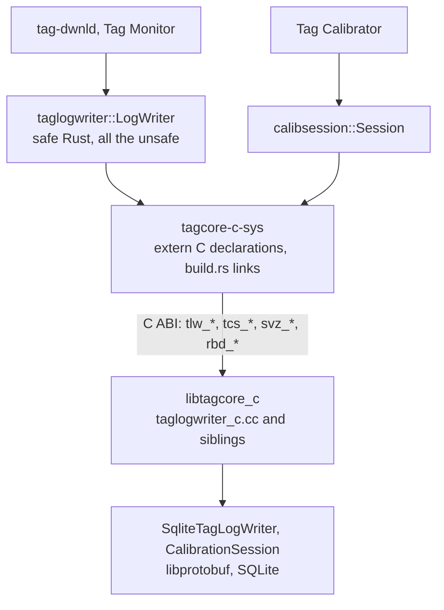
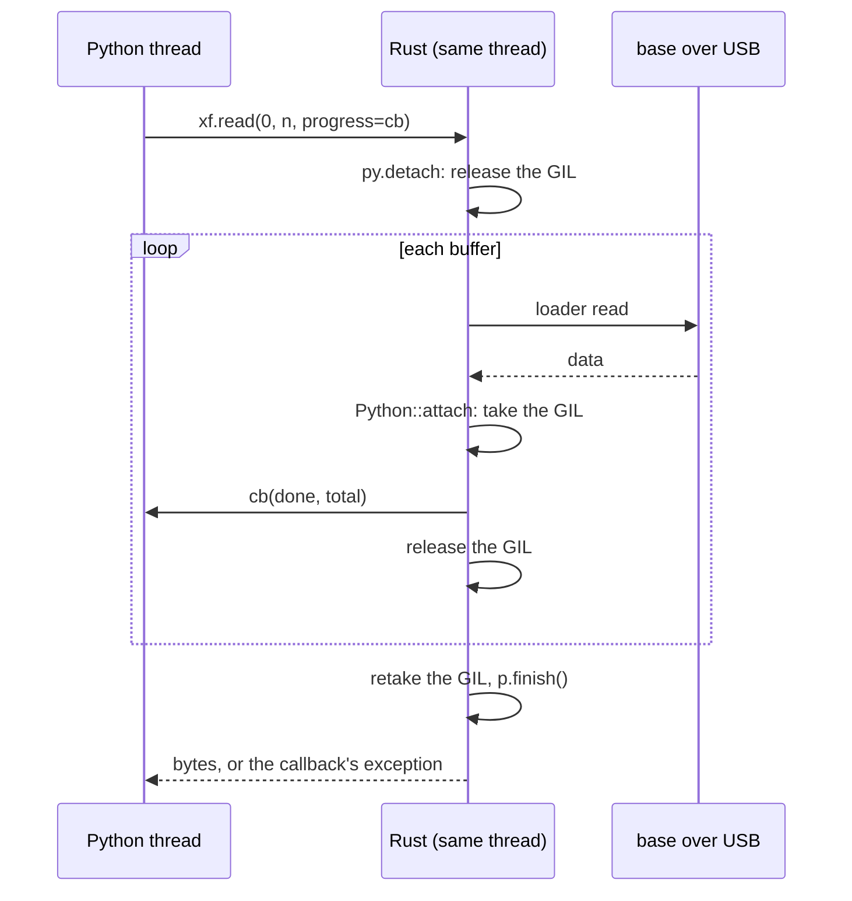

# 8. The bridges: C++ through tagcore_c, and Python through PyO3

The Rust tools do not reimplement the SQLite log writer or the
magnetometer calibration: they call your C++ through a small C interface,
`tagcore_c`. And the Rust recovery library is in turn offered to Python
scripts as a native extension module. This chapter reads both bridges: the
C shims in [`tagcore-c`](../../libraries/tagcore-c/), the raw declarations
and link logic in [`tagcore-c-sys`](../../libraries/tagcore-c-sys/), the
safe wrappers [`taglogwriter-rs`](../../libraries/taglogwriter-rs/) and
[`calibsession-rs`](../../libraries/calibsession-rs/), and the PyO3 binding
[`host/python/tagcore-py`](../../python/tagcore-py/).

After reading it you should be able to follow `LogWriter::write_log(&ack)`
from a Rust `Ack` to `SqliteTagLogWriter::writeLog` and back, say exactly
what each `unsafe` block promises and why the promise holds, explain how a
Rust binary finds `libtagcore_c` at run time on each platform, and follow a
Python `xf.read(0, n, progress=cb)` through the GIL release and back into
the callback.

The architecture and the build matrix are in
[chapter 8 of the guide](../guide/08-cpp-bridge.md); the design, with what
a maintainer must keep in step, is in
[tagcore_c's design](../../libraries/tagcore-c/design/architecture.md).
This chapter reads the code.

## The shape of the C++ bridge



Three rules hold the design together, and the code below is their
implementation:

- **Only C crosses.** No C++ type, exception or `std::string` reaches
  Rust. The shim catches every exception and turns it into a return code
  and a message.
- **Messages cross as protobuf wire bytes.** Rust encodes a `Config` or an
  `Ack` with prost's `encode_to_vec()`; the shim parses it with
  `ParseFromArray`. Neither side interprets the other's structures, and the
  database written is byte for byte the one the C++ `tag-dwnld` writes.
- **Each handle is owned by exactly one Rust value**, which frees it in its
  destructor.

## What `unsafe` means, precisely

Every call into C in this chapter sits inside an `unsafe { ... }` block,
so it is worth being exact about what the keyword does, because it is not
"turn the checks off".

Inside an `unsafe` block the compiler checks everything it always checks:
types, borrows, lifetimes, exhaustive matches. What the block adds is
permission for a short list of operations the compiler cannot verify:
calling an `unsafe fn`, dereferencing a raw pointer (`*const T`,
`*mut T`), touching a `static mut`, and reading a `union` field. This code
uses only the first: every function declared in an `extern "C"` block is
an `unsafe fn`, because the compiler cannot see the C side's
preconditions, and so is `CStr::from_ptr`, which dereferences a raw
pointer on the caller's word that it is valid. No code here dereferences
a raw pointer itself; pointers are only passed to C.

One more construct carries the keyword without a block: `unsafe impl Send
for LogWriter {}`. `Send` is an `unsafe trait`, one whose promise ("a
value of this type may move to another thread") the compiler cannot check
for a type holding a raw pointer, so implementing it is an assertion the
author signs.

Calling C from C is what you have always done; what Rust adds
is that the rest of the program is *proved* free of use-after-free, double
free, data races and out-of-bounds access, and that proof is only as good
as the `unsafe` blocks it rests on. If the C side is called with a dangling
pointer, the whole program's guarantee is void, not just that call.

So each block carries a `// SAFETY:` comment whose job is to state the
preconditions of the operation and argue that each holds at that point:
the pointer is live and non-null, the buffer is as long as the length
passed, the string is NUL-terminated, the C side keeps no pointer after
the call, the handle is used from one thread at a time. That is the
standard Rust convention (Clippy has an optional lint that requires it;
this workspace does not turn the lint on, so here it is a habit, kept
everywhere). Each wrapper crate also has a "Safety model" section in its
crate doc listing the few rules every comment appeals to, so the comments
can be short.

## The C side: `tagcore_c`

### The header

[`taglogwriter_c.h`](../../libraries/tagcore-c/taglogwriter_c.h) is an
ordinary C header with three things a Rust caller relies on. The handle is
opaque, [taglogwriter_c.h:85](../../libraries/tagcore-c/taglogwriter_c.h#L85):

```c
typedef struct tlw_writer tlw_writer;
```

The interface carries a version, [taglogwriter_c.h:79](../../libraries/tagcore-c/taglogwriter_c.h#L79):

```c
#define TLW_ABI_VERSION 1u
```

and every message argument is a byte buffer and a length,
[taglogwriter_c.h:139](../../libraries/tagcore-c/taglogwriter_c.h#L139):

```c
TLW_API tlw_writer *tlw_open(const char *path, const uint8_t *config,
                             size_t config_len, int replace_existing);
```

The Doxygen above `tlw_open` is the contract the Rust wrapper is written
against: "A handle, which the caller must pass to tlw_close() whatever
happens. Check tlw_is_open() ... NULL only when memory runs out." And
above `tlw_last_error`: the string is "Owned by the handle and valid until
the next call on it or tlw_close()". Hold those two sentences; the Rust
code below is built around them.

`TLW_API` marks the exports. The library is built with hidden visibility
and an export list (`exports.macos` holds `_tlw_* _tcs_* _svz_* _rbd_*`,
`exports.linux` a version script with the same globals), so its private
libprotobuf, abseil and SQLite cannot collide with a caller's.

### The shim

[`taglogwriter_c.cc`](../../libraries/tagcore-c/taglogwriter_c.cc) gives
the opaque struct its body, [taglogwriter_c.cc:32](../../libraries/tagcore-c/taglogwriter_c.cc#L32):

```cpp
struct tlw_writer {
    std::unique_ptr<SqliteTagLogWriter> writer; ///< Null if tlw_open() failed before construction.
    TagLogHeader header;                        ///< Parts from tlw_header_add(), written by tlw_write_header().
    bool has_info = false;                      ///< A TLW_INFO part was added.
    std::string error;                          ///< Returned by tlw_last_error().
};
```

and wraps every entry point in one template,
[taglogwriter_c.cc:72](../../libraries/tagcore-c/taglogwriter_c.cc#L72):

```cpp
template <typename Body>
int guarded(tlw_writer *w, int failed_value, Body body)
{
    if (w == nullptr) {
        return failed_value;
    }
    if (!w->writer) {
        // Keep the error from tlw_open(); it says why there is no writer.
        return failed_value;
    }
    try {
        return body();
    } catch (const std::exception &e) {
        fail(w, std::string("C++ exception: ") + e.what());
    } catch (...) {
        fail(w, "C++ exception");
    }
    return failed_value;
}
```

That `try` is the most important line in the bridge. A C++ exception
unwinding out of a function Rust called through `extern "C"` is not
something Rust can catch: the process aborts. So no exception may leave
the shim, and every function body is a lambda passed to `guarded`, for
example [taglogwriter_c.cc:215](../../libraries/tagcore-c/taglogwriter_c.cc#L215):

```cpp
int tlw_write_log(tlw_writer *w, const uint8_t *ack, size_t len)
{
    return guarded(w, -1, [&] {
        Ack message;
        if (!parse(message, ack, len)) {
            fail(w, "Ack does not parse");
            return -1;
        }
        const int consumed = w->writer->writeLog(message);
        if (consumed < 0) {
            failFromWriter(w);
        }
        return consumed;
    });
}
```

The Rust bytes become an `Ack` by `ParseFromArray` (inside the local
`parse` helper), and the existing `SqliteTagLogWriter::writeLog` does the
rest. Nothing here knows a log format. `tlw_open` cannot use `guarded`
because there is no handle yet; it allocates with `new (std::nothrow)` and
has its own `try`, and on failure still returns the handle, closed, so
that `tlw_last_error` can say why.

The other shims follow the same pattern: `calibsession_c.cc` (`tcs_*`,
over sensoranalysis's Qt-free `CalibrationSession`), `sensorviz_c.cc`
(`svz_*`, over sensorViz's Qt-free core) and `rebuild_c.cc` (`rbd_*`, one
handle-less function that rebuilds a SQLite download from a `tag-capture`
directory).

## `tagcore-c-sys`: the declarations and the link

A crate named `*-sys` is the Rust convention for "raw bindings to a
native library, and the build logic that links it, with no safe API".
This one has two jobs: declare the C functions, and tell the linker where
the library is.

### One crate may link the library

[tagcore-c-sys/Cargo.toml:9](../../libraries/tagcore-c-sys/Cargo.toml#L9):

```toml
[package]
name = "tagcore-c-sys"
version = "0.1.0"
edition = "2024"
description = "Links the tagcore_c C interface to the C++ host libraries"
publish = false
# Lets a dependent's build script read DEP_TAGCORE_C_LIB_DIR, to set an rpath.
# Only one crate in a build may declare this.
links = "tagcore_c"
```

`links = "tagcore_c"` tells Cargo that this package links the native
library `tagcore_c`. Cargo then enforces that only one package in any
build does so (two copies of the link directives would be an error), and
it opens a channel from this package's build script to its direct
dependents' build scripts, used below for the run-time path. That is why
the three safe wrappers do not link the library themselves: they all
depend on this crate, so a program may use any of them together.

There is no `bindgen` (which would generate the declarations from the
header) and no `cc` or `cmake` crate (which would build C from Cargo):
CMake builds the library, Cargo only links it, and the declarations are
written by hand. The `taglogwriter` crate doc gives the reason: "with a
dozen functions, `bindgen` would cost more than it saves".

[lib.rs:21](../../libraries/tagcore-c-sys/src/lib.rs#L21):

```rust
#![no_std]

pub mod rbd;
pub mod svz;
pub mod tcs;
pub mod tlw;
```

> **Rust:** `#![no_std]` declares that the crate uses only `core`, the part
> of the standard library that needs no operating system. It is possible
> here because the crate only names C types (`core::ffi::c_char`,
> `c_int`, `c_uint`); it allocates nothing and does no I/O. The inner
> attribute `#![...]` applies to the whole crate.

### Declaring C in Rust

[tlw.rs:7](../../libraries/tagcore-c-sys/src/tlw.rs#L7) (some
declarations omitted):

```rust
use core::ffi::{c_char, c_int};

/// The opaque C handle, `struct tlw_writer`.
#[repr(C)]
pub struct TlwWriter {
    /// Makes the type unconstructible and unsized-like in Rust.
    _private: [u8; 0],
}

/// `TLW_ABI_VERSION` from the header this crate was written against.
pub const TLW_ABI_VERSION: u32 = 1;
/// `TLW_CONFIG`: a Config header part.
pub const TLW_CONFIG: c_int = 1;
// ...

unsafe extern "C" {
    /// The interface version the library was built with.
    pub fn tlw_abi_version() -> u32;
    /// Logs at DEBUG when nonzero, errors only otherwise.
    pub fn tlw_set_debug(enabled: c_int);
    /// Creates a log; returns a handle (closed on failure) or null on
    /// out-of-memory.
    pub fn tlw_open(
        path: *const c_char,
        config: *const u8,
        config_len: usize,
        replace_existing: c_int,
    ) -> *mut TlwWriter;
    // ...
    /// Writes one page; records consumed, 0 at end, negative on error.
    pub fn tlw_write_log(w: *mut TlwWriter, ack: *const u8, len: usize) -> c_int;
    // ...
    /// The last error on `w`, valid until the next call on it.
    pub fn tlw_last_error(w: *const TlwWriter) -> *const c_char;
    /// Closes and frees `w`.
    pub fn tlw_close(w: *mut TlwWriter);
}
```

Read it as the header transliterated:

| C | Rust |
| --- | --- |
| `const char *` | `*const c_char` |
| `const uint8_t *`, `size_t` | `*const u8`, `usize` |
| `tlw_writer *` / `const tlw_writer *` | `*mut TlwWriter` / `*const TlwWriter` |
| `int`, `uint32_t` | `c_int`, `u32` |
| `typedef enum { TLW_CONFIG = 1, ... }` | `pub const TLW_CONFIG: c_int = 1;` |
| `typedef struct tlw_writer tlw_writer;` | a `#[repr(C)]` struct with a zero-length private field |

> **Rust:** the opaque-handle idiom. A struct whose only field is a private
> zero-length array cannot be constructed outside this module and has no
> meaningful size to copy, so Rust code can hold a `*mut TlwWriter` but
> never a `TlwWriter`: exactly the C incomplete type. `#[repr(C)]` asks for
> C layout, which matters for the real structs in `tcs.rs`.

> **Rust:** the C enum becomes plain integer constants, not a Rust `enum`.
> A Rust enum may only ever hold one of its declared values; if C handed
> back any other integer, a Rust enum holding it would be undefined
> behaviour. An integer constant has no such trap.

> **Rust:** `unsafe extern "C" { ... }` declares foreign functions with the
> C calling convention, like a header's prototypes. Edition 2024 requires
> the `unsafe` on the block, as a reminder that the declarations
> themselves are trusted, unchecked claims about the library: a wrong
> parameter type here is not a compile error anywhere. Every function
> declared in it is an `unsafe fn` to call.

`tcs.rs` adds the structures the calibration interface fills in, each a
field-for-field mirror of the header's struct,
[tcs.rs:19](../../libraries/tagcore-c-sys/src/tcs.rs#L19) (abridged):

```rust
/// `tcs_quality`: MagQuality's figures.
#[repr(C)]
#[derive(Default)]
pub struct TcsQuality {
    /// Occupied magnetometer patches.
    pub patches_seen: c_int,
    /// Patches available.
    pub mag_patches: c_int,
    /// patches_seen / mag_patches.
    pub coverage: f32,
    // ...
```

Here `#[repr(C)]` is essential: without it Rust may reorder fields, and
the C side would write `coverage` into the wrong bytes. `#[derive(Default)]`
gives a zeroed value to pass as an out-parameter. `rbd.rs` is the smallest
module, one function with a caller-supplied error buffer,
[rbd.rs:12](../../libraries/tagcore-c-sys/src/rbd.rs#L12):

```rust
unsafe extern "C" {
    /// The interface version the library was built with.
    pub fn rbd_abi_version() -> c_uint;
    /// Rebuilds a SQLite download from a tag-capture directory; 1 when the
    /// file was written, 0 otherwise with `error` saying why.
    pub fn rbd_rebuild(
        capture_dir: *const c_char,
        db_path: *const c_char,
        records: *mut u32,
        error: *mut c_char,
        error_len: usize,
    ) -> c_int;
}
```

### The build script: link directives

[Chapter 1](01-workspace-and-build.md#build-scripts) introduced build
scripts and quoted the start of this one; here it is whole.
[build.rs:33](../../libraries/tagcore-c-sys/build.rs#L33):

```rust
fn main() {
    println!("cargo:rerun-if-env-changed=TAGCORE_C_LIB_DIR");
    println!("cargo:rerun-if-env-changed=TAGCORE_C_LINK");
    let Some(dir) = env::var_os("TAGCORE_C_LIB_DIR").map(PathBuf::from) else {
        panic!(
            "TAGCORE_C_LIB_DIR is not set. Build the C library with CMake \
             (-DBUILD_TAGCORE_C=ON, target tagcore_c or tagcore_c_static) and set \
             TAGCORE_C_LIB_DIR to the directory holding it, e.g. <build>/Release/lib."
        );
    };
    if !dir.is_dir() {
        panic!("TAGCORE_C_LIB_DIR={} is not a directory", dir.display());
    }
    let os = env::var("CARGO_CFG_TARGET_OS").unwrap_or_default();

    // Static on macOS (one bundle per app), shared elsewhere (one shared
    // install directory for every tool).
    let default_link = if os == "macos" { "static" } else { "dylib" };
    let link = env::var("TAGCORE_C_LINK").unwrap_or_else(|_| default_link.into());
```

A `panic!` in a build script fails the build with its message, so a
missing `TAGCORE_C_LIB_DIR` gives instructions rather than a linker error.
The target OS is read from `CARGO_CFG_TARGET_OS` rather than tested with
`#[cfg(target_os = ...)]`, because a build script runs on the *host*: a
`cfg` in it describes the machine doing the build, the variable describes
the machine the program is for.

Then the two link styles, [build.rs:52](../../libraries/tagcore-c-sys/build.rs#L52):

```rust
    match link.as_str() {
        "static" => {
            let archive = dir.join("libtagcore_c.a");
            println!("cargo:rerun-if-changed={}", archive.display());
            // Searched from a copy alone in OUT_DIR: given `-ltagcore_c` in a
            // directory that also holds libtagcore_c.dylib, the macOS linker
            // takes the dylib, which is what this crate's own test binary got.
            let out = PathBuf::from(env::var_os("OUT_DIR").expect("OUT_DIR"));
            std::fs::copy(&archive, out.join("libtagcore_c.a")).unwrap_or_else(|e| {
                panic!("{}: {e}; build target tagcore_c_static", archive.display())
            });
            println!("cargo:rustc-link-search=native={}", out.display());
            println!("cargo:rustc-link-lib=static=tagcore_c");
            match os.as_str() {
                "macos" => {
                    println!("cargo:rustc-link-lib=dylib=c++");
                    println!("cargo:rustc-link-lib=dylib=objc");
                    for framework in ["CoreFoundation", "IOKit", "Security"] {
                        println!("cargo:rustc-link-lib=framework={framework}");
                    }
                }
                "linux" => {
                    println!("cargo:rustc-link-lib=dylib=stdc++");
                    println!("cargo:rustc-link-lib=dylib=udev");
                }
                _ => {}
            }
        }
        "dylib" => {
            println!("cargo:rustc-link-search=native={}", dir.display());
            println!("cargo:rustc-link-lib=dylib=tagcore_c");
            // Read by dependents as DEP_TAGCORE_C_LIB_DIR.
            println!("cargo:lib_dir={}", dir.display());
            // This crate's own tests and examples find the library here.
            if os != "windows" {
                println!("cargo:rustc-link-arg=-Wl,-rpath,{}", dir.display());
            }
        }
        other => panic!("TAGCORE_C_LINK={other}: expected static or dylib"),
    }
}
```

The directives map onto linker flags you know:

| Directive | Means |
| --- | --- |
| `rustc-link-search=native=DIR` | `-L DIR` |
| `rustc-link-lib=static=tagcore_c`, `dylib=c++`, `framework=IOKit` | `-ltagcore_c` (archive), `-lc++`, `-framework IOKit` |
| `rustc-link-arg=...` | a raw linker argument, for this package's own test and example binaries |
| `rerun-if-changed`, `rerun-if-env-changed` | rerun the script when the file or variable changes |
| `lib_dir=DIR` (any key not known to Cargo) | metadata, passed to direct dependents as `DEP_TAGCORE_C_LIB_DIR` because of `links = "tagcore_c"` |

The platform split follows packaging (the owner's decision, recorded in
[guide chapter 8](../guide/08-cpp-bridge.md#building-and-linking-it)):
on macOS each application is its own bundle, so the static archive goes
into every executable, which then also needs the C++ runtime and the
frameworks libusb uses (the writer's `writeHeader(Tag &)` pulls the C++
`tagcore` link layer, and with it libusb, into the archive, although that
code is never called).
On Linux and Windows one shared library in the install directory serves
every tool.

### The rpath: only the final binary can set it

A shared `libtagcore_c.so` must be found at run time, which on Linux means
an rpath in the executable. But a `rustc-link-arg` from a build script
applies only to the binaries of *the package whose build script printed
it*. `tagcore-c-sys` cannot give `tag-dwnld` an rpath; `tag-dwnld`'s own
package must. That is what `lib_dir` is for. The wrapper crates set it for
their own test binaries, [taglogwriter-rs/build.rs:14](../../libraries/taglogwriter-rs/build.rs#L14):

```rust
fn main() {
    if let Ok(dir) = env::var("DEP_TAGCORE_C_LIB_DIR")
        && env::var("CARGO_CFG_TARGET_OS").as_deref() != Ok("windows")
    {
        println!("cargo:rustc-link-arg=-Wl,-rpath,{dir}");
    }
}
```

and the command-line tools for theirs,
[commandline-rs/build.rs:24](../../commandline-rs/build.rs#L24):

```rust
fn main() {
    println!("cargo:rerun-if-env-changed=TAGCORE_C_RPATH");
    // DEP_TAGCORE_C_LIB_DIR is present only for a shared link.
    let Ok(lib_dir) = env::var("DEP_TAGCORE_C_LIB_DIR") else {
        return;
    };
    if env::var("CARGO_CFG_TARGET_OS").as_deref() == Ok("windows") {
        return;
    }
    let dir = env::var("TAGCORE_C_RPATH").unwrap_or(lib_dir);
    println!("cargo:rustc-link-arg-bins=-Wl,-rpath,{dir}");
}
```

`DEP_TAGCORE_C_LIB_DIR` reaches only *direct* dependents of
`tagcore-c-sys`, which is why `commandline-rs/Cargo.toml` names
`tagcore-c-sys` as an optional dependency it never calls ("Named directly
only so build.rs receives DEP_TAGCORE_C_LIB_DIR for the rpath"). The CMake
build sets `TAGCORE_C_RPATH=$ORIGIN/../lib:$ORIGIN/../../lib` for the tools
(one entry for `bin/`, one for `bin/internal/`), which is where the package
installs the library; a plain cargo build falls back to the directory the
library was linked from. On Windows
there is no rpath and the DLL sits beside the executables.

> **Rust:** `if let Ok(dir) = ... && ... { }` is a *let chain* (stable
> since Rust 1.88, edition 2024): a pattern match and a boolean condition
> in one `if`, with `dir` bound for the body. `.as_deref()` turns the
> `Result<String, _>` from `env::var` into a `Result<&str, _>` that borrows
> it, so it can be compared with `Ok("windows")` without allocating.

## `taglogwriter`: the safe wrapper

[`taglogwriter-rs/src/lib.rs`](../../libraries/taglogwriter-rs/src/lib.rs)
turns the dozen `tlw_*` functions into one Rust type whose methods cannot
be misused. Its crate doc states the safety model all its `unsafe` blocks
appeal to, [lib.rs:51](../../libraries/taglogwriter-rs/src/lib.rs#L51):

```rust
//! All `unsafe` is in this file, and every call states why it is sound. Three
//! rules carry the whole argument:
//!
//! - **Ownership.** A [`LogWriter`] owns exactly one C handle, never null,
//!   closed exactly once in `Drop`. Nothing else holds the pointer.
//! - **Borrowed buffers.** Every pointer passed in (a path, an encoded
//!   message, an info string) points at Rust memory that lives until the call
//!   returns. The library copies what it keeps and holds no pointer after the
//!   call.
//! - **Returned strings.** `tlw_last_error()` returns memory owned by the
//!   handle, valid only until the next call on it, so it is copied out at
//!   once, by the private `LogWriter::last_error`, which is why it is not
//!   public.
//!
//! A handle may move between threads but must not be used from two at once:
//! `LogWriter` is `Send` and not `Sync`, and every writing method takes
//! `&mut self`.
```

### The handle, `Send` and not `Sync`

[lib.rs:156](../../libraries/taglogwriter-rs/src/lib.rs#L156):

```rust
pub struct LogWriter {
    /// The C handle; never null, and owned: closed exactly once, in `Drop`.
    raw: NonNull<ffi::TlwWriter>,
}

// SAFETY: the C handle carries no thread affinity (no thread-local state, no
// thread-bound SQLite connection mode); it requires only that one thread use
// it at a time, which `&mut self` on every writing call guarantees. It is
// not `Sync`.
unsafe impl Send for LogWriter {}
```

> **Rust:** `NonNull<T>` is a raw pointer the type system knows is not
> null. It is still raw (no lifetime, no ownership semantics of its own),
> but the null case is ruled out once, at construction, instead of being
> checked or forgotten at every use.

The two marker traits deserve a careful reading, because they are how the
C side's threading rule ("use each handle from one thread at a time")
becomes a compile-time rule.

- `Send`: a value of this type may be *moved* to another thread.
- `Sync`: a *shared reference* `&T` may be used from several threads at
  once.

The compiler derives both automatically from a type's fields, and a raw
pointer is neither, so `LogWriter` starts out as neither. The author opts
back into `Send` only, with an `unsafe impl` whose SAFETY comment argues
the C object has no thread affinity. It stays not-`Sync`. Now combine that
with the method signatures: every method that writes takes `&mut self`, and
the borrow checker allows only one `&mut` at a time; the private `&self`
helpers (`check`, `last_error`) cannot be reached from a second thread
either, since without `Sync` no `&LogWriter` can be shared. A `LogWriter`
can be created on, or moved to, a worker thread (Tag Monitor's download
runs on its tag thread and creates its writer there), but no two threads
can ever call it concurrently, and no mutex is needed. In C++ the same rule lives in a `@note` and in the reviewer's
head.

### Creating it

[lib.rs:176](../../libraries/taglogwriter-rs/src/lib.rs#L176):

```rust
    pub fn create(path: &Path, config: &Config, replace: bool) -> Result<Self, WriterError> {
        // SAFETY: no arguments, no preconditions.
        let version = unsafe { ffi::tlw_abi_version() };
        if version != ffi::TLW_ABI_VERSION {
            return Err(WriterError(format!(
                "libtagcore_c has interface version {version}; this program needs {}",
                ffi::TLW_ABI_VERSION
            )));
        }
        let path = path
            .to_str()
            .ok_or_else(|| WriterError(format!("Path is not UTF-8: {}", path.display())))?;
        let path = CString::new(path)
            .map_err(|_| WriterError(format!("Path contains a NUL byte: {path}")))?;
        let config = config.encode_to_vec();
        // SAFETY: `path` is a NUL-terminated string and `config` a buffer of
        // `config.len()` bytes, both live for the call; the library copies
        // what it keeps.
        let raw = unsafe {
            ffi::tlw_open(
                path.as_ptr(),
                config.as_ptr(),
                config.len(),
                c_int::from(replace),
            )
        };
        let raw = NonNull::new(raw).ok_or_else(|| WriterError("Out of memory".into()))?;
        let writer = Self { raw };
        // SAFETY: `raw` is a live handle from tlw_open().
        if unsafe { ffi::tlw_is_open(writer.raw.as_ptr()) } == 0 {
            return Err(writer.last_error());
        }
        Ok(writer)
    }
```

Walk it against the header's contract.

1. The ABI version is compared first, so a library built from a different
   header fails with a sentence instead of misbehaving.
2. The path goes from `&Path` to `&str` (UTF-8 required) to `CString`.
3. The `Config` is encoded to wire bytes in a `Vec<u8>` named `config`,
   which lives to the end of the function, past the call.
4. `NonNull::new` returns `None` for a null pointer, which the header says
   means out of memory.
5. **The handle is wrapped in `Self` before `tlw_is_open` is checked.** If
   the open failed, `return Err(writer.last_error())` copies the message
   and then drops `writer`, whose destructor calls `tlw_close`. The
   header's "must pass to tlw_close() whatever happens" is kept by RAII,
   on every path, with no `goto cleanup`.

> **Rust:** `CString::new(s)` copies a string into an owned buffer with a
> terminating NUL, and fails if `s` contains an interior NUL (which C
> would silently truncate at). `path.as_ptr()` borrows that buffer as a
> `*const c_char` for as long as `path` lives. The classic bug is
> `CString::new(x).unwrap().as_ptr()` as one expression: the temporary
> `CString` is freed at the end of the statement and the pointer dangles.
> Binding it to a named local, as here, is the fix.

> **Rust:** `let path = ...; let path = ...;` is *shadowing*: each `let`
> makes a new variable, here of a new type each time (`&Path`, `&str`,
> `CString`), and the old name is no longer reachable. It is idiomatic for
> successive conversions of one value. `c_int::from(replace)` converts a
> `bool` to 0 or 1.

### Returned strings are copied at once

[lib.rs:323](../../libraries/taglogwriter-rs/src/lib.rs#L323):

```rust
    fn last_error(&self) -> WriterError {
        // SAFETY: `raw` is a live handle; the returned string is
        // NUL-terminated and valid until the next call on the handle, and is
        // copied before then.
        let text = unsafe { CStr::from_ptr(ffi::tlw_last_error(self.raw.as_ptr())) };
        let text = text.to_string_lossy();
        WriterError(if text.is_empty() {
            "The log writer failed without saying why".into()
        } else {
            text.into_owned()
        })
    }
```

> **Rust:** `CStr::from_ptr` wraps a `const char *` as a borrowed view
> (it runs `strlen`), the `std::string_view` of C strings. It is `unsafe`
> because the compiler cannot know the pointer is valid or terminated;
> the SAFETY comment cites the header for both. `to_string_lossy()` gives a
> `Cow<str>`, borrowed when the bytes are valid UTF-8 and an owned copy
> with replacement characters otherwise; `into_owned()` makes sure the
> result is an owned `String` before the next call can invalidate the C
> buffer.

The method is private on purpose: a public accessor would hand out text
whose validity ends at the next call, which is the one thing the safety
model forbids.

### Writing a page

[lib.rs:276](../../libraries/taglogwriter-rs/src/lib.rs#L276):

```rust
    pub fn write_log(&mut self, ack: &Ack) -> Result<usize, WriterError> {
        let bytes = ack.encode_to_vec();
        // SAFETY: `bytes` is a buffer of `bytes.len()` bytes, live for the
        // call; `raw` is a live handle, used from this thread only.
        let consumed =
            unsafe { ffi::tlw_write_log(self.raw.as_ptr(), bytes.as_ptr(), bytes.len()) };
        usize::try_from(consumed).map_err(|_| self.last_error())
    }
```

The download loop of [chapter 5](05-protobuf-and-the-tag-api.md) calls
this once per page: the `Ack` the tag returned is re-encoded, handed over,
and the C++ writer decides how many records it consumed.

> **Rust:** `usize::try_from(consumed)` converts the C `int` to an unsigned
> size and fails exactly when it is negative, which is the header's error
> convention. One line maps "negative means error" onto `Result`.

Header parts go through one generic helper, [lib.rs:300](../../libraries/taglogwriter-rs/src/lib.rs#L300):

```rust
    fn add_part(&mut self, kind: c_int, message: &impl Message) -> Result<(), WriterError> {
        let bytes = message.encode_to_vec();
        // SAFETY: `bytes` is a buffer of `bytes.len()` bytes, live for the
        // call; `raw` is a live handle, used from this thread only.
        self.check(unsafe {
            ffi::tlw_header_add(self.raw.as_ptr(), kind, bytes.as_ptr(), bytes.len())
        })
    }
```

> **Rust:** `&impl Message` accepts a reference to any type implementing
> prost's `Message` trait (`Config`, `TagInfo`, `CalibrationConstants`,
> `State`). It is a generic parameter, compiled once per message type like
> a template, not a virtual call.

### Closing

[lib.rs:337](../../libraries/taglogwriter-rs/src/lib.rs#L337):

```rust
impl Drop for LogWriter {
    fn drop(&mut self) {
        // SAFETY: `raw` came from tlw_open() and is closed only here.
        unsafe { ffi::tlw_close(self.raw.as_ptr()) }
    }
}
```

`Drop` is the destructor. Because `LogWriter` has no `Clone` and no other
way to duplicate `raw`, "closed only here" is true by construction: each
handle is closed exactly once, whether the download finished, returned an
error part way, or panicked.

### A handle-less call with a caller's buffer

`rebuild_from_capture` is the other shape a C interface takes: no handle,
an out-parameter and a caller-owned error buffer,
[lib.rs:383](../../libraries/taglogwriter-rs/src/lib.rs#L383):

```rust
    let mut records = 0u32;
    let mut error = [0 as c_char; REBUILD_ERROR_LEN];
    // SAFETY: `dir` and `db` are NUL-terminated strings, `records` a u32 and
    // `error` a buffer of `error.len()` bytes, all live for the call; the
    // library keeps no pointer after it returns and always NUL-terminates
    // `error` within its length.
    let ok = unsafe {
        rbd::rbd_rebuild(dir.as_ptr(), db.as_ptr(), &mut records, error.as_mut_ptr(), error.len())
    };
    if ok != 0 {
        return Ok(records);
    }
    // SAFETY: the library NUL-terminated `error` within its length (it was
    // zeroed beforehand as well), and it lives for this borrow.
    let message = unsafe { CStr::from_ptr(error.as_ptr()) }.to_string_lossy().into_owned();
    Err(WriterError(if message.is_empty() { "rebuild failed".into() } else { message }))
```

> **Rust:** `&mut records` is passed where the declaration wants a
> `*mut u32`: a reference converts to a raw pointer implicitly (the
> reverse never does). `[0 as c_char; REBUILD_ERROR_LEN]` is a zeroed
> 1024-byte array on the stack, `char error[1024] = {0}`.
> `error.as_mut_ptr()` and `error.len()` are the pointer and length pair.

It checks `RBD_ABI_VERSION` at the top of every call, the same way
`create` checks `TLW_ABI_VERSION`.

## `calibsession`: the same pattern, more types

[`calibsession-rs/src/lib.rs`](../../libraries/calibsession-rs/src/lib.rs)
wraps the `tcs_*` interface for Tag Calibrator. The handle and its thread
rule are as for the writer, [lib.rs:224](../../libraries/calibsession-rs/src/lib.rs#L224):

```rust
pub struct Session {
    /// The C handle; never null, freed in `Drop`.
    ptr: NonNull<ffi::TcsSession>,
}

// SAFETY: the handle owns its memory and has no thread affinity; the C
// interface only forbids concurrent use, which `!Sync` and `&mut self`
// already prevent.
unsafe impl Send for Session {}
```

Its error type is an enum with data, [lib.rs:72](../../libraries/calibsession-rs/src/lib.rs#L72):

```rust
pub enum SessionError {
    /// The library was built from another version of `calibsession_c.h`.
    AbiMismatch {
        /// The version this crate expects.
        expected: u32,
        /// The version the library reports.
        found: u32,
    },
    /// The library could not allocate a session.
    OutOfMemory,
}
```

used by the constructor, [lib.rs:242](../../libraries/calibsession-rs/src/lib.rs#L242):

```rust
    pub fn new() -> Result<Session, SessionError> {
        // SAFETY: takes nothing, returns a constant.
        let found = unsafe { ffi::tcs_abi_version() };
        if found != ffi::TCS_ABI_VERSION {
            return Err(SessionError::AbiMismatch {
                expected: ffi::TCS_ABI_VERSION,
                found,
            });
        }
        // SAFETY: takes nothing; returns an owned handle or null.
        let ptr = NonNull::new(unsafe { ffi::tcs_new() }).ok_or(SessionError::OutOfMemory)?;
        Ok(Session { ptr })
    }
```

Three things are new compared with the writer.

**An `Option` across C.** C has no optional array, so the header takes a
flag and a pointer, [lib.rs:267](../../libraries/calibsession-rs/src/lib.rs#L267):

```rust
    pub fn add_sample(&mut self, mag: [f32; 3], accel: Option<[f32; 3]>) -> bool {
        let a = accel.unwrap_or_default();
        // SAFETY: a live handle; both arrays hold three floats and outlive
        // the call.
        unsafe {
            ffi::tcs_add_sample(
                self.ptr.as_ptr(),
                mag.as_ptr(),
                accel.is_some().into(),
                a.as_ptr(),
            ) != 0
        }
    }
```

`a` is three zeros when there is no accelerometer reading, so the pointer
passed is always valid even though the C side ignores it.

**Out-structs.** The Rust API returns plain Rust values, and the `#[repr(C)]`
mirrors stay inside the wrapper, [lib.rs:358](../../libraries/calibsession-rs/src/lib.rs#L358)
(abridged):

```rust
    pub fn quality(&self) -> Quality {
        let mut q = ffi::TcsQuality::default();
        // SAFETY: a live handle; `q` is a repr(C) mirror of tcs_quality.
        unsafe { ffi::tcs_get_quality(self.ptr.as_ptr(), &mut q) };
        Quality {
            patches_seen: q.patches_seen,
            mag_patches: q.mag_patches,
            coverage: q.coverage,
            // ...
            have_accel_metrics: q.have_accel_metrics != 0,
            samples: q.samples,
        }
    }
```

The field-by-field copy is where C's `int` flags become `bool`, so no
caller ever sees a C type.

**`&self` mirrors `const`.** Methods over C functions that take
`const tcs_session *` (`has_calibration`, `calibrate`, `points`,
`quality`) take `&self`; those over `tcs_session *` (`clear`, `add_sample`,
`update_quality`) take `&mut self`. The Rust receiver is the C `const`,
enforced. And because `Session` is not `Sync`, even the `&self` calls
cannot happen on two threads at once. One more slice idiom appears in
`points`, [lib.rs:297](../../libraries/calibsession-rs/src/lib.rs#L297):

```rust
    pub fn points(&self) -> Vec<[f32; 3]> {
        let mut xyz = vec![0.0f32; 3 * SLOTS];
        // SAFETY: a live handle; `xyz` has room for SLOTS points, and the
        // library writes at most `max` of them.
        let n = unsafe { ffi::tcs_points(self.ptr.as_ptr(), xyz.as_mut_ptr(), SLOTS) }.min(SLOTS);
        xyz.as_chunks::<3>().0.iter().take(n).copied().collect()
    }
```

> **Rust:** the C side fills a flat `float[3 * 650]`; `as_chunks::<3>()`
> views it as a slice of `[f32; 3]` (plus a remainder, discarded by `.0`)
> without copying, and the iterator copies the first `n` points out. The
> `.min(SLOTS)` guards against a C return larger than the buffer before
> it is used as a count.

`calibsession` has a test that exercises the C++ through the bridge (so
does `sensorviz-session`, on its fixtures; `taglogwriter` has none). [`tests/replay.rs`](../../libraries/calibsession-rs/tests/replay.rs)
replays qtcalibrate's reference capture (775 samples) through a
`Session` and requires every figure qtcalibrate logged,
[replay.rs:58](../../libraries/calibsession-rs/tests/replay.rs#L58):

```rust
    // magquality: coverage 90/100 isotropy 0.722 attitude 2.06 (185 cells
    // over 90 patches) dip 63.54 +/- 2.70 deg (p95 5.99, 559 of 650 in gate)
    assert_eq!((q.patches_seen, q.mag_patches), (90, 100));
    assert_eq!(format!("{:.3}", q.isotropy), "0.722");
    assert_eq!(format!("{:.2}", q.attitude_diversity), "2.06");
```

It needs the library (`TAGCORE_C_LIB_DIR`) but no hardware.

## `sensorviz-session` and `rbd`, briefly

[`sensorviz-session-rs`](../../libraries/sensorviz-session-rs/src/lib.rs) is
the third wrapper, over `svz_*` in `sensorviz_c.h`, which wraps the
Qt-free `sensorviz::Session` the Qt sensorViz runs; Tag View uses it. The
safety model is the same (an owned handle freed in `Drop`, `Send` and not
`Sync`, borrowed buffers, returned strings copied before the next call),
with one difference in what crosses: descriptions (the catalog, the view
state, the plot spec, the parameters) cross as JSON text written by the C++
side and parsed with serde into Rust structs, while samples cross as
arrays. Its `Session::new` checks `SVZ_ABI_VERSION`. The fourth interface,
`rbd` (`rebuild_c.h`, `RBD_ABI_VERSION = 1`), has no wrapper crate of its
own: it is the `rebuild_from_capture` function read above, used by the Rust
`tag-rebuild`.

## The Python bridge: `tagcore-py`

The other direction: Python calling Rust. The recovery library of
[chapter 6](06-recovery.md) (`tagcore::recovery`: sessions that attach with
the core halted at the reset vector, loader sessions on external flash,
captures and the rescue erase) is offered to scripts as the Python package
`tagcore`.

**Library: PyO3** (0.30.1). Rust bindings to CPython's C API, plus macros
that generate the glue: `#[pymodule]` writes the module's `PyInit_`
function, `#[pyfunction]` and `#[pymethods]` write the argument parsing and
conversion for each function and method, `#[pyclass]` makes a Rust struct a
Python type. Conversions between Rust and Python values (`u32` and `int`,
`Vec<u8>` and `bytes`, `Option<T>` and `None`, `PathBuf` and `str` or
`os.PathLike`) are automatic for the types used here. The C-API equivalent
you would write by hand is `PyArg_ParseTupleAndKeywords`, a `PyTypeObject`
and reference counting; PyO3 generates all of it.

**Tool: maturin.** The Python build backend for PyO3 crates: it runs Cargo,
names the shared library as Python expects, and builds a wheel or installs
into a virtual environment (`maturin develop`).

### Packaging

[Cargo.toml:12](../../python/tagcore-py/Cargo.toml#L12):

```toml
[lib]
name = "_native"
crate-type = ["cdylib"]

[dependencies]
pyo3 = { version = "0.30", features = ["extension-module", "abi3-py39"] }
tagcore = { version = "0.1.0", path = "../../libraries/tagcore-rs" }

[build-dependencies]
pyo3-build-config = "0.30"
```

- `crate-type = ["cdylib"]` builds a C-ABI shared library, the `.so` that
  Python `dlopen`s, instead of a Rust library for other crates.
- `name = "_native"` names the shared library `_native` (on disk
  `_native.abi3.so`); Python imports a file of that name by calling
  `PyInit__native`, which the `#[pymodule] fn _native` below generates, so
  the two names must agree.
  [pyproject.toml](../../python/tagcore-py/pyproject.toml) places the module
  in the package as `tagcore._native` (`module-name = "tagcore._native"`,
  `python-source = "python"`), and the pure-Python files under
  `python/tagcore/` re-export it as `tagcore.swd` and `tagcore.recovery`.
- `extension-module` stops PyO3 linking libpython: the symbols resolve from
  the interpreter that imports the module. On macOS that needs
  `-undefined dynamic_lookup`, which the
  [build script](../../python/tagcore-py/build.rs) adds with one call,
  `pyo3_build_config::add_extension_module_link_args()`.
- `abi3-py39` builds against CPython's stable ABI, so one binary serves
  every CPython from 3.9 on.

`tagcore` links libusb statically (rusb's `vendored` feature), so the wheel
needs no other library. The crate is a workspace member but not part of the
CMake build.

### The module and its exception

[lib.rs:738](../../python/tagcore-py/src/lib.rs#L738):

```rust
#[pymodule]
fn _native(m: &Bound<'_, PyModule>) -> PyResult<()> {
    m.add("RecoveryError", m.py().get_type::<RecoveryError>())?;
    m.add_class::<PySession>()?;
    m.add_class::<PyExternalFlash>()?;
    m.add_function(wrap_pyfunction!(bases, m)?)?;
    m.add_function(wrap_pyfunction!(open, m)?)?;
    m.add_function(wrap_pyfunction!(capture, m)?)?;
    m.add_function(wrap_pyfunction!(rescue_erase_external, m)?)?;
    Ok(())
}
```

The exception is declared by a macro, [lib.rs:32](../../python/tagcore-py/src/lib.rs#L32):

```rust
create_exception!(
    _native,
    RecoveryError,
    PyException,
    "A recovery operation failed: no base, an attach that did not halt the \
     core, a loader that failed, or a refused rescue. The message says which."
);

/// Converts a recovery error message into a [`RecoveryError`].
fn err(msg: impl Into<String>) -> PyErr {
    RecoveryError::new_err(msg.into())
}
```

`create_exception!` defines a Python exception class `RecoveryError`
deriving from `Exception`. Errors cross the boundary as values: every
function returns `PyResult<T>` (that is, `Result<T, PyErr>`), and returning
`Err` raises in Python. `tagcore::recovery` reports failures as
`Result<_, String>`, so most calls end in `.map_err(err)`. Bad arguments
raise `ValueError` instead, [lib.rs:54](../../python/tagcore-py/src/lib.rs#L54):

```rust
fn parse_exit(exit: &str) -> PyResult<SwdExit> {
    match exit {
        "reset" => Ok(SwdExit::HardwareReset),
        "halted" => Ok(SwdExit::LeaveHalted),
        other => Err(PyValueError::new_err(format!(
            "exit must be \"reset\" or \"halted\", not {other:?}"
        ))),
    }
}
```

`python/tagcore/__init__.py` sets `RecoveryError.__module__ = "tagcore"`, so
Python reports it as `tagcore.RecoveryError`.

### A function with defaults

[lib.rs:559](../../python/tagcore-py/src/lib.rs#L559):

```rust
#[pyfunction]
#[pyo3(signature = (base=None, exit="reset"))]
fn open(py: Python<'_>, base: Option<&str>, exit: &str) -> PyResult<PySession> {
    let exit = parse_exit(exit)?;
    let dev = select_base(base)?;
    let mut s = Session::new();
    py.detach(|| s.open(&dev))
        .map_err(|e| err(format!("could not halt the tag at its reset vector: {e}")))?;
    Ok(PySession { inner: s, exit })
}
```

`#[pyo3(signature = ...)]` gives the Python defaults: `tagcore.swd.open()`
picks the only base and resets on close. The arguments are checked before
anything attaches, an order the offline tests rely on.

> **Rust:** `py: Python<'_>` is PyO3's *GIL token*: a zero-sized value
> that exists only while the current thread holds the GIL (in PyO3's term,
> is "attached" to the interpreter). Functions that touch Python objects
> take it as proof. PyO3 inserts it automatically; it is not a Python
> argument.

### Releasing the GIL

`s.open(&dev)` attaches over USB and may take a second. Holding the GIL
through it would freeze every other Python thread, so it runs inside
`py.detach(...)`, which releases the GIL, runs the closure on the same
thread, and takes the GIL back. (`detach` is PyO3 0.30's name for what
older PyO3 called `allow_threads`.) Every long operation in the module is
wrapped this way, for example the read helper,
[lib.rs:195](../../python/tagcore-py/src/lib.rs#L195):

```rust
    fn read_bytes(&mut self, py: Python<'_>, addr: u32, length: usize) -> PyResult<Vec<u8>> {
        let start = addr & !3;
        let end = (u64::from(addr) + length as u64 + 3) & !3;
        let s = &mut self.inner;
        let words = py
            .detach(|| s.read_vec(start, (end - u64::from(start)) as usize, 4096))
            .map_err(err)?;
        let off = (addr - start) as usize;
        Ok(words[off..off + length].to_vec())
    }
```

> **Rust:** `detach` requires its closure (and its result) to be `Send`,
> which on stable Rust is how PyO3 proves the closure holds nothing
> GIL-bound: a `Python` token or a `Bound` reference to a Python object is
> not `Send`, so capturing one is a compile error. `let s = &mut
> self.inner;` borrows just the Rust session, a plain `Send` value, before
> the closure captures it.

### Classes

[lib.rs:180](../../python/tagcore-py/src/lib.rs#L180):

```rust
#[pyclass(name = "Session", module = "tagcore._native")]
struct PySession {
    /// The Rust session.
    inner: Session,
    /// How [`close`](Self::close) leaves the tag by default.
    exit: SwdExit,
}
```

`#[pyclass]` makes the struct a Python type named `Session`. Methods
visible to Python live in a `#[pymethods] impl PySession` block; helpers
like `read_bytes` live in a plain `impl PySession` block and are not
exported. Getters are marked `#[getter]` (`mcu_name`, `uid`, `attach`).
Context-manager support is two ordinary methods,
[lib.rs:361](../../python/tagcore-py/src/lib.rs#L361):

```rust
    /// Context-manager entry: the session itself.
    fn __enter__(slf: Py<Self>) -> Py<Self> {
        slf
    }

    /// Context-manager exit: closes with the default exit. Never swallows
    /// an exception.
    #[pyo3(signature = (*_args))]
    fn __exit__(&mut self, _args: &Bound<'_, pyo3::types::PyTuple>) -> PyResult<bool> {
        self.close(None)?;
        Ok(false)
    }
```

PyO3 requires a `#[pyclass]` to be `Send` and `Sync` (Python objects can
be reached from any thread), unless it is marked `unsendable`; these are
not marked, so `tagcore::recovery::Session` satisfies both: it is safe
Rust throughout, and the compiler derives the two traits from its fields.
Compare `LogWriter` above, which holds a raw pointer and so is `Send` only
by assertion and not `Sync` at all. Shared access from Python is still
never concurrent mutation: every `&mut self` method goes through PyO3's
run-time borrow flag, described next.

### A class that holds another

A loader session (`ExternalFlash`) runs inside a recovery session and must
use it for every command. In Rust that would be a borrow; across Python it
cannot be, because Python decides lifetimes. So the Python object holds a
counted reference to the session object, [lib.rs:379](../../python/tagcore-py/src/lib.rs#L379):

```rust
#[pyclass(name = "ExternalFlash", module = "tagcore._native")]
struct PyExternalFlash {
    /// The session the loader runs in.
    session: Py<PySession>,
    /// The Rust loader session; `None` once closed.
    xf: Option<ExternalFlash>,
    /// The loader image's path.
    path: PathBuf,
}
```

and borrows it for each call, [lib.rs:398](../../python/tagcore-py/src/lib.rs#L398):

```rust
    fn with<T: Send>(
        &mut self,
        py: Python<'_>,
        f: impl FnOnce(&mut ExternalFlash, &mut Session) -> Result<T, String> + Send,
    ) -> PyResult<T> {
        let xf = self
            .xf
            .as_mut()
            .ok_or_else(|| err("the loader session is closed"))?;
        let mut sess = self.session.bind(py).try_borrow_mut().map_err(busy)?;
        let s = &mut sess.inner;
        py.detach(|| f(xf, s)).map_err(err)
    }
```

A borrow that fails becomes a `RecoveryError`, through `busy`,
[lib.rs:45](../../python/tagcore-py/src/lib.rs#L45):

```rust
/// The error for a session another Python thread is using: the GIL is
/// released during long operations, so a second thread can reach a session
/// that is busy, and a plain `borrow_mut` would panic there.
fn busy(_: pyo3::pycell::PyBorrowMutError) -> PyErr {
    err("the session is in use by another thread")
}
```

> **Rust:** PyO3 has two kinds of reference to a Python object. `Py<T>` is
> an owned, counted reference that does not need the GIL to exist, so it
> can be stored in a struct (it is `Py_INCREF`ed, and decremented on drop).
> `Bound<'py, T>` is the same reference tied to a held GIL (the `'py`
> lifetime of a `Python<'py>` token), and only it can be used.
> `self.session.bind(py)` turns one into the other.

> **Rust:** `.try_borrow_mut()` on a bound pyclass applies Rust's aliasing
> rule at run time (the same check `RefCell` makes): it returns `Ok` with a
> mutable borrow if no other borrow of that `PySession` is live, and
> `Err(PyBorrowMutError)` otherwise. Its sibling `.borrow_mut()` panics in
> the second case, which PyO3 would surface as a `PanicException`; the
> `try_` form lets `.map_err(busy)?` raise an ordinary `RecoveryError`
> instead. (A `&mut self` receiver on a `#[pymethods]` method makes the
> same check itself and raises `RuntimeError`.) The case is reachable
> because `py.detach` releases the GIL, so a second Python thread can call
> into a session while a loader command runs; this check is how "the
> session cannot be used for anything else meanwhile" is enforced. The same
> `try_borrow_mut().map_err(busy)?` guards `Session.external_flash`, which
> borrows the session to start the loader, and `close`.

`xf: Option<ExternalFlash>` makes closing idempotent,
[lib.rs:509](../../python/tagcore-py/src/lib.rs#L509):

```rust
    fn close(&mut self, py: Python<'_>) -> PyResult<()> {
        if self.xf.is_none() {
            return Ok(());
        }
        // Borrow before taking the loader, so a busy session leaves it open.
        let mut sess = self.session.bind(py).try_borrow_mut().map_err(busy)?;
        let Some(mut xf) = self.xf.take() else {
            return Ok(());
        };
        let s = &mut sess.inner;
        py.detach(|| xf.close(s))
            .map_err(|e| err(format!("Serve() did not exit cleanly: {e}")))
    }
```

`self.xf.take()` moves the value out and leaves `None`, so a second close
finds nothing to do. The order matters: the session is borrowed first, so
if another thread holds it, `close` raises with the loader still in
`self.xf` and can be called again later; taking it first would drop the
`ExternalFlash` unclosed.

### Calling back into Python from detached code

A progress callback is a Python callable, and calling it needs the GIL,
which the long operation released. The `Progress` helper retakes it for
each call, [lib.rs:136](../../python/tagcore-py/src/lib.rs#L136):

```rust
struct Progress {
    /// The callback, if one was given.
    callback: Option<Py<PyAny>>,
    /// The first exception the callback raised.
    error: Option<PyErr>,
}

impl Progress {
    /// Wraps an optional callback.
    fn new(callback: Option<Py<PyAny>>) -> Self {
        Progress {
            callback,
            error: None,
        }
    }

    /// Calls the callback with `args`, unless it has already failed.
    fn call<A>(&mut self, args: A)
    where
        A: for<'py> pyo3::call::PyCallArgs<'py>,
    {
        if self.error.is_some() {
            return;
        }
        if let Some(cb) = &self.callback {
            Python::attach(|py| {
                if let Err(e) = cb.call1(py, args) {
                    self.error = Some(e);
                }
            });
        }
    }

    /// The callback's exception, if it raised one.
    fn finish(self) -> PyResult<()> {
        self.error.map_or(Ok(()), Err)
    }
}
```

`Python::attach` (formerly `with_gil`) acquires the GIL, runs the closure
with a token, and releases it. If the callback raises, the exception is
not thrown through the Rust operation underneath (Rust has no exceptions to
throw it as); it is stored, later calls are skipped, and `finish()` returns
it once the operation is over. A read with progress shows the whole cycle,
[lib.rs:460](../../python/tagcore-py/src/lib.rs#L460):

```rust
    fn read<'py>(
        &mut self,
        py: Python<'py>,
        offset: u32,
        length: usize,
        progress: Option<Py<PyAny>>,
    ) -> PyResult<Bound<'py, PyBytes>> {
        let mut p = Progress::new(progress);
        let mut buf = vec![0u8; length];
        let out = &mut buf;
        let pp = &mut p;
        self.with(py, move |xf, s| {
            let mut cb = |done: u32, total: u32| pp.call((done, total));
            xf.read(s, offset, out, Some(&mut cb))
        })?;
        p.finish()?;
        Ok(PyBytes::new(py, &buf))
    }
```



> **Rust:** `for<'py> PyCallArgs<'py>` is a *higher-ranked* bound: the
> argument tuple must be convertible to Python arguments for *every*
> lifetime `'py`, because the GIL token it will be used with is created
> later, inside `call`. `self.error.map_or(Ok(()), Err)` is "if there is an
> error return `Err(e)`, else `Ok(())`", with the enum constructor `Err`
> passed as a function.

> **Rust:** `pp` and `out` are `&mut` borrows taken before the `move`
> closure, so the closure moves the *references* in, not `p` and `buf`
> themselves; after `with` returns, `p` and `buf` are usable again for
> `finish()` and the result.

A Rust panic inside any `#[pyfunction]` or method is caught by PyO3 at the
boundary and raised as `pyo3_runtime.PanicException`, so it never unwinds
into the interpreter.

### The offline tests

[`tests/test_offline.py`](../../python/tagcore-py/tests/test_offline.py) is a
pytest file that checks the API surface and the argument errors, all of
which must be raised before anything attaches,
[test_offline.py:38](../../python/tagcore-py/tests/test_offline.py#L38):

```python
def test_bad_exit_is_refused():
    """An unknown exit is a ValueError, raised before the base is opened."""
    with pytest.raises(ValueError):
        swd.open(exit="sideways")


def test_unknown_base_is_refused():
    """A base that is not on USB raises RecoveryError."""
    with pytest.raises(tagcore.RecoveryError, match="no base"):
        swd.open(base="250:250")
```

`bases()` and the unknown-base test enumerate USB devices (no attach, no
reset); the rest touch nothing.

## Try it

None of these attaches to a tag.

- Read the three safety models side by side: the "Safety model" sections
  at the top of `taglogwriter-rs/src/lib.rs`, `calibsession-rs/src/lib.rs`
  and `sensorviz-session-rs/src/lib.rs`, then
  `rg -n 'SAFETY:' host/libraries/taglogwriter-rs host/libraries/calibsession-rs`
  and check each comment against the rule it cites.
- Compare a declaration with its header: `tagcore-c-sys/src/tcs.rs` beside
  `tagcore-c/calibsession_c.h`, field by field for `TcsQuality`. Nothing
  but your eyes checks that they agree.
- Build the C library and run the replay test (no hardware):
  `cmake --build <build-dir> --target tagcore_c_static tagcore_c`, then
  `cd host && TAGCORE_C_LIB_DIR=<build-dir>/Release/lib cargo test -p calibsession`.
- See what a build script printed: after any build, the files
  `<target-dir>/debug/build/tagcore-c-sys-*/output` hold the `cargo:` lines.
- `cargo doc -p taglogwriter --open` (it needs only `TAGCORE_C_LIB_DIR`
  pointing at a directory, with `TAGCORE_C_LINK=dylib`, since `cargo doc`
  does not link).
- Build the Python package into a virtual environment and run its offline
  tests, following [its README](../../python/tagcore-py/README.md#building):
  `maturin develop --release`, then `pytest tests`. Two of the tests list
  USB devices; none opens a base for debug.

## Where next

- [Chapter 9](09-command-line-tools.md) reads `tag-dwnld`, the main user of
  `LogWriter`, and the other tools.
- [Chapter 6](06-recovery.md) reads `tagcore::recovery`, the Rust library
  the Python package wraps.
- [Chapter 14](14-the-three-applications.md) compares the applications,
  including how Tag Calibrator drives `calibsession::Session`.
- What to change, in which order, when a header changes:
  [Keeping it in step](../guide/08-cpp-bridge.md#keeping-it-in-step) in the
  guide.
