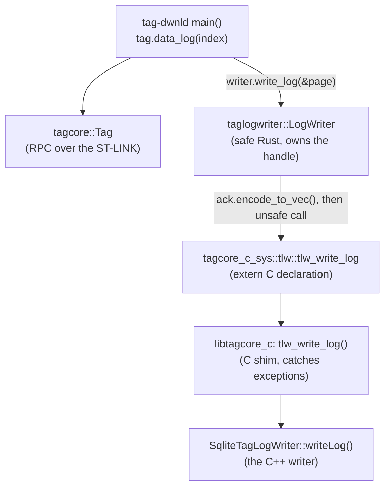

# 9. The command-line tools

The command-line tools are the package `tag-tools` in
[`host/commandline-rs`](../../commandline-rs): one small library of shared
code ([`src/lib.rs`](../../commandline-rs/src/lib.rs)) and 21 programs, one
file each in [`src/bin/`](../../commandline-rs/src/bin). Most are ports of
your C++ tools in `host/commandline`, keeping their names, options, messages
and exit status. They are the smallest complete programs in the workspace,
so they are the best place to see the tag interface of chapters 3 to 5 used
end to end. After this chapter you can read any of the tools, follow
`tag-dwnld` from its command line to the C++ `SqliteTagLogWriter`, and add a
tool of your own.

The guide's [chapter 9](../guide/09-command-line-tools.md) describes the
tools and their conventions; this chapter reads the code. The binary you
know as the download tool is named **`tag-dwnld`**, as the C++ one was.

## The package

[Chapter 1](01-workspace-and-build.md#reading-a-package-manifest) read
[`Cargo.toml`](../../commandline-rs/Cargo.toml); the points that shape this
chapter are:

- `src/lib.rs` is the package's library, named `tag_tools` in code. Every
  binary in `src/bin/` is a separate crate that depends on it, so a tool
  writes `use tag_tools::{BaseArgs, init_logging, select_base};` as it would
  for any other crate. There is no other sharing between the binaries: two
  tools that need the same helper either put it in `lib.rs` or repeat it
  (six tools have their own `fail()`, five their own `settle()`).
- cargo finds the binaries by file name. Only `tag-dwnld`,
  `tag-log-import` and `tag-rebuild` have `[[bin]]` entries, to say
  `required-features = ["sqlitelog"]`: they write through the C++ writer in
  `libtagcore_c`, and without the feature cargo skips them.
- CMake builds every binary in one run with the feature on (the `rust_tools`
  target) and copies the shipped ones to `bin/` and the rest to
  `bin/internal/`.

```text
commandline-rs/
├── Cargo.toml
├── build.rs        rpath for a shared libtagcore_c (chapter 1)
├── CMakeLists.txt  host_rust_tools(), rust_flash_tools(), install rules
├── README.md       the tool table, the differences from the C++, how the ports were checked
└── src/
    ├── lib.rs      BaseArgs, logging, Ctrl-C, SIGPIPE, base selection, naming helpers
    └── bin/        tag-info.rs, tag-reset.rs, tag-dwnld.rs, ... (21 files)
```

## The libraries the tools use

**Library: clap.** The command-line parser, with its `derive` feature on.
You declare a struct whose fields are the options; `#[derive(Parser)]`
generates the parser, `--help` and the error messages from the struct,
its attributes and its doc comments. `Cli::parse()` parses `std::env::args`,
and on an error or `--help` prints and exits the process itself (status 2
for an error, 0 for `--help`). The attributes used here:

| Attribute | Means |
| --- | --- |
| `#[derive(Parser)]` on a struct | This struct is the program's command line |
| `#[command(name = "tag-info")]` | The name shown in help and errors |
| `#[arg(short, long)]` on a field | `-x` and `--field-name`, both derived from the field name (`settle_timeout` becomes `--settle-timeout`) |
| `bool` field | A flag; `Option<T>` an optional value; `Vec<T>` a repeatable one; any other type a required value, or a positional argument if it has no `short`/`long` |
| `default_value_t = 10` / `default_value = "default"` | A default, typed or as text |
| `value_name = "SECONDS"` | The placeholder in help |
| `value_parser = f` | Parse the text with `fn f(&str) -> Result<T, String>` |
| `requires = "rescue_exception"` | Only valid together with that other option |
| `#[command(flatten)]` on a field | Splice in the options of a struct that derives `Args` |
| `#[derive(Subcommand)]` on an enum, `#[command(subcommand)]` on a field | Subcommands (`tag-flash program ...`) |
| `#[derive(ValueEnum)]` on an enum | An option whose value is one of the variant names (`--erase plan`) |
| `global = true` | The option is accepted after the subcommand too |

The `///` comment on each field is its help line, and the one on the struct
is the program's description. These are ordinary doc comments that clap's
derive reads at compile time, so the code's documentation and `--help` are
the same text.

**Library: log and env_logger.** `log` is the logging facade every crate in
the workspace calls (`log::debug!`, `log::error!`, `warn!`); by itself it
discards everything. A program installs one logger behind it, once.
`env_logger` is that logger here: it writes to stderr with a format and a
level filter the tool sets. The C++ equivalent is `log.c` with
`log_set_level()`.

**Library: chrono.** Dates and times; used for the log line's wall-clock
timestamp and, in `tag-info`, to print marker epochs as UTC.

**Library: ctrlc.** Installs a portable Ctrl-C handler that runs a closure
on a thread of its own.

**Library: libc.** Raw bindings to the C library, used for one call,
`signal(SIGPIPE, SIG_DFL)`; a dependency only on Unix.

**Library: prost-reflect.** Run-time reflection over prost's generated
protobuf types (the `Descriptor` API of C++ protobuf). `tag-info` uses it to
list every field of `TagInfo` without naming them; `tagcore` uses it for
text format and JSON (chapter [5](05-protobuf-and-the-tag-api.md)).

**Library: serde_json.** JSON; only `tag-log-import` uses it directly, to
read its header line.

The workspace's own crates: `tagcore` (the `Tag` API, chapters
[4](04-monitor-and-rpc.md) and [5](05-protobuf-and-the-tag-api.md), and
`tagcore::recovery`, chapter [6](06-recovery.md)), `tagprobe` (probe-rs,
chapter [7](07-programming-tags-and-bases.md)), `tagprogram-core` (Tag
Programmer's ELF reader and erase plan), and with `sqlitelog`,
`taglogwriter` (chapter [8](08-bridges-to-cpp-and-python.md)).

## The shared library: `src/lib.rs`

[`lib.rs`](../../commandline-rs/src/lib.rs) is the port of `options.cc` and
the parts of `log.c` the tools use. It is short; read it whole after this
section.

### The common options

[`lib.rs:49`](../../commandline-rs/src/lib.rs#L49):

```rust
/// The options every tag tool shares (`options.cc`).
#[derive(Debug, Clone, Args)]
pub struct BaseArgs {
    /// Set log level to DEBUG
    #[arg(short, long)]
    pub debug: bool,

    /// Select bus:device
    #[arg(short, long, value_name = "BUS:DEVICE")]
    pub base: Option<String>,
}
```

`Args` (not `Parser`) makes this a group of options that a tool's own
`Cli` flattens into itself, so every monitor tool has the same `-d` and
`-b BUS:DEVICE`. The `--base` value stays a `String` here; it is parsed
later, by `select_base`, as `options.cc` did.

> **Rust:** `#[derive(Debug, Clone, Args)]` asks the compiler (and clap's
> macro, for `Args`) to generate trait implementations: `Debug` is
> printability with `{:?}`, `Clone` an explicit `.clone()` copy. Nothing is
> copyable or printable by default in Rust; you opt in per type.

### Logging in the `log.c` format

[`lib.rs:84`](../../commandline-rs/src/lib.rs#L84):

```rust
pub fn init_logging_at(level: LevelFilter) {
    env_logger::Builder::new()
        .filter_level(level)
        // nusb logs every USB device's missing properties at DEBUG on each
        // enumeration, which buries the tools' own lines.
        .filter_module("nusb", level.min(LevelFilter::Warn))
        // probe-rs (through tracing's `log` feature) narrates every probe
        // and flash step at DEBUG; its INFO and above are what -d needs.
        .filter_module("probe_rs", level.min(LevelFilter::Info))
        .format(|buf, record| {
            writeln!(
                buf,
                "{} {:<5} {}:{}: {}",
                chrono::Local::now().format("%H:%M:%S"),
                record.level(),
                record.file().unwrap_or("?"),
                record.line().unwrap_or(0),
                record.args()
            )
        })
        .init();
}
```

`init_logging(&BaseArgs)` (line 68) calls this with `Debug` when `-d` was
given and `Error` otherwise. Each line is `HH:MM:SS LEVEL file:line:
message`, the `log.c` layout, with the Rust source file and line of the log
call. `.init()` installs the logger for the whole process and panics if one
is already installed.

The level comes only from `-d`. `env_logger::Builder::new()` starts from
nothing and does not read the `RUST_LOG` environment variable (that is
`Builder::from_env`, which tagcore's `tag_info` example uses), so
`RUST_LOG=debug tag-info` changes nothing; use `tag-info -d`. probe-rs logs
through `tracing`, which the package's `tracing` dependency, named only for
its `log` feature, forwards to this logger; the `probe_rs` target is capped
at INFO even with `-d`, as `nusb` is capped at WARN
([chapter 7](07-programming-tags-and-bases.md#the-libraries-in-this-chapter)).

> **Rust:** the builder calls chain because each returns the builder
> (`&mut Self`), like a fluent C++ API. `.format(|buf, record| ...)` passes a
> closure, a lambda; its parameter types are inferred from what `format`
> expects. `writeln!` is `fprintf` to `buf`, and `{:<5}` left-aligns in five
> columns as `%-5s` would.

### Ctrl-C and SIGPIPE

[`lib.rs:121`](../../commandline-rs/src/lib.rs#L121):

```rust
pub fn exit_on_interrupt() {
    let _ = ctrlc::set_handler(|| std::process::exit(1));
}
```

and [`lib.rs:135`](../../commandline-rs/src/lib.rs#L135):

```rust
pub fn restore_sigpipe() {
    #[cfg(unix)]
    // SAFETY: called at the start of `main`, before any other thread exists;
    // SIG_DFL is a valid disposition for SIGPIPE.
    unsafe {
        libc::signal(libc::SIGPIPE, libc::SIG_DFL);
    }
}
```

Ctrl-C exits with status 1, as the C++ SIGINT handler did. The Rust
runtime, unlike a C program, sets SIGPIPE to ignored before `main`; a write
to a closed pipe then returns an error, `println!` panics on that error, and
`tag-info | head` would end with a panic message and status 101.
`restore_sigpipe()`, the first line of every tool's `main`, puts the default
action back, so the process just dies of SIGPIPE as a C tool does.

> **Rust:** `let _ = expr;` discards a value explicitly. `set_handler`
> returns a `Result`, and Rust warns when a `Result` is silently dropped;
> `let _ =` says "ignored on purpose". `#[cfg(unix)]` on the `unsafe` block
> compiles it only for Unix targets, like `#ifdef`. `unsafe { }` marks code
> the compiler cannot check (here, a call into C); the `// SAFETY:` comment
> above every such block is this code base's rule for saying why it is sound.

Both of these, and the `select_base` exits below, leave through
`std::process::exit`, which ends the process **without running
destructors**. That matters because `tagcore::Tag` detaches in its
destructor: a tool that returns from `main` sends MONITORSTOP and releases
the base; a tool that exits from Ctrl-C or a bad `--base` does not, just as
the C++ tools' `exit()` did not.

### Choosing a base

[`lib.rs:162`](../../commandline-rs/src/lib.rs#L162):

```rust
pub fn select_base_from<C: CommandFactory>(devs: Vec<UsbDev>, args: &BaseArgs) -> UsbDev {
    let device = args.base.clone().unwrap_or_default();
    let mut found = if devs.is_empty() { None } else { Some(0) };

    if devs.len() > 1 || !device.is_empty() {
        let Some((bus, address)) = parse_bus_device(&device) else {
            let _ = C::command().print_help();
            println!();
            std::process::exit(1);
        };
        found = devs
            .iter()
            .position(|d| d.bus == bus && d.address == address);
    }

    match found {
        Some(i) => devs[i].clone(),
        None => {
            eprintln!("No matching device {device}");
            std::process::exit(1);
        }
    }
}
```

`select_base(&tag, &args)` (line 153) is this applied to `tag.available()`,
the list of ST-LINKs on USB; the SWD recovery tools, which have no `Tag`,
call `select_base_from` with their own list. With one base and no `--base`
it is used; with several, `--base` must parse and match; a malformed value
prints the tool's help and exits 1. Enumeration opens nothing, so no tag is
reset here.

> **Rust:** `C: CommandFactory` is a generic parameter with a trait bound,
> like a constrained C++ template parameter. `C` is the calling tool's own
> `Cli` type, passed so the right help is printed:
> `select_base::<Cli>(&tag, &cli.base)`. The `::<Cli>` ("turbofish") gives a
> generic argument that cannot be inferred from the call's arguments.
> `C::command()` is a static method that clap's derive generated for `Cli`.

`parse_bus_device` (line 191) reproduces `sscanf("%u:%u")`'s leniency
(`"20:3x"` parses as `(20, 3)`); its unit test is the one quoted in
[chapter 1](01-workspace-and-build.md#tests).

## The shape of every tool

Every monitor tool's `main` starts the same way. From `tag-reset`,
[`tag-reset.rs:102`](../../commandline-rs/src/bin/tag-reset.rs#L102):

```rust
fn main() -> ExitCode {
    tag_tools::restore_sigpipe();
    let cli = Cli::parse();
    init_logging(&cli.base);

    let tag = Tag::new();
    let dev = select_base::<Cli>(&tag, &cli.base);
    if !tag.attach(&dev) {
        // Exiting 0 here would report success from a tool that never
        // reached the tag.
        return fail("Attach failed");
    }
    exit_on_interrupt();
```

and the tools that need one share the same two-line helper, copied into
each,
[`tag-reset.rs:74`](../../commandline-rs/src/bin/tag-reset.rs#L74):

```rust
/// Prints `message` to stderr and returns exit status 1.
fn fail(message: impl std::fmt::Display) -> ExitCode {
    eprintln!("{message}");
    ExitCode::FAILURE
}
```

Points to notice:

- `Tag::new()` makes a detached `Tag`; `tag.attach(&dev)` **resets the
  tag** (chapter [4](04-monitor-and-rpc.md)). `attach` takes `&self`, not
  `&mut self`, though it changes state: `Tag` keeps its state behind a
  `Mutex`, which every method locks (so a request and the recording of its
  outcome are atomic, and a `Tag` may be used from more than one thread).
  `tag` here is not even declared `mut`.
- Anything that can be checked without the tag is checked before
  `attach`: options, files, an ELF's symbols. A mistyped option must not
  cost a running tag its run.
- `return fail(...)` returns from `main` normally, so `tag`'s destructor
  runs and detaches (and in `tag-dwnld`, the log writer's destructor closes
  the database). There are no explicit cleanup calls anywhere in the tools.

> **Rust:** `fn main() -> ExitCode` is `int main()`: `ExitCode::SUCCESS` is
> 0, `ExitCode::FAILURE` is 1, `ExitCode::from(2)` is 2. `message: impl
> std::fmt::Display` accepts any printable type (`&str`, `String`, an error
> type), a generic parameter written in argument position; each caller gets
> its own instantiation, as with a C++ template.

### Exit status

| Status | Meaning |
| --- | --- |
| 0 | Success (`ExitCode::SUCCESS`) |
| 1 | Failure: `ExitCode::FAILURE`, or `process::exit(1)` from `select_base*` and the Ctrl-C handler |
| 2 | An option error, from clap (the C++ cxxopts exited 1 there; this is the one deliberate difference). Three recovery tools also return 2 themselves, with different meanings: `tag-capture` "written, but some region failed"; `tag-sramcall` "the called function returned something other than 1"; `tag-xflash` `rescue-erase` given neither `--capture` nor `--no-capture` (an option error the tool detects itself) |
| 101 | A panic, which should not happen; this is why SIGPIPE is restored |

A script cannot tell `tag-capture`'s "incomplete" 2 from a clap usage error
2 by the status alone; the stdout line `INCOMPLETE` does.

## tag-info

[`tag-info.rs`](../../commandline-rs/src/bin/tag-info.rs) prints the base,
the tag's information, configuration, status and state-transition log, or
all of it as one JSON object. It writes nothing to the tag; the attach is
its only side effect, and its help says so,
[`tag-info.rs:38`](../../commandline-rs/src/bin/tag-info.rs#L38):

```rust
/// print tag information. Attaching connects under reset, so the state shown
/// is the one the tag restored on boot, not the one it was in: a tag past its
/// start time is reported RUNNING because the reset started it, and a tag
/// that had stalled reports whatever its backup registers held
#[derive(Parser)]
#[command(name = "tag-info")]
struct Cli {
    /// The shared `--debug` and `--base` options.
    #[command(flatten)]
    base: BaseArgs,

    /// Print tag information as a single JSON object, for recording rather
    /// than reading
    #[arg(short, long)]
    json: bool,
}
```

The struct's comment is the `about` text of `tag-info --help`.

### main

[`tag-info.rs:275`](../../commandline-rs/src/bin/tag-info.rs#L275):

```rust
fn main() -> ExitCode {
    tag_tools::restore_sigpipe();
    let cli = Cli::parse();
    init_logging(&cli.base);
    exit_on_interrupt();

    let tag = Tag::new();
    let dev = select_base::<Cli>(&tag, &cli.base);
    if !tag.attach(&dev) {
        return ExitCode::FAILURE;
    }
    if cli.json {
        return print_json(&tag);
    }

    match tag.base_identity() {
        Some(base) => println!("Base: {base}"),
        None => println!("Base: unidentified (its firmware predates the identify command)"),
    }
    if let Some(sha) = tag.git_sha() {
        println!("Tag SHA: {sha}");
    }
    let info = match tag.tag_info() {
        Ok(info) => info,
        Err(_) => {
            eprintln!("Info failed: {}", tag.debug_message());
            return ExitCode::FAILURE;
        }
    };
    println!("{}", proto::debug_string(&info));
    print_fields(&info);

    // A default-constructed config would misreport the tag's settings.
    match tag.config() {
        Ok(config) => println!("{}", proto::debug_string(&config)),
        Err(_) => eprintln!("GetConfig failed: {}", tag.debug_message()),
    }

    if let Ok(status) = tag.status() {
        println!("Current state: {}", state_name(status.state));
        // A boot reset-recovery trace when the firmware has nothing else to
        // report; see statusRecoveryTraceWrite().
        if !status.debug_message.is_empty() {
            println!("Firmware report: {}", status.debug_message);
        }
    }
    print_state_log(&tag);
    ExitCode::SUCCESS
}
```

Each request is a `Tag` method returning `Result<message, TagError>`
(chapter [5](05-protobuf-and-the-tag-api.md)). Three ways of handling one
appear in twenty lines, and they are deliberate:

- `tag_info()` is required: on `Err` the tool prints the reason and fails.
  The reason comes from `tag.debug_message()`, the C++ `Tag::debugMessage()`
  equivalent (the outcome of the last RPC), rather than from the `TagError`,
  so the text matches the C++ tool's.
- `config()` is reported but not fatal, and the comment says why the C++
  habit of printing a default-constructed message was dropped.
- `status()` is optional: `if let Ok(status) = ...` runs the block only on
  success.

Unlike `tag-reset` and `tag-dwnld`, `tag-info` does not wait for the tag to
settle after the attach; it prints the first status it gets, which may be
`STATE_UNSPECIFIED` while the tag boots. It also installs the Ctrl-C handler
before the attach rather than after.

> **Rust:** `match` on a `Result` with arms `Ok(info) => info` and
> `Err(_) => { ...; return ... }` is the long form of "unwrap or bail out":
> the `match` is an expression whose value is `info`, and the `Err` arm
> leaves the function. `if let Some(sha) = tag.git_sha()` is the short form
> for when only one case does anything. `proto::debug_string` prints a
> message in protobuf text format laid out as C++ `DebugString()` does.

### Printing every field by reflection

`print_fields` lists every `TagInfo` field with its protobuf type, so a
field added to `proto/` appears without a change here,
[`tag-info.rs:250`](../../commandline-rs/src/bin/tag-info.rs#L250):

```rust
fn print_fields(info: &TagInfo) {
    let msg = info.transcode_to_dynamic();
    for field in msg.descriptor().fields() {
        let value = if field.is_list() || field.is_map() {
            "(repeated)".to_owned()
        } else if field.supports_presence() && !msg.has_field(&field) {
            "(not set)".to_owned()
        } else {
            match msg.get_field(&field).as_ref() {
                prost_reflect::Value::F32(v) => ostream_float(*v),
                prost_reflect::Value::F64(v) => format_g(*v, 6, 6, |_| true),
                prost_reflect::Value::String(s) => s.clone(),
                v => scalar(&field, v),
            }
        };
        println!(
            "{}: {} : {value}",
            type_name(&field.kind()),
            label(field.name())
        );
    }
}
```

`transcode_to_dynamic()` converts the generated struct into a
`DynamicMessage`, prost-reflect's equivalent of a C++ `Message&` used
through its `Descriptor` and `Reflection`. `type_name` (line 208) maps the
field kind to the strings C++'s `FieldDescriptor::type_name()` returns, and
`ostream_float` prints a float as `std::ostream` does by default (`%g`, six
digits), so the output matches the C++ tool byte for byte apart from live
readings.

> **Rust:** `if ... { a } else if ... { b } else { c }` is an expression, so
> it initialises `value` directly, like a chained `?:`. In the `match`, the
> last arm `v => ...` binds anything not matched above. `*v` dereferences:
> the matched values are references into the message.

### The state log, and a method as a function pointer

`print_state_log` (line 120) requests the marker log in chunks until one is
refused or empty, but never more than 16 chunks; the comment above the loop
says why (a tag that keeps answering must not hang the tool),
[`tag-info.rs:125`](../../commandline-rs/src/bin/tag-info.rs#L125):

```rust
    for _ in 0..16 {
        let Ok(log) = tag.state_log(next) else { break };
        if log.states.is_empty() {
            break;
        }
        for marker in &log.states {
            print_marker(next, marker);
            next += 1;
        }
    }
```

Each marker prints its reason by name,
[`tag-info.rs:158`](../../commandline-rs/src/bin/tag-info.rs#L158):

```rust
        enum_name(marker.transition_reason, state::Event::as_str_name),
```

prost stores an enum field in a message as a plain `i32` (an unknown value
from newer firmware must survive decoding), so turning it into a name means
converting the number to the generated enum and asking for its name. prost
generates `as_str_name` as an ordinary method of each enum, not through a
trait, so `enum_name` in `lib.rs` (line 236) takes the method itself as a
function pointer, `fn(&E) -> &'static str`, and falls back to the number
when the conversion fails.

`--json` (`print_json`, line 181) assembles one object from
`proto::to_json` of the info, configuration and status: compact proto3 JSON
with the `.proto` field names and enums by name, the options under which
these messages are stored in a SQLite log (where the C++ writer, not
`to_json`, writes them).

## tag-reset: stop, then erase

[`tag-reset.rs`](../../commandline-rs/src/bin/tag-reset.rs) takes a tag in
any acquiring or stopped state back to IDLE: stop it if it is acquiring,
erase it, wait for IDLE. Its module comment states the bench rule it serves:
the erase is done by the firmware already on the tag, which knows its own
log layout, so this is step 2 of the flashing protocol.

Its options are three timeouts and `--set-rtc`,
[`tag-reset.rs:47`](../../commandline-rs/src/bin/tag-reset.rs#L47):

```rust
    /// Synchronize the tag clock from the host once idle
    #[arg(long)]
    set_rtc: bool,

    /// Seconds to wait for the erase to finish
    #[arg(long, default_value_t = 180, value_name = "SECONDS")]
    reset_timeout: u64,
```

### Settle

After the attach the tag is booting, and its first status can legitimately
be `STATE_UNSPECIFIED`. `settle` polls once a second until it is not,
[`tag-reset.rs:84`](../../commandline-rs/src/bin/tag-reset.rs#L84):

```rust
fn settle(tag: &Tag, timeout_s: u64) -> Result<Status, String> {
    const SETTLE: Duration = Duration::from_secs(1);
    for _ in 0..timeout_s {
        let status = tag
            .status()
            .map_err(|_| format!("GetStatus failed: {}", tag.debug_message()))?;
        if status.state != TagState::StateUnspecified as i32 {
            return Ok(status);
        }
        sleep(SETTLE);
    }
    Err(format!(
        "tag still reports STATE_UNSPECIFIED after {timeout_s} s; it is not merely settling"
    ))
}
```

A failed status read is fatal, not retried: a tag that never answered must
not be mistaken for one that is idle.

> **Rust:** `?` after an expression of type `Result` returns early with the
> error if there is one, otherwise unwraps the value; `.map_err(...)` first
> converts the error (`TagError`) into this function's error type
> (`String`). `TagState::StateUnspecified as i32` converts the generated
> enum to its number to compare with `status.state`, which is an `i32` for
> the reason given above. The last expression of a function, with no
> semicolon (`Err(...)` here), is its return value.

### Stop: `stop_confirmed`

[`tag-reset.rs:127`](../../commandline-rs/src/bin/tag-reset.rs#L127):

```rust
    if tagcore::tag::is_acquiring(status.state) {
        status = match tag.stop_confirmed(Duration::from_secs(cli.stop_timeout)) {
            Ok(status) => status,
            Err(failure) => return fail(failure),
        };
        report_debug(&status);
    }
```

`is_acquiring` is CONFIGURED, RUNNING or HIBERNATING, the states the
firmware's `monitor_acquisition_active()` accepts a stop in. The waiting is
in `tagcore`, shared with `tag-stop`, `tag-dwnld --stop` and Tag Monitor,
[`tagcore-rs/src/tag.rs:639`](../../libraries/tagcore-rs/src/tag.rs#L639):

```rust
    pub fn stop_confirmed(&self, timeout: Duration) -> Result<Status, StopFailure> {
        let status = self.status().map_err(StopFailure::Status)?;
        if is_stopped(status.state) {
            return Ok(status);
        }
        if !is_acquiring(status.state) {
            return Err(StopFailure::NotAcquiring(Box::new(status)));
        }
        if let Some(stopped) = self.stop().map_err(StopFailure::Refused)?
            && is_stopped(stopped.state)
        {
            return Ok(stopped);
        }
        let started = Instant::now();
        let mut sent = started;
        loop {
            let status = self.status().map_err(StopFailure::Status)?;
            if is_stopped(status.state) {
                return Ok(status);
            }
            if started.elapsed() >= timeout {
                return Err(StopFailure::TimedOut(Box::new(status)));
            }
            if is_acquiring(status.state) && sent.elapsed() >= STOP_RESEND_AFTER {
                warn!(
                    "tag still {} {:.0} s after the stop was accepted; sending it again",
                    state_label(status.state),
                    sent.elapsed().as_secs_f32()
                );
                if let Err(e) = self.stop() {
                    warn!("resent stop failed: {e}");
                }
                sent = Instant::now();
            }
            sleep(STOP_POLL);
        }
    }
```

Two generations of firmware are handled here. Firmware with synchronous
monitor commands stops before it answers and returns the resulting
`Status`; `stop()` returns `Ok(Some(status))` and the `if let` returns at
once. Older firmware only queues the stop and answers `Ok(None)`, and an
STM32L4 running it can accept a stop and lose it; so the loop polls every
`STOP_POLL` (2 s) and resends the stop if the tag is still acquiring after
`STOP_RESEND_AFTER` (4 s). This replaces the C++ tools' single stop and
fixed poll.

> **Rust:** `if let Some(stopped) = ... && is_stopped(stopped.state)` is a
> let chain (edition 2024): the pattern must match *and* the condition hold.
> `StopFailure` is an enum whose variants carry data (`TimedOut` carries the
> last `Status`), Rust's tagged union; `map_err(StopFailure::Status)` passes
> the variant's constructor as a function. `Box::new(status)` heap-allocates
> the large `Status` so the error type stays small. `fail(failure)` in
> `tag-reset` works because `StopFailure` implements `Display`, with one
> message per variant.

### Erase and poll for IDLE

[`tag-reset.rs:136`](../../commandline-rs/src/bin/tag-reset.rs#L136):

```rust
    let erasing = status.state == TagState::SReset as i32;
    if status.state == TagState::Finished as i32
        || status.state == TagState::Aborted as i32
        || erasing
    {
        // In sRESET the erase continues the sweep already under way. Firmware
        // that predates synchronous commands refuses it but sweeps on
        // regardless, so there the refusal is only a note and the poll below
        // still waits for IDLE.
        if tag.erase().is_err() {
            if !erasing {
                return fail(format!("Erase failed: {}", tag.debug_message()));
            }
            println!(
                "Erase while erasing refused ({}); waiting for the sweep to finish",
                tag.debug_message()
            );
        }

        // The erase reply means at most that the tag entered sRESET; the
        // state machine then sweeps external storage in batches whose length
        // depends on the data present, so poll for IDLE rather than guess a
        // duration.
        const POLL_MS: u64 = 250;
        let timeout_ms = cli.reset_timeout * 1000;
        let mut waited_ms = 0;
        let mut reached_idle = false;
        while waited_ms < timeout_ms {
            sleep(Duration::from_millis(POLL_MS));
            waited_ms += POLL_MS;
            let Ok(s) = tag.status() else { continue };
            status = s;
            if status.state == TagState::Idle as i32 {
                reached_idle = true;
                break;
            }
        }
```

The rule in AGENTS.md, "an acknowledgement is not a completion", is the
shape of this block: the erase reply proves at most that the tag entered
sRESET, so the tool polls for the state it wants. During the sweep a status
read may fail while the firmware is busy; `let Ok(s) = ... else { continue }`
skips it rather than failing. After the loop the tool refuses anything but
IDLE (line 191) and only then honours `--set-rtc`, because IDLE is the only
state the firmware accepts it in. Exit 0 therefore means the tag is IDLE.

## tag-dwnld, end to end

[`tag-dwnld.rs`](../../commandline-rs/src/bin/tag-dwnld.rs) downloads a
stopped tag's log into SQLite. The tag side is `tagcore`; the database is
written by the C++ `SqliteTagLogWriter`, the same code the C++ `tag-dwnld`
used, so the two tools write byte-identical files from the same tag. Its
module comment (lines 1-65) lists the sequence and a "Maintaining" section:
the header requests and the page loop must stay identical to `dwnld.cc`,
and a change is checked by downloading the same finished tag with both tools
and comparing the databases with `cmp`.

The layers a page crosses on its way to disk:



### Building it

`tag-dwnld` exists only with the `sqlitelog` feature. CMake's `rust_tools`
target always builds with it. By hand, with the C++ library built by CMake:

```sh
export TAGCORE_C_LIB_DIR=/Users/geobrown/codedev/Build/tag-designs-host/Release/lib
cargo build -p tag-tools --features sqlitelog --bin tag-dwnld
```

The feature pulls in `taglogwriter` and `tagcore-c-sys`; the latter's build
script links `libtagcore_c` (statically on macOS) and `tag-tools`'s own
`build.rs` sets the rpath where the link is shared (chapter
[1](01-workspace-and-build.md#build-scripts)).

### The options

[`tag-dwnld.rs:80`](../../commandline-rs/src/bin/tag-dwnld.rs#L80) declares
`-o/--output`, `-f/--format`, `-s/--stop`, `--rescue-exception`, `--elf`,
`--profile`, `--settle-timeout` and `--stop-timeout`. Two show clap
features not seen yet,
[`tag-dwnld.rs:99`](../../commandline-rs/src/bin/tag-dwnld.rs#L99):

```rust
    /// For old firmware only: change EXCEPTION backup state to ABORTED before
    /// downloading
    #[arg(long)]
    rescue_exception: bool,

    /// With --rescue-exception on a BitTag: the ELF of the image the tag
    /// runs, whose vddHeader and __persistent_end__ say where its records
    /// are. Required for BITTAG_LE; without it a BITTAG is read at the
    /// original field firmware's addresses
    #[arg(long, value_name = "FILE", requires = "rescue_exception")]
    elf: Option<std::path::PathBuf>,
```

The field `rescue_exception` becomes `--rescue-exception`, and `requires`
names the other field (by its Rust name), so `--elf` alone is a usage error,
exit 2, before anything happens.

### Before attaching

[`tag-dwnld.rs:367`](../../commandline-rs/src/bin/tag-dwnld.rs#L367):

```rust
fn main() -> ExitCode {
    tag_tools::restore_sigpipe();
    let cli = Cli::parse();
    init_logging(&cli.base);
    taglogwriter::set_debug(cli.base.debug);

    // Before attaching, which resets the tag: a mistyped option must not cost
    // a running tag its run.
    if let Err(message) = check_format(&cli.format) {
        return fail(message);
    }
    // The same for --elf: a missing file or symbol is found before the reset.
    let elf_layout = match cli.elf.as_deref().map(bittag_layout_from_elf).transpose() {
        Ok(layout) => layout,
        Err(message) => return fail(message),
    };
```

- `taglogwriter::set_debug` sets the C++ library's own `log.c` level. The
  library has its own logger, separate from `env_logger`, and logs at DEBUG
  until told otherwise, so `tag-dwnld`, `tag-rebuild` and `tag-log-import`
  pass `-d` on. `tag-log-import` has no `BaseArgs` and no `env_logger`; its
  own `-d` exists only for this call, and without it the writer logs only
  errors (the C++ tool left its writer at DEBUG).
- `check_format` (line 162) accepts the SQLite spellings and refuses
  `text`, which is retired, naming `tag-txt-import`.
- The `--elf` line reads the BitTag record region from an ELF, if one was
  given, still before the attach.

> **Rust:** `cli.elf` is an `Option<PathBuf>`. `.as_deref()` turns it into
> `Option<&Path>` (borrowing, not moving). `.map(f)` applies `f` only to a
> `Some`, giving `Option<Result<BitTagFlashLog, String>>`, and
> `.transpose()` swaps the layers to `Result<Option<...>, String>`, so one
> `match` handles "no `--elf`", "a good `--elf`" and "a bad `--elf`".

### Attach, settle, rescue, stop

Lines 384-420 attach and settle as `tag-reset` does (with its own near
copy of `settle`, which polls at least once even with a zero timeout). Then two optional steps: with `--rescue-exception`, an old
BitTag's EXCEPTION backup state is rewritten to ABORTED
(`tag.force_backup_state`, chapter [5](05-protobuf-and-the-tag-api.md)); with
`--stop`, a RUNNING tag is stopped through `stop_confirmed`, read above.
Then the tool refuses anything not FINISHED, ABORTED or EXCEPTION
(`is_downloadable`, line 209), printing the status.

### The output and the BitTag rescue layout

[`tag-dwnld.rs:438`](../../commandline-rs/src/bin/tag-dwnld.rs#L438):

```rust
    let bittag_rescue = rescue
        && (config.tag_type == TagType::Bittag as i32
            || config.tag_type == TagType::BittagLe as i32);
    let layout = match (&elf_layout, bittag_rescue) {
        (Some(layout), true) => *layout,
        (None, true) if config.tag_type == TagType::Bittag as i32 => BitTagFlashLog::LEGACY,
        (None, true) => {
            return fail(
                "Rescue: a BITTAG_LE image keeps its records at addresses that vary by build; \
                 pass --elf with the image the tag runs",
            );
        }
        (_, false) => BitTagFlashLog::LEGACY,
    };
```

and then [line 460](../../commandline-rs/src/bin/tag-dwnld.rs#L460):

```rust
    let output = cli.output.unwrap_or_else(|| "tag-download.db3".into());
    // The writer refuses a tag type it has no schema for before creating
    // the file.
    let mut writer = match LogWriter::create(output.as_ref(), &config, true) {
        Ok(writer) => writer,
        Err(error) => return fail(format!("Could not open output: {error}")),
    };
    println!("Writing sqlite log to {output}");
```

> **Rust:** `match (a, b)` matches a tuple, so four combinations are written
> as four arms, and `if ...` after a pattern is a guard. The compiler checks
> that the arms cover every case; the last arm's `_` matches anything.
> `output.as_ref()` borrows the `String` as the `&Path` that `create` takes
> (`String` implements `AsRef<Path>`, and the parameter type picks that
> impl); `.into()` converts the literal `&str` into a `String`.

`LogWriter::create` checks that the library's interface version matches,
then calls `tlw_open`. The C++ writer decides whether the tag type is
supported, before touching the file, so the list of supported types lives
only in C++. `writer` is declared `mut` because every writing method takes
`&mut self`: the borrow checker, not a mutex, guarantees one user at a time.

### The header

`read_header` makes exactly the requests the C++ `readTagLogHeader()`
makes, in the same order,
[`tag-dwnld.rs:223`](../../commandline-rs/src/bin/tag-dwnld.rs#L223):

```rust
fn read_header(tag: &Tag) -> Result<LogHeader, String> {
    let config = tag
        .config()
        .map_err(|_| "Could not read tag config".to_string())?;
    let info = tag
        .tag_info()
        .map_err(|_| "Could not read tag info".to_string())?;
    let mut calibration = Vec::new();
    while let Ok(constants) = tag.read_calibration(calibration.len() as i32) {
        calibration.push(constants);
    }
    let mut states = Vec::new();
    while let Ok(chunk) = tag.state_log(states.len() as i32) {
        if chunk.states.is_empty() {
            break;
        }
        states.extend(chunk.states);
    }
    Ok(LogHeader {
        config,
        info,
        calibration,
        states,
    })
}
```

Calibration constants are read from index 0 until the tag refuses one; the
state log in chunks until one is refused or empty. `writer.write_header`
then passes each part across (line 473).

> **Rust:** `while let Ok(x) = f() { ... }` loops while the pattern matches
> and stops at the first `Err`, which is how "until the tag refuses" is
> written. `Vec::new()` is `std::vector`; the element type is inferred from
> the first `push`. `LogHeader { config, info, ... }` is field-init
> shorthand for `config: config, ...`. `states.extend(chunk.states)` moves
> the chunk's elements in, without copying them.

### The page loop

The writer, not the tool, knows how many records a page holds (it depends
on the tag type) and where the log ends. So the loop asks for the page at
`total`, hands it to the writer, and advances by what the writer says it
consumed. [`tag-dwnld.rs:502`](../../commandline-rs/src/bin/tag-dwnld.rs#L502):

```rust
    let start = Instant::now();
    if let Err(error) = writer.begin_log() {
        println!();
        return fail(format!("Could not begin log download: {error}"));
    }
    write_log += start.elapsed();

    loop {
        let start = Instant::now();
        // In BitTag rescue mode the firmware's data-log RPC is avoided: the
        // host reads the raw headers from flash, wrapped as ordinary pages.
        let page: Option<Ack> = if bittag_rescue {
            tag.bittag_log_from_flash(layout, total as i32)
        } else {
            tag.data_log(total as i32).ok()
        };
        let Some(page) = page else {
            println!();
            return fail(format!(
                "GetDataLog failed at entry {total}: {}",
                tag.debug_message()
            ));
        };
        get_log += start.elapsed();
        requests += 1;

        if !page.error_message().is_empty() {
            println!();
            return fail(page.error_message());
        }
        if page.err == ack::Err::Nodata as i32 && total < max_count {
            total += 1;
            print_progress(total, max_count);
            continue;
        }

        let start = Instant::now();
        let consumed = match writer.write_log(&page) {
            Ok(consumed) => consumed,
            Err(error) => {
                println!();
                return fail(format!("Could not write log data: {error}"));
            }
        };
        write_log += start.elapsed();
        if consumed == 0 {
            break;
        }
        total += consumed;
        print_progress(total, max_count);
    }

    let start = Instant::now();
    if let Err(error) = writer.end_log() {
        println!();
        return fail(format!("Could not finish log download: {error}"));
    }
```

- `begin_log` opens the SQLite transaction; `end_log` commits it. Every
  `return fail(...)` in between drops `writer`, whose destructor calls
  `tlw_close`, which rolls back the open transaction; and drops `tag`, which
  detaches. That is the whole of the error-path cleanup.
- `max_count` (lines 477-490) is the tag's external page count, or its
  internal one; a NODATA page below it advances the index by one, as the C++
  does.
- `page.error_message()` is a helper in `tagcore::proto` that returns the
  `Ack`'s error text or `""`, like the C++ accessor for an unset oneof.
- `print_progress` (line 254) redraws a 40-column bar with `\r` only when
  stdout is a terminal; into a file or pipe it prints just the final bar.

> **Rust:** `loop { }` is `for (;;)`. The `if`/`else` that produces `page`
> is an expression yielding an `Option<Ack>`, with the type written out on
> the `let`. `tag.data_log(...).ok()` converts a `Result` to an `Option`,
> discarding the error (the message comes from `debug_message()` instead).
> `let Some(page) = page else { ... };` rebinds the name `page` to the
> unwrapped value; reusing a name like this ("shadowing") is idiomatic.

### Across the bridge

`write_log` is where the Rust side ends,
[`taglogwriter-rs/src/lib.rs:276`](../../libraries/taglogwriter-rs/src/lib.rs#L276):

```rust
    pub fn write_log(&mut self, ack: &Ack) -> Result<usize, WriterError> {
        let bytes = ack.encode_to_vec();
        // SAFETY: `bytes` is a buffer of `bytes.len()` bytes, live for the
        // call; `raw` is a live handle, used from this thread only.
        let consumed =
            unsafe { ffi::tlw_write_log(self.raw.as_ptr(), bytes.as_ptr(), bytes.len()) };
        usize::try_from(consumed).map_err(|_| self.last_error())
    }
```

The page crosses as protobuf wire bytes: prost encodes it, and the C shim
([`taglogwriter_c.cc:215`](../../libraries/tagcore-c/taglogwriter_c.cc#L215))
parses it into a C++ `Ack` and calls `SqliteTagLogWriter::writeLog`. A
negative count means an error, and `usize::try_from` fails exactly then,
turning it into the writer's last error message. Neither side interprets
the other's structs, which is why the database is the C++ tool's, byte for
byte. Chapter [8](08-bridges-to-cpp-and-python.md) reads the declarations,
the shim's exception guard, the ownership rules and the linking.

### The report

Lines 561-573 print the record and request counts and the decoding time,
and with `--profile` the timing of the download and tagcore's link and RPC
counters (`print_profile`, line 300), or "Host link instrumentation was
compiled out" when `tagcore` was built without its `instrumentation`
feature. The durations print at full precision rather than C++ stream
precision, one of the three differences the module comment lists.

## The recovery tools: tag-capture, tag-xflash, tag-sramcall, tag-rebuild

These four do not use the monitor. They are command lines over
`tagcore::recovery` (chapter [6](06-recovery.md)), which attaches over SWD
with the core halted at its reset vector, so the tag's firmware never runs.
They have no `Tag`; they list bases with `recovery::Session::available()` and
choose one with `select_base_from`, and they are internal tools, built into
`bin/internal`.

`tag-capture` shows how a tool hands a progress callback to the library,
[`tag-capture.rs:118`](../../commandline-rs/src/bin/tag-capture.rs#L118):

```rust
    let mut print = |line: &str| println!("  {line}");
    let mut o = CaptureOptions {
        parent_dir: cli.out_dir.clone(),
        reason: cli.reason.clone(),
        include_sram: cli.sram,
        include_external: !cli.no_external,
        loader_path: cli.loader.clone(),
        loader_dirs,
        external_full: cli.external_full,
        exit: if cli.leave_halted { SwdExit::LeaveHalted } else { SwdExit::HardwareReset },
        build,
        progress: Some(&mut print),
    };

    let dev = select_base_from::<Cli>(Session::new().available(), &cli.base);
    let r = match capture_tag(&mut o, &dev) {
```

The options struct borrows the closure (`Some(&mut print)`), so the library
calls back into the tool's `println!` without owning it; the borrow checker
ensures `print` outlives `o`. `--with-build` is resolved before the attach
(lines 109-116), so a wrong path costs nothing on the tag. The tool ends
with the one three-way exit in the crate,
[`tag-capture.rs:216`](../../commandline-rs/src/bin/tag-capture.rs#L216):

```rust
    if r.complete { ExitCode::SUCCESS } else { ExitCode::from(2) }
```

0 is a complete capture, 2 a capture written with some region failed, 1 no
capture. `tag-sramcall` returns 2 when the called function returned
something other than 1; `tag-xflash` returns 2 only for `rescue-erase`
without `--capture` or `--no-capture`, and otherwise 0 or 1. `tag-rebuild`
needs no base at all: it passes a capture directory and an output path to
`taglogwriter::rebuild_from_capture`, which runs the C++ family decoders
through `tagcore_c`'s `rbd_*` interface (chapter
[8](08-bridges-to-cpp-and-python.md)) and writes the same database
`tag-dwnld` would have.

## The flashing tools: tag-flash and base-flash

`tag-flash` programs, erases and reads a tag through a base with probe-rs,
and `base-flash` programs a base over USB DFU; chapter
[7](07-programming-tags-and-bases.md) reads `tagprobe`, which does the work.
The tools themselves show clap's subcommands. Neither uses `BaseArgs`:
`tag-flash -b` takes the base's USB **serial**, which survives replugging,
not `bus:device`. [`tag-flash.rs:76`](../../commandline-rs/src/bin/tag-flash.rs#L76):

```rust
#[derive(Parser)]
#[command(name = "tag-flash")]
struct Cli {
    /// Set log level to DEBUG
    #[arg(short, long, global = true)]
    debug: bool,

    /// The base's USB serial, as `tag-flash list` prints it; needed only
    /// when more than one base is connected
    #[arg(short, long, global = true, value_name = "SERIAL")]
    base: Option<String>,

    /// What to do.
    #[command(subcommand)]
    command: Command,
}

/// The `tag-flash` commands.
#[derive(Subcommand)]
enum Command {
    /// List the bases on USB
    List,
    /// Check the connection: device, flash size and supply voltage
    Info,
    /// Program an image, verify it and start it
    Program {
        /// The firmware's .elf
        #[arg(value_parser = tag_tools::parse_elf_path)]
        elf: PathBuf,
        /// What to erase before programming
        #[arg(long, value_enum, default_value_t = EraseArg::Plan)]
        erase: EraseArg,
    },
    // ...
}
```

and the dispatch,
[`tag-flash.rs:447`](../../commandline-rs/src/bin/tag-flash.rs#L447):

```rust
    let base = cli.base.as_deref();
    let attaches = !matches!(cli.command, Command::List);
    let result = match &cli.command {
        Command::List => list(),
        Command::Info => info(base),
        Command::Program { elf, erase } => program(base, elf, *erase),
        Command::Erase => erase(base),
        Command::Read {
            address,
            length,
            output,
        } => read(base, *address, *length, output),
    };
    if attaches {
        // A tool that attaches the moment this one has let the base go can
        // fail its first debug read (SWD status 0x81); a second later it
        // does not. On a BitTag, 3 of 5 back-to-back `tag-info` runs failed
        // after `program`, and 6 of 6 passed with this pause.
        std::thread::sleep(SETTLE);
    }
```

> **Rust:** a subcommand is an enum variant, and a variant with fields
> (`Program { elf, erase }`) carries that subcommand's arguments: the C++
> equivalent is a `std::variant` of one struct per command. `match
> &cli.command` borrows the enum, so the bound fields are references, hence
> `*erase` to copy the value out. `matches!(x, Pattern)` is a boolean
> pattern test. Each command function returns `Result<(), String>`, and
> `main` maps `Err` to "tag-flash: message" and exit 1.

The default `--erase plan` takes the erase from Tag Programmer's flash plan
for the image (`tagprogram_core::model::flashplan`); `--erase image` is
refused unless the persistent region stays where the old image had it
(`check_persistent_unmoved`, line 313). Every command but `list` attaches
under reset, and `program` attaches several times. `base-flash program`
exits 0 only when the base has come back as an ST-LINK reporting the
image's identity string.

## The other tools

| Tool | Ships | Does | Changes the tag |
| --- | --- | --- | --- |
| [`tag-start`](../../commandline-rs/src/bin/tag-start.rs) | yes | Starts an IDLE tag with its stored configuration, or `--config FILE` (with `--merge`, only the fields the tag supports); `--set-rtc`, `--start-now`. Exits 0 for RUNNING or CONFIGURED, or "not confirmed" when the tag accepted but stopped answering. Once the start is sent, turns logging off unless `-d` (`set_log_level`), since a tag that sleeps at once drops the debug link | writes the configuration, starts a run |
| [`tag-stop`](../../commandline-rs/src/bin/tag-stop.rs) | yes | `stop_confirmed`, then prints the status | ends the run |
| [`tag-test`](../../commandline-rs/src/bin/tag-test.rs) | yes | Syncs the clock, runs a self-test (`--test NAME\|NUMBER`, default `RUN_ALL`), polls for IDLE, prints the result; exit 0 only for `ALL_PASSED` | the test's effects; the clock, twice |
| [`tag-cal`](../../commandline-rs/src/bin/tag-cal.rs) | yes | Puts an IDLE tag in CALIBRATE and streams `Raw:` samples until Ctrl-C, then stops it. Its clap name is `tag-calibrate`, the C++ name, so help prints that | enters and leaves CALIBRATE |
| [`tag-cal-write`](../../commandline-rs/src/bin/tag-cal-write.rs) | internal | Writes identity calibration constants so a reflashed compass tag will start | appends a calibration record |
| [`tag-test-example`](../../commandline-rs/src/bin/tag-test-example.rs) | internal | Sets the clock, waits, prints the clock error; a worked example of the API | sets the clock |
| [`tag-peek`](../../commandline-rs/src/bin/tag-peek.rs) | internal | Reads words of memory through the monitor, between RPCs | no |
| [`tag-attach-cycle`](../../commandline-rs/src/bin/tag-attach-cycle.rs) | internal | Attaches and detaches repeatedly, to test the attach path | one reset per cycle |
| [`tag-monitor-test`](../../commandline-rs/src/bin/tag-monitor-test.rs) | internal | Drives the STM32L4 DebugMonitor handshake directly over `LinkAdapt`; refuses an STM32U3 | resets |
| [`tag-side-channel-check`](../../commandline-rs/src/bin/tag-side-channel-check.rs) | internal | PASS/FAIL checks of tagcore's memory access, keep-alive and threading; opt-in writes | only with its opt-in options |
| [`qtmonitor-fixture-capture`](../../commandline-rs/src/bin/qtmonitor-fixture-capture.rs) | internal | Saves a tag's info, configuration and status as a qtmonitor test fixture. Does not use `BaseArgs` | no |
| [`tag-log-import`](../../commandline-rs/src/bin/tag-log-import.rs) | internal | Writes a JSONL download (from `tagclient` or tagsim) as a SQLite log through the same writer as `tag-dwnld`; `-d` logs the writer at DEBUG; needs `sqlitelog` | no tag |
| [`tag-xflash`](../../commandline-rs/src/bin/tag-xflash.rs) | internal | Reads (or, `rescue-erase`, erases) external flash through an SRAM loader with the core halted | `rescue-erase` erases external flash |
| [`tag-sramcall`](../../commandline-rs/src/bin/tag-sramcall.rs) | internal | Calls one function of an SRAM image on a halted tag and dumps the buffer | resets afterwards |
| [`tag-rebuild`](../../commandline-rs/src/bin/tag-rebuild.rs) | internal | Rebuilds a SQLite download from a `tag-capture` directory; needs `sqlitelog` | no tag |

Every file starts with a `//!` block giving its usage, exit status and a
"Hardware side effects" section; that block is the place to start.

## Adding a tool

1. Create `src/bin/<name>.rs`. cargo builds it with no manifest change
   (add a `[[bin]]` entry only if it needs `sqlitelog`).
2. Write the `//!` header: what it does, usage, exit status, hardware side
   effects, and for a port the C++ file it follows.
3. Declare `Cli` with `#[derive(Parser)]` and `#[command(flatten)] base:
   BaseArgs`, and copy the skeleton from `tag-reset`'s `main`. Check
   everything you can before `attach`; settle; poll for the state you asked
   for.
4. Document every item (`cargo clippy -p tag-tools` warns otherwise).
5. To have CMake copy it, add it to `HOST_RUST_SHIPPED_TOOLS` or
   `HOST_RUST_INTERNAL_TOOLS` in
   [`cmake/HostRust.cmake`](../../../cmake/HostRust.cmake#L189); a shipped
   tool also wants a page in the user manual (`host/docs/src/cli/`).

## Try it

None of these touches a tag.

- Read [`src/lib.rs`](../../commandline-rs/src/lib.rs) whole; it is 264
  lines including its tests.
- With `CARGO_TARGET_DIR` set as in [chapter 1](01-workspace-and-build.md#day-to-day),
  build the tools and read the generated help, which is the doc comments:
  `cargo build -p tag-tools`, then
  `$CARGO_TARGET_DIR/debug/tag-info --help`,
  `$CARGO_TARGET_DIR/debug/tag-flash program --help` and
  `$CARGO_TARGET_DIR/debug/tag-reset --bogus; echo $?` (prints 2). Running a
  tool with `--help` or a bad option exits before it looks for a base.
- `cargo test -p tag-tools` runs the hardware-free tests: `bus:device`
  parsing, state names, `tag-flash`'s number parsing, and clap's own
  consistency check of each derived parser (`Cli::command().debug_assert()`
  in `tag-flash.rs` and `base-flash.rs`).
- `cargo doc --no-deps --document-private-items -p tag-tools --open` and
  open a binary's page: the `//!` header is its front page.
- From the repository root,
  `rg -n 'ExitCode::from|process::exit' host/commandline-rs/src` lists every
  exit that is not plain 0 or 1, or that skips destructors.
- `rg -n 'stop_confirmed|fn settle' host` shows who shares the stop logic and
  who repeats the settle loop.

On the bench (a tag on a base, after the procedures in
[`docs/bench/`](../../../docs/bench/README.md), and never on a tag whose run
matters, since every one of these resets it): `tag-info -d` shows the
`log.c`-format debug lines; `tag-dwnld --profile` on a FINISHED tag shows
the link counters.

## Where next

- Chapter [8](08-bridges-to-cpp-and-python.md) for `taglogwriter`,
  `tagcore-c-sys` and the C shim that `tag-dwnld` writes through.
- Chapter [6](06-recovery.md) for what `tag-capture` and its siblings do
  under `capture_tag`, and chapter [7](07-programming-tags-and-bases.md) for
  what `tag-flash program` does to the tag.
- [`commandline-rs/README.md`](../../commandline-rs/README.md) for how each
  port was checked against its C++ original.
