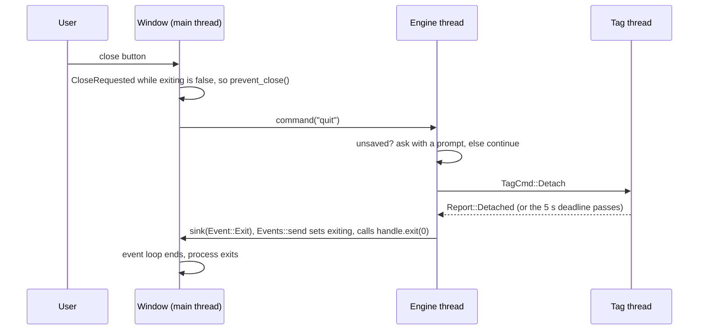
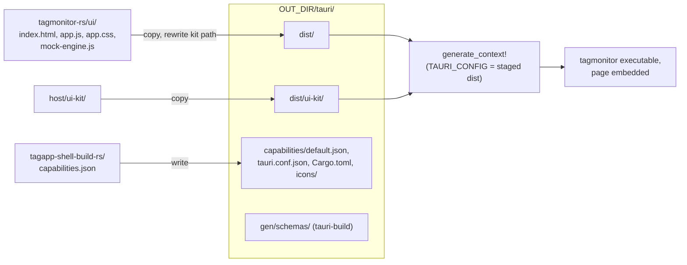

# 10. The Tauri shell: how a Rust program gets a window

Each desktop application is a toolkit-free Rust engine (the `core` crate,
chapter 11), a web page (chapter 12), and between them a shell that opens a
window, loads the page into it and passes messages both ways. The shell is
written once, in two library crates every application shares:
`host/libraries/tagapp-shell-rs` (crate `tagapp-shell`, the run-time half)
and `host/libraries/tagapp-shell-build-rs` (crate `tagapp-shell-build`, the
build-script half). What is left in each application is about fifty lines
of `main.rs` that describe it and start its engine, and a one-line
`build.rs`.

This chapter reads Tag Monitor's `host/applications/tagmonitor-rs/app/`
(`src/main.rs`, `build.rs`, `tauri.conf.json`, `Cargo.toml`), then the two
shared crates in full, and the CMake that builds and packages the result.
Afterwards you will be able to say, for any click in the window, which Rust
function receives it and on which thread, and how the page's files end up
inside the executable.

The architecture is in [chapter 10 of the guide](../guide/10-application-pattern.md)
("The Tauri shell") and Tag Monitor's own
[UI/engine contract](../../applications/tagmonitor-rs/design/ui-engine-contract.md);
this chapter is the code reading behind them.

## What Tauri is, in Qt terms

**Library: Tauri** (crate `tauri` 2.12.5 in `host/Cargo.lock`). Tauri is a
Rust application framework. The Rust process is the application: it owns the
event loop and the native window. Inside the window it puts the operating
system's own web view -- WKWebView (WebKit) on macOS, WebView2 (Edge's
Chromium) on Windows, WebKitGTK 4.1 on Linux -- and that web view shows a
page, which is the user interface. Nothing like Chromium or Node.js is
bundled, which is why the macOS Tag Programmer is about 21 MB where qtprogram
was about 51 MB
([its packaging page](../../applications/tagprogram-rs/design/build-and-packaging.md)).

The page and the Rust process talk over Tauri's IPC bridge, in two ways:

- **invoke**: the page calls `invoke("name", {args})`; Tauri finds the Rust
  function registered under that name (a *command*), converts the JSON
  arguments to its parameters, runs it, and resolves the JavaScript promise
  with its return value converted back to JSON.
- **events**: Rust calls `emit("event", payload)`; every page that called
  `listen("event", callback)` gets the payload as JSON.

Plugins (`tauri-plugin-*` crates) add native features with both a Rust half
and a JavaScript API, and *capabilities* (JSON files) say which of those APIs
the page may call.

If you think of it as a Qt application, the pieces line up like this:

| Qt (qtmonitor) | Tauri (tagmonitor) |
| --- | --- |
| `QApplication app; ... app.exec();` | `tauri::Builder::default() ... .run(context)` |
| a `QQmlApplicationEngine` loading `main.qml` | the OS web view loading `index.html` |
| QML files compiled into the binary from a `.qrc` by `rcc` | the page directory embedded by `tauri::generate_context!()` |
| a `Q_INVOKABLE` method or slot called from QML | a `#[tauri::command]` function called with `invoke` |
| a C++ signal connected to a QML handler | `AppHandle::emit` and the page's `listen` |
| a context property (`setContextProperty("engine", ...)`) | managed state (`app.manage(engine)`) injected into commands |
| `QSettings` | `settings.json` in the platform app config directory |
| `QFileDialog::getOpenFileName` | the dialog plugin, called by the page |
| `QDesktopServices::openUrl` | the opener plugin, called by the page |
| `closeEvent(QCloseEvent*)` with `ignore()` | `on_window_event` with `api.prevent_close()` |

There is one big difference. A QML engine and its C++ objects share one
address space: QML can hold a pointer to a `QObject` and call it
synchronously. The web view is a separate process (WebKit and WebView2 both
run pages out of process), so everything that crosses is serialised to JSON
and every call from the page is asynchronous. The design leans into that:
the page never asks the engine for individual values, it receives the whole
view state as one JSON object (chapter 11).

Tauri was chosen when Tag Programmer was ported
([decision 0035](../../../docs/decisions/0035-host-tagprogram-rs.md)): a web
page can use existing plotting and 3-D libraries, which Tag View and Tag
Calibrator need; egui and Slint were considered and declined. These
applications use only a small slice of it:

- two commands, `command` and `query`, and two events, `state` and `log`;
- the `dialog` and `opener` plugins, which only the page calls;
- one window, configured in `tauri.conf.json`, and one capability file
  shared by every application;
- `tauri-build` in the build script, and `generate_context!` to embed the
  page;
- on macOS only, and only where closing goes through the engine, Tauri's
  default application menu with one item replaced.

They do not use the Tauri CLI (`cargo tauri ...`; a plain `cargo build`
does everything), Tauri's bundler, installer or updater (CMake packages the
applications), native menus of their own design (the page draws its menu bar
from the `menus` query), trays, several windows, IPC channels, or Tauri
state wrapped in a `Mutex`. The one native menu is the macOS menu bar's:
Tauri's default application menu (About, Services, Hide, Quit, a File menu
with Close Window, and Edit, View, Window and Help menus), which sits above
the page's own menu bar and supplies the Edit shortcuts the page's text
fields need. The shell installs it itself so that it can swap the Quit item
for one of its own ([below](#the-macos-application-menu)).

## The files

| File | Lines | What it is |
| --- | --- | --- |
| [tagmonitor-rs/app/Cargo.toml](../../applications/tagmonitor-rs/app/Cargo.toml) | 34 | The binary crate `tagmonitor`: the core, the shell, Tauri and the two plugins |
| [tagmonitor-rs/app/src/main.rs](../../applications/tagmonitor-rs/app/src/main.rs) | 46 | Describes Tag Monitor to the shell and starts its engine |
| [tagmonitor-rs/app/build.rs](../../applications/tagmonitor-rs/app/build.rs) | 10 | One call to `tagapp_shell_build::build` |
| [tagmonitor-rs/app/tauri.conf.json](../../applications/tagmonitor-rs/app/tauri.conf.json) | 30 | Product name, identifier, the window, security |
| `tagmonitor-rs/app/icons/` | -- | `icon.png`, `icon.icns`, `icon.ico` |
| [tagapp-shell-rs/src/lib.rs](../../libraries/tagapp-shell-rs/src/lib.rs) | 302 | The shell: the logger, two commands, two events, the close hook, the macOS Quit item, App Nap, the user guide |
| [tagapp-shell-build-rs/src/lib.rs](../../libraries/tagapp-shell-build-rs/src/lib.rs) | 163 | Stages the page, writes the capabilities, sets `TAURI_CONFIG`, the rpath, runs `tauri_build` |
| [tagapp-shell-build-rs/capabilities.json](../../libraries/tagapp-shell-build-rs/capabilities.json) | 16 | What the page may call, for every application |
| [tagmonitor-rs/CMakeLists.txt](../../applications/tagmonitor-rs/CMakeLists.txt) | 82 | Runs cargo; installs the program per platform |
| [tagmonitor-rs/cmake/Info.plist.in](../../applications/tagmonitor-rs/cmake/Info.plist.in) | 36 | The macOS bundle's `Info.plist` |

## The crate manifest

[app/Cargo.toml:10-26](../../applications/tagmonitor-rs/app/Cargo.toml#L10):

```toml
[dependencies]
tagmonitor-core = { path = "../core" }
tagapp-shell = { path = "../../../libraries/tagapp-shell-rs" }
# generate_context! expands here and names tauri.
tauri = { version = "2", features = [] }
# Registered by tagapp-shell; named here so the build script can resolve the
# plugins' permissions (cargo passes them only to direct dependents).
tauri-plugin-dialog = "2"
tauri-plugin-opener = "2"

[build-dependencies]
tagapp-shell-build = { path = "../../../libraries/tagapp-shell-build-rs" }

[features]
# Download Data... through the C++ SQLite writer; needs libtagcore_c and
# TAGCORE_C_LIB_DIR (see ../core/Cargo.toml).
sqlitelog = ["tagmonitor-core/sqlitelog"]
```

The application depends on its core crate and the shell crate by path;
every rule is in the core, every piece of Tauri plumbing in the shell. Three
of the dependencies look redundant and are not:

- **`tauri`** is used by the shell, but `main.rs` calls
  `tauri::generate_context!()`, and a macro's expansion names the crates it
  uses (`tauri::...`) as paths in the crate where it expands. The crate must
  therefore be a direct dependency of the application, not only of the
  shell.
- **`tauri-plugin-dialog` and `tauri-plugin-opener`** are registered by the
  shell and never mentioned in the application's code. A plugin crate
  publishes its permission definitions to build scripts through Cargo's
  `links` metadata (`DEP_*` environment variables), and Cargo passes those
  only to the build scripts of the plugin's *direct* dependents. Without
  these two lines `tauri-build`, running in the application's build script,
  could not resolve `dialog:default` and `opener:default` in the capability
  file and would fail the build.

> **Rust:** `[build-dependencies]` are crates used by `build.rs`, which is
> compiled and run on the build machine before the crate itself. A path
> dependency (`{ path = "..." }`) is a crate in this repository, built as part
> of the same workspace -- the counterpart of `add_subdirectory` plus
> `target_link_libraries` on a sibling library.

> **Rust:** a Cargo *feature* is a named compile-time switch that can also
> pull in dependencies, roughly a `-D` option that the build system
> understands. `sqlitelog = ["tagmonitor-core/sqlitelog"]` turns on the core's
> feature of the same name, which links the C++ SQLite writer. CMake always
> builds with it on; a bare `cargo build -p tagmonitor` leaves it off and
> Download Data refuses with a message.

## main.rs, top to bottom

### The crate attribute and the imports

[main.rs:17-20](../../applications/tagmonitor-rs/app/src/main.rs#L17):

```rust
#![cfg_attr(not(debug_assertions), windows_subsystem = "windows")]

use tagapp_shell::App;
use tagmonitor_core::engine::{self, EngineConfig};
```

> **Rust:** `#![...]` (with `!`) is an attribute on the whole crate.
> `cfg_attr(condition, attribute)` applies the attribute only when the
> condition holds. Here: in release builds (`debug_assertions` off), link the
> Windows executable for the GUI subsystem, so no console window opens -- the
> MSVC `/SUBSYSTEM:WINDOWS` that `WIN32_EXECUTABLE` gives a CMake target.
> Debug builds keep the console for the log. Other platforms ignore it. It
> has to be in the application's `main.rs`, since it describes the
> executable; a library crate cannot set it.

From the shell the application needs only `App`; from its core, the module
`engine` (for `engine::spawn`) and the configuration struct. It never names
the engine's handle type or its `Event`: those pass straight from the core
to the shell.

### main

[main.rs:29-46](../../applications/tagmonitor-rs/app/src/main.rs#L29):

```rust
fn main() {
    let app = App {
        name: "Tag Monitor",
        guide_page: "tagmonitor",
        keep_awake: true,
        close_through_engine: true,
    };
    tagapp_shell::run(app, tauri::generate_context!(), |setup| {
        let paths = tauri::Manager::path(setup.app);
        let config = EngineConfig {
            settings_path: paths.app_config_dir()?.join("settings.json"),
            home_dir: paths.home_dir()?,
            user_guide_url: Some(setup.user_guide_url()),
            auto_attach: std::env::var_os("TAGMONITOR_NO_ATTACH").is_none(),
        };
        Ok(engine::spawn(config, setup.sink()))
    });
}
```

That is the whole application-specific part of the shell. `main` hands
`tagapp_shell::run` three things:

1. **An `App`**, a plain struct describing the application: its name (for
   the panic message), the manual page to look for, and two switches the
   shell acts on. Tag Monitor sets both: keep the process out of App Nap,
   and send a window close to the engine. Their meaning is under
   [`App`](#what-an-application-tells-the-shell) below.
2. **`tauri::generate_context!()`**, the compiled-in configuration, page and
   icons. It is a macro that reads files at compile time, relative to the
   crate it is written in, so it must be written here and not in the shell
   ([below](#run-the-close-hook-the-command-table-and-run)).
3. **A closure that builds the engine**, which the shell calls once, during
   Tauri's setup, with a `Setup` value.

The closure does what a Qt `main` does between constructing `QApplication`
and `exec()`, and nothing else:

1. **Builds the engine's configuration.** `tauri::Manager::path(setup.app)`
   is Tauri's path resolver. `app_config_dir()` is the per-application
   configuration folder derived from the `identifier` in `tauri.conf.json`
   (`com.tagdesigns.tagmonitor`; on macOS
   `~/Library/Application Support/com.tagdesigns.tagmonitor`), and
   `settings.json` there replaces qtmonitor's `QSettings`.
   `TAGMONITOR_NO_ATTACH` in the environment stops the automatic attach. The
   user guide's URL comes from the shell, which searched for it
   (`setup.user_guide_url()`).
2. **Starts the engine** with `engine::spawn`, passing the *sink* the shell
   supplies, `setup.sink()`: the closure the engine calls for every
   `Event`. `spawn` returns the engine's handle, a `tagapp_engine::Engine`,
   and the closure returns it to the shell as it is.

What the closure does not do is as telling. It installs no logger (the
shell installs the toolkit's `LOGGER` before Tauri starts; chapter 11),
it does not look inside the engine's events (the shell's sink does), and it
does not adapt the handle for the shell (the shell stores it as it is). Every
engine is built from the shared engine toolkit, so every one of those steps
was the same in all four applications, and now happens once, in
`tagapp_shell::run`.

> **Rust:** `tauri::Manager::path(setup.app)` calls the `path` method of the
> trait `Manager` in its fully qualified form. A trait's methods can be
> called with method syntax (`setup.app.path()`) only when the trait is in
> scope through a `use`; this file has no other use for `Manager`, so it
> names the trait at the call instead. It is the same function either way.

> **Rust:** `?` after `app_config_dir()` returns early from the closure with
> the error, like a `return` of an error code after a failed call. The
> closure must return `Result<tagapp_engine::Engine, Box<dyn Error>>` (the
> shell's signature), and `?` converts Tauri's error type into the boxed
> `dyn Error` on the way out, through the standard `From` conversion every
> error type gets. The shell passes the error up to Tauri, which fails to
> start, and the shell's `run` then panics with "error while running Tag
> Monitor". The closure's final `Ok(...)` is its success value.

> **Rust:** why `user_guide_url()` is a method and not a public field.
> Writing `setup.user_guide_url` for a `String` field *moves* the string out
> of `setup` -- a partial move, which leaves `setup` usable only field by
> field. The next line's `setup.sink()` borrows the whole of `setup`, and the
> compiler rejects a borrow of a partly moved value. The method takes
> `&self` and returns a copy, so both calls only borrow, in either order.
> `setup.sink()` returns a closure that owns a clone of what it needs and
> borrows nothing from `setup`, so it may outlive `setup`, as it must: the
> engine thread calls it long after setup has returned. Its type,
> `impl Fn(Event) + Send + Sync + 'static`, says exactly that -- callable
> from any thread, borrowing nothing -- and is the type `engine::spawn` asks
> for, so the two fit without any glue.

## tagapp-shell: the shared shell

Everything else is in
[tagapp-shell-rs/src/lib.rs](../../libraries/tagapp-shell-rs/src/lib.rs),
one file, the same for every application. Its manifest names Tauri, the two
plugins, `serde_json` (for the `log` event's payload and the `quit`
command's empty arguments; chapter 11 introduces it properly), the engine
toolkit `tagapp-engine` (whose `Engine`, `Event` and `LOGGER` it uses),
`log` (to install that logger) and, on macOS only, `objc2-foundation`:

```toml
# Already in the graph through Tauri; named here to opt out of App Nap.
[target.'cfg(target_os = "macos")'.dependencies]
objc2-foundation = { version = "0.3.2", default-features = false, features = ["std", "NSObject", "NSProcessInfo", "NSString"] }
```

> **Rust:** `[target.'cfg(target_os = "macos")'.dependencies]` is a
> dependency that exists only when compiling for macOS -- the manifest-level
> twin of `#if defined(__APPLE__)` around an `#include` plus its link line.

### What an application tells the shell

[lib.rs:48-67](../../libraries/tagapp-shell-rs/src/lib.rs#L48):

```rust
/// What an application tells the shell about itself.
#[derive(Debug, Clone, Copy)]
pub struct App {
    pub name: &'static str,
    pub guide_page: &'static str,
    pub keep_awake: bool,
    pub close_through_engine: bool,
}
```

(field comments dropped). The two switches:

- **`keep_awake`**: opt the process out of macOS App Nap for its lifetime,
  so an attached tag's status poll keeps running while the window is in the
  background ([below](#the-user-guide-and-app-nap)). Set by every
  application that attaches to a tag.
- **`close_through_engine`**: a window close, and on macOS the menu bar's
  Quit (Cmd-Q), become the engine's `quit` command, and the window closes
  only when the engine says so. Set by every application whose engine has
  something to ask or finish first. When clear, a close closes at once and
  Tauri's default macOS menu is kept.

> **Rust:** `&'static str` is a pointer to string data that lives for the
> whole program -- in practice a string literal, a `const char*` into the
> executable's read-only data. `#[derive(Clone, Copy)]` makes `App` a plain
> value type that is copied bit for bit wherever it is passed, like a C
> struct of a pointer and two `bool`s. That matters in `run`, where three
> different closures each take their own copy.

### The engine as the shell sees it

The shell's imports, [lib.rs:44-46](../../libraries/tagapp-shell-rs/src/lib.rs#L44):

```rust
use serde_json::{Value, json};
use tagapp_engine::{Engine, Event};
use tauri::{AppHandle, Emitter, Manager, State, WindowEvent, Wry};
```

`Engine` here is the engine toolkit's handle, `tagapp_engine::Engine`, and
it is the only engine type the shell knows. Every application's core is
built on the toolkit ([chapter 14](14-the-three-applications.md#the-engine-toolkit-underneath)),
re-exports the toolkit's handle as `engine::Engine`, and returns it from
`engine::spawn`. Each core has its own message type and its own state, but
the toolkit hides both behind the handle: an `Engine` holds a type-erased
sender and a query timeout, and its two methods, `command(&self, &str,
Value)` and `query(&self, &str, Value) -> Value`, are the same whatever
engine is behind it (chapter 11 reads them). So one concrete type serves
all four applications, and the shell simply names it: `run`'s closure
returns an `Engine`, Tauri stores it as managed state, and the two commands
take it as `State<'_, Engine>`. There is no trait, no wrapper and no
function pointer between the shell and the engine.

In C++ terms, the toolkit did the type erasure once, inside the handle --
the way `std::function` hides a callable's type -- so that its users never
need an abstract base class. Had each core kept a handle type of its own,
the shell would have needed some common interface over them, and that is
awkward in Rust:

> **Rust: the orphan rule.** An `impl Trait for Type` may be written only in
> the crate that defines the trait or the crate that defines the type. A
> trait `EngineHandle` defined in the shell could be implemented for a
> core's handle only in the shell (which would then depend on every core)
> or in the core (which would then depend on the shell, and through it on
> Tauri). The application crate, which defines neither, may not connect
> them. The rule exists so that two unrelated crates can never both supply
> the same `impl` and conflict; C++ has no such rule, because a class lists
> its bases where it is defined. One concrete handle type in the toolkit
> sidesteps the question.

The dependencies run one way: the shell depends on the toolkit, and the
toolkit and the cores never depend on the shell. `tagapp-engine` names
neither Tauri nor any window type, so a core and its tests build and run
with no window at all -- the reason the cores are kept toolkit-free
(chapter 11).

### Events, Setup and the sink

[lib.rs:69-131](../../libraries/tagapp-shell-rs/src/lib.rs#L69) (doc
comments dropped):

```rust
#[derive(Clone)]
struct Events {
    handle: AppHandle<Wry>,
    exiting: Arc<AtomicBool>,
}

impl Events {
    fn send(&self, event: Event) {
        match event {
            Event::State(state) => {
                let _ = self.handle.emit("state", state);
            }
            Event::Log { level, text } => {
                let _ = self
                    .handle
                    .emit("log", json!({ "level": level, "text": text }));
            }
            Event::Exit => {
                self.exiting.store(true, Ordering::Relaxed);
                self.handle.exit(0);
            }
        }
    }
}

pub struct Setup<'a> {
    pub app: &'a tauri::App<Wry>,
    guide_url: String,
    events: Events,
}

impl Setup<'_> {
    pub fn user_guide_url(&self) -> String {
        self.guide_url.clone()
    }

    pub fn sink(&self) -> impl Fn(Event) + Send + Sync + 'static {
        let events = self.events.clone();
        move |event| events.send(event)
    }
}
```

`Events` is where the engine's events go, and it is private to the shell:
an application never sees it. Its one method, `send`, passes each variant
of the toolkit's `Event` on. `State` becomes the page's `state` event, `Log`
the `log` event `{level, text}`, and `Exit` ends the application. It is
called on the engine thread for `State` and `Exit`, and on whichever thread
logged for `Log` (often the tag thread). That is safe because `AppHandle`
is a cheap, cloneable handle that may be used from any thread; `emit`
serialises the payload to JSON and posts it to the web view, much as
emitting a signal from a worker thread to an object in the GUI thread
queues a call there. `emit` returns a `Result` (the web view may be gone
during shutdown), and `let _ =` discards it deliberately.

`Exit` is the end of a close that went through the engine: `send` sets the
`exiting` flag and calls `handle.exit(0)`, which asks the event loop to end
([below](#run-the-close-hook-the-command-table-and-run)).

> **Rust:** the `match` must handle every variant of `Event`. Adding a
> variant to the toolkit makes the shell fail to compile until it is
> handled -- here, in one place, rather than in four applications. Tag
> View's engine never sends `Exit`, which costs nothing: the arm is simply
> never taken.

`Setup` is what the application's closure receives: the running
`tauri::App` (for its path resolver, the one public field), and two
methods. `user_guide_url()` gives a copy of the manual page's URL the shell
found. `sink()` gives the closure to pass to `engine::spawn`: a `move`
closure owning its own clone of the `Events`, which it calls `send` on for
every event, for the life of the engine.

> **Rust:** `-> impl Fn(Event) + Send + Sync + 'static` returns "some
> closure type that can be called with an `Event`", without naming it:
> every closure has its own unnamed type, so it can be returned only this
> way or boxed. Unlike a `Box<dyn Fn>` (a `std::function`), there is no
> heap allocation or indirect call; the caller's code is compiled for the
> actual type, as a C++ function returning `auto` would be. `Send + Sync`
> lets the engine call it from other threads, and `'static` says it borrows
> nothing, so it may outlive the `Setup` it came from. `move |event|
> events.send(event)` takes ownership of `events`, like a C++ lambda
> capturing `[events = std::move(events)]`.

> **Rust:** `Setup<'a>` has a *lifetime parameter*: `app: &'a tauri::App`
> is a borrow that is valid only while Tauri's setup runs, and the `'a`
> records that a `Setup` cannot outlive it. The compiler therefore rejects
> an application closure that tries to keep `setup.app` (in the sink, say)
> past its return. In C++ this would be a raw `App*` with a comment saying
> "do not store". `impl Setup<'_>` implements the methods for every
> lifetime, without naming it.

> **Rust:** `Arc<AtomicBool>` is a reference-counted shared boolean
> (`std::shared_ptr<std::atomic<bool>>`). The flag is shared between the
> `Events` (which sets it) and the window-event hook in `run` (which reads
> it). `Ordering::Relaxed` is `std::memory_order_relaxed`; only the flag
> itself is shared.

### The two commands

[lib.rs:133-153](../../libraries/tagapp-shell-rs/src/lib.rs#L133):

```rust
/// The `invoke("command", {cmd, args})` command: queued for the engine
/// thread; the page learns the outcome from the next `state` event.
#[tauri::command]
fn command(engine: State<'_, Engine>, cmd: String, args: Value) {
    engine.command(&cmd, args);
}

/// The `invoke("query", {name, args})` command. The engine answers on its own
/// thread, so the wait is kept off Tauri's main thread.
///
/// # Errors
///
/// Only when the blocking task itself fails (panics or is cancelled); the
/// join error's text is returned to the page as the rejected promise.
#[tauri::command]
async fn query(engine: State<'_, Engine>, name: String, args: Value) -> Result<Value, String> {
    let engine = Engine::clone(&engine);
    tauri::async_runtime::spawn_blocking(move || engine.query(&name, args))
        .await
        .map_err(|e| e.to_string())
}
```

These are the only two functions the page can call in Rust. Everything the
user does -- every menu item, button, form edit and dialog answer -- arrives
as `command` with a name and a JSON object; everything the page needs to ask
arrives as `query`. The shell does not know any command or query by name: it
passes the string and the untyped `serde_json::Value` straight to the
engine, which validates them.

> **Rust:** `#[tauri::command]` is an *attribute macro*: at compile time it
> generates a wrapper that takes the invoke message, pulls `cmd` and `args`
> out of the JSON argument object by parameter name, converts them to
> `String` and `Value`, calls the function, and converts the return value to
> JSON. It is code generation, as `moc` generates the glue behind
> `Q_INVOKABLE`. A parameter of type `State<'_, T>` is not taken from the
> page: Tauri fills it from the managed state (below). The two functions are
> private to the shell crate; Tauri reaches them through the dispatch table
> `run` registers.

`command` is synchronous, and Tauri 2 runs a synchronous command on the main
(event-loop) thread. That is acceptable because the core's `command` only
puts a message on a channel and returns; the promise in the page resolves
with `null` at once, and the effect shows up in a later `state` event.

`query` has to wait for the engine's answer (up to 10 s, chapter 11), and
must not do that on the main thread, which would freeze the window exactly
as a blocking call in a Qt slot freezes the GUI. So it is `async`: Tauri runs
async commands on its async runtime (Tauri bundles tokio and exposes it as
`tauri::async_runtime`). Inside, `spawn_blocking` moves the blocking wait
onto the runtime's pool of threads meant for blocking work, and `.await`
suspends the command until that finishes.

> **Rust:** `async fn` returns a future (a state machine the runtime polls)
> instead of running to completion; `.await` suspends it until the awaited
> future is ready. There is no direct C++ counterpart in this code base; think
> of `QFuture` plus a continuation. `spawn_blocking(closure)` runs an
> ordinary blocking closure on a separate thread and gives back a future of
> its result.

> **Rust:** `Engine::clone(&engine)` -- `State<'_, Engine>` is a borrow of
> the value Tauri stores, and a borrow cannot be moved into a closure that
> runs on another thread and may outlive the call. So the handle is cloned
> and the clone is moved into the blocking task with `move`. Cloning an
> `Engine` copies a reference-counted pointer to its sender and bumps the
> count, as cheap as copying a `std::shared_ptr`. It is written
> `Engine::clone(&engine)` rather than `engine.clone()` because `State`
> itself is `Clone` too: method syntax would find `State::clone` first and
> clone the borrow, not the handle. Naming the type picks the right one.

`query` returns `Result<Value, String>`: `Ok(value)` resolves the page's
promise with the JSON, `Err(text)` rejects it. The only `Err` is a failed
blocking task (`map_err` turns the join error into its text). An engine that
does not answer in 10 s gives `Ok(null)`, not a rejection, and an unknown
query name gives `Ok({"error": ...})`. Tauri 2 also requires an async command
that takes a borrowed parameter such as `State<'_, _>` to return a `Result`,
so the signature could not drop it anyway.

### The user guide and App Nap

`user_guide_url` ([lib.rs:215-237](../../libraries/tagapp-shell-rs/src/lib.rs#L215))
looks for a built copy of the manual page `apps/<page>.html` (or
`apps/<page>/index.html`) beside the executable and up to five directories
above it, then in the source tree, and returns a `file://` URL, or the
published manual's URL. `<page>` is the `App`'s `guide_page`. It is plain
path searching; `run` passes the result to the application in `Setup`
(`setup.user_guide_url()`), the engine answers the `user_guide_url` query
with it, and the page opens it with the opener plugin.

[lib.rs:194-205](../../libraries/tagapp-shell-rs/src/lib.rs#L194):

```rust
fn stay_awake() {
    #[cfg(target_os = "macos")]
    {
        use objc2_foundation::{NSActivityOptions, NSProcessInfo, NSString};
        let reason = NSString::from_str("Keeping an attached tag awake");
        let token = NSProcessInfo::processInfo().beginActivityWithOptions_reason(
            NSActivityOptions::UserInitiatedAllowingIdleSystemSleep,
            &reason,
        );
        std::mem::forget(token);
    }
}
```

This is not Tauri. A tag goes to sleep after about 4.5 s without a host
request, and the tag thread's 400 ms status poll is what keeps an attached
tag awake. macOS App Nap throttles the timers of an application whose window
is in the background, which stretched that poll past the tag's limit (Tag
Programmer found this first). `beginActivityWithOptions:reason:` opts the
process out, for as long as the returned token lives. `run` calls it when
the `App` sets `keep_awake`.

**Library: objc2-foundation** (0.3.2, macOS only). Rust bindings to Apple's
Foundation framework, generated from the SDK headers; Tauri already depends
on it, so naming it costs nothing. Only `NSProcessInfo` and `NSString` are
used.

> **Rust:** `#[cfg(target_os = "macos")]` on a block compiles the block only
> for macOS, like `#ifdef __APPLE__`. `std::mem::forget(token)` takes
> ownership of a value and never runs its destructor. The token is an
> Objective-C object held by a reference-counting smart pointer (objc2's
> `Retained`, close to an `std::shared_ptr` over `retain`/`release`);
> dropping it would release the token and end the activity, so leaking it
> keeps the process out of App Nap until it exits. In Objective-C you would
> keep a strong reference to the token for the life of the process.

### The macOS application menu

[lib.rs:155-184](../../libraries/tagapp-shell-rs/src/lib.rs#L155):

```rust
/// The id of the Quit item [`app_menu`] puts in the application menu.
#[cfg(target_os = "macos")]
const QUIT_MENU_ID: &str = "quit";

/// Tauri's default macOS menu with its Quit item replaced by one that sends
/// the engine `quit` (see the crate documentation for why).
///
/// # Errors
///
/// When Tauri cannot build or change the menu.
#[cfg(target_os = "macos")]
fn app_menu(app: &AppHandle<Wry>) -> tauri::Result<tauri::menu::Menu<Wry>> {
    use tauri::menu::{Menu, MenuItem, MenuItemKind};
    let menu = Menu::default(app)?;
    if let Some(MenuItemKind::Submenu(app_submenu)) = menu.items()?.into_iter().next() {
        let items = app_submenu.items()?;
        if let Some(MenuItemKind::Predefined(_)) = items.last() {
            app_submenu.remove_at(items.len() - 1)?;
        }
        let quit = format!("Quit {}", app.package_info().name);
        app_submenu.append(&MenuItem::with_id(
            app,
            QUIT_MENU_ID,
            quit,
            true,
            Some("CmdOrCtrl+Q"),
        )?)?;
    }
    Ok(menu)
}
```

When closing goes through the engine (the close hook, below), Cmd-Q has to
take the same road. Tauri's own Quit cannot: it is a *predefined* item, one
whose action is a fixed Cocoa selector (`terminate:`) rather than an event
the application receives. Tauri's windowing layer, tao, sees it only as
`applicationWillTerminate` and ends the event loop, so there is no
`CloseRequested` to veto and no exit request to prevent. The shell therefore
keeps Tauri's menu and replaces that one item with an ordinary item whose
click comes back to Rust as an event. In Qt terms: removing the `QAction`
with `QAction::QuitRole` and adding one connected to your own slot. The rest
of the menu (Edit's copy and paste, which the page's text fields need,
Window, Hide) is Tauri's own.

The Tauri menu API (module `tauri::menu`, a wrapper over the `muda` crate)
used here:

| Call | What it does |
| --- | --- |
| `Menu::default(app)` | Builds the menu Tauri would install by default. On macOS its first entry is the application submenu: About, Services, Hide, Hide Others, then the predefined Quit, last. |
| `menu.items()`, `submenu.items()` | The entries, as a `Vec<MenuItemKind>` |
| `MenuItemKind` | An enum over the entry types: `MenuItem`, `Submenu`, `Predefined`, `Check`, `Icon` |
| `submenu.remove_at(i)` | Removes the entry at position `i` |
| `MenuItem::with_id(app, id, text, enabled, accelerator)` | A plain item with a chosen id; the accelerator string `CmdOrCtrl+Q` is Cmd-Q on macOS |
| `submenu.append(&item)` | Adds it at the end |

The code checks rather than assumes: it touches the first submenu only if
it is one, and removes the last entry only if it is a predefined item (the
Quit). The new item's label is "Quit " and the product name from
`tauri.conf.json`, as Cocoa's own would be. Every call returns a
`tauri::Result`, and `?` passes a failure up to the builder, which then
fails to start.

> **Rust:** `if let Some(MenuItemKind::Submenu(app_submenu)) = ... .next()`
> tests two things in one pattern: that the iterator yielded an entry, and
> that the entry is the `Submenu` variant, binding its contents. C++ would
> need a null check and a `std::get_if`. `#[cfg(target_os = "macos")]` on
> the constant and the function removes them from other platforms'
> builds entirely, so Windows and Linux never compile a reference to the
> macOS menu.

> **Rust:** `AppHandle<Wry>` -- Tauri's types are generic over the
> *runtime* (the windowing back end), and `Wry` is the only one there is.
> An application's own code usually never writes it, because Tauri's
> defaults fill it in; a library that names `AppHandle`, `tauri::App` or
> `Context` in its public functions spells it out.

### run: building the application

[lib.rs:251-289](../../libraries/tagapp-shell-rs/src/lib.rs#L251):

```rust
pub fn run<F>(app: App, context: tauri::Context<Wry>, start: F)
where
    F: FnOnce(Setup<'_>) -> Result<Engine, Box<dyn Error>> + Send + 'static,
{
    // Ignored if a logger is already set. The toolkit's logger drops records
    // until the engine's channel gives it the sink.
    let _ = log::set_logger(&tagapp_engine::LOGGER);
    if app.keep_awake {
        stay_awake();
    }
    let exiting = Arc::new(AtomicBool::new(false));
    let exiting_close = exiting.clone();
    let builder = tauri::Builder::default();
    #[cfg(target_os = "macos")]
    let builder = if app.close_through_engine {
        builder.menu(app_menu).on_menu_event(|handle, event| {
            if event.id() == QUIT_MENU_ID {
                handle.state::<Engine>().command("quit", json!({}));
            }
        })
    } else {
        builder
    };
    builder
        .plugin(tauri_plugin_dialog::init())
        .plugin(tauri_plugin_opener::init())
        .setup(move |tauri_app| {
            let events = Events {
                handle: tauri_app.handle().clone(),
                exiting,
            };
            let engine = start(Setup {
                app: tauri_app,
                guide_url: user_guide_url(app.guide_page),
                events,
            })?;
            tauri_app.manage(engine);
            Ok(())
        })
```

> **Rust:** the bound `F: FnOnce(Setup<'_>) -> Result<Engine, Box<dyn
> Error>> + Send + 'static` describes the application's closure. `FnOnce`
> means it may be called only once -- which lets it *move* what it captured
> out of itself, as Tag View's closure moves the files named on its command
> line into the engine's configuration; an `Fn` closure, callable many
> times, could only lend them. `Send + 'static` because Tauri's own
> `setup` demands both of the closure it stores, and the shell's setup
> closure owns `start`; `'static` also means it may not borrow from
> `main`'s stack, since Tauri keeps it until the application is built.
> `Box<dyn Error>` is "any error type, on the heap", the type-erased error
> that `?` in the closure converts into (`std::unique_ptr<std::exception>`,
> roughly). In C++ this would be a template parameter `F` with a comment;
> here the compiler checks the closure against the bound in the
> application's crate, with the error pointing at the closure.

The first line installs the logger. `log::set_logger` registers the
process's one logger for the `log` crate, through which the engine and the
libraries it calls report; the toolkit's `LOGGER` turns
each record into an `Event::Log` once the engine's channel has given it the
sink (chapter 11). It is installed here, before Tauri starts, so that every
application gets it and none has to remember it. `set_logger` succeeds only
once per process, and the result is ignored on purpose.

`tauri::Builder::default()` starts a builder: each method configures it and
returns it, and the chain ends in `.run(...)`, which enters the event loop.
It is the same idea as constructing a `QApplication`, setting it up, then
calling `exec()`.

On macOS, when the `App` closes through the engine, two more calls go into
the chain before the rest. `.menu(app_menu)` gives Tauri a function to build
the application's menu from the `AppHandle` once the application exists;
with a menu supplied, Tauri does not install its default one.
`.on_menu_event(closure)` registers a handler that Tauri calls, on the main
thread, for a click on any non-predefined menu item, with the `AppHandle`
and a `MenuEvent`. The handler sends `quit` for the replaced Quit item and
ignores everything else (there is nothing else that is not predefined). It
reaches the engine the way the close hook does, through the managed state;
the state exists by then, since `setup` runs before the first event. When
`close_through_engine` is clear (Tag View), the builder is left alone and
Tauri installs its default menu, whose Quit ends the process directly.

> **Rust:** `let builder = ...; #[cfg(target_os = "macos")] let builder =
> if ... { builder.menu(...)... } else { builder };` is *shadowing*: the
> second `let` declares a new variable with the same name, initialised from
> the old one, which is moved into it. With the attribute, the second
> statement exists only in a macOS build, so on other platforms `builder`
> is the plain `Builder::default()`. C++ cannot redeclare a name in one
> scope; the equivalent is an `#ifdef` around an `if` that reassigns
> `builder = std::move(builder).menu(...)`. Rust needs the new binding
> because each builder method takes `self` by value and returns a new
> builder, and a conditional attribute can be put on a statement but not on
> one link of a method chain. `if ... { } else { }` is an expression whose
> value is the chosen branch's last expression, like `?:`, so both branches
> must produce a builder.

`.plugin(...)` registers the two plugins. **Library: tauri-plugin-dialog**
(2.8.3) gives the page native open and save dialogs
(`window.__TAURI__.dialog.open` / `.save`); **library: tauri-plugin-opener**
(2.7.2) opens URLs and files with the system's handler and reveals files in
the Finder or Explorer. Rust registers them and nothing more; chapter 12
shows the calls.

`.setup(closure)` runs once, on the main thread, after Tauri has built the
application and before the first event is processed. The shell's closure
builds the `Events` (the `AppHandle` and the `exiting` flag), finds the user
guide, calls the application's `start` with them, and stores what it
returns with `tauri_app.manage(engine)`, so Tauri can hand it to every
command as `State<'_, Engine>`. If `start` fails, `?` returns its error from
setup and Tauri fails to start.

> **Rust:** two clones of the `exiting` flag exist, `exiting` and
> `exiting_close`, because two different `move` closures need it: the setup
> closure (which gives it to `Events`) and the window-event hook (which
> reads it). Each closure takes ownership of its own clone. `app` needs no
> clone: it is `Copy`, so each closure that names it (the setup closure, for
> `guide_page`; the window hook, for `close_through_engine`) captures its
> own copy, and `run` still has one for the final panic message.

### run: the close hook, the command table and run

[lib.rs:290-302](../../libraries/tagapp-shell-rs/src/lib.rs#L290):

```rust
        .on_window_event(move |window, event| {
            if let WindowEvent::CloseRequested { api, .. } = event
                && app.close_through_engine
                && !exiting_close.load(Ordering::Relaxed)
            {
                api.prevent_close();
                window.state::<Engine>().command("quit", json!({}));
            }
        })
        .invoke_handler(tauri::generate_handler![command, query])
        .run(context)
        .unwrap_or_else(|e| panic!("error while running {}: {e}", app.name));
}
```

**With `close_through_engine`, closing the window is the engine's
decision.** Tag Monitor's configuration may have unsaved changes, and an
attached tag should be detached before the process ends. So a close request
(the red button, File > Close Window) is vetoed and turned into the engine
command `quit`, which is what the page's File > Quit and, on macOS, the menu
bar's Quit item (Cmd-Q) also send. The engine may ask about unsaved changes,
then detaches, then emits `Event::Exit`; the sink's `Events::send` sets
`exiting` and calls `handle.exit(0)`, which asks the event loop
to end (Tauri raises `RunEvent::ExitRequested`, which nothing here
prevents, and the loop exits without sending the window another
`CloseRequested`). The flag is a guard: any close request that does arrive
after the exit was allowed is let through instead of becoming a second
`quit`. If the tag never acknowledges the detach, Tag Monitor's engine exits
anyway after 5 s (chapter 11). Two routes still end the process without
asking the engine: Quit in the Dock's menu and logging out send Cocoa's
`terminate:` directly, not through the menu item. Without
`close_through_engine` the hook does nothing and the window closes at once.



This is the Qt pattern of overriding `closeEvent`, calling
`event->ignore()`, and later calling `qApp->quit()` yourself.

> **Rust:** `if let Pattern = value && condition && condition { ... }` is a
> *let chain* (stable from Rust 1.88, edition 2024): the body runs only if
> `event` matches `WindowEvent::CloseRequested` -- binding its `api` field,
> with `..` ignoring the rest -- and both conditions hold. The whole
> match-and-test is one expression, where C++ would need a `dynamic_cast` or
> a `switch` followed by an `if`.

`window.state::<Engine>()` is the same managed-state lookup that fills a
command's `State<'_, Engine>`, made explicitly from a window handle.

> **Rust:** `::<Engine>` is the *turbofish*: an explicit generic argument,
> like `window.state<Engine>()` in C++, needed here because nothing else
> tells the compiler which type to look up.

`.invoke_handler(tauri::generate_handler![command, query])` is the command
table. `generate_handler!` is a function-like macro that builds one dispatch
function mapping the strings `"command"` and `"query"` to the two functions'
generated wrappers. A name not in the list is rejected in the page with an
error.

`.run(context)` runs the event loop until the application exits, with the
*context* the application built with `tauri::generate_context!()`.
`generate_context!` runs at compile time: it reads `tauri.conf.json`
(merged with the `TAURI_CONFIG` that the build script sets), the
capabilities that `tauri-build` processed, and the icons, and it **embeds
every file of the `frontendDist` directory into the executable**,
compressed. The page is served to the web view from those bytes through a
custom URL scheme (`tauri://localhost` on macOS and Linux,
`http://tauri.localhost` on Windows), as a Qt application serves `qrc:/`
resources compiled in by `rcc`. There is no loose page on disk in the
installed application.

That compile-time reading is why `generate_context!` is in the
application's `main.rs` and its result is passed in: the macro finds
`tauri.conf.json` and the build script's output relative to the crate being
compiled, and its expansion refers to `tauri::...` paths that must resolve
in that crate. Written inside the shell, it would embed the shell's (absent)
configuration, the same for every application. `.unwrap_or_else(...)`
replaces the usual `.expect(...)` so that the panic message can carry the
application's name and Tauri's error; the closure, and so the formatting,
runs only on failure.

### How the four applications differ

The shells differ only in their `App` and in the closure that builds the
engine:

| Application | `keep_awake` | `close_through_engine` | What `quit` does | `build.rs` rpath |
| --- | --- | --- | --- | --- |
| Tag Programmer | yes | yes | quits at once, unless a tag is being programmed: then a `confirmQuit` prompt | `Never` |
| Tag Monitor | yes | yes | asks about unsaved changes, detaches | `WithFeature("sqlitelog")` |
| Tag Calibrator | yes | yes | stops the stream, detaches | `Always` |
| Tag View | no | no | (no `quit`; the window closes at once) | `Always` |

- **Tag Programmer**'s `quit` matters only during the one step a quit would
  interrupt mid-write: while probe-rs is erasing, programming and verifying
  a tag. Then the engine queues a `confirmQuit` prompt, "Programming is in
  progress. Quitting now can leave the tag with a partial image. Quit
  anyway?", with Keep Programming the default; Quit answers with the button
  `quit`, which exits, and Keep Programming with `cancel`. At any other
  time `quit` exits at once (its
  [contract](../../applications/tagprogram-rs/design/ui-engine-contract.md)).
  Its `EngineConfig` holds a firmware cache folder (under the app data
  directory), a settings file and a documents folder, with `~/Documents` as
  the fallback where the platform names none.
- **Tag Calibrator** reads `TAGCALIBRATE_REPLAY` (replay a capture file
  instead of a tag) and `TAGCALIBRATE_NO_ATTACH` in its closure. It keeps no
  settings file, so its `EngineConfig` has no `settings_path`; it has
  `replay` and `replay_period` instead.
- **Tag View** attaches no tag and has no unsaved work, so it neither keeps
  awake nor closes through the engine, and its engine never sends the
  `Exit` event (the shell's sink handles it all the same, because the
  toolkit's `Event` has it). Its
  `main` reads the log and preference file named on the command line before
  calling `run`, and its closure is a `move` closure that moves them into
  the configuration -- the case `FnOnce` exists for.

## tauri.conf.json

[app/tauri.conf.json](../../applications/tagmonitor-rs/app/tauri.conf.json), all of it:

```json
{
  "$schema": "https://schema.tauri.app/config/2",
  "productName": "Tag Monitor",
  "version": "2.1.0",
  "identifier": "com.tagdesigns.tagmonitor",
  "build": {
    "frontendDist": "dist"
  },
  "app": {
    "withGlobalTauri": true,
    "windows": [
      {
        "label": "main",
        "title": "Tag Monitor v2.1",
        "width": 1100,
        "height": 640,
        "minWidth": 1000,
        "minHeight": 480
      }
    ],
    "security": {
      "csp": null
    }
  },
  "bundle": {
    "active": true,
    "targets": "all",
    "icon": ["icons/icon.png", "icons/icon.icns", "icons/icon.ico"]
  }
}
```

| Key | Effect here |
| --- | --- |
| `productName`, `version` | Tauri's package information. The window's title comes from the engine's view state (the page sets it), the bundle's version from CMake, so neither is user-visible. |
| `identifier` | Names the app config directory (`settings.json`). CMake's `Info.plist.in` uses the same string as `CFBundleIdentifier`. |
| `build.frontendDist` | The directory to embed. `"dist"` is not what is used: the build script overrides it with the absolute path of a staged copy (next section). |
| `app.withGlobalTauri` | Injects `window.__TAURI__` into the page, holding the core API (`core.invoke`, `event.listen`, `window`) and each plugin's API. The page is plain scripts with no bundler and no `import`, so this global is how it reaches Tauri ([kit.js:24](../../ui-kit/kit.js#L24)). |
| `app.windows` | One window, label `main`, 1100 x 640, minimum 1000 x 480. The capability file grants permissions to the window by this label. The title here shows only until the first `state` event. |
| `app.security.csp` | `null`: Tauri injects no Content-Security-Policy, so the page may run inline scripts and load anything. It loads only its own embedded files. |
| `bundle` | Settings for Tauri's bundler, which is never run. |

## The capabilities

[tagapp-shell-build-rs/capabilities.json](../../libraries/tagapp-shell-build-rs/capabilities.json), all of it:

```json
{
  "$schema": "../gen/schemas/desktop-schema.json",
  "identifier": "default",
  "description": "The main window: engine events, file dialogs, the window title, and opening the user guide.",
  "windows": ["main"],
  "permissions": [
    "core:default",
    "core:window:allow-set-title",
    "dialog:default",
    "opener:default",
    {
      "identifier": "opener:allow-open-url",
      "allow": [{ "url": "file://**" }]
    }
  ]
}
```

Tauri 2 denies a page every API call that no capability grants. This file
grants, to the window labelled `main`:

| Permission | Lets the page |
| --- | --- |
| `core:default` | use events (`listen`) and the default window, path and app APIs. The application's own commands, `command` and `query`, need no entry: Tauri allows an application's commands by default unless its build declares permissions for them, and this one does not |
| `core:window:allow-set-title` | set the native window title from `state.title`, which carries the document's name |
| `dialog:default` | show the open and save dialogs (and message dialogs, unused) |
| `opener:default` | open http(s) and mailto URLs, and reveal a file in its folder |
| `opener:allow-open-url` with `file://**` | open a local `file://` URL: the installed user guide |

There is nothing like this in Qt, where QML can call anything it is given.
It matters to Tauri because the web view could in principle show remote
content; here it documents exactly what the page uses. There is one file
for all four applications, kept in the build-script crate and written into
each application's staging directory as `capabilities/default.json`
(next section), so no application's permissions can drift from the
others'. An application that does not use a permission (Tag Programmer's
title never changes) simply never calls it.

The `$schema` path, `../gen/schemas/desktop-schema.json`, is an editor hint.
`tauri-build` writes that schema into the staging directory, where the path
resolves from `capabilities/default.json`; beside `capabilities.json` in the
source tree it points at nothing.

## build.rs: staging the page

Tag Monitor's whole build script,
[app/build.rs](../../applications/tagmonitor-rs/app/build.rs), less its
comments:

```rust
fn main() {
    tagapp_shell_build::build(tagapp_shell_build::Rpath::WithFeature("sqlitelog"));
}
```

> **Rust:** `build.rs` is Cargo's build script: a small Rust program that
> Cargo compiles and runs before compiling the crate, in the role of a CMake
> custom command that generates sources. It talks to Cargo by printing lines:
> `cargo:rerun-if-changed=<path>` (rerun me when this changes),
> `cargo:rustc-env=NAME=VALUE` (set an environment variable for the crate's
> compilation, readable with `env!`), `cargo:rustc-link-arg-bins=...` (a
> linker argument for the binaries). Cargo gives it `CARGO_MANIFEST_DIR`,
> `OUT_DIR` (a private scratch directory under the target directory) and
> `CARGO_FEATURE_*` / `CARGO_CFG_*` variables. A build script may use
> library crates, listed under `[build-dependencies]`; the library's code
> then runs inside the build script's process, so it sees the
> *application's* variables, not its own.

That last point is what lets the whole build step live in a library:
[tagapp-shell-build-rs/src/lib.rs](../../libraries/tagapp-shell-build-rs/src/lib.rs)
reads `CARGO_MANIFEST_DIR` and finds the application's `ui/`, `icons/` and
`tauri.conf.json`.

**Library: tauri-build** (2.7.4). The build-script half of Tauri: it reads
`tauri.conf.json` and the capability files, checks them, generates the
permission schemas under `gen/schemas`, and prepares what
`generate_context!` compiles in (on Windows also the executable's resources).
It is called once, as `tauri_build::build()`, at the end of
`tagapp_shell_build::build`.

**Why stage at all.** The page in `tagmonitor-rs/ui/` loads the shared UI kit
from `host/ui-kit/` by the relative path `../../../ui-kit/`
([index.html:14-32](../../applications/tagmonitor-rs/ui/index.html#L14)), so
it also opens as a plain file in a browser against a mock engine. Tauri
embeds exactly one directory, and the kit is outside the application. So
the build step assembles one directory under `OUT_DIR`, with the kit inside
it and the path rewritten, and runs tauri-build there because tauri-build
writes `gen/schemas` relative to its working directory and the release
build runs with the source tree read-only.

[lib.rs:18-28](../../libraries/tagapp-shell-build-rs/src/lib.rs#L18) (from the
crate's doc comment) shows the result:

```rust
//! Layout of `$OUT_DIR/tauri`, rebuilt from scratch on every run:
//!
//! ```text
//! dist/            ../ui files, *.html with KIT_HREF rewritten to ui-kit/
//! dist/ui-kit/     host/ui-kit files
//! capabilities/    default.json: this crate's capabilities.json, one for all
//! icons/           ../app/icons
//! tauri.conf.json  Cargo.toml
//! gen/schemas/     written by tauri-build
//! ```
```

### The constants and the copy

[lib.rs:38-43](../../libraries/tagapp-shell-build-rs/src/lib.rs#L38) and
[lib.rs:66-81](../../libraries/tagapp-shell-build-rs/src/lib.rs#L66) (doc
comments dropped):

```rust
const KIT_HREF: &str = "../../../ui-kit/";

const CAPABILITIES: &str = include_str!("../capabilities.json");

// ...
fn copy_dir(from: &Path, to: &Path, rewrite: bool) {
    fs::create_dir_all(to).expect("create staging directory");
    for entry in fs::read_dir(from).unwrap_or_else(|e| panic!("read {}: {e}", from.display())) {
        let path = entry.expect("dir entry").path();
        if path.is_dir() {
            continue;
        }
        let dest = to.join(path.file_name().expect("file name"));
        if rewrite && path.extension().is_some_and(|e| e == "html") {
            let html = fs::read_to_string(&path).expect("read html");
            fs::write(&dest, html.replace(KIT_HREF, "ui-kit/")).expect("write html");
        } else {
            fs::copy(&path, &dest).expect("copy file");
        }
    }
}
```

`KIT_HREF` works for every application because each page sits at the same
depth, `host/applications/<app>-rs/ui/`.

> **Rust:** `include_str!("../capabilities.json")` reads the file at
> compile time, relative to the source file it is written in, and makes its
> contents a `&'static str` constant -- what `xxd -i` or a CMake
> `file(READ ...)` into a generated header would give you in C. The JSON is
> compiled into `tagapp-shell-build` itself, so the application's build
> script needs no path to find it, and Cargo rebuilds the helper (and so
> reruns every application's build script) when the file changes.

Only the top level of a directory is copied, and only `.html` files are
rewritten (the scripts and stylesheets they load carry no kit path). Every
failure is a panic, and a panicking build script fails the build with its
message, which is the right behaviour for a build step.

> **Rust:** `.expect("msg")` unwraps a `Result` or `Option`, panicking with
> the message if it holds an error or nothing; `unwrap_or_else(|e| panic!(...))`
> does the same with a message built from the error. In application code
> these would be bugs waiting to happen; in a build script, aborting is the
> error handling.

### build: staging, watching, TAURI_CONFIG

[lib.rs:127-142](../../libraries/tagapp-shell-build-rs/src/lib.rs#L127) does the
staging:

```rust
pub fn build(rpath: Rpath) {
    let manifest = PathBuf::from(std::env::var("CARGO_MANIFEST_DIR").expect("manifest dir"));
    let stage = PathBuf::from(std::env::var("OUT_DIR").expect("OUT_DIR")).join("tauri");
    let _ = fs::remove_dir_all(&stage);

    let dist = stage.join("dist");
    copy_dir(&manifest.join("../ui"), &dist, true);
    copy_dir(&manifest.join("../../../ui-kit"), &dist.join("ui-kit"), false);
    fs::create_dir_all(stage.join("capabilities")).expect("create capabilities");
    fs::write(stage.join("capabilities/default.json"), CAPABILITIES).expect("write capabilities");
    copy_dir(&manifest.join("icons"), &stage.join("icons"), false);
    // tauri-build reads both from its working directory: the configuration,
    // and the manifest to check the tauri crate's features against it.
    for file in ["tauri.conf.json", "Cargo.toml"] {
        fs::copy(manifest.join(file), stage.join(file)).expect("copy config");
    }
```

`manifest` is the application's `app/` directory, since the code runs in
the application's build script. Then
[lib.rs:144-157](../../libraries/tagapp-shell-build-rs/src/lib.rs#L144)
tells Cargo what to watch and points `generate_context!` at the staged page:

```rust
    for watched in ["../ui", "../../../ui-kit", "icons", "tauri.conf.json", "Cargo.toml"] {
        println!("cargo:rerun-if-changed={}", manifest.join(watched).display());
    }
    // The page generate_context! embeds: the staged copy, by absolute path.
    // Canonical, because Tauri reads frontendDist as a URL when it can: a
    // Windows path such as `d:/a/...` parses as one (scheme `d`), and then
    // nothing is embedded and the window finds no index.html. The canonical
    // form there, `\\?\D:\a\...`, cannot.
    let dist = dist.canonicalize().expect("canonical staging path");
    let config = format!(
        r#"{{"build":{{"frontendDist":{}}}}}"#,
        serde_json::to_string(&dist.to_string_lossy()).expect("path as JSON")
    );
    println!("cargo:rustc-env=TAURI_CONFIG={config}");
```

The `rerun-if-changed` lines matter: without them Cargo would not rerun the
build script when only a page file changed, and the binary would keep the
old page. With them, editing `ui/app.js` or `host/ui-kit/kit.css` and
running `cargo build` again embeds the new file. The capabilities need no
line of their own: they are part of the helper crate, so a change to them
rebuilds it.

`TAURI_CONFIG` is how Tauri accepts a configuration patch from the
environment: `generate_context!` merges the JSON over `tauri.conf.json`, so
the embedded `frontendDist` is the absolute staged path. The comment records
a Windows failure: an absolute path like `d:/a/...` parses as a URL with
scheme `d`, Tauri then treats `frontendDist` as a dev-server URL and embeds
nothing; the canonical `\\?\D:\...` form does not parse as a URL.

> **Rust:** `r#"..."#` is a raw string: no escapes, so the quotes need no
> backslashes. Inside `format!`, `{{` and `}}` are literal braces and `{}` is
> the argument, so the result is `{"build":{"frontendDist":"/abs/path"}}`.
> `serde_json::to_string` quotes and escapes the path for JSON (backslashes on
> Windows); that is the only reason the helper depends on `serde_json`.

### The rpath, and tauri-build

The argument to `build` says whether the executable needs a run-time search
path to a shared `libtagcore_c`,
[lib.rs:44-55](../../libraries/tagapp-shell-build-rs/src/lib.rs#L44):

```rust
pub enum Rpath {
    /// The application links no C++ library (Tag Programmer).
    Never,
    /// Only when this cargo feature of the application is on (Tag Monitor's
    /// `sqlitelog`).
    WithFeature(&'static str),
    /// Always (Tag Calibrator, Tag View, whose cores are in the library).
    Always,
}
```

`tagcore_c_rpath`
([lib.rs:93-116](../../libraries/tagapp-shell-build-rs/src/lib.rs#L93))
decides from it, and, off Windows, when `libtagcore_c` is linked as a
shared library (the default everywhere but macOS), prints
`cargo:rustc-link-arg-bins=-Wl,-rpath,<dir>`, taking the directory from
`TAGCORE_C_RPATH` (the package's `$ORIGIN/../lib`) or else
`TAGCORE_C_LIB_DIR` (the build tree). That is the rpath the Linux package
relies on. For `WithFeature("sqlitelog")` it tests the variable Cargo sets
for an enabled feature, `CARGO_FEATURE_SQLITELOG` -- the application's,
again, since the code runs in the application's build script.

> **Rust:** `Rpath` is an enum whose variants may carry data:
> `WithFeature(&'static str)` holds the feature's name, the others nothing.
> It is a tagged union, `std::variant<Never, WithFeature, Always>` with the
> tag managed for you, and `match rpath { Rpath::WithFeature(feature) => ...
> }` both tests the tag and binds the payload.

Finally, [lib.rs:161-162](../../libraries/tagapp-shell-build-rs/src/lib.rs#L161):

```rust
    std::env::set_current_dir(&stage).expect("enter staging directory");
    tauri_build::build()
```



The staged `dist/` also contains `mock-engine.js` and the page loads it in
the app too; [kit.js:51-62](../../ui-kit/kit.js#L51) ignores the mock when
`window.__TAURI__` exists.

## How CMake builds and ships it

Cargo builds the executable; CMake runs Cargo and packages the result.
Tauri's bundler is never run.

[host/CMakeLists.txt:554-558](../../CMakeLists.txt#L554) adds the Rust
applications when `BUILD_RUST_APPS` is on (the default), and the host build
also builds `tagcore_c` whenever they are on. The application's own file is
short; [CMakeLists.txt:42-44](../../applications/tagmonitor-rs/CMakeLists.txt#L42):

```cmake
host_rust_app(tagmonitor PACKAGE tagmonitor OUTPUT _tagmonitor_bin
  FEATURES sqlitelog LINKS_TAGCORE_C
  COMMENT "Building Tag Monitor (tagmonitor-rs) with cargo")
```

`host_rust_app` is in the repository's
[cmake/HostRust.cmake](../../../cmake/HostRust.cmake#L142). Its core is one
custom target, [HostRust.cmake:165-175](../../../cmake/HostRust.cmake#L165):

```cmake
  add_custom_target(
    ${target} ALL
    COMMAND ${CMAKE_COMMAND} -E env ${_env}
            "${CARGO_EXECUTABLE}" build --release --locked -p ${ARG_PACKAGE} ${_features}
    COMMAND ${CMAKE_COMMAND} -E make_directory "${CMAKE_BINARY_DIR}/$<CONFIG>/bin"
    COMMAND ${CMAKE_COMMAND} -E copy_if_different "${_bin}" "${CMAKE_BINARY_DIR}/$<CONFIG>/bin"
    WORKING_DIRECTORY "${HOST_RUST_WORKSPACE_DIR}"
    BYPRODUCTS "${_bin}"
    COMMENT "${ARG_COMMENT}"
    USES_TERMINAL
    VERBATIM)
```

- It always runs; Cargo decides what is out of date.
- `--locked` builds exactly the committed `host/Cargo.lock`, and the working
  directory is the workspace, `host/`.
- `${_env}` (from `_host_rust_environment`, [HostRust.cmake:83-102](../../../cmake/HostRust.cmake#L83))
  sets `CARGO_TARGET_DIR=<build>/host/cargo`, shared by every Rust target in
  the build tree, and `MACOSX_DEPLOYMENT_TARGET` on macOS. With
  `LINKS_TAGCORE_C` it adds `TAGCORE_C_LIB_DIR=<build>/<Config>/lib`, on
  Linux `TAGCORE_C_RPATH=$ORIGIN/../lib`, and a target dependency on
  `tagcore_c_static` (macOS, linked into the executable) or `tagcore_c`
  (elsewhere, a shared library installed once for all applications).
- The executable is copied to `<build>/<Config>/bin` beside the C++
  programs.

The install rules, [CMakeLists.txt:57-82](../../applications/tagmonitor-rs/CMakeLists.txt#L57):

```cmake
if(APPLE)
  set(_bundle "${HOST_BUNDLE_INSTALL_DIR}/tagmonitor.app")
  configure_file(cmake/Info.plist.in "${CMAKE_CURRENT_BINARY_DIR}/Info.plist" @ONLY)
  install(PROGRAMS "${_tagmonitor_bin}" DESTINATION "${_bundle}/Contents/MacOS")
  install(FILES "${CMAKE_CURRENT_BINARY_DIR}/Info.plist" DESTINATION "${_bundle}/Contents")
  install(FILES app/icons/icon.icns DESTINATION "${_bundle}/Contents/Resources")
  if(MACOS_SIGN_APPS AND MACOS_CODE_SIGN_IDENTITY)
    find_program(CODESIGN_EXECUTABLE codesign REQUIRED)
    install(CODE "
      include(\"${PROJECT_SOURCE_DIR}/cmake/MacosCodesignBundle.cmake\")
      macos_codesign_bundle(
          BUNDLE \"\${CMAKE_INSTALL_PREFIX}/${_bundle}\"
          IDENTITY \"${MACOS_CODE_SIGN_IDENTITY}\"
          ENTITLEMENTS \"${MACOS_CODE_SIGN_ENTITLEMENTS}\"
          CODESIGN \"${CODESIGN_EXECUTABLE}\")
    ")
  endif()
elseif(WIN32)
  install(PROGRAMS "${_tagmonitor_bin}" DESTINATION "${HOST_WINDOWS_APPDIR}")
  install(
    PROGRAMS "$<TARGET_FILE:tag_tools_launcher_gui>"
    DESTINATION "${CMAKE_INSTALL_BINDIR}"
    RENAME "tagmonitor${CMAKE_EXECUTABLE_SUFFIX}")
else()
  install(PROGRAMS "${_tagmonitor_bin}" DESTINATION "${HOST_BUNDLE_INSTALL_DIR}/bin")
endif()
```

On macOS CMake assembles the `.app` by hand: a single executable in
`Contents/MacOS` (the page is inside it), an `Info.plist`, and the icon. A
Tauri `.app` needs nothing else -- no frameworks, no plug-ins, nothing like
`macdeployqt`. [Info.plist.in](../../applications/tagmonitor-rs/cmake/Info.plist.in)
sets `CFBundleIdentifier` to `com.tagdesigns.tagmonitor`, the version to
`@ULTRALIGHT_PACKAGE_VERSION@` (the host package version, not the `2.1.0` in
`tauri.conf.json`), `LSMinimumSystemVersion` to the deployment target, and
the Documents, Desktop and Downloads usage strings macOS shows when the
application first touches those folders. Signing is the same
`macos_codesign_bundle` the Qt bundles use
([cmake/MacosCodesignBundle.cmake](../../../cmake/MacosCodesignBundle.cmake)).

On Windows the program goes to `tag_tools/lib` beside `tagcore_c.dll` and the
MSVC runtime, because Windows finds a program's DLLs only beside it, and the
GUI launcher is installed as `tag_tools/tagmonitor.exe` to start it. On
Linux it goes to `tag_tools/bin`, links the system WebKitGTK 4.1, and finds
`libtagcore_c.so` in `tag_tools/lib` through the rpath the build script
added.

Why not Tauri's bundler: it would be a second signing and notarising path
and a second download
([decision 0035](../../../docs/decisions/0035-host-tagprogram-rs.md),
"Alternatives considered"). Tag Monitor's
[build and packaging page](../../applications/tagmonitor-rs/design/build-and-packaging.md)
has the details, including the third-party notices.

## The Rust-JavaScript boundary

This is everything that crosses between the page and Rust in Tag Monitor.
On the JavaScript side every call goes through the UI kit's engine object
([kit.js:51-62](../../ui-kit/kit.js#L51)), which chapter 12 reads.

**Page to Rust, through `invoke`** (application commands, allowed without a permission entry):

| JS call | Rust function | Payload | Reply |
| --- | --- | --- | --- |
| `invoke("command", {cmd, args})` | `tagapp_shell`'s `command(engine, cmd: String, args: Value)`, main thread | `cmd`: a command name; `args`: an object, `{}` when none | resolves `null` at once; the outcome arrives as a later `state` |
| `invoke("query", {name, args})` | `tagapp_shell`'s `async query(engine, name: String, args: Value)`, blocking wait on Tauri's pool | `name`: a query name; `args`: `{}` (no query reads them) | resolves with the answer's JSON; `null` if the engine does not answer within 10 s; `{"error": "unknown query <name>"}` for an unknown name; rejects only if the blocking task fails |

**The commands** (`Monitor::command`, chapter 11):

| `cmd` | `args` | Effect |
| --- | --- | --- |
| `attach`, `detach`, `read`, `start`, `stop`, `sync`, `test`, `erase`, `download`, `open`, `save`, `reset` | `{}` | the menu commands; ignored unless the availability rule enables them now |
| `ready` | `{}` | the page is listening: resend the whole state; attach the first time |
| `answer` | `{id, button, index?, path?}` | answers the shown prompt; a stale `id` is ignored |
| `set_field` | `{id, value}` | one edit of a form control |
| `new_config` | `{tagType}` | File > New Configuration > type |
| `open_recent` | `{path}` | File > Open Recent > file |
| `set_approved` | `{on}` | the Approved box |
| `cancel_download` | `{}` | stop the download after its current page |
| `hide_erase` | `{}` | close the erase sheet (the erase continues) |
| `quit` | `{}` | File > Quit, and every window close |
| `set_log_level` | `{level}` | `TRACE`, `DEBUG`, `INFO`, `WARN` or `ERROR` |
| `save_text` | `{path, text}` | Save Error Log |

An unknown `cmd` is logged as a warning.

**The queries** (`Monitor::query`):

| `name` | Answer |
| --- | --- |
| `menus` | `{menus: [{title, entries: [{kind: "command" \| "item" \| "separator", id, label, tooltip, shortcut}]}], newConfigurationTypes: [...]}` |
| `about` | `{title, text}` |
| `user_guide_url` | a URL string, or `null` |
| `default_download_name` | a path string: `untitled.db3` in the home folder |

**Rust to page, through events** (permission `core:default`):

| Event | Emitted by | Payload | Thread |
| --- | --- | --- | --- |
| `state` | the shell's sink, on `Event::State` (`Events::send`) | the whole view state object (`title`, `modified`, `attaching`, `strip`, `tag`, `config`, `actions`, `recent`, `erase`, `download`, `prompt`); sent only when it differs from the last one sent | engine |
| `log` | the shell's sink, on `Event::Log` (`Events::send`) | `{level, text}` | whichever thread logged |

The view state's fields are in the
[contract](../../applications/tagmonitor-rs/design/ui-engine-contract.md#view-state-event-state)
and chapter 11 builds them.

**The page's own calls to Tauri**, which Rust never sees:

| JS call | Permission | Used for |
| --- | --- | --- |
| `__TAURI__.dialog.open({title, filters, defaultPath})` | `dialog:default` | an `openFile` prompt; the chosen path goes back as `answer {path}` |
| `__TAURI__.dialog.save({title, filters, defaultPath})` | `dialog:default` | a `saveFile` prompt, and Save Error Log |
| `__TAURI__.opener.openUrl(url)` | `opener:default`, `opener:allow-open-url` (`file://**`) | Help > User Guide |
| `__TAURI__.window.getCurrentWindow().setTitle(title)` | `core:window:allow-set-title` | `state.title` |

**Window events** (Tag Monitor sets `close_through_engine`): a
`CloseRequested` before the engine allowed the exit is vetoed and becomes
`command("quit")`; `Event::Exit` from the engine reaches `Events::send`,
which calls `handle.exit(0)`.

**Menu events** (macOS): the application menu's Quit item, id `quit`,
becomes `command("quit")`.

## Try it

- Read [kit.js:51-62](../../ui-kit/kit.js#L51) next to
  [tagapp-shell's lib.rs:133-153](../../libraries/tagapp-shell-rs/src/lib.rs#L133):
  the three lines of JavaScript and the two Rust functions are the whole
  bridge, for every application.
- Open `host/applications/tagmonitor-rs/ui/index.html` directly in a browser.
  With no `window.__TAURI__`, the kit uses `ui/mock-engine.js`, and the same
  page runs with no Rust at all.
- Build the shell and look at the staged page (no hardware involved):
  `cd host && cargo build -p tagmonitor`, then
  `ls target/debug/build/tagmonitor-*/out/tauri/dist` -- note the rewritten
  `ui-kit/` paths in `index.html`, and `capabilities/default.json` beside
  `dist/`.
- Run it without touching a tag: `TAGMONITOR_NO_ATTACH=1 cargo run -p tagmonitor`.
  Without the variable the first `ready` attaches, which **resets any tag on
  a connected base**; follow [docs/bench](../../../docs/bench/README.md)
  before letting it do that.
- `rg -n -A4 "App \{" host/applications/*/app/src/main.rs` shows the four
  applications' descriptions side by side: everything that differs between
  their shells, apart from the engine configuration.
- `cargo doc -p tagapp-shell --open` (from `host/`) shows the shell's public
  API: `App`, `Setup` (with `sink` and `user_guide_url`), `run` and
  `user_guide_url`.
- `cargo doc -p tagapp-engine --open` and read `Engine`, `Event` and
  `LOGGER`: the shell's whole view of every core.

## Where next

[Chapter 11](11-engine-and-model.md) follows a `command` past
`Engine::command` into the engine thread, the tag thread and the view state.
[Chapter 12](12-ui-kit-and-pages.md) reads the page that calls `invoke` and
listens for `state`. [Chapter 13](13-tracing-start.md) traces one Start from
the button to the wire and back.
