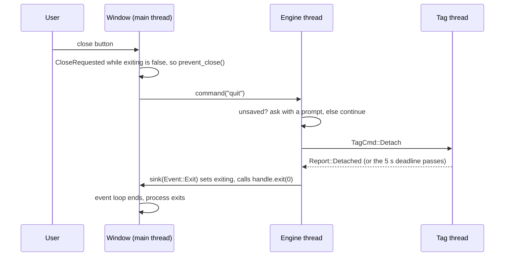
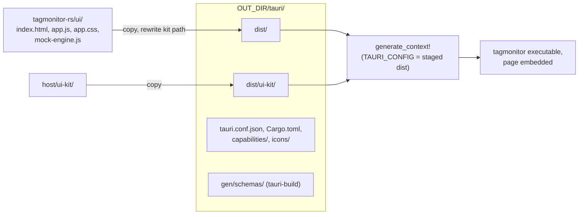

# 10. The Tauri shell: how a Rust program gets a window

Each of the three desktop applications is a toolkit-free Rust engine (the
`core` crate, chapter 11), a web page (chapter 12), and between them a shell
of about 150 lines that opens a window, loads the page into it and passes
messages both ways. This chapter reads Tag Monitor's shell in full:
`host/applications/tagmonitor-rs/app/` (`src/main.rs`, `build.rs`,
`tauri.conf.json`, `capabilities/default.json`, `Cargo.toml`) and the CMake
that builds and packages it. Afterwards you will be able to say, for any
click in the window, which Rust function receives it and on which thread,
and how the page's files end up inside the executable.

The architecture is in [chapter 10 of the guide](../guide/10-application-pattern.md)
("The Tauri shell") and Tag Monitor's own
[UI/engine contract](../../applications/tagmonitor-rs/design/ui-engine-contract.md);
this chapter is the code reading behind them.

## What Tauri is, in Qt terms

**Library: Tauri** (crate `tauri` 2.12.5 in `host/Cargo.lock`). Tauri is a
Rust application framework. The Rust process is the application: it owns the
event loop and the native window. Inside the window it puts the operating
system's own web view -- WKWebView (WebKit) on macOS, WebView2 (Edge's
Chromium) on Windows, WebKitGTK 4.1 on Linux -- and that web view shows a
page, which is the user interface. Nothing like Chromium or Node.js is
bundled, which is why the macOS Tag Programmer is about 21 MB where qtprogram
was about 51 MB
([its packaging page](../../applications/tagprogram-rs/design/build-and-packaging.md)).

The page and the Rust process talk over Tauri's IPC bridge, in two ways:

- **invoke**: the page calls `invoke("name", {args})`; Tauri finds the Rust
  function registered under that name (a *command*), converts the JSON
  arguments to its parameters, runs it, and resolves the JavaScript promise
  with its return value converted back to JSON.
- **events**: Rust calls `emit("event", payload)`; every page that called
  `listen("event", callback)` gets the payload as JSON.

Plugins (`tauri-plugin-*` crates) add native features with both a Rust half
and a JavaScript API, and *capabilities* (JSON files) say which of those APIs
the page may call.

If you think of it as a Qt application, the pieces line up like this:

| Qt (qtmonitor) | Tauri (tagmonitor) |
| --- | --- |
| `QApplication app; ... app.exec();` | `tauri::Builder::default() ... .run(context)` |
| a `QQmlApplicationEngine` loading `main.qml` | the OS web view loading `index.html` |
| QML files compiled into the binary from a `.qrc` by `rcc` | the page directory embedded by `tauri::generate_context!()` |
| a `Q_INVOKABLE` method or slot called from QML | a `#[tauri::command]` function called with `invoke` |
| a C++ signal connected to a QML handler | `AppHandle::emit` and the page's `listen` |
| a context property (`setContextProperty("engine", ...)`) | managed state (`app.manage(engine)`) injected into commands |
| `QSettings` | `settings.json` in the platform app config directory |
| `QFileDialog::getOpenFileName` | the dialog plugin, called by the page |
| `QDesktopServices::openUrl` | the opener plugin, called by the page |
| `closeEvent(QCloseEvent*)` with `ignore()` | `on_window_event` with `api.prevent_close()` |

There is one big difference. A QML engine and its C++ objects share one
address space: QML can hold a pointer to a `QObject` and call it
synchronously. The web view is a separate process (WebKit and WebView2 both
run pages out of process), so everything that crosses is serialised to JSON
and every call from the page is asynchronous. The design leans into that:
the page never asks the engine for individual values, it receives the whole
view state as one JSON object (chapter 11).

Tauri was chosen when Tag Programmer was ported
([decision 0035](../../../docs/decisions/0035-host-tagprogram-rs.md)): a web
page can use existing plotting and 3-D libraries, which Tag View and Tag
Calibrator need; egui and Slint were considered and declined. These
applications use only a small slice of it:

- two commands, `command` and `query`, and two events, `state` and `log`;
- the `dialog` and `opener` plugins, which only the page calls;
- one window, configured in `tauri.conf.json`, and one capability file;
- `tauri-build` in `build.rs`, and `generate_context!` to embed the page.

They do not use the Tauri CLI (`cargo tauri ...`; a plain `cargo build`
does everything), Tauri's bundler, installer or updater (CMake packages the
applications), native menus of their own (the page draws its menu bar from
the `menus` query), trays, several windows, IPC channels, or Tauri state
wrapped in a `Mutex`. One native menu does exist on macOS: the builder never
calls `enable_macos_default_menu(false)`, so Tauri installs its default
application menu (About, Hide, Quit, a File menu with Close Window, and Edit,
View, Window and Help menus) above the page's own menu bar.

## The files

| File | Lines | What it is |
| --- | --- | --- |
| [app/Cargo.toml](../../applications/tagmonitor-rs/app/Cargo.toml) | 37 | The binary crate `tagmonitor`: Tauri, two plugins, the core |
| [app/src/main.rs](../../applications/tagmonitor-rs/app/src/main.rs) | 155 | The shell: two commands, the event sink, the close hook |
| [app/tauri.conf.json](../../applications/tagmonitor-rs/app/tauri.conf.json) | 30 | Product name, identifier, the window, security |
| [app/capabilities/default.json](../../applications/tagmonitor-rs/app/capabilities/default.json) | 16 | What the page may call |
| [app/build.rs](../../applications/tagmonitor-rs/app/build.rs) | 146 | Stages the page, sets `TAURI_CONFIG`, runs `tauri_build` |
| `app/icons/` | -- | `icon.png`, `icon.icns`, `icon.ico` |
| [CMakeLists.txt](../../applications/tagmonitor-rs/CMakeLists.txt) | 82 | Runs cargo; installs the program per platform |
| [cmake/Info.plist.in](../../applications/tagmonitor-rs/cmake/Info.plist.in) | 36 | The macOS bundle's `Info.plist` |

## The crate manifest

[app/Cargo.toml:10-29](../../applications/tagmonitor-rs/app/Cargo.toml#L10):

```toml
[dependencies]
tagmonitor-core = { path = "../core" }
tauri = { version = "2", features = [] }
tauri-plugin-dialog = "2"
tauri-plugin-opener = "2"
serde_json = "1"
log = "0.4"

# Already in the graph through Tauri; named here to opt out of App Nap.
[target.'cfg(target_os = "macos")'.dependencies]
objc2-foundation = { version = "0.3.2", default-features = false, features = ["std", "NSObject", "NSProcessInfo", "NSString"] }

[build-dependencies]
tauri-build = { version = "2", features = [] }
serde_json = "1"

[features]
# Download Data... through the C++ SQLite writer; needs libtagcore_c and
# TAGCORE_C_LIB_DIR (see ../core/Cargo.toml).
sqlitelog = ["tagmonitor-core/sqlitelog"]
```

The shell depends on the core crate by path; every rule is there. The two
plugin crates are registered in `main` and never called from Rust.
`serde_json` is here only to build the `log` event's payload and the `quit`
command's empty arguments (chapter 11 introduces it properly).

> **Rust:** `[target.'cfg(target_os = "macos")'.dependencies]` is a
> dependency that exists only when compiling for macOS -- the manifest-level
> twin of `#if defined(__APPLE__)` around an `#include` plus its link line.
> `[build-dependencies]` are crates used by `build.rs`, which is compiled and
> run on the build machine before the crate itself.

> **Rust:** a Cargo *feature* is a named compile-time switch that can also
> pull in dependencies, roughly a `-D` option that the build system
> understands. `sqlitelog = ["tagmonitor-core/sqlitelog"]` turns on the core's
> feature of the same name, which links the C++ SQLite writer. CMake always
> builds with it on; a bare `cargo build -p tagmonitor` leaves it off and
> Download Data refuses with a message.

## main.rs, top to bottom

### The crate attribute and the imports

[main.rs:18-26](../../applications/tagmonitor-rs/app/src/main.rs#L18):

```rust
#![cfg_attr(not(debug_assertions), windows_subsystem = "windows")]

use std::path::{Path, PathBuf};
use std::sync::Arc;
use std::sync::atomic::{AtomicBool, Ordering};

use serde_json::{Value, json};
use tagmonitor_core::engine::{self, Engine, EngineConfig, Event};
use tauri::{Emitter, Manager, State, WindowEvent};
```

> **Rust:** `#![...]` (with `!`) is an attribute on the whole crate.
> `cfg_attr(condition, attribute)` applies the attribute only when the
> condition holds. Here: in release builds (`debug_assertions` off), link the
> Windows executable for the GUI subsystem, so no console window opens -- the
> MSVC `/SUBSYSTEM:WINDOWS` that `WIN32_EXECUTABLE` gives a CMake target.
> Debug builds keep the console for the log. Other platforms ignore it.

> **Rust:** `Emitter` and `Manager` are traits, and a trait's methods can be
> called only when the trait is in scope. `handle.emit(...)` resolves because
> of `Emitter`; `app.path()`, `app.manage(...)` and `window.state()` because of
> `Manager`. Nothing in the file names either trait again, which surprises a
> C++ reader looking for where `emit` comes from.

### The two commands

[main.rs:28-48](../../applications/tagmonitor-rs/app/src/main.rs#L28):

```rust
/// The contract's `invoke("command", {cmd, args})`: queued for the engine
/// thread; the page learns the outcome from the next `state` event.
#[tauri::command]
fn command(engine: State<'_, Engine>, cmd: String, args: Value) {
    engine.command(&cmd, args);
}

/// The contract's `invoke("query", {name, args})`. The engine answers on its
/// own thread, so the wait is kept off the main thread.
///
/// # Errors
///
/// Only when the blocking task itself fails (panics or is cancelled); the
/// join error's text is returned to the page as the rejected promise.
#[tauri::command]
async fn query(engine: State<'_, Engine>, name: String, args: Value) -> Result<Value, String> {
    let engine = engine.inner().clone();
    tauri::async_runtime::spawn_blocking(move || engine.query(&name, args))
        .await
        .map_err(|e| e.to_string())
}
```

These are the only two functions the page can call in Rust. Everything the
user does -- every menu item, button, form edit and dialog answer -- arrives
as `command` with a name and a JSON object; everything the page needs to ask
arrives as `query`. The shell does not know any command or query by name: it
passes the string and the untyped `serde_json::Value` straight to the
engine, which validates them.

> **Rust:** `#[tauri::command]` is an *attribute macro*: at compile time it
> generates a wrapper that takes the invoke message, pulls `cmd` and `args`
> out of the JSON argument object by parameter name, converts them to
> `String` and `Value`, calls the function, and converts the return value to
> JSON. It is code generation, as `moc` generates the glue behind
> `Q_INVOKABLE`. A parameter of type `State<'_, T>` is not taken from the
> page: Tauri fills it from the managed state (below).

`command` is synchronous, and Tauri 2 runs a synchronous command on the main
(event-loop) thread. That is acceptable because `Engine::command` only puts a
message on a channel and returns; the promise in the page resolves with
`null` at once, and the effect shows up in a later `state` event.

`query` has to wait for the engine's answer (up to 10 s, chapter 11), and
must not do that on the main thread, which would freeze the window exactly
as a blocking call in a Qt slot freezes the GUI. So it is `async`: Tauri runs
async commands on its async runtime (Tauri bundles tokio and exposes it as
`tauri::async_runtime`). Inside, `spawn_blocking` moves the blocking wait
onto the runtime's pool of threads meant for blocking work, and `.await`
suspends the command until that finishes.

> **Rust:** `async fn` returns a future (a state machine the runtime polls)
> instead of running to completion; `.await` suspends it until the awaited
> future is ready. There is no direct C++ counterpart in this code base; think
> of `QFuture` plus a continuation. `spawn_blocking(closure)` runs an
> ordinary blocking closure on a separate thread and gives back a future of
> its result.

> **Rust:** `engine.inner().clone()` -- `State<'_, Engine>` is a borrow of the
> value Tauri stores, and a borrow cannot be moved into a closure that runs on
> another thread and may outlive the call. Cloning `Engine` copies only its
> channel sender (cheap, like copying a `std::shared_ptr`), and the clone is
> moved into the closure with `move`.

`query` returns `Result<Value, String>`: `Ok(value)` resolves the page's
promise with the JSON, `Err(text)` rejects it. The only `Err` is a failed
blocking task (`map_err` turns the join error into its text). An engine that
does not answer in 10 s gives `Ok(null)`, not a rejection, and an unknown
query name gives `Ok({"error": ...})`. Tauri 2 also requires an async command
that takes a borrowed parameter such as `State<'_, _>` to return a `Result`,
so the signature could not drop it anyway.

### The user guide and App Nap

`user_guide_url` ([main.rs:58-79](../../applications/tagmonitor-rs/app/src/main.rs#L58))
looks for a built copy of the manual page `apps/tagmonitor.html` beside the
executable and up to five directories above it, then in the source tree,
and returns a `file://` URL, or the published manual's URL. It is plain path
searching; the page opens the result with the opener plugin.

[main.rs:89-100](../../applications/tagmonitor-rs/app/src/main.rs#L89):

```rust
fn stay_awake() {
    #[cfg(target_os = "macos")]
    {
        use objc2_foundation::{NSActivityOptions, NSProcessInfo, NSString};
        let reason = NSString::from_str("Keeping an attached tag awake");
        let token = NSProcessInfo::processInfo().beginActivityWithOptions_reason(
            NSActivityOptions::UserInitiatedAllowingIdleSystemSleep,
            &reason,
        );
        std::mem::forget(token);
    }
}
```

This is not Tauri. A tag goes to sleep after about 4.5 s without a host
request, and the tag thread's 400 ms status poll is what keeps an attached
tag awake. macOS App Nap throttles the timers of an application whose window
is in the background, which stretched that poll past the tag's limit (Tag
Programmer found this first). `beginActivityWithOptions:reason:` opts the
process out, for as long as the returned token lives.

**Library: objc2-foundation** (0.3.2, macOS only). Rust bindings to Apple's
Foundation framework, generated from the SDK headers; Tauri already depends
on it, so naming it costs nothing. Only `NSProcessInfo` and `NSString` are
used.

> **Rust:** `#[cfg(target_os = "macos")]` on a block compiles the block only
> for macOS, like `#ifdef __APPLE__`. `std::mem::forget(token)` takes
> ownership of a value and never runs its destructor. The token is an
> Objective-C object held by a reference-counting smart pointer (objc2's
> `Retained`, close to an `std::shared_ptr` over `retain`/`release`);
> dropping it would release the token and end the activity, so leaking it
> keeps the process out of App Nap until it exits. In Objective-C you would
> keep a strong reference to the token for the life of the process.

### main: building the application

[main.rs:110-143](../../applications/tagmonitor-rs/app/src/main.rs#L110):

```rust
fn main() {
    stay_awake();
    // Set once the engine allows the exit, so the close it causes is let
    // through.
    let exiting = Arc::new(AtomicBool::new(false));
    let exiting_close = exiting.clone();
    tauri::Builder::default()
        .plugin(tauri_plugin_dialog::init())
        .plugin(tauri_plugin_opener::init())
        .setup(move |app| {
            let paths = app.path();
            let config = EngineConfig {
                settings_path: paths.app_config_dir()?.join("settings.json"),
                home_dir: paths.home_dir()?,
                user_guide_url: Some(user_guide_url()),
                auto_attach: std::env::var_os("TAGMONITOR_NO_ATTACH").is_none(),
            };
            let _ = log::set_logger(&engine::LOGGER);
            let handle = app.handle().clone();
            let engine = engine::spawn(config, move |event| match event {
                Event::State(state) => {
                    let _ = handle.emit("state", state);
                }
                Event::Log { level, text } => {
                    let _ = handle.emit("log", json!({ "level": level, "text": text }));
                }
                Event::Exit => {
                    exiting.store(true, Ordering::Relaxed);
                    handle.exit(0);
                }
            });
            app.manage(engine);
            Ok(())
        })
```

`tauri::Builder::default()` starts a builder: each method configures it and
returns it, and the chain ends in `.run(...)`, which enters the event loop.
It is the same idea as constructing a `QApplication`, setting it up, then
calling `exec()`.

`.plugin(...)` registers the two plugins. **Library: tauri-plugin-dialog**
(2.8.3) gives the page native open and save dialogs
(`window.__TAURI__.dialog.open` / `.save`); **library: tauri-plugin-opener**
(2.7.2) opens URLs and files with the system's handler and reveals files in
the Finder or Explorer. Rust registers them and nothing more; chapter 12
shows the calls.

`.setup(closure)` runs once, on the main thread, after Tauri has built the
application and before the first event is processed: the place for what a
Qt `main` does between constructing `QApplication` and `exec()`. Here it:

1. **Builds the engine's configuration.** `app.path()` is Tauri's path
   resolver. `app_config_dir()` is the per-application configuration folder
   derived from the `identifier` in `tauri.conf.json`
   (`com.tagdesigns.tagmonitor`; on macOS
   `~/Library/Application Support/com.tagdesigns.tagmonitor`), and
   `settings.json` there replaces qtmonitor's `QSettings`.
   `TAGMONITOR_NO_ATTACH` in the environment stops the automatic attach.
2. **Installs the logger** (`engine::LOGGER`, chapter 11). `log::set_logger`
   can succeed only once per process; the result is ignored on purpose.
3. **Starts the engine** with `engine::spawn`, passing a *sink*: the closure
   the engine calls for every `Event`. It returns an `Engine` handle.
4. **Stores the handle** with `app.manage(engine)`, so Tauri can hand it to
   every command as `State<'_, Engine>`.

> **Rust:** `?` after `app_config_dir()` returns early from the closure with
> the error if there is one, like a `return` of an error code after a failed
> call. Because `setup` returns a `Result`, an error makes `.run()` fail and
> the `.expect(...)` at the end of `main` panics with "error while running
> Tag Monitor". The closure's final `Ok(())` is its success value.

The sink is where the engine's events become Tauri events. It is called on
the engine thread for `State` and `Exit`, and on whichever thread logged for
`Log` (often the tag thread). That is safe because `AppHandle` is a cheap,
cloneable handle that may be used from any thread; `emit` serialises the
payload to JSON and posts it to the web view, much as emitting a signal from
a worker thread to an object in the GUI thread queues a call there. `emit`
returns a `Result` (the web view may be gone during shutdown), and `let _ =`
discards it deliberately.

> **Rust:** `move |event| match event { ... }` is a closure that takes
> ownership of what it captures (`handle` and `exiting`), like a C++ lambda
> capturing by value with `[handle = std::move(handle)]`. The engine thread
> calls it long after `setup` returns, so it must own its captures; borrowing
> them from `setup`'s stack would not compile. The `match` must handle every
> variant of `Event`; adding a variant in the core makes this file fail to
> compile until it is handled.

> **Rust:** `Arc<AtomicBool>` is a reference-counted shared boolean
> (`std::shared_ptr<std::atomic<bool>>`). Two clones exist, `exiting` and
> `exiting_close`, because two different `move` closures need it: the sink
> (which sets it) and the window-event hook (which reads it). Each closure
> takes ownership of its own clone. `Ordering::Relaxed` is
> `std::memory_order_relaxed`; only the flag itself is shared.

### main: the close hook, the command table and run

[main.rs:144-155](../../applications/tagmonitor-rs/app/src/main.rs#L144):

```rust
        .on_window_event(move |window, event| {
            if let WindowEvent::CloseRequested { api, .. } = event
                && !exiting_close.load(Ordering::Relaxed)
            {
                api.prevent_close();
                window.state::<Engine>().command("quit", json!({}));
            }
        })
        .invoke_handler(tauri::generate_handler![command, query])
        .run(tauri::generate_context!())
        .expect("error while running Tag Monitor");
}
```

**Closing the window is the engine's decision.** The configuration may have
unsaved changes, and an attached tag should be detached before the process
ends. So a close request (the red button, File > Close Window) is vetoed and
turned into the engine command `quit`, which is what the page's File > Quit
also sends. The engine may ask about unsaved changes, then detaches, then
emits `Event::Exit`; the sink sets `exiting` and calls `handle.exit(0)`,
which asks the event loop to end (Tauri raises `RunEvent::ExitRequested`,
which nothing here prevents, and the loop exits without sending the window
another `CloseRequested`). The flag is a guard: any close request that does
arrive after the exit was allowed is let through instead of becoming a
second `quit`. If the tag
never acknowledges the detach, the engine exits anyway after 5 s
(chapter 11).



This is the Qt pattern of overriding `closeEvent`, calling
`event->ignore()`, and later calling `qApp->quit()` yourself.

> **Rust:** `if let Pattern = value && condition { ... }` is a *let chain*
> (stable from Rust 1.88, edition 2024): the body runs only if `event`
> matches `WindowEvent::CloseRequested` -- binding its `api` field, with `..`
> ignoring the rest -- and the flag is false. The whole match-and-test is one
> expression, where C++ would need a `dynamic_cast` or a `switch` followed by
> an `if`.

`window.state::<Engine>()` is the same managed-state lookup that fills a
command's `State<'_, Engine>`, made explicitly from a window handle.

> **Rust:** `::<Engine>` is the *turbofish*: an explicit generic argument,
> like `window.state<Engine>()` in C++, needed here because nothing else
> tells the compiler which type to look up.

`.invoke_handler(tauri::generate_handler![command, query])` is the command
table. `generate_handler!` is a function-like macro that builds one dispatch
function mapping the strings `"command"` and `"query"` to the two functions'
generated wrappers. A name not in the list is rejected in the page with an
error.

`.run(tauri::generate_context!())` builds the *context*, then runs the event
loop until the application exits. `generate_context!` runs at compile time:
it reads `tauri.conf.json` (merged with the `TAURI_CONFIG` that `build.rs`
sets), the capabilities that `tauri-build` processed, and the icons, and it
**embeds every file of the `frontendDist` directory into the executable**,
compressed. The page is served to the web view from those bytes through a
custom URL scheme (`tauri://localhost` on macOS and Linux,
`http://tauri.localhost` on Windows), as a Qt application serves `qrc:/`
resources compiled in by `rcc`. There is no loose page on disk in the
installed application.

### Where the other two shells differ

Tag Monitor's shell is Tag Programmer's with two changes, and Tag
Calibrator's is Tag Monitor's with different environment variables
(chapter 14 compares them):

- **Tag Programmer** has no `on_window_event` and no `exiting` flag; its
  engine has no `Exit` event, so the window simply closes. Its sink handles
  two variants. Its `EngineConfig` holds a firmware cache folder (under the
  app data directory) and a documents folder in place of `home_dir` and
  `auto_attach`.
- **Tag Calibrator** intercepts the close exactly as Tag Monitor does, and
  reads `TAGCALIBRATE_REPLAY` (replay a capture file instead of a tag) and
  `TAGCALIBRATE_NO_ATTACH` in `setup`. It keeps no settings file, so its
  `EngineConfig` has no `settings_path`; it has `replay` and
  `replay_period` instead.

## tauri.conf.json

[app/tauri.conf.json](../../applications/tagmonitor-rs/app/tauri.conf.json), all of it:

```json
{
  "$schema": "https://schema.tauri.app/config/2",
  "productName": "Tag Monitor",
  "version": "2.1.0",
  "identifier": "com.tagdesigns.tagmonitor",
  "build": {
    "frontendDist": "dist"
  },
  "app": {
    "withGlobalTauri": true,
    "windows": [
      {
        "label": "main",
        "title": "Tag Monitor v2.1",
        "width": 1100,
        "height": 640,
        "minWidth": 1000,
        "minHeight": 480
      }
    ],
    "security": {
      "csp": null
    }
  },
  "bundle": {
    "active": true,
    "targets": "all",
    "icon": ["icons/icon.png", "icons/icon.icns", "icons/icon.ico"]
  }
}
```

| Key | Effect here |
| --- | --- |
| `productName`, `version` | Tauri's package information. The window's title comes from the engine's view state (the page sets it), the bundle's version from CMake, so neither is user-visible. |
| `identifier` | Names the app config directory (`settings.json`). CMake's `Info.plist.in` uses the same string as `CFBundleIdentifier`. |
| `build.frontendDist` | The directory to embed. `"dist"` is not what is used: `build.rs` overrides it with the absolute path of a staged copy (next section). |
| `app.withGlobalTauri` | Injects `window.__TAURI__` into the page, holding the core API (`core.invoke`, `event.listen`, `window`) and each plugin's API. The page is plain scripts with no bundler and no `import`, so this global is how it reaches Tauri ([kit.js:24](../../ui-kit/kit.js#L24)). |
| `app.windows` | One window, label `main`, 1100 x 640, minimum 1000 x 480. The capability file grants permissions to the window by this label. The title here shows only until the first `state` event. |
| `app.security.csp` | `null`: Tauri injects no Content-Security-Policy, so the page may run inline scripts and load anything. It loads only its own embedded files. |
| `bundle` | Settings for Tauri's bundler, which is never run. |

## The capabilities

[app/capabilities/default.json](../../applications/tagmonitor-rs/app/capabilities/default.json), all of it:

```json
{
  "$schema": "../gen/schemas/desktop-schema.json",
  "identifier": "default",
  "description": "The main window: engine events, file dialogs, the window title, and opening the user guide.",
  "windows": ["main"],
  "permissions": [
    "core:default",
    "core:window:allow-set-title",
    "dialog:default",
    "opener:default",
    {
      "identifier": "opener:allow-open-url",
      "allow": [{ "url": "file://**" }]
    }
  ]
}
```

Tauri 2 denies a page every API call that no capability grants. This file
grants, to the window labelled `main`:

| Permission | Lets the page |
| --- | --- |
| `core:default` | use events (`listen`) and the default window, path and app APIs. The application's own commands, `command` and `query`, need no entry: Tauri allows an application's commands by default unless its build declares permissions for them, and this one does not |
| `core:window:allow-set-title` | set the native window title from `state.title`, which carries the document's name |
| `dialog:default` | show the open and save dialogs (and message dialogs, unused) |
| `opener:default` | open http(s) and mailto URLs, and reveal a file in its folder |
| `opener:allow-open-url` with `file://**` | open a local `file://` URL: the installed user guide |

There is nothing like this in Qt, where QML can call anything it is given.
It matters to Tauri because the web view could in principle show remote
content; here it documents exactly what the page uses. Tag Calibrator's
file is the same; Tag Programmer's lacks `core:window:allow-set-title`, since
its title never changes (its page still calls `setTitle`, and the kit
swallows the refusal, [kit.js:122-132](../../ui-kit/kit.js#L122)).

The `$schema` path, `../gen/schemas/desktop-schema.json`, is an editor hint.
`tauri-build` writes that schema into the staging directory described next,
where the path resolves; in the source tree it points at nothing.

## build.rs: staging the page

**Library: tauri-build** (2.7.4). The build-script half of Tauri: it reads
`tauri.conf.json` and the capability files, checks them, generates the
permission schemas under `gen/schemas`, and prepares what
`generate_context!` compiles in (on Windows also the executable's resources).
It is called once, as `tauri_build::build()`.

> **Rust:** `build.rs` is Cargo's build script: a small Rust program that
> Cargo compiles and runs before compiling the crate, in the role of a CMake
> custom command that generates sources. It talks to Cargo by printing lines:
> `cargo:rerun-if-changed=<path>` (rerun me when this changes),
> `cargo:rustc-env=NAME=VALUE` (set an environment variable for the crate's
> compilation, readable with `env!`), `cargo:rustc-link-arg-bins=...` (a
> linker argument for the binaries). Cargo gives it `CARGO_MANIFEST_DIR`,
> `OUT_DIR` (a private scratch directory under the target directory) and
> `CARGO_FEATURE_*` / `CARGO_CFG_*` variables.

**Why stage at all.** The page in `tagmonitor-rs/ui/` loads the shared UI kit
from `host/ui-kit/` by the relative path `../../../ui-kit/`
([index.html:14-32](../../applications/tagmonitor-rs/ui/index.html#L14)), so
it also opens as a plain file in a browser against a mock engine. Tauri
embeds exactly one directory, and the kit is outside the application. So
`build.rs` assembles one directory under `OUT_DIR`, with the kit inside it
and the path rewritten, and runs tauri-build there because tauri-build writes
`gen/schemas` relative to its working directory and the release build runs
with the source tree read-only.

[build.rs:13-20](../../applications/tagmonitor-rs/app/build.rs#L13) (from the
file's doc comment) shows the result:

```rust
//! Layout of `$OUT_DIR/tauri`, rebuilt from scratch on every run:
//!
//! ```text
//! dist/            ../ui files, *.html with KIT_HREF rewritten to ui-kit/
//! dist/ui-kit/     host/ui-kit files
//! capabilities/    icons/    tauri.conf.json    Cargo.toml
//! gen/schemas/     written by tauri-build
//! ```
```

[build.rs:36-62](../../applications/tagmonitor-rs/app/build.rs#L36) (doc
comments on `copy_dir` dropped):

```rust
const KIT_HREF: &str = "../../../ui-kit/";

// ...
fn copy_dir(from: &Path, to: &Path, rewrite: bool) {
    fs::create_dir_all(to).expect("create staging directory");
    for entry in fs::read_dir(from).unwrap_or_else(|e| panic!("read {}: {e}", from.display())) {
        let path = entry.expect("dir entry").path();
        if path.is_dir() {
            continue;
        }
        let dest = to.join(path.file_name().expect("file name"));
        if rewrite && path.extension().is_some_and(|e| e == "html") {
            let html = fs::read_to_string(&path).expect("read html");
            fs::write(&dest, html.replace(KIT_HREF, "ui-kit/")).expect("write html");
        } else {
            fs::copy(&path, &dest).expect("copy file");
        }
    }
}
```

Only the top level of a directory is copied, and only `.html` files are
rewritten (the scripts and stylesheets they load carry no kit path). Every
failure is a panic, and a panicking build script fails the build with its
message, which is the right behaviour for a build step.

> **Rust:** `.expect("msg")` unwraps a `Result` or `Option`, panicking with
> the message if it holds an error or nothing; `unwrap_or_else(|e| panic!(...))`
> does the same with a message built from the error. In application code
> these would be bugs waiting to happen; in a build script, aborting is the
> error handling.

[build.rs:72-94](../../applications/tagmonitor-rs/app/build.rs#L72) does the
staging:

```rust
fn main() {
    let manifest = PathBuf::from(std::env::var("CARGO_MANIFEST_DIR").expect("manifest dir"));
    let stage = PathBuf::from(std::env::var("OUT_DIR").expect("OUT_DIR")).join("tauri");
    let _ = fs::remove_dir_all(&stage);

    let dist = stage.join("dist");
    copy_dir(&manifest.join("../ui"), &dist, true);
    copy_dir(
        &manifest.join("../../../ui-kit"),
        &dist.join("ui-kit"),
        false,
    );
    copy_dir(
        &manifest.join("capabilities"),
        &stage.join("capabilities"),
        false,
    );
    copy_dir(&manifest.join("icons"), &stage.join("icons"), false);
    // tauri-build reads both from its working directory: the configuration,
    // and the manifest to check the tauri crate's features against it.
    for file in ["tauri.conf.json", "Cargo.toml"] {
        fs::copy(manifest.join(file), stage.join(file)).expect("copy config");
    }
```

Then [build.rs:96-119](../../applications/tagmonitor-rs/app/build.rs#L96)
tells Cargo what to watch and points `generate_context!` at the staged page:

```rust
    for watched in [
        "../ui",
        "../../../ui-kit",
        "capabilities",
        "icons",
        "tauri.conf.json",
        "Cargo.toml",
    ] {
        println!(
            "cargo:rerun-if-changed={}",
            manifest.join(watched).display()
        );
    }
    // The page generate_context! embeds: the staged copy, by absolute path.
    // Canonical, because Tauri reads frontendDist as a URL when it can: a
    // Windows path such as `d:/a/...` parses as one (scheme `d`), and then
    // nothing is embedded and the window finds no index.html. The canonical
    // form there, `\\?\D:\a\...`, cannot.
    let dist = dist.canonicalize().expect("canonical staging path");
    let config = format!(
        r#"{{"build":{{"frontendDist":{}}}}}"#,
        serde_json::to_string(&dist.to_string_lossy()).expect("path as JSON")
    );
    println!("cargo:rustc-env=TAURI_CONFIG={config}");
```

The `rerun-if-changed` lines matter: without them Cargo would not rerun the
build script when only a page file changed, and the binary would keep the
old page. With them, editing `ui/app.js` or `host/ui-kit/kit.css` and
running `cargo build` again embeds the new file.

`TAURI_CONFIG` is how Tauri accepts a configuration patch from the
environment: `generate_context!` merges the JSON over `tauri.conf.json`, so
the embedded `frontendDist` is the absolute staged path. The comment records
a Windows failure: an absolute path like `d:/a/...` parses as a URL with
scheme `d`, Tauri then treats `frontendDist` as a dev-server URL and embeds
nothing; the canonical `\\?\D:\...` form does not parse as a URL.

> **Rust:** `r#"..."#` is a raw string: no escapes, so the quotes need no
> backslashes. Inside `format!`, `{{` and `}}` are literal braces and `{}` is
> the argument, so the result is `{"build":{"frontendDist":"/abs/path"}}`.
> `serde_json::to_string` quotes and escapes the path for JSON (backslashes on
> Windows); that is the only reason `serde_json` is a build dependency.

[build.rs:121-142](../../applications/tagmonitor-rs/app/build.rs#L121) adds
one thing Tag Programmer's build script does not have: with the `sqlitelog`
feature, off Windows, when `libtagcore_c` is linked as a shared library
(the default everywhere but macOS), it prints
`cargo:rustc-link-arg-bins=-Wl,-rpath,<dir>`, taking the directory from
`TAGCORE_C_RPATH` (the package's `$ORIGIN/../lib`) or else
`TAGCORE_C_LIB_DIR` (the build tree). That is the rpath the Linux package
relies on. Finally, [build.rs:144-145](../../applications/tagmonitor-rs/app/build.rs#L144):

```rust
    std::env::set_current_dir(&stage).expect("enter staging directory");
    tauri_build::build()
```



The staged `dist/` also contains `mock-engine.js` and the page loads it in
the app too; [kit.js:51-62](../../ui-kit/kit.js#L51) ignores the mock when
`window.__TAURI__` exists.

## How CMake builds and ships it

Cargo builds the executable; CMake runs Cargo and packages the result.
Tauri's bundler is never run.

[host/CMakeLists.txt:554-558](../../CMakeLists.txt#L554) adds the Rust
applications when `BUILD_RUST_APPS` is on (the default), and the host build
also builds `tagcore_c` whenever they are on. The application's own file is
short; [CMakeLists.txt:42-44](../../applications/tagmonitor-rs/CMakeLists.txt#L42):

```cmake
host_rust_app(tagmonitor PACKAGE tagmonitor OUTPUT _tagmonitor_bin
  FEATURES sqlitelog LINKS_TAGCORE_C
  COMMENT "Building Tag Monitor (tagmonitor-rs) with cargo")
```

`host_rust_app` is in the repository's
[cmake/HostRust.cmake](../../../cmake/HostRust.cmake#L142). Its core is one
custom target, [HostRust.cmake:165-175](../../../cmake/HostRust.cmake#L165):

```cmake
  add_custom_target(
    ${target} ALL
    COMMAND ${CMAKE_COMMAND} -E env ${_env}
            "${CARGO_EXECUTABLE}" build --release --locked -p ${ARG_PACKAGE} ${_features}
    COMMAND ${CMAKE_COMMAND} -E make_directory "${CMAKE_BINARY_DIR}/$<CONFIG>/bin"
    COMMAND ${CMAKE_COMMAND} -E copy_if_different "${_bin}" "${CMAKE_BINARY_DIR}/$<CONFIG>/bin"
    WORKING_DIRECTORY "${HOST_RUST_WORKSPACE_DIR}"
    BYPRODUCTS "${_bin}"
    COMMENT "${ARG_COMMENT}"
    USES_TERMINAL
    VERBATIM)
```

- It always runs; Cargo decides what is out of date.
- `--locked` builds exactly the committed `host/Cargo.lock`, and the working
  directory is the workspace, `host/`.
- `${_env}` (from `_host_rust_environment`, [HostRust.cmake:83-102](../../../cmake/HostRust.cmake#L83))
  sets `CARGO_TARGET_DIR=<build>/host/cargo`, shared by every Rust target in
  the build tree, and `MACOSX_DEPLOYMENT_TARGET` on macOS. With
  `LINKS_TAGCORE_C` it adds `TAGCORE_C_LIB_DIR=<build>/<Config>/lib`, on
  Linux `TAGCORE_C_RPATH=$ORIGIN/../lib`, and a target dependency on
  `tagcore_c_static` (macOS, linked into the executable) or `tagcore_c`
  (elsewhere, a shared library installed once for all applications).
- The executable is copied to `<build>/<Config>/bin` beside the C++
  programs.

The install rules, [CMakeLists.txt:57-82](../../applications/tagmonitor-rs/CMakeLists.txt#L57):

```cmake
if(APPLE)
  set(_bundle "${HOST_BUNDLE_INSTALL_DIR}/tagmonitor.app")
  configure_file(cmake/Info.plist.in "${CMAKE_CURRENT_BINARY_DIR}/Info.plist" @ONLY)
  install(PROGRAMS "${_tagmonitor_bin}" DESTINATION "${_bundle}/Contents/MacOS")
  install(FILES "${CMAKE_CURRENT_BINARY_DIR}/Info.plist" DESTINATION "${_bundle}/Contents")
  install(FILES app/icons/icon.icns DESTINATION "${_bundle}/Contents/Resources")
  if(MACOS_SIGN_APPS AND MACOS_CODE_SIGN_IDENTITY)
    find_program(CODESIGN_EXECUTABLE codesign REQUIRED)
    install(CODE "
      include(\"${PROJECT_SOURCE_DIR}/cmake/MacosCodesignBundle.cmake\")
      macos_codesign_bundle(
          BUNDLE \"\${CMAKE_INSTALL_PREFIX}/${_bundle}\"
          IDENTITY \"${MACOS_CODE_SIGN_IDENTITY}\"
          ENTITLEMENTS \"${MACOS_CODE_SIGN_ENTITLEMENTS}\"
          CODESIGN \"${CODESIGN_EXECUTABLE}\")
    ")
  endif()
elseif(WIN32)
  install(PROGRAMS "${_tagmonitor_bin}" DESTINATION "${HOST_WINDOWS_APPDIR}")
  install(
    PROGRAMS "$<TARGET_FILE:tag_tools_launcher_gui>"
    DESTINATION "${CMAKE_INSTALL_BINDIR}"
    RENAME "tagmonitor${CMAKE_EXECUTABLE_SUFFIX}")
else()
  install(PROGRAMS "${_tagmonitor_bin}" DESTINATION "${HOST_BUNDLE_INSTALL_DIR}/bin")
endif()
```

On macOS CMake assembles the `.app` by hand: a single executable in
`Contents/MacOS` (the page is inside it), an `Info.plist`, and the icon. A
Tauri `.app` needs nothing else -- no frameworks, no plug-ins, nothing like
`macdeployqt`. [Info.plist.in](../../applications/tagmonitor-rs/cmake/Info.plist.in)
sets `CFBundleIdentifier` to `com.tagdesigns.tagmonitor`, the version to
`@ULTRALIGHT_PACKAGE_VERSION@` (the host package version, not the `2.1.0` in
`tauri.conf.json`), `LSMinimumSystemVersion` to the deployment target, and
the Documents, Desktop and Downloads usage strings macOS shows when the
application first touches those folders. Signing is the same
`macos_codesign_bundle` the Qt bundles use
([cmake/MacosCodesignBundle.cmake](../../../cmake/MacosCodesignBundle.cmake)).

On Windows the program goes to `tag_tools/lib` beside `tagcore_c.dll` and the
MSVC runtime, because Windows finds a program's DLLs only beside it, and the
GUI launcher is installed as `tag_tools/tagmonitor.exe` to start it. On
Linux it goes to `tag_tools/bin`, links the system WebKitGTK 4.1, and finds
`libtagcore_c.so` in `tag_tools/lib` through the rpath `build.rs` added.

Why not Tauri's bundler: it would be a second signing and notarising path
and a second download
([decision 0035](../../../docs/decisions/0035-host-tagprogram-rs.md),
"Alternatives considered"). Tag Monitor's
[build and packaging page](../../applications/tagmonitor-rs/design/build-and-packaging.md)
has the details, including the third-party notices.

## The Rust-JavaScript boundary

This is everything that crosses between the page and Rust in Tag Monitor.
On the JavaScript side every call goes through the UI kit's engine object
([kit.js:51-62](../../ui-kit/kit.js#L51)), which chapter 12 reads.

**Page to Rust, through `invoke`** (application commands, allowed without a permission entry):

| JS call | Rust function | Payload | Reply |
| --- | --- | --- | --- |
| `invoke("command", {cmd, args})` | `command(engine, cmd: String, args: Value)`, main thread | `cmd`: a command name; `args`: an object, `{}` when none | resolves `null` at once; the outcome arrives as a later `state` |
| `invoke("query", {name, args})` | `async query(engine, name: String, args: Value)`, blocking wait on Tauri's pool | `name`: a query name; `args`: `{}` (no query reads them) | resolves with the answer's JSON; `null` if the engine does not answer within 10 s; `{"error": "unknown query <name>"}` for an unknown name; rejects only if the blocking task fails |

**The commands** (`Monitor::command`, chapter 11):

| `cmd` | `args` | Effect |
| --- | --- | --- |
| `attach`, `detach`, `read`, `start`, `stop`, `sync`, `test`, `erase`, `download`, `open`, `save`, `reset` | `{}` | the menu commands; ignored unless the availability rule enables them now |
| `ready` | `{}` | the page is listening: resend the whole state; attach the first time |
| `answer` | `{id, button, index?, path?}` | answers the shown prompt; a stale `id` is ignored |
| `set_field` | `{id, value}` | one edit of a form control |
| `new_config` | `{tagType}` | File > New Configuration > type |
| `open_recent` | `{path}` | File > Open Recent > file |
| `set_approved` | `{on}` | the Approved box |
| `cancel_download` | `{}` | stop the download after its current page |
| `hide_erase` | `{}` | close the erase sheet (the erase continues) |
| `quit` | `{}` | File > Quit, and every window close |
| `set_log_level` | `{level}` | `TRACE`, `DEBUG`, `INFO`, `WARN` or `ERROR` |
| `save_text` | `{path, text}` | Save Error Log |

An unknown `cmd` is logged as a warning.

**The queries** (`Monitor::query`):

| `name` | Answer |
| --- | --- |
| `menus` | `{menus: [{title, entries: [{kind: "command" \| "item" \| "separator", id, label, tooltip, shortcut}]}], newConfigurationTypes: [...]}` |
| `about` | `{title, text}` |
| `user_guide_url` | a URL string, or `null` |
| `default_download_name` | a path string: `untitled.db3` in the home folder |

**Rust to page, through events** (permission `core:default`):

| Event | Emitted by | Payload | Thread |
| --- | --- | --- | --- |
| `state` | the sink, on `Event::State` | the whole view state object (`title`, `modified`, `attaching`, `strip`, `tag`, `config`, `actions`, `recent`, `erase`, `download`, `prompt`); sent only when it differs from the last one sent | engine |
| `log` | the sink, on `Event::Log` | `{level, text}` | whichever thread logged |

The view state's fields are in the
[contract](../../applications/tagmonitor-rs/design/ui-engine-contract.md#view-state-event-state)
and chapter 11 builds them.

**The page's own calls to Tauri**, which Rust never sees:

| JS call | Permission | Used for |
| --- | --- | --- |
| `__TAURI__.dialog.open({title, filters, defaultPath})` | `dialog:default` | an `openFile` prompt; the chosen path goes back as `answer {path}` |
| `__TAURI__.dialog.save({title, filters, defaultPath})` | `dialog:default` | a `saveFile` prompt, and Save Error Log |
| `__TAURI__.opener.openUrl(url)` | `opener:default`, `opener:allow-open-url` (`file://**`) | Help > User Guide |
| `__TAURI__.window.getCurrentWindow().setTitle(title)` | `core:window:allow-set-title` | `state.title` |

**Window events**: a `CloseRequested` before the engine allowed the exit is
vetoed and becomes `command("quit")`; `Event::Exit` from the engine calls
`handle.exit(0)`.

## Try it

- Read [kit.js:51-62](../../ui-kit/kit.js#L51) next to `main.rs:28-48`: the
  three lines of JavaScript and the two Rust functions are the whole bridge.
- Open `host/applications/tagmonitor-rs/ui/index.html` directly in a browser.
  With no `window.__TAURI__`, the kit uses `ui/mock-engine.js`, and the same
  page runs with no Rust at all.
- Build the shell and look at the staged page (no hardware involved):
  `cd host && cargo build -p tagmonitor`, then
  `ls target/debug/build/tagmonitor-*/out/tauri/dist` -- note the rewritten
  `ui-kit/` paths in `index.html`.
- Run it without touching a tag: `TAGMONITOR_NO_ATTACH=1 cargo run -p tagmonitor`.
  Without the variable the first `ready` attaches, which **resets any tag on
  a connected base**; follow [docs/bench](../../../docs/bench/README.md)
  before letting it do that.
- `rg -n "emit\(|generate_handler|on_window_event" host/applications/*/app/src/main.rs`
  shows the three shells side by side.
- `cargo doc -p tagmonitor-core --open` and read `engine::Engine` and
  `engine::Event`: the shell's whole view of the core.

## Where next

[Chapter 11](11-engine-and-model.md) follows a `command` past
`Engine::command` into the engine thread, the tag thread and the view state.
[Chapter 12](12-ui-kit-and-pages.md) reads the page that calls `invoke` and
listens for `state`. [Chapter 13](13-tracing-start.md) traces one Start from
the button to the wire and back.
