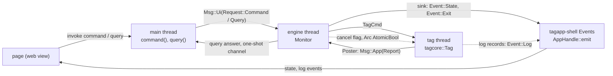
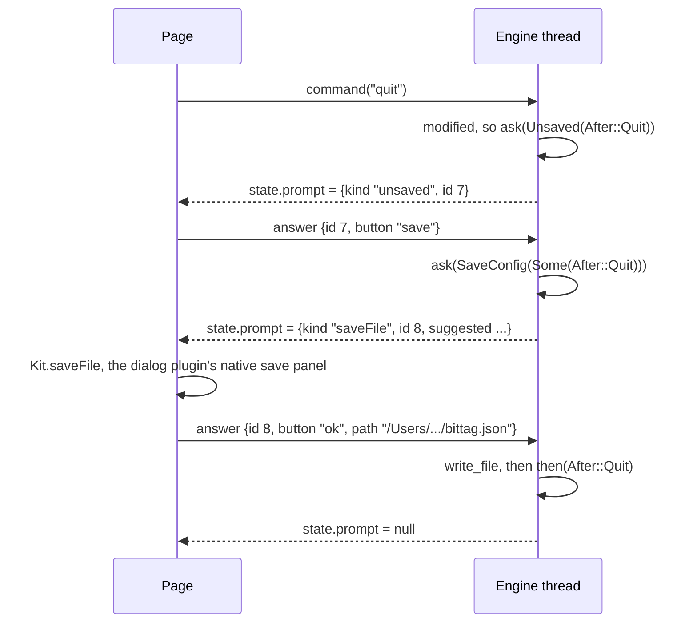

# 11. The engine: threads, the model and the view state

Everything Tag Monitor decides is in one library crate, `tagmonitor-core`
(`host/applications/tagmonitor-rs/core/`), which knows nothing of Tauri or
the web page. This chapter reads it: the three threads and the channels
between them, the engine loop, the tag thread that owns `tagcore::Tag`, the
`Monitor` state with its command table and its prompts, the view state it
publishes, the configuration editor, the logger, and the tests. The handle,
the engine loop, the prompt queue and the logger are not Tag Monitor's own
code: they come from the engine toolkit every application shares,
`tagapp-engine` ([its README](../../libraries/tagapp-engine-rs/README.md)),
and are read here as the code Tag Monitor runs. Afterwards
you will be able to take any `invoke("command", ...)` from
[chapter 10](10-tauri-shell.md), follow it to the line of the engine that
handles it, and say what the next `state` event will contain and why.

The design is set out in [chapter 10 of the guide](../guide/10-application-pattern.md)
and Tag Monitor's [architecture](../../applications/tagmonitor-rs/design/architecture.md)
and [UI/engine contract](../../applications/tagmonitor-rs/design/ui-engine-contract.md).
The behaviour is qtmonitor's, ported: most functions name the
`MainWindow`, `ConfigTab` or `qtmon/core` function they replace, and you
will recognise them.

## The crate

[core/Cargo.toml:8-21](../../applications/tagmonitor-rs/core/Cargo.toml#L8):

```toml
[dependencies]
tagcore = { path = "../../../libraries/tagcore-rs" }
prost = "0.14.4"
prost-reflect = { version = "0.16.5", features = ["serde"] }
serde_json = "1"
log = "0.4"
tagapp-engine = { path = "../../../libraries/tagapp-engine-rs" }
taglogwriter = { path = "../../../libraries/taglogwriter-rs", optional = true }

[features]
# Download Data... writes SQLite through the C++ writer (libtagcore_c, built
# by CMake with -DBUILD_TAGCORE_C=ON). Without it Download refuses and the
# rest of Tag Monitor works.
sqlitelog = ["dep:taglogwriter"]
```

No `tauri`, no GUI crate: the core builds and tests with plain `cargo`, which
is what makes it testable without a window. `tagcore` is the Rust tag
library of chapters 3 to 5; `prost` and `prost-reflect` are its protobuf
runtime (chapter 5); `tagapp-engine` is the engine toolkit the applications
share (the handle, the loop, the prompt queue and the logger, read below);
`taglogwriter` is the C++ SQLite writer reached through `tagcore_c`
(chapter 8).

> **Rust:** `optional = true` plus `sqlitelog = ["dep:taglogwriter"]` makes a
> dependency that exists only when the feature is on: without the feature
> the crate is not even compiled. It is the build-system half of an
> `#ifdef HAVE_SQLITELOG` (the source half is shown under
> [Download](#download-two-functions-one-chosen-at-compile-time)).

| Path | Lines | Holds |
| --- | --- | --- |
| `src/lib.rs` | 15 | `pub mod engine; pub mod model;` |
| `src/engine/mod.rs` | 121 | `EngineConfig`, `spawn`, and the toolkit's `Engine`, `Event`, `UiLogger` and `LOGGER` re-exported |
| `src/engine/tagthread.rs` | 357 | `TagCmd`, `Report`, the tag thread |
| `src/engine/monitor.rs` | 966 | `Monitor`: the engine's state, commands, prompts, reports, queries; its `EngineState` impl |
| `src/engine/view.rs` | 338 | `Monitor::view_state` and the `menus` query |
| `src/engine/download.rs` | 258 | Download Data, through `taglogwriter` |
| `src/model/commands.rs` | 284 | `Command`, the availability rule |
| `src/model/startchecks.rs` | 107 | The checks Start makes |
| `src/model/tagrules.rs` | 158 | Downloadable states, erase size, clock offset, version floor |
| `src/model/monitormodel.rs` | 345 | `MonitorModel`: what each status settles |
| `src/model/configdocument.rs` | 222 | The document, its file format, approval |
| `src/model/configform.rs` | 1598 | The form's panels, with Qt's widgets modelled |
| `src/model/configeditor.rs` | 312 | Document and form together |
| `src/model/menus.rs` | 195 | The menu bar as data |
| `tests/`, `examples/` | | See [Testing](#testing-without-tauri-or-a-tag) |

The `model` modules are pure functions and plain structs over tagcore's
protobuf types: no threads, no I/O, no clock of their own (callers pass
`now`). The `engine` modules own the threads and the state.

### Library: serde_json

**serde** is Rust's serialisation framework: a pair of traits, `Serialize`
and `Deserialize`, that a type implements (usually with
`#[derive(Serialize)]`) to be written to or read from any format a format
crate supports. **serde_json** (1.0.154) is the JSON format crate, and it
also provides `serde_json::Value`, a dynamically typed JSON value:

```text
Value = Null | Bool(bool) | Number(Number) | String(String)
      | Array(Vec<Value>) | Object(Map<String, Value>)
```

(the shape of the type, written out; it is serde_json's, not this
repository's). Think of
`QJsonValue`, with `QJsonObject` as `Map`. This crate uses only `Value`, not
serde's derives: every JSON object the engine sends is built by hand. What
you need to read it:

- `json!({ "key": expr, ... })` builds a `Value` from JSON-like syntax. Any
  Rust value that implements `Serialize` can be interpolated: a `bool`, a
  number, a `String`, a `Vec<String>` (an array), an `Option<T>` (`null` or
  the value), another `Value`.
- `v["key"]` reads a member and gives `Value::Null` for a missing key or a
  non-object, instead of panicking; `v["key"] = json!(...)` inserts or
  replaces (and panics only if `v` is neither an object nor `null`).
- `v.get("key")` gives an `Option<&Value>`; `as_str()`, `as_u64()`,
  `as_bool()`, `as_array()` give an `Option` of the typed content. Chains such
  as `args.get("id").and_then(Value::as_u64)` are how arguments are read.
- `Value` implements `PartialEq` structurally, so `a != b` compares two JSON
  trees deeply. The engine loop depends on this.
- Without serde_json's `preserve_order` feature (it is off in this
  workspace) `Map` is a `BTreeMap`, so object keys are kept sorted.

### Library: log

**log** (0.4.34) is Rust's logging facade: the `error!`, `warn!`, `info!`,
`debug!` and `trace!` macros write to whatever single logger the program
installed with `log::set_logger`, as `qDebug()` and friends write to the
handler installed with `qInstallMessageHandler`. Libraries (tagcore
included) log through the facade without knowing who listens. Tag Monitor's
logger is in [The logger](#the-logger).

## Three threads and two channels



| Thread | Created by | Owns | Blocks on |
| --- | --- | --- | --- |
| main | the OS; runs Tauri's event loop | the window, the web view | nothing (a query's wait is moved to Tauri's blocking pool) |
| engine (`tagmonitor-engine`) | `tagapp_engine::spawn`, called by `engine::spawn` | one `Monitor`: the model, the document and form, the prompts, the progress displays | its channel, with a timeout until the next deadline |
| tag (`tagmonitor-tag`) | `engine::spawn` | the `tagcore::Tag` | its channel, with a timeout until the next status poll; and every USB transfer |

The rule that makes this work: **everything that changes the engine's state
arrives as a message on one channel and is applied on the engine thread.**
UI commands, UI queries and the tag thread's reports all go into the same
queue, so the `Monitor` needs no lock; it is touched by one thread only. The
engine thread never calls the tag, so it never blocks on USB, and the window
stays live during a two-minute download.

qtmonitor after its restructure had the same split: `LiveTagSession`'s
`TagWorker` on a `QThread` owned the tag, and queued signals carried
commands to it and results back
([qtmon architecture](../../applications/qtmon/design/architecture.md)).
Here the queued signals are channel messages.

**Library: std::sync::mpsc.** The standard library's channel:
`mpsc::channel()` returns a `(Sender<T>, Receiver<T>)` pair. *Multi-producer,
single-consumer*: the `Sender` can be cloned and sent to other threads, the
`Receiver` cannot. `send` never blocks (the queue is unbounded) and fails
only when the receiver is gone; `recv_timeout(d)` blocks until a message
arrives or `d` passes, and reports `Disconnected` when every sender is gone.
Think of it as a thread-safe queue with a condition variable; it plays the
part a `Qt::QueuedConnection` plays by posting to the receiving thread's
event queue. No crossbeam, tokio or `select!` is used in the core.

## The messages

A handful of enums carry everything between the threads. The engine
thread's inbox is the toolkit's,
[tagapp-engine-rs/src/lib.rs:138-154](../../libraries/tagapp-engine-rs/src/lib.rs#L138):

```rust
/// A UI request to the engine thread.
#[derive(Debug)]
enum Request {
    /// A command: its name and its JSON arguments.
    Command(String, Value),
    /// A query: its name, its JSON arguments and the channel for its answer.
    Query(String, Value, Sender<Value>),
}

/// A message to the engine thread, applied in the order it arrives.
#[derive(Debug)]
enum Msg<M> {
    /// From the UI, through the [`Engine`].
    Ui(Request),
    /// From the application, through a [`Poster`].
    App(M),
}
```

`M` is the application's own message type. Tag Monitor's is the tag
thread's `Report`, below: its `EngineState` implementation says
`type Msg = Report`
([monitor.rs:850](../../applications/tagmonitor-rs/core/src/engine/monitor.rs#L850)),
so its engine thread's channel carries `Msg<Report>`, and a report arrives
as `Msg::App(report)`.

[engine/tagthread.rs:42-95](../../applications/tagmonitor-rs/core/src/engine/tagthread.rs#L42):

```rust
/// A command for the tag thread.
#[derive(Debug)]
pub(crate) enum TagCmd {
    /// List the connected bases.
    FindBases,
    /// Attach to the tag on this base (resets it).
    Attach(UsbDev),
    /// Detach.
    Detach,
    /// Read the tag's configuration.
    ReadConfig,
    /// Write this configuration and start the tag.
    Start(Box<Config>),
    /// Stop the tag.
    Stop,
    /// Set the tag's clock from the host's.
    SyncClock,
    /// Run every self-test.
    SelfTest,
    /// Erase the tag's data.
    Erase,
    /// Download the log to this file.
    Download(PathBuf),
}

/// What the tag thread learned, for the engine thread.
#[derive(Debug)]
pub(crate) enum Report {
    /// The connected bases, possibly none, each with its identity when
    /// there are several to choose from (see [`identify`]).
    BasesFound(Vec<(UsbDev, Option<String>)>),
    /// Attached: the tag's identity and configuration.
    Attached(Box<TagInfo>, Box<Config>),
    /// Attaching failed; the text says so.
    AttachFailed(String),
    /// Detached.
    Detached,
    /// A status read, with the base's supply voltage and the host clock (ms).
    Status(Box<Status>, f32, i64),
    /// The tag's configuration, for Read Configuration.
    ConfigRead(Box<Config>),
    /// Start was sent; the text is Tag::start's error, or empty.
    StartSent(String),
    /// Self-Test was accepted.
    TestSent,
    /// Erase was accepted.
    EraseSent,
    /// The tag refused a command, or it could not be sent.
    CommandFailed(Command, String),
    /// Download progress: records written, and the record count.
    DownloadProgress(i32, i32),
    /// The download ended.
    DownloadFinished(super::download::DownloadResult),
}
```

In qtmonitor each of these would be a signal or slot with its own
signature, connected one by one: `attached(TagInfo, Config)`,
`statusRead(Status, float, qint64)`, and so on. Here each is a *variant* of
one type, carrying its own data, and the receiver handles them all in one
`match`. Adding a report means adding a variant, and the compiler then
refuses every `match` that does not handle it, so a new message cannot be
silently unconnected.

> **Rust:** a Rust `enum` is a tagged union: each variant may carry fields,
> and the value records which variant it is. `Request::Query(name, args, reply)`
> is roughly `std::variant<Command, Query>` with each alternative a
> struct, except that `match` destructures it directly and must cover every
> variant. `#[derive(Debug)]` generates a debug formatter (`{:?}`).
> `Msg<M>` is a generic enum, a class template over `M`: `Msg<Report>` is
> one concrete type, `Msg<()>` (Tag View's) another.

> **Rust:** `Box<Config>` is a heap-allocated `Config` (`std::unique_ptr`).
> An enum is as large as its largest variant, and protobuf structs are big,
> so boxing them keeps every `Report` small to move through the channel.

> **Rust:** `pub(crate)` makes an item visible throughout this crate but not
> to its users. The shell sees only `Engine`, `EngineConfig`, `Event`,
> `spawn`, `UiLogger` and `LOGGER`; `TagCmd` and `Report` are internal to
> the crate, and the toolkit's `Request` and `Msg`, with no `pub` at all,
> are private to the toolkit.

The last enum is the engine's output, the toolkit's `Event`, which
`engine/mod.rs` re-exports
([mod.rs:51](../../applications/tagmonitor-rs/core/src/engine/mod.rs#L51):
`pub use tagapp_engine::{Engine, Event, LOGGER, UiLogger};`),
[tagapp-engine-rs/src/lib.rs:67-82](../../libraries/tagapp-engine-rs/src/lib.rs#L67):

```rust
#[derive(Debug, Clone)]
pub enum Event {
    /// The whole view state, sent only when it differs from the last one sent
    /// (or after a `ready`; see [`EngineState::take_republish`]).
    State(Value),
    /// One log line at or above the level the UI set (see [`set_log_level`]).
    Log {
        /// The level's name: `TRACE`, `DEBUG`, `INFO`, `WARN` or `ERROR`.
        level: &'static str,
        /// The message, without the level.
        text: String,
    },
    /// Quit was confirmed (and whatever had to happen first has happened):
    /// the shell should close the window and exit.
    Exit,
}
```

Chapter 10 showed the application's sink, a `match` over these three that
hands each to the shared shell's `Events` (`state`, `log`, `exit`).

## The Engine handle and spawn

> **Note:** The handle, `spawn`'s plumbing, the loop below and the logger
> are the shared engine toolkit's, `tagapp-engine`
> ([its README](../../libraries/tagapp-engine-rs/README.md); its place among
> the applications is in
> [chapter 14](14-the-three-applications.md#the-engine-toolkit-underneath)).
> Tag Monitor, Tag Calibrator and Tag View all run on it, so what follows is
> exact for all three; Tag Monitor supplies only its `Monitor` and the tag
> thread.

The shell holds an `Engine`, wrapped in the shared shell's own `Engine`
(`Engine::new` binds the handle to the two methods below; chapter 10,
[The engine as the shell sees it](10-tauri-shell.md#the-engine-as-the-shell-sees-it)),
[tagapp-engine-rs/src/lib.rs:156-198](../../libraries/tagapp-engine-rs/src/lib.rs#L156)
(doc comments on the struct and its methods dropped, the fields' kept):

```rust
/// Sends a request to the engine thread; false once the thread has gone.
type SendRequest = Arc<dyn Fn(Request) -> bool + Send + Sync>;

// ...
#[derive(Clone)]
pub struct Engine {
    /// Queues a request on the engine thread's channel.
    send: SendRequest,
    /// How long [`Engine::query`] waits for its answer.
    query_timeout: Duration,
}

impl Engine {
    // ...
    pub fn command(&self, cmd: &str, args: Value) {
        (self.send)(Request::Command(cmd.to_owned(), args));
    }

    // ...
    pub fn query(&self, name: &str, args: Value) -> Value {
        let (reply_tx, reply_rx) = mpsc::channel();
        if !(self.send)(Request::Query(name.to_owned(), args, reply_tx)) {
            return Value::Null;
        }
        reply_rx
            .recv_timeout(self.query_timeout)
            .unwrap_or(Value::Null)
    }
}
```

`Engine` is nothing but a way to put a request on the engine's channel, so
cloning it is cheap and every clone talks to the same thread. A command is
one send. A query is a synchronous call across threads made from two
channels: the caller creates a fresh one-shot channel, sends its `Sender`
inside the request, and waits on the `Receiver`; the engine answers by
sending on it. It is the shape of `QMetaObject::invokeMethod` with
`Qt::BlockingQueuedConnection` and a return value, with a timeout added:
Tag Monitor's is 10 s (`QUERY_TIMEOUT`,
[mod.rs:69](../../applications/tagmonitor-rs/core/src/engine/mod.rs#L69)),
because its engine thread never waits on the tag.

Why `send` is a closure and not simply the channel's `Sender`: the channel
carries `Msg<Report>`, and a `Sender<Msg<Report>>` field would make the
handle `Engine<Report>`, a different type for each application. The closure
built by `channel` wraps the request in `Msg::Ui` and sends it, and its type,
`dyn Fn(Request) -> bool`, mentions no application type, so every
application's handle is the same `Engine` and the shared shell can hold any
of them.

> **Rust:** `(self.send)(...)` calls the closure stored in the field; the
> parentheses tell the compiler it is a field, not a method named `send`.
> It returns `false` once the engine thread has ended, and `command`
> ignores that: a command sent after the engine has gone is dropped.

`spawn` makes the channel and starts both threads,
[mod.rs:104-121](../../applications/tagmonitor-rs/core/src/engine/mod.rs#L104):

```rust
pub fn spawn(config: EngineConfig, sink: impl Fn(Event) + Send + Sync + 'static) -> Engine {
    let (engine, poster, inbox) = tagapp_engine::channel(QUERY_TIMEOUT, sink);
    let (tag_tx, tag_rx) = mpsc::channel();
    let cancel = Arc::new(AtomicBool::new(false));
    {
        let cancel = cancel.clone();
        std::thread::Builder::new()
            .name("tagmonitor-tag".into())
            .spawn(move || tagthread::run(tag_rx, poster, cancel))
            .expect("tag thread");
    }
    tagapp_engine::spawn(
        "tagmonitor-engine",
        Monitor::new(config, tag_tx, cancel),
        inbox,
    );
    engine
}
```

Two channels: the engine's inbox, made by `tagapp_engine::channel`, and
`tag_tx`/`tag_rx`, the tag thread's (`TagCmd`). `channel` returns the three
ends of the first: the `Engine` handle for the shell, a `Poster<Report>`
for the tag thread to send its reports with, and the `Inbox` (the
receiving end, with the sink) that `tagapp_engine::spawn` hands to the
engine thread. The engine thread gets `tag_tx` inside the `Monitor`. The one
piece of state the two threads share directly is `cancel`, an atomic flag
the engine sets to stop a download between pages.

`channel` also installs the sink as the logger's destination and resets the
log level to INFO ([lib.rs:246-260](../../libraries/tagapp-engine-rs/src/lib.rs#L246)),
before the tag thread starts, so the tag thread's first log line already
reaches the page.

> **Rust:** `sink: impl Fn(Event) + Send + Sync + 'static` accepts any
> callable taking an `Event` -- a closure, usually -- like a template
> parameter constrained by a concept. `Send + Sync` say it may be moved to and
> called from other threads; `'static` says it borrows nothing that could
> disappear, because the threads outlive `spawn`. `type Sink = Arc<dyn Fn(Event) + Send + Sync>`
> ([lib.rs:235](../../libraries/tagapp-engine-rs/src/lib.rs#L235)), inside
> `channel`, then erases the closure's type behind a shared pointer: in C++,
> `std::shared_ptr<std::function<void(Event)>>`.

> **Rust:** the block `{ let cancel = cancel.clone(); ... }` makes a clone
> with the same name, moves it into the tag thread's closure, and ends; the
> original stays available below, for the `Monitor`. It is the idiom for
> "give this thread its own copy". `poster` needs no such block: nothing
> after the tag thread uses it, so the closure takes it outright.

## The engine loop

The loop Tag Monitor runs is the toolkit's `run_loop`, started on the
engine thread by `tagapp_engine::spawn` with the `Monitor` as its `state`,
[tagapp-engine-rs/src/lib.rs:278-307](../../libraries/tagapp-engine-rs/src/lib.rs#L278):

```rust
fn run_loop<S: EngineState>(mut state: S, inbox: Inbox<S::Msg>) {
    let mut last_state = Value::Null;
    loop {
        let wait = state
            .next_deadline()
            .map(|d| d.saturating_duration_since(Instant::now()))
            .unwrap_or(Duration::from_secs(3600));
        match inbox.rx.recv_timeout(wait) {
            Ok(Msg::Ui(Request::Command(cmd, args))) => state.command(&cmd, &args),
            Ok(Msg::Ui(Request::Query(name, args, reply))) => {
                let _ = reply.send(state.query(&name, &args));
            }
            Ok(Msg::App(msg)) => state.message(msg),
            Err(RecvTimeoutError::Timeout) => {}
            Err(RecvTimeoutError::Disconnected) => break,
        }
        state.fire_timers(Instant::now());
        if state.take_republish() {
            last_state = Value::Null;
        }
        let view = state.view_state();
        if view != last_state {
            (inbox.sink)(Event::State(view.clone()));
            last_state = view;
        }
        if state.take_exit() {
            (inbox.sink)(Event::Exit);
        }
    }
}
```

This is the whole of the engine's control flow. Each pass:

1. **Waits** for one message, but no longer than the nearest deadline the
   `Monitor` holds (an hour if it holds none). There is no `QTimer`: a timer
   is an `Option<Instant>` field, and the wait is a `recv_timeout`, the way a
   C event loop passes its nearest timer to `select()`.
2. **Applies** the message: a command, a query (answered on the reply
   channel at once), or a report from the tag thread.
3. **Fires the timers** that are due.
4. **Rebuilds the whole view state** from scratch, as one `Value`.
5. **Sends it only if it changed**, comparing with the last one sent. A
   status poll that changes nothing visible costs a rebuild and a
   comparison, and nothing reaches the page.
6. **Passes on a confirmed quit**.

The loop knows the `Monitor` only through the toolkit's `EngineState`
trait, which `Monitor` implements by handing each call to its own method of
the same name, and a tag-thread message to `report`,
[monitor.rs:848-891](../../applications/tagmonitor-rs/core/src/engine/monitor.rs#L848)
(the rest delegate the same way, and `take_republish` is below):

```rust
/// The toolkit's engine loop runs a `Monitor` (see [`super::spawn`]).
impl EngineState for Monitor {
    type Msg = Report;

    /// [`Monitor::command`].
    fn command(&mut self, cmd: &str, args: &Value) {
        Monitor::command(self, cmd, args);
    }

    // ...

    /// [`Monitor::report`]: a report from the tag thread.
    fn message(&mut self, report: Report) {
        self.report(report);
    }

    // ...
}
```

> **Rust:** `run_loop<S: EngineState>` is generic: the compiler makes one
> copy of the loop for each state type it is called with, so the calls are
> direct, not virtual. `S::Msg` names the associated type the implementation
> chose (`Report` here). Inside the impl, `Monitor::command(self, cmd, args)`
> calls the *inherent* method, the one in `impl Monitor`, explicitly; the
> trait method of the same name merely forwards to it.

> **Rust:** `let _ = reply.send(...)` discards a `Result` on purpose.
> `Result` is marked `#[must_use]`, so ignoring it silently draws a warning;
> `let _ =` says "I know". The send fails only when the querying thread has
> stopped waiting (its timeout passed).

Steps 4 and 5 replace the whole of qtmonitor's `render()` /
`updateActions()` / `updateTitle()` bookkeeping: nothing ever decides *what*
changed; the engine describes everything, and equality finds out whether to
send. The page, in turn, redraws from the state it receives (chapter 12).

> **Rust:** `Option::map(...).unwrap_or(default)` -- `next_deadline()`
> returns `Option<Instant>`; `.map` converts the deadline, if there is one,
> into a wait (`saturating_duration_since` gives zero instead of a negative
> duration for a deadline already past), and `.unwrap_or` supplies the hour
> when there is none. It reads like `d ? f(*d) : default`.

The timers, [monitor.rs:243-275](../../applications/tagmonitor-rs/core/src/engine/monitor.rs#L243):

```rust
    /// The nearest deadline: the tick, while attached, and the quit
    /// deadline, while detaching to quit.
    pub(crate) fn next_deadline(&self) -> Option<Instant> {
        match (self.next_tick, self.quitting) {
            (Some(a), Some(b)) => Some(a.min(b)),
            (a, b) => a.or(b),
        }
    }

    /// Fires the timers that are due: the quit deadline, which exits without
    /// waiting any longer for the detach, and the tick, which recomputes how
    /// long the tag has been silent.
    pub(crate) fn fire_timers(&mut self, now: Instant) {
        if self.quitting.is_some_and(|deadline| now >= deadline) {
            warn!(
                "The tag did not detach within {} s; quitting anyway. \
                 A tag that has stopped answering is reset by the next attach.",
                QUIT_DETACH_WAIT.as_secs()
            );
            self.quitting = None;
            self.exit = true;
        }
        if !self.model.attached() {
            self.next_tick = None;
            self.silence_s = 0;
            return;
        }
        if self.next_tick.is_none_or(|t| now >= t) {
            let ms = self.model.silence_ms(now_ms());
            self.silence_s = if ms >= NO_ANSWER_MS { ms / 1000 } else { 0 };
            self.next_tick = Some(now + TICK);
        }
    }
```

There are two timers. The 1 s tick, while attached, recomputes how long the
tag has gone without a status getting through, so the strip can show
"IDLE (no answer 4 s)" in red: qtmonitor's silence timer. The quit deadline,
5 s after a confirmed Quit, exits even if the tag never acknowledges the
detach (a PresTag hung in its RTC initialisation once made Quit impossible).

> **Rust:** `match (a, b) { (Some(a), Some(b)) => ..., (a, b) => a.or(b) }`
> matches a tuple of two `Option`s; the first arm takes the earlier of two
> deadlines, the second returns whichever exists, or `None`.
> `is_some_and(|d| ...)` and `is_none_or(|t| ...)` test an `Option` and its
> content in one call.

The last piece of the loop is `take_republish`. The page sends `ready` once
its listeners are registered, [monitor.rs:184-191](../../applications/tagmonitor-rs/core/src/engine/monitor.rs#L184):

```rust
    /// The page is listening (the `ready` command): the view state is sent
    /// again, and the first time, the engine attaches unless the
    /// configuration says not to, as qtmonitor does when its window opens.
    fn ready(&mut self) {
        if self.ready.ready() && self.config.auto_attach {
            self.attach();
        }
    }
```

`self.ready` is the toolkit's `Ready` guard, a pair of flags,
[tagapp-engine-rs/src/lib.rs:330-348](../../libraries/tagapp-engine-rs/src/lib.rs#L330):

```rust
impl Ready {
    /// Records a `ready`. True the first time only: the caller starts the
    /// engine then.
    pub fn ready(&mut self) -> bool {
        self.republish = true;
        !std::mem::replace(&mut self.started, true)
    }

    /// Whether a `ready` has been received.
    pub fn started(&self) -> bool {
        self.started
    }

    /// True once after each `ready`; return it from
    /// [`EngineState::take_republish`].
    pub fn take_republish(&mut self) -> bool {
        std::mem::take(&mut self.republish)
    }
}
```

and `Monitor`'s `EngineState::take_republish` returns
`self.ready.take_republish()`
([monitor.rs:883](../../applications/tagmonitor-rs/core/src/engine/monitor.rs#L883)):
after each `ready` the loop forgets the last state it sent, so a page that
reloaded gets the whole state again.

> **Rust:** `std::mem::replace(&mut x, new)` stores `new` in `x` and returns
> the old value; `std::mem::take(&mut x)` does the same with the type's
> default (`false`). Both are "read and reset" in one step:
> `!replace(&mut self.started, true)` is true exactly once, the first time,
> like `std::exchange(started, true)` in C++.

Nothing happens until `ready`: the engine does not attach, and so does not
reset a tag, before the page can show what happens. Tag Calibrator and Tag
View keep the same guard.

## The tag thread

[tagthread.rs](../../applications/tagmonitor-rs/core/src/engine/tagthread.rs)
is the only code that touches the tag, the counterpart of qtmonitor's
`TagWorker`. It decides nothing: it runs each `TagCmd` in order, polls the
status every 400 ms while attached, and reports what it learned.

[tagthread.rs:128-141](../../applications/tagmonitor-rs/core/src/engine/tagthread.rs#L128):

```rust
/// The tag thread's state.
struct TagThread {
    /// The tag; touched only on this thread.
    tag: Tag,
    /// Where reports go: the engine thread's channel.
    out: Poster<Report>,
    /// Set by the engine to stop a running download after its page.
    cancel: Arc<AtomicBool>,
    /// When the next status read is due, while attached.
    next_poll: Option<Instant>,
    /// When an accepted Stop was first sent and when it was last sent, while
    /// the polls are still waiting for the tag to leave acquisition.
    stop_sent: Option<(Instant, Instant)>,
}
```

`out` is the toolkit's `Poster`
([lib.rs:202-223](../../libraries/tagapp-engine-rs/src/lib.rs#L202)): its
`post` wraps a report in `Msg::App` and queues it on the engine thread's
channel, and returns false, which the tag thread ignores, once the engine
thread has gone. Every report goes through one helper,
[tagthread.rs:144-147](../../applications/tagmonitor-rs/core/src/engine/tagthread.rs#L144),
whose body is `self.out.post(report);`.

Its loop, [tagthread.rs:330-357](../../applications/tagmonitor-rs/core/src/engine/tagthread.rs#L330),
has the engine loop's shape:

```rust
pub(crate) fn run(rx: Receiver<TagCmd>, out: Poster<Report>, cancel: Arc<AtomicBool>) {
    let mut t = TagThread {
        tag: Tag::new(),
        out,
        cancel,
        next_poll: None,
        stop_sent: None,
    };
    loop {
        let wait = t
            .next_poll
            .map(|due| due.saturating_duration_since(Instant::now()))
            .unwrap_or(Duration::from_secs(3600));
        match rx.recv_timeout(wait) {
            Ok(cmd) => t.run(cmd),
            Err(RecvTimeoutError::Timeout) => {}
            Err(RecvTimeoutError::Disconnected) => {
                if t.tag.is_attached() {
                    t.tag.detach();
                }
                return;
            }
        }
        if t.next_poll.is_some_and(|due| Instant::now() >= due) {
            t.poll();
        }
    }
}
```

`tagcore::Tag`'s methods all take `&self` (the struct keeps its state behind
an internal `Mutex`, chapter 5), so the type would allow calls from several
threads. The application does not do that: one owner means the tag's calls
happen in the order the engine sent them, a poll never lands in the middle
of a Start, and nothing else needs to lock.

The poll, [tagthread.rs:163-182](../../applications/tagmonitor-rs/core/src/engine/tagthread.rs#L163):

```rust
    fn poll(&mut self) {
        if !self.tag.is_attached() {
            self.next_poll = None;
            return;
        }
        let voltage = self.tag.voltage().unwrap_or(0.0);
        let status = self.tag.status();
        // A base unplugged during the poll closes the session in tagcore;
        // show the window detached rather than attached to nothing.
        if !self.tag.is_attached() {
            self.next_poll = None;
            self.report(Report::Detached);
            return;
        }
        if let Ok(status) = status {
            self.resend_stop(&status);
            self.report(Report::Status(Box::new(status), voltage, now_ms()));
        }
        self.next_poll = Some(Instant::now() + Duration::from_millis(STATUS_POLL_MS));
    }
```

A failed read is skipped silently; the engine notices a silent tag from the
time since the last good `Status` (the tick above).

The command dispatcher, [tagthread.rs:209-269](../../applications/tagmonitor-rs/core/src/engine/tagthread.rs#L209)
(`FindBases` and `Detach` arms elided):

```rust
    fn run(&mut self, cmd: TagCmd) {
        let attached = self.tag.is_attached();
        match cmd {
            // ...
            TagCmd::Attach(base) => {
                if attached {
                    self.report(Report::AttachFailed("Already Attached to Tag".into()));
                } else if !self.tag.attach(&base) {
                    self.report(Report::AttachFailed("Could not attach to tag".into()));
                } else {
                    // A stop from an earlier session ended with it.
                    self.stop_sent = None;
                    let info = self.tag.tag_info().unwrap_or_default();
                    let config = self.tag.config().unwrap_or_default();
                    self.report(Report::Attached(Box::new(info), Box::new(config)));
                    self.poll();
                }
            }
            // ...
            _ if !attached => {}
            TagCmd::ReadConfig => match self.tag.config() {
                Ok(config) => self.report(Report::ConfigRead(Box::new(config))),
                Err(_) => self.report(Report::CommandFailed(
                    Command::Read,
                    "Tag config read failed".into(),
                )),
            },
            TagCmd::Start(config) => {
                debug!(
                    "Starting tag with config: {}",
                    tagcore::proto::debug_string(&*config)
                );
                // A failed call does not mean the tag did not start: the
                // acknowledgement can be lost after the tag accepted it. The
                // model judges the start from the statuses that follow.
                let message = match self.tag.start(&config) {
                    Ok(_) => String::new(),
                    Err(_) => self.tag.debug_message(),
                };
                self.report(Report::StartSent(message));
                self.poll();
            }
```

> **Rust:** `_ if !attached => {}` is a wildcard arm with a *guard*. Arms are
> tried top to bottom, so after `FindBases`, `Attach` and `Detach` this one
> swallows every remaining command while no tag is attached; the arms below
> it only ever run attached. A C++ `switch` cannot express it; you would
> write an `if` before the `switch`.

> **Rust:** `&*config` dereferences the `Box<Config>` and borrows the
> `Config` inside, as `&*ptr` does with a `unique_ptr`. `&config` (a
> `&Box<Config>`) also works for `self.tag.start(&config)` on the next line,
> because Rust converts `&Box<T>` to `&T` automatically where a `&T` is
> expected.

Start shows the rule from the bench procedure, *an acknowledgement is not a
completion*, in its other form: a lost acknowledgement is not a failure. The
tag thread only reports that Start was sent and with what error; the model
judges success from the states the tag reaches (below). Stop, likewise,
distinguishes firmware that stops synchronously from firmware that queues
the stop, and resends a stop an L4 tag accepted and lost
([tagthread.rs:270-287](../../applications/tagmonitor-rs/core/src/engine/tagthread.rs#L270),
`resend_stop` at [:188](../../applications/tagmonitor-rs/core/src/engine/tagthread.rs#L188)).
After Synchronize Clock and Self-Test the polls pause for 1.5 s
(`QUIET_AFTER_BUSY`), because debug access to an L4 tag fails in bursts
while it is busy.

A download runs on the tag thread and blocks only it,
[tagthread.rs:315-323](../../applications/tagmonitor-rs/core/src/engine/tagthread.rs#L315):

```rust
            TagCmd::Download(path) => {
                self.cancel.store(false, Ordering::Relaxed);
                let out = self.out.clone();
                let result = super::download::run(&self.tag, &path, &self.cancel, |v, m| {
                    out.post(Report::DownloadProgress(v, m));
                });
                self.report(Report::DownloadFinished(result));
                self.poll();
            }
```

The progress callback sends a report per page; each one reaches the engine,
changes `download`, and so changes the view state, which moves the page's
progress bar. Cancel is the one flag the engine writes and the tag thread
reads directly: `cancel_download` sets it, and `download::run` checks it
between pages.

## Monitor: the engine's state

`Monitor` is qtmonitor's `MainWindow` with the widgets taken out,
[monitor.rs:105-144](../../applications/tagmonitor-rs/core/src/engine/monitor.rs#L105).
Its fields, grouped:

| Fields | What they hold |
| --- | --- |
| `config`, `tag_tx`, `cancel` | files and Help; the tag thread's channel; the download cancel flag |
| `model: MonitorModel` | the tag as known: identity, latest status, pending test, start, erase, download |
| `editor: ConfigEditor` | the configuration document and its form |
| `shown_info`, `attaching`, `recent`, `erase_shown`, `download`, `silence_s` | display state: the Tag Info page, the progress sheets, the recent files, the silence count |
| `prompts: Prompts<PromptKind>` | questions waiting for the page, in the toolkit's queue; the first is shown |
| `next_tick`, `quitting`, `exit`, `ready` | the timers, the exit flag, and the `ready` guard |

`view.rs` adds methods to the same type.

> **Rust:** a type may have several `impl` blocks, in different files of the
> same crate: `monitor.rs` has the behaviour and `view.rs` the view state,
> both `impl Monitor`. It is like splitting a C++ class's member function
> definitions across two `.cpp` files, without a header listing them.
> `pub(super)` on a field makes it visible to the parent module
> (`engine`), so `view.rs` can read it and nothing outside can.

### Settings: QSettings as a JSON file

The only persistent setting is the recent-files list.
[monitor.rs:460-475](../../applications/tagmonitor-rs/core/src/engine/monitor.rs#L460):

```rust
    fn add_recent(&mut self, path: &str) {
        self.recent.retain(|p| p != path);
        self.recent.insert(0, path.to_string());
        self.recent.truncate(RECENT_MAX);
        let mut settings = read_settings(&self.config.settings_path);
        settings[RECENT_KEY] = json!(self.recent);
        if let Some(dir) = self.config.settings_path.parent() {
            let _ = std::fs::create_dir_all(dir);
        }
        if let Err(e) = std::fs::write(&self.config.settings_path, settings.to_string()) {
            warn!(
                "Could not save the recent files to {}: {e}",
                self.config.settings_path.display()
            );
        }
    }
```

and [monitor.rs:894-900](../../applications/tagmonitor-rs/core/src/engine/monitor.rs#L894):

```rust
fn read_settings(path: &Path) -> Value {
    std::fs::read_to_string(path)
        .ok()
        .and_then(|t| serde_json::from_str::<Value>(&t).ok())
        .filter(Value::is_object)
        .unwrap_or_else(|| json!({}))
}
```

The file is read, the one key replaced, and the file rewritten, so keys the
engine does not know survive. `read_settings` turns any failure (no file,
bad JSON, not an object) into an empty object.

> **Rust:** the chain in `read_settings` converts a `Result` to an `Option`
> (`.ok()`), parses if there was text (`and_then`), keeps the value only if
> it is an object (`filter`), and supplies `{}` otherwise. Each step passes
> "nothing" along, so there is one fallback at the end instead of three
> `if`s. `from_str::<Value>` uses the turbofish to say what to parse into.

## Commands and their availability

The menu commands and the rule for when each is available are in
`model/commands.rs`, a port of `qtmon/core/commands.h`.
[commands.rs:42-56](../../applications/tagmonitor-rs/core/src/model/commands.rs#L42)
lists them, and [commands.rs:120-157](../../applications/tagmonitor-rs/core/src/model/commands.rs#L120)
is the rule (its doc comment dropped):

```rust
pub fn availability(command: Command, input: &CommandInputs) -> Availability {
    let idle = input.attached && input.state == TagState::Idle;
    match command {
        Command::Attach => enabled_if(!input.attached),
        Command::Detach => enabled_if(input.attached),
        Command::Read | Command::Sync => enabled_if(idle),
        Command::Test => enabled_if(idle && !input.test_pending),
        Command::Start => {
            enabled_if(input.document && idle && input.document_type == input.tag_type)
        }
        // CALIBRATE is entered only from the command line (tag-cal), but Tag
        // Monitor can still stop a tag left in it.
        Command::Stop => enabled_if(
            input.attached
                && matches!(
                    input.state,
                    TagState::Configured
                        | TagState::Running
                        | TagState::Hibernating
                        | TagState::Calibrate
                ),
        ),
        // sRESET too: an erase sent while the tag is erasing continues the
        // sweep, on firmware with synchronous commands.
        Command::Erase => enabled_if(
            input.attached
                && matches!(
                    input.state,
                    TagState::Finished | TagState::Aborted | TagState::SReset
                ),
        ),
        Command::Download => {
            enabled_if(input.attached && is_downloadable_state(input.state) && !input.downloading)
        }
        Command::Open => Availability::Enabled,
        Command::Save | Command::Reset => enabled_if(input.document),
    }
}
```

It is a pure function of a small struct, `CommandInputs` (attached, state,
tag type, document and its type, downloading, test pending), which the
`MonitorModel` fills.

> **Rust:** `matches!(value, A | B | C)` is true when the value matches one
> of the patterns: a compact `state == A || state == B || state == C`. The
> `match` on `command` has no default arm, so a new `Command` variant fails
> to compile until the rule says when it is available.

The engine uses this one rule twice: to publish `actions` in every view
state, and to refuse a command that is not available now.
[monitor.rs:480-517](../../applications/tagmonitor-rs/core/src/engine/monitor.rs#L480):

```rust
    pub(crate) fn command(&mut self, cmd: &str, args: &Value) {
        if let Some(&command) = ALL_COMMANDS.iter().find(|c| command_name(**c) == cmd) {
            if self.available(command) == Availability::Enabled {
                self.run_command(command);
            } else {
                debug!("{cmd}: not available now");
            }
            return;
        }
        let text = |key: &str| {
            args.get(key)
                .and_then(Value::as_str)
                .unwrap_or_default()
                .to_string()
        };
        match cmd {
            "ready" => self.ready(),
            "set_field" => {
                let id = text("id");
                if !self.editor.edit(&id, &args["value"]) {
                    debug!("set_field {id}: no such editable control");
                }
            }
            "answer" => self.answer(args),
            "new_config" => {
                if let Some(t) = TagType::from_str_name(&text("tagType")) {
                    self.confirm_discard(After::New(t));
                }
            }
            "open_recent" => self.confirm_discard(After::OpenFile(text("path"))),
            "set_approved" => {
                let on = args.get("on").and_then(Value::as_bool).unwrap_or(false);
                self.editor.set_approved(on);
            }
            "cancel_download" => self.cancel.store(true, Ordering::Relaxed),
            "hide_erase" => self.erase_shown = false,
            "quit" => self.confirm_discard(After::Quit),
            // ...
```

(The rest handles `set_log_level`, `save_text`, and warns about an unknown
name.) The twelve menu commands are found by name in `ALL_COMMANDS` and
checked against the availability rule *again*, on the engine thread. The
page greys out what `actions` says is disabled, but a click can be in flight
when the state changes (a Start clicked as the tag drops out of IDLE); the
re-check makes the stale click a no-op rather than a fault. The other
commands are a plain `match` on the string.

> **Rust:** `ALL_COMMANDS.iter().find(...)` yields `Option<&Command>`, and
> `if let Some(&command) = ...` both tests for a match and copies the
> `Command` out of the reference (the `&` in the pattern). The closure
> `text` captures `args` and is called like a function: a small local
> helper, as a C++ lambda would be.

`available` feeds the rule from the model and the document,
[monitor.rs:231-239](../../applications/tagmonitor-rs/core/src/engine/monitor.rs#L231),
and `run_command` ([monitor.rs:535-560](../../applications/tagmonitor-rs/core/src/engine/monitor.rs#L535))
maps each command to its action, `MainWindow::runCommand`'s switch: Detach,
Stop and Sync go straight to the tag thread, Start runs the start checks,
Erase and Download ask first, Open and Read go through "unsaved changes?".

## Prompts: dialogs as data

qtmonitor asked questions with modal dialogs: `QMessageBox::exec()` runs a
nested event loop and returns the button, and the code after it continues
with the answer. The engine cannot do that. It runs on its own thread, the
dialog is drawn by the page in another process, and blocking the engine
until a user answers would freeze every status update. So a question
becomes *data*: the engine queues a prompt, the view state carries the
first one, the page shows it and answers with the `answer` command, and the
engine continues from there.

What a prompt can ask is Tag Monitor's,
[monitor.rs:54-103](../../applications/tagmonitor-rs/core/src/engine/monitor.rs#L54):

```rust
/// What happens once the user has saved or discarded unsaved changes.
#[derive(Debug, Clone)]
pub(crate) enum After {
    /// Read Configuration.
    Read,
    /// Open Configuration...: ask for the file.
    Open,
    /// Open this file (Open Recent).
    OpenFile(String),
    /// New Configuration from this tag type's defaults.
    New(TagType),
    /// Make the attached tag's configuration the document.
    AttachConfig(Box<Config>),
    /// Quit.
    Quit,
}

/// A question or message for the UI, which it shows once per id.
#[derive(Debug, Clone)]
pub(crate) enum PromptKind {
    /// A message box with only OK.
    Alert {
        /// Window title.
        title: String,
        /// The main sentence.
        text: String,
        /// Further text, or empty.
        informative: String,
        /// Text behind Show Details, or empty.
        detail: String,
        /// `"warning"`, `"error"` or `"info"`.
        style: &'static str,
    },
    /// Several bases, each with its identity: which one to attach through.
    ChooseBase(Vec<(UsbDev, Option<String>)>),
    /// Start checks failed: start anyway?
    StartAnyway(Vec<String>),
    /// Erase the tag's state and data?
    ConfirmErase,
    /// The configuration has unsaved changes: save, discard or cancel.
    Unsaved(After),
    /// Ask for a configuration file to open.
    OpenConfig,
    /// Ask where to save the configuration; then continue with the `After`.
    SaveConfig(Option<After>),
    /// Ask where to save the download.
    SaveDownload,
    /// The file at this path names no tag type: which is it for?
    ChooseTagType(String, Vec<TagType>),
}
```

and the queue that holds them, with their ids, is the toolkit's
`Prompts<PromptKind>`, whose entries are
[tagapp-engine-rs/src/lib.rs:352-359](../../libraries/tagapp-engine-rs/src/lib.rs#L352):

```rust
/// A prompt and the id the page answers it by.
#[derive(Debug)]
pub struct Prompt<K> {
    /// Increases with each prompt asked, from 1.
    pub id: u64,
    /// What it asks: the application's prompt kind.
    pub kind: K,
}
```

`After` is the continuation: what was to happen once the question is
answered, stored in the prompt. `Unsaved(After::Quit)` means "the document
has unsaved changes; after the user saves or discards them, quit". It is
the code after `exec()` in qtmonitor, turned into a value that can wait in
a queue. [monitor.rs:315-346](../../applications/tagmonitor-rs/core/src/engine/monitor.rs#L315):

```rust
    /// Runs `after` now if nothing is unsaved, else asks first
    /// (ConfigTab::confirmDiscard).
    fn confirm_discard(&mut self, after: After) {
        if self.is_modified() {
            self.ask(PromptKind::Unsaved(after));
        } else {
            self.then(after);
        }
    }

    /// Continues with `after`, unsaved changes having been dealt with.
    fn then(&mut self, after: After) {
        match after {
            After::Read => self.send(TagCmd::ReadConfig),
            After::Open => self.ask(PromptKind::OpenConfig),
            After::OpenFile(path) => self.open_file(&path),
            After::New(tag_type) => {
                if let Some(messages) = self.editor.load_defaults(tag_type, now_s()) {
                    self.panel_messages(messages);
                }
            }
            After::AttachConfig(config) => self.load(*config, DocumentSource::Tag, ""),
            // Detach first, as qtmonitor's session does when it closes; the
            // exit follows the tag thread's Detached.
            After::Quit if self.model.attached() || self.attaching => {
                self.quitting = Some(Instant::now() + QUIT_DETACH_WAIT);
                self.cancel.store(true, Ordering::Relaxed);
                self.send(TagCmd::Detach);
            }
            After::Quit => self.exit = true,
        }
    }
```

> **Rust:** two arms for `After::Quit`: the first has a guard and is taken
> while a tag is attached or attaching; otherwise the second, unguarded one
> is. `*config` moves the `Config` out of its `Box`.

`ask` ([monitor.rs:199-201](../../applications/tagmonitor-rs/core/src/engine/monitor.rs#L199))
hands the kind to `Prompts::ask`, which gives it the next id and pushes it
on the queue. The answer comes back through `answer`,
[monitor.rs:606-617](../../applications/tagmonitor-rs/core/src/engine/monitor.rs#L606):

```rust
    fn answer(&mut self, args: &Value) {
        let Some(answer) = self.prompts.answer(args) else {
            return;
        };
        let ok = answer.ok();
        let (button, index, path) = (answer.button.as_str(), answer.index, answer.path.as_deref());
        match answer.kind {
            PromptKind::Alert { .. } => {}
            PromptKind::ChooseBase(bases) => match (ok, index.and_then(|i| bases.get(i))) {
                (true, Some((base, _))) => self.send(TagCmd::Attach(base.clone())),
                _ => self.attaching = false,
            },
```

The checking and parsing are the toolkit's `Prompts::answer`,
[tagapp-engine-rs/src/lib.rs:431-455](../../libraries/tagapp-engine-rs/src/lib.rs#L431):

```rust
    pub fn answer(&mut self, args: &Value) -> Option<Answer<K>> {
        let id = args.get("id").and_then(Value::as_u64)?;
        if self.queue.front().map(|p| p.id) != Some(id) {
            log::debug!("Ignoring a stale answer");
            return None;
        }
        let prompt = self.queue.pop_front()?;
        Some(Answer {
            kind: prompt.kind,
            button: args
                .get("button")
                .and_then(Value::as_str)
                .unwrap_or("cancel")
                .to_owned(),
            index: args
                .get("index")
                .and_then(Value::as_u64)
                .map(|i| i as usize),
            path: args
                .get("path")
                .and_then(Value::as_str)
                .filter(|p| !p.is_empty())
                .map(str::to_owned),
        })
    }
```

An answer is accepted only for the prompt being shown; an answer with any
other id (a double click, a page that reloaded) is ignored. Missing
arguments default to "cancel", no index, no path. The answered prompt comes
back removed from the queue, its `kind` moved out into the `Answer`, so
`answer`'s `match` owns the `After` a continuation carries.

> **Rust:** `let Some(answer) = ... else { return; };` is *let-else*: bind
> the pattern or run the `else` block, which must leave the function. Inside
> `Prompts::answer`, the `?` after `as_u64()` and `pop_front()` returns
> `None` from the whole function when either gives `None`: an early return
> written as one character. `answer.path.as_deref()` borrows the
> `Option<String>` as an `Option<&str>`.

The save dialog's arm shows a continuation being resumed,
[monitor.rs:643-650](../../applications/tagmonitor-rs/core/src/engine/monitor.rs#L643):

```rust
            PromptKind::SaveConfig(after) => {
                if let (true, Some(path)) = (ok, path)
                    && self.write_file(path)
                    && let Some(after) = after
                {
                    self.then(after);
                }
            }
```

Read it as: if the user pressed OK with a path, and the file was written,
and there is something to continue with, continue. `Unsaved(After::Quit)`
answered "save" asks `SaveConfig(Some(After::Quit))`; that answered OK
writes the file and then quits.

> **Rust:** a *let chain* mixes pattern tests and boolean conditions joined
> by `&&`; each `let` binds names for the conditions after it, and the body
> runs only if all hold. `(true, Some(path)) = (ok, path)` tests two values
> at once by matching a tuple.

### File pickers are prompts too

Open and save dialogs are native windows, drawn by the dialog plugin at the
page's request; Rust never opens one. But *which* dialog, its title, filters
and starting folder are decisions, so the engine makes them and puts them
in the prompt. [view.rs:249-266](../../applications/tagmonitor-rs/core/src/engine/view.rs#L249),
inside `prompt_json`:

```rust
            PromptKind::OpenConfig => json!({
                "kind": "openFile",
                "title": "Open Configuration",
                "start": self.open_start_dir(),
                "filters": [{ "name": "Configuration", "extensions": ["json"] }],
            }),
            PromptKind::SaveConfig(_) => json!({
                "kind": "saveFile",
                "title": "Save Configuration",
                "suggested": self.suggested_config_path(),
                "filters": [{ "name": "Configuration", "extensions": ["json"] }],
            }),
            PromptKind::SaveDownload => json!({
                "kind": "saveFile",
                "title": "Save File",
                "suggested": self.config.home_dir.join(super::download::DEFAULT_DOWNLOAD_NAME).to_string_lossy(),
                "filters": [{ "name": "SQLite database", "extensions": ["db3"] }],
            }),
```

and at the end of `prompt_json` the id is added to whichever object was
built ([view.rs:274](../../applications/tagmonitor-rs/core/src/engine/view.rs#L274)):
`v["id"] = json!(p.id);`. The page's side,
[ui/app.js:417-424](../../applications/tagmonitor-rs/ui/app.js#L417), calls
the plugin through the kit and answers with the path:

```js
      case "openFile": {
        const path = await Kit.openFile({ title: p.title, filters: p.filters, defaultPath: p.start });
        return path ? answer(id, "ok", { path }) : answer(id, "cancel");
      }
      case "saveFile": {
        const path = await Kit.saveFile({ title: p.title, filters: p.filters, defaultPath: p.suggested });
        return path ? answer(id, "ok", { path }) : answer(id, "cancel");
      }
```



The prompt kinds, their fields and their buttons are tabulated in the
[contract](../../applications/tagmonitor-rs/design/ui-engine-contract.md#prompts).

## Reports: what the tag thread's facts do

[monitor.rs:679-747](../../applications/tagmonitor-rs/core/src/engine/monitor.rs#L679)
applies each report, as `MainWindow`'s `on...` slots did. Its first arms:

```rust
    pub(crate) fn report(&mut self, report: Report) {
        match report {
            Report::BasesFound(bases) => match bases.len() {
                0 => {
                    self.attaching = false;
                    self.alert("Warning", "No Tag Bases Found", "", "", "warning");
                }
                1 => self.send(TagCmd::Attach(bases[0].0.clone())),
                _ => self.ask(PromptKind::ChooseBase(bases)),
            },
            Report::Attached(info, config) => {
                self.attaching = false;
                if !monitor_version_accepted(VERSION) {
                    self.alert(
                        "Warning",
                        &format!("monitor version {VERSION} less than required version {REQUIRED_MONITOR_VERSION}"),
                        "",
                        "",
                        "warning",
                    );
                    return self.send(TagCmd::Detach);
                }
                self.shown_info = Some((*info).clone());
                self.model.set_attached(*info);
                self.next_tick = Some(Instant::now() + TICK);
                match on_attach(self.editor.document().source()) {
                    OnAttach::Keep => {}
                    OnAttach::ReplaceIfDiscarded => {
                        self.confirm_discard(After::AttachConfig(config))
                    }
                    OnAttach::Replace => self.then(After::AttachConfig(config)),
                }
            }
```

Attach is therefore a conversation: the engine sends `FindBases`; the tag
thread reports the bases; with one base the engine sends `Attach`, with
several it asks the user (the `ChooseBase` prompt) and sends `Attach` from
`answer`; the tag thread attaches and reports `Attached`; the engine
decides, by `on_attach`, whether the tag's configuration becomes the
document.

A `Status` report goes to the model,
[monitor.rs:724-731](../../applications/tagmonitor-rs/core/src/engine/monitor.rs#L724):

```rust
            Report::Status(status, voltage, host_ms) => {
                self.editor.state_update(status.state());
                let events = self.model.apply_status(*status, voltage, host_ms);
                self.silence_s = 0;
                for event in events {
                    self.monitor_event(event);
                }
            }
```

`MonitorModel::apply_status` (a port of `qtmon/core/monitormodel.h`) is where
each status settles the outstanding work: the self-test result, the end of
an erase, and whether a Start succeeded,
[monitormodel.rs:263-278](../../applications/tagmonitor-rs/core/src/model/monitormodel.rs#L263):

```rust
        if let Some((sent, message)) = &self.start_sent {
            let state = status.state();
            if matches!(state, TagState::Running | TagState::Configured) {
                events.push(MonitorEvent::StartSucceeded {
                    state,
                    message: message.clone(),
                });
                self.start_sent = None;
            } else if host_ms - sent >= START_WAIT_MS {
                events.push(MonitorEvent::StartFailed {
                    state,
                    message: message.clone(),
                });
                self.start_sent = None;
            }
        }
```

Start succeeded when the tag reaches RUNNING or CONFIGURED, whatever the
call returned, and failed when it has not after 7 s. The model returns
`MonitorEvent`s rather than acting; `monitor_event`
([monitor.rs:750-790](../../applications/tagmonitor-rs/core/src/engine/monitor.rs#L750))
logs them or raises a "Start Failed" alert. Keeping the model free of the
engine lets the tests drive it with hand-made statuses.

## The view state

[view.rs](../../applications/tagmonitor-rs/core/src/engine/view.rs) turns a
`Monitor` into the JSON the page draws, applying qtmonitor's display rules
(`render`, `populateTagInfo`, `updateTitle`, `updateActions`,
`TagStatusStrip`) so the page only draws.
[view.rs:278-322](../../applications/tagmonitor-rs/core/src/engine/view.rs#L278):

```rust
    /// The whole view state.
    pub(crate) fn view_state(&self) -> Value {
        let mut title = format!("Tag Monitor v{VERSION}");
        let name = self.document_name();
        if !name.is_empty() {
            title += &format!(" \u{2014} {name}");
        }
        let actions: Map<String, Value> = ALL_COMMANDS
            .iter()
            .map(|&c| {
                let a = self.available(c);
                (
                    command_name(c).to_string(),
                    json!({ "visible": a != Availability::Hidden, "enabled": a == Availability::Enabled }),
                )
            })
            .collect();
        let erase = (self.erase_shown && self.model.erasing()).then(|| {
            json!({
                "value": self.model.erase_value(),
                "max": self.model.erase_maximum(),
                "text": if self.silence_s > 0 {
                    format!("Erasing flash... (no answer from the tag for {} s)", self.silence_s)
                } else {
                    "Erasing flash...".to_string()
                },
            })
        });
        let download = self
            .download
            .map(|(value, max)| json!({ "value": value, "max": max }));
        json!({
            "title": title,
            "modified": self.is_modified(),
            "attaching": self.attaching,
            "strip": self.strip_json(),
            "tag": self.tag_json(),
            "config": self.config_json(),
            "actions": actions,
            "recent": self.recent.iter().map(|p| json!({ "path": p, "name": file_name(p) })).collect::<Vec<_>>(),
            "erase": erase,
            "download": download,
            "prompt": self.prompt_json(),
        })
    }
```

The helpers build the parts the same way: `strip_json` the status strip,
`tag_json` the Tag Info page, `config_json` the Configuration tab (its
`panels` come from the form, below), `prompt_json` the shown prompt or
`null`. The camelCase keys the page reads (`typeTooltip`, `downloadEnabled`)
are literal strings in these `json!` calls: no struct is serialised and no
serde attribute renames anything. The complete shape, with an example, is
in the [contract](../../applications/tagmonitor-rs/design/ui-engine-contract.md#view-state-event-state).

> **Rust:** `.map(|&c| (key, value)).collect()` into a `Map<String, Value>`
> builds a JSON object from an iterator of pairs; `collect` builds whatever
> collection the annotated type asks for. `bool::then(|| value)` gives
> `Some(value)` when true and `None` when false, and `json!` turns `None`
> into `null`, so `"erase": erase` is either the sheet's object or `null`.
> `Option::map` does the same for `download`.

Because the state is rebuilt whole after every message, `view_state` is
called often: after every status poll (2.5 times a second while attached),
every command, every download page. Its cost is building a few kilobytes of
JSON and one deep comparison, which is small beside a USB round trip, and it
buys a page with no incremental update logic at all.

The module comment ([view.rs:6-10](../../applications/tagmonitor-rs/core/src/engine/view.rs#L6))
says `view_state` does no I/O and reads the clock once: `modified` (and
`config.modified`) comes from `Monitor::is_modified`, which collects the
form at `now_s()`, and the schedule panel sends a start time already in the
past as "start now"
([configform.rs:609-617](../../applications/tagmonitor-rs/core/src/model/configform.rs#L609)).
So a document whose scheduled start passes while it is open can become
modified without a message; the change is published at the next pass of
the loop.

## The configuration editor

The Configuration tab's logic is three model modules, ports of qtmonitor's
`ConfigTab` and its panels:

- `configdocument.rs`: one `Config`, where it came from (`DocumentSource`:
  none, defaults, file, tag), its unsaved-changes baseline, approval, and
  the file format.
- `configform.rs`: the panels (schedule, BitTag log format, ADXL362/367,
  LSM6) and which a tag type shows, each loading its fields from a `Config`
  into *models of Qt's widgets* (`DateEdit`, `DoubleSpin`, `IntSpin`,
  `RadioGroup`) and storing them back. The widgets are modelled because what
  a panel sends depends on how `QDoubleSpinBox` rounds and clamps, and the
  goldens recorded from qtmonitor include that behaviour.
- `configeditor.rs`: the two together, with the rules for New, Open, Reset,
  Start, and when the form may be edited.

[configeditor.rs:72-92](../../applications/tagmonitor-rs/core/src/model/configeditor.rs#L72):

```rust
    /// What Start would send, with no document `None`. `now` is the clock,
    /// seconds.
    pub fn collect(&self, now: i64) -> Option<Config> {
        self.doc.has_document().then(|| {
            self.form
                .collect(self.doc.config(), self.doc.tag_type(), now)
        })
    }

    /// What Start sends (ConfigTab::GetConfig): [`collect`](Self::collect),
    /// recorded as the document's values.
    pub fn get_config(&mut self, now: i64) -> Option<Config> {
        let config = self.collect(now)?;
        self.doc.set_config(config.clone());
        Some(config)
    }

    /// Whether the form's values differ from what it sent after loading.
    pub fn is_modified(&self, now: i64) -> bool {
        self.doc.is_modified(self.collect(now).as_ref())
    }
```

`collect` is "the document's `Config`, with each shown panel's fields
written over it" ([configform.rs:1512-1519](../../applications/tagmonitor-rs/core/src/model/configform.rs#L1512));
fields no panel owns pass through untouched. "Modified" is not a flag set by
edits: it compares what the form would send now with what it would have
sent just after loading, so an edit undone by hand is not a change.

> **Rust:** `?` on an `Option` returns `None` from the function when the
> value is `None` -- here, when there is no document -- and otherwise
> unwraps it. It is the `Option` counterpart of `?` on a `Result`.

A form edit from the page is `set_field {id, value}`, which reaches
[configeditor.rs:202-210](../../applications/tagmonitor-rs/core/src/model/configeditor.rs#L202):

```rust
    /// One user edit of a control (see [`ConfigForm::edit`]); an edit
    /// withdraws approval. False when nothing took it.
    pub fn edit(&mut self, id: &str, value: &Value) -> bool {
        let taken = self.form.edit(id, value);
        if taken {
            self.doc.content_changed();
        }
        taken
    }
```

`ConfigForm::edit` offers the edit to each shown panel until one takes it
([configform.rs:1564-1571](../../applications/tagmonitor-rs/core/src/model/configform.rs#L1564));
the panel clamps and rounds the value as the Qt widget would and runs the
handlers qtmonitor connected to it (the schedule's whole-hour rounding, the
hibernation rows' start-before-end rule). The next view state carries the
corrected value, and the page shows that. The page never validates input;
it displays what the engine sends back.

Each control is described to the page by `Control::view`
([configform.rs:376-405](../../applications/tagmonitor-rs/core/src/model/configform.rs#L376)):
an object with `id`, `group`, `label`, `tooltip`, `enabled`, a `kind`
(`radio`, `check`, `number`, `datetime`) and its value, range, step,
decimals or choices. The page renders a panel from that list without knowing
which panel it is (chapter 12).

Saving writes protobuf JSON with every field present under its proto field
name, as qtmonitor's `JsonPrintOptions` did,
[configdocument.rs:207-221](../../applications/tagmonitor-rs/core/src/model/configdocument.rs#L207):

```rust
    /// The text Save writes: indented protobuf JSON with every field,
    /// including those at their default, under its proto field name.
    pub fn file_text(config: &Config) -> String {
        let dynamic = config.transcode_to_dynamic();
        let mut out = serde_json::Serializer::pretty(Vec::new());
        dynamic
            .serialize_with_options(
                &mut out,
                &SerializeOptions::new()
                    .use_proto_field_name(true)
                    .skip_default_fields(false),
            )
            .expect("a Config always serializes to JSON");
        String::from_utf8(out.into_inner()).expect("JSON is UTF-8")
    }
```

**Library: prost-reflect** (0.16.5, `serde` feature) adds protobuf reflection
to prost's generated structs: `transcode_to_dynamic()` turns the `Config`
into a dynamic message driven by its descriptor, which serde can write as
canonical protobuf JSON. It is the counterpart of
`google::protobuf::util::MessageToJsonString`; chapter 5 covers the protobuf types themselves.

## The logger

The logger is the toolkit's; Tag Monitor re-exports `UiLogger` and
`LOGGER`, and the shell installs `LOGGER` before it calls `spawn`.
[tagapp-engine-rs/src/lib.rs:466-514](../../libraries/tagapp-engine-rs/src/lib.rs#L466)
(doc comments on `UiLogger` and `LOGGER` dropped; `Sink` is the
`Arc<dyn Fn(Event) + Send + Sync>` of [spawn](#the-engine-handle-and-spawn)):

```rust
/// The sink [`UiLogger`] forwards to, set by [`channel`]. `None` until an
/// engine is made, so records logged before then are dropped.
static LOG_SINK: OnceLock<Mutex<Option<Sink>>> = OnceLock::new();
/// The UI's log level, as `log::Level as u8` (1 ERROR .. 5 TRACE). Starts at
/// 3 (INFO).
static LOG_LEVEL: AtomicU8 = AtomicU8::new(3);

// ...
pub struct UiLogger;

// ...
pub static LOGGER: UiLogger = UiLogger;

impl log::Log for UiLogger {
    /// Passes records at or above the UI's level.
    fn enabled(&self, metadata: &log::Metadata<'_>) -> bool {
        metadata.level() as u8 <= LOG_LEVEL.load(Ordering::Relaxed)
    }

    /// Sends one enabled record to the sink as an [`Event::Log`], with the
    /// record's message only.
    fn log(&self, record: &log::Record<'_>) {
        if !self.enabled(record.metadata()) {
            return;
        }
        let level = match record.level() {
            log::Level::Error => "ERROR",
            log::Level::Warn => "WARN",
            log::Level::Info => "INFO",
            log::Level::Debug => "DEBUG",
            log::Level::Trace => "TRACE",
        };
        if let Some(sink) = LOG_SINK.get().and_then(|s| s.lock().ok()?.clone()) {
            sink(Event::Log {
                level,
                text: record.args().to_string(),
            });
        }
    }

    /// Does nothing: nothing is buffered.
    fn flush(&self) {}
}
```

This replaces qtmonitor's message handler. The `log` facade calls the one
installed logger from whichever thread logged, so a `warn!` inside tagcore on
the tag thread becomes an `Event::Log` there, goes through the shell's sink,
and appears in the page's Error Log tab. That is why the `Event` doc
comment insists the sink be cheap and never wait on the engine. The UI's
level (the `set_log_level` command) is an atomic, and `set_log_level` also
sets the facade's global maximum, so a `debug!` below the level is not even
formatted.

> **Rust:** `pub struct UiLogger;` is a *unit struct*, a type with no fields,
> and `pub static LOGGER: UiLogger = UiLogger;` is its one global instance:
> the logger has no state of its own. `log::set_logger` needs a reference
> that lives for the whole program (`&'static dyn Log`), which a `static`
> provides. `impl log::Log for UiLogger` implements the facade's interface
> for the type, like deriving from an abstract class, except that the
> implementation is declared apart from the type.

> **Rust:** `static LOG_SINK: OnceLock<Mutex<Option<Sink>>>` is a global
> initialised on first use (`get_or_init` in `channel`), a `Mutex` guarding an
> optional callback: in C++, a function-local `static std::mutex` and
> `std::optional<std::shared_ptr<...>>`. In `|s| s.lock().ok()?.clone()` the
> `?` makes the closure return `None` if the mutex is poisoned (a thread
> panicked while holding it); otherwise the sink pointer is cloned out and
> the lock released before the sink is called.

`log::set_logger` succeeds only once per process, and `channel` replaces
the `LOG_SINK`. A process with two engines -- two tests in one test binary
-- would have one logger feeding whichever engine started last. Tag
Calibrator and Tag View use the same logger, so the rule holds for every
application: one engine per process.

## Download: two functions, one chosen at compile time

[download.rs:230-242](../../applications/tagmonitor-rs/core/src/engine/download.rs#L230):

```rust
/// Refuses: this build has no SQLite writer (the `sqlitelog` feature is off).
#[cfg(not(feature = "sqlitelog"))]
pub fn run(
    _tag: &Tag,
    _path: &Path,
    _cancel: &AtomicBool,
    _progress: impl FnMut(i32, i32),
) -> DownloadResult {
    DownloadResult::failed(
        "This Tag Monitor was built without SQLite log support (feature sqlitelog).".into(),
        0,
    )
}
```

The real `run`, under `#[cfg(feature = "sqlitelog")]` at
[download.rs:78](../../applications/tagmonitor-rs/core/src/engine/download.rs#L78),
has the same signature: it opens a `taglogwriter::LogWriter`, writes the
header, then loops reading log pages from the tag and writing them, calling
`progress` and checking `cancel` between pages. The two definitions are
`#ifdef` / `#else`, and the leading underscores tell the compiler that the
stub's unused parameters are deliberate. Chapter 8 reads the writer.

> **Rust:** `impl FnMut(i32, i32)` accepts any callable that may mutate its
> own captured state when called. `Fn`, `FnMut` and `FnOnce` differ in how
> the callable may be called: through a shared reference, a mutable one, or
> by value once.

## Testing without Tauri or a tag

There is no `Tag` trait and no mock tag: the engine is concrete over
`tagcore::Tag`. What makes the core testable is the split itself: the rules
are pure functions over plain data, the `Monitor` can be built around a
channel the test owns, and qtmonitor's behaviour was recorded in
language-neutral files the Rust must reproduce exactly.

| Test | Checks | How |
| --- | --- | --- |
| [tests/oracles.rs](../../applications/tagmonitor-rs/core/tests/oracles.rs) | the availability rule and the start checks | the tables printed by the Rust equal `qtmonitor --check-action-states` and `--check-start-checks` output, committed in `qtmon/test/` |
| [tests/core_check.rs](../../applications/tagmonitor-rs/core/tests/core_check.rs) | `qtmon_core_check.cc`'s assertions, and the menu bar against `qtmon/test/menus.txt` | direct calls on `ConfigDocument`, `MonitorModel`, `tagrules`, `menus` |
| [tests/config_probe.rs](../../applications/tagmonitor-rs/core/tests/config_probe.rs) | all 710 configuration probe cases | each case through a fresh `ConfigEditor`, against goldens recorded from qtmonitor |
| [tests/panels.rs](../../applications/tagmonitor-rs/core/tests/panels.rs) | the panel table against every tag type's default configuration | `check_panels_against_shapes()` |
| unit tests in `src/` | quit deadline, clock text, download path, form rounding, editor rules | `#[cfg(test)] mod tests` beside the code |

The oracle test is the whole idea in a few lines,
[tests/oracles.rs:13-25](../../applications/tagmonitor-rs/core/tests/oracles.rs#L13):

```rust
/// A file in `host/applications/qtmon/test/`.
fn qtmon_test_file(name: &str) -> String {
    let path = PathBuf::from(env!("CARGO_MANIFEST_DIR"))
        .join("../../qtmon/test")
        .join(name);
    fs::read_to_string(&path).unwrap_or_else(|e| panic!("{}: {e}", path.display()))
}

/// The command rule, against action-states.txt.
#[test]
fn action_states_match_qtmonitor() {
    assert_eq!(action_state_table(), qtmon_test_file("action-states.txt"));
}
```

`action_state_table()` ([commands.rs:250-284](../../applications/tagmonitor-rs/core/src/model/commands.rs#L250))
prints the availability of every command for every case, in the exact text
qtmonitor's `--check-action-states` prints. If the Rust rule and the C++ rule
ever disagree, the files differ and the test shows where.

> **Rust:** `env!("CARGO_MANIFEST_DIR")` is read at compile time: Cargo sets
> it to the crate's directory, so the test finds the Qt app's files relative
> to its own source wherever the tree is checked out. `#[test]` marks a
> function `cargo test` runs; files in `tests/` are each compiled as a
> separate program that uses the crate's public API only.

The probe test ([config_probe.rs](../../applications/tagmonitor-rs/core/tests/config_probe.rs))
replays each case in `qtmon/test/cases/*.json` -- a document, a tag state,
perhaps a file opened, at a fixed clock -- through a new `ConfigEditor`, and
compares with `qtmon/test/golden/*.json`: the exact bytes Start would send
(`encode_to_vec()` as hex), the document's description, the panels shown,
the messages raised, and a fingerprint of every control's value, range,
step, decimals, enabled state and tooltip. It collects all differences in a
`BTreeMap` keyed by what differed and fails once, with a summary, rather than
at the first.

For the engine itself, the unit tests construct a `Monitor` directly, with
the test holding the tag thread's end of the channel,
[monitor.rs:922-952](../../applications/tagmonitor-rs/core/src/engine/monitor.rs#L922):

```rust
    /// A monitor whose tag thread is a channel the test holds, with settings
    /// in a path that does not exist (so none are read).
    fn monitor() -> (Monitor, Receiver<TagCmd>) {
        let (tx, rx) = mpsc::channel();
        let config = EngineConfig {
            settings_path: PathBuf::from("/nonexistent/tagmonitor-test/settings.json"),
            home_dir: std::env::temp_dir(),
            user_guide_url: None,
            auto_attach: false,
        };
        (
            Monitor::new(config, tx, Arc::new(AtomicBool::new(false))),
            rx,
        )
    }

    /// A quit whose detach never comes back exits at the deadline.
    #[test]
    fn quit_exits_when_the_detach_never_returns() {
        let (mut m, _rx) = monitor();
        let start = Instant::now();
        m.quitting = Some(start + QUIT_DETACH_WAIT);
        assert_eq!(m.next_deadline(), m.quitting, "the loop must wake for it");
        m.fire_timers(start);
        assert!(!m.take_exit(), "no exit before the deadline");
        m.fire_timers(start + QUIT_DETACH_WAIT);
        assert!(m.take_exit(), "exit at the deadline");
        assert!(m.quitting.is_none());
        m.report(Report::Detached);
        assert!(!m.take_exit(), "a late Detached does not exit twice");
    }
```

This is the mock: no fake tag, just the channel. The test plays the tag
thread by calling `m.report(...)` with whatever report it wants, could read
`rx` to see which `TagCmd`s the engine sent, and passes `Instant`s to
`fire_timers` so time is under its control. The tests live inside
`monitor.rs` (a `#[cfg(test)] mod tests` compiled only by `cargo test`),
which is why they can touch private fields such as `quitting`.

Two examples complete the picture. `examples/form_view.rs` prints the form's
JSON for a tag type's defaults; it is the sample the page's mock engine
uses. `examples/session_check.rs` runs a whole tag cycle -- attach, sync,
self-test, read, approve, start, stop, download, erase, detach -- through
`engine::spawn`, exactly as the page drives it: commands, answers to
prompts, and reading the published state, with no window. It is the proof
that the engine needs no UI, and it **changes the tag** (see its header):
bench only.

## Try it

- `cd host && cargo test -p tagmonitor-core` runs every test above with no
  tag and no window (the `sqlitelog` feature is not needed). Watch for
  "710 cases match" with `-- --nocapture`.
- Break the rule on purpose: in `commands.rs` change `Command::Sync` to need
  `!input.test_pending` too, run `cargo test -p tagmonitor-core --test oracles`,
  read the diff against `action-states.txt`, and revert.
- `cargo run -p tagmonitor-core --example form_view -- IMUTAG` prints the
  form the Configuration tab draws for an IMUTag; compare with the
  `config.panels` part of the contract.
- `cargo doc -p tagmonitor-core --document-private-items --open` and read
  `engine::monitor::Monitor`; its methods are grouped as this chapter reads
  them.
- `rg -n "Report::" host/applications/tagmonitor-rs/core/src` lists every
  place a report is made or consumed: two files, the two ends of one channel.
- Do **not** run `examples/session_check.rs` or `examples/provoke_0x81.rs`
  without a bench tag prepared as [docs/bench](../../../docs/bench/README.md)
  describes: both attach, and the first starts, stops and erases the tag.

## Where next

[Chapter 12](12-ui-kit-and-pages.md) reads the page that draws this view
state and sends these commands. [Chapter 13](13-tracing-start.md) follows
one Start through every layer, from the button through this engine and the
tag thread to the ST-LINK and back. [Chapter 14](14-the-three-applications.md)
shows how Tag Programmer replaces the tag thread with worker closures and
how Tag Calibrator streams samples through the same loop.
