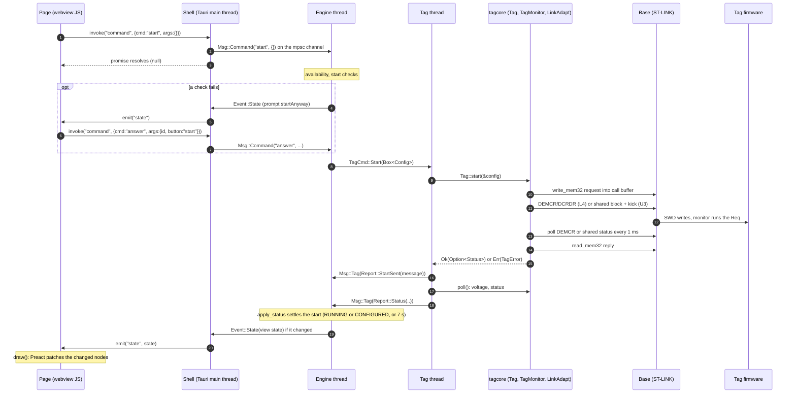

# 13. End to end: Tag Monitor's Start, from the button to the wire and back

This chapter follows a single user action, a click on Tag Monitor's Start
button, through every layer of the host software and back: the page
(`tagmonitor-rs/ui/app.js` and `host/ui-kit/kit.js`), the Tauri shell
(`tagmonitor-rs/app/src/main.rs` and the shared `tagapp-shell` it calls), the engine and its model
(`tagmonitor-rs/core/src/engine/` and `model/`), the tag thread, and tagcore
from `Tag::start` down to the 16-byte ST-LINK command blocks. It quotes the
code at each hop and points to the chapter that explains that layer in
depth ([chapters 3](03-usb-and-stlink.md), [4](04-monitor-and-rpc.md),
[5](05-protobuf-and-the-tag-api.md), [10](10-tauri-shell.md),
[11](11-engine-and-model.md) and [12](12-ui-kit-and-pages.md)) instead of
re-explaining it. After reading it you can put a finger on the line that
runs at any moment of a Start, say which thread it runs on and what it is
waiting for, and know where to look when a Start goes wrong.

The architecture-level version of this trace is in the guide's
[How a command travels](../guide/10-application-pattern.md#how-a-command-travels)
and in Tag Monitor's [architecture.md](../../applications/tagmonitor-rs/design/architecture.md#how-a-command-travels-start).
This chapter is the same journey with the code in front of you.

## The whole round trip



Four threads of control take part: the webview's JavaScript, the Tauri main
thread, the engine thread and the tag thread. They hand each other data
only through channels (the one other shared object, the download's cancel
flag, plays no part in a Start). The page talks to the shell through Tauri's IPC, the shell to the
engine through one `std::sync::mpsc` channel, the engine to the tag thread
through a second, and the tag thread back to the engine through the first.
tagcore runs entirely on the tag thread.

## Hop 1: the page

The Start button is drawn by the status strip,
[app.js:145](../../applications/tagmonitor-rs/ui/app.js#L145):

```js
      ${["start", "stop"].map((cmd) => html`<${Button} small hidden=${!actions[cmd].visible}
        disabled=${!actions[cmd].enabled} onClick=${() => send(cmd)}>${cmd === "start" ? "Start" : "Stop"}<//>`)}
```

The button decides nothing. Whether it is visible and enabled comes from
`actions.start` in the engine's view state (hop 7); a click sends the
command name and nothing else. The configuration the tag will receive is
not in the request: the engine holds the form (hop 4).

> **JavaScript:** `` html`...` `` is a tagged template literal: `html` is a
> function (htm, bound to Preact) that receives the literal's string pieces
> and the `${...}` values and builds a virtual-DOM tree. `<${Button} ...>`
> uses a component function as the tag name, and `<//>` closes it. Think of it
> as JSX without a compiler step; [chapter 12](12-ui-kit-and-pages.md) covers it.

`send` is [app.js:54](../../applications/tagmonitor-rs/ui/app.js#L54):

```js
  const send = (cmd, args) =>
    Promise.resolve(engine.command(cmd, args)).then((err) => {
      if (err) Kit.alert("Tag Monitor", String(err), null, "warning");
    }, (err) => Kit.alert("Tag Monitor", String(err), null, "warning"));
```

> **JavaScript:** `.then(onResolved, onRejected)` attaches both handlers at
> once. `Promise.resolve(x)` wraps a value that might or might not be a
> promise (the mock engine returns plain values, Tauri returns promises), so
> the same code handles both.

The engine was created by the kit,
[kit.js:51](../../ui-kit/kit.js#L51):

```js
  function createEngine(mock) {
    const t = tauri();
    if (t) {
      return {
        kind: "tauri",
        command: (cmd, args) => t.core.invoke("command", { cmd, args: args || {} }),
        query: (name, args) => t.core.invoke("query", { name, args: args || {} }),
        on: (event, cb) => t.event.listen(event, (e) => cb(e.payload)),
      };
    }
    // ...
  }
```

So the click becomes `window.__TAURI__.core.invoke("command", {cmd: "start",
args: {}})`. **Library: Tauri's JS API.** `invoke(name, payload)` serialises
`payload` to JSON, sends it over the webview's IPC bridge to the Rust command
registered under `name`, and returns a promise for its return value;
`event.listen(name, cb)` subscribes to events the Rust side emits. Tauri
injects these as the global `window.__TAURI__` because the app's
configuration sets `withGlobalTauri`; [chapter 10](10-tauri-shell.md) shows
the configuration.

Tag Monitor's `command` returns nothing (hop 2), so the promise resolves
with `null` as soon as the shell has queued the message, and `send`'s
`if (err)` never fires for an engine decision. Only a failure in Tauri
itself (an argument that does not deserialise, for example) rejects. The
outcome of the Start reaches the page later, as a `state` event.

## Hop 2: the shell

The shell's half is four lines in the shell every application shares,
[tagapp-shell lib.rs:150](../../libraries/tagapp-shell-rs/src/lib.rs#L150):

```rust
/// The `invoke("command", {cmd, args})` command: queued for the engine
/// thread; the page learns the outcome from the next `state` event.
#[tauri::command]
fn command(engine: State<'_, Engine>, cmd: String, args: Value) {
    engine.command(&cmd, args);
}
```

**Library: Tauri (Rust side).** `#[tauri::command]` turns a plain function
into an IPC handler: Tauri deserialises the JSON payload's `cmd` and `args`
keys into the parameters of the same names, and `State<'_, Engine>` is
injected from the value the shell registered with `tauri_app.manage(engine)` at
startup ([lib.rs:302](../../libraries/tagapp-shell-rs/src/lib.rs#L302)): the shell's `Engine`, which wraps Tag
Monitor's handle and calls its `command` method (chapter 10,
[The engine as the shell sees it](10-tauri-shell.md#the-engine-as-the-shell-sees-it)),
and that puts a `Msg::Command` on the engine's channel.
A command without `async` runs on the main thread, which is why this one
does nothing but post a message. `Value` is **serde_json**'s untyped JSON
tree, the C++ equivalent of a `QJsonValue`.

> **Rust:** `State<'_, Engine>` is a borrowed handle; `'_` is an elided
> lifetime meaning "for as long as this call". `&cmd` turns the owned
> `String` into a `&str` for the callee, while `args` is moved (ownership
> passes to `engine.command`, no copy).

`Engine::command`,
[engine/mod.rs:138](../../applications/tagmonitor-rs/core/src/engine/mod.rs#L138),
is the whole crossing from the main thread to the engine thread:

```rust
    pub fn command(&self, cmd: &str, args: Value) {
        let _ = self.tx.send(Msg::Command(cmd.to_owned(), args));
    }
```

> **Rust:** `std::sync::mpsc` is the standard library's multi-producer,
> single-consumer queue; `Sender::send` never blocks (the queue is
> unbounded) and fails only if the receiving thread has gone.
> `let _ = ...` discards that `Result` on purpose: a command sent during
> shutdown is dropped. Without the `let _` the compiler warns about an
> unused `Result`.

## Hop 3: the engine

The engine thread spends its life in
[engine/mod.rs:267](../../applications/tagmonitor-rs/core/src/engine/mod.rs#L267):

```rust
fn run(mut monitor: Monitor, sink: Sink, rx: Receiver<Msg>) {
    let mut last_state = Value::Null;
    loop {
        let wait = monitor
            .next_deadline()
            .map(|d| d.saturating_duration_since(Instant::now()))
            .unwrap_or(Duration::from_secs(3600));
        match rx.recv_timeout(wait) {
            Ok(Msg::Command(cmd, args)) => monitor.command(&cmd, &args),
            Ok(Msg::Query(name, args, reply)) => {
                let _ = reply.send(monitor.query(&name, &args));
            }
            Ok(Msg::Tag(report)) => monitor.report(report),
            Err(RecvTimeoutError::Timeout) => {}
            Err(RecvTimeoutError::Disconnected) => break,
        }
        // ...
```

One message, one state change, then (hop 7) one comparison of the view
state. The `Msg::Command` arm hands the start to `Monitor::command`,
[monitor.rs:504](../../applications/tagmonitor-rs/core/src/engine/monitor.rs#L504):

```rust
    pub(crate) fn command(&mut self, cmd: &str, args: &Value) {
        if let Some(&command) = ALL_COMMANDS.iter().find(|c| command_name(**c) == cmd) {
            if self.available(command) == Availability::Enabled {
                self.run_command(command);
            } else {
                debug!("{cmd}: not available now");
            }
            return;
        }
        // ...
```

> **Rust:** `ALL_COMMANDS.iter()` yields `&Command`; `find` hands its
> closure a reference to that, so `c` is `&&Command` and `**c` gets back to
> the value. The pattern `Some(&command)` destructures the found
> `&Command` and copies the value out (`Command` is `Copy`). It is a linear
> search of a twelve-entry table, the Rust spelling of a `std::find_if`.

### The availability rule

The engine checks availability again even though the page only enables the
button when it is available: the page's copy of `actions` can be one state
old, and a keyboard shortcut or menu item is another way in. `available`
calls the same pure function that filled `actions.start`,
[commands.rs:120](../../applications/tagmonitor-rs/core/src/model/commands.rs#L120):

```rust
pub fn availability(command: Command, input: &CommandInputs) -> Availability {
    let idle = input.attached && input.state == TagState::Idle;
    match command {
        // ...
        Command::Start => {
            enabled_if(input.document && idle && input.document_type == input.tag_type)
        }
        // ...
```

Start needs an attached IDLE tag and a configuration document of that tag's
type. The table this function produces is compared byte for byte with
qtmonitor's `action-states.txt` by `core/tests/oracles.rs`
([chapter 11](11-engine-and-model.md)).

### The start checks

`run_command` maps `Command::Start` to `start_with_checks`
([monitor.rs:564](../../applications/tagmonitor-rs/core/src/engine/monitor.rs#L564)),
[monitor.rs:597](../../applications/tagmonitor-rs/core/src/engine/monitor.rs#L597):

```rust
    /// The failing start checks' sentences.
    fn start_check_failures(&self) -> Vec<String> {
        let (offset, test) = (self.model.clock_offset_s(), self.model.last_test());
        start_check_failures(offset, test, self.editor.approved())
            .into_iter()
            .map(|c| start_check_message(c, offset, test))
            .collect()
    }

    /// Start: asks first if a check fails.
    fn start_with_checks(&mut self) {
        let failures = self.start_check_failures();
        if failures.is_empty() {
            self.start();
        } else {
            self.ask(PromptKind::StartAnyway(failures));
        }
    }
```

The rules themselves are a pure function,
[startchecks.rs:36](../../applications/tagmonitor-rs/core/src/model/startchecks.rs#L36):

```rust
pub fn start_check_failures(
    clock_offset_s: f64,
    test: TestResult,
    approved: bool,
) -> Vec<StartCheck> {
    let mut failures = Vec::new();
    if clock_offset_s.abs() > CLOCK_TOLERANCE_S {
        failures.push(StartCheck::Clock);
    }
    if test != TestResult::AllPassed {
        failures.push(StartCheck::SelfTest);
    }
    if !approved {
        failures.push(StartCheck::Approval);
    }
    failures
}
```

`CLOCK_TOLERANCE_S` is 2.0, so an offset of exactly 2 s passes. The clock
offset and the self-test result are whatever the last status poll reported;
nothing is read from the tag at this point. Every input is already in the
engine's memory, so the checks cost nothing and never block.

### The StartAnyway prompt round trip

When a check fails, `ask` queues a prompt with a fresh id
([monitor.rs:221](../../applications/tagmonitor-rs/core/src/engine/monitor.rs#L221))
and the command handler returns. Nothing has gone to the tag. The engine
cannot open a dialog; it describes one in the view state instead,
[view.rs:232](../../applications/tagmonitor-rs/core/src/engine/view.rs#L232):

```rust
            PromptKind::StartAnyway(failures) => json!({
                "kind": "startAnyway",
                "title": "Start Tag",
                "text": "Start the tag anyway?",
                "failures": failures,
            }),
```

with `v["id"] = json!(p.id);` added at
[view.rs:274](../../applications/tagmonitor-rs/core/src/engine/view.rs#L274).
The view state now differs from the last one sent, so the loop emits it
(hop 7), and the page's `showPrompt` draws the dialog once per id,
[app.js:391](../../applications/tagmonitor-rs/ui/app.js#L391):

```js
      case "startAnyway": {
        const body = html`<div><div>${p.text}</div><ul class="failures">${p.failures.map((f) => html`<li>${f}</li>`)}</ul></div>`;
        const choice = await Kit.dialog({ title: p.title, body, width: 420, buttons: [
          "spacer",
          { label: "Cancel", value: "cancel", cancel: true, default: true, enter: true },
          { label: "Start Anyway", value: "start" },
        ] });
        return answer(id, choice || "cancel");
      }
```

> **JavaScript:** `showPrompt` is an `async` function, so `await` suspends it
> until the dialog's promise resolves, without blocking the page; the
> `state` listener that called it has already returned. `choice || "cancel"`
> maps a dismissed dialog (`null`) to `"cancel"`.

`answer` sends `command("answer", {id, button: "start"})`, which travels
hops 1 to 3 exactly as Start did and arrives at `Monitor::answer`. That
checks the id against the prompt at the front of the queue (an answer to
any other id is stale and ignored), pops it, and for this kind,
[monitor.rs:655](../../applications/tagmonitor-rs/core/src/engine/monitor.rs#L655):

```rust
            PromptKind::StartAnyway(failures) => {
                if button == "start" {
                    warn!(
                        "Starting {} although: {}",
                        self.tag_name(),
                        failures.join(" ")
                    );
                    self.start();
                }
            }
```

Cancel does nothing at all. The prompt's state lives only in the engine;
the page holds the dialog open and nothing else, which is the pattern of
the guide's [Prompts: dialogs as data](../guide/10-application-pattern.md#prompts-dialogs-as-data).

## Hop 4: the configuration

Both paths end in `start`,
[monitor.rs:616](../../applications/tagmonitor-rs/core/src/engine/monitor.rs#L616):

```rust
    /// Sends the form's configuration to start the tag.
    fn start(&mut self) {
        match self.editor.get_config(now_s()) {
            Some(config) => {
                self.send(TagCmd::Start(Box::new(config)));
            }
            None => debug!("Start: the configuration cannot be written"),
        }
    }
```

What the form would send is built on the engine thread,
[configeditor.rs:81](../../applications/tagmonitor-rs/core/src/model/configeditor.rs#L81):

```rust
    /// What Start sends (ConfigTab::GetConfig): [`collect`](Self::collect),
    /// recorded as the document's values.
    pub fn get_config(&mut self, now: i64) -> Option<Config> {
        let config = self.collect(now)?;
        self.doc.set_config(config.clone());
        Some(config)
    }
```

and `collect` hands it to the form,
[configform.rs:1510](../../applications/tagmonitor-rs/core/src/model/configform.rs#L1510):

```rust
    /// What Start would send: `base` with `tag_type`, each shown panel's
    /// fields written over it. `now` is the clock, seconds.
    pub fn collect(&self, base: &Config, tag_type: TagType, now: i64) -> Config {
        let mut config = base.clone();
        config.tag_type = tag_type as i32;
        for &i in &self.shown {
            self.panels[i].store(&mut config, now);
        }
        config
    }
```

The document's `Config` (as loaded from a file or read from the tag) is
the base; each panel shown for this tag type writes its fields over it.
`now` matters because the schedule panel turns a start time in the past
into "immediately". `Config` is the prost-generated struct for the
protobuf message (hop 5); the bytes Start sends for 710 recorded form cases
are compared with qtmonitor's by `core/tests/config_probe.rs`.

> **Rust:** the `?` in `self.collect(now)?` works on `Option` as well as
> `Result`: a `None` returns `None` from `get_config` at once. `Box::new`
> moves the `Config` to the heap so the `TagCmd` enum stays small: an enum
> is as large as its largest variant, and every other `TagCmd` is a few
> words. Clippy's `large_enum_variant` lint asks for exactly this.

`self.send` is another non-blocking `mpsc` send, to the tag thread's
channel ([monitor.rs:216](../../applications/tagmonitor-rs/core/src/engine/monitor.rs#L216)).
The engine thread is done with the Start until a report comes back. It
goes back to `recv_timeout` and keeps answering the page.

## Hop 5: the tag thread and tagcore

### The tag thread

The tag thread's loop,
[tagthread.rs:338](../../applications/tagmonitor-rs/core/src/engine/tagthread.rs#L338),
has the same shape as the engine's: wait for a command or the next poll.

```rust
    loop {
        let wait = t
            .next_poll
            .map(|due| due.saturating_duration_since(Instant::now()))
            .unwrap_or(Duration::from_secs(3600));
        match rx.recv_timeout(wait) {
            Ok(cmd) => t.run(cmd),
            Err(RecvTimeoutError::Timeout) => {}
            // ...
        }
        if t.next_poll.is_some_and(|due| Instant::now() >= due) {
            t.poll();
        }
    }
```

The Start arm of `TagThread::run`,
[tagthread.rs:255](../../applications/tagmonitor-rs/core/src/engine/tagthread.rs#L255):

```rust
            TagCmd::Start(config) => {
                debug!(
                    "Starting tag with config: {}",
                    tagcore::proto::debug_string(&*config)
                );
                // A failed call does not mean the tag did not start: the
                // acknowledgement can be lost after the tag accepted it. The
                // model judges the start from the statuses that follow.
                let message = match self.tag.start(&config) {
                    Ok(_) => String::new(),
                    Err(_) => self.tag.debug_message(),
                };
                self.report(Report::StartSent(message));
                self.poll();
            }
```

The thread decides nothing. It reduces the call's outcome to a message
(empty on success), reports it, and reads a status at once. Note that
`Ok(_)` throws away the `Option<Status>` that synchronous firmware returns
in its reply: the judgement is left to the status poll that follows.

> **Rust:** `&*config` turns a `Box<Config>` into a `&Config` (dereference
> the box, then borrow). `&config` in `self.tag.start(&config)` is a
> `&Box<Config>`, which the compiler converts to `&Config` automatically
> ("deref coercion"). `debug_string` is generic over the message type, and
> a generic parameter gets no deref coercion: `&config` would compile there
> too, but with the type parameter inferred as `Box<Config>` (prost-reflect
> implements its reflection trait for `Box<M>`). `&*config` says plainly that
> the `Config` is what is printed.

### Tag::start

From here down is tagcore,
[tag.rs:596](../../libraries/tagcore-rs/src/tag.rs#L596). The doc comment is
dropped:

```rust
    pub fn start(&self, config: &Config) -> Result<Option<Status>, TagError> {
        self.lock()
            .command(&request(req::Payload::Start(config.clone())))
    }
```

`request` wraps the payload in a `Req`
([tag.rs:219](../../libraries/tagcore-rs/src/tag.rs#L219)), and
`Req { payload: Some(req::Payload::Start(config)) }` is prost's
representation of the `.proto` oneof `Config start = 5;`. The config is
cloned because the request owns its payload and the caller keeps its own.

> **Rust:** `self.lock()` returns a `MutexGuard`, a temporary that lives
> until the expression it is part of has been evaluated, so the lock is held
> for the whole RPC and released as `start` returns. This is the only lock
> on the path; see [What is not on this path](#what-is-not-on-this-path).

`Inner::command`,
[tag.rs:291](../../libraries/tagcore-rs/src/tag.rs#L291), is the shared
path for state-changing requests (Start, Stop, Erase, Self-test,
Calibrate):

```rust
    fn command(&mut self, req: &Req) -> Result<Option<Status>, TagError> {
        if !self.rpc(req) {
            self.ack = monitor_failure("Monitor call failed");
            return Err(self.error());
        }
        command_outcome(&self.ack)
    }
```

and `Inner::rpc`,
[tag.rs:248](../../libraries/tagcore-rs/src/tag.rs#L248), records the reply
or its absence so that `debug_message` and `last_error` can report it later:

```rust
    fn rpc(&mut self, req: &Req) -> bool {
        match self.monitor.rpc(req) {
            Some(ack) => {
                self.ack = ack;
                self.rpc_failed = false;
            }
            None => {
                self.ack = Ack::default();
                self.rpc_failed = true;
            }
        }
        !self.rpc_failed
    }
```

(The getters `tag_info` and `config` go through `Inner::payload` instead,
which returns the reply's payload; Start does not.) Everything above this
point is the Tag API of [chapter 5](05-protobuf-and-the-tag-api.md); below
it is the monitor of [chapter 4](04-monitor-and-rpc.md).

### TagMonitor::rpc: encode, write, call, read, decode

**Library: prost.** prost generates a plain Rust struct per protobuf message
at build time (tagcore's `build.rs`) and implements its `Message` trait,
whose `encoded_len()`, `encode(&mut buf)` and `decode(bytes)` are the only
calls this path uses. It is the Rust counterpart of the C++
`SerializeToArray` and `ParseFromArray`. [Chapter 5](05-protobuf-and-the-tag-api.md)
explains the generation.

[rpc.rs:106](../../libraries/tagcore-rs/src/monitor/rpc.rs#L106) encodes the
request into a 64 KB host staging buffer:

```rust
        let size = req.encoded_len();
        if size > self.rpcbuf.len() {
            error!("Request message too big");
            return None;
        }
        let step = Instant::now();
        let mut out: &mut [u8] = &mut self.rpcbuf[..];
        if req.encode(&mut out).is_err() {
            error!("Request message too big");
            return None;
        }
```

> **Rust:** prost writes into anything implementing `BufMut`, and a
> `&mut [u8]` does: each write advances the slice past what it wrote. That
> is why `out` is a separate mutable variable holding a slice of
> `rpcbuf` and is passed as `&mut out`, a pointer to the cursor, much like
> passing a `uint8_t **` in C.

The bytes are plain protobuf with no length prefix. For a Start, the first
byte is `0x2A` (field 5, wire type 2), then the `Config`'s length as a
varint, then the `Config`. The request must leave two bytes spare in the
firmware's call buffer (`size + 2 > self.maxpacket` fails). On an STM32L4
with the DebugMonitor transport, `wait_l4_idle` then waits up to 2.5 s for
any earlier request to clear (`MON_PEND` and `MON_REQ` both zero) before
the buffer is overwritten.

`write_request(round4(size))`
([rpc.rs:47](../../libraries/tagcore-rs/src/monitor/rpc.rs#L47)) writes the
request, rounded up to whole words, to `call_buf`, the firmware's call
buffer address read at attach, with `write_mem32`. On an STM32L4 it reads
the words back and rewrites up to three times, 100 ms apart, because an L4
can drop a write with an OK status while its bus matrix is asleep. The
check depends on the target family, not the transport, so an L4 image on
the mailbox is checked too.

Then the call and the reply,
[rpc.rs:146](../../libraries/tagcore-rs/src/monitor/rpc.rs#L146), with the
statistics lines elided:

```rust
        let step = Instant::now();
        let retval = self.call(op::PROTOBUF, size as i32);
        // ...
        let Some(retval) = retval else {
            error!("monitor_call failed");
            return None;
        };

        let len = retval as usize;
        if len > self.maxpacket {
            error!(
                "Reply length {len} exceeds the monitor buffer ({} bytes)",
                self.maxpacket
            );
            return None;
        }

        let step = Instant::now();
        let read_ok = len == 0
            || self
                .link
                .read_mem32(self.call_buf, &mut self.rpcbuf[..round4(len)]);
        // ...
        let ack = Ack::decode(&self.rpcbuf[..len]);
        // ...
        ack.map_err(|e| error!("Reply did not decode: {e}")).ok()
```

The request length goes out as the PROTOBUF operand; the reply length comes
back as the call's result word; the reply overwrites the request in the
same call buffer. We come back to the decode in hop 6.

> **Rust:** `let Some(x) = expr else { ...; return None; };` is "let-else":
> bind on a match, otherwise run the block, which must leave the function.
> It replaces the C++ pattern `if (!opt) { ...; return {}; } auto x = *opt;`.
> The last line uses `map_err` only for its side effect (logging) and then
> `.ok()` turns `Result<Ack, _>` into `Option<Ack>`.

### call: one operation over either transport

`call` picks the transport chosen at attach,
[monitor/mod.rs:594](../../libraries/tagcore-rs/src/monitor/mod.rs#L594):

```rust
    fn call(&mut self, operation: u8, operand: i32) -> Option<u32> {
        if self.transport == Transport::Mailbox {
            self.call_u3(operation, operand)
        } else {
            self.call_l4(operation, operand)
        }
    }
```

Both pack the same command word,
[abi.rs:126](../../libraries/tagcore-rs/src/monitor/abi.rs#L126): operand
in bits 31..8, operation in bits 7..0. `op::PROTOBUF` is 3, so a request of
90 bytes (0x5A, an example size used through the rest of this chapter)
gives the word `0x0000_5A03`.

**The DebugMonitor (STM32L4).** `call_l4` reads DEMCR, refuses if a request
is still pending, then posts the command,
[l4.rs:153](../../libraries/tagcore-rs/src/monitor/l4.rs#L153):

```rust
        if !self
            .link
            .write_debug32(DCRDR, command_word(operation, operand))
            || !self
                .link
                .write_debug32(DEMCR, demcr | MON_EN | MON_PEND | MON_REQ | VC_CORERESET)
        {
            log!(self.failure_log_level(), "write reg failed");
            return None;
        }
```

and waits for the firmware's DebugMon handler to clear `MON_REQ`,
[l4.rs:172](../../libraries/tagcore-rs/src/monitor/l4.rs#L172), with the
probe-lost arm elided:

```rust
        // Wait for the handler to clear MON_REQ.
        let mut answered = false;
        for _ in 0..call_timeout_ms {
            match self.link.read_debug32(DEMCR) {
                // ...
                // read_debug32 logs the failure; keep polling.
                None => {}
                Some(d) => {
                    demcr = d;
                    if d & MON_REQ == 0 {
                        answered = true;
                        break;
                    }
                }
            }
            sleep(ms(1));
        }
```

The result is then read from DCRDR (up to 500 tries). For PROTOBUF the
poll limit is 65000; each poll is a USB round trip plus a 1 ms sleep, so
the code's own documentation puts the wall time near 120 s. On a timeout,
`report_l4_timeout` logs DHCSR, DCRDR, RCC_CSR and the SCB registers, and
can halt and resume the core or drop the session.

**The mailbox (STM32U3, and L4 images built with `TAG_L4_MONITOR_MAILBOX`).**
`call_u3` reads the shared block at `0x2000_0000`, refuses unless it shows
a connected session with nothing in flight, then writes the command and
kicks the firmware by pending IRQ 39 in the NVIC,
[u3.rs:137](../../libraries/tagcore-rs/src/monitor/u3.rs#L137):

```rust
        if !(self.write_monitor_shared_word(MonitorShared::RESULT, 0)
            && self.write_monitor_shared_word(MonitorShared::STATUS, status::IDLE)
            && self.write_monitor_shared_word(
                MonitorShared::COMMAND,
                command_word(operation, operand),
            )
            && self.write_word(MONITOR_SHARED_KICK_ICPR_ADDR, MONITOR_SHARED_KICK_MASK)
            && self.write_word(MONITOR_SHARED_KICK_ISPR_ADDR, MONITOR_SHARED_KICK_MASK))
        {
            error!("mailbox monitor kick failed op={name}(0x{operation:x}) operand={operand}");
            return None;
        }
```

then polls the `status` word once a millisecond, up to 2500 times, for
`DONE`, and reads `result`,
[u3.rs:155](../../libraries/tagcore-rs/src/monitor/u3.rs#L155):

```rust
        for _ in 0..timeout_ms {
            if let Some(st) = self.read_word(MONITOR_SHARED_ADDR + MonitorShared::STATUS) {
                if st == status::DONE {
                    let result = self.read_word(MONITOR_SHARED_ADDR + MonitorShared::RESULT);
                    if result.is_none() {
                        error!("mailbox monitor result read failed");
                    }
                    return result;
                }
                // ...
```

A `BUSY`, `BAD_COMMAND` or `NOT_ATTACHED` status fails the call at once.
The 2500-poll limit applies to PROTOBUF too, unlike the L4's 65000. Every
access here, the NVIC writes included, goes through the memory path
(`read_word` and `write_word` are one-word `read_mem32` and `write_mem32`,
[monitor/mod.rs:440](../../libraries/tagcore-rs/src/monitor/mod.rs#L440));
the L4 transport uses the debug-register path for DEMCR and DCRDR. The two
transports are compared in [chapter 4](04-monitor-and-rpc.md).

### LinkAdapt: the 16-byte command blocks

Every access above ends in one of four `LinkAdapt` calls. The memory write,
[target.rs:109](../../libraries/tagcore-rs/src/link/target.rs#L109), with
the statistics elided:

```rust
    pub fn write_mem32(&mut self, addr: u32, data: &[u8]) -> bool {
        let start = Instant::now();
        let Ok(count) = u16::try_from(data.len()) else {
            error!("write of {} bytes exceeds one ST-LINK transfer", data.len());
            return false;
        };
        let mut cmd = debug_cmd(stlink::DEBUG_WRITEMEM_32BIT, addr);
        cmd[6..8].copy_from_slice(&count.to_le_bytes());
        if !self.cmd_write(&cmd, data) {
            return false;
        }
        match self.get_rw_status() {
            Some(stlink::DEBUG_ERR_OK) => {}
            status => {
                let level = self.note_failure();
                log!(level, "error return {:x}", status.unwrap_or(0));
                return false;
            }
        }
        self.end_failure_run(format_args!("a memory write"));
        // ...
        true
    }
```

and the debug-register read,
[target.rs:153](../../libraries/tagcore-rs/src/link/target.rs#L153):

```rust
    pub fn read_debug32(&mut self, addr: u32) -> Option<u32> {
        let start = Instant::now();
        let mut result = [0u8; 8];
        if !self.cmd_read(
            &debug_cmd(stlink::DEBUG_APIV2_READDEBUGREG, addr),
            &mut result,
        ) {
            return None;
        }
        let status = unpack16(&result);
        if status != stlink::DEBUG_ERR_OK {
            // ...
            return None;
        }
        // ...
        Some(unpack32(&result[4..8]))
    }
```

Both start from `debug_cmd`,
[stlink.rs:145](../../libraries/tagcore-rs/src/link/stlink.rs#L145):

```rust
pub(super) fn debug_cmd(sub: u8, addr: u32) -> [u8; 16] {
    let mut cmd = [0u8; 16];
    cmd[0] = DEBUG_COMMAND;
    cmd[1] = sub;
    cmd[2..6].copy_from_slice(&addr.to_le_bytes());
    cmd
}
```

and go to the probe through `cmd_write` or `cmd_read`
([stlink.rs:306](../../libraries/tagcore-rs/src/link/stlink.rs#L306)), which
send the block on the bulk OUT endpoint and then send the data or read the
reply. **Library: rusb.** rusb is the Rust binding to libusb (built from
source and linked statically here); the link uses `read_bulk` and
`write_bulk` on a `DeviceHandle`, each with a 1.5 s timeout
(`USB_TRANSFER_TIMEOUT`). [Chapter 3](03-usb-and-stlink.md) covers opening
the probe, the endpoints and the failure-run logging.

> **Rust:** `u16::try_from(len)` is a checked narrowing conversion that
> returns `Err` instead of truncating; the C++ took a `uint16_t` count and
> truncated silently. `to_le_bytes()` gives the value's little-endian bytes
> whatever the host's byte order.

Here are the actual bytes for two of the accesses a Start makes.

**The mailbox `COMMAND` word write**, `write_mem32(0x2000_001C, &[0x03,
0x5A, 0x00, 0x00])` (offset `7 * 4` in the shared block; command word
`0x0000_5A03`):

```text
OUT 16  F2 08 1C 00 00 20 04 00 00 00 00 00 00 00 00 00   DEBUG_COMMAND, WRITEMEM_32BIT, addr LE, count 4
OUT  4  03 5A 00 00                                       the data
OUT 16  F2 3E 00 00 00 00 00 00 00 00 00 00 00 00 00 00   GETLASTRWSTATUS2
IN  12  80 00 ...                                         status 0x0080 = DEBUG_ERR_OK; rest not interpreted
```

A memory write is three USB OUT transfers and one IN. The status query
after it is needed because the probe reports success at the USB level even
when the target faulted the access. (If the 12-byte form fails,
`get_rw_status` falls back to the older 2-byte `F2 3B`.) The request write
into `call_buf` is the same with the call buffer's address and a count of
`round4(size)`, here 92 (`5C 00`), followed by the 92 bytes of the request.

**The L4 DEMCR poll**, `read_debug32(0xE000_EDFC)`:

```text
OUT 16  F2 36 FC ED 00 E0 00 00 00 00 00 00 00 00 00 00   DEBUG_COMMAND, APIV2_READDEBUGREG, addr LE
IN   8  80 00 xx xx  v0 v1 v2 v3                          status LE (bytes 2-3 unused), value LE
```

While the request is pending the value has `MON_REQ` (bit 19) set; once the
handler has run, the bit is clear and the loop ends. For example, with
only the host's bits set, `0x000B_0001` (`01 00 0B 00`) while pending and
`0x0001_0001` (`01 00 01 00`) after. A debug-register access is one OUT and
one IN; the posting write `write_debug32(DCRDR, 0x0000_5A03)` is
`F2 35 F8 ED 00 E0 03 5A 00 00 00 00 00 00 00 00` with a 2-byte status
reply.

The base's firmware turns each block into SWD transactions on the tag's
debug port; the tag's core keeps running throughout, and the monitor code
in the firmware does the work. On the L4 the DebugMon exception runs the
request; on the mailbox an interrupt handler does. Neither is in this tree;
see [chapter 4](04-monitor-and-rpc.md) for what the host can assume of
them.

## Hop 6: back up

### The reply

When the call returns, its result word is the reply length. `rpc` rejects a
length larger than the call buffer, reads `round4(len)` bytes back with
`read_mem32` (the same block as the write, with sub-command `07` and the
data arriving on the IN endpoint), and decodes exactly `len` bytes; the
padding is ignored. A length of 0 skips the read and decodes an empty
buffer, which gives a default `Ack` whose `err` is `UNSPECIFIED`.

The decoded `Ack` goes back up to `Inner::rpc`, which stores it, and
`Inner::command` turns it into the API's result with `command_outcome`,
[tag.rs:208](../../libraries/tagcore-rs/src/tag.rs#L208):

```rust
fn command_outcome(ack: &Ack) -> Result<Option<Status>, TagError> {
    if ack_err(ack) != ack::Err::Ok {
        return Err(describe(ack, false));
    }
    match &ack.payload {
        Some(ack::Payload::Status(status)) => Ok(Some(status.clone())),
        _ => Ok(None),
    }
}
```

So `Tag::start` has three outcomes:

| Outcome | Meaning |
| --- | --- |
| `Ok(Some(status))` | Firmware with synchronous commands carried out the start before answering and reports CONFIGURED or RUNNING. |
| `Ok(None)` | Older firmware answered a bare OK and starts later. |
| `Err(TagError)` | The firmware refused (PERM in the wrong state, NXIO when the configuration could not be stored or the start ended in another state), or the transport failed, recorded as a MONITOR Ack with "Monitor call failed". |

The `Option<Status>` is the reason the return type is not a plain
`Result<(), _>`: a caller that cares (the command-line `tag-start`, for
one) can see the new state without another request. Tag Monitor does not
use it, as hop 5 showed.

> **Rust:** `match &ack.payload` matches on a reference, so `status` binds
> as `&Status` and nothing is moved out of the `Ack`; `.clone()` makes the
> owned copy to return. prost represents a oneof as an `Option` of a
> generated enum, here `Option<ack::Payload>`.

### The reports

The tag thread sends `Report::StartSent(message)` and then calls `poll`,
[tagthread.rs:163](../../applications/tagmonitor-rs/core/src/engine/tagthread.rs#L163):

```rust
    fn poll(&mut self) {
        if !self.tag.is_attached() {
            self.next_poll = None;
            return;
        }
        let voltage = self.tag.voltage().unwrap_or(0.0);
        let status = self.tag.status();
        // A base unplugged during the poll closes the session in tagcore;
        // show the window detached rather than attached to nothing.
        if !self.tag.is_attached() {
            self.next_poll = None;
            self.report(Report::Detached);
            return;
        }
        if let Ok(status) = status {
            self.resend_stop(&status);
            self.report(Report::Status(Box::new(status), voltage, now_ms()));
        }
        self.next_poll = Some(Instant::now() + Duration::from_millis(STATUS_POLL_MS));
    }
```

`tag.voltage()` is a single ST-LINK command (`F7`) that does not touch the
target; `tag.status()` is another full RPC down the same path as the Start.
The next poll is due 400 ms later. Because both reports come from the one
tag thread over one channel, the engine always sees `StartSent` before the
status read after it.

### The model settles the start

The engine applies the two reports in turn,
[monitor.rs:761](../../applications/tagmonitor-rs/core/src/engine/monitor.rs#L761):

```rust
            Report::Status(status, voltage, host_ms) => {
                self.editor.state_update(status.state());
                let events = self.model.apply_status(*status, voltage, host_ms);
                self.silence_s = 0;
                for event in events {
                    self.monitor_event(event);
                }
            }
            Report::ConfigRead(config) => self.load(*config, DocumentSource::Tag, ""),
            Report::StartSent(message) => self.model.start_sent(now_ms(), message),
```

`start_sent` records `Some((now_ms, message))`. Every status after it goes
through `MonitorModel::apply_status`, which settles the start,
[monitormodel.rs:263](../../applications/tagmonitor-rs/core/src/model/monitormodel.rs#L263):

```rust
        if let Some((sent, message)) = &self.start_sent {
            let state = status.state();
            if matches!(state, TagState::Running | TagState::Configured) {
                events.push(MonitorEvent::StartSucceeded {
                    state,
                    message: message.clone(),
                });
                self.start_sent = None;
            } else if host_ms - sent >= START_WAIT_MS {
                events.push(MonitorEvent::StartFailed {
                    state,
                    message: message.clone(),
                });
                self.start_sent = None;
            }
        }
```

> **Rust:** `if let Some((sent, message)) = &self.start_sent` matches
> through a reference: `sent` is `&i64` and `message` is `&String`, which is
> why `host_ms - sent` works (arithmetic is defined for `i64 - &i64`) and
> why `message.clone()` is needed. `matches!(value, pattern)` is a boolean
> pattern test, here an "is one of" check.

`monitor_event`
([monitor.rs:802](../../applications/tagmonitor-rs/core/src/engine/monitor.rs#L802))
logs a warning when a start succeeded although the call reported an error,
and turns `StartFailed` into an alert prompt,
[monitor.rs:811](../../applications/tagmonitor-rs/core/src/engine/monitor.rs#L811):

```rust
            MonitorEvent::StartFailed { state, message } => {
                let last = format!("Last known state: {}", state.as_str_name());
                if message.is_empty() {
                    self.alert("Error", "Start Failed", &last, "", "error");
                } else {
                    self.alert(
                        "Error",
                        "Start Failed",
                        &format!("{message}\n{last}"),
                        &message,
                        "error",
                    );
                }
            }
```

### Why the state reached, not the ack

The reason is in the constant's own documentation,
[monitormodel.rs:33](../../applications/tagmonitor-rs/core/src/model/monitormodel.rs#L33):

```rust
/// Start is reported as failed when a status read finds the tag not yet in
/// RUNNING or CONFIGURED this long after [`MonitorModel::start_sent`], ms.
/// The clock starts when the engine handles the tag thread's report that
/// the Start request returned (which can be up to the monitor's protobuf
/// timeout after it was sent), not when it was sent. An acknowledgement is
/// not a completion, and a lost one is not a failure, so Start is judged by
/// the state the tag reaches; with no status getting through, nothing is
/// judged.
pub const START_WAIT_MS: i64 = 7000;
```

The two halves map onto the two kinds of firmware and the link. On older
firmware the OK means "queued": the state machine acts later, so an OK
proves nothing. And the reply can be lost after the tag has acted on the
request (a USB timeout, a burst of 0x81 failures from an L4 base while the
tag is busy), so an error does not prove the tag stayed IDLE. The status
the tag reports afterwards is the one fact that covers every case, which is
the rule `docs/bench` states as "an acknowledgement is not a completion".
The test `monitor_model_rules` in
[core_check.rs:194](../../applications/tagmonitor-rs/core/tests/core_check.rs#L194)
pins the three cases: an error followed by RUNNING succeeds with the
error as a warning, IDLE after 7 s fails, and CONFIGURED succeeds at once.

Two consequences are worth knowing when reading a log:

- The 7 s clock starts when the engine processes `StartSent`, which is
  after the RPC has returned, not when the button was pressed.
- `StartFailed` is raised only by a status read. If the tag stops
  answering after the Start, no status arrives and no Start Failed alert
  appears; the status strip shows "(no answer N s)" instead, from the
  engine's 1 s tick once 3 s have passed without a status.

## Hop 7: the view state and the redraw

After every message the engine loop rebuilds the whole view state and
compares it with the last one sent,
[engine/mod.rs:283](../../applications/tagmonitor-rs/core/src/engine/mod.rs#L283):

```rust
        monitor.fire_timers(Instant::now());
        if monitor.take_republish() {
            last_state = Value::Null;
        }
        let state = monitor.view_state();
        if state != last_state {
            sink(Event::State(state.clone()));
            last_state = state;
        }
```

`view_state` ([view.rs:279](../../applications/tagmonitor-rs/core/src/engine/view.rs#L279))
builds a `serde_json::Value` with the strip, the tag page, the form, the
prompt and `actions`, which is the availability rule of hop 3 evaluated
for every command,
[view.rs:285](../../applications/tagmonitor-rs/core/src/engine/view.rs#L285):

```rust
        let actions: Map<String, Value> = ALL_COMMANDS
            .iter()
            .map(|&c| {
                let a = self.available(c);
                (
                    command_name(c).to_string(),
                    json!({ "visible": a != Availability::Hidden, "enabled": a == Availability::Enabled }),
                )
            })
            .collect();
```

When the status shows RUNNING, `strip.state` changes from IDLE to RUNNING,
`actions.start.enabled` becomes false and `actions.stop.enabled` true. If
the document is the configuration read from this tag, the form also
becomes read-only (`editor.state_update` calls `update_editable`,
[configeditor.rs:186](../../applications/tagmonitor-rs/core/src/model/configeditor.rs#L186)). The `!=` is a deep
comparison of two JSON trees; it costs microseconds and means an unchanged
status poll sends nothing to the page. A StartFailed adds the alert to
`prompt` and so is a change too.

> **Rust:** `.map(...).collect()` into a `Map<String, Value>` builds the
> JSON object directly from (key, value) pairs; `collect` picks the
> container from the declared type. `json!` is serde_json's macro for
> writing a JSON literal in Rust syntax.

The sink is the closure Tag Monitor's `main` gave `engine::spawn`,
[main.rs:47](../../applications/tagmonitor-rs/app/src/main.rs#L47):

```rust
        let engine = engine::spawn(config, move |event| match event {
            Event::State(state) => events.state(state),
            // ...
```

and the shell's `Events::state`,
[tagapp-shell lib.rs:120](../../libraries/tagapp-shell-rs/src/lib.rs#L120):

```rust
    pub fn state(&self, state: Value) {
        let _ = self.handle.emit("state", state);
    }
```

Both run on the engine thread. `AppHandle::emit` serialises the value to
JSON and queues it for the webview; it does not wait for the page. On the
page, the listener registered at startup,
[app.js:526](../../applications/tagmonitor-rs/ui/app.js#L526):

```js
    engine.on("state", (s) => {
      state = s;
      Kit.setTitle(s.title);
      draw();
      renderProgress(s);
      showPrompt(s.prompt);
    }),
```

and `draw`,
[app.js:70](../../applications/tagmonitor-rs/ui/app.js#L70):

```js
  function draw() {
    if (state) render(html`<${Window} s=${state}/>`, document.getElementById("app"));
  }
```

**Library: Preact.** `render` builds a new virtual tree for the whole
window and compares it with the tree from the previous call; only the
differences reach the DOM. Here that is the state text, the Start button's
`disabled` attribute, the Stop button's, and (when the form locks) the
form controls' `disabled` flags; the log pane and the scroll positions are untouched. This is why the
page can redraw everything on every event and still behave like a widget
tree that is updated in place. [Chapter 12](12-ui-kit-and-pages.md) covers
`render`, `html` and the kit's components.

`showPrompt` returns at once unless the prompt's id is new, so the same
alert is never shown twice however many states carry it.

## What is not on this path

- **No locks below `Tag`.** `Tag`'s one `Mutex` is taken once per request,
  for the whole request. `TagMonitor` and `LinkAdapt` take `&mut self`
  and lock nothing: the borrow checker proves that only the lock holder can
  reach them. The `Tag` is owned by the tag thread and touched by no other
  thread, so the lock is never contended in Tag Monitor. It is what makes
  `Tag`'s methods take `&self` and the type safe to share between threads;
  none of the three applications shares one (Tag Programmer and Tag
  Calibrator also confine each `Tag` to one thread, chapter 14). (Every
  `debug!` or `warn!` on the path also locks the UI logger's sink for a
  moment to clone it, [engine/mod.rs:202](../../applications/tagmonitor-rs/core/src/engine/mod.rs#L202);
  see [chapter 11](11-engine-and-model.md).)
- **No async.** Every function on the path is an ordinary blocking call on
  a thread that is allowed to block. There is no `async`, no executor and
  no `await` in the engine or tagcore. The only `async` in the shell is the
  `query` command, which waits for an answer on Tauri's blocking pool; the
  Start uses `command`, which does not wait at all.
- **No exceptions.** A failure is a value at every layer: `bool` and
  `Option` in `LinkAdapt` and `TagMonitor` (with the reason logged where it
  happened), `Result<_, TagError>` from `Tag`, a `String` in the report, a
  `MonitorEvent` in the model, a prompt in the view state. A bad reply
  from the tag or the base is an error value, never a panic.
- **No callbacks into the engine.** tagcore never calls up; the tag thread
  calls it and reports. The engine never calls the tag; it sends a
  `TagCmd`. The only state the two threads share is the download's cancel
  flag, an `AtomicBool`.
- **No shared view state.** The page keeps no copy of the rules: it holds
  the last state it was sent, the selected tab, the log text and the log
  level.

## Timing: what blocks where

| Where | What it waits for | Limit |
| --- | --- | --- |
| Page | Nothing. `send` resolves once the shell has queued the message; the dialog `await` suspends only `showPrompt` | none |
| Shell (main thread) | Nothing. An `mpsc` send never blocks; `emit` queues | none |
| Engine thread | The next message, or its next deadline (the 1 s tick while attached, the quit deadline); never the tag | none |
| Tag thread, `Tag::start` | The whole RPC | see the rows below |
| L4, before the write | An earlier request to clear (`wait_l4_idle`) | 2500 polls of DEMCR, about 2.5 s or more |
| L4, request write | Read-back mismatch | 3 attempts, 100 ms apart |
| L4, PROTOBUF call | The DebugMon handler to clear `MON_REQ` | 65000 polls, about 120 s in practice |
| L4, result | DCRDR to read | 500 tries |
| U3 mailbox call | `status` to reach `DONE` | 2500 polls, about 2.5 s or more |
| Every USB transfer | The probe | 1.5 s (`USB_TRANSFER_TIMEOUT`) |
| Tag thread, after the Start | The immediate status poll, then one every 400 ms | `STATUS_POLL_MS` |
| Model | RUNNING or CONFIGURED in a status | 7 s after `StartSent` is processed (`START_WAIT_MS`) |
| Strip | Any status | "(no answer N s)" after 3 s (`NO_ANSWER_MS`) |

The poll counts are counts of round trips with a 1 ms sleep each, so the
wall time is always longer than the nominal milliseconds. While a slow RPC
runs, the tag thread polls nothing, so the engine's tick shows the silence
in the strip while the window stays responsive.

## Try it

- Click through the whole Start path without a tag: open
  `host/applications/tagmonitor-rs/ui/index.html?scenario=prompt-start` in
  a browser. The mock engine (`ui/mock-engine.js`) raises the StartAnyway
  prompt; answer Start Anyway and the strip goes to RUNNING. In the browser's
  developer tools, put a breakpoint in `send` and in the `state` listener to
  see hops 1 and 7.
- Run the start-settlement tests:
  `CARGO_TARGET_DIR=/Users/geobrown/codedev/Build/tutorial-check cargo test -p tagmonitor-core --test core_check monitor_model_rules`
  and the start-check oracle with `--test oracles start_checks_match_qtmonitor`.
  Neither needs hardware.
- Check the command word: `cargo test -p tagcore command_word` runs
  `command_word_packs_operand_above_operation` in `monitor/abi.rs`, and
  `debug_command_blocks_are_little_endian` in `link/stlink.rs` checks a
  `debug_cmd` block byte for byte.
- Follow the names: `rg -n "StartSent|start_sent|START_WAIT_MS" host/applications/tagmonitor-rs`
  shows every place the start's outcome is touched.
- On the bench only, with a tag on its base and the
  [bench rules](../../../docs/bench/README.md) followed (supply voltage
  checked, UUID recorded, Tag Monitor the only program attached): set the
  Error Log level to DEBUG before pressing Start. The log shows the tag
  thread's "Starting tag with config:" line with the whole `Config` in text
  format, then the state change. Do not attach anything else to a running
  tag to watch it: the attach resets it.

## Where next

- [Chapter 14](14-the-three-applications.md) compares Tag Monitor with Tag
  Programmer and Tag Calibrator, which follow the same path with different
  thread arrangements.
- For any single hop in depth: [chapter 12](12-ui-kit-and-pages.md) (page),
  [chapter 10](10-tauri-shell.md) (shell), [chapter 11](11-engine-and-model.md)
  (engine and model), [chapter 5](05-protobuf-and-the-tag-api.md) (Tag API
  and protobuf), [chapter 4](04-monitor-and-rpc.md) (monitor and transports),
  [chapter 3](03-usb-and-stlink.md) (USB and the ST-LINK).
- The guide's [communication model](../guide/03-communication-model.md)
  for the architecture behind the monitor RPC.
