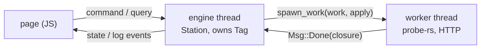

# 14. Tag Programmer, Tag Monitor and Tag Calibrator compared

The three Tauri applications share one shape: a toolkit-free `core` crate that
holds every rule and all state, a small Tauri `app` crate, and a web page on
the UI kit. [Chapter 10](10-tauri-shell.md) and [chapter 11](11-engine-and-model.md)
read that shape in Tag Monitor, and [chapter 12](12-ui-kit-and-pages.md) read
its page. This chapter reads the other two against it: Tag Programmer
(`host/applications/tagprogram-rs`), which came first and is an earlier
variant of the pattern, and Tag Calibrator (`host/applications/tagcalibrate-rs`),
which came last and follows Tag Monitor closely but streams sensor data and
draws in 3D. After reading it you can open either app's `core/src/engine` and
`ui/app.js` and know which parts are the pattern and which are the app's own.

What each application does for its user is in
[chapter 11 of the guide](../guide/11-applications.md); the decisions are
[0035](../../../docs/decisions/0035-host-tagprogram-rs.md) (Tag Programmer),
[0037](../../../docs/decisions/0037-host-tagmonitor-rs.md) (Tag Monitor) and
[0039](../../../docs/decisions/0039-host-tagcalibrate-rs.md) (Tag Calibrator).

## Order of creation, and what was copied

Tag Programmer was ported from qtprogram first. Tag Monitor followed, adding
closing through the engine and a settings file, and Tag Calibrator copied
Tag Monitor's engine shape. So when the two older apps differ, Tag Monitor's
way is the later one, and Tag Calibrator usually agrees with it. The Tauri
shells no longer differ in code: all three call the shared `tagapp-shell`
crate ([chapter 10](10-tauri-shell.md)), and each `main.rs` only describes
its application and builds its engine's configuration. The engines are
converging the same way: Tag Calibrator's handle, loop, prompt queue and logger now come
from the shared engine toolkit, `tagapp-engine`
([below](#the-engine-toolkit-underneath)), while Tag Programmer and Tag
Monitor still carry their own and move onto it when each is next changed.
The differences are listed in the table at the end; the sections
below explain the ones that change how the code reads.

## Tag Programmer

### What it does

It programs and tests a batch of tags through a USB base and records each one
in a CSV file: qtprogram's station, with the same checks, texts and record,
but programming through probe-rs (by way of `tagprobe`,
[chapter 7](07-programming-tags-and-bases.md)) instead of
STM32CubeProgrammer, and downloading firmware releases from GitHub. Its engine
is documented in
[tagprogram-rs/design/engine.md](../../applications/tagprogram-rs/design/engine.md),
its protocol in
[design/ui-engine-contract.md](../../applications/tagprogram-rs/design/ui-engine-contract.md).

### One engine thread that owns the tag, and workers that return closures

The largest difference is the threading. Tag Monitor has a dedicated tag
thread that owns `tagcore::Tag` and talks to the engine with `TagCmd` and
`Report` messages. Tag Programmer has **no tag thread**: the engine thread
owns the `Tag`, because the monitor calls it makes (attach, status, stop,
erase, self-tests, SetRtc) are quick, as they were on qtprogram's GUI thread.
Work that takes seconds (listing and downloading releases, the SWD connect
check, programming, reading flash back) runs on a short-lived **worker
thread**, and the worker's result comes back as a closure that the engine
thread runs on its state.



The message type says it.
[tagprogram-rs/core/src/engine/mod.rs:139](../../applications/tagprogram-rs/core/src/engine/mod.rs#L139):

```rust
/// Messages to the engine thread, applied in the order they arrive.
pub(crate) enum Msg {
    /// A UI command: its name and its JSON arguments (see
    /// [`Station::command`]).
    Command(String, Value),
    /// A UI query: its name, its JSON arguments and the channel for its
    /// answer (see [`Station::query`]).
    Query(String, Value, Sender<Value>),
    /// A worker finished, or reports progress; its closure is applied to the
    /// station on the engine thread. The station also posts one to itself to
    /// defer opening the record until after the first view is published
    /// (`Station::begin_checks`).
    Done(Box<dyn FnOnce(&mut Station) + Send>),
}
```

> **Rust:** `Box<dyn FnOnce(&mut Station) + Send>` is a heap-allocated,
> type-erased callable that takes `&mut Station`, may be called once, and
> may be sent to another thread: roughly a move-only
> `std::function<void(Station&)>`. Sending *code* rather than data is how a
> worker affects state it cannot touch: the `Station` lives on the engine
> thread and no one else holds a reference to it. The nearest Qt idiom is
> `QMetaObject::invokeMethod(obj, lambda, Qt::QueuedConnection)`. The enum
> has no `#[derive(Debug)]`, unlike Tag Monitor's, because a boxed closure
> cannot be printed.

The loop is Tag Monitor's without the republish step. Its exit step is a
flag: once the station sets `exit` (a confirmed quit, below), the loop sends
`Event::Exit` once and the shell closes the window.
[mod.rs:300](../../applications/tagprogram-rs/core/src/engine/mod.rs#L300):

```rust
fn run(config: EngineConfig, sink: Sink, tx: Sender<Msg>, rx: Receiver<Msg>) {
    let mut station = Station::new(config, tx);
    let mut last_state = Value::Null;
    let mut exited = false;
    loop {
        let wait = station
            .next_deadline()
            .map(|d| d.saturating_duration_since(Instant::now()))
            .unwrap_or(Duration::from_secs(3600));
        match rx.recv_timeout(wait) {
            Ok(Msg::Command(cmd, args)) => station.command(&cmd, &args),
            Ok(Msg::Query(name, args, reply)) => {
                let _ = reply.send(station.query(&name, &args));
            }
            Ok(Msg::Done(apply)) => apply(&mut station),
            Err(RecvTimeoutError::Timeout) => {}
            Err(RecvTimeoutError::Disconnected) => break,
        }
        station.fire_timers(Instant::now());
        let state = station.view_state();
        if state != last_state {
            sink(Event::State(state.clone()));
            last_state = state;
        }
        if station.exit && !exited {
            exited = true;
            sink(Event::Exit);
        }
    }
}
```

`Station::new` runs on the engine thread itself, and the station is given a
clone of the channel's sender (`tx`), which is how it starts workers that can
reply. The worker launcher, [station.rs:442](../../applications/tagprogram-rs/core/src/engine/station.rs#L442)
(doc comment dropped; it warns that `apply` "sees the station as it is when
the message is handled, not as it was when the work began"):

```rust
    pub(crate) fn spawn_work<T: Send + 'static>(
        &self,
        work: impl FnOnce() -> T + Send + 'static,
        apply: impl FnOnce(&mut Station, T) + Send + 'static,
    ) {
        let tx = self.tx.clone();
        std::thread::spawn(move || {
            let done: Box<dyn FnOnce(&mut Station) + Send> =
                match std::panic::catch_unwind(std::panic::AssertUnwindSafe(work)) {
                    Ok(result) => Box::new(move |s: &mut Station| apply(s, result)),
                    Err(panic) => {
                        let what = panic
                            .downcast_ref::<&str>()
                            .map(|s| (*s).to_owned())
                            .or_else(|| panic.downcast_ref::<String>().cloned())
                            .unwrap_or_else(|| "unknown panic".to_owned());
                        Box::new(move |s: &mut Station| s.worker_panicked(&what))
                    }
                };
            let _ = tx.send(Msg::Done(done));
        });
    }
```

`work` runs on the new thread and produces a `T`; `apply` is packaged with
that `T` into a `Done` closure and runs later on the engine thread.

> **Rust:** `spawn_work<T: Send + 'static>` is generic over the result type;
> the *bounds* (like a C++20 concept) say a `T` may move to another thread
> and borrows nothing that could die first. `impl FnOnce() -> T + Send +
> 'static` accepts any closure of that shape, monomorphised as a template
> would be. `move ||` makes the closure take ownership of what it captures,
> which a closure crossing threads must.

> **Rust:** A panic in a worker would normally end only that thread, and
> `apply` would never run, leaving `worker_busy` set for good.
> `catch_unwind` turns the panic into an `Err` value (like a `catch (...)`
> around the call), and `downcast_ref::<&str>()` / `::<String>()` is a
> checked `dynamic_cast` of the panic's payload to recover its message. The
> engine then runs `worker_panicked`, which clears the busy flags and ends a
> running session FAILED.

The one exception to "nothing needs a lock" is the firmware catalog. The
station holds `catalog: Arc<Catalog>`, shared with the workers that refresh it
from GitHub and download into it, and the catalog guards its own fields.
[model/catalog.rs:292](../../applications/tagprogram-rs/core/src/model/catalog.rs#L292):

```rust
pub struct Catalog {
    /// Root of the cache; see the module documentation for its layout.
    cache_dir: PathBuf,
    /// The releases offered, newest first: the last listing plus any cached
    /// release it lacks.
    releases: Mutex<Vec<FirmwareRelease>>,
    /// The tag of the release being fetched, so at most one download runs.
    fetching: Mutex<Option<String>>,
}
```

and its refresh hands a clone of the `Arc` to a worker,
[station.rs:1376](../../applications/tagprogram-rs/core/src/engine/station.rs#L1376):

```rust
        let catalog = self.catalog.clone();
        self.spawn_work(
            move || catalog.refresh(),
            |s, result| {
                s.refreshing = false;
                if let Err(e) = result {
                    warn!("Could not list firmware releases: {e}");
                    s.refresh_error = Some(e);
                }
                s.catalog.load();
```

> **Rust:** `Arc<Catalog>` is a thread-safe reference-counted pointer
> (`std::shared_ptr`); `.clone()` copies the pointer, not the catalog. An
> `Arc` gives only shared (`const`) access, so a `Catalog` that changes
> keeps its mutable parts in `Mutex`es and its methods take `&self`. This is
> *interior mutability*: the C++ equivalent is a class with `mutable
> std::mutex` members and `const` methods.

The station also posts a `Done` closure **to itself**, to run something on
the next pass of the loop, after the current view has been published. At
start-up it opens the record CSV this way, because on macOS the first `open()`
under Documents blocks until the user answers the system's folder-access
prompt; deferring it lets the window draw first, with the Record row saying
what is happening. [station.rs:798](../../applications/tagprogram-rs/core/src/engine/station.rs#L798):

```rust
        let _ = self.tx.send(Msg::Done(Box::new(move |s: &mut Station| {
            let mut record = RecordLog::new();
            match record.open(Path::new(&path)) {
                Ok(()) => s.record = Some(record),
                Err(e) => warn!("{e}"),
            }
            s.check_record();
            if s.record.is_none() {
                s.raise_record_prompt();
            }
        })));
```

### The Station

`Station` ([station.rs:200](../../applications/tagprogram-rs/core/src/engine/station.rs#L200))
is qtprogram's `Station` plus the parts of its `MainWindow` that held state.
Its `impl` is spread over three files: `station.rs` (checks, base, attach,
polling, firmware choice, record, prompts), `session.rs` (the programming
session) and `view.rs` (the view state).

> **Rust:** A type's methods may be defined in several `impl Station { ... }`
> blocks in different files of the same crate. It is how one large class is
> split by subject without a partial-class mechanism.

The parts worth knowing:

| Field or item | What it is |
| --- | --- |
| `checks: Vec<CheckStatus>` | the eight Station rows, indexed by `enum Check { Programmer = 0, Base, Swd, Supply, Tag, TagState, Firmware, Record }`; each has a `Level` (Pending, Ok, Warn, Fail) and a text |
| `tag: Tag` | the monitor link, used directly on this thread |
| `worker_busy: bool` | a worker owns the base; polls, attaches and Choose Base wait |
| `base_poll`, `status_poll`, `attach_retry` | timer deadlines: 1 s while no base, 400 ms while attached, 200 ms retries |
| `session: Option<SessionState>` | the current or last programming session |
| `prompt: Option<Prompt>` | at most one outstanding question |
| `catalog: Arc<Catalog>` | the release list, shared with workers |

`command` ([station.rs:627](../../applications/tagprogram-rs/core/src/engine/station.rs#L627))
is one `match` on the command name, with two small closures to read
arguments ([station.rs:632](../../applications/tagprogram-rs/core/src/engine/station.rs#L632)):

```rust
        let s = |k: &str| args.get(k).and_then(Value::as_str).unwrap_or("").to_owned();
        let b = |k: &str| args.get(k).and_then(Value::as_bool).unwrap_or(false);
```

A missing or mistyped argument reads as `""` or `false`, and an unknown
command is logged as a warning: nothing is returned to the page, which matches
the shell's `command` returning `()` ([chapter 12](12-ui-kit-and-pages.md#kitcreateengine-tauri-or-the-mock)).

`start` versus `ready`: the page's first command is `start`, not `ready`.
[station.rs:741](../../applications/tagprogram-rs/core/src/engine/station.rs#L741):

```rust
    fn begin(&mut self) {
        if self.started {
            return;
        }
        self.started = true;
        if !self.settings.contains(key::AUTO_ATTACH) {
            self.raise(json!({ "kind": "autoAttach" }));
            return;
        }
        self.begin_checks();
    }
```

It is one-shot: a second `start` is ignored, and nothing forces the engine to
send the whole state again. Tag Monitor's `ready` does both jobs (start once,
republish every time), so a reloaded Tag Monitor page gets its state at once;
a reloaded Tag Programmer page waits for the next change. In the app the page
loads once, so the difference shows only in development.

### Programming: tagprobe on a worker, progress as closures

A Program session stops the tag through its monitor, has the tag's own
firmware erase a held log, then detaches and programs with probe-rs on a
worker. [session.rs:725](../../applications/tagprogram-rs/core/src/engine/session.rs#L725),
the end of `run_programmer`:

```rust
        let driver = self.driver();
        let erase = self.probe_erase(&image);
        info!("probe-rs: {chip}, {}, erase {erase:?}", driver.name());
        let tx = self.sender();
        self.worker_busy = true;
        self.spawn_work(
            move || {
                tagprobe::program(&base, driver, chip, &image.elf_path, erase, |p| {
                    let _ = tx.send(Msg::Done(Box::new(move |s: &mut Station| {
                        s.program_progress(p)
                    })));
                })
            },
            |s, result| {
                s.worker_busy = false;
                match result {
                    Err(e) => {
                        error!("{e}");
                        s.finish(
                            &format!("PROGRAM_FAILED: {e}"),
                            &format!(
                                "Programming failed ({e}). The probe's messages are in the log."
                            ),
                        );
                    }
                    Ok(()) => {
                        s.set_step(Step::Connecting, "Connecting to the new image");
                        s.start_timer();
                    }
                }
            },
        );
```

Earlier in the same function, `self.tag.detach()` runs first: the monitor
link and probe-rs must never hold the base at once (the hazard list in
[design/engine.md](../../applications/tagprogram-rs/design/engine.md#hazards)).
`tagprobe::program` calls its `on_progress` callback synchronously, on the
worker, from inside probe-rs's flash loop, with a `tagprobe::Progress`
([tagprobe-rs/src/lib.rs:426](../../libraries/tagprobe-rs/src/lib.rs#L426)):
`Step(&'static str)` ("Erasing", "Programming", "Verifying", "Reading back")
or `Bytes { done, total }`. Each event becomes its own `Done` closure, so the
station is updated on its own thread. [session.rs:762](../../applications/tagprogram-rs/core/src/engine/session.rs#L762):

```rust
    fn program_progress(&mut self, p: Progress) {
        let Some(s) = self.session.as_mut().filter(|s| s.running) else {
            return;
        };
        match p {
            Progress::Step(name) => {
                info!("probe-rs: {name}");
                s.progress = None;
            }
            Progress::Bytes { done, total } => s.progress = Some((done, total)),
        }
    }
```

> **Rust:** `let Some(s) = expr else { return; };` is *let-else*: bind `s`
> if the pattern matches, otherwise run the `else` block, which must leave
> the function. It replaces `if (!p) return;` followed by a dereference.
> `.filter(|s| s.running)` turns `Some` into `None` when the predicate
> fails, so a progress event that arrives after the session ended is
> dropped.

The view turns `progress` into what the page's bar needs,
[view.rs:203](../../applications/tagprogram-rs/core/src/engine/view.rs#L203):

```rust
        let progress = if s.running && s.step != Step::PowerCycle {
            match s.progress {
                Some((done, total)) => json!({ "done": done, "total": total }),
                None => json!("busy"),
            }
        } else {
            Value::Null
        };
```

So the whole progress path is: probe-rs flash loop, `on_progress` on the
worker, a `Msg::Done` closure, `SessionState.progress` on the engine thread,
a changed view state, a `state` event, and the page's `Session` component
drawing a `Progress` bar (`null` hidden, `"busy"` indeterminate, `{done,
total}` a fraction). Every progress event rebuilds the view; the change check
keeps it from being sent when nothing visible moved.

### The session step machine

The session's steps are qtprogram's `ProgramSession::Step`.
[session.rs:93](../../applications/tagprogram-rs/core/src/engine/session.rs#L93):

```rust
/// The session's steps (`ProgramSession::Step`).
#[derive(Debug, Clone, Copy, PartialEq, Eq)]
pub(crate) enum Step {
    /// Stopping the tag and waiting for IDLE (ticked); erases a held log on
    /// the way.
    Stopping,
    /// The tag's firmware is erasing its log (SRESET); ticked, with sector
    /// progress.
    Erasing,
    /// probe-rs is erasing, programming and verifying on a worker; no tick.
    /// Cannot be cancelled.
    Programming,
    /// Retest: probe-rs is reading the flash back on a worker; no tick.
    Reading,
    /// Reattaching to the tag after programming or a read-back (ticked).
    Connecting,
    /// The tag did not answer: waiting for the user to replug the base and
    /// press Retry, or Give Up. No tick.
    PowerCycle,
    /// The self-tests are running (ticked).
    Testing,
    /// Finished; the session is kept for its message.
    Done,
}
```

The waiting steps are driven by a 1 s tick, a deadline kept in the session
(`tick_at`) and fired by `Station::fire_timers`, which re-arms it before
running the step ([station.rs:545](../../applications/tagprogram-rs/core/src/engine/station.rs#L545)):

```rust
        if self
            .session
            .as_ref()
            .and_then(|s| s.tick_at)
            .is_some_and(|t| t <= now)
        {
            if let Some(s) = self.session.as_mut() {
                s.tick_at = Some(now + Duration::from_secs(1));
            }
            self.session_tick();
        }
```

and dispatched by step, [session.rs:425](../../applications/tagprogram-rs/core/src/engine/session.rs#L425):

```rust
    pub(crate) fn session_tick(&mut self) {
        let Some(step) = self.session.as_ref().filter(|s| s.running).map(|s| s.step) else {
            return;
        };
        match step {
            Step::Stopping => self.tick_stopping(),
            Step::Erasing => self.tick_erasing(),
            Step::Connecting => self.tick_connecting(),
            Step::Testing => self.tick_testing(),
            _ => {}
        }
    }
```

Programming and Reading have no tick: they end when their worker's `Done`
arrives. PowerCycle waits for the user's Retry or Give Up. Each waiting step
counts ticks against a limit (`STOP_TICKS = 30`, `CONNECT_TICKS = 6`,
`TEST_TICKS = 120`, [session.rs:60](../../applications/tagprogram-rs/core/src/engine/session.rs#L60)).
`Station::finish` ends every session and writes the record row. The engine's
`next_deadline` is the minimum of the four timers,
[station.rs:512](../../applications/tagprogram-rs/core/src/engine/station.rs#L512):

```rust
    pub(crate) fn next_deadline(&self) -> Option<Instant> {
        [
            self.base_poll,
            self.status_poll,
            self.attach_retry.map(|(t, _)| t),
            self.session.as_ref().and_then(|s| s.tick_at),
        ]
        .into_iter()
        .flatten()
        .min()
    }
```

> **Rust:** An array of four `Option<Instant>`s; `.into_iter().flatten()`
> skips the `None`s and yields the `Instant`s; `.min()` gives the earliest,
> or `None` when no timer is armed. `is_some_and(|t| t <= now)` is "is
> `Some` and the predicate holds", one call instead of `t && *t <= now`.

Compared with Tag Monitor, where timers live in both the engine (`Monitor`)
and the tag thread (status polls), all of Tag Programmer's timers live in the
station, because the station is also the code that talks to the tag.

### Prompts: one at a time, answered by per-kind commands with the id

Tag Monitor keeps a queue of typed prompts and answers every kind with one
`answer {id, button, ...}` command. Tag Programmer keeps **one** prompt,
whose body is free-form JSON, and a new one replaces the old.
[station.rs:496](../../applications/tagprogram-rs/core/src/engine/station.rs#L496):

```rust
    /// Raises a prompt, replacing any outstanding one, with a fresh id.
    pub(crate) fn raise(&mut self, body: Value) {
        self.prompt_seq += 1;
        self.prompt = Some(Prompt {
            id: self.prompt_seq,
            body,
        });
    }

    /// Raises a warning-style `alert` prompt: a message box with OK.
    pub(crate) fn alert(&mut self, title: &str, text: &str) {
        self.raise(json!({ "kind": "alert", "title": title, "text": text, "style": "warning" }));
    }
```

The view adds the id to the body ([view.rs:279](../../applications/tagprogram-rs/core/src/engine/view.rs#L279)),
and the page shows each id once, as Tag Monitor's does. But the answers are
**distinct commands**, listed in one table,
[station.rs:182](../../applications/tagprogram-rs/core/src/engine/station.rs#L182):

```rust
/// The commands that answer a prompt, each checked against the outstanding
/// prompt's `id` before it runs.
const PROMPT_ANSWERS: [&str; 7] = [
    "quit_anyway",
    "answer_auto_attach",
    "choose_base",
    "record_use_default",
    "record_open",
    "record_create",
    "prompt_cancel",
];
```

Each carries its own arguments (`quit_anyway {}`, `answer_auto_attach {on}`,
`choose_base {index}`, `record_open {path}`, `record_create {path}`) plus
the `id` of the prompt it answers. Before the `match`, `command` drops an
answer whose prompt is no longer the outstanding one,
[station.rs:627](../../applications/tagprogram-rs/core/src/engine/station.rs#L627):

```rust
    pub(crate) fn command(&mut self, cmd: &str, args: &Value) {
        if PROMPT_ANSWERS.contains(&cmd) && !self.answers_current(args) {
            info!("Ignored {cmd}: it answers a prompt that has been replaced");
            return;
        }
```

with the test in `answers_current`,
[station.rs:602](../../applications/tagprogram-rs/core/src/engine/station.rs#L602):

```rust
    /// True when a prompt answer's `id` names the outstanding prompt, or the
    /// answer carries no `id`.
    ///
    /// The page answers a prompt with the `id` it showed. If the engine has
    /// raised another prompt meanwhile (an alert while the base list was
    /// open), the late answer would otherwise clear the new prompt unseen and
    /// act on the old one; Tag Monitor and Tag Calibrator drop such answers
    /// the same way. An answer without an `id` is taken as answering the
    /// current prompt, as before ids were checked.
    fn answers_current(&self, args: &Value) -> bool {
        match args.get("id").and_then(Value::as_u64) {
            None => true,
            Some(id) => self.prompt.as_ref().is_some_and(|p| p.id == id),
        }
    }
```

> **Rust:** `[&str; 6]` is a fixed-size array of six string slices, a
> `const char *const[6]` in C; `.contains(&cmd)` is a linear search
> (`std::find`), and takes `&cmd` because it compares by reference.
> `self.prompt.as_ref().is_some_and(...)` borrows the `Option<Prompt>`
> rather than moving it out of `self`, then tests the prompt inside.

An answer that passes the check clears the outstanding prompt and acts,
[station.rs:662](../../applications/tagprogram-rs/core/src/engine/station.rs#L662):

```rust
            "answer_auto_attach" => {
                self.prompt = None;
                self.set_auto_attach(b("on"));
                self.begin_checks();
            }
            "list_bases" => self.list_bases(),
            "choose_base" => {
                self.prompt = None;
                let index = args.get("index").and_then(Value::as_u64).unwrap_or(0) as usize;
                self.choose_base(index);
            }
```

So a late answer (the page still showing a base list when the engine has
raised an alert) is logged and ignored instead of clearing the alert unseen.
The test `stale_prompt_answers_are_dropped`
([station.rs:2077](../../applications/tagprogram-rs/core/src/engine/station.rs#L2077))
raises two alerts, answers the first, and checks that the second survives,
then that an answer with the right id, or with none, clears the prompt. An
answer with no `id` still applies to whatever prompt is outstanding; the
page always sends one.

### The shell, and quitting

`tagprogram-rs/app/src/main.rs` describes Tag Programmer to the shared shell
as Tag Monitor's does, with both `keep_awake` and `close_through_engine`
set, so a window close or Cmd-Q reaches the engine as `quit`. Its sink,
[main.rs:57](../../applications/tagprogram-rs/app/src/main.rs#L57):

```rust
        let engine = engine::spawn(config, move |event| match event {
            Event::State(state) => events.state(state),
            Event::Log { level, text } => events.log(level, &text),
            Event::Exit => events.exit(),
        });
```

Its `quit` asks only when quitting would do harm: while probe-rs is erasing,
programming and verifying a tag, an exit would leave the tag with a partial
image. [station.rs:576](../../applications/tagprogram-rs/core/src/engine/station.rs#L576):

```rust
    fn programming(&self) -> bool {
        self.session
            .as_ref()
            .is_some_and(|s| s.running && s.step == Step::Programming)
    }

    fn quit(&mut self) {
        if self.programming() {
            self.raise(json!({
                "kind": "confirmQuit",
                "title": "Programming in Progress",
                "text": "Programming is in progress. Quitting now can leave the tag with a partial image. Quit anyway?",
            }));
        } else {
            self.exit = true;
        }
    }
```

(doc comments dropped). At any other step, a test, a read-back, waiting for
a tag, `quit` exits at once. The page shows `confirmQuit` with Keep
Programming as the default; Quit sends `quit_anyway`, which clears the
prompt and sets `exit`, and Keep Programming sends `prompt_cancel`. Like
every answer, both carry the prompt's `id`, so a stale one is dropped. The
choice stays with the user, so a stuck programming job cannot trap the
program. The test `quit_asks_only_while_programming` in `station.rs` checks
both paths. The page's capability set is the shared one, so its
`Kit.setTitle` call is allowed, though the title it sets never changes.

> **Rust:** `is_some_and(|s| ...)` on an `Option` is true only if there is
> a value and the closure says yes for it, the one-call form of
> `opt && pred(*opt)`. `as_ref()` first turns `&Option<SessionState>` into
> `Option<&SessionState>`, so the test borrows the session instead of
> moving it out of the station.

### The page

[tagprogram-rs/ui/app.js](../../applications/tagprogram-rs/ui/app.js) has the
same skeleton as Tag Monitor's (`send`, `draw`, `Window`, `showPrompt`,
wiring), with four differences.

**The menus are written in the page**, not fetched with a `menus` query.
[app.js:438](../../applications/tagprogram-rs/ui/app.js#L438):

```js
  Kit.menuBar(document.getElementById("menubar"), [
    { title: "Help", items: [
      { label: "Tag Programmer User Guide", tooltip: "Open the Tag Programmer page of the user manual", action: userGuide },
      { label: "About Tag Programmer", action: about },
    ] },
    { title: "Station", items: () => [
      { label: "Attach Automatically", checked: state && state.autoAttach,
        action: () => send("set_auto_attach", { on: !(state && state.autoAttach) }) },
      { label: "Choose Base...", action: () => send("list_bases") },
      { label: "Choose Record File...", action: () => send("choose_record") },
      { label: "Refresh Firmware Releases", action: () => send("refresh_releases") },
    ] },
  ]);
```

The Station menu's `items` is a function, so its check mark follows
`state.autoAttach` each time it opens.

**Prompts answer with their own commands, and the prompt's id.** [app.js:207](../../applications/tagprogram-rs/ui/app.js#L207):

```js
  function showPrompt(p) {
    if (!p || p.id === shownPrompt) return;
    shownPrompt = p.id;
    if (p.kind === "autoAttach") return promptAutoAttach(p);
    if (p.kind === "recordFile") return promptRecordFile(p);
    if (p.kind === "chooseBase") return promptChooseBase(p);
    if (p.kind === "confirmQuit") return promptConfirmQuit(p);
    if (p.kind === "alert") {
      return Kit.alert(p.title, p.text, null, p.style).then(() => send("prompt_cancel", { id: p.id }));
    }
    send("prompt_cancel", { id: p.id });
  }
```

Each `prompt*` function passes `p.id` on with whatever it sends, for
example `promptChooseBase`
([app.js:271](../../applications/tagprogram-rs/ui/app.js#L271)):

```js
  async function promptChooseBase(p) {
    const index = await Kit.chooseFromList("Choose a Base", p.label, p.items, p.current);
    send(index === null ? "prompt_cancel" : "choose_base", index === null ? { id: p.id } : { index, id: p.id });
  }
```

> **JavaScript:** `{ index, id: p.id }` is an object literal with a
> shorthand property: `index` alone means `index: index`.

**Start-up sends `start`**, then opens a preview dialog if the URL asks for
one ([app.js:454](../../applications/tagprogram-rs/ui/app.js#L454)):

```js
  Promise.all([
    engine.on("log", (e) => log.append(`${e.level} ${e.text}`)),
    engine.on("state", (s) => {
      state = s;
      Kit.setTitle(s.title);
      draw();
      showPrompt(s.prompt);
    }),
  ]).then(async () => {
    await send("set_log_level", { level: ui.level });
    await send("start");
    if (params.get("dialog") === "program") programDialog(params.get("label") || "");
    if (params.get("dialog") === "conflict") labelAccepted("Program Tag", params.get("label") || "BitTag-017");
  });
```

`await send("start")` resolves when Tauri has queued the command, not when
the engine has acted on it.

**Some dialogs are started by the page and ask queries first.** The
Program dialog is the richest piece of front-end code in the three apps.
`programDialog` ([app.js:367](../../applications/tagprogram-rs/ui/app.js#L367)):

```js
  async function programDialog(initialLabel) {
    if (busy) return;
    busy = true;
    try {
      const pv = await engine.query("program_preview");
      if (!pv.ok) {
        await Kit.alert("Program Tag", pv.reason, null, "warning");
        return;
      }
      const buttons = [
        { label: "Cancel", value: null, default: false, cancel: true, enter: true },
        { label: "Erase and Program", value: "program", default: true, enabled: false },
      ];
      let label = "";
      const onLabel = (l) => {
        label = l;
        if (buttons[1].node) buttons[1].node.disabled = l === "";
      };
      const body = html`<${ProgramBody} pv=${pv} initialLabel=${initialLabel || ""} onLabel=${onLabel}/>`;
      if ((await Kit.dialog({ title: "Program Tag", body, buttons })) !== "program") return;
      if (await labelAccepted("Program Tag", label)) send("program", { label });
    } finally {
      busy = false;
    }
  }
```

- `busy` blocks a second dialog while one is open (a double click on
  Program); `try ... finally` clears it on every exit, including the early
  `return`s.
- `program_preview` answers what programming will erase, lose and keep, or
  why it cannot program.
- Return presses **Cancel** (`enter: true` on Cancel), "so the destructive
  step always takes a click". Erase and Program is styled as the default but
  starts disabled.
- The body reports the trimmed label through `onLabel`, which enables or
  disables the button through the `.node` that `Kit.dialog` attached to its
  button object. The `if (buttons[1].node)` guard is there because the body
  is rendered before the button row exists, and its first `onLabel` call
  could come before it.
- After the dialog, `label_conflict` asks whether the record already holds
  the label for another tag; only then is `program {label}` sent.

The body is a component with its own state, the only component in the
three apps that calls `useState`. [app.js:328](../../applications/tagprogram-rs/ui/app.js#L328):

```js
  function ProgramBody({ pv, initialLabel, onLabel }) {
    const [label, setLabel] = useState(initialLabel);
    const [notes, setNotes] = useState("");
    const seq = useRef(0);
    const input = useRef(null);
    useEffect(() => { setTimeout(() => input.current.select(), 0); }, []);
    useEffect(() => {
      const trimmed = label.trim();
      onLabel(trimmed);
      const mine = ++seq.current;
      Promise.resolve(trimmed ? engine.query("label_notes", { label: trimmed }) : []).then((extra) => {
        if (mine === seq.current) setNotes(pv.notes.concat(extra || []).join("\n"));
      });
    }, [label]);
```

and its field, [app.js:346](../../applications/tagprogram-rs/ui/app.js#L346):

```js
        <div class="kit-form-value"><input ref=${input} class="kit-field" type="text" value=${label}
          placeholder="The label on the board, e.g. BitTag-017"
          onInput=${(ev) => setLabel(ev.currentTarget.value)}/></div>
```

Why `useState` here and nowhere else: the label belongs to the dialog, not to
the engine. While the user types, no engine state exists for it, so the
component holds it (like a `QLineEdit` in a modal dialog), and the input is a
*controlled* one (`value=${label}`, updated on every `input` event), unlike
Tag Monitor's engine-driven fields.

The second effect runs whenever `label` changes: it reports the label, then
asks the engine for notes about it ("already recorded on ...", and so on).
Queries resolve out of order if the user types quickly, so each request takes
a sequence number (`mine`) and its answer is used only if no newer request
has been made since. A `useRef` holds the counter because it must survive
renders without causing one.

> **JavaScript:** `const [label, setLabel] = useState(initialLabel)` is array
> destructuring of the pair `useState` returns. `++seq.current` increments
> the box's value and yields the new one. The effect's closure captures
> `mine`, its own number, which is how the late `.then` knows whether it is
> stale.

Two smaller page details. Choosing "Other ELF file..." in the firmware popup
opens a file picker; if the user cancels, the page calls `draw()`, and the
kit's `Select` snaps the popup back to the engine's selection
([app.js:409](../../applications/tagprogram-rs/ui/app.js#L409)). And
`keepSpaces` ([app.js:61](../../applications/tagprogram-rs/ui/app.js#L61))
replaces each double space in a firmware entry with a no-break space and a
space, because a closed `<select>` collapses runs of spaces and qtprogram's
texts align columns with two.

Tag Programmer is also the only page that uses `StatusGrid` (the eight
Station rows, built by `checkRows` with Stop, Erase and Choose... buttons on
their rows), `Disclosure` and a `LogPane` as a drawer, and the inline
`Session` line (step text, progress bar, Retry and Cancel) instead of
progress sheets.

## Tag Calibrator

### What it does

It streams a tag's magnetometer and accelerometer, collects samples while the
user turns the tag, fits a hard- and soft-iron calibration, shows the fit's
quality and the samples on a sphere, shows the resulting compass heading and
the tag's attitude in 3D, and writes the constants to the tag: qtcalibrate's
behaviour. The maths is the C++ calibration session
(`calibcore::CalibrationSession`), reached through `tagcore_c` and the
`calibsession` crate ([chapter 8](08-bridges-to-cpp-and-python.md)). Its
design is [tagcalibrate-rs/design/architecture.md](../../applications/tagcalibrate-rs/design/architecture.md),
its protocol [design/ui-engine-contract.md](../../applications/tagcalibrate-rs/design/ui-engine-contract.md).

### The core: Tag Monitor's two threads, over a C++ session

The engine has Tag Monitor's threads: an engine thread that owns all state in
one `Calibrator` and never touches the tag, and a tag thread that owns
`tagcore::Tag`, takes `TagCmd`s and sends `Report`s. There is no `model/`
directory: the model *is* `calibsession::Session`. Unlike Tag Monitor, the
plumbing around the two threads (the handle, the channel, the loop, the
logger) is not in this crate: it is the shared engine toolkit,
`tagapp-engine`, read in the next section. What is left is `spawn`,
[tagcalibrate-rs/core/src/engine/mod.rs:83](../../applications/tagcalibrate-rs/core/src/engine/mod.rs#L83):

```rust
pub fn spawn(config: EngineConfig, sink: impl Fn(Event) + Send + Sync + 'static) -> Engine {
    let (engine, poster, inbox) = tagapp_engine::channel(QUERY_TIMEOUT, sink);
    let (tag_tx, tag_rx) = mpsc::channel();
    std::thread::Builder::new()
        .name("tagcalibrate-tag".into())
        .spawn(move || tagthread::run(tag_rx, poster))
        .expect("tag thread");
    let calibrator = Calibrator::new(config, tag_tx).expect("calibration session");
    tagapp_engine::spawn("tagcalibrate-engine", calibrator, inbox);
    engine
}
```

Three handles come out of `channel`: `engine` for the shell, `poster` for the
tag thread to send its reports on, and `inbox`, the engine thread's
receiving end, which `tagapp_engine::spawn` consumes. The tag thread's own
inbox (`tag_tx`/`tag_rx`) is still a plain `mpsc` channel, since only this
application knows what a `TagCmd` is. `QUERY_TIMEOUT` is 10 s. `Engine`,
`Event`, `LOGGER` and `UiLogger` are re-exported from the toolkit
(`pub use tagapp_engine::{Engine, Event, LOGGER, UiLogger};`), so the
application's `main.rs` names them through `tagcalibrate_core::engine` as
before.

Unlike the other two, the state is built on the caller's thread and then
moved into the engine thread. That is only possible because the C++ session
handle is declared movable between threads
([calibsession-rs/src/lib.rs:232](../../libraries/calibsession-rs/src/lib.rs#L232),
`unsafe impl Send for Session {}`; chapter 8 explains it). Building it first
also makes a failure to create the C++ session (an ABI mismatch, or out of
memory) a panic at start-up rather than a dead engine thread. There is no
`cancel` flag: nothing here is long enough to cancel.

`Calibrator` is handed to the loop through the toolkit's trait, whose
methods are the calibrator's own,
[calibrator.rs:741](../../applications/tagcalibrate-rs/core/src/engine/calibrator.rs#L741)
(doc comments dropped):

```rust
impl EngineState for Calibrator {
    type Msg = Report;

    fn command(&mut self, cmd: &str, args: &Value) {
        Calibrator::command(self, cmd, args);
    }
    // query, view_state, next_deadline, fire_timers and take_exit likewise
    fn message(&mut self, report: Report) {
        self.report(report);
    }
    fn take_republish(&mut self) -> bool {
        self.ready.take_republish()
    }
}
```

> **Rust:** `Calibrator::command(self, cmd, args)` inside
> `impl EngineState for Calibrator` calls the *inherent* method (the one in
> `impl Calibrator`), not the trait method of the same name, which would
> recurse. Writing the type's path picks the inherent one, like
> `Base::f()` qualifying a call in C++. Inherent methods take precedence in
> method-call syntax too, so `self.command(...)` would also find it, but the
> path makes the intent plain.

### The engine toolkit underneath

`host/libraries/tagapp-engine-rs/src/lib.rs` is one file, fully documented,
and is the loop of [chapter 11](11-engine-and-model.md#the-engine-loop) with
the application taken out. Three Rust devices make that work, and none of
them appears elsewhere in the tree.

**A trait with an associated type and default methods.**
[lib.rs:92](../../libraries/tagapp-engine-rs/src/lib.rs#L92) (doc comments
dropped, default bodies shortened):

```rust
pub trait EngineState: Send + 'static {
    type Msg: Send + 'static;

    fn command(&mut self, cmd: &str, args: &Value);
    fn query(&mut self, name: &str, args: &Value) -> Value;
    fn view_state(&mut self) -> Value;

    fn message(&mut self, msg: Self::Msg) { let _ = msg; }
    fn next_deadline(&self) -> Option<Instant> { None }
    fn fire_timers(&mut self, now: Instant) { let _ = now; }
    fn take_republish(&mut self) -> bool { false }
    fn take_exit(&mut self) -> bool { false }
}
```

> **Rust:** `type Msg` is an *associated type*: each implementation names
> one (`Report` for the calibrator, `()` for Tag View), and the trait's
> methods and the toolkit's generic code refer to it as `Self::Msg` or
> `S::Msg`. In C++ it is a nested typedef a template expects of its
> parameter (`typename S::Msg`), checked when the `impl` is written rather
> than when a template is instantiated. A method with a body is a *default*:
> an implementation may leave it out, like a virtual function with a base
> implementation, but resolved at compile time. Tag View writes only the
> three required methods and `take_republish`; the calibrator writes all
> eight. `: Send + 'static` on the trait means only a state that can be moved
> into the engine thread can implement it.

The loop, `run_loop` ([lib.rs:278](../../libraries/tagapp-engine-rs/src/lib.rs#L278)),
is generic over `S: EngineState`, so it is compiled once per application with
the calls made directly, not through a vtable.

**A boxed closure that hides the message type.** The engine thread's channel
carries `Msg<M>`, either a UI request or one of the application's messages,
so its sender's type depends on the application. The shell must hold the
handle without knowing that type, so `Engine` keeps a closure instead of
the sender, [lib.rs:157](../../libraries/tagapp-engine-rs/src/lib.rs#L157)
and [lib.rs:165](../../libraries/tagapp-engine-rs/src/lib.rs#L165):

```rust
type SendRequest = Arc<dyn Fn(Request) -> bool + Send + Sync>;

#[derive(Clone)]
pub struct Engine {
    send: SendRequest,
    query_timeout: Duration,
}
```

and `channel` makes it, [lib.rs:246](../../libraries/tagapp-engine-rs/src/lib.rs#L246):

```rust
    let ui_tx = tx.clone();
    let engine = Engine {
        send: Arc::new(move |request| ui_tx.send(Msg::Ui(request)).is_ok()),
        query_timeout,
    };
```

> **Rust:** the closure captures a `Sender<Msg<M>>` for one particular `M`,
> but its type as stored, `dyn Fn(Request) -> bool`, mentions only
> `Request`. That is type erasure, as `std::function<bool(Request)>` erases
> what a lambda captured. So `Engine` is not generic: every application's
> handle is the same type, and `tagapp-shell` can store one without a type
> parameter. The cost is one indirect call per command, which is nothing
> beside a channel send.

**A hand-written `Clone`.** The tag thread's handle is the other half,
generic because the tag thread knows its message type,
[lib.rs:202](../../libraries/tagapp-engine-rs/src/lib.rs#L202):

```rust
pub struct Poster<M> {
    tx: Sender<Msg<M>>,
}

// Derived Clone would require `M: Clone`; a sender clones whatever it sends.
impl<M> Clone for Poster<M> {
    fn clone(&self) -> Self {
        Poster {
            tx: self.tx.clone(),
        }
    }
}
```

> **Rust:** `#[derive(Clone)]` on a generic struct writes
> `impl<M: Clone> Clone for Poster<M>`: it bounds every type parameter,
> whether or not a field needs it. A `Sender<T>` clones for any `T`, and
> `Report` is not `Clone`, so the derived impl would make `Poster<Report>`
> uncloneable for no reason. Writing the impl by hand with `impl<M>` and no
> bound is the standard fix.

The rest is the prompt queue and the `ready` guard, read with the
calibrator's prompts below, and `UiLogger`, which is chapter 11's logger
with its sink set by `channel`. The toolkit's own tests, at the end of
`lib.rs`, drive the loop with a small `Probe` state and no window: two
`ready`s, a posted message, an unknown query and a `quit`.

### 100 ms samples, 200 ms quality

The tag thread reads the tag's calibration log every 100 ms while streaming,
as qtcalibrate's sample timer did, and otherwise reads the status every second
only to keep the tag awake. [tagthread.rs:19](../../applications/tagcalibrate-rs/core/src/engine/tagthread.rs#L19):

```rust
/// How often the calibration log is read while streaming: qtcalibrate's
/// 100 ms sample timer.
pub(crate) const SAMPLE_POLL: Duration = Duration::from_millis(100);
```

and [tagthread.rs:34](../../applications/tagcalibrate-rs/core/src/engine/tagthread.rs#L34):

```rust
/// One calibration sample: the magnetometer reading, and the accelerometer's
/// when the tag sent one.
pub(crate) type Sample = ([f32; 3], Option<[f32; 3]>);
```

The poll, [tagthread.rs:146](../../applications/tagcalibrate-rs/core/src/engine/tagthread.rs#L146):

```rust
    fn poll(&mut self) {
        if !self.tag.is_attached() {
            self.next_poll = None;
            return;
        }
        if self.streaming {
            if let Ok(ackn) = self.tag.calibration_log()
                && let Some(ack::Payload::CalibrationLog(log)) = ackn.payload
            {
                let samples = log
                    .data
                    .iter()
                    .filter_map(|d| {
                        let m = d.mag.as_ref()?;
                        let a = d.accel.as_ref().map(|a| [a.ax, a.ay, a.az]);
                        Some(([m.mx, m.my, m.mz], a))
                    })
                    .collect();
                self.report(Report::Samples(samples));
            }
            self.next_poll = Some(Instant::now() + SAMPLE_POLL);
        } else {
            let _ = self.tag.status();
            self.next_poll = Some(Instant::now() + KEEP_AWAKE);
        }
    }
```

> **Rust:** `if let Ok(ackn) = ... && let Some(ack::Payload::CalibrationLog(log)) = ackn.payload`
> is a *let chain*: two pattern matches joined by `&&`, the second using a
> binding from the first. It reads "if the call succeeded and its payload is
> the calibration-log variant of the protobuf `oneof`" (prost generates the
> `oneof` as a Rust enum, [chapter 5](05-protobuf-and-the-tag-api.md)).
> Inside `filter_map`, `d.mag.as_ref()?` returns `None` from the closure for
> a sample with no magnetometer reading, which drops it.

Each read becomes one `Report::Samples(Vec<Sample>)` carrying however many
samples the tag's log held. On the engine thread, `report` gives each read a
batch index and passes every sample to `sample`
([calibrator.rs:519](../../applications/tagcalibrate-rs/core/src/engine/calibrator.rs#L519)):

```rust
    fn sample(&mut self, batch_index: i32, sample_index: i32, sample: Sample) {
        let (mag, accel) = sample;
        if let Some(a) = accel
            && let Some(orientation) = self.session.orientation(mag, a)
        {
            let gravity = (a[0] * a[0] + a[1] * a[1] + a[2] * a[2]).sqrt();
            self.live = Some(Live {
                orientation,
                gravity,
            });
        }
        if self.collecting {
            if self.capture.active {
                self.capture.samples.push(CaptureSample {
                    batch_index,
                    sample_index,
                    sample,
                });
            }
            if self.session.add_sample(mag, accel) {
                debug!("new calibration, B={:.2} uT", self.session.field());
            }
            self.newest = Some(if self.session.has_calibration() {
                self.session.calibrate(mag)
            } else {
                mag
            });
        }
    }
```

Every sample with an accelerometer reading updates the live compass; while
collecting, the sample is also captured (qtcalibrate's capture file) and fed
to the C++ solver, which keeps up to `calibsession::SLOTS` = 650 samples
([calibsession-rs/src/lib.rs:68](../../libraries/calibsession-rs/src/lib.rs#L68)).

The quality figures are recomputed on their own timer, every 200 ms while
collecting from a tag. [calibrator.rs:24](../../applications/tagcalibrate-rs/core/src/engine/calibrator.rs#L24):

```rust
/// How often the quality figures are recomputed while collecting from a tag:
/// qtcalibrate's 200 ms quality timer, one update every two samples.
const QUALITY_PERIOD: Duration = Duration::from_millis(200);

/// In a replay, the quality update runs every this many samples instead, so
/// the result depends on the capture alone (qtcalibrate's
/// `kReplayQualityInterval`).
const REPLAY_QUALITY_INTERVAL: usize = 2;
```

and the timers, [calibrator.rs:617](../../applications/tagcalibrate-rs/core/src/engine/calibrator.rs#L617):

```rust
    pub fn fire_timers(&mut self, now: Instant) {
        if self.quit_due.is_some_and(|d| now >= d) {
            warn!("The tag did not detach in time; quitting anyway");
            self.quit_due = None;
            self.exit = true;
        }
        if self.replay_due.is_some_and(|d| now >= d) {
            self.replay_due = Some(now + self.config.replay_period);
            self.replay_tick();
        }
        if self.quality_due.is_some_and(|d| now >= d) {
            self.quality_due = Some(now + QUALITY_PERIOD);
            self.quality_update();
        }
    }
```

`quality_update` logs qtcalibrate's four `DEBUG` lines (`magquality:`,
`residual:`, `gravity:`, `retention:`) in its exact format, which is what the
replay test compares against qtcalibrate's own log.

**Replay is the mock tag.** With `TAGCALIBRATE_REPLAY` set (or
`EngineConfig::replay` in a test), the engine needs no tag: it loads a capture
file and feeds one sample per `replay_period` from its own timer
(`replay_tick` above), with a quality update every second sample so the result
depends on the capture alone, not on timing. That is how
`core/tests/replay_log.rs` runs the real engine and the real C++ maths at a
1 ms period and checks the last quality lines against qtcalibrate's.

### The whole sphere in every state

The view state carries the data the 3D views draw.
[view.rs:195](../../applications/tagcalibrate-rs/core/src/engine/view.rs#L195):

```rust
    fn sphere_view(&self) -> Value {
        let points: Vec<f32> = self.session.points().into_iter().flatten().collect();
        json!({
            "radius": self.session.field(),
            "points": points,
            "newest": self.newest,
        })
    }
```

`points()` returns up to 650 `[f32; 3]`; flattening gives `[x, y, z, x, y, z,
...]` in microtesla, which the page hands straight to three.js. The
orientation part sends a heading in degrees (declination and battery direction
applied), preformatted readouts, and the tag model's rotation as a quaternion,
[view.rs:224](../../applications/tagcalibrate-rs/core/src/engine/view.rs#L224):

```rust
        // qtcalibrate turns its tag model by the raw angles, yaw
        // counter-clockwise.
        let model = model_rotation(a.pitch as f32, a.roll as f32, (360.0 - a.yaw) as f32);
```

`model_rotation` returns `[w, x, y, z]`, scalar first, as Qt's `QQuaternion`
does. Remember that order for the page.

This is the heaviest use of "send the whole state": while streaming, every
100 ms read and every 200 ms quality update rebuilds the state, sphere
included, compares it with the last, and emits it if it changed, which during
collection is nearly every time. Up to about 15 states a second, each with up
to 1950 floats, work without trouble in practice; there is no delta protocol.

### Prompts, ready and quit

Prompts are Tag Monitor's style: a typed `PromptKind` (`Alert`, `ChooseBase`,
`SaveCapture`) in a queue, the page shown the front one, answered by
`answer {id, button, index?, path?}`. The queue is the toolkit's
`Prompts<PromptKind>`; a prompt raised while another is up waits its turn.
[calibrator.rs:425](../../applications/tagcalibrate-rs/core/src/engine/calibrator.rs#L425):

```rust
    fn answer(&mut self, args: &Value) {
        let Some(answer) = self.prompts.answer(args) else {
            return;
        };
        let ok = answer.ok();
        match answer.kind {
            PromptKind::Alert { .. } => {}
            PromptKind::ChooseBase(bases) => {
                match answer.index.and_then(|i| bases.get(i)).filter(|_| ok) {
                    Some((base, _)) => self.send(TagCmd::Attach(base.clone())),
                    None => self.attaching = false,
                }
            }
            // SaveCapture: save to answer.path when ok
        }
    }
```

`Prompts::answer` ([tagapp-engine lib.rs:431](../../libraries/tagapp-engine-rs/src/lib.rs#L431))
takes the answer only if its `id` is the front prompt's; then it removes that
prompt and returns its kind with the button, index and path already parsed
out of the JSON (`button` defaults to `cancel`, an empty path is `None`).
Any other id, a stale answer to a prompt the page no longer shows, returns
`None` and leaves the queue alone, which the let-else turns into an early
return. Because `answer.kind` is moved out, `ChooseBase(bases)` binds the
list of bases by value; no clone of the prompt is needed.

`ready` starts the replay or attaches, but only the first time,
[calibrator.rs:245](../../applications/tagcalibrate-rs/core/src/engine/calibrator.rs#L245):

```rust
    fn ready(&mut self) {
        if !self.ready.ready() {
            return;
        }
        if let Some(path) = self.config.replay.clone() {
            self.start_replay(&path);
        } else if self.config.auto_attach {
            self.attach();
        }
    }
```

`self.ready` is the toolkit's `Ready`, the pair of flags Tag Monitor keeps by
hand ([chapter 11](11-engine-and-model.md#the-engine-loop)): `ready()` sets
the republish flag every time and returns true only the first time, and the
calibrator's `take_republish` returns `Ready::take_republish`, so the loop
sends a reloaded page the whole state at once. A reload therefore neither
re-attaches nor restarts a replay; it redraws what the engine has. Tag
View's `ready` has the same guard around opening its startup log.

Quit works as in Tag Monitor (the shared shell turns a window close, and on
macOS the menu bar's Quit item, into `quit` and exits on `Event::Exit`, see
[chapter 10](10-tauri-shell.md#the-macos-application-menu); the engine
detaches first and exits once the tag thread reports `Detached`, or after
`QUIT_WAIT`, 5 s), less the
unsaved-changes question, since there is no document. The reason given here
is the tag's own: "exiting at once left the tag calibrating, and a
calibrating tag refuses everything but Stop" ([calibrator.rs:226](../../applications/tagcalibrate-rs/core/src/engine/calibrator.rs#L226)).

### The page

[tagcalibrate-rs/ui/app.js](../../applications/tagcalibrate-rs/ui/app.js) is
Tag Monitor's page with different contents: `menus` from a query, `menuItem`
with page-side ids (`stream`, `declination`, whose label shows the current
value, `battery_forward` and the log items), `answer {id, ...}` prompts
(`alert`, `chooseBase`, `saveFile`), tabs kept mounted, `ready` at start-up,
and only the Cmd/Ctrl+Q shortcut. Its scripts add three files to the kit's,
[index.html:30](../../applications/tagcalibrate-rs/ui/index.html#L30):

```html
  <script src="../../../ui-kit/preact-htm.js"></script>
  <script src="../../../ui-kit/kit.js"></script>
  <script src="../../../ui-kit/kit-components.js"></script>
  <script src="../../../ui-kit/heading-dial.js"></script>
  <script src="three.min.js"></script>
  <script src="views.js"></script>
  <script src="mock-capture.js"></script>
  <script src="mock-engine.js"></script>
  <script src="app.js"></script>
```

The page keeps one value the engine never sees, `ui.direction`, the 3D tag
view's camera azimuth (Screen Direction). Its number fields use Tag Monitor's
focus rule packaged as a component,
[app.js:245](../../applications/tagcalibrate-rs/ui/app.js#L245):

```js
  function NumberField({ value, decimals, step, min, max, tooltip, onValue }) {
    const ref = useRef(null);
    useLayoutEffect(() => {
      if (document.activeElement !== ref.current) ref.current.value = Number(value).toFixed(decimals);
    });
    return html`<input ref=${ref} class="kit-field number" type="number" step=${step} min=${min} max=${max}
      title=${tooltip} onChange=${(ev) => {
        const v = parseFloat(ev.currentTarget.value);
        if (!Number.isNaN(v)) onValue(v);
      }}/>`;
  }
```

Declination is sent to the engine (`set_declination`); Screen Direction is
stored in `ui.direction` and redrawn. The popup menu is attached to the whole
`.pages` area but suppressed over the log pane and over the sphere's canvas.

**Library: three.js.** A WebGL scene graph for the browser: a `Scene` of
`Mesh`es (a geometry plus a material), `Group`s, lights and a camera, drawn by
a `WebGLRenderer` onto a `<canvas>`. It plays the part Qt 3D and
`MyAttitude.qml` played in qtcalibrate. The page vendors **r159**
([three.min.js](../../applications/tagcalibrate-rs/ui/three.min.js)) and
defines the global `THREE`. Its header gives the reason for the pin: "r159 is
the last release with this classic (non-module) build, which is what lets the
page open from file:// with no build step". Later releases are ES modules
only, which the `file://` rule of [chapter 12](12-ui-kit-and-pages.md#classic-scripts-loaded-in-a-fixed-order)
excludes.

[views.js](../../applications/tagcalibrate-rs/ui/views.js) wraps three.js in
Preact components, so the page uses `<${SphereView} sphere=${s.sphere}/>`
like any other component. Both views share a helper that sets up a renderer,
[views.js:83](../../applications/tagcalibrate-rs/ui/views.js#L83):

```js
  function stage(canvas, camera, fit) {
    const renderer = new THREE.WebGLRenderer({ canvas, antialias: true, alpha: true });
    renderer.setPixelRatio(window.devicePixelRatio || 1);
    const scene = new THREE.Scene();
    scene.add(new THREE.HemisphereLight(0xffffff, 0x777777, 1.7));
    const sun = new THREE.DirectionalLight(0xffffff, 1.3);
    sun.position.set(200, -300, 400);
    scene.add(sun);
    const render = () => renderer.render(scene, camera);
    const observer = new ResizeObserver(() => {
      const w = canvas.clientWidth, h = canvas.clientHeight;
      if (!w || !h) return;
      renderer.setSize(w, h, false);
      fit(camera, w, h);
      camera.updateProjectionMatrix();
      render();
    });
    observer.observe(canvas);
    return { scene, render, dispose() { observer.disconnect(); renderer.dispose(); } };
  }
```

- **Render on demand.** There is no animation loop. A frame is drawn when
  something changed: new data from the engine, a drag, a zoom, a resize. An
  idle window costs no GPU time, as a `QOpenGLWidget` that calls `update()`
  only on change.
- **ResizeObserver** is a browser callback on an element's size change. It
  re-sizes the renderer and redraws. A view on a hidden tab has size zero, so
  the callback returns early; when the tab is shown, the size changes and the
  view draws correctly. That is why both views can stay mounted on hidden
  tabs.
- `alpha: true` leaves the canvas background transparent, so the CSS
  `--view-bg` token (white, or dark with the theme) shows through.

The tag view shows the pattern for every three.js component.
[views.js:318](../../applications/tagcalibrate-rs/ui/views.js#L318):

```js
  function TagView({ quaternion, batteryForward, direction }) {
    const canvas = useRef(null);
    const view = useRef(null);
    // Built in a layout effect, declared first, so it exists before the
    // effects that update it run.
    useLayoutEffect(() => {
      const camera = new THREE.PerspectiveCamera(60, 1, 1, 5000);
      const st = stage(canvas.current, camera, (c, w, h) => { c.aspect = w / h; });
      const grid = new THREE.GridHelper(1000, 20, 0xbbbbbb, 0xdddddd);
      grid.rotation.x = Math.PI / 2;
      st.scene.add(grid);
      for (const [x, y, z, color] of AXES) st.scene.add(axis([x * 400, y * 400, z * 400], color));
      const tag = new THREE.Group();
      tag.add(new THREE.Mesh(new THREE.BoxGeometry(100, 200, 10),
        new THREE.MeshStandardMaterial({ color: 0x1f8f2f, roughness: 0.6 })));
      const battery = new THREE.Mesh(new THREE.CylinderGeometry(55, 55, 30, 48),
        new THREE.MeshPhongMaterial({ color: 0xd8dadd, shininess: 60 }));
      battery.rotation.x = Math.PI / 2;
      tag.add(battery);
      st.scene.add(tag);
      const cam = orbit(canvas.current, camera, Math.hypot(500, 40), 0, Math.atan2(40, 500) / deg, st.render);
      view.current = { st, tag, battery, cam };
      return () => { cam.dispose(); st.dispose(); };
    }, []);
    useLayoutEffect(() => { view.current.cam.set(direction, null); }, [direction]);
    useLayoutEffect(() => {
      const v = view.current;
      const [w, x, y, z] = quaternion;
      v.tag.quaternion.set(x, y, z, w);
      v.battery.position.set(0, batteryForward ? 100 : -100, 20);
      v.st.render();
    }, [quaternion, batteryForward]);
    return html`<canvas ref=${canvas} class="view tag-view"
      title="The tag's attitude. Drag to look from another side."></canvas>`;
  }
```

- Preact renders only the `<canvas>`. The scene is built once, at mount
  (`deps` `[]`), kept in `view.current` (a `useRef`, so a member variable),
  and its returned function disposes the renderer and the drag listeners at
  unmount. Effects run in the order they are declared, so the builder comes
  first and the effects that update the scene can rely on `view.current`.
- The other effects update the scene when their props change, then render
  once.
- **The quaternion order swap.** The engine sends `[w, x, y, z]`
  (`QQuaternion`'s order); three.js's `Quaternion.set` takes `(x, y, z, w)`.
  `const [w, x, y, z] = quaternion;` unpacks it by position and the next
  line passes it in three.js's order. Read this line whenever the model turns
  the wrong way.
- `orbit` ([views.js:38](../../applications/tagcalibrate-rs/ui/views.js#L38))
  is a camera that circles the origin with Z up, driven by pointer drags
  (`setPointerCapture` keeps the drag going outside the canvas) and by
  `direction`.

Because each `state` event is freshly parsed JSON, `quaternion` and `sphere`
are new arrays and objects every time, so their effects run (and the view
renders) on every state, whether or not the numbers changed. `direction` and
`batteryForward` are a number and a boolean and compare by value.

`SphereView` ([views.js:167](../../applications/tagcalibrate-rs/ui/views.js#L167))
reproduces qtcalibrate's `magPlot` the same way: an orthographic camera at a
fixed scale (so the circle's size on screen *is* the field magnitude), a
see-through disc drawn with a small GLSL shader, the samples as
`THREE.Points` with per-vertex colours (dark near, pale far), the newest in
yellow, and drag-to-turn and wheel zoom. Its update effect turns the sphere so
the newest sample faces the viewer, [views.js:284](../../applications/tagcalibrate-rs/ui/views.js#L284):

```js
      v.geometry.setAttribute("position", new THREE.Float32BufferAttribute(sphere.points, 3));
      v.geometry.setAttribute("color", new THREE.Float32BufferAttribute(new Float32Array(sphere.points.length), 3));
      v.geometry.computeBoundingSphere();
      const newest = sphere.newest;
      v.latest.visible = !!newest;
      if (newest) {
        v.latest.position.fromArray(newest);
        const p = v.latest.position.clone().normalize();
        if (p.lengthSq() > 0) v.focus.setFromUnitVectors(p, new THREE.Vector3(0, 0, -1));
```

The flat `points` array from Rust goes into a GPU buffer as it is, three
floats per vertex. `setFromUnitVectors` is the shortest rotation taking one
direction to another, three.js's `QQuaternion::rotationTo`. The page
computes nothing about the tag: points, heading and quaternion all come from
the engine (views.js's header says so).

The Orientation page's compass is the kit's SVG `HeadingDial`
([chapter 12](12-ui-kit-and-pages.md#heading-dialjs)), driven by
`state.orientation.heading`.

### A mock that replays a real capture

Tag Calibrator's mock engine is the only one that does not invent its data.
`mock-capture.js` is one line of generated JavaScript, `window.CAPTURE =
{...}`, holding the reference qtcalibrate capture
(`host/docs/fixtures/qtcalibrate/qtcalibrate-samples-20261010-145438.json`)
joined with the angles qtcalibrate itself computed for each sample. It is made
by [tools/make_mock_capture.py](../../applications/tagcalibrate-rs/tools/make_mock_capture.py),
whose docstring explains how to get those angles out of a patched qtcalibrate.
The mock replays it at the capture's 10 Hz,
[mock-engine.js:253](../../applications/tagcalibrate-rs/ui/mock-engine.js#L253):

```js
    /** Runs or stops the replay, at the capture's 10 Hz. */
    function replay(on) {
      clearInterval(timer);
      timer = on ? setInterval(step, 100) : null;
    }
```

and applies the capture's final fit throughout, so the browser preview shows
the app's own results without reimplementing them. Its header
([mock-engine.js:11](../../applications/tagcalibrate-rs/ui/mock-engine.js#L11))
also writes out the view state, commands and queries, and its scenarios are
`startup`, `idle`, `streaming` (the default), `collecting`, `collected`
(with `?percent=`), `orientation`, `prompt-base` and `alert`; `?sample=N` and
`?pose=heading,pitch,roll` fix the display. Like Tag Monitor's mock, it is
loaded in the shipped app but never constructed there, so the 63 KB capture is
embedded in the binary unused.

## The three side by side

| | Tag Programmer | Tag Monitor | Tag Calibrator |
| --- | --- | --- | --- |
| Ported from | qtprogram | qtmonitor | qtcalibrate |
| Created | first ([0035](../../../docs/decisions/0035-host-tagprogram-rs.md)) | second ([0037](../../../docs/decisions/0037-host-tagmonitor-rs.md)) | third ([0039](../../../docs/decisions/0039-host-tagcalibrate-rs.md)) |
| Engine state type | `Station` (with `session.rs`, `view.rs`) | `Monitor` (with `model/` rules) | `Calibrator` over `calibsession::Session` |
| Who owns `tagcore::Tag` | the engine thread | a tag thread | a tag thread |
| Other threads | short-lived workers via `spawn_work` | none | none |
| `Msg` variants | `Command`, `Query`, `Done(closure)` | `Command`, `Query`, `Tag(Report)` | the toolkit's: a UI request, or `Report` as `EngineState::Msg`, posted through a `Poster` |
| Shared between threads, besides channels and the logger's sink | `Arc<Catalog>` with internal `Mutex`es | `Arc<AtomicBool>` download cancel | none |
| Timers | base poll 1 s, status poll 400 ms, attach retry, session tick 1 s, all in the station | engine: a tick and the quit deadline; tag thread: 400 ms status poll | tag thread: 100 ms samples or 1 s keep-awake; engine: 200 ms quality, replay tick, quit wait |
| Long work | probe-rs programming and read-back, GitHub listing and downloads | SQLite download on the tag thread, with cancel | none |
| C++ | none | `tagcore_c` SQLite writer (feature `sqlitelog`) | `tagcore_c` calibration session, always |
| First page command | `start` (once; no republish) | `ready` (attaches the first time; republishes every time) | `ready` (attaches or starts the replay the first time, through the toolkit's `Ready`; republishes every time) |
| Prompts | one `Option<Prompt>`, JSON body, replaced by the next | typed `PromptKind`s in a queue | typed `PromptKind`s in the toolkit's `Prompts` queue |
| Prompt answers | per-kind commands, each with the prompt's `id`; stale ones dropped | `answer {id, button, ...}` | `answer {id, button, ...}` |
| Menus | written in the page | `menus` query (table in `model/menus.rs`) | `menus` query (table in `view.rs`) |
| Window close and Cmd-Q | through the engine: `quit` exits at once, or asks (`confirmQuit`) while a tag is being programmed | through the engine: `quit`, `Event::Exit` after the detach (at most 5 s) | as Tag Monitor, with no unsaved-changes question |
| Shell (`tagapp-shell`) | `keep_awake`, `close_through_engine`; build rpath `Never` | the same flags; rpath `WithFeature("sqlitelog")` | the same flags; rpath `Always` |
| Page-initiated queries | `program_preview`, `label_notes`, `label_conflict`, `retest_default_label` | none beyond `menus`, `about`, `user_guide_url` | none beyond `menus`, `about`, `user_guide_url` |
| Progress display | inline `Session` row | `Kit.dialog` sheets following `erase`/`download` | quality figures and the sphere |
| Kit pieces only it uses | `StatusGrid`, `Disclosure`, log drawer, `useState` | generated config form | `HeadingDial`, three.js views |
| Mock data | hand-written, scenario chosen at `create` | hand-written plus the real BITTAG form, scenario at `ready` | a real capture replayed at 10 Hz, scenario at `ready` |
| Headless tests | 29 unit tests in `model/`, `view.rs` and `station.rs`; `examples/smoke.rs` lists the base | Qt oracle files and model tests ([chapter 11](11-engine-and-model.md)) | replay of the reference capture through the real engine and C++ maths |
| Window | 900 x 700 | 1100 x 640 | 1040 x 800 |

Read as a history, the table shows the pattern settling: Tag Programmer
proved the engine/page split with a design shaped by qtprogram (workers,
page-side menus, one command per answer); Tag Monitor moved the menus and the
prompt protocol into the engine and added the tag thread; Tag Calibrator took
Tag Monitor's shape unchanged and spent its novelty on the data path and the
graphics. The next step is under way: that shape, taken out of the
applications into `tagapp-engine`, which Tag Calibrator (and Tag View) now
run on.

## Try it

- Open `host/applications/tagcalibrate-rs/ui/index.html` in a browser and
  watch the mock replay the real capture; try
  `?scenario=collected&percent=100`, `?scenario=orientation&page=orientation`
  and `?pose=90,10,-20&page=orientation`. Drag both 3D views.
- Open `host/applications/tagprogram-rs/ui/index.html?dialog=program&label=BitTag-017`
  and type in the Label field: the Erase and Program button follows the
  field, and Return presses Cancel.
- `rg -n "spawn_work\(" host/applications/tagprogram-rs/core/src` lists every
  piece of work that leaves the engine thread; read each `apply` closure and
  check what it re-checks.
- `cargo doc -p tagprogram-core --document-private-items --open` (from
  `host/`, with `CARGO_TARGET_DIR` on the build disk) renders `Station`,
  `SessionState` and `Step` with their documentation.
- `cargo test -p tagprogram-core` runs its model, view and station tests;
  none needs hardware (`stale_prompt_answers_are_dropped` opens a libusb
  context but sends nothing on USB). Do not run its examples on the bench without reading their
  headers: `smoke` talks to a base on USB, and `bench` programs a real tag.
- With a CMake build of `tagcore_c`,
  `TAGCORE_C_LIB_DIR=<build-dir>/Release/lib cargo test -p tagcalibrate-core`
  replays the reference capture through the real engine and compares its
  quality lines with qtcalibrate's (see
  [Checking a change](../../applications/tagcalibrate-rs/design/architecture.md#checking-a-change)).
- Compare the loops directly: the `fn run` in Tag Programmer's and Tag
  Monitor's `core/src/engine/mod.rs`, and `run_loop` in
  `host/libraries/tagapp-engine-rs/src/lib.rs`, which Tag Calibrator runs on,
  are each about 25 lines. `cargo test -p tagapp-engine` runs the toolkit's
  own tests, with no window and no tag.

## Where next

- [Chapter 13](13-tracing-start.md) traces one Tag Monitor command end to end.
- [Chapter 7](07-programming-tags-and-bases.md) reads `tagprobe::program`
  and probe-rs, the other side of Tag Programmer's worker.
- [Chapter 8](08-bridges-to-cpp-and-python.md) reads `calibsession` and
  `tagcore_c`, the other side of Tag Calibrator's `Session`.
- [tagprogram-rs/design/engine.md](../../applications/tagprogram-rs/design/engine.md)
  lists what runs on the engine thread and what on workers, and the hazards
  the session avoids.
