# Tag Monitor

Tag Monitor connects to a tag through a USB base and shows the information
needed to prepare, check, run, and recover a data logging experiment. Use it to
verify the tag identity and firmware, synchronize the tag clock, run self-tests,
edit the tag configuration, start logging, download finished data, and inspect
error messages.

## Walkthrough

The main screens below show a CompassTag; the Configuration tab is shown for a
classic BitTag, and for every tag type under [Tag Configuration](#tag-configuration).
Other tag types use the same screens; only the Configuration tab changes by tag
family.

### The window

Commands are in the menus at the top of the window, and on popup menus
(right-click):

| Menu | Commands |
| --- | --- |
| **File** | New Configuration ▸, Open Configuration…, Open Recent ▸, Save Configuration…, Reset to Defaults, Download Data…, Save Error Log…, Quit |
| **Tag** | Attach, Detach, Read Configuration, Start, Stop, Synchronize Clock, Self-Test, Erase… |
| **Log** | Log Level, Clear Error Log |
| **Help** | Tag Monitor User Guide (opens this page), About Tag Monitor |

A command that does not apply to the tag's current state is greyed out: for
example, Synchronize Clock and Self-Test need an IDLE tag, Stop a running one,
and Download Data a finished one.

The **status strip** below the tabs is visible on every tab. It shows
whether a tag is **Attached** or **Detached**, the tag's type (hover over it for
the board UUID), its state, how far its clock is from this computer's, its
voltage, and its self-test result. A clock more than 2 s off, or a self-test
result other than ALL_PASSED, is shown in red. **Approved**, **Start** and
**Stop** are on the right of the strip.

### Opening screen

When Tag Monitor opens with no tag attached, the strip shows **Detached** and
most commands are greyed out. Connect a base with an installed tag, then choose
**Tag ▸ Attach** if the application did not attach automatically.

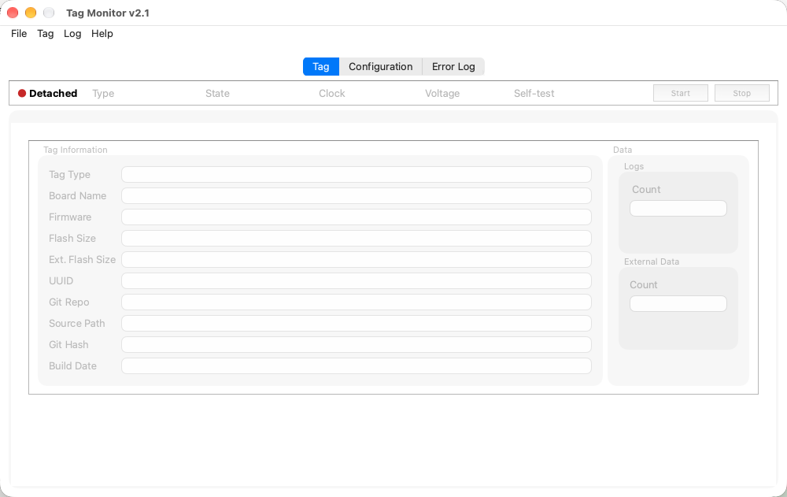

### Tag

The Tag tab shows the tag's identity and how much data it holds. Right-click it
for the tag commands.

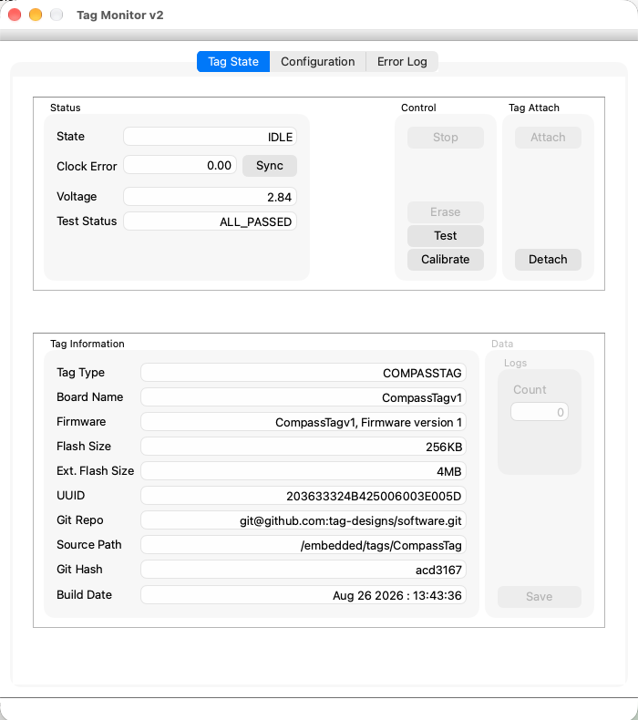

Check the state, voltage, self-test result, UUID, firmware version, and Git hash
before using a tag in the field. The UUID identifies the physical tag and the
Git hash identifies the firmware build loaded on it.

Choose **Tag ▸ Synchronize Clock** and **Tag ▸ Self-Test** before starting an
experiment; the strip shows the clock offset and the self-test result. The
self-tests usually finish in well under a second, so the tag's state rarely
shows TEST; the strip shows **Running** until the result arrives, and the Error
Log records each run's start and result with the tag's UUID. Calibration data
is collected with [Qt Calibrate](qtcalibrate.md), or streamed for debugging with
the [`tag-cal`](../cli/tag-cal.md) command-line tool; Tag Monitor has no
calibration command, but **Stop** ends calibration mode on a tag left in it.

When a tag is running, the configuration cannot be edited and **Stop** is
available.

If the tag stops answering for more than a few seconds, the strip shows its
last known state in red with **(no answer N s)** after it, and an erase in
progress says the same. A brief burst usually clears by itself. If it does
not, choose **Tag ▸ Detach** and then **Tag ▸ Attach**.

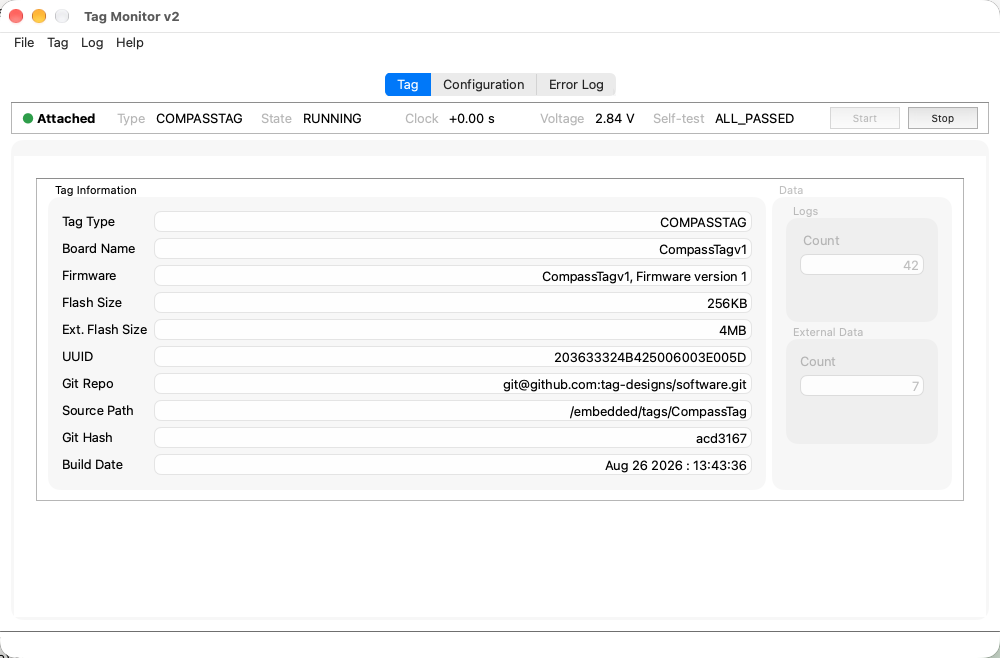

When a tag has finished logging, **File ▸ Download Data…** saves its data.

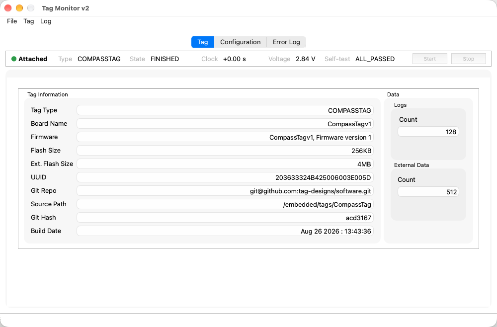

### Configuration

The Configuration tab is a configuration editor. It holds one configuration,
for one tag type, and shows it as a page of panels: every tag has a **Logging
Schedule** panel, and tags with user-configurable settings add panels for
them, such as the BitTag log format or the accelerometer. If the page is taller
than the screen, it scrolls.

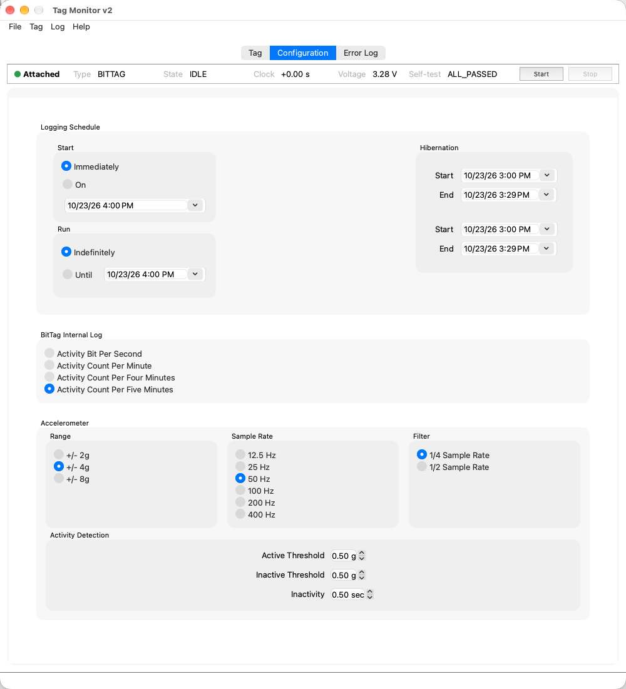

A configuration can come from three places, and none of them needs a tag:

- **File ▸ New Configuration ▸** a tag type starts from that type's default
  configuration.
- **File ▸ Open Configuration…** (or **Open Recent**) opens a saved file; see
  [Configuration Files](../reference/config-files.md).
- Attaching a tag, or **Tag ▸ Read Configuration**, reads the tag's own.

The window title shows which configuration is open, and marks it when it has
unsaved changes. **File ▸ Save Configuration…** asks for a file, offering the
one the configuration came from, and writes it. **Reset to Defaults** puts the tag
type's default values back. Tag Monitor asks before discarding unsaved
changes.

**Start** writes the configuration to the attached tag and starts it. It needs
an IDLE tag of the configuration's tag type, so you can prepare a
configuration with no tag attached, attach the tag, and start it. Attaching
keeps a configuration you opened or created; to work on the tag's own instead,
choose **Tag ▸ Read Configuration**. While a tag is running, its own
configuration is shown but cannot be edited.

### Start checks

Before it starts a tag, **Start** checks that:

- the tag's clock is within 2 s of this computer's;
- the tag reports its self-test as ALL_PASSED;
- **Approved** is ticked in the status strip.

Tick **Approved** once you have reviewed the configuration. Any change to the
configuration's values clears it: an edit, New, Open, Read Configuration or
Reset. Saving does not.

If a check fails, Start lists what failed and asks whether to **Start Anyway**
or **Cancel**; Cancel is the default. A tag started anyway is recorded in the
Error Log with its type, UUID and the checks that failed.

These commands are also on the page's popup menu.

### Error Log

The Error Log tab collects application and tag communication messages. If Tag
Monitor behaves unexpectedly, check this tab first, and save the log
(**File ▸ Save Error Log…**) if the message history will help diagnose the
issue. **Log ▸ Log Level** sets how much detail is recorded. Right-click the
log to copy, save or clear it.

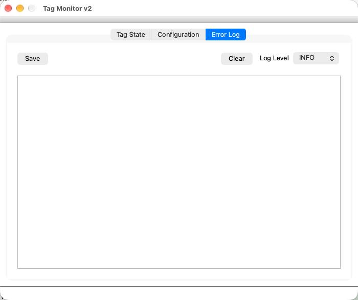

## Common Workflow

1. Connect the USB base with the tag installed.
2. Attach to the tag and verify tag type, UUID, firmware, Git hash, and voltage.
3. Synchronize the tag clock.
4. Run the self-tests and resolve any reported problem.
5. Configure the schedule and any sensor settings for the experiment.
6. Review the configuration and tick **Approved**.
7. Press **Start** to write the configuration and begin logging.
8. After logging finishes, download the tag's data before erasing or
   redeploying.
9. Use the Error Log when attach, configuration, test, or download behavior is
   unexpected.

## Tag Configuration

The Configuration tab is intentionally tag-specific: each tag type shows the
panels for the settings its firmware accepts, and nothing else.

Each hibernation row has an **In use** checkbox. A row that is not in use has
its dates greyed out and is sent to the tag as 1/1/70, a date long past, so the
tag never hibernates for it. Check **In use** to use a row: a row with no date
yet starts at the logging start, rounded up to the hour, and ends an hour
later. Set its start and end inside the logging interval.

Every schedule time, for logging and for hibernation, is in **UTC** and on a
**whole hour**. The calendar button picks the date; to change the hour, click
the hour in the box and use the arrow keys, or type it. A tag checks once an
hour, on the hour, whether a hibernation has ended, so a hibernation always
ends on the hour. A time read from a tag that is not on the hour is rounded
when shown: a hibernation start down, every other time up.

### BitTag

Classic BitTag exposes the full ADXL362 accelerometer configuration. The
schedule controls define the active logging interval and optional hibernation
periods. The BitTag log format controls how activity is binned in memory:
shorter bins provide finer time resolution and consume storage faster.

The **Accelerometer** panel configures ADXL362 range, sample rate, anti-alias
filter, and activity detection thresholds. Most experiments primarily tune the
active and inactive thresholds plus inactivity duration; range, rate, and
filter are usually changed only for specialized deployments.

### BitTag LE

BitTag LE uses the same schedule and log format as classic BitTag. Its
low-energy firmware fixes the accelerometer's range, rate and filter, so the
**Activity Wakeup** panel shows only the fields users are expected to tune: the
ADXL362 wake/activity thresholds and the inactivity sample count. In this mode,
inactivity is a count at the wake-mode sample rate rather than a duration in
seconds.

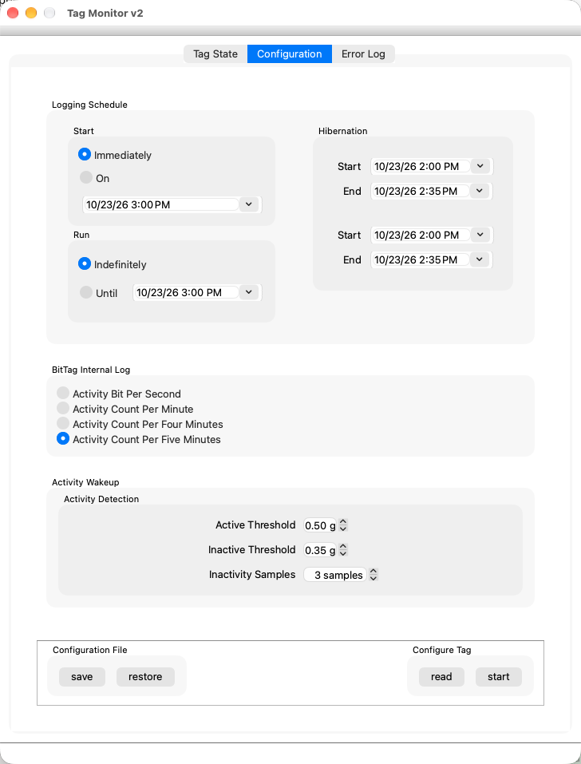

### BitPresTag

BitPresTag combines BitTag-style activity logging with pressure-tag behavior.
Use the schedule fields for the deployment interval and hibernation windows.
The **Activity Wakeup** panel exposes the wake/activity fields that apply to
the BitPresTag firmware. As with BitTag LE, firmware fixes the other
accelerometer parameters.

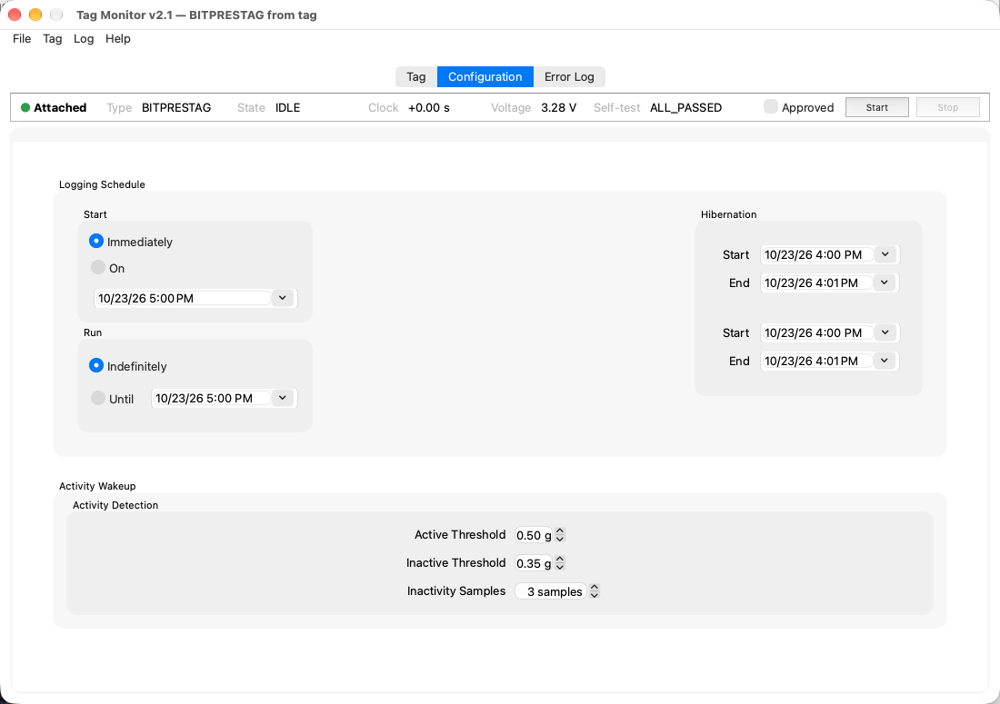

### PresTag

PresTag shows the schedule with one more setting, the sampling **Period** in
seconds. It has no separate sensor controls.

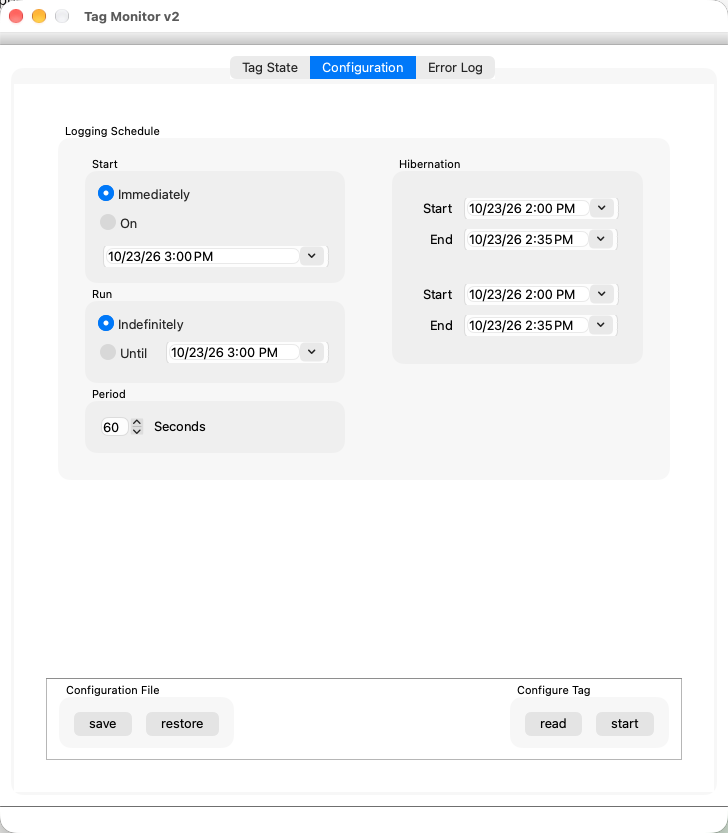

### IMUTag

IMUTag's schedule is a **Start Delay** in minutes: logging begins that long
after **start**, and runs until the tag is stopped. The **IMU** panel configures
the sample rate and the accelerometer and gyro ranges.

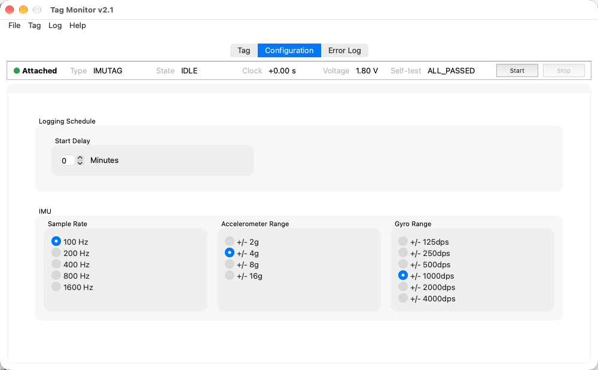

### CompassTag

CompassTag uses the schedule for deployment timing and hibernation windows.
It has no separate sensor controls in Tag Monitor.

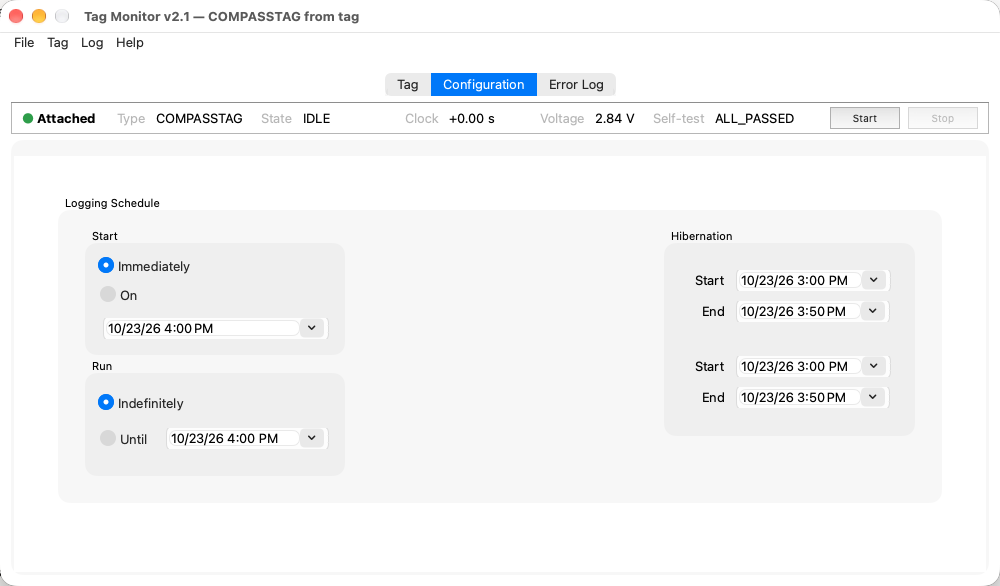
