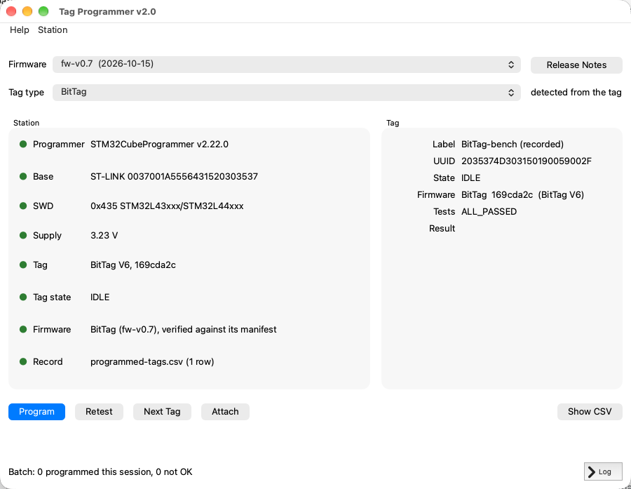
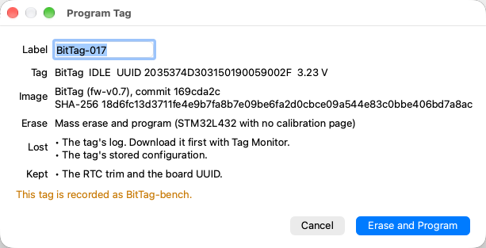

# Qt Program

Use Qt Program (Tag Programmer) to program a batch of tags. For each tag it
writes the firmware, tests the tag, leaves it erased and IDLE ready for Tag
Monitor, and records the result in a CSV file.
**Help ▸ Tag Programmer User Guide** opens this page.

**Programming erases the tag.** Download its data with Tag Monitor first.

## Before You Start

- Install STMicroelectronics' STM32CubeProgrammer. Tag Programmer finds its
  command-line tool, `STM32_Programmer_CLI`, in the usual install folders, on
  the `PATH`, and in the `STM32CUBEPROGRAMMER` and `STM32_PRG_PATH` environment
  variables. If it is not found, press **Choose…** on the Programmer line and
  pick the STM32CubeProgrammer folder. The choice is remembered.
- Plug in the base station or programmer.
- The first time Tag Programmer opens, it asks whether to **attach
  automatically**. Connecting to a tag restarts it, which ends a deployment
  that is running. On a programming bench, answer **Yes**. You can change this
  later under **Station ▸ Attach Automatically**.
- The first time, it also asks where to keep the **record**: a CSV file with
  one line for every tag programmed. The default is
  `Documents/Tag Programmer/programmed-tags.csv`.

## The Window

- **Firmware** lists the published firmware releases, newest first, then
  ELF files you have used, then **Other ELF file…**. A release is downloaded
  the first time you choose it, then checked against the record of what was
  built. **Release Notes** opens the release's page, which says which tags it
  was qualified on. If the release has not been qualified for the chosen tag
  type, the Firmware light turns amber and the Program dialog says so. You
  can still program, for bench work, but do not fly those tags.
- **Tag type** is filled in from the tag when its firmware answers ("detected
  from the tag"). Choose it yourself for a new, blank board.
- **Station** shows a light for each check: green is ready, amber needs
  attention, red must be fixed before you can program. Each line says what is
  wrong and how to fix it. Hover over a line to see the whole message.
- **Tag** shows the attached tag's label (if it is in the record), UUID, state,
  firmware, self-test result, and the result of the last program.

## Program a Batch of Tags

1. Choose the **Firmware** and check the **Tag type**. Both are remembered.
2. Put a tag in the base. With automatic attach on, it connects by itself;
   otherwise press **Attach**.
3. Press **Program**, type the **label** written on the board, and check the
   rest of the dialog. Choose **Erase and Program**.
    

4. Wait for the result. A typical tag takes under 30 seconds. Tag Programmer:
    1. stops the tag if it is running, and has its own firmware erase its log;
    2. erases internal flash as the image requires and writes the image;
    3. reconnects, sets the clock and runs the self-tests;
    4. starts and stops the tag once and erases it again, so the new firmware
       sets up its own storage;
    5. adds a line to the record.
5. Press **Next Tag**, take the tag out, put the next one in, and press
   **Attach** (or wait for it to attach automatically). Go back to step 3.

The line at the bottom of the window counts the tags programmed this session.
**Show CSV** opens the folder that holds the record.

## The Record

Each line of the CSV holds the label, the tag type, the UUID, the firmware
version (`fw-vX.Y`, or `custom` for a file you chose), the git hash the tag
reports, the date (UTC), the self-test result and the result. The remaining
columns are the image's SHA-256, its file name, the erase, the supply voltage,
the base's serial number and the Tag Programmer version.

Every attempt that reached the programmer is recorded, including failures:

| Result | Meaning |
| --- | --- |
| `OK` | Programmed, and the self-tests passed |
| `TEST_FAILED` | Programmed, but a self-test failed; see `test_status` |
| `MISMATCH` | The tag does not report the firmware just written |
| `NO_ANSWER` | Programmed, but the tag never answered |
| `PROGRAM_FAILED: …` | The programmer failed |

The record cannot be written while it is open in another program on Windows,
such as Excel. Tag Programmer then disables **Program** until you close the
file.

## What Programming Keeps

| | IMUTag | CompassTag | Other tags |
| --- | --- | --- | --- |
| Erase | none: the image's pages only | every page below the calibration page | mass erase |
| Log data | lost | lost | lost |
| Stored configuration | lost | lost | lost |
| Calibration constants | kept | kept | (none) |
| RTC trim, board UUID | kept | kept | kept |

The log and stored configuration are lost because the tag is erased before and
after programming. An image for the wrong processor is refused. An image for a
different tag type from the one the tag is running gets a warning.

## Troubleshooting

- **Base: No base on USB.** Plug in the base. Tag Programmer notices it within
  a second.
- **SWD: No STM32 target found.** No tag is in the base, or it is not powered.
- **Supply: above the STM32L432's 3.6 V maximum.** Lower the supply before
  going on.
- **Tag: No firmware answers.** This is normal for a new, blank board: choose
  the tag type and program it. For a board that has run firmware, unplug the
  base, plug it in again, and press **Attach**.
- **"Programmed, but the tag does not answer."** A mass erase can leave the
  processor starting its built-in bootloader until it is powered off. Unplug
  the base, plug it in again, and press **Retry**. **Give Up** records
  `NO_ANSWER`.
- **Firmware: does not match its manifest.** The downloaded image is not the
  one that was released. Do not program it; tell the developers.
- **Firmware: GitHub cannot be reached.** Releases downloaded before are still
  offered. Otherwise choose an ELF file.
- **STM32_Programmer_CLI failed.** Press **Log** at the bottom right to see its
  output.
- **Self-test failed.** The tag is programmed and the failure is recorded.
  Press **Retest** to run the tests again; each retest adds a line.
