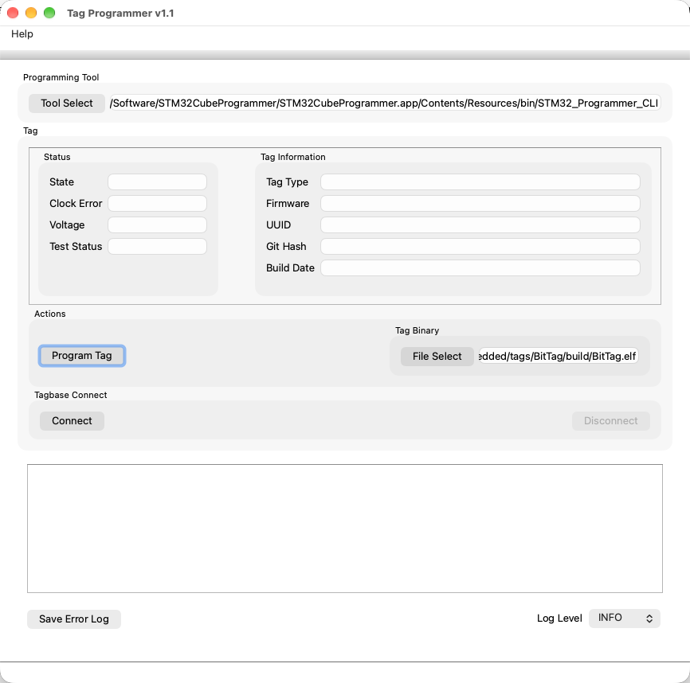
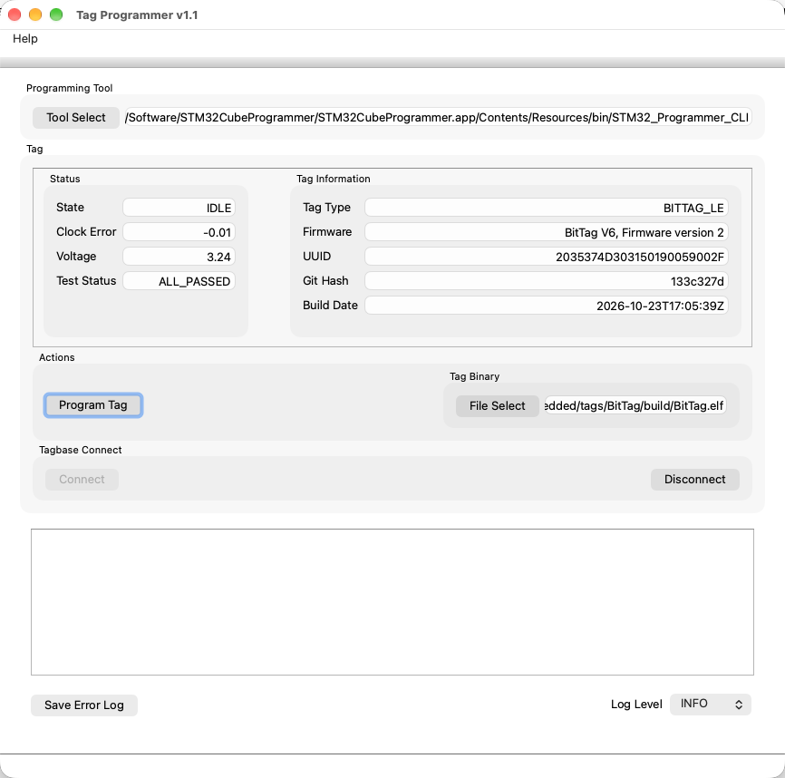
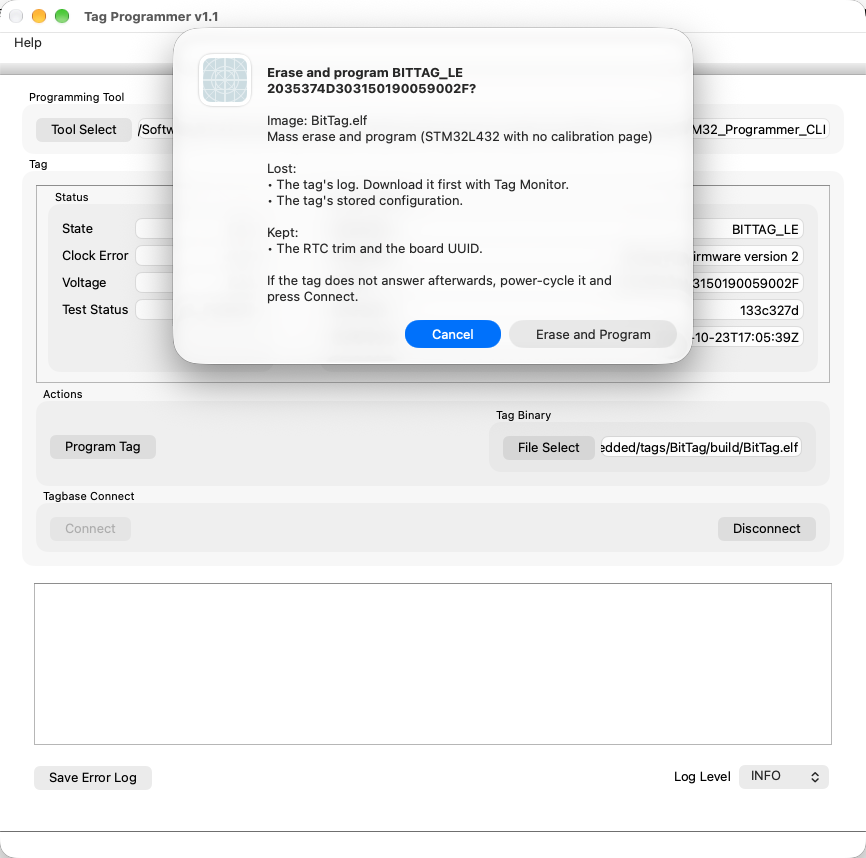

# Qt Program

Use Qt Program (Tag Programmer) to write new firmware to a tag, test it, and
leave it erased and IDLE, ready to configure in Tag Monitor.
**Help ▸ Tag Programmer User Guide** opens this page.

**Programming erases the tag.** Download its data with Tag Monitor first.

## Before You Start

- Install STMicroelectronics' STM32CubeProgrammer. Tag Programmer looks for
  its command-line tool, `STM32_Programmer_CLI`, in the usual install folders,
  on the `PATH`, and in the `STM32CUBEPROGRAMMER` (the tool itself) and
  `STM32_PRG_PATH` (its folder) environment variables. If it is not found,
  choose it with the programming tool button; the choice is remembered.
- Connect the base station or programmer, with the tag installed. Tag
  Programmer opens without one. It does not connect to the tag until you press
  **Connect** or **Program**, because connecting restarts a running tag.
- Have the firmware's `.elf` file. A `.bin` will not do: the `.elf` records the
  flash layout, which decides what is erased.

Press **Connect** to see the tag's state, clock error, voltage, self-test
result and identity:

## Program a Tag

1. Choose the firmware `.elf`. The last image programmed is remembered.
2. Press **Program**. A confirmation names the tag, its UUID and the image, and
   lists what will be lost and what will be kept. **Cancel** is the default.
    

3. Choose **Erase and Program**. Tag Programmer then:
    1. stops the tag if it is running;
    2. has the tag's own firmware erase its log, whenever the tag is not IDLE;
    3. erases internal flash as the image's layout requires and writes the
       image, in one programmer run;
    4. sets the tag's clock and runs its self-tests;
    5. starts and stops the tag once and erases it again, so the new firmware
       lays out its own storage.
4. Wait for the result: "Programmed and tested: ALL_PASSED", a self-test
   failure, or the reason programming failed.

## What Programming Keeps

| | IMUTag | CompassTag | Other tags |
| --- | --- | --- | --- |
| Erase | none: the image's pages only | every page below the calibration page | mass erase |
| Log data | lost | lost | lost |
| Stored configuration | lost | lost | lost |
| Calibration constants | kept | kept | (none) |
| RTC trim, board UUID | kept | kept | kept |

The log and stored configuration are lost because the tag is erased before and
after programming. Calibration is kept unless the image keeps no calibration
page; if the attached tag has calibration and the image would destroy it, the
confirmation says so, which usually means the wrong image was chosen.

An image for the wrong processor (an IMUTag image for another tag, or the
reverse) is refused.

## Troubleshooting

- **"No tag base found"**: plug in the base and press **Connect**.
- **"Programmed, but the tag does not answer"** after a mass erase: power-cycle
  the tag (unplug and replug it) and press **Connect**. A mass erase can leave
  the processor starting its built-in bootloader instead of the new firmware
  until it is powered off.
- **"does not say which flash layout it was built for"**: the `.elf` was built
  before the layout was recorded in it. Rebuild it, or use a current release.
- **STM32_Programmer_CLI failed**: its output is in the log at the bottom of
  the window.
