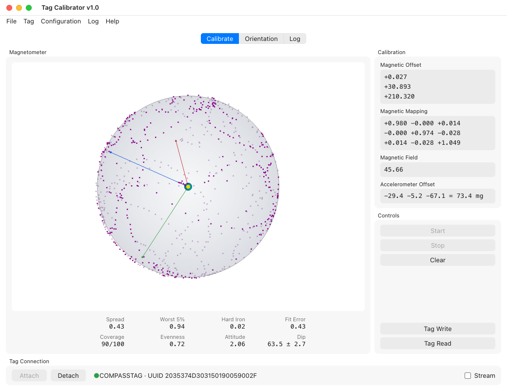
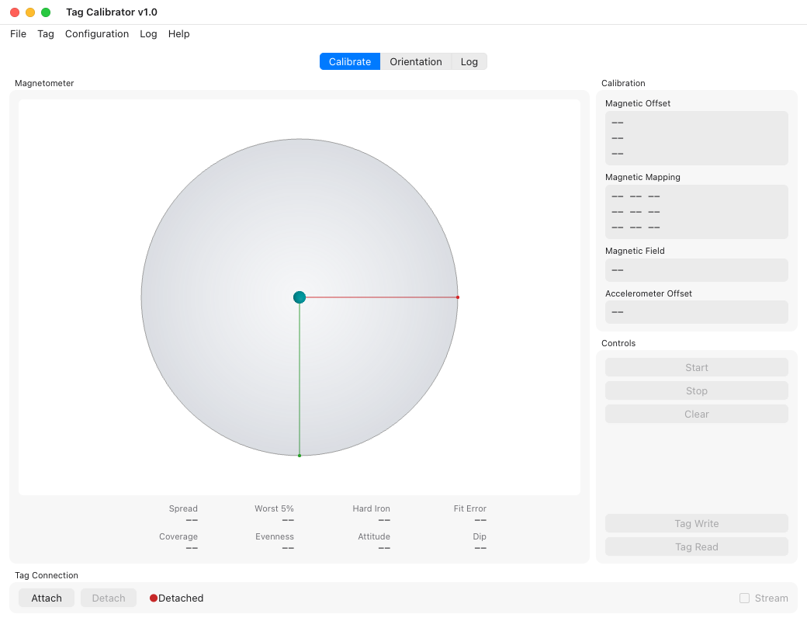
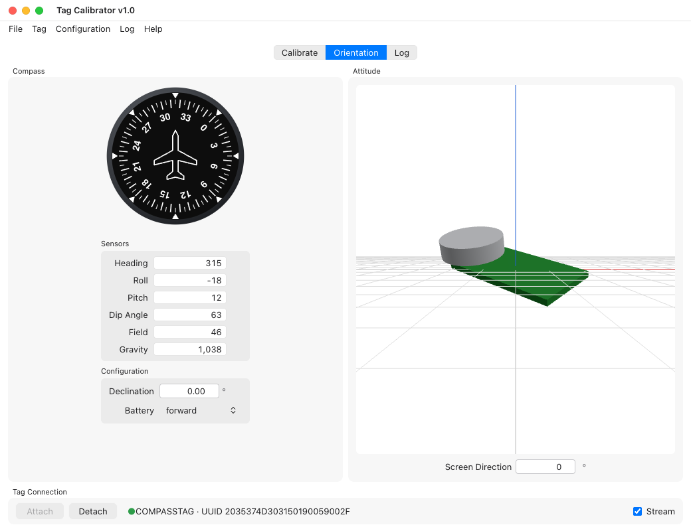

# Tag Calibrator

Tag Calibrator (`tagcalibrate`) calibrates a tag's magnetometer and
accelerometer. You turn the tag through as many orientations as you can while
it streams samples; Tag Calibrator fits the constants that correct the
magnetometer, measures the accelerometer's zero-g offset, tells you how far
to trust the result, and writes the constants to the tag. **Help ▸ Tag
Calibrator User Guide** opens this page.

Uncalibrated, a tag's magnetometer offset is about half the size of the
Earth's field it is trying to measure, so its heading is meaningless.
Calibration is a once-per-tag job, not a once-per-deployment one: the
constants are stored on the tag, copied into every download from it, and
applied by Tag View without being asked.



## Before You Start

- On Linux, Tag Calibrator needs WebKitGTK 4.1, which GNOME desktops already
  have. Elsewhere install it once, for example
  `sudo apt install libwebkit2gtk-4.1-0` on Ubuntu or Debian. Windows 10 and
  11 and macOS need nothing extra.
- Connect the tag to its base, and the base to the computer. Tag Calibrator
  attaches to the tag as soon as it opens. Attaching restarts the tag, which
  ends a deployment that is running.
- Only an IDLE tag is calibrated. A tag that is running a deployment or holds
  data is refused with **Tag not in idle state**; finish with it in Tag
  Monitor first.
- Close other programs that talk to the tag, such as Tag Monitor. A base
  answers only one program at a time.
- Work away from steel furniture, magnets, motors and other electronics where
  you can: anything near the tag that disturbs the field ends up in the
  calibration.
- **Tag Write** is the only command that changes the tag: it adds a
  calibration record. Nothing else is written.

## The Window



The window has three tabs:

- **Calibrate**: the **Magnetometer** panel, with the sample sphere and the
    quality figures under it; the **Calibration** panel, with the fitted
    constants; and the **Controls**: **Start**, **Stop**, **Clear**,
    **Tag Write** and **Tag Read**.
- **Orientation**: the live compass heading and the tag's attitude; see
    [Check Orientation](#check-orientation).
- **Log**: messages from Tag Calibrator and the tag; see [The Log](#the-log).

The **Tag Connection** bar at the bottom has **Attach** and **Detach**, names
the attached tag and its UUID, and has the **Stream** check box, which reads
the tag's sensors continuously.

The menus hold the same commands:

- **File**: **Save Sample Capture…**, **Save Log…** and **Quit**.
- **Tag**: **Attach**, **Detach**, **Stream**, then **Start**, **Stop** and
    **Clear**, then **Tag Write** and **Tag Read**.
- **Configuration**: **Declination…** and **Battery Forward**.
- **Log**: **Log Level** and **Clear Log**.
- **Help**: **Tag Calibrator User Guide** and **About Tag Calibrator**.

Right-clicking in the window offers the same menus.

With more than one base plugged in, **Attach** asks which to use. When no base
is found it says **No Tag Bases Found**.

## Run a Calibration

1. Open Tag Calibrator with the tag on its base. It attaches, and if the tag
   already holds a calibration, shows the stored constants in the
   **Calibration** panel.
2. Tick **Stream**. The tag starts sending samples, and the **Orientation**
   tab comes alive.
3. Press **Start** to begin collecting.
4. Turn the tag slowly through as many orientations as you can manage: tip it
   end over end and side over side, and roll it about each direction as well
   as spinning it flat. The sphere fills in as samples arrive, and the
   figures under it update a few times a second. Watch **Coverage**,
   **Evenness** and **Attitude** (see
   [Reading the Results](#reading-the-results)).
5. When the figures stop improving, press **Stop**.
6. Untick **Stream**. Tag Calibrator waits for the tag to return to IDLE.
7. Press **Tag Write** to store the constants on the tag (see
   [Writing the Constants to the Tag](#writing-the-constants-to-the-tag)).
8. Tick **Stream** again and check the heading on the **Orientation** tab.

**Clear** discards the samples, the fit and the capture, to start again. It
is available while streaming and not collecting. Unticking **Stream** while
collecting stops the collection first, so the samples are kept.

## Reading the Results

Two panels fill in while samples arrive. **Calibration** holds the constants
that would be written to the tag; each reads `--` until a fit exists. The
figures under the sphere in **Magnetometer** are eight numbers that say
whether those constants are worth writing; they read `--` until the first
update after **Start** or **Clear**.

The sphere is drawn at the computed field, so its size on screen tracks the
**Magnetic Field** value: a weaker site draws a smaller sphere. It shows the
samples the fit is holding, corrected with the current fit, and turns so that
the newest sample is in the middle; drag it to look round the other side.
Points that lie on the sphere are consistent with the fit; the scatter you
can see around it is the residual the figures below put a number on.

### Calibration

| Panel | What it holds |
| --- | --- |
| **Magnetic Offset** | Hard iron, in µT. The steady field the tag carries with it -- its own battery and components -- which is subtracted from every reading. |
| **Magnetic Mapping** | Soft iron, a 3x3 matrix with no units. It corrects the way nearby metal stretches the field into an ellipsoid. Expect diagonal terms within a few percent of 1 and small off-diagonal terms. |
| **Magnetic Field** | Field strength the fit settled on, in µT. The Earth's field runs from about 25 µT to 65 µT depending on where you are; a value well outside that means the fit has not converged. |
| **Accelerometer Offset** | Zero-g offset in mg, three axes and then their magnitude. A sound tag reads about 75 mg. The word `CHECK` appears past 250 mg, which means a damaged part or a sweep that never covered enough orientations. It is used when deriving dip and orientation, and **Tag Write** writes it to the tag with the magnetometer constants, so Tag View applies it to the downloaded log. |

### Magnetometer: coverage

The bottom row says whether the sweep gave the solver enough to work with. It
updates while you turn the tag, so it is the row to watch during collection.

| Figure | What it means |
| --- | --- |
| **Coverage** | Directions visited, out of 100 evenly spaced patches on the sphere. Aim to fill all of them. |
| **Evenness** | How evenly the samples are spread over directions, from 0 to 1. Near 1 is uniform; near 0 means they lie close to a single plane -- the tag was spun on a bench without ever being tipped. Coverage alone will not catch that, because the occupied patches really are spread around. |
| **Attitude** | How much the tag was rotated *about* the field direction, as the mean number of distinct gravity directions seen per magnetometer patch. At 1, every patch was reached from one attitude only, and nothing in the data pins down the off-diagonal soft-iron terms. The practical ceiling is around 3.6 at this site's inclination, because the angle between field and gravity is fixed wherever you are. |
| **Dip** | Magnetic inclination: the angle between the field and gravity, in degrees, as mean ± spread. The angle belongs to the site, not to the sample, so a wide spread means the samples disagree with each other about where the field is. |

**Attitude** and **Dip** need accelerometer samples. Without them **Dip**
reads `no accel`.

### Magnetometer: residual

The top row measures how far the samples sit from the sphere that was fitted
to them, all as a percentage of the field except Hard Iron.

| Figure | What it means |
| --- | --- |
| **Spread** | What a typical sample does. A robust width, so a handful of bad samples barely move it. |
| **Worst 5%** | What the bad samples do: 95% of samples are closer to the sphere than this, so one in twenty is worse. |
| **Hard Iron** | Hard iron the fit did not remove, in µT. It needs decent Coverage to mean anything -- read it with the Coverage figure below it. |
| **Fit Error** | The RMS residual, which is the number the solver itself minimises. A mean square is set by its largest residual, so outliers drag this up while Spread stays put. |

Read them together rather than one at a time:

- **Spread and Fit Error close together** -- no outliers; the residual is
  evenly distributed and the fit is as good as the numbers say.
- **Fit Error well above Spread, with a large Worst 5%** -- the bulk of the
  sweep is fine but some samples are badly wrong. Keep collecting and they may
  be dropped as the sample buffer fills; if the numbers do not settle,
  something near the tag is disturbing the field.
- **All three small but Coverage or Evenness low** -- the fit is tight on the
  data it has, and may still be wrong. A flat ring of samples fits many
  spheres equally well. Keep turning the tag.
- **Small residuals but a wide Dip spread** -- each sensor is self-consistent
  and the two disagree about the site. Usually a magnetic disturbance nearby,
  or a tag being swung too fast for the accelerometer to read gravity.

### Reference values

From the two captures committed as documentation fixtures, both usable sweeps.
These come from replaying each capture in full; the window shows the same
figures over the samples the solver is holding at that moment, so a live
reading will be close but not identical.

| | Short sweep | Long sweep |
| --- | --- | --- |
| Samples | 775 | 2425 |
| Magnetic Field | 46.2 µT | 46.0 µT |
| Coverage | 90/100 | 100/100 |
| Evenness | 0.63 | 0.76 |
| Attitude | 2.26 | 3.15 |
| Dip | 63.8 ± 2.8° | 63.7 ± 2.5° |
| Spread | 0.82% | 1.08% |
| Worst 5% | 1.84% | 1.98% |
| Hard Iron | 0.55 µT | 0.51 µT |
| Fit Error | 0.94% | 1.03% |
| Accelerometer Offset | 73 mg | 69 mg |

The longer sweep has the better coverage and the tighter dip spread, and
slightly larger residuals -- more samples means more of the sensor's own noise
is in the fit, which is the honest number rather than a worse one.

## Writing the Constants to the Tag

**Tag Write** adds a calibration record to the tag: the magnetic offset and
mapping, and the accelerometer offset beside them. When there is no
accelerometer fit, it writes a zero accelerometer offset, which means no
correction. It is available once a fit exists, with a tag attached and
**Stream** unticked; the tag accepts the record only when it is IDLE. If the
tag refuses it, a **Tag Write** message says why.

**Tag Read** reads the tag's most recent calibration record and shows it in
the **Calibration** panel, replacing the fit on screen; the Magnetic Field
figure is recomputed from the samples held. Tag Calibrator does the same when
it attaches, so the panel starts with what the tag already has.

Once written, the constants are copied into every download from that tag, and
Tag View applies them to the magnetometer and accelerometer readings.

## Check Orientation



The **Orientation** tab shows what the calibration gives, live, while
**Stream** is ticked. It is the quickest way to confirm the calibration
behaves before you commit a tag to a deployment.

- **Compass**: a heading dial, and the **Sensors** readouts: **Heading**,
    **Roll**, **Pitch** and **Dip Angle** in degrees, **Field** in µT and
    **Gravity** in mg.
- **Configuration**: **Declination**, the local magnetic declination in
    degrees east, which is added to the heading; and **Battery**, which end of
    the tag is forward. With the battery backward the heading is turned round
    and pitch and roll change sign. **Configuration ▸ Declination…** and
    **Configuration ▸ Battery Forward** set the same values.
- **Attitude**: a model of the tag, turned as the tag is. Drag it to look from
    another side; **Screen Direction** turns the view about the vertical, in
    degrees.

## Save Sample Data

Tag Calibrator records the samples it collects between **Start** and
**Stop**. Once a collection has stopped with samples in it,
**File ▸ Save Sample Capture…** saves them to a JSON file, suggested as
`qtcalibrate-samples-<date>-<time>.json` in your home folder. The file holds
the magnetometer samples, any paired accelerometer samples, and the fitted
calibration values when there are some. It names the tag type but not its
UUID. Use it to keep an example calibration session for troubleshooting or
for documentation fixtures.

## The Log

The **Log** tab holds messages from Tag Calibrator and the tag. **Log ▸ Log
Level** sets how much detail it shows, **Log ▸ Clear Log** empties it, and
**File ▸ Save Log…** saves it to a text file. Include the log when reporting a
problem.

## Troubleshooting

- **No Tag Bases Found.** Check the base's USB cable, and that no other
    program, such as Tag Monitor, is attached to it. Then **Tag ▸ Attach**.
- **Tag not in idle state.** The tag is running a deployment or holds data.
    Finish with it in Tag Monitor, then attach again.
- **Could not attach to tag.** Check that the tag is seated on its base, then
    **Tag ▸ Attach** again.
- **Start, Stop and Clear are greyed out.** Tick **Stream** first.
- **Tag Write is greyed out.** Untick **Stream**, and check that the
    **Calibration** panel holds a fit rather than `--`.
- **The Orientation tab does not move.** Tick **Stream**. Heading, roll and
    pitch need accelerometer samples as well as magnetometer ones.
- **`CHECK` beside the Accelerometer Offset.** Clear and collect again,
    turning the tag through more orientations. If it persists, the
    accelerometer may be damaged.
- **The figures do not settle, or you do not trust them.**
    [Reading the Results](#reading-the-results) says what each figure means
    and what combinations of them point to.
- **Quitting while streaming** is safe: Tag Calibrator stops the stream and
    waits for the tag to return to IDLE before it exits. A tag left streaming
    by a program that exited without stopping it is stopped when Tag
    Calibrator attaches.

## Maintainer Notes

Documentation maintainers can replay a saved capture without tag hardware by
setting `TAGCALIBRATE_REPLAY` when starting the program:

```sh
TAGCALIBRATE_REPLAY=$PWD/host/docs/fixtures/qtcalibrate/qtcalibrate-samples-20261010-145438.json \
  tagcalibrate
```

The window then looks attached to the file; tick **Stream** to feed it the
samples, and **Start** to collect them. `TAGCALIBRATE_NO_ATTACH=1` opens the
window without attaching.

The pictures on this page are taken from the window drawn against a stand-in
for a tag, by
`host/applications/tagcalibrate-rs/ui/screenshots.sh`, which writes them to
`host/docs/src/images/`.
