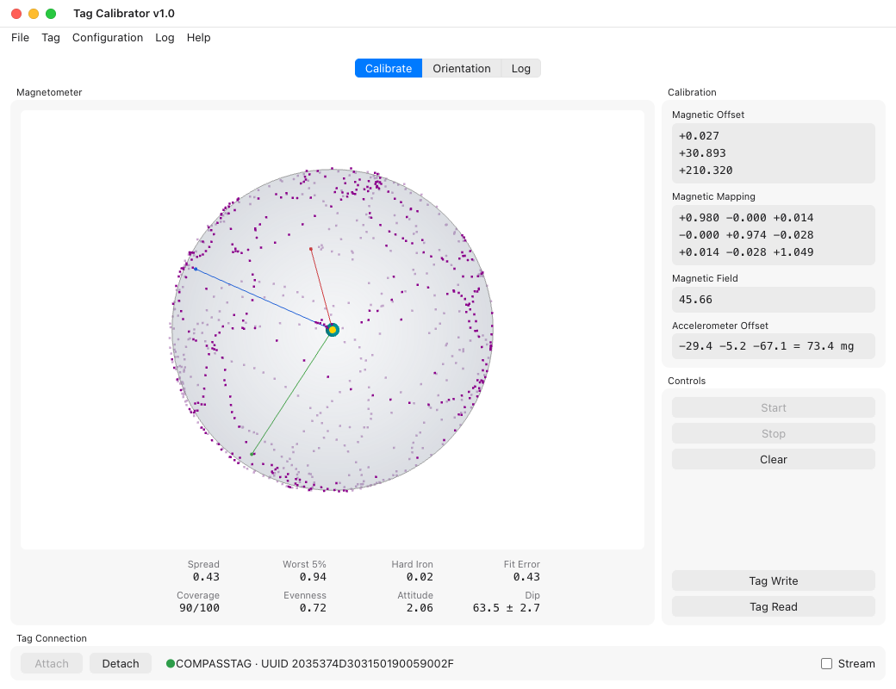
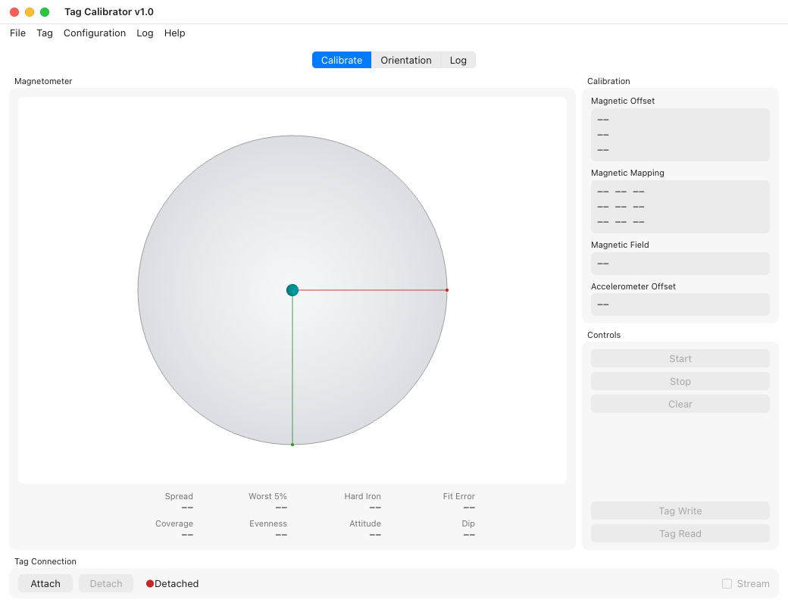
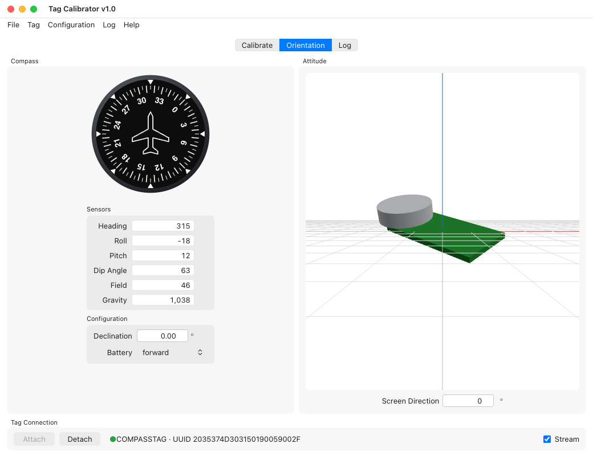

# Tag Calibrator

Tag Calibrator is a new build of [Qt Calibrate](qtcalibrate.md). It
calibrates a tag's magnetometer and accelerometer the same way, with
the same calculation, and writes the same calibration record to the tag.
Everything on the [Qt Calibrate page](qtcalibrate.md) applies, including
[Reading the Results](qtcalibrate.md#reading-the-results); this page lists
only what differs. **Help ▸ Tag Calibrator User Guide** opens this page.

The two programs are installed side by side, as `qtcalibrate` and
`tagcalibrate`. Use one at a time: both talk to the tag through the base, and
a base answers only one program.

## Before You Start

- On Linux, Tag Calibrator needs WebKitGTK 4.1, which GNOME desktops already
  have. Elsewhere install it once, for example
  `sudo apt install libwebkit2gtk-4.1-0` on Ubuntu or Debian. Windows 10 and
  11 and macOS need nothing extra.
- Like Qt Calibrate, it attaches to the tag as soon as it opens. Attaching
  restarts the tag, which ends a deployment that is running. Only an IDLE tag
  is calibrated.
- **Tag Write** is the only command that changes the tag: it adds a
  calibration record. Nothing else is written.

## The Window

The **Calibrate** tab has the magnetometer sphere, the quality figures under
it, the calibration values and the controls, as in Qt Calibrate. The
**Tag Connection** bar at the bottom attaches and detaches, names the attached
tag and its UUID, and turns the **Stream** on and off.

## What Is Different

- **The pictures are redrawn.** The sphere is shaded and scaled as Qt
    Calibrate draws it; the compass dial and the tag model on the
    **Orientation** tab are new drawings of the same views.
- **The quality figures** are a labelled grid under the sphere.
- **A Tag menu** has Attach, Detach, Stream and the Calibrate tab's commands,
    and a **Log** menu and tab hold the messages, as in Tag Monitor.
- **File ▸ Save Sample Capture…** saves the same JSON capture as Qt
    Calibrate's. Qt Calibrate's Save Calibration and Read Data File, which did
    nothing, are gone.

Report anything else that behaves differently: the two are meant to agree.
