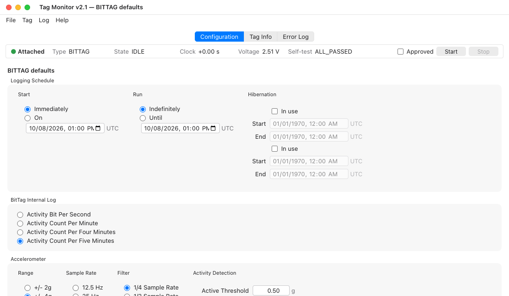
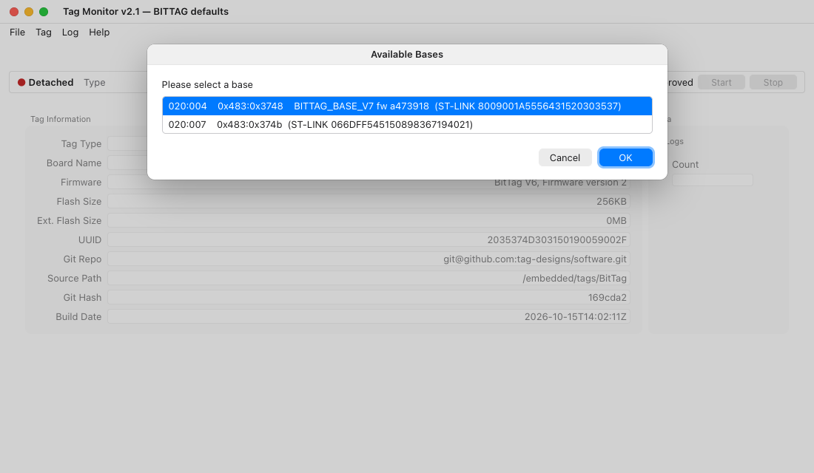
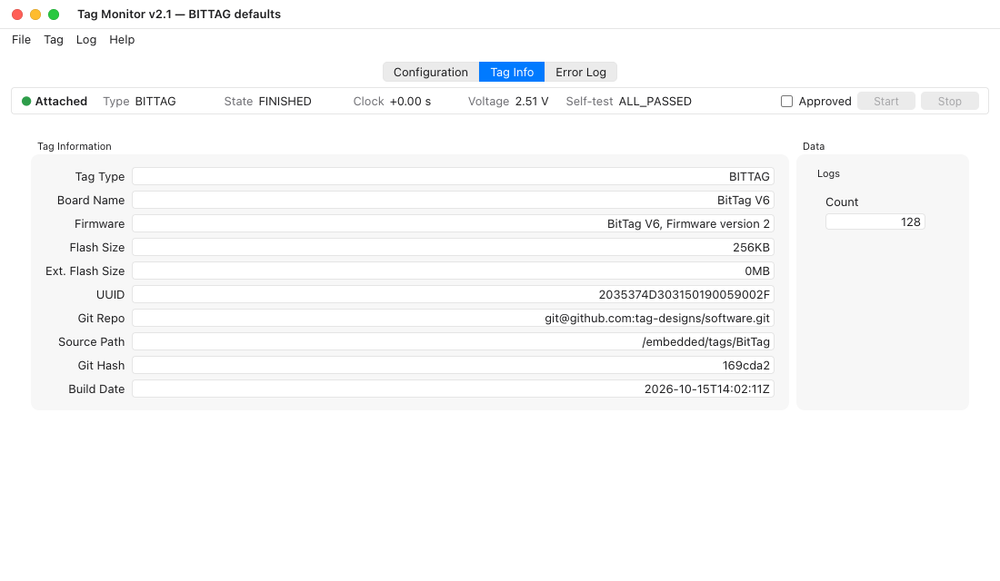

# Tag Monitor

Tag Monitor (the program `tagmonitor`) connects to a tag through a USB base
and shows the information needed to prepare, check, run, and recover a data
logging experiment. Use it to verify the tag identity and firmware,
synchronize the tag clock, run self-tests, edit the tag configuration, start
logging, download finished data, and inspect error messages.
**Help ▸ Tag Monitor User Guide** opens this page.

## Before You Start

- On Linux, Tag Monitor needs WebKitGTK 4.1, which GNOME desktops already
  have. Elsewhere install it once, for example
  `sudo apt install libwebkit2gtk-4.1-0` on Ubuntu or Debian. Windows 10 and
  11 and macOS need nothing extra.
- Tag Monitor attaches to a tag as soon as it opens. **Attaching restarts the
  tag, which ends a deployment that is running.**
- Tag Monitor talks to the tag through the base, and a base answers only one
  program at a time. Close any other program using the base first.

## The Window

The window has three tabs: **Configuration**, **Tag Info** and **Error Log**.
It opens on the Configuration tab.

Commands are in the menus at the top of the window. Right-click the
Configuration tab, the Tag Info tab or the status strip for the same menus:

| Menu | Commands |
| --- | --- |
| **File** | New Configuration ▸, Open Configuration…, Open Recent ▸, Save Configuration…, Reset to Defaults, Download Data…, Save Error Log…, Quit |
| **Tag** | Attach, Detach, Read Configuration, Start, Stop, Synchronize Clock, Self-Test, Erase… |
| **Log** | Log Level ▸, Clear Error Log |
| **Help** | Tag Monitor User Guide (opens this page), About Tag Monitor |

Ctrl+O, Ctrl+S and Ctrl+Q (Cmd on macOS) open a configuration, save the
configuration, and quit.

A command that does not apply to the tag's current state is greyed out: for
example, Read Configuration, Synchronize Clock and Self-Test need an IDLE
tag, Stop a running one, and Download Data a finished one.

### The status strip

The **status strip** below the tabs is visible on every tab. It shows
whether a tag is **Attached** or **Detached**, the tag's type (hover over it
for the board UUID), its state, how far its clock is from this computer's,
its voltage, and its self-test result. A clock more than 2 s off, or a
self-test result other than ALL_PASSED, is shown in red. **Approved**,
**Start** and **Stop** are on the right of the strip.

When no tag is attached, the strip shows **Detached** and most commands are
greyed out. Connect a base with an installed tag, then choose
**Tag ▸ Attach** if Tag Monitor did not attach automatically.

If the tag stops answering for more than a few seconds, the strip shows its
last known state in red with **(no answer N s)** after it, and an erase in
progress says the same. A brief burst usually clears by itself. If it does
not, choose **Tag ▸ Detach** and then **Tag ▸ Attach**.

### Choosing a base

With one base plugged in, Tag Monitor uses it. With several, it asks which.
The list names each base the way it identifies itself (its board and
firmware) with its ST-LINK serial, so the base with your tag is easy to pick.

A base with older firmware does not identify itself, so only its USB address
and ST-LINK serial are listed.

A base with no tag on it cannot be attached to: Tag Monitor reports that it
could not attach, and the Error Log asks whether a tag is connected to that
base.

## Tag Info

The Tag Info tab shows the tag's identity and how much data it holds: tag
type, board name, firmware, flash sizes, UUID, Git repository, source path,
Git hash and build date, and the log count. After a detach it stays greyed,
still showing the last tag.

Check the state, voltage, self-test result, UUID, firmware, and Git hash
before using a tag in the field. The UUID identifies the physical tag and the
Git hash identifies the firmware build loaded on it.

Choose **Tag ▸ Synchronize Clock** and **Tag ▸ Self-Test** before starting an
experiment; the strip shows the clock offset and the self-test result. The
self-tests usually finish in well under a second, so the tag's state rarely
shows TEST; the strip shows **Running** until the result arrives, and the
Error Log records each run's start and result with the tag's type and UUID.

Calibration data is collected with [Tag Calibrator](tagcalibrate.md), or
streamed for debugging with the [`tag-cal`](../cli/tag-cal.md) command-line
tool. Tag Monitor has no calibration command, but **Stop** ends calibration
mode on a tag left in it.

## Configuration

The Configuration tab is a configuration editor. It holds one configuration,
for one tag type, and shows it as a page of panels: every tag has a **Logging
Schedule** panel, and tags with user-configurable settings add panels for
them, such as the BitTag internal log format or the accelerometer. If the
page is taller than the window, it scrolls.

A configuration can come from three places, and none of them needs a tag:

- **File ▸ New Configuration ▸** a tag type starts from that type's default
    configuration.
- **File ▸ Open Configuration…** (or **Open Recent**) opens a saved file;
    see [Configuration Files](../reference/config-files.md). If the file does
    not say which tag type it is for, Tag Monitor asks, offering the attached
    tag's type first.
- Attaching a tag, or **Tag ▸ Read Configuration**, reads the tag's own.

The window title and the top of the tab show which configuration is open,
and the tab marks it **unsaved changes** when it has them.
**File ▸ Save Configuration…** asks for a file, offering the one the
configuration came from (or `<tagtype>-config.json` in your home folder),
and writes it. **Reset to Defaults** puts the tag type's default values back.
Tag Monitor asks whether to save unsaved changes before it replaces the
configuration or quits.

**Start** writes the configuration to the attached tag and starts it. It
needs an IDLE tag of the configuration's tag type, so you can prepare a
configuration with no tag attached, attach the tag, and start it. Attaching
keeps a configuration you opened or created; to work on the tag's own
instead, choose **Tag ▸ Read Configuration**. While a tag is running, its own
configuration is shown but cannot be edited.

### Start checks

Before it starts a tag, **Start** checks that:

- the tag's clock is within 2 s of this computer's;
- the tag reports its self-test as ALL_PASSED;
- **Approved** is ticked in the status strip.

Tick **Approved** once you have reviewed the configuration. Any change to the
configuration's values clears it: an edit, New, Open, Read Configuration or
Reset. Saving does not.

If a check fails, Start lists what failed and asks whether to **Start Anyway**
or **Cancel**; Cancel is the default. A tag started anyway is recorded in the
Error Log with its type, UUID and the checks that failed.

### Schedule times and hibernation

Every schedule time, for logging and for hibernation, is in **UTC** and on a
**whole hour**. The date and time boxes are shown in your computer's own date
format, marked UTC; the minutes always read `:00`. A tag checks once an hour,
on the hour, whether a hibernation has ended, so a hibernation always ends on
the hour. A time read from a tag that is not on the hour is rounded when
shown: a hibernation start down, every other time up.

Each hibernation row has an **In use** checkbox. A row that is not in use has
its dates greyed out (they read 1/1/1970) and is sent to the tag as a date
long past, so the tag never hibernates for it. Check **In use** to use a row:
a row with no date yet starts at the logging start, rounded up to the hour,
and ends an hour later. Set its start and end inside the logging interval.

### Settings by tag type

The Configuration tab is intentionally tag-specific: each tag type shows the
panels for the settings its firmware accepts, and nothing else.

- **BitTag** exposes the full ADXL362 accelerometer configuration. The
    schedule defines the active logging interval and optional hibernation
    periods. The **BitTag Internal Log** panel controls how activity is
    binned in memory: shorter bins give finer time resolution and use storage
    faster. The **Accelerometer** panel sets the ADXL362 range, sample rate,
    filter, and activity detection thresholds. Most experiments tune only the
    active and inactive thresholds and the inactivity duration; range, rate
    and filter are usually changed only for specialized deployments.
- **BitTag LE** uses the same schedule and internal log format as BitTag. Its
    low-energy firmware fixes the accelerometer's range, rate and filter, so
    the **Activity Wakeup** panel shows only the fields users are expected to
    tune: the wake and activity thresholds and the inactivity sample count.
    Here inactivity is a count at the wake-mode sample rate rather than a
    duration in seconds.
- **BitPresTag** combines BitTag-style activity logging with pressure-tag
    behaviour. Use the schedule for the deployment interval and hibernation
    windows. Its **Activity Wakeup** panel shows the wake and activity fields
    that apply to its firmware; as with BitTag LE, the firmware fixes the
    other accelerometer parameters.
- **PresTag** shows the schedule with one more setting, the sampling
    **Period** in seconds. It has no separate sensor controls.
- **IMUTag**'s schedule is a **Start Delay** in minutes: logging begins that
    long after Start, and runs until the tag is stopped. The **IMU** panel
    sets the sample rate and the accelerometer and gyro ranges.
- **CompassTag** uses the schedule for deployment timing and hibernation
    windows. It has no separate sensor controls.

## Downloading and Erasing

When a tag has finished logging (state FINISHED, ABORTED or EXCEPTION),
**File ▸ Download Data…** saves its data to a SQLite file; see
[Data Download](../workflows/data-download.md) and
[SQLite Logs](../reference/sqlite-logs.md). It offers `untitled.db3` in your
home folder, and adds `.db3` to a name you give without an extension. A
progress window follows the download; **Cancel** stops it after the current
page and keeps what was already written.

**Tag ▸ Erase…** erases the tag's data and returns it to IDLE. It is
available when the tag is FINISHED or ABORTED, and asks before it starts.
Download the data first: an erase cannot be undone. Closing the erase
progress window only hides it; the erase continues on the tag.

## Error Log

The Error Log tab collects application and tag communication messages. If
Tag Monitor behaves unexpectedly, check this tab first, and save the log
(**Save Error Log** on the tab, or **File ▸ Save Error Log…**) if the message
history will help diagnose the issue. **Log Level** (on the tab or in the
**Log** menu) sets how much detail is recorded, and **Clear** or
**Log ▸ Clear Error Log** empties it.

## Common Workflow

1. Connect the USB base with the tag installed, and open Tag Monitor.
2. Check on the Tag Info tab and the status strip the tag type, UUID,
   firmware, Git hash, and voltage.
3. Synchronize the tag clock.
4. Run the self-tests and resolve any reported problem.
5. On the Configuration tab, set the schedule and any sensor settings for the
   experiment.
6. Review the configuration and tick **Approved**.
7. Press **Start** to write the configuration and begin logging.
8. After logging finishes, download the tag's data before erasing or
   redeploying.
9. Use the Error Log when attach, configuration, test, or download behaviour
   is unexpected.

For problems shared with the other programs, see
[Troubleshooting](../reference/troubleshooting.md).
