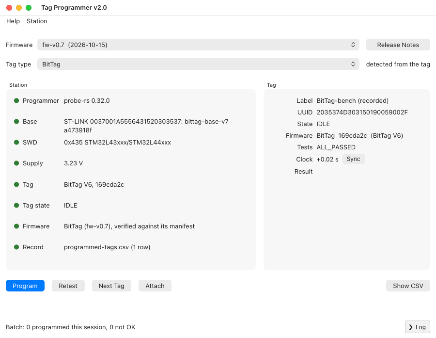
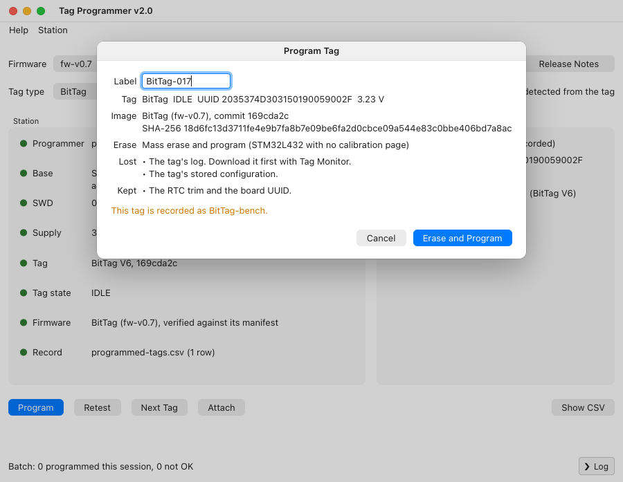
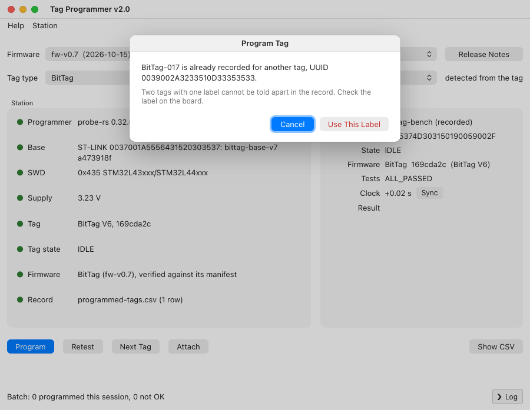
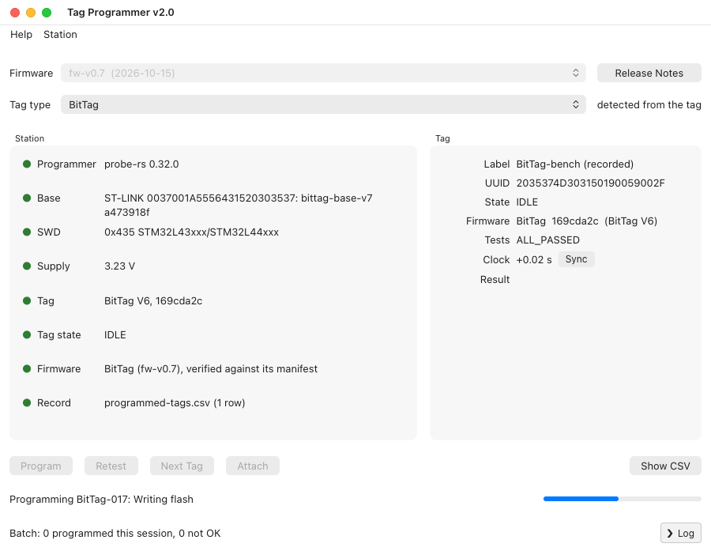

# Tag Programmer

Tag Programmer programs a batch of tags. It is the successor to
[Qt Program](qtprogram.md) and works the same way: for each tag it writes the
firmware, tests the tag, leaves it IDLE ready for Tag Monitor, and
adds a line to the same CSV record. **Help ▸ Tag Programmer User Guide** opens
this page.

The difference is the programmer. Tag Programmer writes the firmware itself,
through the base, so **STM32CubeProgrammer is not needed**. It is also faster:
a BitTag takes about 10 seconds from start to finish.

**Programming erases the tag.** Download its data with Tag Monitor first.

## Before You Start

- On Linux, Tag Programmer needs WebKitGTK 4.1, which GNOME desktops already
  have. Elsewhere install it once, for example
  `sudo apt install libwebkit2gtk-4.1-0` on Ubuntu or Debian. Windows 10 and
  11 and macOS need nothing extra.
- Plug in the base station or programmer. With one base plugged in, it is
  used. With several, Tag Programmer asks which; **Station ▸ Choose Base…**
  switches to another at any time.
- The first time Tag Programmer opens, it asks whether to **attach
  automatically**. Connecting to a tag restarts it, which ends a deployment
  that is running. On a programming bench, answer **Yes**. You can change this
  later under **Station ▸ Attach Automatically**.
- The first time, it also asks where to keep the **record**. The default is
  `Documents/Tag Programmer/programmed-tags.csv`, the same file Qt Program
  uses, so both programs can add to one record. Choose **Open Existing…** to
  keep using a record kept elsewhere.

## The Window

The window is laid out as Qt Program's; see [The Window](qtprogram.md#the-window)
for the firmware list, tag type, Station lights and Tag panel. Two lines read
differently:

- **Programmer** names the programming software built into Tag Programmer,
  for example `probe-rs 0.32.0`. It is always ready; there is nothing to
  choose.
- **Base** shows the base's serial number, and for a base with current
  firmware also its type and firmware version, for example
  `ST-LINK 0037…: bittag-base-v7 a473918f`. Older bases show
  `older base firmware: field-safe driver`. Both kinds program tags.

## Program a Batch of Tags

1. Choose the **Firmware** and check the **Tag type**. Both are remembered.
2. Put a tag in the base. With automatic attach on, it connects by itself;
   otherwise press **Attach**.
3. Press **Program**, type the **label** written on the board, check the rest
    of the dialog, and choose **Erase and Program**. The dialog says what will
    be erased, what is lost and what is kept, and notes in orange anything to
    check, such as a tag already recorded under another label.

    

    If the record already has that label for a different tag, Tag Programmer
    asks before going on: two tags with one label cannot be told apart
    afterwards, so check the label on the board. A blank board's UUID is not
    known until it is programmed, so for one of those it asks whenever the
    label is in the record at all. **Cancel** is the default.

    

4. Wait for the result. Tag Programmer:
    1. stops the tag if it is running, and has its own firmware erase its log;
    2. erases internal flash as the image requires, writes the image and
       checks it;
    3. reconnects, sets the clock and runs the self-tests;
    4. adds a line to the record, and leaves the tag IDLE.

    The line under the buttons names the step, with a progress bar, and the
    buttons are disabled until it finishes.

    

5. Press **Next Tag**, put the next tag in, and press **Attach** (or wait for
   it to attach automatically). Go back to step 3.

**Retest** runs the self-tests again without programming. It reads the tag's
flash back, compares it with the release the tag reports, and adds a line to
the record.

## The Record and What Programming Keeps

The record has the same columns and results as Qt Program's; see
[The Record](qtprogram.md#the-record). Its last column says
`tagprogram-rs` and the version, so lines written by either program can be
told apart. What is erased and what is kept is also the same; see
[What Programming Keeps](qtprogram.md#what-programming-keeps).

## Troubleshooting

Qt Program's [Troubleshooting](qtprogram.md#troubleshooting) applies, except
that there is no STM32CubeProgrammer to find. When programming fails, the
message says why. Press **Log** at the bottom right to see each step,
including the programmer's progress (erasing, programming, verifying).
