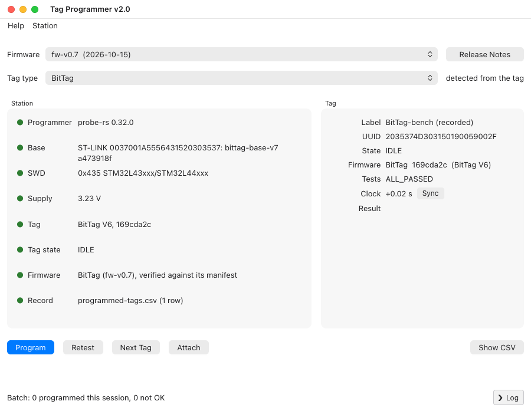
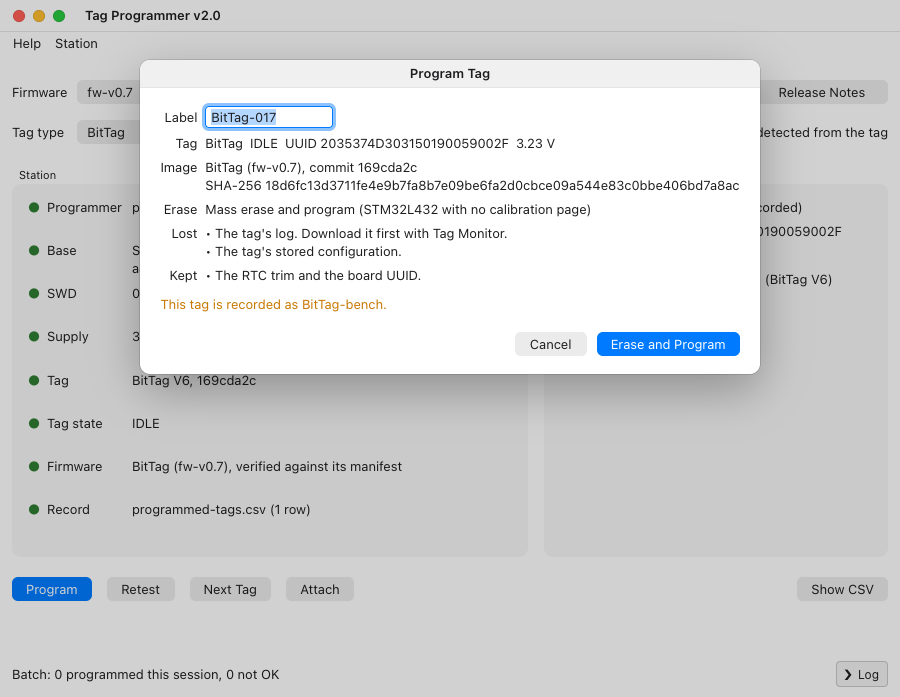
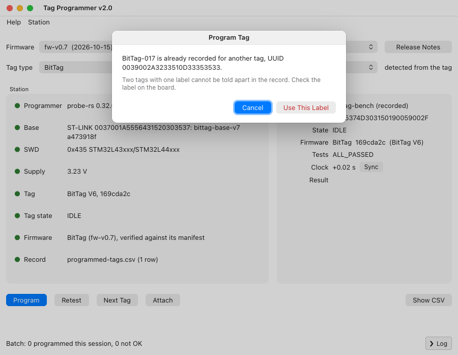
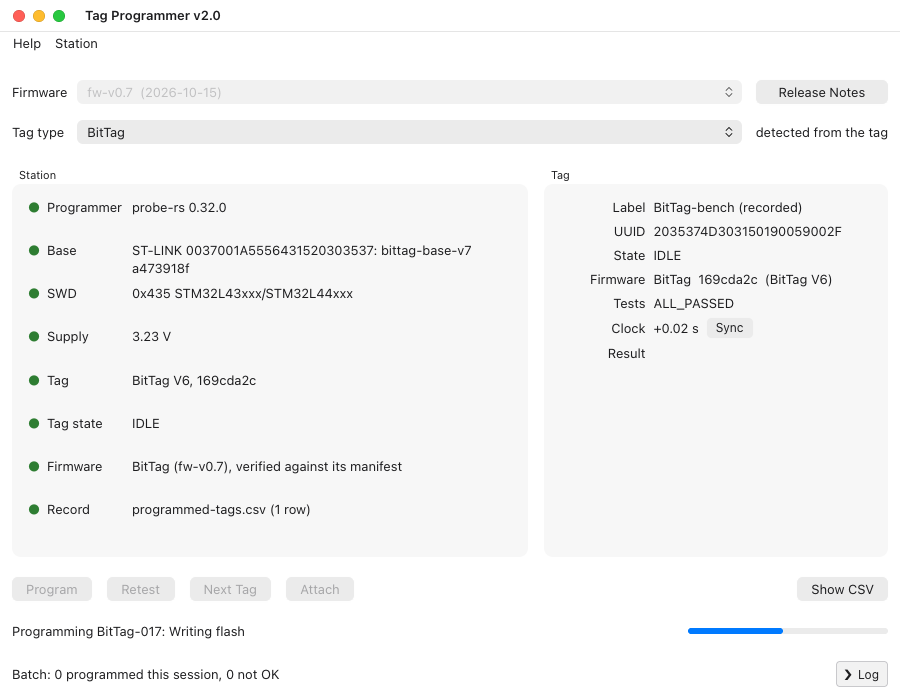

# Tag Programmer

Use Tag Programmer (program `tagprogram`) to program a batch of tags. For each
tag it writes the firmware, tests the tag, leaves it IDLE ready for
[Tag Monitor](tagmonitor.md), and records the result in a CSV file.
**Help ▸ Tag Programmer User Guide** opens this page.

Tag Programmer writes the firmware itself, through the base, so nothing else
needs installing: STM32CubeProgrammer is not needed. A BitTag takes about 10
seconds from start to finish.

**Programming erases the tag.** Download its data with Tag Monitor first.

## Before You Start

- On Linux, Tag Programmer needs WebKitGTK 4.1, which GNOME desktops already
  have. Elsewhere install it once, for example
  `sudo apt install libwebkit2gtk-4.1-0` on Ubuntu or Debian. Windows 10 and
  11 and macOS need nothing extra.
- Plug in the base station or programmer. With one base plugged in, it is
  used. With several, Tag Programmer asks which; **Station ▸ Choose Base…**
  switches to another at any time.
- The first time Tag Programmer opens, it asks whether to **attach
  automatically**. Connecting to a tag restarts it, which ends a deployment
  that is running. On a programming bench, answer **Yes**. You can change this
  later under **Station ▸ Attach Automatically**.
- The first time, it also asks where to keep the **record**: a CSV file with
  one line for every tag programmed. The default is
  `Documents/Tag Programmer/programmed-tags.csv`. Choose **Open Existing…** to
  keep using a record kept elsewhere, or **Create Elsewhere…** to start one in
  another folder. **Station ▸ Choose Record File…** changes it later.

## The Window

- **Firmware** lists the published firmware releases, newest first, each with
  its date and marked `not downloaded` until it has been; then ELF files you
  have used; then **Other ELF file…**. A release is downloaded the first time
  you choose it, then checked against the record of what was built.
  **Station ▸ Refresh Firmware Releases** looks for new releases.
  **Release Notes** opens the release's page, which says which tags it was
  qualified on. If the release has not been qualified for the chosen tag type,
  the Firmware light turns amber and the Program dialog says so. You can still
  program, for bench work, but do not fly those tags.

    Choose the latest release qualified for the tag type you are programming.
    The newest release is not always qualified for every tag type, so an
    older one may be the right choice.

- **Tag type** is filled in from the tag when its firmware answers ("detected
  from the tag"). Choose it yourself for a new, blank board. For an ELF file
  you chose, the type comes from the image.
- **Station** shows a light for each check: green is ready, amber needs
  attention, red must be fixed before you can program. Each line says what is
  wrong and how to fix it. The checks are:
    - **Programmer**: the programming software built into Tag Programmer, for
      example `probe-rs 0.32.0`. It is always ready; there is nothing to
      choose.
    - **Base**: the base's serial number, and for a base with current firmware
      also its type and firmware version, for example
      `ST-LINK 0037…: bittag-base-v7 a473918f`. Older bases show
      `older base firmware: field-safe driver`. Both kinds program tags.
    - **SWD**: the processor found in the base, or why none was.
    - **Supply**: the tag's supply voltage.
    - **Tag**: the firmware the tag is running, or a note that none answers.
    - **Tag state**: the tag's state, and whether programming would lose a log
      or stop a deployment. **Stop** appears here for a running tag, and
      **Erase** for one that is FINISHED or ABORTED; Erase asks first, since
      the log cannot be recovered.
    - **Firmware**: whether the chosen image is downloaded, verified, for this
      tag and processor, and qualified.
    - **Record**: the record file and how many lines it holds. **Choose…**
      appears here when there is no usable record.
- **Tag** shows the attached tag's label (if it is in the record), UUID, state,
  firmware, self-test result, clock, and the result of the last program.
  **Clock** is the tag's clock minus this computer's; beyond 2 seconds it
  turns amber. **Sync** sets the tag's clock. Programming and Retest set it
  again after the self-tests, which disturb it.

When **Program** is disabled, hover over it to see why.

## Program a Batch of Tags

1. Choose the **Firmware** and check the **Tag type**. Both are remembered.
2. Put a tag in the base. With automatic attach on, it connects by itself;
   otherwise press **Attach**.
3. Press **Program**, type the **label** written on the board, check the rest
    of the dialog, and choose **Erase and Program**. The dialog says what will
    be erased, what is lost and what is kept, and notes in orange anything to
    check, such as a tag already recorded under another label.

    

    If the record already has that label for a different tag, Tag Programmer
    asks before going on: two tags with one label cannot be told apart
    afterwards, so check the label on the board. A blank board's UUID is not
    known until it is programmed, so for one of those it asks whenever the
    label is in the record at all. **Cancel** is the default.

    

4. Wait for the result. Tag Programmer:
    1. stops the tag if it is running, and has its own firmware erase its log;
    2. erases internal flash as the image requires, writes the image and
       checks it;
    3. reconnects, sets the clock and runs the self-tests;
    4. adds a line to the record, and leaves the tag IDLE.

    The line under the buttons names the step, with a progress bar, and the
    buttons are disabled until it finishes.

    

5. Press **Next Tag**, put the next tag in, and press **Attach** (or wait for
   it to attach automatically). Go back to step 3.

The line at the bottom of the window counts the tags programmed this session,
and how many were not OK. **Show CSV** shows the record file in its folder.

**Retest** runs the self-tests again without programming, on a tag you have
just programmed or one you do not want to reprogram. It asks for the tag's
label, reads the tag's flash back and compares it with the release the tag
reports, then adds a line to the record naming that release, or recording
`MISMATCH` if the flash is something else. The release must have been
downloaded (choose it once under **Firmware**); otherwise the flash is not
compared and the line records just the commit the tag reports.

## The Record

Each line of the CSV holds the label, the tag type, the UUID, the firmware
version (`fw-vX.Y`, or `custom` for a file you chose), the git hash the tag
reports, the date (UTC), the self-test result and the result. The remaining
columns are the image's SHA-256, its file name, the erase (`none`,
`below-calibration` or `all`), the supply voltage, the base's serial number
and the program version, `tagprogram-rs` followed by the version number.

Every attempt that reached the programmer is recorded, including failures, and
so is every retest:

| Result | Meaning |
| --- | --- |
| `OK` | Programmed (or retested), and the self-tests passed |
| `TEST_FAILED` | Programmed, but a self-test failed; see `test_status` |
| `MISMATCH` | The tag does not report the firmware just written, or on a retest its flash is not the release it reports |
| `NO_ANSWER` | Programmed, but the tag never answered |
| `PROGRAM_FAILED: …` | The programmer failed; the text says why |

An attempt cancelled before the tag was programmed writes no line.

Tag Programmer checks that it can write the record before it erases a tag.
If it cannot, for example because the file is open in a spreadsheet on
Windows, the Record line turns red with
`Cannot write … Close it in any other program.`, and **Program** stays
disabled until you close the file.

## What Programming Keeps

| | IMUTag | CompassTag | Other tags |
| --- | --- | --- | --- |
| Erase | none: the image's pages only | every page below the calibration page | mass erase |
| Log data | lost | lost | lost |
| Stored configuration | lost | lost | lost |
| Calibration constants | kept | kept | (none) |
| RTC trim, board UUID | kept | kept | kept |

The image itself decides the erase, and the Program dialog states it. An
older image that predates the record of its flash layout is programmed with a
mass erase, which loses calibration constants too; the dialog says so.

The log is lost because the tag erases it before it is programmed. An image
for the wrong processor is refused. An image for a different tag type from the
one the tag is running gets a warning.

## Troubleshooting

When something fails, the message says why. Press **Log** at the bottom right
to see each step, including the programmer's progress (erasing, programming,
verifying); the log can be saved to a file.

- **Base: No base on USB.** Plug in the base. Tag Programmer notices it within
  a second.
- **SWD: … Is a tag in the base, and powered?** No tag is in the base, or it
  is not powered.
- **Supply: above the STM32L432's 3.6 V maximum.** Lower the supply before
  going on.
- **Tag: No firmware answers.** This is normal for a new, blank board: choose
  the tag type and program it. For a board that has run firmware, unplug the
  base, plug it in again, and press **Attach**.
- **"Programmed, but the tag does not answer."** A mass erase can leave the
  processor starting its built-in bootloader until it is powered off. Unplug
  the base, plug it in again, and press **Retry**. **Give Up** records
  `NO_ANSWER`.
- **Firmware: does not match its manifest.** The downloaded image is not the
  one that was released. Do not program it; tell the developers.
- **Firmware: GitHub cannot be reached.** Releases downloaded before are still
  offered. Otherwise choose an ELF file.
- **Programming failed.** The message gives the programmer's reason, and its
  messages are in the log.
- **Self-test failed.** The tag is programmed and the failure is recorded.
  Press **Retest** to run the tests again; each retest adds a line.

See also [Firmware Programming](../workflows/firmware-programming.md) and
[Troubleshooting](../reference/troubleshooting.md).
