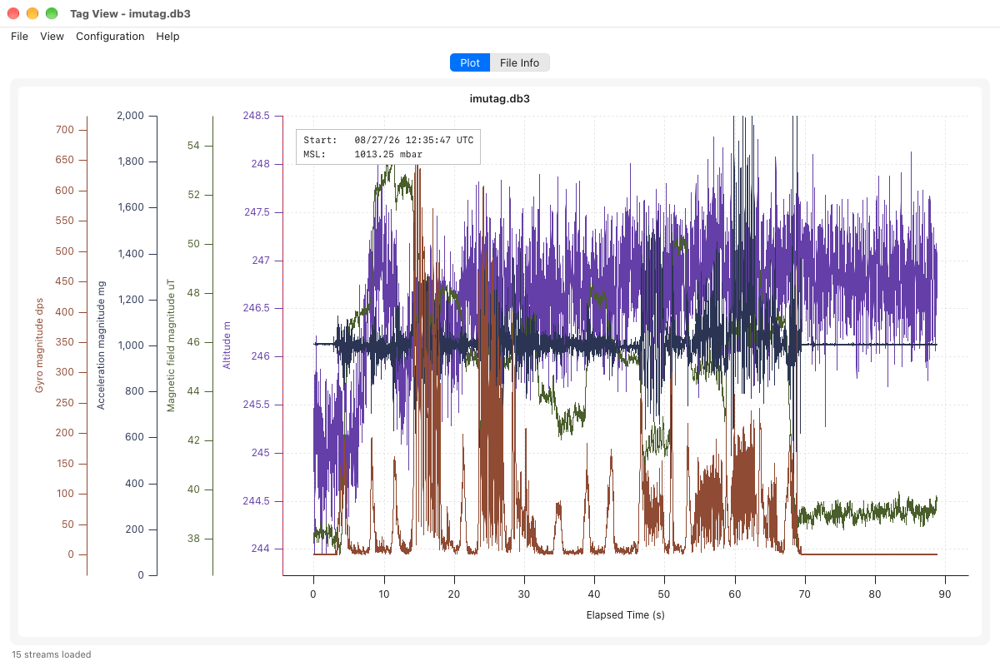
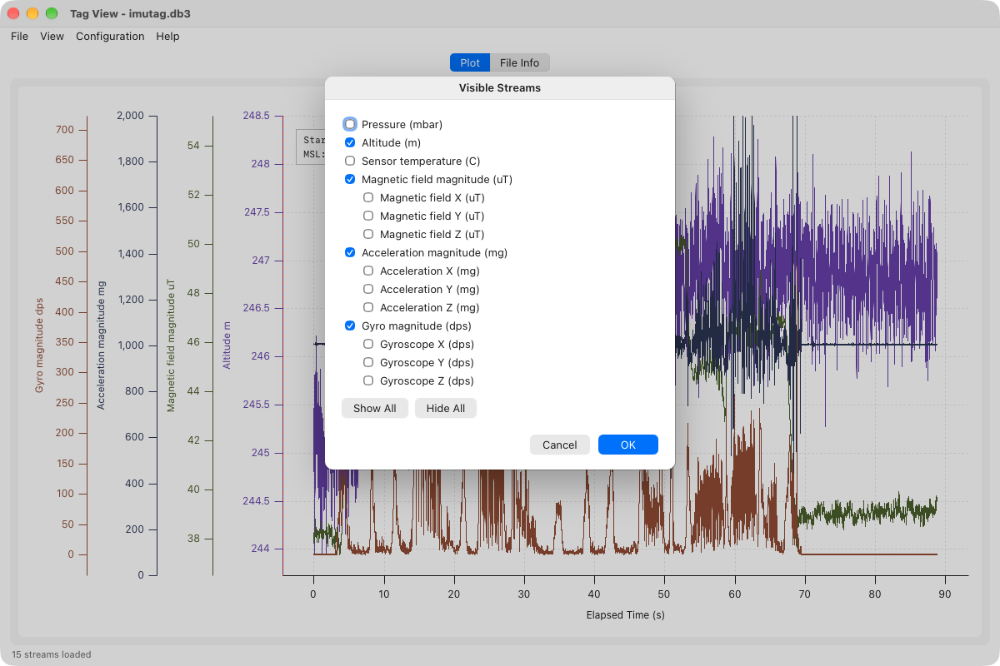
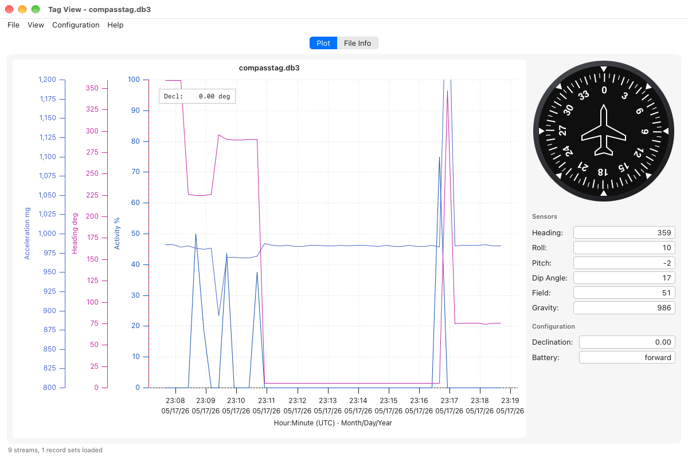

# Tag View

Tag View is a new build of [SensorViz](sensorviz.md). It opens the same SQLite
logs and draws the same plot: the same streams, derived views, colors, axes,
cursors and zoom, from the same code. Its menus are SensorViz's, and its
preference files are the same files, so a file stored by one loads in the
other. Everything on the [SensorViz page](sensorviz.md) applies; this page
lists only what differs. **Help ▸ Tag View User Guide** opens this page.

The two programs are installed side by side, as `sensorviz` and `tagview`.

## Before You Start

- On Linux, Tag View needs WebKitGTK 4.1, which GNOME desktops already have.
  Elsewhere install it once, for example
  `sudo apt install libwebkit2gtk-4.1-0` on Ubuntu or Debian. Windows 10 and
  11 and macOS need nothing extra.
- Tag View only reads log files. It never connects to a tag or a base.
- A log can be named when Tag View is started from a terminal, with a
  preference file to load:
  `tagview flight.db3 --load-preferences my-preferences.json`.

## What Is Different

- **Export PDF instead of Print.** **File ▸ Export PDF…** saves the plot as
    it is on screen, with its title, legend and metadata box, as a PDF page
    you can print or share. There is no print preview.

- **Auto-ranged axes fit the data.** An axis with no range of its own spans
    the visible data with a small margin. In SensorViz such an axis also
    keeps zero in view, so a trace such as altitude can sit in a thin band of
    a tall axis; in Tag View it fills the axis.

- **No activity filter.** **Configuration ▸ Activity Filter** is not in Tag
    View. The activity stream itself is plotted as in SensorViz; use SensorViz
    for the filtered view.

- **Visible Streams** lists each magnitude first, with its X, Y and Z
    channels indented beneath it.

    

- **Axis Sides** lists each stream, rather than each shared axis. Streams
    that share an axis move together.

- **The time axis title** is on one line.

## CompassTag Logs

For a CompassTag log with raw compass samples, Tag View shows the compass
panel beside the plot, as SensorViz does: the heading dial, the sensor
readings and the declination and battery direction. It shows the sample at
the cursor as you move over the plot.

Report anything else that behaves differently: the two are meant to agree.
