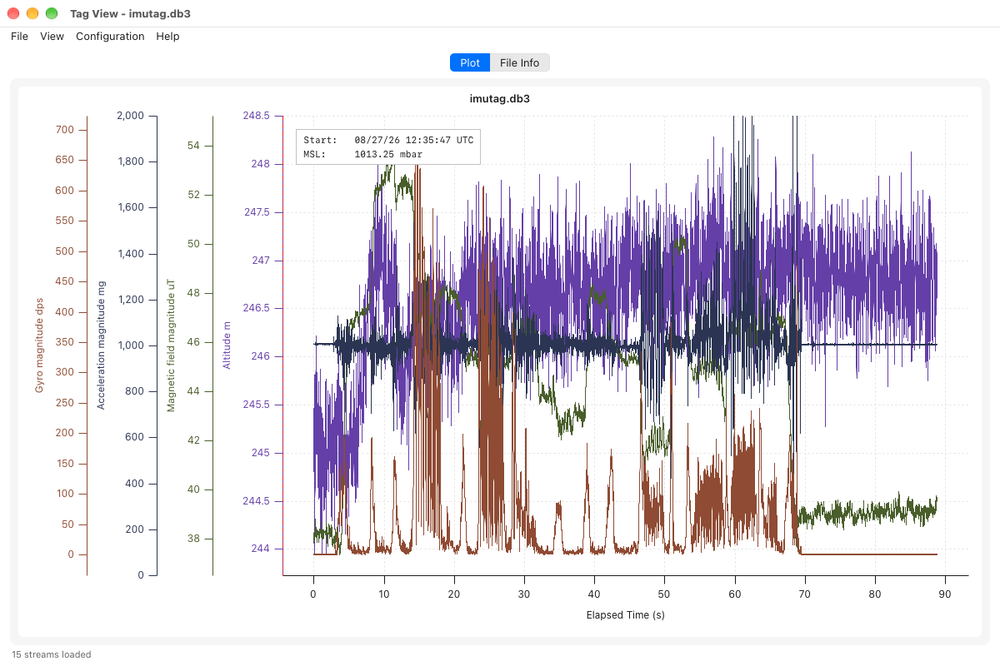
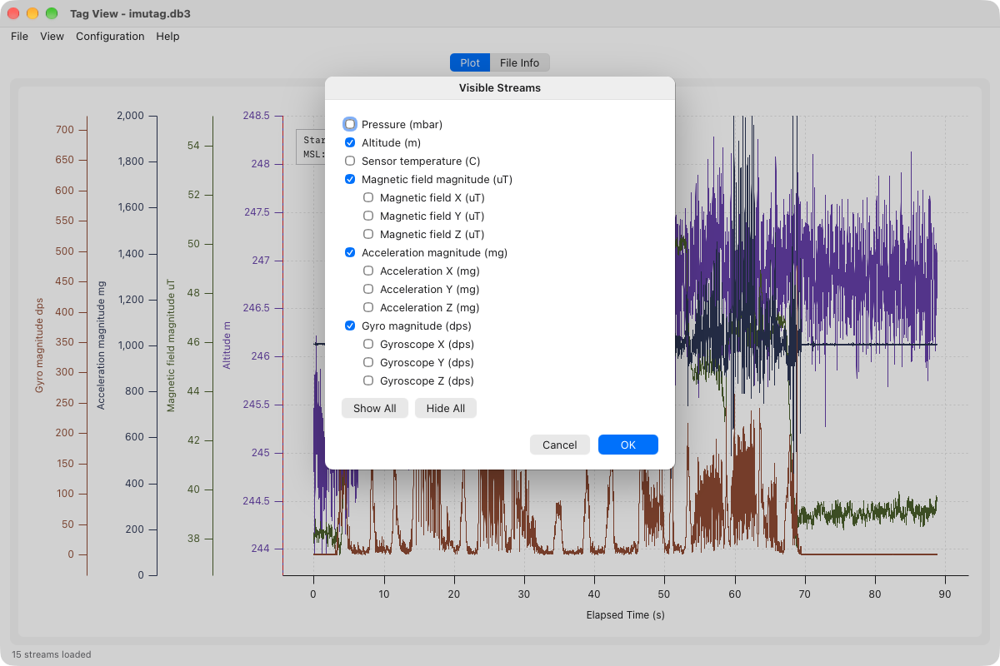
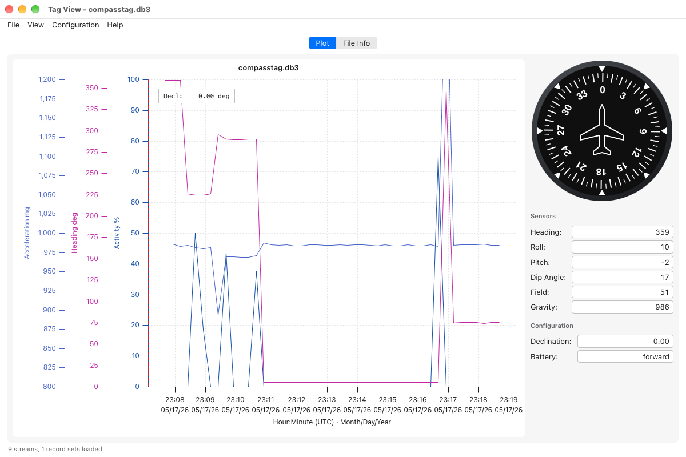

# Tag View

Use Tag View (program `tagview`) to inspect the SQLite logs downloaded from a
tag: activity and pressure logs, IMUTag logs and CompassTag logs. It plots the
raw sensor streams beside views derived from them, such as altitude computed
from pressure, IMU magnitudes, and compass heading and orientation, so they can
be compared on one time axis. **Help ▸ Tag View User Guide** opens this page.



## Before You Start

- On Linux, Tag View needs WebKitGTK 4.1, which GNOME desktops already have.
  Elsewhere install it once, for example
  `sudo apt install libwebkit2gtk-4.1-0` on Ubuntu or Debian. Windows 10 and
  11 and macOS need nothing extra.
- Tag View only reads log files. It never connects to a tag or a base, and it
  never changes the log it opens.
- Logs come from a download: see [Data Download](../workflows/data-download.md)
  and [tag-dwnld](../cli/tag-dwnld.md).

## Open a Log

1. Open Tag View. Until a log is loaded the plot area reads
    **File > Load... opens a tag log (.db3)** and the status line reads
    **No log loaded**.
2. Choose **File ▸ Load...** and select a downloaded SQLite log, which has the
    `.db3` extension.
3. Check the **File Info** tab to confirm the tag type and what the log holds
    (see [File Info](#file-info)).
4. Return to the **Plot** tab to inspect the streams.

The window title then names the file, and the status line at the bottom
counts the streams and record sets loaded. A file that cannot be read is
reported in a **Load Failed** message, and the log that was open stays open.

Loading a log resets the plot for it: the default streams, colors and axis
sides for its tag type (or your preferences for that tag type, see
[Preferences](#preferences)), no manual ranges, and the file name as the
graph title.

File dialogs start in the folder of the last file you opened or saved, or in
your home folder before that.

A log can also be named when Tag View is started from a terminal, with a
preference file to load after it:

```sh
tagview flight.db3 --load-preferences my-preferences.json
```

The [SQLite Log Format](../reference/sqlite-logs.md) reference describes the
metadata and sensor tables Tag View reads.

## The Plot

Each visible stream is drawn against time. Most streams get a y axis of their
own, drawn in the stream's color, on the left or right of the plot; axes stack
outward from the plot on each side.

The time axis depends on how the log stores time:

- **Clock time.** Logs that store UTC times are labelled with the time of day
    over the date (`HH:MM` over `MM/DD/YY`), in UTC unless you set an offset
    with **Configuration ▸ UTC Offset...**.
- **Elapsed seconds.** IMUTag logs store time as seconds since the
    collection started, and the axis shows those seconds. The metadata box
    then gives the collection's start time, when the log records it.

An axis without a range of its own spans the visible data with a 5% margin,
so the trace fills its axis (see [Ranges](#ranges)).

Where the log has a gap in its data, such as missing pages, the line stops at
the gap and the readout shows no value inside it. **View ▸ Break Lines at
Gaps** turns this off.

In IMUTag logs, the timing events that break the time base (resyncs and
restart recovery, from the `ImuEvent` table) are marked with grey dashed
vertical lines.

### Moving Around

- **Drag** the plot left or right to pan in time.
- **Scroll** the mouse wheel to zoom time in or out around the pointer. Only
    the time axis zooms; y axes keep their ranges.
- **Hover** over the plot to see a readout of the time at the pointer and the
    value of every visible stream there. For a log with compass orientation,
    the compass panel follows the pointer too.
- **View ▸ Reset Zoom** returns to the whole log.

### Cursors

Two vertical cursors mark a time interval: the left one red, the right one
blue, both dashed.

- **Double-click** the plot to move the left cursor to that time.
- **Shift-double-click** to move the right cursor.
- **View ▸ Zoom to Cursors** zooms the time axis to the interval between
    them. It needs the cursors shown, with the left one before the right.
- **View ▸ Show Cursors** hides or shows them. Showing them, or resetting
    the zoom, puts them at the edges of the view; double-clicking shows them
    if they were hidden.

### Shared Axes and the Legend

Streams that the log records as one group with the same units share one y
axis: the IMUTag accelerometer, gyroscope and magnetometer `x/y/z` channels,
each with its magnitude. A shared axis is labelled with the group's name and
units, and its range covers every visible member.

The members of a group are drawn in related colors (accelerometer blues,
gyroscope reds and oranges, magnetometer greens), with the magnitude in a
darker shade. While any axis is shared, a legend names its traces, one column
per shared axis.

### The Metadata Box

A small box in the plot gives context for what is drawn:

- **Start**: the collection start time, on an elapsed-seconds axis.
- **Decl**: the magnetic declination, while the heading is visible.
- **MSL**: the sea-level pressure used for altitude, while altitude is
    visible.

Drag the metadata box or the legend to move it out of the way of the data.

## File Info

The **File Info** tab lists, line by line:

- the file name;
- the tag type and profile name;
- the record sets loaded;
- the compass calibration, when the log has one: whether it loaded, its
    epoch, and any warning about it;
- where compass orientation comes from, derived from the raw compass samples
    or stored by [`dataprocessing`](../cli/dataprocessing.md);
- the other rows of the log's `info` table.

Check it before changing display settings: it confirms that the log holds the
data the plot and the menus depend on. The text can be selected and copied.

## File Menu

| Menu item | Function |
| --- | --- |
| **Load...** | Opens a SQLite log (`.db3`), replacing the one open. |
| **Preferences ▸ Load...** | Loads a preference file and applies its entry for the open log's tag type. Available before a log is open; the entries then apply to logs opened later. |
| **Preferences ▸ Store...** | Writes the preference file. Enabled once a log is open. |
| **Preferences ▸ Load Defaults** | Drops your preferences for the open log's tag type and returns it to the built-in defaults. |
| **Export PDF...** | Saves the plot as a PDF page. See [Export PDF](#export-pdf). |

## Preferences

Preferences keep your display choices for each tag type (or, for a log with
no tag type, its profile name): which streams are visible, stream colors,
axis sides, and whether lines break at gaps. Only the choices that differ
from the built-in defaults are kept.

While Tag View is running, opening another log remembers the choices for the
log you leave, and opening a log of the same tag type later applies them. To
keep them between runs, save them with **File ▸ Preferences ▸ Store...**
(a JSON file, `sensorviz-preferences.json` unless you name it otherwise),
and load the file with **File ▸ Preferences ▸ Load...** or with
`--load-preferences` when starting Tag View. Loading a file replaces every
tag type's preferences with the file's.

Preferences do not include y-axis ranges, the graph title, sea-level
pressure, declination, battery direction or the UTC offset: those belong to
the analysis of one log.

## View Menu

The **View** menu controls what is drawn and how. Its stream entries are built
from the open log, so the menu is short for simple tags and longer for IMUTag
and CompassTag logs.

| Menu item | Function |
| --- | --- |
| **Visible Streams...** | A check box for each stream; **Show All** and **Hide All** set every box. Shows or hides streams without reloading the log. |
| **Axis Sides...** | Puts each visible stream's axis on the **Left** or **Right**. |
| **Colors...** | A color for each visible stream; **Defaults** returns every stream in the dialog to its default color. |
| **Ranges ▸ _Stream_ Range...** | Sets one visible stream's y-axis range. See [Ranges](#ranges). |
| **Reset Zoom** | Shows the whole log, clears the y-axis ranges you set, and moves the cursors to the edges of the view. |
| **Zoom to Cursors** | Zooms the time axis to the interval between the cursors. |
| **Show Cursors** | Shows or hides the two cursors. |
| **Break Lines at Gaps** | When checked (the default), a line stops where the log has a gap. Uncheck it to join the samples on either side. Kept with your preferences. |
| **Calibration Constants** | Shows the log's compass calibration, read only: hard iron (µT), soft iron, accelerometer offset (mg), epoch, and any warning. Present only when the log carries compass calibration. |

In **Visible Streams**, each IMUTag magnitude is listed first, with its X, Y
and Z channels indented beneath it.



In **Axis Sides**, streams that share an axis move together: the axis goes
where its streams are put.

Which streams are visible when a log first opens depends on the stream:

| Visible at first | Hidden at first |
| --- | --- |
| Activity, altitude, the IMU magnitudes, compass heading and acceleration | Pressure, temperatures, voltage, the IMU `x/y/z` channels, compass pitch, roll, dip and magnetic field |

## Ranges

**View ▸ Ranges** has one item for each visible stream, such as
**Altitude Range...**. Its dialog sets the axis's **Minimum** and **Maximum**
in the stream's units, starting from the range you last set for it, or else
from its data's range with a 5% margin. The minimum
must be less than the maximum. For a stream on a shared axis, the range
applies to the whole axis.

An axis's range is chosen in this order:

1. A range you set.
2. A fixed range for the stream: activity 0 to 100, core temperature 0 to
    50 °C, voltage 0 to 5 V, IMU acceleration magnitude 0 to 2000 mg, heading
    0 to 360°, compass acceleration 800 to 1200 mg, pitch and roll -180 to
    180°, dip -90 to 90°. On a shared axis this applies only while the stream
    is the axis's only visible member.
3. The data's minimum and maximum with a 5% margin, over every visible member
    of a shared axis.

A pressure range you set carries over to altitude, converted at the current
sea-level pressure, until altitude is given a range of its own.

**View ▸ Reset Zoom** clears every range you set.

## Configuration Menu

The **Configuration** menu sets the graph title, the time zone of the time
axis, and the parameters of the derived views. The parameter items appear only
when the log has the data they apply to, and each shows its current value in
the menu.

| Menu item | Function |
| --- | --- |
| **Graph Title...** | Edits the title shown above the plot. It starts as the log's file name. |
| **Show Graph Title** | Shows or hides the title. |
| **UTC Offset... (_hours_)** | Sets the offset from UTC, in whole hours from -12 to 12, for the time-axis labels and the hover readout. The stored times stay in UTC. Enabled only for logs that store clock time, not elapsed seconds. |
| **Sea-level Pressure... (_value_ mbar)** | Sets the mean sea-level pressure, 800 to 1200 mbar (1013.25 to start), from which altitude is computed. Present when the log has pressure. |
| **Declination... (_value_ deg)** | Sets the magnetic declination, -180 to 180°, added to the heading to give true heading. Present when the log has compass orientation. |
| **Battery Forward** | Checked (the default) when the tag is mounted battery forward. Unchecked, the heading is turned 180° and pitch and roll change sign. Present when the log has compass orientation. |

These settings last while the log is open; they are not saved with the
preferences.

## Derived Views

Tag View computes some streams from the log so they can be read beside the
raw ones. They are display only: the log is not changed.

| Derived view | Made from | Controlled by |
| --- | --- | --- |
| **Altitude** | The pressure stream, using the pressure sensor's temperature where the log has it. | **Configuration ▸ Sea-level Pressure...**; show or hide it in **View ▸ Visible Streams...**. |
| **IMU magnitudes** | The accelerometer, gyroscope and magnetometer `x/y/z` channels of an IMUTag log. | **View ▸ Visible Streams...** |
| **Heading, acceleration, pitch, roll, dip and magnetic field** | A CompassTag log's raw compass samples and calibration constants, or orientation stored by `dataprocessing`. | **Configuration ▸ Declination...** and **Configuration ▸ Battery Forward**; show or hide each in **View ▸ Visible Streams...**. |

Tag View plots a log's activity stream but does not yet offer a filtered
(low-pass) activity view.

## IMUTag Logs

IMUTag logs typically hold high-rate accelerometer and gyroscope samples with
lower-rate magnetometer and pressure samples, timed in elapsed seconds. The
plot opens on each sensor's magnitude, which is easier to read than its
channels; the `x/y/z` channels are in **View ▸ Visible Streams...**, and
share their sensor's axis when shown (see
[Shared Axes and the Legend](#shared-axes-and-the-legend)).

An IMUTag log run through [`dataprocessing`](../cli/dataprocessing.md) with
the `imu-compass-orientation` processor also gets the heading, pitch, roll,
dip and field streams and the compass panel, built from the orientation the
processor stored.

## CompassTag Logs

A CompassTag log with raw compass samples and calibration constants gets
heading, acceleration, pitch, roll, dip and magnetic-field streams, and the
compass panel beside the plot. If the compass streams cannot be built, a
**Compass Streams** message says why.



The compass panel shows the heading on a dial and, under **Sensors**, the
heading, roll, pitch, dip angle, field and gravity of one compass sample;
under **Configuration** it shows the declination and whether the battery is
forward. It starts at the log's first sample, and as you move over the plot
it shows the sample at or just after the pointer's time.

The **File Info** tab reports the compass calibration and where the
orientation came from, which confirms that the panel and the compass items in
the **Configuration** menu should be present.

## Plot Context Menu

Right-click the plot, with a log open, for a menu with:

- **File**: **Load...** and **About**;
- **View** and **Configuration**: the same items as the menu bar's.

## Export PDF

**File ▸ Export PDF...** saves the plot as it is on screen as a one-page PDF,
A4 landscape, ready to print or share. The suggested name is the log's, with
`.pdf`. The plot is drawn again at 300 dpi, with the title, metadata box and
legend as text at the same places as on screen, and the cursors where they
are shown. There is no print preview: open the PDF to print it.

## Help Menu

| Menu item | Function |
| --- | --- |
| **Tag View User Guide** | Opens this page in your browser: the copy installed with Tag View, or the online manual when none is found. |
| **About** | Shows Tag View's version. |

## Troubleshooting

| Symptom | What to check |
| --- | --- |
| A file does not load | Confirm that it is a SQLite log (`.db3`) written by a download. The **Load Failed** message gives the reason. |
| A file loads but a stream is missing | Look in **View ▸ Visible Streams...**: many streams start hidden. If it is not listed, check the File Info tab and the log's `streams` table (see [SQLite Log Format](../reference/sqlite-logs.md)). |
| A Configuration item is missing | Sea-level pressure needs a pressure stream; declination and battery direction need compass orientation (raw compass samples with calibration constants, or orientation stored by `dataprocessing`). |
| UTC Offset is disabled | The log stores elapsed seconds, not clock time. |
| Colors, visibility or axis sides did not come back | Load your preference file with **File ▸ Preferences ▸ Load...**. Preferences are kept by tag type, and only for the running Tag View unless stored to a file. |
| A y-axis range looks wrong | Set one with **View ▸ Ranges**, or use **View ▸ Reset Zoom** to clear the ranges you set. |
| Zoom to Cursors does nothing | Show the cursors and put the left one before the right one. |
